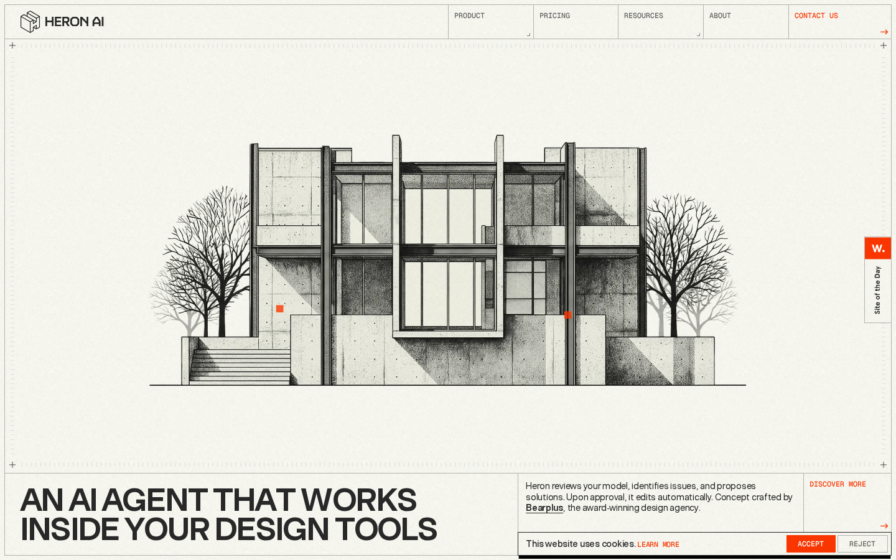
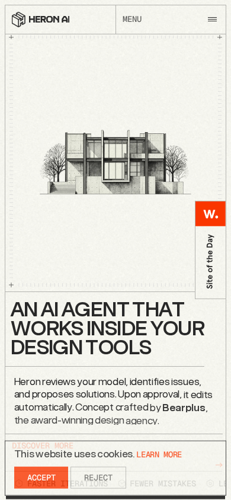

# UI Design System & Master Generation Blueprint: heronaiapp-com

> **Heron AI · Works inside your design tools** (https://heronaiapp.com/) — Heron sees your model, spots problems, and suggests fixes as you design. When you approve, it makes the edit itself, all without leaving...



---

## 1. Executive Visual Persona & Design Archetype

- **Brand Essence & Persona**: **Heron AI · Works inside your design tools** (`https://heronaiapp.com/`). Heron sees your model, spots problems, and suggests fixes as you design. When you approve, it makes the edit itself, all without leaving...
- **Capture Provenance**: Live browser capture (`tier1_fast`, HTTP `200`, captured `2026-11-23`).
- **Visual Archetype**: **Light-Gallery WebGL / Canvas Interactive Experience (`#ffffff` / `#fa3600`)**.
- **Anti-AI-Slop Differentiators**:
  - **Live-Computed Chromatic Polarity**: Anchors the viewport in `#ffffff` (live computed `browser-default` `background-color` (`computed_styles.json`)) paired with `#282828` primary typography and `#fa3600` accents.
  - **Grounded Typographic Hierarchy**: Pairs `BT Grotesk` for display copy (`AN AI AGENT THAT WORKS INSIDE YOUR D`) with `BT Grotesk` and `Geistmono`.
  - **Calibrated Spatial Grid & Motion**: Combines `60rem` container bounds (`gap: 16px`, padding `9px`) with `cubic-bezier(.23,1,.32,1)` easing and Lenis Smooth Scroll (`data-lenis`), GSAP Timeline & ScrollTrigger.

---

## 2. Spatial Architecture & Modular Grid Mathematics



### Viewport Allocation & Container Geometry
- **Captured Viewport Dimensions**: Desktop `1440×900px` (`assets/desktop.png`, single-viewport 100vh live capture (900px)), Mobile `390×844px` (`assets/mobile.png`, single-viewport 100vh live capture (844px)).
- **Master Container Bounds**: `60rem` (non-`@media` desktop container stylesheet rule).
- **Canvas Lateral Padding & Spacing**: `9px` lateral canvas padding with `16px` grid gap.
- **Border Radius Scale**: `3px`, `100%`, `50%`, `99%`.

### Responsive Breakpoint Architecture
- **Desktop Layout**: Multi-column CSS Grid / Flexbox layout at `1440px` (`max-width: 60rem`, `gap: 16px`).
- **Mobile Layout**: Single-column vertical stack at `390px` viewport width with `9px` horizontal padding.
- **Extracted CSS Media Queries**: `@media screen and (max-width:991px)`, `@media screen and (max-width:767px)`, `@media screen and (max-width:479px)`, `@media (min-width:768px)`.

---

## 3. Color System, Materiality & Atmospheric Lighting

### Semantic Palette & Source Grounding
| Semantic Role | Ground-Truth Value | Extracted Live / CSS Source |
|---|---|---|
| **Primary Canvas Substrate** | `#ffffff` | live computed `browser-default` `background-color` (`computed_styles.json`) |
| **Primary Typography Ink** | `#282828` | live computed `h1` `color` (`computed_styles.json`) |
| **Elevated Surface / Card Substrate** | `#efefef` | live computed `button` `background-color` (`computed_styles.json`) |
| **Interactive Accent / Highlight** | `#fa3600` | live computed `a` `color` (`computed_styles.json`) |
| **Secondary / Muted Copy** | `#b4b4b0` | live computed `h2` `color` (`computed_styles.json`) |
| **Structural Hairline Border** | `#b3b3af` | `var(--content--border)` in `:root` |
| **Variable Token (`--content--surface`)** | `#72726f` | `var(--content--surface)` in `:root` |
| **Variable Token (`--content--granite-gray`)** | `#626260` | `var(--content--granite-gray)` in `:root` |
| **Variable Token (`--content--secondary`)** | `#414140` | `var(--content--secondary)` in `:root` |

### Sanitized Root CSS Variables (`ui-ux.md` Ground Truth)
| Variable Name | Extracted Value | Semantic Role |
|---|---|---|
| `--content--terriary` | `#282828b8` | Color / Atmospheric Token |
| `--size--padding-hero` | `calc(4.4rem + 1rem*2)` | Layout / Spatial Grid Token |
| `--size--max-screen-height` | `calc(100dvh - 1.6rem)` | Layout / Spatial Grid Token |
| `--content--border` | `#b3b3af` | Elevation / Border Token |
| `--size--border` | `max(1px,.1rem)` | Layout / Spatial Grid Token |
| `--content--brand` | `#fa3600` | Brand / Palette Token |
| `--content--primary` | `#282828` | Brand / Palette Token |
| `--content--white` | `white` | Canvas / Surface Token |
| `--content--disable` | `#b4b4b0` | Color / Atmospheric Token |
| `--content--surface` | `#72726f` | Canvas / Surface Token |
| `--content--granite-gray` | `#626260` | Color / Atmospheric Token |
| `--content--transparent` | `transparent` | Design System Custom Token |
| `--content--secondary` | `#414140` | Brand / Palette Token |
| `--size--line` | `0px` | Layout / Spatial Grid Token |
| `--trans-percent` | `0%` | Dimension / Scale Token |
| `--mask-percent` | `0%` | Dimension / Scale Token |

---

## 4. Typographic Scale & Editorial Hierarchy

### Font Family Stacks
- **Display Typography**: `BT Grotesk`.
- **Primary Body Stack**: `BT Grotesk`.
- **Technical / Metadata Stack**: `Geistmono`.

### Typographic Scale & Rules (Live Computed & Stylesheet Grounded)
- **Hero Display (`H1`)**: live computed `h1` (`font-size: 46.6667px`, `line-height: 46.6667px`, `font-weight: 700`, `letter-spacing: -0.933333px`); rule `h1` (`font-size: 7.2rem`, `line-height: 1em`, `font-weight: 500`).
- **Section Heading (`H2`)**: live computed `h2` (`font-size: 33.3333px`, `line-height: 33.3333px`, `font-weight: 600`, `letter-spacing: -0.666667px`); rule `h2` (`font-size: 2.4rem`, `line-height: 1.1em`, `letter-spacing: -.02em`, `font-weight: 500`).
- **Body Copy**: live computed `body` (`font-size: 13.3333px`, `line-height: 17.3333px`, `font-weight: 500`, `letter-spacing: -0.266667px`); rule `p` (`font-size: 1rem`, `line-height: 1.1em`).
- **Metadata & Navigation Labels**: live computed `nav/a` (`font-size: 11.6667px`, `line-height: 15.1667px`, `font-weight: 500`, `letter-spacing: -0.266667px`).

---

## 5. Choreographed Motion & Interaction Physics

### Primary Easing Curves
- **Extracted Timing Functions**: `cubic-bezier(.23,1,.32,1)`, `cubic-bezier(.59,.23,.22,.96)`, `cubic-bezier(.625,.05,0,1)`.

### Per-Element Transition & Choreography Rules
- **Selector `.w-webflow-badge>img`**: `transition: unset` extracted from `heronaiapp-com` stylesheet.
- **Selector `.w-slider-dot`**: `transition: background-color .1s,color .1s` extracted from `heronaiapp-com` stylesheet.
- **Selector `.w-lightbox-control`**: `transition: all .3s` extracted from `heronaiapp-com` stylesheet.
- **Extracted Easing Curve (`cubic-bezier(.23,1,.32,1)`)**: Governs interactive state transitions across `<header.header>` and `<section.home-intro>`.
- **Runtime Interaction Engine**: Integrates Lenis Smooth Scroll (`data-lenis`), GSAP Timeline & ScrollTrigger, Three.js / WebGL Canvas Pipeline, Swiper Touch Carousel Engine, Barba.js Page Transition Router, Framer Motion Layout Physics with `prefers-reduced-motion: reduce` fallback guards.

---

## 6. Component Wireframe & Structural DOM Map

### Visual Layout Schematic — Desktop (`1440px`, Grounded in `dom.html` & Landmark Bounding Boxes)
```
┌────────────────────────────────────────────────────────────────────────┐
│ DESKTOP VIEWPORT (1440px) — Heron AI · Works inside your design tools  │
│ ====================================================================== │
│ [ <header.header> (1427x56px)         | Menu · Pricing Pricing · Ins ] │
│ ---------------------------------------------------------------------- │
│ | HERO STAGE: <section.home-hero> (w=1427px)                         | │
│ | H1: AN AI AGENT THAT WORKS INSIDE YOUR DESIGN TOOLS                | │
│ | Substrate: #ffffff | Ink: #282828 | Accent: #fa3600                | │
│ ---------------------------------------------------------------------- │
│ | SHOWCASE GRID (<section.home-intro>) max-w: 60rem                  | │
│ | +------------------------------+  +------------------------------+ | │
│ | | An AI agent that works insid |  | T H E R E P E T I T I V E P  | | │
│ | +------------------------------+  +------------------------------+ | │
│ ---------------------------------------------------------------------- │
│ | DETAIL MODULE (<section.home-problem>) — Your design tools do      | │
│ ---------------------------------------------------------------------- │
│ [ FOOTER (<footer.footer>     ) | https://heronaiapp.com/              │
└────────────────────────────────────────────────────────────────────────┘
```

### Visual Layout Schematic — Mobile Reflow (`390px`)
```
┌────────────────────────────────────────────────────────────────────────┐
│ MOBILE VIEWPORT REFLOW (390px) — Single-Column Stack (gap: 16px)       │
│ ====================================================================== │
│ [ HEADER BAR (<header.header>         ) | Compact Menu (390px)         │
│ ---------------------------------------------------------------------- │
│ | HERO STAGE (<section.home-hero>) — 390px Vertical Lead             | │
│ | H1: AN AI AGENT THAT WORKS INSIDE YOUR DESIGN TOOLS                | │
│ ---------------------------------------------------------------------- │
│ | SHOWCASE STACK (<section.home-intro>) — 1-Col Stack                | │
│ | [ Item 1: An AI agent that works inside your design tools        ] | │
│ | [ Item 2: T H E R E P E T I T I V E P A R T S O F M O D E L...   ] | │
│ ---------------------------------------------------------------------- │
│ | DETAIL STACK (<section.home-problem>) — 1-Col (Your design tools ) | │
│ ---------------------------------------------------------------------- │
│ [ FOOTER (<footer.footer>     ) | Stacked 390px Colophon               │
└────────────────────────────────────────────────────────────────────────┘
```

### Granular DOM Region Breakdown
1. **Brand Header & Navigation Bar (<header.header> — `heronaiapp-com`)**:
   - Landmark `<header class="header">` (`1427x56px`) hosting `Heron AI · Works inside your design ` navigation (`Menu · Pricing Pricing · Insights Insights · About About`), DOM attributes (`data-wf-domain="heronai.webflow.io"`, `data-wf-page="6a4b5161f0d11f1602cc3ba1"`, `data-wf-site="6a4b5161f0d11f1602cc3bbf"`, `data-resources-saver-cleanup="branding"`), and stylesheet rule `html { -webkit-text-size-adjust:100%;-ms-text-size-adjust:100%;font-family:sans... }`.
2. **Hero Stage & Focal Lead (<section.home-hero> — `AN AI AGENT THAT WORKS INSIDE YOUR`)**:
   - Landmark `<section class="home-hero">` presenting display lead `AN AI AGENT THAT WORKS INSIDE YOUR DESIGN TOOLS` and copy excerpt *"This website uses cookies. LEARN MORE"* over `#ffffff` canvas and `#282828` ink.
3. **Primary Showcase & Content Grid (<section.home-intro> — `An AI agent that works inside your`)**:
   - Landmark `<section class="home-intro">` rendering section `An AI agent that works inside your design tools` with copy *"©2026 HERON AI. All rights reserved. Concept Crafted by Bearplus"*, asset references (`cdn.prod.website-files.com`, `heronai.webflow.shared.9f21166e0....`, `clarity.js`, `xxzxds4q6a`), and grid rule `summary { display:block }`.
4. **Interactive Detail & Feature Matrix (<section.home-problem> — `T H E R E P E T I T I V E P A R T `)**:
   - Landmark `<section class="home-problem">` framing `T H E R E P E T I T I V E P A R T S O F M O D E L...` and `Your design tools do what you tell them, nothing...` (*"An AI agent that works inside your design tools"*) with `#efefef` surface cards, `#fa3600` accents, and `video { vertical-align:baseline;display:inline-block }`.
5. **Colophon & Global Directory Footer (<footer.footer> — `https://heronaiapp.com/`)**:
   - Landmark `<footer class="footer">` anchoring `Heron AI · Works inside your des` footer links (`Menu · Pricing Pricing · Insights Insights · About About`), copy *"T H E R E P E T I T I V E P A R T S O F M O D E L..."*, and `#b3b3af` structural dividers.

---

## 7. Master Zero-Shot AI Generation Prompt

```markdown
# Master Zero-Shot Frontend Generation Prompt: heronaiapp-com (Heron AI · Works inside your design tools)

You are a principal frontend architect and design systems engineer. Build a complete, production-ready web application replicating the exact design system, DOM landmarks, typographic hierarchy, color tokens, and motion physics of `heronaiapp-com` (**Heron AI · Works inside your design tools** — `https://heronaiapp.com/`).

### 1. Visual Archetype & Anti-AI-Slop Mandates
- **Archetype**: Light-Gallery WebGL / Canvas Interactive Experience (`#ffffff` / `#fa3600`).
- **Identity & Domain Context**: Heron sees your model, spots problems, and suggests fixes as you design. When you approve, it makes the edit itself, all without leaving...
- **Primary Substrate**: `#ffffff` (live computed `browser-default` `background-color` (`computed_styles.json`)), **Primary Ink**: `#282828`, **Accent / Highlight**: `#fa3600`.
- **Site-Specific Differentiators**:
  - **Live-Computed Chromatic Polarity**: Anchors the viewport in `#ffffff` (live computed `browser-default` `background-color` (`computed_styles.json`)) paired with `#282828` primary typography and `#fa3600` accents.
  - **Grounded Typographic Hierarchy**: Pairs `BT Grotesk` for display copy (`AN AI AGENT THAT WORKS INSIDE YOUR D`) with `BT Grotesk` and `Geistmono`.
  - **Calibrated Spatial Grid & Motion**: Combines `60rem` container bounds (`gap: 16px`, padding `9px`) with `cubic-bezier(.23,1,.32,1)` easing and Lenis Smooth Scroll (`data-lenis`), GSAP Timeline & ScrollTrigger.

### 2. Ground-Truth CSS Variables (`:root` Token Contract)
Declare and consume these exact custom properties extracted from `heronaiapp-com` in your global stylesheet:

:root {
  /* Heron AI · Works inside your design tools (heronaiapp-com) — Live-Grounded CSS Variables */
  --content--terriary: #282828b8; /* Color / Atmospheric Token (heronaiapp-com) */
  --size--padding-hero: calc(4.4rem + 1rem*2); /* Layout / Spatial Grid Token (heronaiapp-com) */
  --size--max-screen-height: calc(100dvh - 1.6rem); /* Layout / Spatial Grid Token (heronaiapp-com) */
  --content--border: #b3b3af; /* Elevation / Border Token (heronaiapp-com) */
  --size--border: max(1px,.1rem); /* Layout / Spatial Grid Token (heronaiapp-com) */
  --content--brand: #fa3600; /* Brand / Palette Token (heronaiapp-com) */
  --content--primary: #282828; /* Brand / Palette Token (heronaiapp-com) */
  --content--white: white; /* Canvas / Surface Token (heronaiapp-com) */
  --content--disable: #b4b4b0; /* Color / Atmospheric Token (heronaiapp-com) */
  --content--surface: #72726f; /* Canvas / Surface Token (heronaiapp-com) */
  --content--granite-gray: #626260; /* Color / Atmospheric Token (heronaiapp-com) */
  --content--transparent: transparent; /* Design System Custom Token (heronaiapp-com) */
  --content--secondary: #414140; /* Brand / Palette Token (heronaiapp-com) */
  --size--line: 0px; /* Layout / Spatial Grid Token (heronaiapp-com) */
  --trans-percent: 0%; /* Dimension / Scale Token (heronaiapp-com) */
  --mask-percent: 0%; /* Dimension / Scale Token (heronaiapp-com) */
}

### 3. Semantic Color & Materiality Contract
Map every surface, ink, and border strictly to these source-grounded tokens:
- **Primary Canvas Substrate**: `#ffffff` — grounded in live computed `browser-default` `background-color` (`computed_styles.json`)
- **Primary Typography Ink**: `#282828` — grounded in live computed `h1` `color` (`computed_styles.json`)
- **Elevated Surface / Card Substrate**: `#efefef` — grounded in live computed `button` `background-color` (`computed_styles.json`)
- **Interactive Accent / Highlight**: `#fa3600` — grounded in live computed `a` `color` (`computed_styles.json`)
- **Secondary / Muted Copy**: `#b4b4b0` — grounded in live computed `h2` `color` (`computed_styles.json`)
- **Structural Hairline Border**: `#b3b3af` — grounded in `var(--content--border)` in `:root`
- **Variable Token (`--content--surface`)**: `#72726f` — grounded in `var(--content--surface)` in `:root`
- **Variable Token (`--content--granite-gray`)**: `#626260` — grounded in `var(--content--granite-gray)` in `:root`
- **Variable Token (`--content--secondary`)**: `#414140` — grounded in `var(--content--secondary)` in `:root`

### 4. Spatial Grid, Container Bounds & Responsive Breakpoints
- **Desktop Viewport Reference**: `1440×900px` (single-viewport 100vh live capture (900px), `1440px` standard desktop width).
- **Mobile Viewport Reference**: `390×844px` (single-viewport 100vh live capture (844px), `390px` standard mobile width).
- **Container Max-Width**: `60rem` (non-`@media` desktop container stylesheet rule)
- **Padding & Gutters**: `9px` lateral canvas padding with `16px` grid gap
- **Desktop Grid**: Multi-column CSS Grid / Flexbox layout at `1440px` (`max-width: 60rem`, `gap: 16px`)
- **Mobile Adaptation**: Single-column vertical stack at `390px` viewport width with `9px` horizontal padding
- **Media Queries**: `@media screen and (max-width:991px)`, `@media screen and (max-width:767px)`, `@media screen and (max-width:479px)`, `@media (min-width:768px)`
- **Corner Radii**: `3px`, `100%`, `50%`, `99%`

### 5. Typography & Editorial Scale Contract
- **Display Font Stack**: `BT Grotesk`
- **Body Font Stack**: `BT Grotesk`
- **Monospace / Technical Font Stack**: `Geistmono`
- **H1 Display Rule**: live computed `h1` (`font-size: 46.6667px`, `line-height: 46.6667px`, `font-weight: 700`, `letter-spacing: -0.933333px`); rule `h1` (`font-size: 7.2rem`, `line-height: 1em`, `font-weight: 500`)
- **H2 Section Rule**: live computed `h2` (`font-size: 33.3333px`, `line-height: 33.3333px`, `font-weight: 600`, `letter-spacing: -0.666667px`); rule `h2` (`font-size: 2.4rem`, `line-height: 1.1em`, `letter-spacing: -.02em`, `font-weight: 500`)
- **Body Copy Rule**: live computed `body` (`font-size: 13.3333px`, `line-height: 17.3333px`, `font-weight: 500`, `letter-spacing: -0.266667px`); rule `p` (`font-size: 1rem`, `line-height: 1.1em`)
- **Metadata & Index Rule**: live computed `nav/a` (`font-size: 11.6667px`, `line-height: 15.1667px`, `font-weight: 500`, `letter-spacing: -0.266667px`)

### 6. Component Hierarchy, Verbatim Copy & Real DOM Landmarks
Scaffold `heronaiapp-com` (`Heron AI · Works inside your design tools`) with these exact structural regions, extracted copy, and CSS rules from `dom.html`:
1. **Brand Header & Navigation Bar (<header.header> — `heronaiapp-com`)**:
   - DOM & Selectors: Landmark `<header class="header">` (`1427x56px`) hosting `Heron AI · Works inside your design ` navigation (`Menu · Pricing Pricing · Insights Insights · About About`), DOM attributes (`data-wf-domain="heronai.webflow.io"`, `data-wf-page="6a4b5161f0d11f1602cc3ba1"`, `data-wf-site="6a4b5161f0d11f1602cc3bbf"`, `data-resources-saver-cleanup="branding"`), and stylesheet rule `html { -webkit-text-size-adjust:100%;-ms-text-size-adjust:100%;font-family:sans... }`.
   - Responsive Contract: Header `Brand Header & Navigation Bar (<header.header> — `heronaiapp-com`)` (`heronaiapp-com`) adapts across `@media screen and (max-width:991px)`, `@media screen and (max-width:767px)`, `@media screen and (max-width:479px)`, `@media (min-width:768px)` with `cubic-bezier(.23,1,.32,1)`, `cubic-bezier(.59,.23,.22,.96)`, `cubic-bezier(.625,.05,0,1)` transitions and links `Menu · Pricing Pricing · Insights Insights · About About`.
2. **Hero Stage & Focal Lead (<section.home-hero> — `AN AI AGENT THAT WORKS INSIDE YOUR`)**:
   - DOM & Selectors: Landmark `<section class="home-hero">` presenting display lead `AN AI AGENT THAT WORKS INSIDE YOUR DESIGN TOOLS` and copy excerpt *"This website uses cookies. LEARN MORE"* over `#ffffff` canvas and `#282828` ink.
   - Responsive Contract: Hero stage (`1440×900px` desktop / `390×844px` mobile) sets `#ffffff` background with `#282828` headline `AN AI AGENT THAT WORKS INSIDE YOUR DESIGN TOOLS`.
3. **Primary Showcase & Content Grid (<section.home-intro> — `An AI agent that works inside your`)**:
   - DOM & Selectors: Landmark `<section class="home-intro">` rendering section `An AI agent that works inside your design tools` with copy *"©2026 HERON AI. All rights reserved. Concept Crafted by Bearplus"*, asset references (`cdn.prod.website-files.com`, `heronai.webflow.shared.9f21166e0....`, `clarity.js`, `xxzxds4q6a`), and grid rule `summary { display:block }`.
   - Responsive Contract: Showcase grid `Primary Showcase & Content Grid (<section.home-intro> — `An AI agent that works inside your`)` applies Multi-column CSS Grid / Flexbox layout at `1440px` (`max-width: 60rem`, `gap: 16px`) on desktop and Single-column vertical stack at `390px` viewport width with `9px` horizontal padding on mobile.
4. **Interactive Detail & Feature Matrix (<section.home-problem> — `T H E R E P E T I T I V E P A R T `)**:
   - DOM & Selectors: Landmark `<section class="home-problem">` framing `T H E R E P E T I T I V E P A R T S O F M O D E L...` and `Your design tools do what you tell them, nothing...` (*"An AI agent that works inside your design tools"*) with `#efefef` surface cards, `#fa3600` accents, and `video { vertical-align:baseline;display:inline-block }`.
   - Responsive Contract: Detail module `Interactive Detail & Feature Matrix (<section.home-problem> — `T H E R E P E T I T I V E P A R T `)` uses `3px`, `100%`, `50%`, `99%` radii, `#fa3600` highlights, and assets (cdn.prod.website-files.com, heronai.webflow.shared.9f21166e0...., clarity.js).
5. **Colophon & Global Directory Footer (<footer.footer> — `https://heronaiapp.com/`)**:
   - DOM & Selectors: Landmark `<footer class="footer">` anchoring `Heron AI · Works inside your des` footer links (`Menu · Pricing Pricing · Insights Insights · About About`), copy *"T H E R E P E T I T I V E P A R T S O F M O D E L..."*, and `#b3b3af` structural dividers.
   - Responsive Contract: Footer `Colophon & Global Directory Footer (<footer.footer> — `https://heronaiapp.com/`)` aligns to `60rem` (non-`@media` desktop container stylesheet rule) with `9px` lateral canvas padding with `16px` grid gap and attributes (data-wf-domain="heronai.webflow.io", data-wf-page="6a4b5161f0d11f1602cc3ba1", data-wf-site="6a4b5161f0d11f1602cc3bbf").

#### Verbatim DOM Copy Excerpts (`dom.html`)
- Copy Excerpt 1: *"This website uses cookies. LEARN MORE"*
- Copy Excerpt 2: *"©2026 HERON AI. All rights reserved. Concept Crafted by Bearplus"*

### 7. Motion, Extracted Stylesheet Rules & Interaction Choreography
- **Primary Easing Functions**: `cubic-bezier(.23,1,.32,1)`, `cubic-bezier(.59,.23,.22,.96)`, `cubic-bezier(.625,.05,0,1)`
- **Extracted Stylesheet Rules (`heronaiapp-com`)**:
- `html { -webkit-text-size-adjust:100%;-ms-text-size-adjust:100%;font-family:sans... }`
- `summary { display:block }`
- `video { vertical-align:baseline;display:inline-block }`
- `template { display:none }`
- `strong { font-weight:700 }`
- **Per-Selector Transition Rules**:
- **Selector `.w-webflow-badge>img`**: `transition: unset` extracted from `heronaiapp-com` stylesheet.
- **Selector `.w-slider-dot`**: `transition: background-color .1s,color .1s` extracted from `heronaiapp-com` stylesheet.
- **Selector `.w-lightbox-control`**: `transition: all .3s` extracted from `heronaiapp-com` stylesheet.
- **Extracted Easing Curve (`cubic-bezier(.23,1,.32,1)`)**: Governs interactive state transitions across `<header.header>` and `<section.home-intro>`.
- **Runtime Interaction Engine**: Integrates Lenis Smooth Scroll (`data-lenis`), GSAP Timeline & ScrollTrigger, Three.js / WebGL Canvas Pipeline, Swiper Touch Carousel Engine, Barba.js Page Transition Router, Framer Motion Layout Physics with `prefers-reduced-motion: reduce` fallback guards.

### 8. Technical Deliverables
- Implement in Next.js (App Router) with TypeScript and Tailwind CSS consuming the `:root` custom properties defined above for `heronaiapp-com`.
- Reproduce both the `1440px` desktop architecture and `390px` mobile breakpoint transitions, preserving semantic HTML5 landmarks (`<header>`, `<nav>`, `<main>`, `<section>`, `<footer>`) and `prefers-reduced-motion` accessibility guards.
```
