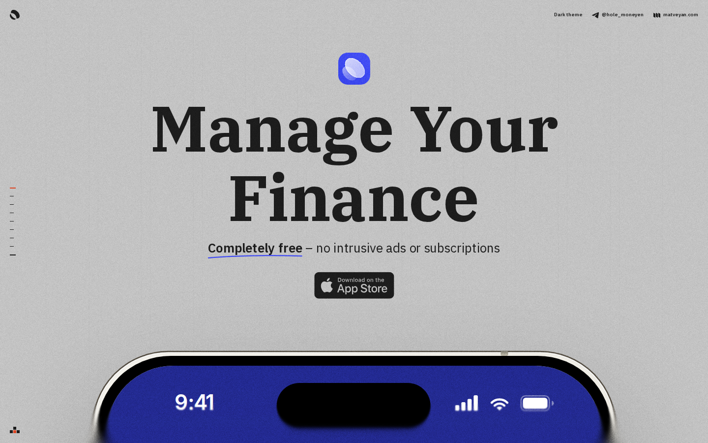
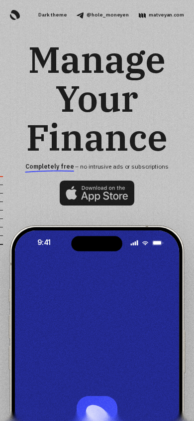

# UI Design System & Master Generation Blueprint: hole-money

> **Money Hole** (https://hole.money) — Money Hole is a free personal finance manager for tracking income, expenses, accounts and budgets. Analytics, multi-currency support and...



---

## 1. Executive Visual Persona & Design Archetype

- **Brand Essence & Persona**: **Money Hole** (`https://hole.money`). Money Hole is a free personal finance manager for tracking income, expenses, accounts and budgets. Analytics, multi-currency support and...
- **Capture Provenance**: Live browser capture (`tier1_fast`, HTTP `200`, captured `2026-11-23`).
- **Visual Archetype**: **Light-Gallery WebGL / Canvas Interactive Experience (`#c3c3c3` / `#1c1c1c`)**.
- **Anti-AI-Slop Differentiators**:
  - **Live-Computed Chromatic Polarity**: Anchors the viewport in `#c3c3c3` (live computed `body` `background-color` (`computed_styles.json`)) paired with `#0000ee` primary typography and `#1c1c1c` accents.
  - **Grounded Typographic Hierarchy**: Pairs `IBM Plex Serif` for display copy (`Manage Your Finance`) with `IBM Plex Sans` and not declared in live computed styles (uses primary stack / `ui-monospace`).
  - **Calibrated Spatial Grid & Motion**: Combines `1385px` container bounds (`gap: 10px`, padding `7px`) with `cubic-bezier(.32,.72,0,1)` easing and HTML5 `<canvas>` Interactive Viewport Surface.

---

## 2. Spatial Architecture & Modular Grid Mathematics



### Viewport Allocation & Container Geometry
- **Captured Viewport Dimensions**: Desktop `1440×900px` (`assets/desktop.png`, single-viewport 100vh live capture (900px)), Mobile `390×844px` (`assets/mobile.png`, single-viewport 100vh live capture (844px)).
- **Master Container Bounds**: `1385px` (measured widest bounded `<section>` landmark width on `1440px` desktop).
- **Canvas Lateral Padding & Spacing**: `7px` lateral canvas padding with `10px` grid gap.
- **Border Radius Scale**: `62px`, `1px`, `60px`, `2px`.

### Responsive Breakpoint Architecture
- **Desktop Layout**: Multi-column CSS Grid / Flexbox layout at `1440px` (`max-width: 1385px`, `gap: 10px`).
- **Mobile Layout**: Single-column vertical stack at `390px` viewport width with `7px` horizontal padding.
- **Extracted CSS Media Queries**: `@media (prefers-reduced-motion:reduce)`.

---

## 3. Color System, Materiality & Atmospheric Lighting

### Semantic Palette & Source Grounding
| Semantic Role | Ground-Truth Value | Extracted Live / CSS Source |
|---|---|---|
| **Primary Canvas Substrate** | `#c3c3c3` | live computed `body` `background-color` (`computed_styles.json`) |
| **Primary Typography Ink** | `#0000ee` | live computed `a` `color` (`computed_styles.json`) |
| **Elevated Surface / Card Substrate** | `#e4e4e7` | `var(--bg)` in `:root` |
| **Interactive Accent / Highlight** | `#1c1c1c` | live computed `button` `color` (`computed_styles.json`) |
| **Secondary / Muted Copy** | `#797986` | `var(--ink2)` in `:root` |
| **Structural Hairline Border** | `#d7d7db` | `var(--divider)` in `:root` |
| **Variable Token (`--module`)** | `#ffffff` | `var(--module)` in `:root` |
| **Variable Token (`--primary`)** | `#18181b` | `var(--primary)` in `:root` |
| **Variable Token (`--grab`)** | `#afafb6` | `var(--grab)` in `:root` |
| **Variable Token (`--shadow-btn`)** | `#000000` | `var(--shadow-btn)` in `:root` |

### Sanitized Root CSS Variables (`ui-ux.md` Ground Truth)
| Variable Name | Extracted Value | Semantic Role |
|---|---|---|
| `--ios` | `cubic-bezier(.32,.72,0,1)` | Motion / Timing Token |
| `--bg` | `#e4e4e7` | Canvas / Surface Token |
| `--module` | `#ffffff80` | Color / Atmospheric Token |
| `--card` | `#ffffff` | Color / Atmospheric Token |
| `--glass` | `#ffffff73` | Color / Atmospheric Token |
| `--bsm` | `#ffffff4d` | Color / Atmospheric Token |
| `--primary` | `#18181b` | Brand / Palette Token |
| `--grab` | `#afafb6` | Color / Atmospheric Token |
| `--divider` | `#d7d7db` | Color / Atmospheric Token |
| `--gstroke` | `#ffffff73` | Elevation / Border Token |
| `--shadow-btn` | `#0000000a` | Elevation / Border Token |
| `--icon-shadow` | `#0000000a` | Elevation / Border Token |
| `--ink` | `#18181b` | Typography Ink Token |
| `--ink2` | `#797986` | Typography Ink Token |
| `--inv` | `#ffffff` | Color / Atmospheric Token |
| `--ph` | `#afafb6` | Color / Atmospheric Token |

---

## 4. Typographic Scale & Editorial Hierarchy

### Font Family Stacks
- **Display Typography**: `IBM Plex Serif`.
- **Primary Body Stack**: `IBM Plex Sans`.
- **Technical / Metadata Stack**: not declared in live computed styles (uses primary stack / `ui-monospace`).

### Typographic Scale & Rules (Live Computed & Stylesheet Grounded)
- **Hero Display (`H1`)**: live computed `h1` (`font-size: 120px`, `line-height: 130px`, `font-weight: 700`, `letter-spacing: -0.1px`).
- **Section Heading (`H2`)**: live computed `h2` (`font-size: 60px`, `line-height: 70px`, `font-weight: 700`, `letter-spacing: -0.1px`).
- **Body Copy**: live computed `body` (`font-size: 16px`, `line-height: normal`, `font-weight: 400`, `letter-spacing: -0.1px`); rule `body` (`letter-spacing: -.1px`).
- **Metadata & Navigation Labels**: live computed `nav/a` (`font-size: 16px`, `line-height: normal`, `font-weight: 400`, `letter-spacing: -0.1px`); rule `small` (`font-weight: 500`).

---

## 5. Choreographed Motion & Interaction Physics

### Primary Easing Curves
- **Extracted Timing Functions**: `cubic-bezier(.32,.72,0,1)`, `cubic-bezier(.34,1.4,.64,1)`, `cubic-bezier(.4,0,.2,1)`.

### Per-Element Transition & Choreography Rules
- **Selector `.splash`**: `transition: opacity .6s var(--ios)` extracted from `hole-money` stylesheet.
- **Selector `.splash .ico`**: `transition: opacity .7s var(--ios),transform .9s cubic-bezier(.34,1.4,.64,...` extracted from `hole-money` stylesheet.
- **Selector `.splash.out .ico`**: `transition: opacity .45s ease-in,transform .6s var(--ios),filter .45s` extracted from `hole-money` stylesheet.
- **Extracted Easing Curve (`cubic-bezier(.32,.72,0,1)`)**: Governs interactive state transitions across `<header.paused>` and `<section.sl:nth(2)>`.
- **Runtime Interaction Engine**: Integrates HTML5 `<canvas>` Interactive Viewport Surface with `prefers-reduced-motion: reduce` fallback guards.

---

## 6. Component Wireframe & Structural DOM Map

### Visual Layout Schematic — Desktop (`1440px`, Grounded in `dom.html` & Landmark Bounding Boxes)
```
┌────────────────────────────────────────────────────────────────────────┐
│ DESKTOP VIEWPORT (1440px) — Money Hole                                 │
│ ====================================================================== │
│ [ <header.paused> (1400x20px)         | Overview · Index · Archive · ] │
│ ---------------------------------------------------------------------- │
│ | HERO STAGE: <section.sl> (w=1440px)                                | │
│ | H1: Manage Your Finance                                            | │
│ | Substrate: #c3c3c3 | Ink: #0000ee | Accent: #1c1c1c                | │
│ ---------------------------------------------------------------------- │
│ | SHOWCASE GRID (<section.sl:nth(2)>) max-w: 1385px                  | │
│ | +------------------------------+  +------------------------------+ | │
│ | | Manage Your Finance Manage Y |  | For example, Salary to Cash, | | │
│ | +------------------------------+  +------------------------------+ | │
│ ---------------------------------------------------------------------- │
│ | DETAIL MODULE (<section.sl:nth(3)>) — Manage Your Finance          | │
│ ---------------------------------------------------------------------- │
│ [ FOOTER (<footer.dframe>     ) | https://hole.money                   │
└────────────────────────────────────────────────────────────────────────┘
```

### Visual Layout Schematic — Mobile Reflow (`390px`)
```
┌────────────────────────────────────────────────────────────────────────┐
│ MOBILE VIEWPORT REFLOW (390px) — Single-Column Stack (gap: 10px)       │
│ ====================================================================== │
│ [ HEADER BAR (<header.paused>         ) | Compact Menu (390px)         │
│ ---------------------------------------------------------------------- │
│ | HERO STAGE (<section.sl>) — 390px Vertical Lead                    | │
│ | H1: Manage Your Finance                                            | │
│ ---------------------------------------------------------------------- │
│ | SHOWCASE STACK (<section.sl:nth(2)>) — 1-Col Stack                 | │
│ | [ Item 1: Manage Your Finance Manage Your Finance                ] | │
│ | [ Item 2: For example, Salary to Cash, ten thousand dollar       ] | │
│ ---------------------------------------------------------------------- │
│ | DETAIL STACK (<section.sl:nth(3)>) — 1-Col (Manage Your Financ)    | │
│ ---------------------------------------------------------------------- │
│ [ FOOTER (<footer.dframe>     ) | Stacked 390px Colophon               │
└────────────────────────────────────────────────────────────────────────┘
```

### Granular DOM Region Breakdown
1. **Brand Header & Navigation Bar (<header.paused> — `hole-money`)**:
   - Landmark `<header class="paused">` (`1400x20px`) hosting `Money Hole` navigation (`Overview · Index · Archive · About · Contact`), DOM attributes (`data-c="0"`, `data-m="0"`, `data-s="1"`, `data-v="incT"`), and stylesheet rule `.stage { position:relative;width:432px;height:871px }`.
2. **Hero Stage & Focal Lead (<section.sl> — `Manage Your Finance`)**:
   - Landmark `<section class="sl show">` presenting display lead `Manage Your Finance` and copy excerpt *"Spending by Category"* over `#c3c3c3` canvas and `#0000ee` ink.
3. **Primary Showcase & Content Grid (<section.sl:nth(2)> — `Manage Your Finance Manage Your Fi`)**:
   - Landmark `<section class="sl">` rendering section `Manage Your Finance Manage Your Finance` with copy *"For example, Salary to Cash, ten thousand dollars"*, asset references (`fonts.googleapis.com`, `fonts.gstatic.com`, `css2`, `favicon.ico`), and grid rule `.device { position:absolute;left:0;top:0;width:432px;height:871px;transform-origin... }`.
4. **Interactive Detail & Feature Matrix (<section.sl:nth(3)> — `For example, Salary to Cash, ten t`)**:
   - Landmark `<section class="sl">` framing `For example, Salary to Cash, ten thousand dollar` and `Manage Your Finance` (*"Manage Your Finance"*) with `#e4e4e7` surface cards, `#1c1c1c` accents, and `.dcut { position:absolute;background:linear-gradient(817e73,c3beac);border-radiu... }`.
5. **Colophon & Global Directory Footer (<footer.dframe> — `https://hole.money`)**:
   - Landmark `<footer class="dframe">` anchoring `Money Hole` footer links (`Overview · Index · Archive · About · Contact`), copy *"– no intrusive ads or subscriptions"*, and `#d7d7db` structural dividers.

---

## 7. Master Zero-Shot AI Generation Prompt

```markdown
# Master Zero-Shot Frontend Generation Prompt: hole-money (Money Hole)

You are a principal frontend architect and design systems engineer. Build a complete, production-ready web application replicating the exact design system, DOM landmarks, typographic hierarchy, color tokens, and motion physics of `hole-money` (**Money Hole** — `https://hole.money`).

### 1. Visual Archetype & Anti-AI-Slop Mandates
- **Archetype**: Light-Gallery WebGL / Canvas Interactive Experience (`#c3c3c3` / `#1c1c1c`).
- **Identity & Domain Context**: Money Hole is a free personal finance manager for tracking income, expenses, accounts and budgets. Analytics, multi-currency support and...
- **Primary Substrate**: `#c3c3c3` (live computed `body` `background-color` (`computed_styles.json`)), **Primary Ink**: `#0000ee`, **Accent / Highlight**: `#1c1c1c`.
- **Site-Specific Differentiators**:
  - **Live-Computed Chromatic Polarity**: Anchors the viewport in `#c3c3c3` (live computed `body` `background-color` (`computed_styles.json`)) paired with `#0000ee` primary typography and `#1c1c1c` accents.
  - **Grounded Typographic Hierarchy**: Pairs `IBM Plex Serif` for display copy (`Manage Your Finance`) with `IBM Plex Sans` and not declared in live computed styles (uses primary stack / `ui-monospace`).
  - **Calibrated Spatial Grid & Motion**: Combines `1385px` container bounds (`gap: 10px`, padding `7px`) with `cubic-bezier(.32,.72,0,1)` easing and HTML5 `<canvas>` Interactive Viewport Surface.

### 2. Ground-Truth CSS Variables (`:root` Token Contract)
Declare and consume these exact custom properties extracted from `hole-money` in your global stylesheet:

:root {
  /* Money Hole (hole-money) — Live-Grounded CSS Variables */
  --ios: cubic-bezier(.32,.72,0,1); /* Motion / Timing Token (hole-money) */
  --bg: #e4e4e7; /* Canvas / Surface Token (hole-money) */
  --module: #ffffff80; /* Color / Atmospheric Token (hole-money) */
  --card: #ffffff; /* Color / Atmospheric Token (hole-money) */
  --glass: #ffffff73; /* Color / Atmospheric Token (hole-money) */
  --bsm: #ffffff4d; /* Color / Atmospheric Token (hole-money) */
  --primary: #18181b; /* Brand / Palette Token (hole-money) */
  --grab: #afafb6; /* Color / Atmospheric Token (hole-money) */
  --divider: #d7d7db; /* Color / Atmospheric Token (hole-money) */
  --gstroke: #ffffff73; /* Elevation / Border Token (hole-money) */
  --shadow-btn: #0000000a; /* Elevation / Border Token (hole-money) */
  --icon-shadow: #0000000a; /* Elevation / Border Token (hole-money) */
  --ink: #18181b; /* Typography Ink Token (hole-money) */
  --ink2: #797986; /* Typography Ink Token (hole-money) */
  --inv: #ffffff; /* Color / Atmospheric Token (hole-money) */
  --ph: #afafb6; /* Color / Atmospheric Token (hole-money) */
}

### 3. Semantic Color & Materiality Contract
Map every surface, ink, and border strictly to these source-grounded tokens:
- **Primary Canvas Substrate**: `#c3c3c3` — grounded in live computed `body` `background-color` (`computed_styles.json`)
- **Primary Typography Ink**: `#0000ee` — grounded in live computed `a` `color` (`computed_styles.json`)
- **Elevated Surface / Card Substrate**: `#e4e4e7` — grounded in `var(--bg)` in `:root`
- **Interactive Accent / Highlight**: `#1c1c1c` — grounded in live computed `button` `color` (`computed_styles.json`)
- **Secondary / Muted Copy**: `#797986` — grounded in `var(--ink2)` in `:root`
- **Structural Hairline Border**: `#d7d7db` — grounded in `var(--divider)` in `:root`
- **Variable Token (`--module`)**: `#ffffff` — grounded in `var(--module)` in `:root`
- **Variable Token (`--primary`)**: `#18181b` — grounded in `var(--primary)` in `:root`
- **Variable Token (`--grab`)**: `#afafb6` — grounded in `var(--grab)` in `:root`
- **Variable Token (`--shadow-btn`)**: `#000000` — grounded in `var(--shadow-btn)` in `:root`

### 4. Spatial Grid, Container Bounds & Responsive Breakpoints
- **Desktop Viewport Reference**: `1440×900px` (single-viewport 100vh live capture (900px), `1440px` standard desktop width).
- **Mobile Viewport Reference**: `390×844px` (single-viewport 100vh live capture (844px), `390px` standard mobile width).
- **Container Max-Width**: `1385px` (measured widest bounded `<section>` landmark width on `1440px` desktop)
- **Padding & Gutters**: `7px` lateral canvas padding with `10px` grid gap
- **Desktop Grid**: Multi-column CSS Grid / Flexbox layout at `1440px` (`max-width: 1385px`, `gap: 10px`)
- **Mobile Adaptation**: Single-column vertical stack at `390px` viewport width with `7px` horizontal padding
- **Media Queries**: `@media (prefers-reduced-motion:reduce)`
- **Corner Radii**: `62px`, `1px`, `60px`, `2px`

### 5. Typography & Editorial Scale Contract
- **Display Font Stack**: `IBM Plex Serif`
- **Body Font Stack**: `IBM Plex Sans`
- **Monospace / Technical Font Stack**: not declared in live computed styles (uses primary stack / `ui-monospace`)
- **H1 Display Rule**: live computed `h1` (`font-size: 120px`, `line-height: 130px`, `font-weight: 700`, `letter-spacing: -0.1px`)
- **H2 Section Rule**: live computed `h2` (`font-size: 60px`, `line-height: 70px`, `font-weight: 700`, `letter-spacing: -0.1px`)
- **Body Copy Rule**: live computed `body` (`font-size: 16px`, `line-height: normal`, `font-weight: 400`, `letter-spacing: -0.1px`); rule `body` (`letter-spacing: -.1px`)
- **Metadata & Index Rule**: live computed `nav/a` (`font-size: 16px`, `line-height: normal`, `font-weight: 400`, `letter-spacing: -0.1px`); rule `small` (`font-weight: 500`)

### 6. Component Hierarchy, Verbatim Copy & Real DOM Landmarks
Scaffold `hole-money` (`Money Hole`) with these exact structural regions, extracted copy, and CSS rules from `dom.html`:
1. **Brand Header & Navigation Bar (<header.paused> — `hole-money`)**:
   - DOM & Selectors: Landmark `<header class="paused">` (`1400x20px`) hosting `Money Hole` navigation (`Overview · Index · Archive · About · Contact`), DOM attributes (`data-c="0"`, `data-m="0"`, `data-s="1"`, `data-v="incT"`), and stylesheet rule `.stage { position:relative;width:432px;height:871px }`.
   - Responsive Contract: Header `Brand Header & Navigation Bar (<header.paused> — `hole-money`)` (`hole-money`) adapts across `@media (prefers-reduced-motion:reduce)` with `cubic-bezier(.32,.72,0,1)`, `cubic-bezier(.34,1.4,.64,1)`, `cubic-bezier(.4,0,.2,1)` transitions and links `Overview · Index · Archive · About · Contact`.
2. **Hero Stage & Focal Lead (<section.sl> — `Manage Your Finance`)**:
   - DOM & Selectors: Landmark `<section class="sl show">` presenting display lead `Manage Your Finance` and copy excerpt *"Spending by Category"* over `#c3c3c3` canvas and `#0000ee` ink.
   - Responsive Contract: Hero stage (`1440×900px` desktop / `390×844px` mobile) sets `#c3c3c3` background with `#0000ee` headline `Manage Your Finance`.
3. **Primary Showcase & Content Grid (<section.sl:nth(2)> — `Manage Your Finance Manage Your Fi`)**:
   - DOM & Selectors: Landmark `<section class="sl">` rendering section `Manage Your Finance Manage Your Finance` with copy *"For example, Salary to Cash, ten thousand dollars"*, asset references (`fonts.googleapis.com`, `fonts.gstatic.com`, `css2`, `favicon.ico`), and grid rule `.device { position:absolute;left:0;top:0;width:432px;height:871px;transform-origin... }`.
   - Responsive Contract: Showcase grid `Primary Showcase & Content Grid (<section.sl:nth(2)> — `Manage Your Finance Manage Your Fi`)` applies Multi-column CSS Grid / Flexbox layout at `1440px` (`max-width: 1385px`, `gap: 10px`) on desktop and Single-column vertical stack at `390px` viewport width with `7px` horizontal padding on mobile.
4. **Interactive Detail & Feature Matrix (<section.sl:nth(3)> — `For example, Salary to Cash, ten t`)**:
   - DOM & Selectors: Landmark `<section class="sl">` framing `For example, Salary to Cash, ten thousand dollar` and `Manage Your Finance` (*"Manage Your Finance"*) with `#e4e4e7` surface cards, `#1c1c1c` accents, and `.dcut { position:absolute;background:linear-gradient(817e73,c3beac);border-radiu... }`.
   - Responsive Contract: Detail module `Interactive Detail & Feature Matrix (<section.sl:nth(3)> — `For example, Salary to Cash, ten t`)` uses `62px`, `1px`, `60px`, `2px` radii, `#1c1c1c` highlights, and assets (fonts.googleapis.com, fonts.gstatic.com, css2).
5. **Colophon & Global Directory Footer (<footer.dframe> — `https://hole.money`)**:
   - DOM & Selectors: Landmark `<footer class="dframe">` anchoring `Money Hole` footer links (`Overview · Index · Archive · About · Contact`), copy *"– no intrusive ads or subscriptions"*, and `#d7d7db` structural dividers.
   - Responsive Contract: Footer `Colophon & Global Directory Footer (<footer.dframe> — `https://hole.money`)` aligns to `1385px` (measured widest bounded `<section>` landmark width on `1440px` desktop) with `7px` lateral canvas padding with `10px` grid gap and attributes (data-c="0", data-m="0", data-s="1").

#### Verbatim DOM Copy Excerpts (`dom.html`)
- Copy Excerpt 1: *"Spending by Category"*
- Copy Excerpt 2: *"For example, Salary to Cash, ten thousand dollars"*
- Copy Excerpt 3: *"Manage Your Finance"*
- Copy Excerpt 4: *"– no intrusive ads or subscriptions"*

### 7. Motion, Extracted Stylesheet Rules & Interaction Choreography
- **Primary Easing Functions**: `cubic-bezier(.32,.72,0,1)`, `cubic-bezier(.34,1.4,.64,1)`, `cubic-bezier(.4,0,.2,1)`
- **Extracted Stylesheet Rules (`hole-money`)**:
- `.stage { position:relative;width:432px;height:871px }`
- `.device { position:absolute;left:0;top:0;width:432px;height:871px;transform-origin... }`
- `.dcut { position:absolute;background:linear-gradient(817e73,c3beac);border-radiu... }`
- `.dscreen { position:absolute;left:7px;top:4px;width:418px;height:863px;border-radiu... }`
- `.dbtn.r { border-radius:0 2px 2px 0;background:linear-gradient(270deg,8a867c,f0ece... }`
- **Per-Selector Transition Rules**:
- **Selector `.splash`**: `transition: opacity .6s var(--ios)` extracted from `hole-money` stylesheet.
- **Selector `.splash .ico`**: `transition: opacity .7s var(--ios),transform .9s cubic-bezier(.34,1.4,.64,...` extracted from `hole-money` stylesheet.
- **Selector `.splash.out .ico`**: `transition: opacity .45s ease-in,transform .6s var(--ios),filter .45s` extracted from `hole-money` stylesheet.
- **Extracted Easing Curve (`cubic-bezier(.32,.72,0,1)`)**: Governs interactive state transitions across `<header.paused>` and `<section.sl:nth(2)>`.
- **Runtime Interaction Engine**: Integrates HTML5 `<canvas>` Interactive Viewport Surface with `prefers-reduced-motion: reduce` fallback guards.

### 8. Technical Deliverables
- Implement in Next.js (App Router) with TypeScript and Tailwind CSS consuming the `:root` custom properties defined above for `hole-money`.
- Reproduce both the `1440px` desktop architecture and `390px` mobile breakpoint transitions, preserving semantic HTML5 landmarks (`<header>`, `<nav>`, `<main>`, `<section>`, `<footer>`) and `prefers-reduced-motion` accessibility guards.
```
