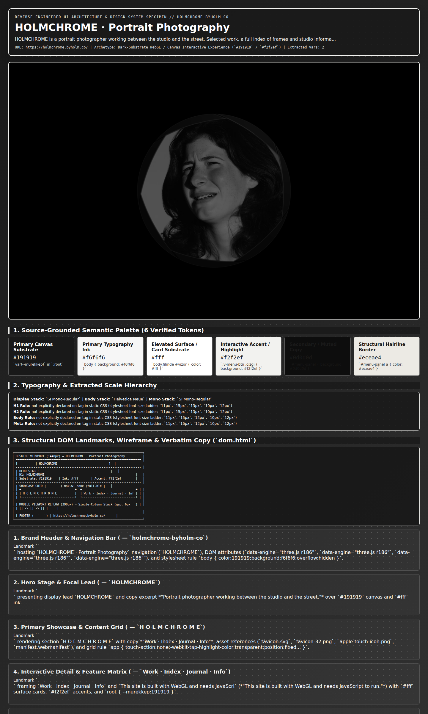
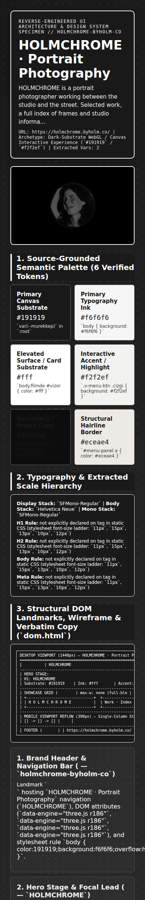

# UI Design System & Master Generation Blueprint: holmchrome-byholm-co

> **HOLMCHROME · Portrait Photography** (https://holmchrome.byholm.co/) — HOLMCHROME is a portrait photographer working between the studio and the street. Selected work, a full index of frames and studio informa...



---

## 1. Executive Visual Persona & Design Archetype

- **Brand Essence & Persona**: **HOLMCHROME · Portrait Photography** (`https://holmchrome.byholm.co/`). HOLMCHROME is a portrait photographer working between the studio and the street. Selected work, a full index of frames and studio informa...
- **Visual Archetype**: **Dark-Substrate WebGL / Canvas Interactive Experience (`#191919` / `#f2f2ef`)**.
- **Anti-AI-Slop Differentiators**:
  - **Source-Grounded Chromatic Polarity**: Anchors the viewport in `#191919` (`var(--murekkep)` in `:root`) paired with `#fff` primary typography and `#f2f2ef` accents.
  - **Extracted Typographic Hierarchy**: Pairs `SFMono-Regular` for display copy (`HOLMCHROME`) with `Helvetica Neue` and `SFMono-Regular`.
  - **Calibrated Spatial Grid & Motion**: Combines `none (full-bleed `100%` viewport stage)` container bounds (`gap: 6px`, padding `34px`) with `cubic-bezier(.3,.7,.2,1.2)` easing and Three.js / WebGL Canvas Pipeline.

---

## 2. Spatial Architecture & Modular Grid Mathematics



### Viewport Allocation & Container Geometry
- **Captured Viewport Dimensions**: Desktop `1440×2400px` (`assets/desktop.png`, capped at 2400px multi-section capture), Mobile `390×2400px` (`assets/mobile.png`, capped at 2400px multi-section capture).
- **Master Container Bounds**: `none (full-bleed `100%` viewport stage)` extracted from `holmchrome-byholm-co` stylesheet.
- **Canvas Lateral Padding & Spacing**: `34px` lateral canvas padding with `6px` grid gap.
- **Border Radius Scale**: `50%`, `1px`, `16px`, `3px`.

### Responsive Breakpoint Architecture
- **Desktop Layout**: Multi-column CSS Grid / Flexbox layout at `1440px` (`max-width: none (full-bleed `100%` viewport stage)`, `gap: 6px`).
- **Mobile Layout**: Single-column vertical stack at `390px` viewport width with `34px` horizontal padding.
- **Extracted CSS Media Queries**: `@media (prefers-reduced-motion:reduce)`, `@media (width<=1024px)`, `@media (width<=700px)`.

---

## 3. Color System, Materiality & Atmospheric Lighting

### Semantic Palette & Source Grounding
| Semantic Role | Ground-Truth Value | Extracted CSS Source / Selector |
|---|---|---|
| **Primary Canvas Substrate** | `#191919` | `var(--murekkep)` in `:root` |
| **Primary Typography Ink** | `#f6f6f6` | `body { background: #f6f6f6 }` |
| **Elevated Surface / Card Substrate** | `#fff` | `body.filmde #vizor { color: #fff }` |
| **Interactive Accent / Highlight** | `#f2f2ef` | `.v-menu-btn .cizgi { background: #f2f2ef }` |
| **Secondary / Muted Copy** | `#0d0d0d` | `#menu-panel { background: #0d0d0d }` |
| **Structural Hairline Border** | `#eceae4` | `#menu-panel a { color: #eceae4 }` |

### Sanitized Root CSS Variables (`ui-ux.md` Ground Truth)
| Variable Name | Extracted Value | Semantic Role |
|---|---|---|
| `--murekkep` | `#191919` | Color / Atmospheric Token |
| `--lupCap` | `140px` | Dimension / Scale Token |
| `--holmchrome-byhol-bg` | `#191919` | Canvas Substrate (from `var(--murekkep)` in `:root`) |
| `--holmchrome-byhol-ink` | `#fff` | Primary Typography Ink (stylesheet-derived) |
| `--holmchrome-byhol-surface` | `#fff` | Surface Substrate (stylesheet-derived) |
| `--holmchrome-byhol-accent` | `#f2f2ef` | Interactive Accent (stylesheet-derived) |
| `--holmchrome-byhol-muted` | `#0d0d0d` | Secondary Ink (stylesheet-derived) |
| `--holmchrome-byhol-border` | `#eceae4` | Structural Border (stylesheet-derived) |
| `--holmchrome-byhol-container` | `none` | Container Bound (stylesheet-derived) |
| `--holmchrome-byhol-gap` | `6px` | Grid Gutter (stylesheet-derived) |
| `--holmchrome-byhol-pad` | `34px` | Lateral Padding (stylesheet-derived) |
| `--holmchrome-byhol-ease` | `cubic-bezier(.3,.7,.2,1.2)` | Primary Easing Function |
| `--holmchrome-byhol-radius` | `50%` | Corner Radius (stylesheet-derived) |
| `--holmchrome-byhol-fs-base` | `11px` | Observed Font Size Token |

---

## 4. Typographic Scale & Editorial Hierarchy

### Font Family Stacks
- **Display Typography**: `SFMono-Regular`.
- **Primary Body Stack**: `Helvetica Neue`.
- **Technical / Metadata Stack**: `SFMono-Regular`.

### Typographic Scale & Rules (Extracted from Stylesheet & Variables)
- **Hero Display (`H1`)**: not explicitly declared on tag in static CSS (stylesheet font-size ladder: `11px`, `15px`, `13px`, `10px`, `12px`).
- **Section Heading (`H2`)**: not explicitly declared on tag in static CSS (stylesheet font-size ladder: `11px`, `15px`, `13px`, `10px`, `12px`).
- **Body Copy**: not explicitly declared on tag in static CSS (stylesheet font-size ladder: `11px`, `15px`, `13px`, `10px`, `12px`).
- **Metadata & Navigation Labels**: not explicitly declared on tag in static CSS (stylesheet font-size ladder: `11px`, `15px`, `13px`, `10px`, `12px`).

---

## 5. Choreographed Motion & Interaction Physics

### Primary Easing Curves
- **Extracted Timing Functions**: `cubic-bezier(.3,.7,.2,1.2)`, `cubic-bezier(.6,.05,.2,1)`, `cubic-bezier(.35,.7,.25,1)`.

### Per-Element Transition & Choreography Rules
- **Selector `#vizor`**: `transition: color .5s` extracted from `holmchrome-byholm-co` stylesheet.
- **Selector `body.hazir #vizor`**: `transition: color .5s,opacity .9s` extracted from `holmchrome-byholm-co` stylesheet.
- **Selector `body.filmde #vizor`**: `transition: none` extracted from `holmchrome-byholm-co` stylesheet.
- **Extracted Easing Curve (`cubic-bezier(.3,.7,.2,1.2)`)**: Governs interactive state transitions across `<header.if-hero>` and `<section.imlecsiz>`.
- **Runtime Interaction Engine**: Integrates Three.js / WebGL Canvas Pipeline with `prefers-reduced-motion: reduce` fallback guards.

---

## 6. Component Wireframe & Structural DOM Map

### Visual Layout Schematic (Grounded in `dom.html` — `1440px` Desktop & `390px` Mobile Reflow)
```
┌────────────────────────────────────────────────────────────────────────┐
│ DESKTOP VIEWPORT (1440px) — HOLMCHROME · Portrait Photography          │
│ ====================================================================== │
│ [ <header.if-hero>         | HOLMCHROME                             ]  │
│ ---------------------------------------------------------------------- │
│ | HERO STAGE: <section.atla>                                       |   │
│ | H1: HOLMCHROME                                                   |   │
│ | Substrate: #191919    | Ink: #fff       | Accent: #f2f2ef        |   │
│ ---------------------------------------------------------------------- │
│ | SHOWCASE GRID (<section.imlecsiz>        ) max-w: none (full-ble |   │
│ | +------------------------------+  +------------------------------+ | │
│ | | H O L M C H R O M E          |  | Work · Index · Journal · Inf | | │
│ | +------------------------------+  +------------------------------+ | │
│ ---------------------------------------------------------------------- │
│ | MOBILE VIEWPORT REFLOW (390px) — Single-Column Stack (gap: 6px   ) | │
│ | [<header.if-hero>] -> [<section.atla>] -> [<section.imlecsiz>] |     │
│ ---------------------------------------------------------------------- │
│ [ FOOTER (<footer.if-son>       ) | https://holmchrome.byholm.co/      │
└────────────────────────────────────────────────────────────────────────┘
```

### Granular DOM Region Breakdown
1. **Brand Header & Navigation Bar (<header.if-hero> — `holmchrome-byholm-co`)**:
   - Landmark `<header class="if-hero">` hosting `HOLMCHROME · Portrait Photography` navigation (`HOLMCHROME`), DOM attributes (`data-engine="three.js r186"`, `data-engine="three.js r186"`, `data-engine="three.js r186"`, `data-engine="three.js r186"`), and stylesheet rule `body { color:191919;background:f6f6f6;overflow:hidden }`.
2. **Hero Stage & Focal Lead (<section.atla> — `HOLMCHROME`)**:
   - Landmark `<section class="atla">` presenting display lead `HOLMCHROME` and copy excerpt *"Portrait photographer working between the studio and the street."* over `#191919` canvas and `#fff` ink.
3. **Primary Showcase & Content Grid (<section.imlecsiz> — `H O L M C H R O M E`)**:
   - Landmark `<section class="imlecsiz">` rendering section `H O L M C H R O M E` with copy *"Work · Index · Journal · Info"*, asset references (`favicon.svg`, `favicon-32.png`, `apple-touch-icon.png`, `manifest.webmanifest`), and grid rule `app { touch-action:none;-webkit-tap-highlight-color:transparent;position:fixed... }`.
4. **Interactive Detail & Feature Matrix (<section.if-ozet> — `Work · Index · Journal · Info`)**:
   - Landmark `<section class="if-ozet">` framing `Work · Index · Journal · Info` and `This site is built with WebGL and needs JavaScri` (*"This site is built with WebGL and needs JavaScript to run."*) with `#fff` surface cards, `#f2f2ef` accents, and `root { --murekkep:191919 }`.
5. **Colophon & Global Directory Footer (<footer.if-son> — `https://holmchrome.byholm.co/`)**:
   - Landmark `<footer class="if-son if-izgara">` anchoring `HOLMCHROME · Portrait Photograph` footer links (`HOLMCHROME`), copy *"· G O L D E N H O U R"*, and `#eceae4` structural dividers.

---

## 7. Master Zero-Shot AI Generation Prompt

```markdown
# Master Zero-Shot Frontend Generation Prompt: holmchrome-byholm-co (HOLMCHROME · Portrait Photography)

You are a principal frontend architect and design systems engineer. Build a complete, production-ready web application replicating the exact design system, DOM landmarks, typographic hierarchy, color tokens, and motion physics of `holmchrome-byholm-co` (**HOLMCHROME · Portrait Photography** — `https://holmchrome.byholm.co/`).

### 1. Visual Archetype & Anti-AI-Slop Mandates
- **Archetype**: Dark-Substrate WebGL / Canvas Interactive Experience (`#191919` / `#f2f2ef`).
- **Identity & Domain Context**: HOLMCHROME is a portrait photographer working between the studio and the street. Selected work, a full index of frames and studio informa...
- **Primary Substrate**: `#191919` (`var(--murekkep)` in `:root`), **Primary Ink**: `#fff`, **Accent / Highlight**: `#f2f2ef`.
- **Site-Specific Differentiators**:
  - **Source-Grounded Chromatic Polarity**: Anchors the viewport in `#191919` (`var(--murekkep)` in `:root`) paired with `#fff` primary typography and `#f2f2ef` accents.
  - **Extracted Typographic Hierarchy**: Pairs `SFMono-Regular` for display copy (`HOLMCHROME`) with `Helvetica Neue` and `SFMono-Regular`.
  - **Calibrated Spatial Grid & Motion**: Combines `none (full-bleed `100%` viewport stage)` container bounds (`gap: 6px`, padding `34px`) with `cubic-bezier(.3,.7,.2,1.2)` easing and Three.js / WebGL Canvas Pipeline.

### 2. Ground-Truth CSS Variables (`:root` Token Contract)
Declare and consume these exact custom properties extracted from `holmchrome-byholm-co` in your global stylesheet:

:root {
  /* HOLMCHROME · Portrait Photography (holmchrome-byholm-co) — Ground-Truth Extracted CSS Variables */
  --murekkep: #191919; /* Color / Atmospheric Token (holmchrome-byholm-co) */
  --lupCap: 140px; /* Dimension / Scale Token (holmchrome-byholm-co) */
  --holmchrome-byhol-bg: #191919; /* Canvas Substrate (from `var(--murekkep)` in `:root`) (holmchrome-byholm-co) */
  --holmchrome-byhol-ink: #fff; /* Primary Typography Ink (stylesheet-derived) (holmchrome-byholm-co) */
  --holmchrome-byhol-surface: #fff; /* Surface Substrate (stylesheet-derived) (holmchrome-byholm-co) */
  --holmchrome-byhol-accent: #f2f2ef; /* Interactive Accent (stylesheet-derived) (holmchrome-byholm-co) */
  --holmchrome-byhol-muted: #0d0d0d; /* Secondary Ink (stylesheet-derived) (holmchrome-byholm-co) */
  --holmchrome-byhol-border: #eceae4; /* Structural Border (stylesheet-derived) (holmchrome-byholm-co) */
  --holmchrome-byhol-container: none; /* Container Bound (stylesheet-derived) (holmchrome-byholm-co) */
  --holmchrome-byhol-gap: 6px; /* Grid Gutter (stylesheet-derived) (holmchrome-byholm-co) */
  --holmchrome-byhol-pad: 34px; /* Lateral Padding (stylesheet-derived) (holmchrome-byholm-co) */
  --holmchrome-byhol-ease: cubic-bezier(.3,.7,.2,1.2); /* Primary Easing Function (holmchrome-byholm-co) */
  --holmchrome-byhol-radius: 50%; /* Corner Radius (stylesheet-derived) (holmchrome-byholm-co) */
  --holmchrome-byhol-fs-base: 11px; /* Observed Font Size Token (holmchrome-byholm-co) */
}

### 3. Semantic Color & Materiality Contract
Map every surface, ink, and border strictly to these source-grounded tokens:
- **Primary Canvas Substrate**: `#191919` — grounded in `var(--murekkep)` in `:root`
- **Primary Typography Ink**: `#f6f6f6` — grounded in `body { background: #f6f6f6 }`
- **Elevated Surface / Card Substrate**: `#fff` — grounded in `body.filmde #vizor { color: #fff }`
- **Interactive Accent / Highlight**: `#f2f2ef` — grounded in `.v-menu-btn .cizgi { background: #f2f2ef }`
- **Secondary / Muted Copy**: `#0d0d0d` — grounded in `#menu-panel { background: #0d0d0d }`
- **Structural Hairline Border**: `#eceae4` — grounded in `#menu-panel a { color: #eceae4 }`

### 4. Spatial Grid, Container Bounds & Responsive Breakpoints
- **Desktop Viewport Reference**: `1440×2400px` (capped at 2400px multi-section capture, `1440px` standard desktop width).
- **Mobile Viewport Reference**: `390×2400px` (capped at 2400px multi-section capture, `390px` standard mobile width).
- **Container Max-Width**: `none (full-bleed `100%` viewport stage)` extracted from `holmchrome-byholm-co` stylesheet
- **Padding & Gutters**: `34px` lateral canvas padding with `6px` grid gap
- **Desktop Grid**: Multi-column CSS Grid / Flexbox layout at `1440px` (`max-width: none (full-bleed `100%` viewport stage)`, `gap: 6px`)
- **Mobile Adaptation**: Single-column vertical stack at `390px` viewport width with `34px` horizontal padding
- **Media Queries**: `@media (prefers-reduced-motion:reduce)`, `@media (width<=1024px)`, `@media (width<=700px)`
- **Corner Radii**: `50%`, `1px`, `16px`, `3px`

### 5. Typography & Editorial Scale Contract
- **Display Font Stack**: `SFMono-Regular`
- **Body Font Stack**: `Helvetica Neue`
- **Monospace / Technical Font Stack**: `SFMono-Regular`
- **H1 Display Rule**: not explicitly declared on tag in static CSS (stylesheet font-size ladder: `11px`, `15px`, `13px`, `10px`, `12px`)
- **H2 Section Rule**: not explicitly declared on tag in static CSS (stylesheet font-size ladder: `11px`, `15px`, `13px`, `10px`, `12px`)
- **Body Copy Rule**: not explicitly declared on tag in static CSS (stylesheet font-size ladder: `11px`, `15px`, `13px`, `10px`, `12px`)
- **Metadata & Index Rule**: not explicitly declared on tag in static CSS (stylesheet font-size ladder: `11px`, `15px`, `13px`, `10px`, `12px`)

### 6. Component Hierarchy, Verbatim Copy & Real DOM Landmarks
Scaffold `holmchrome-byholm-co` (`HOLMCHROME · Portrait Photography`) with these exact structural regions, extracted copy, and CSS rules from `dom.html`:
1. **Brand Header & Navigation Bar (<header.if-hero> — `holmchrome-byholm-co`)**:
   - DOM & Selectors: Landmark `<header class="if-hero">` hosting `HOLMCHROME · Portrait Photography` navigation (`HOLMCHROME`), DOM attributes (`data-engine="three.js r186"`, `data-engine="three.js r186"`, `data-engine="three.js r186"`, `data-engine="three.js r186"`), and stylesheet rule `body { color:191919;background:f6f6f6;overflow:hidden }`.
   - Responsive Contract: Header `Brand Header & Navigation Bar (<header.if-hero> — `holmchrome-byholm-co`)` (`holmchrome-byholm-co`) adapts across `@media (prefers-reduced-motion:reduce)`, `@media (width<=1024px)`, `@media (width<=700px)` with `cubic-bezier(.3,.7,.2,1.2)`, `cubic-bezier(.6,.05,.2,1)`, `cubic-bezier(.35,.7,.25,1)` transitions and links `HOLMCHROME`.
2. **Hero Stage & Focal Lead (<section.atla> — `HOLMCHROME`)**:
   - DOM & Selectors: Landmark `<section class="atla">` presenting display lead `HOLMCHROME` and copy excerpt *"Portrait photographer working between the studio and the street."* over `#191919` canvas and `#fff` ink.
   - Responsive Contract: Hero stage (`1440×2400px` desktop / `390×2400px` mobile) sets `#191919` background with `#fff` headline `HOLMCHROME`.
3. **Primary Showcase & Content Grid (<section.imlecsiz> — `H O L M C H R O M E`)**:
   - DOM & Selectors: Landmark `<section class="imlecsiz">` rendering section `H O L M C H R O M E` with copy *"Work · Index · Journal · Info"*, asset references (`favicon.svg`, `favicon-32.png`, `apple-touch-icon.png`, `manifest.webmanifest`), and grid rule `app { touch-action:none;-webkit-tap-highlight-color:transparent;position:fixed... }`.
   - Responsive Contract: Showcase grid `Primary Showcase & Content Grid (<section.imlecsiz> — `H O L M C H R O M E`)` applies Multi-column CSS Grid / Flexbox layout at `1440px` (`max-width: none (full-bleed `100%` viewport stage)`, `gap: 6px`) on desktop and Single-column vertical stack at `390px` viewport width with `34px` horizontal padding on mobile.
4. **Interactive Detail & Feature Matrix (<section.if-ozet> — `Work · Index · Journal · Info`)**:
   - DOM & Selectors: Landmark `<section class="if-ozet">` framing `Work · Index · Journal · Info` and `This site is built with WebGL and needs JavaScri` (*"This site is built with WebGL and needs JavaScript to run."*) with `#fff` surface cards, `#f2f2ef` accents, and `root { --murekkep:191919 }`.
   - Responsive Contract: Detail module `Interactive Detail & Feature Matrix (<section.if-ozet> — `Work · Index · Journal · Info`)` uses `50%`, `1px`, `16px`, `3px` radii, `#f2f2ef` highlights, and assets (favicon.svg, favicon-32.png, apple-touch-icon.png).
5. **Colophon & Global Directory Footer (<footer.if-son> — `https://holmchrome.byholm.co/`)**:
   - DOM & Selectors: Landmark `<footer class="if-son if-izgara">` anchoring `HOLMCHROME · Portrait Photograph` footer links (`HOLMCHROME`), copy *"· G O L D E N H O U R"*, and `#eceae4` structural dividers.
   - Responsive Contract: Footer `Colophon & Global Directory Footer (<footer.if-son> — `https://holmchrome.byholm.co/`)` aligns to `none (full-bleed `100%` viewport stage)` extracted from `holmchrome-byholm-co` stylesheet with `34px` lateral canvas padding with `6px` grid gap and attributes (data-engine="three.js r186", data-engine="three.js r186", data-engine="three.js r186").

#### Verbatim DOM Copy Excerpts (`dom.html`)
- Copy Excerpt 1: *"Portrait photographer working between the studio and the street."*
- Copy Excerpt 2: *"Work · Index · Journal · Info"*
- Copy Excerpt 3: *"This site is built with WebGL and needs JavaScript to run."*
- Copy Excerpt 4: *"· G O L D E N H O U R"*

### 7. Motion, Extracted Stylesheet Rules & Interaction Choreography
- **Primary Easing Functions**: `cubic-bezier(.3,.7,.2,1.2)`, `cubic-bezier(.6,.05,.2,1)`, `cubic-bezier(.35,.7,.25,1)`
- **Extracted Stylesheet Rules (`holmchrome-byholm-co`)**:
- `body { color:191919;background:f6f6f6;overflow:hidden }`
- `app { touch-action:none;-webkit-tap-highlight-color:transparent;position:fixed... }`
- `root { --murekkep:191919 }`
- `body.karanlik { --murekkep:f2f2f2 }`
- `vizor { pointer-events:none;color:var(--murekkep);opacity:0;transition:color .5s... }`
- **Per-Selector Transition Rules**:
- **Selector `#vizor`**: `transition: color .5s` extracted from `holmchrome-byholm-co` stylesheet.
- **Selector `body.hazir #vizor`**: `transition: color .5s,opacity .9s` extracted from `holmchrome-byholm-co` stylesheet.
- **Selector `body.filmde #vizor`**: `transition: none` extracted from `holmchrome-byholm-co` stylesheet.
- **Extracted Easing Curve (`cubic-bezier(.3,.7,.2,1.2)`)**: Governs interactive state transitions across `<header.if-hero>` and `<section.imlecsiz>`.
- **Runtime Interaction Engine**: Integrates Three.js / WebGL Canvas Pipeline with `prefers-reduced-motion: reduce` fallback guards.

### 8. Technical Deliverables
- Implement in Next.js (App Router) with TypeScript and Tailwind CSS consuming the `:root` custom properties defined above for `holmchrome-byholm-co`.
- Reproduce both the `1440px` desktop architecture and `390px` mobile breakpoint transitions, preserving semantic HTML5 landmarks (`<header>`, `<nav>`, `<main>`, `<section>`, `<footer>`) and `prefers-reduced-motion` accessibility guards.
```
