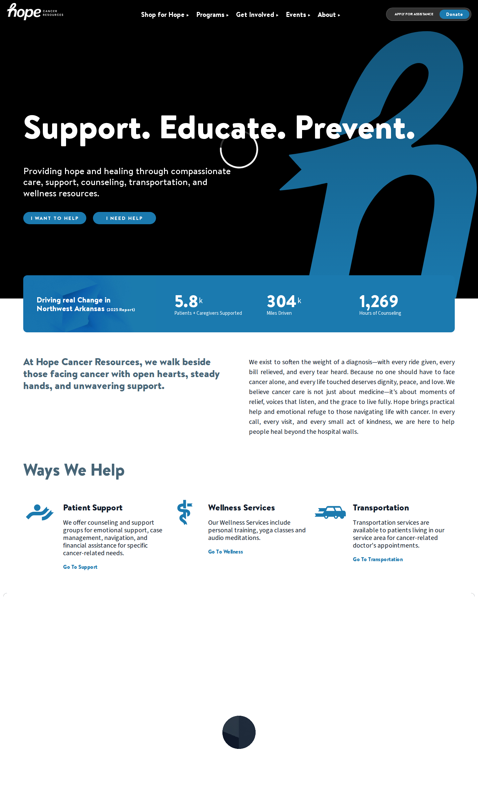
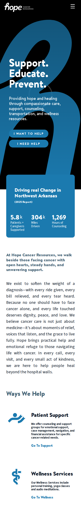

# UI Design System & Master Generation Blueprint: hopecancerresources-org

> **Hope Cancer Resources - Support. Educate. Prevent.** (https://hopecancerresources.org/) — Providing free cancer support services through counseling, transportation, financial assistance, personal training, tobacco treatment, &...



---

## 1. Executive Visual Persona & Design Archetype

- **Brand Essence & Persona**: **Hope Cancer Resources - Support. Educate. Prevent.** (`https://hopecancerresources.org/`). Providing free cancer support services through counseling, transportation, financial assistance, personal training, tobacco treatment, &...
- **Capture Provenance**: Live browser capture (`tier1_fast`, HTTP `200`, captured `2026-11-23`).
- **Visual Archetype**: **Light-Substrate Editorial & Modular Grid System (`#ffffff` canvas, `#000000` ink, `#0000ff` accent)**.
- **Anti-AI-Slop Differentiators**:
  - **Live-Computed Chromatic Polarity**: Anchors the viewport in `#ffffff` (live computed `main` `background-color` (`computed_styles.json`)) paired with `#000000` primary typography and `#0000ff` accents.
  - **Grounded Typographic Hierarchy**: Pairs `BrandonText` for display copy (`Support. Educate. Prevent.`) with `BrandonText` and not declared in live computed styles (uses primary stack / `ui-monospace`).
  - **Calibrated Spatial Grid & Motion**: Combines `1300px` container bounds (`gap: 20px`, padding `20px`) with `cubic-bezier(0.25,0.1,0.25,1)` easing and Three.js / WebGL Canvas Pipeline, Swiper Touch Carousel Engine.

---

## 2. Spatial Architecture & Modular Grid Mathematics



### Viewport Allocation & Container Geometry
- **Captured Viewport Dimensions**: Desktop `1440×2400px` (`assets/desktop.png`, clamped at 2400px live multi-section capture), Mobile `390×2400px` (`assets/mobile.png`, clamped at 2400px live multi-section capture).
- **Master Container Bounds**: `1300px` (measured widest bounded `<section>` landmark width on `1440px` desktop).
- **Canvas Lateral Padding & Spacing**: `20px` lateral canvas padding with `20px` grid gap.
- **Border Radius Scale**: `6px`, `100px`, `12px`, `10px`.

### Responsive Breakpoint Architecture
- **Desktop Layout**: Multi-column CSS Grid / Flexbox layout at `1440px` (`max-width: 1300px`, `gap: 20px`).
- **Mobile Layout**: Single-column vertical stack at `390px` viewport width with `20px` horizontal padding.
- **Extracted CSS Media Queries**: `@media (min-width: 800px)`, `@media (min-width: 768px)`, `@media (min-width: 960px)`, `@media (min-width: 1400px)`.

---

## 3. Color System, Materiality & Atmospheric Lighting

### Semantic Palette & Source Grounding
| Semantic Role | Ground-Truth Value | Extracted Live / CSS Source |
|---|---|---|
| **Primary Canvas Substrate** | `#ffffff` | live computed `main` `background-color` (`computed_styles.json`) |
| **Primary Typography Ink** | `#000000` | live computed `button` `color` (`computed_styles.json`) |
| **Elevated Surface / Card Substrate** | `#edf1f4` | live computed `footer` `background-color` (`computed_styles.json`) |
| **Interactive Accent / Highlight** | `#0000ff` | `.link { color: blue }` (`#0000ff`) |
| **Secondary / Muted Copy** | `#0e1829` | live computed `nav` `color` (`computed_styles.json`) |
| **Structural Hairline Border** | `#b0c5dc` | `hr { border-top: #b0c5dc }` |
| **Variable Token (`--color-brand-blue`)** | `#1b7aaf` | `var(--color-brand-blue)` in `:root` |
| **Variable Token (`--color-brand-lightblue`)** | `#1fa0e5` | `var(--color-brand-lightblue)` in `:root` |
| **Variable Token (`--color-brand-darkblue`)** | `#476577` | `var(--color-brand-darkblue)` in `:root` |
| **Variable Token (`--color-brand-gray-500`)** | `#90a3bf` | `var(--color-brand-gray-500)` in `:root` |
| **Variable Token (`--color-notice-warning`)** | `#dc4b4b` | `var(--color-notice-warning)` in `:root` |
| **Variable Token (`--color-notice-success`)** | `#2db292` | `var(--color-notice-success)` in `:root` |

### Sanitized Root CSS Variables (`ui-ux.md` Ground Truth)
| Variable Name | Extracted Value | Semantic Role |
|---|---|---|
| `--font-primary` | `"BrandonText", Arial, Helvetica, sans-serif` | Brand / Palette Token |
| `--font-heading` | `"BrandonText", Arial, Helvetica, sans-serif` | Typography Ink Token |
| `--font-base` | `"SourceSans", Arial, Helvetica, sans-serif` | Typography / Scale Token |
| `--font-serif` | `"EightiesComebackIt", "Times New Roman", "Garamond", serif` | Typography / Scale Token |
| `--color-brand-black` | `#0e1829` | Canvas / Surface Token |
| `--color-brand-blue` | `#1b7aaf` | Brand / Palette Token |
| `--color-brand-lightblue` | `#1fa0e5` | Canvas / Surface Token |
| `--color-brand-darkblue` | `#476577` | Canvas / Surface Token |
| `--color-brand-gray-500` | `#90a3bf` | Brand / Palette Token |
| `--color-light-gray` | `#476577` | Canvas / Surface Token |
| `--color-lightest-gray` | `#edf1f4` | Canvas / Surface Token |
| `--color-notice-warning` | `#dc4b4b` | Brand / Palette Token |
| `--color-notice-success` | `#2DB292` | Brand / Palette Token |
| `--color-primary` | `var(--color-brand-black)` | Brand / Palette Token |
| `--color-secondary` | `var(--color-brand-black)` | Brand / Palette Token |
| `--color-brand-text-base` | `var(--color-brand-black)` | Typography Ink Token |

---

## 4. Typographic Scale & Editorial Hierarchy

### Font Family Stacks
- **Display Typography**: `BrandonText`.
- **Primary Body Stack**: `BrandonText`.
- **Technical / Metadata Stack**: not declared in live computed styles (uses primary stack / `ui-monospace`).

### Typographic Scale & Rules (Live Computed & Stylesheet Grounded)
- **Hero Display (`H1`)**: live computed `h1` (`font-size: 100px`, `line-height: 100px`, `font-weight: 800`); rule `h1` (`font-size: 2rem`, `line-height: 1`).
- **Section Heading (`H2`)**: live computed `h2` (`font-size: 23px`, `line-height: 26.45px`, `font-weight: 800`); rule `h2` (`font-size: clamp(1.6rem,5vw,3rem)`, `font-weight: 900`).
- **Body Copy**: live computed `body` (`font-size: 10px`, `line-height: 11.5px`, `font-weight: 400`); rule `p` (`font-size: 2rem`, `line-height: 1.5`, `font-weight: 400`).
- **Metadata & Navigation Labels**: live computed `nav/a` (`font-size: 10px`, `line-height: 11.5px`, `font-weight: 400`); rule `.label` (`font-size: 1rem`).

---

## 5. Choreographed Motion & Interaction Physics

### Primary Easing Curves
- **Extracted Timing Functions**: `cubic-bezier(0.25,0.1,0.25,1)`.

### Per-Element Transition & Choreography Rules
- **Selector `body *`**: `transition: all .2s ease-in` extracted from `hopecancerresources-org` stylesheet.
- **Selector `.reveal-overlay`**: `transition: mask-image .1s ease-out,-webkit-mask-image .1s ease-out` extracted from `hopecancerresources-org` stylesheet.
- **Selector `.skip-link`**: `transition: top .3s ease` extracted from `hopecancerresources-org` stylesheet.
- **Standard CSS Easing (`cubic-bezier(0.25,0.1,0.25,1)`)**: Default timing curve (no custom `cubic-bezier()` declared in captured CSS).
- **Runtime Interaction Engine**: Integrates Three.js / WebGL Canvas Pipeline, Swiper Touch Carousel Engine with `prefers-reduced-motion: reduce` fallback guards.

---

## 6. Component Wireframe & Structural DOM Map

### Visual Layout Schematic — Desktop (`1440px`, Grounded in `dom.html` & Landmark Bounding Boxes)
```
┌────────────────────────────────────────────────────────────────────────┐
│ DESKTOP VIEWPORT (1440px) — Hope Cancer Resources - Support. Educate.  │
│ ====================================================================== │
│ [ <header.site-header> (1440x60px)    | Shop for Hope · About Hope · ] │
│ ---------------------------------------------------------------------- │
│ | HERO STAGE: <article.post-type-page> (w=1440px)                    | │
│ | H1: Support. Educate. Prevent.                                     | │
│ | Substrate: #ffffff | Ink: #000000 | Accent: #0000ff                | │
│ ---------------------------------------------------------------------- │
│ | SHOWCASE GRID (<section.page_heading>) max-w: 1300px               | │
│ | +------------------------------+  +------------------------------+ | │
│ | | Driving real Change in North |  | At Hope Cancer Resources, we | | │
│ | +------------------------------+  +------------------------------+ | │
│ ---------------------------------------------------------------------- │
│ | DETAIL MODULE (<section.stats_block_one>) — Ways We Help           | │
│ ---------------------------------------------------------------------- │
│ [ FOOTER (<footer.site-footer>) | https://hopecancerresources.org/     │
└────────────────────────────────────────────────────────────────────────┘
```

### Visual Layout Schematic — Mobile Reflow (`390px`)
```
┌────────────────────────────────────────────────────────────────────────┐
│ MOBILE VIEWPORT REFLOW (390px) — Single-Column Stack (gap: 20px)       │
│ ====================================================================== │
│ [ HEADER BAR (<header.site-header>    ) | Compact Menu (390px)         │
│ ---------------------------------------------------------------------- │
│ | HERO STAGE (<article.post-type-page>) — 390px Vertical Lead        | │
│ | H1: Support. Educate. Prevent.                                     | │
│ ---------------------------------------------------------------------- │
│ | SHOWCASE STACK (<section.page_heading>) — 1-Col Stack              | │
│ | [ Item 1: Driving real Change in Northwest Arkansas (2025 R...   ] | │
│ | [ Item 2: At Hope Cancer Resources, we walk beside those fa...   ] | │
│ ---------------------------------------------------------------------- │
│ | DETAIL STACK (<section.stats_block_one) — 1-Col (Ways We Help)     | │
│ ---------------------------------------------------------------------- │
│ [ FOOTER (<footer.site-footer>) | Stacked 390px Colophon               │
└────────────────────────────────────────────────────────────────────────┘
```

### Granular DOM Region Breakdown
1. **Brand Header & Navigation Bar (<header.site-header> — `hopecancerresources-org`)**:
   - Landmark `<header class="site-header template-home">` (`1440x60px`) hosting `Hope Cancer Resources - Support. Edu` navigation (`Shop for Hope · About Hope · Our Story · Our Foundation · Staff`), DOM attributes (`data-template="base.twig"`, `data-date-iso="2026-11-23CST19:45:23..."`, `data-types="Yoga"`, `data-date-iso="2026-11-26CST19:45:23..."`), and stylesheet rule `content { background:fff;background-size:100% }`.
2. **Hero Stage & Focal Lead (<article.post-type-page> — `Support. Educate. Prevent.`)**:
   - Landmark `<article class="post-type-page">` presenting display lead `Support. Educate. Prevent.` and copy excerpt *"Providing hope and healing through compassionate care, support, c"* over `#ffffff` canvas and `#000000` ink.
3. **Primary Showcase & Content Grid (<section.page_heading> — `Driving real Change in Northwest A`)**:
   - Landmark `<section class="page_heading section-block">` rendering section `Driving real Change in Northwest Arkansas (2025 R...` with copy *"Hope Cancer Resources"*, asset references (`gtm.js`, `style.css`, `humans.txt`, `xmlrpc.php`), and grid rule `ge-template-wp-content .default-h... { padding-top:100px }`.
4. **Interactive Detail & Feature Matrix (<section.stats_block_one> — `At Hope Cancer Resources, we walk `)**:
   - Landmark `<section class="stats_block_one section-block">` framing `At Hope Cancer Resources, we walk beside those fa...` and `Ways We Help` (*"We exist to soften the weight of a diagnosis—with every ride give"*) with `#edf1f4` surface cards, `#0000ff` accents, and `projects-template-default .post-h... { padding-top:80px }`.
5. **Colophon & Global Directory Footer (<footer.site-footer> — `https://hopecancerresources.org/`)**:
   - Landmark `<footer class="site-footer">` anchoring `Hope Cancer Resources - Support.` footer links (`Shop for Hope · About Hope · Our Story · Our Foundation · Staff`), copy *"We are dedicated to providing support for the journey and ed"*, and `#b0c5dc` structural dividers.

---

## 7. Master Zero-Shot AI Generation Prompt

```markdown
# Master Zero-Shot Frontend Generation Prompt: hopecancerresources-org (Hope Cancer Resources - Support. Educate. Prevent.)

You are a principal frontend architect and design systems engineer. Build a complete, production-ready web application replicating the exact design system, DOM landmarks, typographic hierarchy, color tokens, and motion physics of `hopecancerresources-org` (**Hope Cancer Resources - Support. Educate. Prevent.** — `https://hopecancerresources.org/`).

### 1. Visual Archetype & Anti-AI-Slop Mandates
- **Archetype**: Light-Substrate Editorial & Modular Grid System (`#ffffff` canvas, `#000000` ink, `#0000ff` accent).
- **Identity & Domain Context**: Providing free cancer support services through counseling, transportation, financial assistance, personal training, tobacco treatment, &...
- **Primary Substrate**: `#ffffff` (live computed `main` `background-color` (`computed_styles.json`)), **Primary Ink**: `#000000`, **Accent / Highlight**: `#0000ff`.
- **Site-Specific Differentiators**:
  - **Live-Computed Chromatic Polarity**: Anchors the viewport in `#ffffff` (live computed `main` `background-color` (`computed_styles.json`)) paired with `#000000` primary typography and `#0000ff` accents.
  - **Grounded Typographic Hierarchy**: Pairs `BrandonText` for display copy (`Support. Educate. Prevent.`) with `BrandonText` and not declared in live computed styles (uses primary stack / `ui-monospace`).
  - **Calibrated Spatial Grid & Motion**: Combines `1300px` container bounds (`gap: 20px`, padding `20px`) with `cubic-bezier(0.25,0.1,0.25,1)` easing and Three.js / WebGL Canvas Pipeline, Swiper Touch Carousel Engine.

### 2. Ground-Truth CSS Variables (`:root` Token Contract)
Declare and consume these exact custom properties extracted from `hopecancerresources-org` in your global stylesheet:

:root {
  /* Hope Cancer Resources - Support. Educate. Prevent. (hopecancerresources-org) — Live-Grounded CSS Variables */
  --font-primary: "BrandonText", Arial, Helvetica, sans-serif; /* Brand / Palette Token (hopecancerresources-org) */
  --font-heading: "BrandonText", Arial, Helvetica, sans-serif; /* Typography Ink Token (hopecancerresources-org) */
  --font-base: "SourceSans", Arial, Helvetica, sans-serif; /* Typography / Scale Token (hopecancerresources-org) */
  --font-serif: "EightiesComebackIt", "Times New Roman", "Garamond", serif; /* Typography / Scale Token (hopecancerresources-org) */
  --color-brand-black: #0e1829; /* Canvas / Surface Token (hopecancerresources-org) */
  --color-brand-blue: #1b7aaf; /* Brand / Palette Token (hopecancerresources-org) */
  --color-brand-lightblue: #1fa0e5; /* Canvas / Surface Token (hopecancerresources-org) */
  --color-brand-darkblue: #476577; /* Canvas / Surface Token (hopecancerresources-org) */
  --color-brand-gray-500: #90a3bf; /* Brand / Palette Token (hopecancerresources-org) */
  --color-light-gray: #476577; /* Canvas / Surface Token (hopecancerresources-org) */
  --color-lightest-gray: #edf1f4; /* Canvas / Surface Token (hopecancerresources-org) */
  --color-notice-warning: #dc4b4b; /* Brand / Palette Token (hopecancerresources-org) */
  --color-notice-success: #2DB292; /* Brand / Palette Token (hopecancerresources-org) */
  --color-primary: var(--color-brand-black); /* Brand / Palette Token (hopecancerresources-org) */
  --color-secondary: var(--color-brand-black); /* Brand / Palette Token (hopecancerresources-org) */
  --color-brand-text-base: var(--color-brand-black); /* Typography Ink Token (hopecancerresources-org) */
}

### 3. Semantic Color & Materiality Contract
Map every surface, ink, and border strictly to these source-grounded tokens:
- **Primary Canvas Substrate**: `#ffffff` — grounded in live computed `main` `background-color` (`computed_styles.json`)
- **Primary Typography Ink**: `#000000` — grounded in live computed `button` `color` (`computed_styles.json`)
- **Elevated Surface / Card Substrate**: `#edf1f4` — grounded in live computed `footer` `background-color` (`computed_styles.json`)
- **Interactive Accent / Highlight**: `#0000ff` — grounded in `.link { color: blue }` (`#0000ff`)
- **Secondary / Muted Copy**: `#0e1829` — grounded in live computed `nav` `color` (`computed_styles.json`)
- **Structural Hairline Border**: `#b0c5dc` — grounded in `hr { border-top: #b0c5dc }`
- **Variable Token (`--color-brand-blue`)**: `#1b7aaf` — grounded in `var(--color-brand-blue)` in `:root`
- **Variable Token (`--color-brand-lightblue`)**: `#1fa0e5` — grounded in `var(--color-brand-lightblue)` in `:root`
- **Variable Token (`--color-brand-darkblue`)**: `#476577` — grounded in `var(--color-brand-darkblue)` in `:root`
- **Variable Token (`--color-brand-gray-500`)**: `#90a3bf` — grounded in `var(--color-brand-gray-500)` in `:root`
- **Variable Token (`--color-notice-warning`)**: `#dc4b4b` — grounded in `var(--color-notice-warning)` in `:root`
- **Variable Token (`--color-notice-success`)**: `#2db292` — grounded in `var(--color-notice-success)` in `:root`

### 4. Spatial Grid, Container Bounds & Responsive Breakpoints
- **Desktop Viewport Reference**: `1440×2400px` (clamped at 2400px live multi-section capture, `1440px` standard desktop width).
- **Mobile Viewport Reference**: `390×2400px` (clamped at 2400px live multi-section capture, `390px` standard mobile width).
- **Container Max-Width**: `1300px` (measured widest bounded `<section>` landmark width on `1440px` desktop)
- **Padding & Gutters**: `20px` lateral canvas padding with `20px` grid gap
- **Desktop Grid**: Multi-column CSS Grid / Flexbox layout at `1440px` (`max-width: 1300px`, `gap: 20px`)
- **Mobile Adaptation**: Single-column vertical stack at `390px` viewport width with `20px` horizontal padding
- **Media Queries**: `@media (min-width: 800px)`, `@media (min-width: 768px)`, `@media (min-width: 960px)`, `@media (min-width: 1400px)`
- **Corner Radii**: `6px`, `100px`, `12px`, `10px`

### 5. Typography & Editorial Scale Contract
- **Display Font Stack**: `BrandonText`
- **Body Font Stack**: `BrandonText`
- **Monospace / Technical Font Stack**: not declared in live computed styles (uses primary stack / `ui-monospace`)
- **H1 Display Rule**: live computed `h1` (`font-size: 100px`, `line-height: 100px`, `font-weight: 800`); rule `h1` (`font-size: 2rem`, `line-height: 1`)
- **H2 Section Rule**: live computed `h2` (`font-size: 23px`, `line-height: 26.45px`, `font-weight: 800`); rule `h2` (`font-size: clamp(1.6rem,5vw,3rem)`, `font-weight: 900`)
- **Body Copy Rule**: live computed `body` (`font-size: 10px`, `line-height: 11.5px`, `font-weight: 400`); rule `p` (`font-size: 2rem`, `line-height: 1.5`, `font-weight: 400`)
- **Metadata & Index Rule**: live computed `nav/a` (`font-size: 10px`, `line-height: 11.5px`, `font-weight: 400`); rule `.label` (`font-size: 1rem`)

### 6. Component Hierarchy, Verbatim Copy & Real DOM Landmarks
Scaffold `hopecancerresources-org` (`Hope Cancer Resources - Support. Educate. Prevent.`) with these exact structural regions, extracted copy, and CSS rules from `dom.html`:
1. **Brand Header & Navigation Bar (<header.site-header> — `hopecancerresources-org`)**:
   - DOM & Selectors: Landmark `<header class="site-header template-home">` (`1440x60px`) hosting `Hope Cancer Resources - Support. Edu` navigation (`Shop for Hope · About Hope · Our Story · Our Foundation · Staff`), DOM attributes (`data-template="base.twig"`, `data-date-iso="2026-11-23CST19:45:23..."`, `data-types="Yoga"`, `data-date-iso="2026-11-26CST19:45:23..."`), and stylesheet rule `content { background:fff;background-size:100% }`.
   - Responsive Contract: Header `Brand Header & Navigation Bar (<header.site-header> — `hopecancerresources-org`)` (`hopecancerresources-org`) adapts across `@media (min-width: 800px)`, `@media (min-width: 768px)`, `@media (min-width: 960px)`, `@media (min-width: 1400px)` with `cubic-bezier(0.25,0.1,0.25,1)` transitions and links `Shop for Hope · About Hope · Our Story · Our Foundation · Staff`.
2. **Hero Stage & Focal Lead (<article.post-type-page> — `Support. Educate. Prevent.`)**:
   - DOM & Selectors: Landmark `<article class="post-type-page">` presenting display lead `Support. Educate. Prevent.` and copy excerpt *"Providing hope and healing through compassionate care, support, c"* over `#ffffff` canvas and `#000000` ink.
   - Responsive Contract: Hero stage (`1440×2400px` desktop / `390×2400px` mobile) sets `#ffffff` background with `#000000` headline `Support. Educate. Prevent.`.
3. **Primary Showcase & Content Grid (<section.page_heading> — `Driving real Change in Northwest A`)**:
   - DOM & Selectors: Landmark `<section class="page_heading section-block">` rendering section `Driving real Change in Northwest Arkansas (2025 R...` with copy *"Hope Cancer Resources"*, asset references (`gtm.js`, `style.css`, `humans.txt`, `xmlrpc.php`), and grid rule `ge-template-wp-content .default-h... { padding-top:100px }`.
   - Responsive Contract: Showcase grid `Primary Showcase & Content Grid (<section.page_heading> — `Driving real Change in Northwest A`)` applies Multi-column CSS Grid / Flexbox layout at `1440px` (`max-width: 1300px`, `gap: 20px`) on desktop and Single-column vertical stack at `390px` viewport width with `20px` horizontal padding on mobile.
4. **Interactive Detail & Feature Matrix (<section.stats_block_one> — `At Hope Cancer Resources, we walk `)**:
   - DOM & Selectors: Landmark `<section class="stats_block_one section-block">` framing `At Hope Cancer Resources, we walk beside those fa...` and `Ways We Help` (*"We exist to soften the weight of a diagnosis—with every ride give"*) with `#edf1f4` surface cards, `#0000ff` accents, and `projects-template-default .post-h... { padding-top:80px }`.
   - Responsive Contract: Detail module `Interactive Detail & Feature Matrix (<section.stats_block_one> — `At Hope Cancer Resources, we walk `)` uses `6px`, `100px`, `12px`, `10px` radii, `#0000ff` highlights, and assets (gtm.js, style.css, humans.txt).
5. **Colophon & Global Directory Footer (<footer.site-footer> — `https://hopecancerresources.org/`)**:
   - DOM & Selectors: Landmark `<footer class="site-footer">` anchoring `Hope Cancer Resources - Support.` footer links (`Shop for Hope · About Hope · Our Story · Our Foundation · Staff`), copy *"We are dedicated to providing support for the journey and ed"*, and `#b0c5dc` structural dividers.
   - Responsive Contract: Footer `Colophon & Global Directory Footer (<footer.site-footer> — `https://hopecancerresources.org/`)` aligns to `1300px` (measured widest bounded `<section>` landmark width on `1440px` desktop) with `20px` lateral canvas padding with `20px` grid gap and attributes (data-template="base.twig", data-date-iso="2026-11-23CST19:45:23...", data-types="Yoga").

#### Verbatim DOM Copy Excerpts (`dom.html`)
- Copy Excerpt 1: *"Providing hope and healing through compassionate care, support, counseling, transp..."*
- Copy Excerpt 2: *"Hope Cancer Resources"*
- Copy Excerpt 3: *"We exist to soften the weight of a diagnosis—with every ride given, every bill rel..."*
- Copy Excerpt 4: *"We are dedicated to providing support for the journey and education for life. Thes..."*

### 7. Motion, Extracted Stylesheet Rules & Interaction Choreography
- **Primary Easing Functions**: `cubic-bezier(0.25,0.1,0.25,1)`
- **Extracted Stylesheet Rules (`hopecancerresources-org`)**:
- `content { background:fff;background-size:100% }`
- `ge-template-wp-content .default-h... { padding-top:100px }`
- `projects-template-default .post-h... { padding-top:80px }`
- `.archive .standard-heading { padding-top:80px }`
- `.basic-page-padding { width:calc(100% - 40px);max-width:1400px;margin:0px auto;padding:20px 0... }`
- **Per-Selector Transition Rules**:
- **Selector `body *`**: `transition: all .2s ease-in` extracted from `hopecancerresources-org` stylesheet.
- **Selector `.reveal-overlay`**: `transition: mask-image .1s ease-out,-webkit-mask-image .1s ease-out` extracted from `hopecancerresources-org` stylesheet.
- **Selector `.skip-link`**: `transition: top .3s ease` extracted from `hopecancerresources-org` stylesheet.
- **Standard CSS Easing (`cubic-bezier(0.25,0.1,0.25,1)`)**: Default timing curve (no custom `cubic-bezier()` declared in captured CSS).
- **Runtime Interaction Engine**: Integrates Three.js / WebGL Canvas Pipeline, Swiper Touch Carousel Engine with `prefers-reduced-motion: reduce` fallback guards.

### 8. Technical Deliverables
- Implement in Next.js (App Router) with TypeScript and Tailwind CSS consuming the `:root` custom properties defined above for `hopecancerresources-org`.
- Reproduce both the `1440px` desktop architecture and `390px` mobile breakpoint transitions, preserving semantic HTML5 landmarks (`<header>`, `<nav>`, `<main>`, `<section>`, `<footer>`) and `prefers-reduced-motion` accessibility guards.
```
