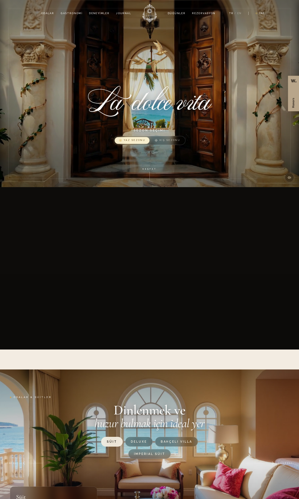

# UI Design System & Master Generation Blueprint: hotelaurelia-online

> **Villa Aurelia — Butik Lüks Otel & Rezervasyon** (https://hotelaurelia.online/) — Villa Aurelia; sakin, sinematik bir kaçamak olarak tasarlanmış butik lüks otel. Odalar, gastronomi, deneyimler, düğünler ve doğrudan reze...



---

## 1. Executive Visual Persona & Design Archetype

- **Brand Essence & Persona**: **Villa Aurelia — Butik Lüks Otel & Rezervasyon** (`https://hotelaurelia.online/`). Villa Aurelia; sakin, sinematik bir kaçamak olarak tasarlanmış butik lüks otel. Odalar, gastronomi, deneyimler, düğünler ve doğrudan reze...
- **Capture Provenance**: Live browser capture (`tier1_fast`, HTTP `200`, captured `2026-11-23`).
- **Visual Archetype**: **Light-Substrate Editorial & Modular Grid System (`#f8f5f2` canvas, `#1a242e` ink, `#e8d9b8` accent)**.
- **Anti-AI-Slop Differentiators**:
  - **Live-Computed Chromatic Polarity**: Anchors the viewport in `#f8f5f2` (live computed `body` `background-color` (`computed_styles.json`)) paired with `#1a242e` primary typography and `#e8d9b8` accents.
  - **Grounded Typographic Hierarchy**: Pairs `La Graziela` for display copy (`La dolce vita`) with `Berlingske Serif` and `Space Mono`.
  - **Calibrated Spatial Grid & Motion**: Combines `1382px` container bounds (`gap: 32px`, padding `2rem`) with `cubic-bezier(.4,0,.6,1)` easing and Lenis Smooth Scroll (`data-lenis`).

---

## 2. Spatial Architecture & Modular Grid Mathematics


### Viewport Allocation & Container Geometry
- **Captured Viewport Dimensions**: Desktop `1440×2400px` (`assets/desktop.png`, clamped at 2400px live multi-section capture), Mobile `390×2400px` (`assets/mobile.png`, clamped at 2400px live multi-section capture).
- **Master Container Bounds**: `1382px` (measured widest bounded `<section>` landmark width on `1440px` desktop).
- **Canvas Lateral Padding & Spacing**: `2rem` lateral canvas padding with `32px` grid gap.
- **Border Radius Scale**: `9999px`, `1rem`, `2px`, `var(--radius)`.

### Responsive Breakpoint Architecture
- **Desktop Layout**: Multi-column CSS Grid / Flexbox layout at `1440px` (`max-width: 1382px`, `gap: 32px`).
- **Mobile Layout**: Single-column vertical stack at `390px` viewport width with `2rem` horizontal padding.
- **Extracted CSS Media Queries**: `@media (min-width: 1400px)`, `@media (prefers-reduced-motion: reduce)`, `@media (max-width: 900px)`, `@media (max-width: 768px)`.

---

## 3. Color System, Materiality & Atmospheric Lighting

### Semantic Palette & Source Grounding
| Semantic Role | Ground-Truth Value | Extracted Live / CSS Source |
|---|---|---|
| **Primary Canvas Substrate** | `#f8f5f2` | live computed `body` `background-color` (`computed_styles.json`) |
| **Primary Typography Ink** | `#1a242e` | live computed `nav` `color` (`computed_styles.json`) |
| **Elevated Surface / Card Substrate** | `#ffffff` | `var(--normal-bg)` in `:root` |
| **Interactive Accent / Highlight** | `#e8d9b8` | live computed `button` `color` (`computed_styles.json`) |
| **Secondary / Muted Copy** | `#5b4f43` | live computed `p` `color` (`computed_styles.json`) |
| **Structural Hairline Border** | `#e5e7eb` | `:after { border-color: #e5e7eb }` |

### Sanitized Root CSS Variables (`ui-ux.md` Ground Truth)
| Variable Name | Extracted Value | Semantic Role |
|---|---|---|
| `--background` | `36 30% 96%` | Canvas / Surface Token |
| `--foreground` | `210 20% 18%` | Typography Ink Token |
| `--card` | `36 30% 98%` | Dimension / Scale Token |
| `--card-foreground` | `210 20% 18%` | Typography Ink Token |
| `--popover` | `36 30% 96%` | Dimension / Scale Token |
| `--popover-foreground` | `210 20% 18%` | Typography Ink Token |
| `--primary` | `200 55% 48%` | Brand / Palette Token |
| `--primary-foreground` | `36 30% 98%` | Typography Ink Token |
| `--secondary` | `36 22% 90%` | Brand / Palette Token |
| `--secondary-foreground` | `210 20% 18%` | Typography Ink Token |
| `--muted` | `36 18% 92%` | Dimension / Scale Token |
| `--muted-foreground` | `210 12% 42%` | Typography Ink Token |
| `--accent` | `38 55% 58%` | Brand / Palette Token |
| `--accent-foreground` | `210 20% 18%` | Typography Ink Token |
| `--destructive` | `0 60% 50%` | Dimension / Scale Token |
| `--destructive-foreground` | `36 30% 98%` | Typography Ink Token |

---

## 4. Typographic Scale & Editorial Hierarchy

### Font Family Stacks
- **Display Typography**: `La Graziela`.
- **Primary Body Stack**: `Berlingske Serif`.
- **Technical / Metadata Stack**: `Space Mono`.

### Typographic Scale & Rules (Live Computed & Stylesheet Grounded)
- **Hero Display (`H1`)**: live computed `h1` (`font-size: 187.2px`, `line-height: 177.84px`, `font-weight: 400`, `letter-spacing: -3.744px`).
- **Section Heading (`H2`)**: live computed `h2` (`font-size: 66.24px`, `line-height: 67.5648px`, `font-weight: 500`, `letter-spacing: -1.3248px`).
- **Body Copy**: live computed `body` (`font-size: 16px`, `line-height: 24px`, `font-weight: 300`); rule `,body` (`font-weight: 300`).
- **Metadata & Navigation Labels**: live computed `nav/a` (`font-size: 12px`, `line-height: 18px`, `font-weight: 500`, `letter-spacing: 2.4px`).

---

## 5. Choreographed Motion & Interaction Physics

### Primary Easing Curves
- **Extracted Timing Functions**: `cubic-bezier(.4,0,.6,1)`, `cubic-bezier(.4,0,.2,1)`, `cubic-bezier(0,0,.2,1)`.

### Per-Element Transition & Choreography Rules
- **Selector `.transition`**: `transition: cubic-bezier(.4,0,.6,1)` extracted from `hotelaurelia-online` stylesheet.
- **Selector `.transition-\[background\]`**: `transition: cubic-bezier(.4,0,.6,1)` extracted from `hotelaurelia-online` stylesheet.
- **Selector `width\]`**: `transition: cubic-bezier(.4,0,.6,1)` extracted from `hotelaurelia-online` stylesheet.
- **Extracted Easing Curve (`cubic-bezier(.4,0,.6,1)`)**: Governs interactive state transitions across `<header.top-0>` and `<section.rune-reveal-up>`.
- **Runtime Interaction Engine**: Integrates Lenis Smooth Scroll (`data-lenis`) with `prefers-reduced-motion: reduce` fallback guards.

---

## 6. Component Wireframe & Structural DOM Map

### Visual Layout Schematic — Desktop (`1440px`, Grounded in `dom.html` & Landmark Bounding Boxes)
```
┌────────────────────────────────────────────────────────────────────────┐
│ DESKTOP VIEWPORT (1440px) — Villa Aurelia — Butik Lüks Otel & Rezervas │
│ ====================================================================== │
│ [ <header.top-0> (1440x129px)         | ODALAR · GASTRONOMİ · DENEYİ ] │
│ ---------------------------------------------------------------------- │
│ | HERO STAGE: <section.rune-revealed> (w=1440px)                     | │
│ | H1: La dolce vita                                                  | │
│ | Substrate: #f8f5f2 | Ink: #1a242e | Accent: #e8d9b8                | │
│ ---------------------------------------------------------------------- │
│ | SHOWCASE GRID (<section.rune-reveal-up>) max-w: 1382px             | │
│ | +------------------------------+  +------------------------------+ | │
│ | | Sahilde gün doğumundan deniz |  | titizlikle tasarlanmış.      | | │
│ | +------------------------------+  +------------------------------+ | │
│ ---------------------------------------------------------------------- │
│ | DETAIL MODULE (<section.au-about-reveal>) — Villa Aurelia; mimari  | │
│ ---------------------------------------------------------------------- │
│ [ FOOTER (<footer.relative>   ) | https://hotelaurelia.online/         │
└────────────────────────────────────────────────────────────────────────┘
```

### Visual Layout Schematic — Mobile Reflow (`390px`)
```
┌────────────────────────────────────────────────────────────────────────┐
│ MOBILE VIEWPORT REFLOW (390px) — Single-Column Stack (gap: 32px)       │
│ ====================================================================== │
│ [ HEADER BAR (<header.top-0>          ) | Compact Menu (390px)         │
│ ---------------------------------------------------------------------- │
│ | HERO STAGE (<section.rune-revealed>) — 390px Vertical Lead         | │
│ | H1: La dolce vita                                                  | │
│ ---------------------------------------------------------------------- │
│ | SHOWCASE STACK (<section.rune-reveal-u) — 1-Col Stack              | │
│ | [ Item 1: Sahilde gün doğumundan denizin kıyısındaki müzik       ] | │
│ | [ Item 2: titizlikle tasarlanmış.                                ] | │
│ ---------------------------------------------------------------------- │
│ | DETAIL STACK (<section.au-about-reveal) — 1-Col (Villa Aurelia; mim) │
│ ---------------------------------------------------------------------- │
│ [ FOOTER (<footer.relative>   ) | Stacked 390px Colophon               │
└────────────────────────────────────────────────────────────────────────┘
```

### Granular DOM Region Breakdown
1. **Brand Header & Navigation Bar (<header.top-0> — `hotelaurelia-online`)**:
   - Landmark `<header class="top-0 inset-x-0">` (`1440x129px`) hosting `Villa Aurelia — Butik Lüks Otel & Re` navigation (`ODALAR · GASTRONOMİ · DENEYİMLER · JOURNAL`), DOM attributes (`data-artifact-kind="dwl_content_hash"`, `data-artifact-id="b530ed7030d66d8b94f08..."`, `data-commit-sha="8f86fc78813222994402b..."`, `data-context-token="v1.eyJwcm9qZWN0X2lkIj..."`), and stylesheet rule `after { box-sizing:border-box;border-width:0;border-style:solid;border-color:e5e7eb }`.
2. **Hero Stage & Focal Lead (<section.rune-revealed> — `La dolce vita`)**:
   - Landmark `<section class="rune-revealed rune-reveal-up">` presenting display lead `La dolce vita` and copy excerpt *"Sahilde gün doğumundan denizin kıyısındaki müzikli akşamlara kada"* over `#f8f5f2` canvas and `#1a242e` ink.
3. **Primary Showcase & Content Grid (<section.rune-reveal-up> — `Sahilde gün doğumundan denizin kıy`)**:
   - Landmark `<section class="rune-revealed rune-reveal-up">` rendering section `Sahilde gün doğumundan denizin kıyısındaki müzik` with copy *"titizlikle tasarlanmış."*, asset references (`favicon.png`, `fonts.googleapis.com`, `fonts.gstatic.com`, `css2`), and grid rule `body { margin:0;line-height:inherit }`.
4. **Interactive Detail & Feature Matrix (<section.au-about-reveal> — `titizlikle tasarlanmış.`)**:
   - Landmark `<section class="au-about-reveal rune-revealed">` framing `titizlikle tasarlanmış.` and `Villa Aurelia; mimariye, ışığa ve orada yaşanan ` (*"Villa Aurelia; mimariye, ışığa ve orada yaşanan hayata duyulan de"*) with `#ffffff` surface cards, `#e8d9b8` accents, and `strong { font-weight:bolder }`.
5. **Colophon & Global Directory Footer (<footer.relative> — `https://hotelaurelia.online/`)**:
   - Landmark `<footer class="relative overflow-hidden">` anchoring `Villa Aurelia — Butik Lüks Otel ` footer links (`ODALAR · GASTRONOMİ · DENEYİMLER · JOURNAL`), copy *"huzur bulmak için ideal yer"*, and `#e5e7eb` structural dividers.

---

## 7. Master Zero-Shot AI Generation Prompt

```markdown
# Master Zero-Shot Frontend Generation Prompt: hotelaurelia-online (Villa Aurelia — Butik Lüks Otel & Rezervasyon)

You are a principal frontend architect and design systems engineer. Build a complete, production-ready web application replicating the exact design system, DOM landmarks, typographic hierarchy, color tokens, and motion physics of `hotelaurelia-online` (**Villa Aurelia — Butik Lüks Otel & Rezervasyon** — `https://hotelaurelia.online/`).

### 1. Visual Archetype & Anti-AI-Slop Mandates
- **Archetype**: Light-Substrate Editorial & Modular Grid System (`#f8f5f2` canvas, `#1a242e` ink, `#e8d9b8` accent).
- **Identity & Domain Context**: Villa Aurelia; sakin, sinematik bir kaçamak olarak tasarlanmış butik lüks otel. Odalar, gastronomi, deneyimler, düğünler ve doğrudan reze...
- **Primary Substrate**: `#f8f5f2` (live computed `body` `background-color` (`computed_styles.json`)), **Primary Ink**: `#1a242e`, **Accent / Highlight**: `#e8d9b8`.
- **Site-Specific Differentiators**:
  - **Live-Computed Chromatic Polarity**: Anchors the viewport in `#f8f5f2` (live computed `body` `background-color` (`computed_styles.json`)) paired with `#1a242e` primary typography and `#e8d9b8` accents.
  - **Grounded Typographic Hierarchy**: Pairs `La Graziela` for display copy (`La dolce vita`) with `Berlingske Serif` and `Space Mono`.
  - **Calibrated Spatial Grid & Motion**: Combines `1382px` container bounds (`gap: 32px`, padding `2rem`) with `cubic-bezier(.4,0,.6,1)` easing and Lenis Smooth Scroll (`data-lenis`).

### 2. Ground-Truth CSS Variables (`:root` Token Contract)
Declare and consume these exact custom properties extracted from `hotelaurelia-online` in your global stylesheet:

:root {
  /* Villa Aurelia — Butik Lüks Otel & Rezervasyon (hotelaurelia-online) — Live-Grounded CSS Variables */
  --background: 36 30% 96%; /* Canvas / Surface Token (hotelaurelia-online) */
  --foreground: 210 20% 18%; /* Typography Ink Token (hotelaurelia-online) */
  --card: 36 30% 98%; /* Dimension / Scale Token (hotelaurelia-online) */
  --card-foreground: 210 20% 18%; /* Typography Ink Token (hotelaurelia-online) */
  --popover: 36 30% 96%; /* Dimension / Scale Token (hotelaurelia-online) */
  --popover-foreground: 210 20% 18%; /* Typography Ink Token (hotelaurelia-online) */
  --primary: 200 55% 48%; /* Brand / Palette Token (hotelaurelia-online) */
  --primary-foreground: 36 30% 98%; /* Typography Ink Token (hotelaurelia-online) */
  --secondary: 36 22% 90%; /* Brand / Palette Token (hotelaurelia-online) */
  --secondary-foreground: 210 20% 18%; /* Typography Ink Token (hotelaurelia-online) */
  --muted: 36 18% 92%; /* Dimension / Scale Token (hotelaurelia-online) */
  --muted-foreground: 210 12% 42%; /* Typography Ink Token (hotelaurelia-online) */
  --accent: 38 55% 58%; /* Brand / Palette Token (hotelaurelia-online) */
  --accent-foreground: 210 20% 18%; /* Typography Ink Token (hotelaurelia-online) */
  --destructive: 0 60% 50%; /* Dimension / Scale Token (hotelaurelia-online) */
  --destructive-foreground: 36 30% 98%; /* Typography Ink Token (hotelaurelia-online) */
}

### 3. Semantic Color & Materiality Contract
Map every surface, ink, and border strictly to these source-grounded tokens:
- **Primary Canvas Substrate**: `#f8f5f2` — grounded in live computed `body` `background-color` (`computed_styles.json`)
- **Primary Typography Ink**: `#1a242e` — grounded in live computed `nav` `color` (`computed_styles.json`)
- **Elevated Surface / Card Substrate**: `#ffffff` — grounded in `var(--normal-bg)` in `:root`
- **Interactive Accent / Highlight**: `#e8d9b8` — grounded in live computed `button` `color` (`computed_styles.json`)
- **Secondary / Muted Copy**: `#5b4f43` — grounded in live computed `p` `color` (`computed_styles.json`)
- **Structural Hairline Border**: `#e5e7eb` — grounded in `:after { border-color: #e5e7eb }`

### 4. Spatial Grid, Container Bounds & Responsive Breakpoints
- **Desktop Viewport Reference**: `1440×2400px` (clamped at 2400px live multi-section capture, `1440px` standard desktop width).
- **Mobile Viewport Reference**: `390×2400px` (clamped at 2400px live multi-section capture, `390px` standard mobile width).
- **Container Max-Width**: `1382px` (measured widest bounded `<section>` landmark width on `1440px` desktop)
- **Padding & Gutters**: `2rem` lateral canvas padding with `32px` grid gap
- **Desktop Grid**: Multi-column CSS Grid / Flexbox layout at `1440px` (`max-width: 1382px`, `gap: 32px`)
- **Mobile Adaptation**: Single-column vertical stack at `390px` viewport width with `2rem` horizontal padding
- **Media Queries**: `@media (min-width: 1400px)`, `@media (prefers-reduced-motion: reduce)`, `@media (max-width: 900px)`, `@media (max-width: 768px)`
- **Corner Radii**: `9999px`, `1rem`, `2px`, `var(--radius)`

### 5. Typography & Editorial Scale Contract
- **Display Font Stack**: `La Graziela`
- **Body Font Stack**: `Berlingske Serif`
- **Monospace / Technical Font Stack**: `Space Mono`
- **H1 Display Rule**: live computed `h1` (`font-size: 187.2px`, `line-height: 177.84px`, `font-weight: 400`, `letter-spacing: -3.744px`)
- **H2 Section Rule**: live computed `h2` (`font-size: 66.24px`, `line-height: 67.5648px`, `font-weight: 500`, `letter-spacing: -1.3248px`)
- **Body Copy Rule**: live computed `body` (`font-size: 16px`, `line-height: 24px`, `font-weight: 300`); rule `,body` (`font-weight: 300`)
- **Metadata & Index Rule**: live computed `nav/a` (`font-size: 12px`, `line-height: 18px`, `font-weight: 500`, `letter-spacing: 2.4px`)

### 6. Component Hierarchy, Verbatim Copy & Real DOM Landmarks
Scaffold `hotelaurelia-online` (`Villa Aurelia — Butik Lüks Otel & Rezervasyon`) with these exact structural regions, extracted copy, and CSS rules from `dom.html`:
1. **Brand Header & Navigation Bar (<header.top-0> — `hotelaurelia-online`)**:
   - DOM & Selectors: Landmark `<header class="top-0 inset-x-0">` (`1440x129px`) hosting `Villa Aurelia — Butik Lüks Otel & Re` navigation (`ODALAR · GASTRONOMİ · DENEYİMLER · JOURNAL`), DOM attributes (`data-artifact-kind="dwl_content_hash"`, `data-artifact-id="b530ed7030d66d8b94f08..."`, `data-commit-sha="8f86fc78813222994402b..."`, `data-context-token="v1.eyJwcm9qZWN0X2lkIj..."`), and stylesheet rule `after { box-sizing:border-box;border-width:0;border-style:solid;border-color:e5e7eb }`.
   - Responsive Contract: Header `Brand Header & Navigation Bar (<header.top-0> — `hotelaurelia-online`)` (`hotelaurelia-online`) adapts across `@media (min-width: 1400px)`, `@media (prefers-reduced-motion: reduce)`, `@media (max-width: 900px)`, `@media (max-width: 768px)` with `cubic-bezier(.4,0,.6,1)`, `cubic-bezier(.4,0,.2,1)`, `cubic-bezier(0,0,.2,1)` transitions and links `ODALAR · GASTRONOMİ · DENEYİMLER · JOURNAL`.
2. **Hero Stage & Focal Lead (<section.rune-revealed> — `La dolce vita`)**:
   - DOM & Selectors: Landmark `<section class="rune-revealed rune-reveal-up">` presenting display lead `La dolce vita` and copy excerpt *"Sahilde gün doğumundan denizin kıyısındaki müzikli akşamlara kada"* over `#f8f5f2` canvas and `#1a242e` ink.
   - Responsive Contract: Hero stage (`1440×2400px` desktop / `390×2400px` mobile) sets `#f8f5f2` background with `#1a242e` headline `La dolce vita`.
3. **Primary Showcase & Content Grid (<section.rune-reveal-up> — `Sahilde gün doğumundan denizin kıy`)**:
   - DOM & Selectors: Landmark `<section class="rune-revealed rune-reveal-up">` rendering section `Sahilde gün doğumundan denizin kıyısındaki müzik` with copy *"titizlikle tasarlanmış."*, asset references (`favicon.png`, `fonts.googleapis.com`, `fonts.gstatic.com`, `css2`), and grid rule `body { margin:0;line-height:inherit }`.
   - Responsive Contract: Showcase grid `Primary Showcase & Content Grid (<section.rune-reveal-up> — `Sahilde gün doğumundan denizin kıy`)` applies Multi-column CSS Grid / Flexbox layout at `1440px` (`max-width: 1382px`, `gap: 32px`) on desktop and Single-column vertical stack at `390px` viewport width with `2rem` horizontal padding on mobile.
4. **Interactive Detail & Feature Matrix (<section.au-about-reveal> — `titizlikle tasarlanmış.`)**:
   - DOM & Selectors: Landmark `<section class="au-about-reveal rune-revealed">` framing `titizlikle tasarlanmış.` and `Villa Aurelia; mimariye, ışığa ve orada yaşanan ` (*"Villa Aurelia; mimariye, ışığa ve orada yaşanan hayata duyulan de"*) with `#ffffff` surface cards, `#e8d9b8` accents, and `strong { font-weight:bolder }`.
   - Responsive Contract: Detail module `Interactive Detail & Feature Matrix (<section.au-about-reveal> — `titizlikle tasarlanmış.`)` uses `9999px`, `1rem`, `2px`, `var(--radius)` radii, `#e8d9b8` highlights, and assets (favicon.png, fonts.googleapis.com, fonts.gstatic.com).
5. **Colophon & Global Directory Footer (<footer.relative> — `https://hotelaurelia.online/`)**:
   - DOM & Selectors: Landmark `<footer class="relative overflow-hidden">` anchoring `Villa Aurelia — Butik Lüks Otel ` footer links (`ODALAR · GASTRONOMİ · DENEYİMLER · JOURNAL`), copy *"huzur bulmak için ideal yer"*, and `#e5e7eb` structural dividers.
   - Responsive Contract: Footer `Colophon & Global Directory Footer (<footer.relative> — `https://hotelaurelia.online/`)` aligns to `1382px` (measured widest bounded `<section>` landmark width on `1440px` desktop) with `2rem` lateral canvas padding with `32px` grid gap and attributes (data-artifact-kind="dwl_content_hash", data-artifact-id="b530ed7030d66d8b94f08...", data-commit-sha="8f86fc78813222994402b...").

#### Verbatim DOM Copy Excerpts (`dom.html`)
- Copy Excerpt 1: *"Sahilde gün doğumundan denizin kıyısındaki müzikli akşamlara kadar — Villa Aurelia..."*
- Copy Excerpt 2: *"titizlikle tasarlanmış."*
- Copy Excerpt 3: *"Villa Aurelia; mimariye, ışığa ve orada yaşanan hayata duyulan derin bir saygıyla..."*
- Copy Excerpt 4: *"huzur bulmak için ideal yer"*

### 7. Motion, Extracted Stylesheet Rules & Interaction Choreography
- **Primary Easing Functions**: `cubic-bezier(.4,0,.6,1)`, `cubic-bezier(.4,0,.2,1)`, `cubic-bezier(0,0,.2,1)`
- **Extracted Stylesheet Rules (`hotelaurelia-online`)**:
- `after { box-sizing:border-box;border-width:0;border-style:solid;border-color:e5e7eb }`
- `body { margin:0;line-height:inherit }`
- `strong { font-weight:bolder }`
- `small { font-size:80% }`
- `sup { font-size:75%;line-height:0;position:relative;vertical-align:baseline }`
- **Per-Selector Transition Rules**:
- **Selector `.transition`**: `transition: cubic-bezier(.4,0,.6,1)` extracted from `hotelaurelia-online` stylesheet.
- **Selector `.transition-\[background\]`**: `transition: cubic-bezier(.4,0,.6,1)` extracted from `hotelaurelia-online` stylesheet.
- **Selector `width\]`**: `transition: cubic-bezier(.4,0,.6,1)` extracted from `hotelaurelia-online` stylesheet.
- **Extracted Easing Curve (`cubic-bezier(.4,0,.6,1)`)**: Governs interactive state transitions across `<header.top-0>` and `<section.rune-reveal-up>`.
- **Runtime Interaction Engine**: Integrates Lenis Smooth Scroll (`data-lenis`) with `prefers-reduced-motion: reduce` fallback guards.

### 8. Technical Deliverables
- Implement in Next.js (App Router) with TypeScript and Tailwind CSS consuming the `:root` custom properties defined above for `hotelaurelia-online`.
- Reproduce both the `1440px` desktop architecture and `390px` mobile breakpoint transitions, preserving semantic HTML5 landmarks (`<header>`, `<nav>`, `<main>`, `<section>`, `<footer>`) and `prefers-reduced-motion` accessibility guards.
```
