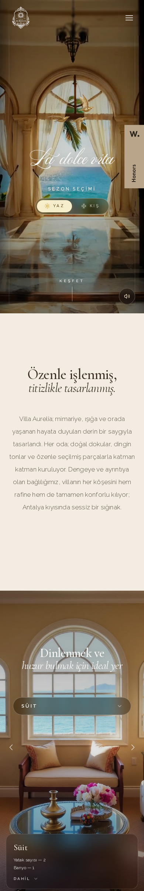

# UI Design System & Master Generation Blueprint: hotelaurelia-online

> **Villa Aurelia — Butik Lüks Otel & Rezervasyon** (https://hotelaurelia.online/) — Villa Aurelia; sakin, sinematik bir kaçamak olarak tasarlanmış butik lüks otel. Odalar, gastronomi, deneyimler, düğünler ve doğrudan reze...


---

## 1. Executive Visual Persona & Design Archetype

- **Brand Essence & Persona**: **Villa Aurelia — Butik Lüks Otel & Rezervasyon** (`https://hotelaurelia.online/`). Villa Aurelia; sakin, sinematik bir kaçamak olarak tasarlanmış butik lüks otel. Odalar, gastronomi, deneyimler, düğünler ve doğrudan reze...
- **Visual Archetype**: **Light-Substrate Editorial & Modular Grid System (`#f6efe5` canvas, `#1f1a15` ink, `#8a7d6c` accent)**.
- **Anti-AI-Slop Differentiators**:
  - **Source-Grounded Chromatic Polarity**: Anchors the viewport in `#f6efe5` (`var(--lume-bone)` in `:root`) paired with `#1f1a15` primary typography and `#8a7d6c` accents.
  - **Extracted Typographic Hierarchy**: Pairs `Neue Montreal` for display copy (`L a d o l c e v i t a`) with `Berlingske Serif` and `Space Mono`.
  - **Calibrated Spatial Grid & Motion**: Combines `1400px` container bounds (`gap: .25rem`, padding `2rem`) with `cubic-bezier(.4,0,.6,1)` easing and Lenis Smooth Scroll (`data-lenis`).

---

## 2. Spatial Architecture & Modular Grid Mathematics



### Viewport Allocation & Container Geometry
- **Captured Viewport Dimensions**: Desktop `1440×10048px` (`assets/desktop.png`, full-page scroll capture), Mobile `390×2400px` (`assets/mobile.png`, capped at 2400px multi-section capture).
- **Master Container Bounds**: `1400px` extracted from `hotelaurelia-online` stylesheet.
- **Canvas Lateral Padding & Spacing**: `2rem` lateral canvas padding with `.25rem` grid gap.
- **Border Radius Scale**: `1rem`, `2px`, `9999px`, `var(--radius)`.

### Responsive Breakpoint Architecture
- **Desktop Layout**: Multi-column CSS Grid / Flexbox layout at `1440px` (`max-width: 1400px`, `gap: .25rem`).
- **Mobile Layout**: Single-column vertical stack at `390px` viewport width with `2rem` horizontal padding.
- **Extracted CSS Media Queries**: `@media (min-width: 1400px)`, `@media (prefers-reduced-motion: reduce)`, `@media (max-width: 900px)`, `@media (max-width: 768px)`.

---

## 3. Color System, Materiality & Atmospheric Lighting

### Semantic Palette & Source Grounding
| Semantic Role | Ground-Truth Value | Extracted CSS Source / Selector |
|---|---|---|
| **Primary Canvas Substrate** | `#f6efe5` | `var(--lume-bone)` in `:root` |
| **Primary Typography Ink** | `#ede4d3` | `var(--lume-cream)` in `:root` |
| **Elevated Surface / Card Substrate** | `#1f1a15` | `var(--lume-ink)` in `:root` |
| **Interactive Accent / Highlight** | `#8a7d6c` | `var(--lume-mute)` in `:root` |
| **Secondary / Muted Copy** | `#b78a6b` | `var(--lume-rose)` in `:root` |
| **Structural Hairline Border** | `#f5f0e4` | `var(--au-cream)` in `:root` |

### Sanitized Root CSS Variables (`ui-ux.md` Ground Truth)
| Variable Name | Extracted Value | Semantic Role |
|---|---|---|
| `--background` | `36 30% 96%` | Canvas / Surface Token |
| `--foreground` | `210 20% 18%` | Typography Ink Token |
| `--card` | `36 30% 98%` | Dimension / Scale Token |
| `--card-foreground` | `210 20% 18%` | Typography Ink Token |
| `--popover` | `36 30% 96%` | Dimension / Scale Token |
| `--popover-foreground` | `210 20% 18%` | Typography Ink Token |
| `--primary` | `200 55% 48%` | Brand / Palette Token |
| `--primary-foreground` | `36 30% 98%` | Typography Ink Token |
| `--secondary` | `36 22% 90%` | Brand / Palette Token |
| `--secondary-foreground` | `210 20% 18%` | Typography Ink Token |
| `--muted` | `36 18% 92%` | Dimension / Scale Token |
| `--muted-foreground` | `210 12% 42%` | Typography Ink Token |
| `--accent` | `38 55% 58%` | Brand / Palette Token |
| `--accent-foreground` | `210 20% 18%` | Typography Ink Token |
| `--destructive` | `0 60% 50%` | Dimension / Scale Token |
| `--destructive-foreground` | `36 30% 98%` | Typography Ink Token |

---

## 4. Typographic Scale & Editorial Hierarchy

### Font Family Stacks
- **Display Typography**: `Neue Montreal`.
- **Primary Body Stack**: `Berlingske Serif`.
- **Technical / Metadata Stack**: `Space Mono`.

### Typographic Scale & Rules (Extracted from Stylesheet & Variables)
- **Hero Display (`H1`)**: not explicitly declared on tag in static CSS (stylesheet font-size ladder: `1em`, `80%`, `75%`, `100%`, `1.5rem`).
- **Section Heading (`H2`)**: not explicitly declared on tag in static CSS (stylesheet font-size ladder: `1em`, `80%`, `75%`, `100%`, `1.5rem`).
- **Body Copy**: rule `,body` (`font-weight: 300`).
- **Metadata & Navigation Labels**: not explicitly declared on tag in static CSS (stylesheet font-size ladder: `1em`, `80%`, `75%`, `100%`, `1.5rem`).

---

## 5. Choreographed Motion & Interaction Physics

### Primary Easing Curves
- **Extracted Timing Functions**: `cubic-bezier(.4,0,.6,1)`, `cubic-bezier(.4,0,.2,1)`, `cubic-bezier(0,0,.2,1)`.

### Per-Element Transition & Choreography Rules
- **Selector `.transition`**: `transition: cubic-bezier(.4,0,.6,1)` extracted from `hotelaurelia-online` stylesheet.
- **Selector `.transition-\[background\]`**: `transition: cubic-bezier(.4,0,.6,1)` extracted from `hotelaurelia-online` stylesheet.
- **Selector `width\]`**: `transition: cubic-bezier(.4,0,.6,1)` extracted from `hotelaurelia-online` stylesheet.
- **Extracted Easing Curve (`cubic-bezier(.4,0,.6,1)`)**: Governs interactive state transitions across `<header.fixed>` and `<section.relative>`.
- **Runtime Interaction Engine**: Integrates Lenis Smooth Scroll (`data-lenis`) with `prefers-reduced-motion: reduce` fallback guards.

---

## 6. Component Wireframe & Structural DOM Map

### Visual Layout Schematic (Grounded in `dom.html` — `1440px` Desktop & `390px` Mobile Reflow)
```
┌────────────────────────────────────────────────────────────────────────┐
│ DESKTOP VIEWPORT (1440px) — Villa Aurelia — Butik Lüks Otel & Rezervas │
│ ====================================================================== │
│ [ <header.fixed>           | ODALAR · GASTRONOMİ · DENEYİMLER · JOU ]  │
│ ---------------------------------------------------------------------- │
│ | HERO STAGE: <section.rune-revealed>                              |   │
│ | H1: L a d o l c e v i t a                                        |   │
│ | Substrate: #f6efe5    | Ink: #1f1a15    | Accent: #8a7d6c        |   │
│ ---------------------------------------------------------------------- │
│ | SHOWCASE GRID (<section.relative>        ) max-w: 1400px         |   │
│ | +------------------------------+  +------------------------------+ | │
│ | | Özenle işlenmiş, titizlikle  |  | Dinlenmek ve huzur bulmak iç | | │
│ | +------------------------------+  +------------------------------+ | │
│ ---------------------------------------------------------------------- │
│ | MOBILE VIEWPORT REFLOW (390px) — Single-Column Stack (gap: .25rem) | │
│ | [<header.fixed>] -> [<section.rune-reve] -> [<section.relative>] |   │
│ ---------------------------------------------------------------------- │
│ [ FOOTER (<footer.relative>     ) | https://hotelaurelia.online/       │
└────────────────────────────────────────────────────────────────────────┘
```

### Granular DOM Region Breakdown
1. **Brand Header & Navigation Bar (<header.fixed> — `hotelaurelia-online`)**:
   - Landmark `<header class="fixed top-0">` hosting `Villa Aurelia — Butik Lüks Otel & Re` navigation (`ODALAR · GASTRONOMİ · DENEYİMLER · JOURNAL`), DOM attributes (`data-artifact-kind="dwl_content_hash"`, `data-artifact-id="b530ed7030d66d8b94f08..."`, `data-commit-sha="8f86fc78813222994402b..."`, `data-context-token="v1.eyJwcm9qZWN0X2lkIj..."`), and stylesheet rule `after { box-sizing:border-box;border-width:0;border-style:solid;border-color:e5e7eb }`.
2. **Hero Stage & Focal Lead (<section.rune-revealed> — `L a d o l c e v i t a`)**:
   - Landmark `<section class="rune-revealed rune-reveal-up">` presenting display lead `L a d o l c e v i t a` and copy excerpt *"Yaz Sezonu Yaz Nisan – Ekim"* over `#f6efe5` canvas and `#1f1a15` ink.
3. **Primary Showcase & Content Grid (<section.relative> — `Özenle işlenmiş, titizlikle tasarl`)**:
   - Landmark `<section class="relative h-screen">` rendering section `Özenle işlenmiş, titizlikle tasarlanmış.` with copy *"Kış Sezonu Kış Kasım – Mart"*, asset references (`favicon.png`, `fonts.googleapis.com`, `fonts.gstatic.com`, `css2`), and grid rule `body { margin:0;line-height:inherit }`.
4. **Interactive Detail & Feature Matrix (<section.au-about-reveal> — `Dinlenmek ve huzur bulmak için ide`)**:
   - Landmark `<section class="au-about-reveal relative">` framing `Dinlenmek ve huzur bulmak için ideal yer` and `Süit` (*"titizlikle tasarlanmış."*) with `#1f1a15` surface cards, `#8a7d6c` accents, and `strong { font-weight:bolder }`.
5. **Colophon & Global Directory Footer (<footer.relative> — `https://hotelaurelia.online/`)**:
   - Landmark `<footer class="relative overflow-hidden">` anchoring `Villa Aurelia — Butik Lüks Otel ` footer links (`ODALAR · GASTRONOMİ · DENEYİMLER · JOURNAL`), copy *"Villa Aurelia; mimariye, ışığa ve orada yaşanan hayata duyul"*, and `#f5f0e4` structural dividers.

---

## 7. Master Zero-Shot AI Generation Prompt

```markdown
# Master Zero-Shot Frontend Generation Prompt: hotelaurelia-online (Villa Aurelia — Butik Lüks Otel & Rezervasyon)

You are a principal frontend architect and design systems engineer. Build a complete, production-ready web application replicating the exact design system, DOM landmarks, typographic hierarchy, color tokens, and motion physics of `hotelaurelia-online` (**Villa Aurelia — Butik Lüks Otel & Rezervasyon** — `https://hotelaurelia.online/`).

### 1. Visual Archetype & Anti-AI-Slop Mandates
- **Archetype**: Light-Substrate Editorial & Modular Grid System (`#f6efe5` canvas, `#1f1a15` ink, `#8a7d6c` accent).
- **Identity & Domain Context**: Villa Aurelia; sakin, sinematik bir kaçamak olarak tasarlanmış butik lüks otel. Odalar, gastronomi, deneyimler, düğünler ve doğrudan reze...
- **Primary Substrate**: `#f6efe5` (`var(--lume-bone)` in `:root`), **Primary Ink**: `#1f1a15`, **Accent / Highlight**: `#8a7d6c`.
- **Site-Specific Differentiators**:
  - **Source-Grounded Chromatic Polarity**: Anchors the viewport in `#f6efe5` (`var(--lume-bone)` in `:root`) paired with `#1f1a15` primary typography and `#8a7d6c` accents.
  - **Extracted Typographic Hierarchy**: Pairs `Neue Montreal` for display copy (`L a d o l c e v i t a`) with `Berlingske Serif` and `Space Mono`.
  - **Calibrated Spatial Grid & Motion**: Combines `1400px` container bounds (`gap: .25rem`, padding `2rem`) with `cubic-bezier(.4,0,.6,1)` easing and Lenis Smooth Scroll (`data-lenis`).

### 2. Ground-Truth CSS Variables (`:root` Token Contract)
Declare and consume these exact custom properties extracted from `hotelaurelia-online` in your global stylesheet:

:root {
  /* Villa Aurelia — Butik Lüks Otel & Rezervasyon (hotelaurelia-online) — Ground-Truth Extracted CSS Variables */
  --background: 36 30% 96%; /* Canvas / Surface Token (hotelaurelia-online) */
  --foreground: 210 20% 18%; /* Typography Ink Token (hotelaurelia-online) */
  --card: 36 30% 98%; /* Dimension / Scale Token (hotelaurelia-online) */
  --card-foreground: 210 20% 18%; /* Typography Ink Token (hotelaurelia-online) */
  --popover: 36 30% 96%; /* Dimension / Scale Token (hotelaurelia-online) */
  --popover-foreground: 210 20% 18%; /* Typography Ink Token (hotelaurelia-online) */
  --primary: 200 55% 48%; /* Brand / Palette Token (hotelaurelia-online) */
  --primary-foreground: 36 30% 98%; /* Typography Ink Token (hotelaurelia-online) */
  --secondary: 36 22% 90%; /* Brand / Palette Token (hotelaurelia-online) */
  --secondary-foreground: 210 20% 18%; /* Typography Ink Token (hotelaurelia-online) */
  --muted: 36 18% 92%; /* Dimension / Scale Token (hotelaurelia-online) */
  --muted-foreground: 210 12% 42%; /* Typography Ink Token (hotelaurelia-online) */
  --accent: 38 55% 58%; /* Brand / Palette Token (hotelaurelia-online) */
  --accent-foreground: 210 20% 18%; /* Typography Ink Token (hotelaurelia-online) */
  --destructive: 0 60% 50%; /* Dimension / Scale Token (hotelaurelia-online) */
  --destructive-foreground: 36 30% 98%; /* Typography Ink Token (hotelaurelia-online) */
}

### 3. Semantic Color & Materiality Contract
Map every surface, ink, and border strictly to these source-grounded tokens:
- **Primary Canvas Substrate**: `#f6efe5` — grounded in `var(--lume-bone)` in `:root`
- **Primary Typography Ink**: `#ede4d3` — grounded in `var(--lume-cream)` in `:root`
- **Elevated Surface / Card Substrate**: `#1f1a15` — grounded in `var(--lume-ink)` in `:root`
- **Interactive Accent / Highlight**: `#8a7d6c` — grounded in `var(--lume-mute)` in `:root`
- **Secondary / Muted Copy**: `#b78a6b` — grounded in `var(--lume-rose)` in `:root`
- **Structural Hairline Border**: `#f5f0e4` — grounded in `var(--au-cream)` in `:root`

### 4. Spatial Grid, Container Bounds & Responsive Breakpoints
- **Desktop Viewport Reference**: `1440×10048px` (full-page scroll capture, `1440px` standard desktop width).
- **Mobile Viewport Reference**: `390×2400px` (capped at 2400px multi-section capture, `390px` standard mobile width).
- **Container Max-Width**: `1400px` extracted from `hotelaurelia-online` stylesheet
- **Padding & Gutters**: `2rem` lateral canvas padding with `.25rem` grid gap
- **Desktop Grid**: Multi-column CSS Grid / Flexbox layout at `1440px` (`max-width: 1400px`, `gap: .25rem`)
- **Mobile Adaptation**: Single-column vertical stack at `390px` viewport width with `2rem` horizontal padding
- **Media Queries**: `@media (min-width: 1400px)`, `@media (prefers-reduced-motion: reduce)`, `@media (max-width: 900px)`, `@media (max-width: 768px)`
- **Corner Radii**: `1rem`, `2px`, `9999px`, `var(--radius)`

### 5. Typography & Editorial Scale Contract
- **Display Font Stack**: `Neue Montreal`
- **Body Font Stack**: `Berlingske Serif`
- **Monospace / Technical Font Stack**: `Space Mono`
- **H1 Display Rule**: not explicitly declared on tag in static CSS (stylesheet font-size ladder: `1em`, `80%`, `75%`, `100%`, `1.5rem`)
- **H2 Section Rule**: not explicitly declared on tag in static CSS (stylesheet font-size ladder: `1em`, `80%`, `75%`, `100%`, `1.5rem`)
- **Body Copy Rule**: rule `,body` (`font-weight: 300`)
- **Metadata & Index Rule**: not explicitly declared on tag in static CSS (stylesheet font-size ladder: `1em`, `80%`, `75%`, `100%`, `1.5rem`)

### 6. Component Hierarchy, Verbatim Copy & Real DOM Landmarks
Scaffold `hotelaurelia-online` (`Villa Aurelia — Butik Lüks Otel & Rezervasyon`) with these exact structural regions, extracted copy, and CSS rules from `dom.html`:
1. **Brand Header & Navigation Bar (<header.fixed> — `hotelaurelia-online`)**:
   - DOM & Selectors: Landmark `<header class="fixed top-0">` hosting `Villa Aurelia — Butik Lüks Otel & Re` navigation (`ODALAR · GASTRONOMİ · DENEYİMLER · JOURNAL`), DOM attributes (`data-artifact-kind="dwl_content_hash"`, `data-artifact-id="b530ed7030d66d8b94f08..."`, `data-commit-sha="8f86fc78813222994402b..."`, `data-context-token="v1.eyJwcm9qZWN0X2lkIj..."`), and stylesheet rule `after { box-sizing:border-box;border-width:0;border-style:solid;border-color:e5e7eb }`.
   - Responsive Contract: Header `Brand Header & Navigation Bar (<header.fixed> — `hotelaurelia-online`)` (`hotelaurelia-online`) adapts across `@media (min-width: 1400px)`, `@media (prefers-reduced-motion: reduce)`, `@media (max-width: 900px)`, `@media (max-width: 768px)` with `cubic-bezier(.4,0,.6,1)`, `cubic-bezier(.4,0,.2,1)`, `cubic-bezier(0,0,.2,1)` transitions and links `ODALAR · GASTRONOMİ · DENEYİMLER · JOURNAL`.
2. **Hero Stage & Focal Lead (<section.rune-revealed> — `L a d o l c e v i t a`)**:
   - DOM & Selectors: Landmark `<section class="rune-revealed rune-reveal-up">` presenting display lead `L a d o l c e v i t a` and copy excerpt *"Yaz Sezonu Yaz Nisan – Ekim"* over `#f6efe5` canvas and `#1f1a15` ink.
   - Responsive Contract: Hero stage (`1440×10048px` desktop / `390×2400px` mobile) sets `#f6efe5` background with `#1f1a15` headline `L a d o l c e v i t a`.
3. **Primary Showcase & Content Grid (<section.relative> — `Özenle işlenmiş, titizlikle tasarl`)**:
   - DOM & Selectors: Landmark `<section class="relative h-screen">` rendering section `Özenle işlenmiş, titizlikle tasarlanmış.` with copy *"Kış Sezonu Kış Kasım – Mart"*, asset references (`favicon.png`, `fonts.googleapis.com`, `fonts.gstatic.com`, `css2`), and grid rule `body { margin:0;line-height:inherit }`.
   - Responsive Contract: Showcase grid `Primary Showcase & Content Grid (<section.relative> — `Özenle işlenmiş, titizlikle tasarl`)` applies Multi-column CSS Grid / Flexbox layout at `1440px` (`max-width: 1400px`, `gap: .25rem`) on desktop and Single-column vertical stack at `390px` viewport width with `2rem` horizontal padding on mobile.
4. **Interactive Detail & Feature Matrix (<section.au-about-reveal> — `Dinlenmek ve huzur bulmak için ide`)**:
   - DOM & Selectors: Landmark `<section class="au-about-reveal relative">` framing `Dinlenmek ve huzur bulmak için ideal yer` and `Süit` (*"titizlikle tasarlanmış."*) with `#1f1a15` surface cards, `#8a7d6c` accents, and `strong { font-weight:bolder }`.
   - Responsive Contract: Detail module `Interactive Detail & Feature Matrix (<section.au-about-reveal> — `Dinlenmek ve huzur bulmak için ide`)` uses `1rem`, `2px`, `9999px`, `var(--radius)` radii, `#8a7d6c` highlights, and assets (favicon.png, fonts.googleapis.com, fonts.gstatic.com).
5. **Colophon & Global Directory Footer (<footer.relative> — `https://hotelaurelia.online/`)**:
   - DOM & Selectors: Landmark `<footer class="relative overflow-hidden">` anchoring `Villa Aurelia — Butik Lüks Otel ` footer links (`ODALAR · GASTRONOMİ · DENEYİMLER · JOURNAL`), copy *"Villa Aurelia; mimariye, ışığa ve orada yaşanan hayata duyul"*, and `#f5f0e4` structural dividers.
   - Responsive Contract: Footer `Colophon & Global Directory Footer (<footer.relative> — `https://hotelaurelia.online/`)` aligns to `1400px` extracted from `hotelaurelia-online` stylesheet with `2rem` lateral canvas padding with `.25rem` grid gap and attributes (data-artifact-kind="dwl_content_hash", data-artifact-id="b530ed7030d66d8b94f08...", data-commit-sha="8f86fc78813222994402b...").

#### Verbatim DOM Copy Excerpts (`dom.html`)
- Copy Excerpt 1: *"Yaz Sezonu Yaz Nisan – Ekim"*
- Copy Excerpt 2: *"Kış Sezonu Kış Kasım – Mart"*
- Copy Excerpt 3: *"titizlikle tasarlanmış."*
- Copy Excerpt 4: *"Villa Aurelia; mimariye, ışığa ve orada yaşanan hayata duyulan derin bir saygıyla..."*

### 7. Motion, Extracted Stylesheet Rules & Interaction Choreography
- **Primary Easing Functions**: `cubic-bezier(.4,0,.6,1)`, `cubic-bezier(.4,0,.2,1)`, `cubic-bezier(0,0,.2,1)`
- **Extracted Stylesheet Rules (`hotelaurelia-online`)**:
- `after { box-sizing:border-box;border-width:0;border-style:solid;border-color:e5e7eb }`
- `body { margin:0;line-height:inherit }`
- `strong { font-weight:bolder }`
- `small { font-size:80% }`
- `sup { font-size:75%;line-height:0;position:relative;vertical-align:baseline }`
- **Per-Selector Transition Rules**:
- **Selector `.transition`**: `transition: cubic-bezier(.4,0,.6,1)` extracted from `hotelaurelia-online` stylesheet.
- **Selector `.transition-\[background\]`**: `transition: cubic-bezier(.4,0,.6,1)` extracted from `hotelaurelia-online` stylesheet.
- **Selector `width\]`**: `transition: cubic-bezier(.4,0,.6,1)` extracted from `hotelaurelia-online` stylesheet.
- **Extracted Easing Curve (`cubic-bezier(.4,0,.6,1)`)**: Governs interactive state transitions across `<header.fixed>` and `<section.relative>`.
- **Runtime Interaction Engine**: Integrates Lenis Smooth Scroll (`data-lenis`) with `prefers-reduced-motion: reduce` fallback guards.

### 8. Technical Deliverables
- Implement in Next.js (App Router) with TypeScript and Tailwind CSS consuming the `:root` custom properties defined above for `hotelaurelia-online`.
- Reproduce both the `1440px` desktop architecture and `390px` mobile breakpoint transitions, preserving semantic HTML5 landmarks (`<header>`, `<nav>`, `<main>`, `<section>`, `<footer>`) and `prefers-reduced-motion` accessibility guards.
```
