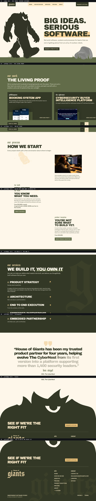
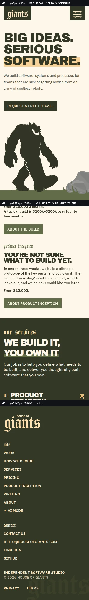

# UI Design System & Master Generation Blueprint: houseofgiants-com

> **House of Giants · Product engineering partner** (https://houseofgiants.com) — House of Giants designs and builds software products. We help you work out what to build, build it, and keep improving it.





---

## 1. Executive Visual Persona & Design Archetype

- **Brand Essence & Persona**: **House of Giants · Product engineering partner** (`https://houseofgiants.com`). House of Giants designs and builds software products. We help you work out what to build, build it, and keep improving it.
- **Capture Provenance**: Live browser capture (`tier1_fast`, HTTP `200`, captured `2026-11-24`).
- **Visual Archetype**: **Light-Substrate Editorial & Modular Grid System (`#ffffff` canvas, `#000000` ink, `#000000` accent)**.
- **Anti-AI-Slop Differentiators**:
  - **Live-Computed Chromatic Polarity**: Anchors the viewport in `#ffffff` (live computed `browser-default` `background-color` (`computed_styles.json`)) paired with `#000000` primary typography and `#000000` accents.
  - **Grounded Typographic Hierarchy**: Pairs `Archivo Black` for display copy (`BIG IDEAS. SERIOUS SOFTWARE.`) with `IBM Plex Sans` and `Geist Mono`.
  - **Calibrated Spatial Grid & Motion**: Combines `96rem` container bounds (`gap: .625rem`, padding `.75rem`) with `cubic-bezier(.4,0,.2,1)` easing and Three.js / WebGL Canvas Pipeline.

---

## 2. Spatial Architecture & Modular Grid Mathematics

### Viewport Allocation & Container Geometry
- **Captured Journey Filmstrips**: Desktop `1280×6624px` (`assets/desktop-journey.webp`, `8` keyframes up to `y=5515px` / doc `6415px`), Mobile `390×2616px` (`assets/mobile-journey.webp`, `3` keyframes).
- **Master Container Bounds**: `96rem` (non-`@media` desktop container stylesheet rule).
- **Canvas Lateral Padding & Spacing**: `.75rem` lateral canvas padding with `.625rem` grid gap.
- **Border Radius Scale**: `50%`, `999px`, `1.25rem`, `.5rem`.

### Responsive Breakpoint Architecture
- **Desktop Layout**: Multi-column CSS Grid / Flexbox layout at `1440px` (`max-width: 96rem`, `gap: .625rem`).
- **Mobile Layout**: Single-column vertical stack at `390px` viewport width with `.75rem` horizontal padding.
- **Extracted CSS Media Queries**: `@media (prefers-reduced-motion:reduce)`, `@media (width>=64rem)`, `@media (width>=48rem)`, `@media (scripting:enabled) and (prefers-reduced-motion:no-prefer...`.

---

## 3. Color System, Materiality & Atmospheric Lighting

### Semantic Palette & Source Grounding
| Semantic Role | Ground-Truth Value | Extracted Live / CSS Source |
|---|---|---|
| **Primary Canvas Substrate** | `#ffffff` | live computed `browser-default` `background-color` (`computed_styles.json`) |
| **Primary Typography Ink** | `#000000` | `body` default contrast ink (`#000000`) |
| **Elevated Surface / Card Substrate** | `#ffffff` | transparent/inherited card surface over live computed `browser-default` `background-color` (`computed_styles.json`) |
| **Interactive Accent / Highlight** | `#000000` | `body` default contrast ink (`#000000`) |
| **Secondary / Muted Copy** | `#000000` | secondary opacity step of `body` default contrast ink (`#000000`) |
| **Structural Hairline Border** | `#000000` | hairline divider derived from secondary opacity step of `body` default contrast ink (`#000000`) |

### Sanitized Root CSS Variables (`ui-ux.md` Ground Truth)
| Variable Name | Extracted Value | Semantic Role |
|---|---|---|
| `--asset-logo-full` | `url(/brand/logo.svg)` | Design System Custom Token |
| `--asset-logo-mark` | `url(/brand/g.svg)` | Design System Custom Token |
| `--asset-logo-word` | `url(/brand/giants.svg)` | Design System Custom Token |
| `--asset-menu` | `url(/brand/menu.svg)` | Design System Custom Token |
| `--asset-work-cursor` | `url(/brand/subtract-cursor.svg)` | Design System Custom Token |
| `--font-hog-display` | `"Newsreader", Georgia, serif` | Typography / Scale Token |
| `--font-hog-impact` | `"Archivo Black", ui-sans-serif, system-ui, sans-serif` | Typography / Scale Token |
| `--font-hog-body` | `"IBM Plex Sans", ui-sans-serif, system-ui, sans-serif` | Typography / Scale Token |
| `--font-hog-eyebrow` | `"BN Blacklettra", serif` | Typography / Scale Token |
| `--paper` | `oklch(94.54% .0499 79.86)` | Canvas / Surface Token |
| `--surface` | `oklch(95.6% .043 82)` | Canvas / Surface Token |
| `--ink` | `oklch(24.2% .043 128)` | Typography Ink Token |
| `--ink-soft` | `oklch(48.5% .036 126)` | Typography Ink Token |
| `--moss` | `oklch(51.23% .0541 122.49)` | Color / Atmospheric Token |
| `--moss-dark` | `oklch(43.54% .0512 122.64)` | Canvas / Surface Token |
| `--moss-deep` | `oklch(33.03% .031 120.72)` | Color / Atmospheric Token |

---

## 4. Typographic Scale & Editorial Hierarchy

### Font Family Stacks
- **Display Typography**: `Archivo Black`.
- **Primary Body Stack**: `IBM Plex Sans`.
- **Technical / Metadata Stack**: `Geist Mono`.

### Typographic Scale & Rules (Live Computed & Stylesheet Grounded)
- **Hero Display (`H1`)**: live computed `h1` (`font-size: 111.387px`, `line-height: 98.021px`, `font-weight: 400`, `letter-spacing: -4.4555px`); CSS variables `--font-hog-display: "Newsreader", Georgia, serif`, `--text-5xl: 3rem`, `--text-5xl--line-height: 1`.
- **Section Heading (`H2`)**: live computed `h2` (`font-size: 64px`, `line-height: 70.4px`, `font-weight: 400`, `letter-spacing: -3.4px`); CSS variables `--text-2xl: 1.5rem`, `--text-2xl--line-height: calc(2 / 1.5)`; rule `h2` (`font-size: var(--text-title-sm)`, `line-height: var(--text-title-sm--...`, `letter-spacing: var(--text-title-sm--...`).
- **Body Copy**: live computed `body` (`font-size: 16px`, `line-height: 24px`, `font-weight: 400`); CSS variables `--font-hog-body: "IBM Plex Sans", ui-sans-serif, system-ui, sans-serif`, `--text-base: 1rem`, `--text-base--line-height: calc(1.5 / 1)`.
- **Metadata & Navigation Labels**: live computed `nav/a` (`font-size: 16px`, `line-height: 24px`, `font-weight: 400`); CSS variables `--font-mono: var(--font-hog-mono)`, `--text-xs: .75rem`, `--text-xs--line-height: calc(1 / .75)`.

---

## 5. Choreographed Motion & Interaction Physics

### Primary Easing Curves
- **Extracted Timing Functions**: `cubic-bezier(.4,0,.2,1)`, `cubic-bezier(.22,1,.36,1)`, `cubic-bezier(.16,1,.3,1)`.

### Per-Element Transition & Choreography Rules
- **Selector `layer theme`**: `transition: .15s` extracted from `houseofgiants-com` stylesheet.
- **Selector `layer components`**: `transition: background-color var(--motion-duration-fast) var(--motion-ease...` extracted from `houseofgiants-com` stylesheet.
- **Selector `.site-footer__link`**: `transition: color var(--motion-duration-fast) var(--motion-ease-standard),...` extracted from `houseofgiants-com` stylesheet.
- **Extracted Easing Curve (`cubic-bezier(.4,0,.2,1)`)**: Governs interactive state transitions across `<header.site-navigation>` and `<section.home-selected-work>`.
- **Runtime Interaction Engine**: Integrates Three.js / WebGL Canvas Pipeline with `prefers-reduced-motion: reduce` fallback guards.
### Measured Runtime Scroll & Interaction Telemetry (`behavioral_journey_v2`)
- **Scroll Driver Mode**: `native` (max document height `6415px`, deepest scrollY reached `5515px` across `8` desktop keyframes).
- **Detected Scroll / Motion Libraries**: Native browser scroll / standard CSS transitions.
- **Hover Physics (`primary_cta` · `REQUEST A FREE FIT CALL`)**: `color`: `oklch(0.9454 0.0499 79.86)` -> `oklch(0.3303 0.031 120.72)`; `backgroundColor`: `oklch(0.3303 0.031 120.72)` -> `oklch(0.8314 0.1023 78.61)` (`transition-duration: 0.16s, 0.16s`, `timing: cubic-bezier(0.22, 1, 0.36, 1), cubic-bezier(0.22, 1, 0.36, 1)`).
- **Interactive Control Probe (`accordion`)**: Tested `02 ARCHITECTURE We're all about a...` (diff `2.54`).
- **Route Transition Architecture**: First internal navigation (`/work`) measured as `SPA` in `1100ms`.

---

## 6. Component Wireframe & Structural DOM Map

### Visual Layout Schematic — Desktop (`1440px`, Grounded in `dom.html` & Landmark Bounding Boxes)
```
┌────────────────────────────────────────────────────────────────────────┐
│ DESKTOP VIEWPORT (1440px) — House of Giants · Product engineering part │
│ ====================================================================== │
│ [ <header.site-navigatio (1440x61px)  | Work · How we decide · Servi ] │
│ ---------------------------------------------------------------------- │
│ | HERO STAGE: <section.home-hero> (w=1440px)                         | │
│ | H1: BIG IDEAS. SERIOUS SOFTWARE.                                   | │
│ | Substrate: #ffffff | Ink: #000000 | Accent: #000000                | │
│ ---------------------------------------------------------------------- │
│ | SHOWCASE GRID (<section.home-selected-wor) max-w: 96rem            | │
│ | +------------------------------+  +------------------------------+ | │
│ | | Big Ideas. Serious Software. |  | The Living Proof             | | │
│ | +------------------------------+  +------------------------------+ | │
│ ---------------------------------------------------------------------- │
│ | DETAIL MODULE (<section.home-process>) — Booking system app        | │
│ ---------------------------------------------------------------------- │
│ [ FOOTER (<footer.site-footer>) | https://houseofgiants.com            │
└────────────────────────────────────────────────────────────────────────┘
```

### Visual Layout Schematic — Mobile Reflow (`390px`)
```
┌────────────────────────────────────────────────────────────────────────┐
│ MOBILE VIEWPORT REFLOW (390px) — Single-Column Stack (gap: .625rem)    │
│ ====================================================================== │
│ [ HEADER BAR (<header.site-navigation>) | Compact Menu (390px)         │
│ ---------------------------------------------------------------------- │
│ | HERO STAGE (<section.home-hero>) — 390px Vertical Lead             | │
│ | H1: BIG IDEAS. SERIOUS SOFTWARE.                                   | │
│ ---------------------------------------------------------------------- │
│ | SHOWCASE STACK (<section.home-selected) — 1-Col Stack              | │
│ | [ Item 1: Big Ideas. Serious Software.                           ] | │
│ | [ Item 2: The Living Proof                                       ] | │
│ ---------------------------------------------------------------------- │
│ | DETAIL STACK (<section.home-process>) — 1-Col (Booking system app) | │
│ ---------------------------------------------------------------------- │
│ [ FOOTER (<footer.site-footer>) | Stacked 390px Colophon               │
└────────────────────────────────────────────────────────────────────────┘
```

### Granular DOM Region Breakdown
1. **Brand Header & Navigation Bar (<header.site-navigation> — `houseofgiants-com`)**:
   - Landmark `<header class="site-navigation inset-x-0">` (`1440x61px`) hosting `House of Giants · Product engineerin` navigation (`Work · How we decide · Services · Pricing · About`), DOM attributes (`data-precedence="default"`, `data-precedence="default"`, `data-status="active"`, `data-footprint-ready`), and stylesheet rule `backdrop { box-sizing:border-box;border:0 solid;margin:0;padding:0 }`.
2. **Hero Stage & Focal Lead (<section.home-hero> — `BIG IDEAS. SERIOUS SOFTWARE.`)**:
   - Landmark `<section class="home-hero pt-10">` presenting display lead `BIG IDEAS. SERIOUS SOFTWARE.` and copy excerpt *"We build software, systems and processes for teams that are sick "* over `#ffffff` canvas and `#000000` ink.
3. **Primary Showcase & Content Grid (<section.home-selected-work> — `Big Ideas. Serious Software.`)**:
   - Landmark `<section class="home-selected-work bg-moss">` rendering section `Big Ideas. Serious Software.` with copy *"We've worked with hundreds of amazing brands over the years. Thes"*, asset references (`thing-walk.svg`, `thing-tufts.svg`, `boulder.svg`, `thing-footprint-right.svg`), and grid rule `file-selector-button { box-sizing:border-box;border:0 solid;margin:0;padding:0 }`.
4. **Interactive Detail & Feature Matrix (<section.home-process> — `The Living Proof`)**:
   - Landmark `<section class="home-process overflow-clip">` framing `The Living Proof` and `Booking system app` (*"PebbleSpaces Booking system app The prototype we inherited was ha"*) with `#ffffff` surface cards, `#000000` accents, and `strong { font-weight:bolder }`.
5. **Colophon & Global Directory Footer (<footer.site-footer> — `https://houseofgiants.com`)**:
   - Landmark `<footer class="site-footer">` anchoring `House of Giants · Product engine` footer links (`Work · How we decide · Services · Pricing · About`), copy *"The prototype we inherited was half-built and the first loca"*, and `#000000` structural dividers.
### Full Vertical Scroll Sequence (Desktop `1440×900` Keyframes)
- **Step 01** (`y=0px`, `0%`): Active landmark `BIG IDEAS. SERIOUS SOFTWARE.` · sticky/fixed elements: `0`
- **Step 02** (`y=850px`, `15%`): Active landmark `THE LIVING PROOF` · sticky/fixed elements: `0`
- **Step 03** (`y=1700px`, `31%`): Active landmark `HOW WE START` · sticky/fixed elements: `0`
- **Step 04** (`y=2550px`, `46%`): Active landmark `YOU'RE NOT SURE WHAT TO BUILD YET.` · sticky/fixed elements: `0`
- **Step 05** (`y=3400px`, `62%`): Active landmark `WE BUILD IT, YOU OWN IT` · sticky/fixed elements: `0`
- **Step 06** (`y=4250px`, `77%`): Active landmark `Testimonial` · sticky/fixed elements: `0`
- **Step 07** (`y=5100px`, `92%`): Active landmark `Footer` · sticky/fixed elements: `0`
- **Step 08** (`y=5515px`, `100%`): Active landmark `SEE IF WE’RE THE RIGHT FIT` · sticky/fixed elements: `0`

### Multi-Page Internal Route Map
- **Listing Route (`/work`)**: `https://houseofgiants.com/work` — H1: `OUR WORK`, scrollHeight `3426px`, transition `SPA` (`1100ms`)
- **Detail Route (`/work/pebblespaces`)**: `https://houseofgiants.com/work/pebblespaces` — H1: `BOOKING SYSTEM APP`, scrollHeight `10256px`, transition `direct` (`406ms`)
- **About Route (`/about`)**: `https://houseofgiants.com/about` — H1: `SMALL TEAM, GIANT RESULTS`, scrollHeight `6733px`, transition `direct` (`512ms`)

---

## 7. Master Zero-Shot AI Generation Prompt

```markdown
# Master Zero-Shot Frontend Generation Prompt: houseofgiants-com (House of Giants · Product engineering partner)

You are a principal frontend architect and design systems engineer. Build a complete, production-ready web application replicating the exact design system, DOM landmarks, typographic hierarchy, color tokens, and motion physics of `houseofgiants-com` (**House of Giants · Product engineering partner** — `https://houseofgiants.com`).

### 1. Visual Archetype & Anti-AI-Slop Mandates
- **Archetype**: Light-Substrate Editorial & Modular Grid System (`#ffffff` canvas, `#000000` ink, `#000000` accent).
- **Identity & Domain Context**: House of Giants designs and builds software products. We help you work out what to build, build it, and keep improving it.
- **Primary Substrate**: `#ffffff` (live computed `browser-default` `background-color` (`computed_styles.json`)), **Primary Ink**: `#000000`, **Accent / Highlight**: `#000000`.
- **Site-Specific Differentiators**:
  - **Live-Computed Chromatic Polarity**: Anchors the viewport in `#ffffff` (live computed `browser-default` `background-color` (`computed_styles.json`)) paired with `#000000` primary typography and `#000000` accents.
  - **Grounded Typographic Hierarchy**: Pairs `Archivo Black` for display copy (`BIG IDEAS. SERIOUS SOFTWARE.`) with `IBM Plex Sans` and `Geist Mono`.
  - **Calibrated Spatial Grid & Motion**: Combines `96rem` container bounds (`gap: .625rem`, padding `.75rem`) with `cubic-bezier(.4,0,.2,1)` easing and Three.js / WebGL Canvas Pipeline.

### 2. Ground-Truth CSS Variables (`:root` Token Contract)
Declare and consume these exact custom properties extracted from `houseofgiants-com` in your global stylesheet:

:root {
  /* House of Giants · Product engineering partner (houseofgiants-com) — Live-Grounded CSS Variables */
  --asset-logo-full: url(/brand/logo.svg); /* Design System Custom Token (houseofgiants-com) */
  --asset-logo-mark: url(/brand/g.svg); /* Design System Custom Token (houseofgiants-com) */
  --asset-logo-word: url(/brand/giants.svg); /* Design System Custom Token (houseofgiants-com) */
  --asset-menu: url(/brand/menu.svg); /* Design System Custom Token (houseofgiants-com) */
  --asset-work-cursor: url(/brand/subtract-cursor.svg); /* Design System Custom Token (houseofgiants-com) */
  --font-hog-display: "Newsreader", Georgia, serif; /* Typography / Scale Token (houseofgiants-com) */
  --font-hog-impact: "Archivo Black", ui-sans-serif, system-ui, sans-serif; /* Typography / Scale Token (houseofgiants-com) */
  --font-hog-body: "IBM Plex Sans", ui-sans-serif, system-ui, sans-serif; /* Typography / Scale Token (houseofgiants-com) */
  --font-hog-eyebrow: "BN Blacklettra", serif; /* Typography / Scale Token (houseofgiants-com) */
  --paper: oklch(94.54% .0499 79.86); /* Canvas / Surface Token (houseofgiants-com) */
  --surface: oklch(95.6% .043 82); /* Canvas / Surface Token (houseofgiants-com) */
  --ink: oklch(24.2% .043 128); /* Typography Ink Token (houseofgiants-com) */
  --ink-soft: oklch(48.5% .036 126); /* Typography Ink Token (houseofgiants-com) */
  --moss: oklch(51.23% .0541 122.49); /* Color / Atmospheric Token (houseofgiants-com) */
  --moss-dark: oklch(43.54% .0512 122.64); /* Canvas / Surface Token (houseofgiants-com) */
  --moss-deep: oklch(33.03% .031 120.72); /* Color / Atmospheric Token (houseofgiants-com) */
}

### 3. Semantic Color & Materiality Contract
Map every surface, ink, and border strictly to these source-grounded tokens:
- **Primary Canvas Substrate**: `#ffffff` — grounded in live computed `browser-default` `background-color` (`computed_styles.json`)
- **Primary Typography Ink**: `#000000` — grounded in `body` default contrast ink (`#000000`)
- **Elevated Surface / Card Substrate**: `#ffffff` — grounded in transparent/inherited card surface over live computed `browser-default` `background-color` (`computed_styles.json`)
- **Interactive Accent / Highlight**: `#000000` — grounded in `body` default contrast ink (`#000000`)
- **Secondary / Muted Copy**: `#000000` — grounded in secondary opacity step of `body` default contrast ink (`#000000`)
- **Structural Hairline Border**: `#000000` — grounded in hairline divider derived from secondary opacity step of `body` default contrast ink (`#000000`)

### 4. Spatial Grid, Container Bounds & Responsive Breakpoints
- **Desktop Viewport Reference**: `1280×6624px` (multi-frame vertical journey filmstrip (6624px), `1440px` standard desktop width).
- **Mobile Viewport Reference**: `390×2616px` (multi-frame vertical journey filmstrip (2616px), `390px` standard mobile width).
- **Container Max-Width**: `96rem` (non-`@media` desktop container stylesheet rule)
- **Padding & Gutters**: `.75rem` lateral canvas padding with `.625rem` grid gap
- **Desktop Grid**: Multi-column CSS Grid / Flexbox layout at `1440px` (`max-width: 96rem`, `gap: .625rem`)
- **Mobile Adaptation**: Single-column vertical stack at `390px` viewport width with `.75rem` horizontal padding
- **Media Queries**: `@media (prefers-reduced-motion:reduce)`, `@media (width>=64rem)`, `@media (width>=48rem)`, `@media (scripting:enabled) and (prefers-reduced-motion:no-prefer...`
- **Corner Radii**: `50%`, `999px`, `1.25rem`, `.5rem`

### 5. Typography & Editorial Scale Contract
- **Display Font Stack**: `Archivo Black`
- **Body Font Stack**: `IBM Plex Sans`
- **Monospace / Technical Font Stack**: `Geist Mono`
- **H1 Display Rule**: live computed `h1` (`font-size: 111.387px`, `line-height: 98.021px`, `font-weight: 400`, `letter-spacing: -4.4555px`); CSS variables `--font-hog-display: "Newsreader", Georgia, serif`, `--text-5xl: 3rem`, `--text-5xl--line-height: 1`
- **H2 Section Rule**: live computed `h2` (`font-size: 64px`, `line-height: 70.4px`, `font-weight: 400`, `letter-spacing: -3.4px`); CSS variables `--text-2xl: 1.5rem`, `--text-2xl--line-height: calc(2 / 1.5)`; rule `h2` (`font-size: var(--text-title-sm)`, `line-height: var(--text-title-sm--...`, `letter-spacing: var(--text-title-sm--...`)
- **Body Copy Rule**: live computed `body` (`font-size: 16px`, `line-height: 24px`, `font-weight: 400`); CSS variables `--font-hog-body: "IBM Plex Sans", ui-sans-serif, system-ui, sans-serif`, `--text-base: 1rem`, `--text-base--line-height: calc(1.5 / 1)`
- **Metadata & Index Rule**: live computed `nav/a` (`font-size: 16px`, `line-height: 24px`, `font-weight: 400`); CSS variables `--font-mono: var(--font-hog-mono)`, `--text-xs: .75rem`, `--text-xs--line-height: calc(1 / .75)`

### 6. Component Hierarchy, Verbatim Copy & Real DOM Landmarks
Scaffold `houseofgiants-com` (`House of Giants · Product engineering partner`) with these exact structural regions, extracted copy, and CSS rules from `dom.html`:
1. **Brand Header & Navigation Bar (<header.site-navigation> — `houseofgiants-com`)**:
   - DOM & Selectors: Landmark `<header class="site-navigation inset-x-0">` (`1440x61px`) hosting `House of Giants · Product engineerin` navigation (`Work · How we decide · Services · Pricing · About`), DOM attributes (`data-precedence="default"`, `data-precedence="default"`, `data-status="active"`, `data-footprint-ready`), and stylesheet rule `backdrop { box-sizing:border-box;border:0 solid;margin:0;padding:0 }`.
   - Responsive Contract: Header `Brand Header & Navigation Bar (<header.site-navigation> — `houseofgiants-com`)` (`houseofgiants-com`) adapts across `@media (prefers-reduced-motion:reduce)`, `@media (width>=64rem)`, `@media (width>=48rem)`, `@media (scripting:enabled) and (prefers-reduced-motion:no-prefer...` with `cubic-bezier(.4,0,.2,1)`, `cubic-bezier(.22,1,.36,1)`, `cubic-bezier(.16,1,.3,1)` transitions and links `Work · How we decide · Services · Pricing · About`.
2. **Hero Stage & Focal Lead (<section.home-hero> — `BIG IDEAS. SERIOUS SOFTWARE.`)**:
   - DOM & Selectors: Landmark `<section class="home-hero pt-10">` presenting display lead `BIG IDEAS. SERIOUS SOFTWARE.` and copy excerpt *"We build software, systems and processes for teams that are sick "* over `#ffffff` canvas and `#000000` ink.
   - Responsive Contract: Hero stage (`1280×6624px` desktop / `390×2616px` mobile) sets `#ffffff` background with `#000000` headline `BIG IDEAS. SERIOUS SOFTWARE.`.
3. **Primary Showcase & Content Grid (<section.home-selected-work> — `Big Ideas. Serious Software.`)**:
   - DOM & Selectors: Landmark `<section class="home-selected-work bg-moss">` rendering section `Big Ideas. Serious Software.` with copy *"We've worked with hundreds of amazing brands over the years. Thes"*, asset references (`thing-walk.svg`, `thing-tufts.svg`, `boulder.svg`, `thing-footprint-right.svg`), and grid rule `file-selector-button { box-sizing:border-box;border:0 solid;margin:0;padding:0 }`.
   - Responsive Contract: Showcase grid `Primary Showcase & Content Grid (<section.home-selected-work> — `Big Ideas. Serious Software.`)` applies Multi-column CSS Grid / Flexbox layout at `1440px` (`max-width: 96rem`, `gap: .625rem`) on desktop and Single-column vertical stack at `390px` viewport width with `.75rem` horizontal padding on mobile.
4. **Interactive Detail & Feature Matrix (<section.home-process> — `The Living Proof`)**:
   - DOM & Selectors: Landmark `<section class="home-process overflow-clip">` framing `The Living Proof` and `Booking system app` (*"PebbleSpaces Booking system app The prototype we inherited was ha"*) with `#ffffff` surface cards, `#000000` accents, and `strong { font-weight:bolder }`.
   - Responsive Contract: Detail module `Interactive Detail & Feature Matrix (<section.home-process> — `The Living Proof`)` uses `50%`, `999px`, `1.25rem`, `.5rem` radii, `#000000` highlights, and assets (thing-walk.svg, thing-tufts.svg, boulder.svg).
5. **Colophon & Global Directory Footer (<footer.site-footer> — `https://houseofgiants.com`)**:
   - DOM & Selectors: Landmark `<footer class="site-footer">` anchoring `House of Giants · Product engine` footer links (`Work · How we decide · Services · Pricing · About`), copy *"The prototype we inherited was half-built and the first loca"*, and `#000000` structural dividers.
   - Responsive Contract: Footer `Colophon & Global Directory Footer (<footer.site-footer> — `https://houseofgiants.com`)` aligns to `96rem` (non-`@media` desktop container stylesheet rule) with `.75rem` lateral canvas padding with `.625rem` grid gap and attributes (data-precedence="default", data-precedence="default", data-status="active").

#### Verbatim DOM Copy Excerpts (`dom.html`)
- Copy Excerpt 1: *"We build software, systems and processes for teams that are sick of getting advice..."*
- Copy Excerpt 2: *"We've worked with hundreds of amazing brands over the years. These are just a few...."*
- Copy Excerpt 3: *"PebbleSpaces Booking system app The prototype we inherited was half-built and the..."*
- Copy Excerpt 4: *"The prototype we inherited was half-built and the first location was six weeks awa..."*

### 7. Motion, Extracted Stylesheet Rules & Interaction Choreography
- **Primary Easing Functions**: `cubic-bezier(.4,0,.2,1)`, `cubic-bezier(.22,1,.36,1)`, `cubic-bezier(.16,1,.3,1)`
- **Extracted Stylesheet Rules (`houseofgiants-com`)**:
- `backdrop { box-sizing:border-box;border:0 solid;margin:0;padding:0 }`
- `file-selector-button { box-sizing:border-box;border:0 solid;margin:0;padding:0 }`
- `strong { font-weight:bolder }`
- `small { font-size:80% }`
- `sup { vertical-align:baseline;font-size:75%;line-height:0;position:relative }`
- **Per-Selector Transition Rules**:
- **Selector `layer theme`**: `transition: .15s` extracted from `houseofgiants-com` stylesheet.
- **Selector `layer components`**: `transition: background-color var(--motion-duration-fast) var(--motion-ease...` extracted from `houseofgiants-com` stylesheet.
- **Selector `.site-footer__link`**: `transition: color var(--motion-duration-fast) var(--motion-ease-standard),...` extracted from `houseofgiants-com` stylesheet.
- **Extracted Easing Curve (`cubic-bezier(.4,0,.2,1)`)**: Governs interactive state transitions across `<header.site-navigation>` and `<section.home-selected-work>`.
- **Runtime Interaction Engine**: Integrates Three.js / WebGL Canvas Pipeline with `prefers-reduced-motion: reduce` fallback guards.
### 7b. Full-Page Scroll Choreography, Interactive States & Multi-Page Routes
- **Scroll Mechanics**: Implement `native` vertical progression up to `6415px` across 8 distinct viewport chapters.
- **Vertical Chapter Sequence**: BIG IDEAS. SERIOUS SOFTWARE. (0%) -> THE LIVING PROOF (15%) -> HOW WE START (31%) -> YOU'RE NOT SURE WHAT TO BUI... (46%) -> WE BUILD IT, YOU OWN IT (62%) -> Testimonial (77%) -> Footer (92%) -> SEE IF WE’RE THE RIGHT FIT (100%).
- **Hover Micro-Interaction (`primary_cta`)**: Animate `color, backgroundColor` with `0.16s, 0.16s cubic-bezier(0.22, 1, 0.36, 1), cubic-bezier(0.22, 1, 0.36, 1)`.
- **Multi-Page Routes**: Scaffold internal routes `/work` (listing, SPA), `/work/pebblespaces` (detail, direct), `/about` (about, direct) sharing the global header/footer shell and design tokens.

### 8. Technical Deliverables
- Implement in Next.js (App Router) with TypeScript and Tailwind CSS consuming the `:root` custom properties defined above for `houseofgiants-com`.
- Reproduce both the `1440px` desktop architecture and `390px` mobile breakpoint transitions, preserving semantic HTML5 landmarks (`<header>`, `<nav>`, `<main>`, `<section>`, `<footer>`) and `prefers-reduced-motion` accessibility guards.
```
---

## 8. Full-Page Scroll Journey, Interactive States & Subpage Inventory

### Desktop Scroll Keyframes (`1440×900` WebP)
| Step | Scroll Y | Progress | Active Landmark / Section | Sticky/Fixed | Visual Asset |
| :---: | :---: | :---: | :--- | :---: | :--- |
| `#01` | `0px` | `0%` | BIG IDEAS. SERIOUS SOFTWARE. | `0` | [desktop-step-01.webp](assets/desktop-step-01.webp) |
| `#02` | `850px` | `15%` | THE LIVING PROOF | `0` | [desktop-step-02.webp](assets/desktop-step-02.webp) |
| `#03` | `1700px` | `31%` | HOW WE START | `0` | [desktop-step-03.webp](assets/desktop-step-03.webp) |
| `#04` | `2550px` | `46%` | YOU'RE NOT SURE WHAT TO BUILD YET. | `0` | [desktop-step-04.webp](assets/desktop-step-04.webp) |
| `#05` | `3400px` | `62%` | WE BUILD IT, YOU OWN IT | `0` | [desktop-step-05.webp](assets/desktop-step-05.webp) |
| `#06` | `4250px` | `77%` | Testimonial | `0` | [desktop-step-06.webp](assets/desktop-step-06.webp) |
| `#07` | `5100px` | `92%` | Footer | `0` | [desktop-step-07.webp](assets/desktop-step-07.webp) |
| `#08` | `5515px` | `100%` | SEE IF WE’RE THE RIGHT FIT | `0` | [desktop-step-08.webp](assets/desktop-step-08.webp) |

### Mobile Condensed Keyframes (`390×844` WebP)
| Step | Scroll Y | Progress | Active Landmark | Visual Asset |
| :---: | :---: | :---: | :--- | :--- |
| `#01` | `0px` | `0%` | BIG IDEAS. SERIOUS SOFTWARE. | [mobile-step-01.webp](assets/mobile-step-01.webp) |
| `#02` | `2573px` | `50%` | YOU'RE NOT SURE WHAT TO BUILD YET. | [mobile-step-02.webp](assets/mobile-step-02.webp) |
| `#03` | `5147px` | `100%` | site | [mobile-step-03.webp](assets/mobile-step-03.webp) |

### Internal Subpage Filmstrips (`1080px` Wide WebP)
| # | Template | Route URL | H1 / Title | Scroll Height | Transition | Filmstrip Asset |
| :-: | :---: | :--- | :--- | :---: | :---: | :--- |
| `1` | `listing` | `https://houseofgiants.com/work` | OUR WORK | `3426px` | `SPA` (`1100ms`) | [subpage-01-work.webp](assets/subpage-01-work.webp) |
| `2` | `detail` | `https://houseofgiants.com/work/pebblespaces` | BOOKING SYSTEM APP | `10256px` | `direct` (`406ms`) | [subpage-02-work-pebblespaces.webp](assets/subpage-02-work-pebblespaces.webp) |
| `3` | `about` | `https://houseofgiants.com/about` | SMALL TEAM, GIANT RESULTS | `6733px` | `direct` (`512ms`) | [subpage-03-about.webp](assets/subpage-03-about.webp) |

