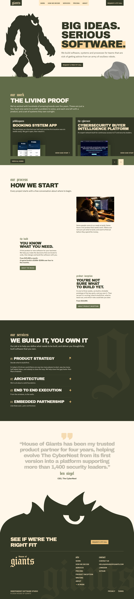
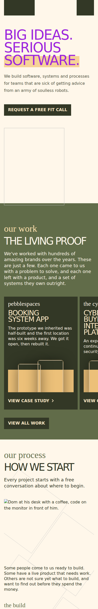

# UI Design System & Master Generation Blueprint: houseofgiants-com

> **House of Giants · Product engineering partner** (https://houseofgiants.com) — House of Giants designs and builds software products. We help you work out what to build, build it, and keep improving it.



---

## 1. Executive Visual Persona & Design Archetype

- **Brand Essence & Persona**: **House of Giants · Product engineering partner** (`https://houseofgiants.com`). House of Giants designs and builds software products. We help you work out what to build, build it, and keep improving it.
- **Visual Archetype**: **Light-Substrate Editorial & Modular Grid System (`#0000` canvas, `#ffffff` ink, `#ffffff` accent)**.
- **Anti-AI-Slop Differentiators**:
  - **Source-Grounded Chromatic Polarity**: Anchors the viewport in `#0000` (`textarea { background-color: #0000 }`) paired with `#ffffff` primary typography and `#ffffff` accents.
  - **Extracted Typographic Hierarchy**: Pairs `Archivo Black` for display copy (`Big Ideas. Serious Software.`) with `Geist Mono` and `Geist Mono`.
  - **Calibrated Spatial Grid & Motion**: Combines `100vw` container bounds (`gap: .625rem`, padding `.75rem`) with `cubic-bezier(.4,0,.2,1)` easing and Three.js / WebGL Canvas Pipeline.

---

## 2. Spatial Architecture & Modular Grid Mathematics



### Viewport Allocation & Container Geometry
- **Captured Viewport Dimensions**: Desktop `1440×6415px` (`assets/desktop.png`, full-page scroll capture), Mobile `390×2400px` (`assets/mobile.png`, capped at 2400px multi-section capture).
- **Master Container Bounds**: `100vw` extracted from `houseofgiants-com` stylesheet.
- **Canvas Lateral Padding & Spacing**: `.75rem` lateral canvas padding with `.625rem` grid gap.
- **Border Radius Scale**: `50%`, `999px`, `1.25rem`, `.5rem`.

### Responsive Breakpoint Architecture
- **Desktop Layout**: Multi-column CSS Grid / Flexbox layout at `1440px` (`max-width: 100vw`, `gap: .625rem`).
- **Mobile Layout**: Single-column vertical stack at `390px` viewport width with `.75rem` horizontal padding.
- **Extracted CSS Media Queries**: `@media (prefers-reduced-motion:reduce)`, `@media (width>=64rem)`, `@media (width>=48rem)`, `@media (scripting:enabled) and (prefers-reduced-motion:no-prefer...`.

---

## 3. Color System, Materiality & Atmospheric Lighting

### Semantic Palette & Source Grounding
| Semantic Role | Ground-Truth Value | Extracted CSS Source / Selector |
|---|---|---|
| **Primary Canvas Substrate** | `#0000` | `textarea { background-color: #0000 }` |
| **Primary Typography Ink** | `#ffffff` | `.thing-mark__white { fill: white }` (`#ffffff`) |

### Sanitized Root CSS Variables (`ui-ux.md` Ground Truth)
| Variable Name | Extracted Value | Semantic Role |
|---|---|---|
| `--font-mono` | `var(--font-hog-mono)` | Typography / Scale Token |
| `--spacing` | `.25rem` | Layout / Spatial Grid Token |
| `--container-md` | `28rem` | Layout / Spatial Grid Token |
| `--container-3xl` | `48rem` | Layout / Spatial Grid Token |
| `--container-7xl` | `80rem` | Layout / Spatial Grid Token |
| `--text-xs` | `.75rem` | Typography Ink Token |
| `--text-xs--line-height` | `calc(1 / .75)` | Typography Ink Token |
| `--text-sm` | `.875rem` | Typography Ink Token |
| `--text-sm--line-height` | `calc(1.25 / .875)` | Typography Ink Token |
| `--text-base` | `1rem` | Typography Ink Token |
| `--text-base--line-height` | `calc(1.5 / 1)` | Typography Ink Token |
| `--text-lg` | `1.125rem` | Typography Ink Token |
| `--text-lg--line-height` | `calc(1.75 / 1.125)` | Typography Ink Token |
| `--text-xl` | `1.25rem` | Typography Ink Token |
| `--text-xl--line-height` | `calc(1.75 / 1.25)` | Typography Ink Token |
| `--text-2xl` | `1.5rem` | Typography Ink Token |

---

## 4. Typographic Scale & Editorial Hierarchy

### Font Family Stacks
- **Display Typography**: `Archivo Black`.
- **Primary Body Stack**: `Geist Mono`.
- **Technical / Metadata Stack**: `Geist Mono`.

### Typographic Scale & Rules (Extracted from Stylesheet & Variables)
- **Hero Display (`H1`)**: CSS variables `--text-5xl: 3rem`, `--text-5xl--line-height: 1`, `--text-display: clamp(3rem, 2.296rem + 3.005vw, 5rem)`.
- **Section Heading (`H2`)**: CSS variables `--text-2xl: 1.5rem`, `--text-2xl--line-height: calc(2 / 1.5)`; rule `h2` (`font-size: var(--text-title-sm)`, `line-height: var(--text-title-sm--...`, `letter-spacing: var(--text-title-sm--...`).
- **Body Copy**: CSS variables `--text-base: 1rem`, `--text-base--line-height: calc(1.5 / 1)`, `--font-hog-body: "IBM Plex Sans", ui-sans-serif, system-ui, sans-serif`.
- **Metadata & Navigation Labels**: CSS variables `--font-mono: var(--font-hog-mono)`, `--text-xs: .75rem`, `--text-xs--line-height: calc(1 / .75)`.

---

## 5. Choreographed Motion & Interaction Physics

### Primary Easing Curves
- **Extracted Timing Functions**: `cubic-bezier(.4,0,.2,1)`, `cubic-bezier(.22,1,.36,1)`, `cubic-bezier(.16,1,.3,1)`.

### Per-Element Transition & Choreography Rules
- **Selector `layer theme`**: `transition: .15s` extracted from `houseofgiants-com` stylesheet.
- **Selector `layer components`**: `transition: background-color var(--motion-duration-fast) var(--motion-ease...` extracted from `houseofgiants-com` stylesheet.
- **Selector `.site-footer__link`**: `transition: color var(--motion-duration-fast) var(--motion-ease-standard),...` extracted from `houseofgiants-com` stylesheet.
- **Extracted Easing Curve (`cubic-bezier(.4,0,.2,1)`)**: Governs interactive state transitions across `<header.site-navigation>` and `<section.home-selected-work>`.
- **Runtime Interaction Engine**: Integrates Three.js / WebGL Canvas Pipeline with `prefers-reduced-motion: reduce` fallback guards.

---

## 6. Component Wireframe & Structural DOM Map

### Visual Layout Schematic (Grounded in `dom.html` — `1440px` Desktop & `390px` Mobile Reflow)
```
┌────────────────────────────────────────────────────────────────────────┐
│ DESKTOP VIEWPORT (1440px) — House of Giants · Product engineering part │
│ ====================================================================== │
│ [ <header.site-navigation> | Work · How we decide · Services · Pric ]  │
│ ---------------------------------------------------------------------- │
│ | HERO STAGE: <section.home-hero>                                  |   │
│ | H1: Big Ideas. Serious Software.                                 |   │
│ | Substrate: #0000      | Ink: #ffffff    | Accent: #ffffff        |   │
│ ---------------------------------------------------------------------- │
│ | SHOWCASE GRID (<section.home-selected-wor) max-w: 100vw          |   │
│ | +------------------------------+  +------------------------------+ | │
│ | | The Living Proof             |  | Booking system app           | | │
│ | +------------------------------+  +------------------------------+ | │
│ ---------------------------------------------------------------------- │
│ | MOBILE VIEWPORT REFLOW (390px) — Single-Column Stack (gap: .625re) | │
│ | [<header.site-navig] -> [<section.home-hero] -> [<section.home-sele] │
│ ---------------------------------------------------------------------- │
│ [ FOOTER (<footer.site-footer>  ) | https://houseofgiants.com          │
└────────────────────────────────────────────────────────────────────────┘
```

### Granular DOM Region Breakdown
1. **Brand Header & Navigation Bar (<header.site-navigation> — `houseofgiants-com`)**:
   - Landmark `<header class="site-navigation absolute">` hosting `House of Giants · Product engineerin` navigation (`Work · How we decide · Services · Pricing · About`), DOM attributes (`data-precedence="default"`, `data-precedence="default"`, `data-status="active"`, `data-footprint-ready`), and stylesheet rule `backdrop { box-sizing:border-box;border:0 solid;margin:0;padding:0 }`.
2. **Hero Stage & Focal Lead (<section.home-hero> — `Big Ideas. Serious Software.`)**:
   - Landmark `<section class="home-hero px-4">` presenting display lead `Big Ideas. Serious Software.` and copy excerpt *"Request a fit call"* over `#0000` canvas and `#ffffff` ink.
3. **Primary Showcase & Content Grid (<section.home-selected-work> — `The Living Proof`)**:
   - Landmark `<section class="home-selected-work bg-moss">` rendering section `The Living Proof` with copy *"We build software, systems and processes for teams that are sick "*, asset references (`thing-walk.svg`, `thing-tufts.svg`, `boulder.svg`, `thing-footprint-right.svg`), and grid rule `file-selector-button { box-sizing:border-box;border:0 solid;margin:0;padding:0 }`.
4. **Interactive Detail & Feature Matrix (<section.home-process> — `Booking system app`)**:
   - Landmark `<section class="home-process overflow-clip">` framing `Booking system app` and `Cybersecurity buyer intelligence platform` (*"Request a Free Fit Call"*) with `#0000` surface cards, `#ffffff` accents, and `strong { font-weight:bolder }`.
5. **Colophon & Global Directory Footer (<footer.site-footer> — `https://houseofgiants.com`)**:
   - Landmark `<footer class="site-footer">` anchoring `House of Giants · Product engine` footer links (`Work · How we decide · Services · Pricing · About`), copy *"We've worked with hundreds of amazing brands over the years."*, and `#ffffff` structural dividers.

---

## 7. Master Zero-Shot AI Generation Prompt

```markdown
# Master Zero-Shot Frontend Generation Prompt: houseofgiants-com (House of Giants · Product engineering partner)

You are a principal frontend architect and design systems engineer. Build a complete, production-ready web application replicating the exact design system, DOM landmarks, typographic hierarchy, color tokens, and motion physics of `houseofgiants-com` (**House of Giants · Product engineering partner** — `https://houseofgiants.com`).

### 1. Visual Archetype & Anti-AI-Slop Mandates
- **Archetype**: Light-Substrate Editorial & Modular Grid System (`#0000` canvas, `#ffffff` ink, `#ffffff` accent).
- **Identity & Domain Context**: House of Giants designs and builds software products. We help you work out what to build, build it, and keep improving it.
- **Primary Substrate**: `#0000` (`textarea { background-color: #0000 }`), **Primary Ink**: `#ffffff`, **Accent / Highlight**: `#ffffff`.
- **Site-Specific Differentiators**:
  - **Source-Grounded Chromatic Polarity**: Anchors the viewport in `#0000` (`textarea { background-color: #0000 }`) paired with `#ffffff` primary typography and `#ffffff` accents.
  - **Extracted Typographic Hierarchy**: Pairs `Archivo Black` for display copy (`Big Ideas. Serious Software.`) with `Geist Mono` and `Geist Mono`.
  - **Calibrated Spatial Grid & Motion**: Combines `100vw` container bounds (`gap: .625rem`, padding `.75rem`) with `cubic-bezier(.4,0,.2,1)` easing and Three.js / WebGL Canvas Pipeline.

### 2. Ground-Truth CSS Variables (`:root` Token Contract)
Declare and consume these exact custom properties extracted from `houseofgiants-com` in your global stylesheet:

:root {
  /* House of Giants · Product engineering partner (houseofgiants-com) — Ground-Truth Extracted CSS Variables */
  --font-mono: var(--font-hog-mono); /* Typography / Scale Token (houseofgiants-com) */
  --spacing: .25rem; /* Layout / Spatial Grid Token (houseofgiants-com) */
  --container-md: 28rem; /* Layout / Spatial Grid Token (houseofgiants-com) */
  --container-3xl: 48rem; /* Layout / Spatial Grid Token (houseofgiants-com) */
  --container-7xl: 80rem; /* Layout / Spatial Grid Token (houseofgiants-com) */
  --text-xs: .75rem; /* Typography Ink Token (houseofgiants-com) */
  --text-xs--line-height: calc(1 / .75); /* Typography Ink Token (houseofgiants-com) */
  --text-sm: .875rem; /* Typography Ink Token (houseofgiants-com) */
  --text-sm--line-height: calc(1.25 / .875); /* Typography Ink Token (houseofgiants-com) */
  --text-base: 1rem; /* Typography Ink Token (houseofgiants-com) */
  --text-base--line-height: calc(1.5 / 1); /* Typography Ink Token (houseofgiants-com) */
  --text-lg: 1.125rem; /* Typography Ink Token (houseofgiants-com) */
  --text-lg--line-height: calc(1.75 / 1.125); /* Typography Ink Token (houseofgiants-com) */
  --text-xl: 1.25rem; /* Typography Ink Token (houseofgiants-com) */
  --text-xl--line-height: calc(1.75 / 1.25); /* Typography Ink Token (houseofgiants-com) */
  --text-2xl: 1.5rem; /* Typography Ink Token (houseofgiants-com) */
}

### 3. Semantic Color & Materiality Contract
Map every surface, ink, and border strictly to these source-grounded tokens:
- **Primary Canvas Substrate**: `#0000` — grounded in `textarea { background-color: #0000 }`
- **Primary Typography Ink**: `#ffffff` — grounded in `.thing-mark__white { fill: white }` (`#ffffff`)

### 4. Spatial Grid, Container Bounds & Responsive Breakpoints
- **Desktop Viewport Reference**: `1440×6415px` (full-page scroll capture, `1440px` standard desktop width).
- **Mobile Viewport Reference**: `390×2400px` (capped at 2400px multi-section capture, `390px` standard mobile width).
- **Container Max-Width**: `100vw` extracted from `houseofgiants-com` stylesheet
- **Padding & Gutters**: `.75rem` lateral canvas padding with `.625rem` grid gap
- **Desktop Grid**: Multi-column CSS Grid / Flexbox layout at `1440px` (`max-width: 100vw`, `gap: .625rem`)
- **Mobile Adaptation**: Single-column vertical stack at `390px` viewport width with `.75rem` horizontal padding
- **Media Queries**: `@media (prefers-reduced-motion:reduce)`, `@media (width>=64rem)`, `@media (width>=48rem)`, `@media (scripting:enabled) and (prefers-reduced-motion:no-prefer...`
- **Corner Radii**: `50%`, `999px`, `1.25rem`, `.5rem`

### 5. Typography & Editorial Scale Contract
- **Display Font Stack**: `Archivo Black`
- **Body Font Stack**: `Geist Mono`
- **Monospace / Technical Font Stack**: `Geist Mono`
- **H1 Display Rule**: CSS variables `--text-5xl: 3rem`, `--text-5xl--line-height: 1`, `--text-display: clamp(3rem, 2.296rem + 3.005vw, 5rem)`
- **H2 Section Rule**: CSS variables `--text-2xl: 1.5rem`, `--text-2xl--line-height: calc(2 / 1.5)`; rule `h2` (`font-size: var(--text-title-sm)`, `line-height: var(--text-title-sm--...`, `letter-spacing: var(--text-title-sm--...`)
- **Body Copy Rule**: CSS variables `--text-base: 1rem`, `--text-base--line-height: calc(1.5 / 1)`, `--font-hog-body: "IBM Plex Sans", ui-sans-serif, system-ui, sans-serif`
- **Metadata & Index Rule**: CSS variables `--font-mono: var(--font-hog-mono)`, `--text-xs: .75rem`, `--text-xs--line-height: calc(1 / .75)`

### 6. Component Hierarchy, Verbatim Copy & Real DOM Landmarks
Scaffold `houseofgiants-com` (`House of Giants · Product engineering partner`) with these exact structural regions, extracted copy, and CSS rules from `dom.html`:
1. **Brand Header & Navigation Bar (<header.site-navigation> — `houseofgiants-com`)**:
   - DOM & Selectors: Landmark `<header class="site-navigation absolute">` hosting `House of Giants · Product engineerin` navigation (`Work · How we decide · Services · Pricing · About`), DOM attributes (`data-precedence="default"`, `data-precedence="default"`, `data-status="active"`, `data-footprint-ready`), and stylesheet rule `backdrop { box-sizing:border-box;border:0 solid;margin:0;padding:0 }`.
   - Responsive Contract: Header `Brand Header & Navigation Bar (<header.site-navigation> — `houseofgiants-com`)` (`houseofgiants-com`) adapts across `@media (prefers-reduced-motion:reduce)`, `@media (width>=64rem)`, `@media (width>=48rem)`, `@media (scripting:enabled) and (prefers-reduced-motion:no-prefer...` with `cubic-bezier(.4,0,.2,1)`, `cubic-bezier(.22,1,.36,1)`, `cubic-bezier(.16,1,.3,1)` transitions and links `Work · How we decide · Services · Pricing · About`.
2. **Hero Stage & Focal Lead (<section.home-hero> — `Big Ideas. Serious Software.`)**:
   - DOM & Selectors: Landmark `<section class="home-hero px-4">` presenting display lead `Big Ideas. Serious Software.` and copy excerpt *"Request a fit call"* over `#0000` canvas and `#ffffff` ink.
   - Responsive Contract: Hero stage (`1440×6415px` desktop / `390×2400px` mobile) sets `#0000` background with `#ffffff` headline `Big Ideas. Serious Software.`.
3. **Primary Showcase & Content Grid (<section.home-selected-work> — `The Living Proof`)**:
   - DOM & Selectors: Landmark `<section class="home-selected-work bg-moss">` rendering section `The Living Proof` with copy *"We build software, systems and processes for teams that are sick "*, asset references (`thing-walk.svg`, `thing-tufts.svg`, `boulder.svg`, `thing-footprint-right.svg`), and grid rule `file-selector-button { box-sizing:border-box;border:0 solid;margin:0;padding:0 }`.
   - Responsive Contract: Showcase grid `Primary Showcase & Content Grid (<section.home-selected-work> — `The Living Proof`)` applies Multi-column CSS Grid / Flexbox layout at `1440px` (`max-width: 100vw`, `gap: .625rem`) on desktop and Single-column vertical stack at `390px` viewport width with `.75rem` horizontal padding on mobile.
4. **Interactive Detail & Feature Matrix (<section.home-process> — `Booking system app`)**:
   - DOM & Selectors: Landmark `<section class="home-process overflow-clip">` framing `Booking system app` and `Cybersecurity buyer intelligence platform` (*"Request a Free Fit Call"*) with `#0000` surface cards, `#ffffff` accents, and `strong { font-weight:bolder }`.
   - Responsive Contract: Detail module `Interactive Detail & Feature Matrix (<section.home-process> — `Booking system app`)` uses `50%`, `999px`, `1.25rem`, `.5rem` radii, `#ffffff` highlights, and assets (thing-walk.svg, thing-tufts.svg, boulder.svg).
5. **Colophon & Global Directory Footer (<footer.site-footer> — `https://houseofgiants.com`)**:
   - DOM & Selectors: Landmark `<footer class="site-footer">` anchoring `House of Giants · Product engine` footer links (`Work · How we decide · Services · Pricing · About`), copy *"We've worked with hundreds of amazing brands over the years."*, and `#ffffff` structural dividers.
   - Responsive Contract: Footer `Colophon & Global Directory Footer (<footer.site-footer> — `https://houseofgiants.com`)` aligns to `100vw` extracted from `houseofgiants-com` stylesheet with `.75rem` lateral canvas padding with `.625rem` grid gap and attributes (data-precedence="default", data-precedence="default", data-status="active").

#### Verbatim DOM Copy Excerpts (`dom.html`)
- Copy Excerpt 1: *"Request a fit call"*
- Copy Excerpt 2: *"We build software, systems and processes for teams that are sick of getting advice..."*
- Copy Excerpt 3: *"Request a Free Fit Call"*
- Copy Excerpt 4: *"We've worked with hundreds of amazing brands over the years. These are just a few...."*

### 7. Motion, Extracted Stylesheet Rules & Interaction Choreography
- **Primary Easing Functions**: `cubic-bezier(.4,0,.2,1)`, `cubic-bezier(.22,1,.36,1)`, `cubic-bezier(.16,1,.3,1)`
- **Extracted Stylesheet Rules (`houseofgiants-com`)**:
- `backdrop { box-sizing:border-box;border:0 solid;margin:0;padding:0 }`
- `file-selector-button { box-sizing:border-box;border:0 solid;margin:0;padding:0 }`
- `strong { font-weight:bolder }`
- `small { font-size:80% }`
- `sup { vertical-align:baseline;font-size:75%;line-height:0;position:relative }`
- **Per-Selector Transition Rules**:
- **Selector `layer theme`**: `transition: .15s` extracted from `houseofgiants-com` stylesheet.
- **Selector `layer components`**: `transition: background-color var(--motion-duration-fast) var(--motion-ease...` extracted from `houseofgiants-com` stylesheet.
- **Selector `.site-footer__link`**: `transition: color var(--motion-duration-fast) var(--motion-ease-standard),...` extracted from `houseofgiants-com` stylesheet.
- **Extracted Easing Curve (`cubic-bezier(.4,0,.2,1)`)**: Governs interactive state transitions across `<header.site-navigation>` and `<section.home-selected-work>`.
- **Runtime Interaction Engine**: Integrates Three.js / WebGL Canvas Pipeline with `prefers-reduced-motion: reduce` fallback guards.

### 8. Technical Deliverables
- Implement in Next.js (App Router) with TypeScript and Tailwind CSS consuming the `:root` custom properties defined above for `houseofgiants-com`.
- Reproduce both the `1440px` desktop architecture and `390px` mobile breakpoint transitions, preserving semantic HTML5 landmarks (`<header>`, `<nav>`, `<main>`, `<section>`, `<footer>`) and `prefers-reduced-motion` accessibility guards.
```
