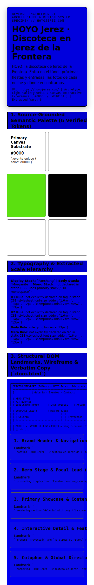

# UI Design System & Master Generation Blueprint: hoyojerez-com

> **HOYO Jerez · Discoteca en Jerez de la Frontera** (https://hoyojerez.com/) — HOYO, la discoteca de Jerez de la Frontera. Entra en el túnel: próximas fiestas y entradas, las fotos de cada noche y dónde encontrarnos.


---

## 1. Executive Visual Persona & Design Archetype

- **Brand Essence & Persona**: **HOYO Jerez · Discoteca en Jerez de la Frontera** (`https://hoyojerez.com/`). HOYO, la discoteca de Jerez de la Frontera. Entra en el túnel: próximas fiestas y entradas, las fotos de cada noche y dónde encontrarnos.
- **Visual Archetype**: **Light-Gallery WebGL / Canvas Interactive Experience (`#0000` / `#010101`)**.
- **Anti-AI-Slop Differentiators**:
  - **Source-Grounded Chromatic Polarity**: Anchors the viewport in `#0000` (`.evento-enlace { color: #0000 }`) paired with `#010101` primary typography and `#010101` accents.
  - **Extracted Typographic Hierarchy**: Pairs `Panchang` for display copy (`Eventos`) with `Morganite` and not declared in static CSS (uses primary stack / `ui-monospace`).
  - **Calibrated Spatial Grid & Motion**: Combines `410px` container bounds (`gap: 16px`, padding `.8rem`) with `cubic-bezier(.22,1,.36,1)` easing and Lenis Smooth Scroll (`data-lenis`), Three.js / WebGL Canvas Pipeline.

---

## 2. Spatial Architecture & Modular Grid Mathematics



### Viewport Allocation & Container Geometry
- **Captured Viewport Dimensions**: Desktop `1440×2400px` (`assets/desktop.png`, capped at 2400px multi-section capture), Mobile `390×2400px` (`assets/mobile.png`, capped at 2400px multi-section capture).
- **Master Container Bounds**: `410px` extracted from `hoyojerez-com` stylesheet.
- **Canvas Lateral Padding & Spacing**: `.8rem` lateral canvas padding with `16px` grid gap.
- **Border Radius Scale**: `999px`, `16px`, `50%`, `26px`.

### Responsive Breakpoint Architecture
- **Desktop Layout**: Multi-column CSS Grid / Flexbox layout at `1440px` (`max-width: 410px`, `gap: 16px`).
- **Mobile Layout**: Single-column vertical stack at `390px` viewport width with `.8rem` horizontal padding.
- **Extracted CSS Media Queries**: `@media (width>=767px)`, `@media (prefers-reduced-motion:reduce)`, `@media (prefers-reduced-motion)`, `@media (width>=1100px)`.

---

## 3. Color System, Materiality & Atmospheric Lighting

### Semantic Palette & Source Grounding
| Semantic Role | Ground-Truth Value | Extracted CSS Source / Selector |
|---|---|---|
| **Primary Canvas Substrate** | `#0000` | `.evento-enlace { color: #0000 }` |
| **Primary Typography Ink** | `#fff` | `.evento-enlace:focus-visible { color: #fff }` |
| **Elevated Surface / Card Substrate** | `#5be010` | `.evento-enlace:focus-visible { border: #5be010 }` |
| **Interactive Accent / Highlight** | `#010101` | `._actions_1d25v_67 button:hover { color: #010101 }` |
| **Secondary / Muted Copy** | `#fff3` | `preferences_1d25v_98 ._necessar... { border-top: #fff3 }` |
| **Structural Hairline Border** | `#fff0` | `._boton_1qcud_34 { background: #fff0 }` |

### Sanitized Root CSS Variables (`ui-ux.md` Ground Truth)
| Variable Name | Extracted Value | Semantic Role |
|---|---|---|
| `--tamano` | `22px` | Dimension / Scale Token |
| `--nivel` | `1` | Design System Custom Token |
| `--pista` | `2px` | Dimension / Scale Token |
| `--pulgar` | `9px` | Dimension / Scale Token |
| `--retraso` | `.2s` | Motion / Timing Token |
| `--cookies-tapa` | `0px` | Dimension / Scale Token |
| `--hoyojerez-com-bg` | `#0000` | Canvas Substrate (from `.evento-enlace { color: #0000 }`) |
| `--hoyojerez-com-ink` | `#010101` | Primary Typography Ink (stylesheet-derived) |
| `--hoyojerez-com-surface` | `#5be010` | Surface Substrate (stylesheet-derived) |
| `--hoyojerez-com-accent` | `#010101` | Interactive Accent (stylesheet-derived) |
| `--hoyojerez-com-muted` | `#fff3` | Secondary Ink (stylesheet-derived) |
| `--hoyojerez-com-border` | `#fff0` | Structural Border (stylesheet-derived) |
| `--hoyojerez-com-container` | `410px` | Container Bound (stylesheet-derived) |
| `--hoyojerez-com-gap` | `16px` | Grid Gutter (stylesheet-derived) |
| `--hoyojerez-com-pad` | `.8rem` | Lateral Padding (stylesheet-derived) |
| `--hoyojerez-com-ease` | `cubic-bezier(.22,1,.36,1)` | Primary Easing Function |

---

## 4. Typographic Scale & Editorial Hierarchy

### Font Family Stacks
- **Display Typography**: `Panchang`.
- **Primary Body Stack**: `Morganite`.
- **Technical / Metadata Stack**: not declared in static CSS (uses primary stack / `ui-monospace`).

### Typographic Scale & Rules (Extracted from Stylesheet & Variables)
- **Hero Display (`H1`)**: not explicitly declared on tag in static CSS (stylesheet font-size ladder: `1.6rem`, `14px`, `12px`, `clamp(88px,min(17svh,30vw)`, `13px`).
- **Section Heading (`H2`)**: not explicitly declared on tag in static CSS (stylesheet font-size ladder: `1.6rem`, `14px`, `12px`, `clamp(88px,min(17svh,30vw)`, `13px`).
- **Body Copy**: rule `p` (`font-size: 13px`).
- **Metadata & Navigation Labels**: not explicitly declared on tag in static CSS (stylesheet font-size ladder: `1.6rem`, `14px`, `12px`, `clamp(88px,min(17svh,30vw)`, `13px`).

---

## 5. Choreographed Motion & Interaction Physics

### Primary Easing Curves
- **Extracted Timing Functions**: `cubic-bezier(.22,1,.36,1)`, `cubic-bezier(.2,.85,.25,1)`, `cubic-bezier(.55,0,.35,1)`.

### Per-Element Transition & Choreography Rules
- **Selector `.intro-rotulo[data-astro-cid-lcde...`**: `transition: opacity .25s,transform .25s,visibility 0s linear .25s` extracted from `hoyojerez-com` stylesheet.
- **Selector `data-astro-cid-lcdefpme][data-vis...`**: `transition: opacity .7s,transform .7s cubic-bezier(.22,1,.36,1),visibility` extracted from `hoyojerez-com` stylesheet.
- **Selector `.intro-sin-sonido[data-astro-cid-...`**: `transition: opacity .25s,visibility 0s linear .25s` extracted from `hoyojerez-com` stylesheet.
- **Extracted Easing Curve (`cubic-bezier(.22,1,.36,1)`)**: Governs interactive state transitions across `<header.lenis>` and `<main.main-content>`.
- **Runtime Interaction Engine**: Integrates Lenis Smooth Scroll (`data-lenis`), Three.js / WebGL Canvas Pipeline with `prefers-reduced-motion: reduce` fallback guards.

---

## 6. Component Wireframe & Structural DOM Map

### Visual Layout Schematic (Grounded in `dom.html` — `1440px` Desktop & `390px` Mobile Reflow)
```
┌────────────────────────────────────────────────────────────────────────┐
│ DESKTOP VIEWPORT (1440px) — HOYO Jerez · Discoteca en Jerez de la Fron │
│ ====================================================================== │
│ [ <header.lenis>           | Galería · Eventos · Contacto           ]  │
│ ---------------------------------------------------------------------- │
│ | HERO STAGE: <main.main-content>                                  |   │
│ | H1: Eventos                                                      |   │
│ | Substrate: #0000      | Ink: #010101    | Accent: #010101        |   │
│ ---------------------------------------------------------------------- │
│ | SHOWCASE GRID (<main.main-content>       ) max-w: 410px          |   │
│ | +------------------------------+  +------------------------------+ | │
│ | | Galería                      |  | Proyección                   | | │
│ | +------------------------------+  +------------------------------+ | │
│ ---------------------------------------------------------------------- │
│ | MOBILE VIEWPORT REFLOW (390px) — Single-Column Stack (gap: 16px  ) | │
│ | [<header.lenis>] -> [<main.main-content] -> [<main.main-content] |   │
│ ---------------------------------------------------------------------- │
│ [ FOOTER (<footer.intro-cargando) | https://hoyojerez.com/             │
└────────────────────────────────────────────────────────────────────────┘
```

### Granular DOM Region Breakdown
1. **Brand Header & Navigation Bar (<header.lenis> — `hoyojerez-com`)**:
   - Landmark `<header class="lenis">` hosting `HOYO Jerez · Discoteca en Jerez de l` navigation (`Galería · Eventos · Contacto`), DOM attributes (`data-astro-cid-wetux6vv`, `data-astro-exec`, `data-astro-transition-persist="hoyo-tunnel"`, `data-persistent-tunnel`), and stylesheet rule `focus-visible { outline-offset:3px;outline:2px solid fff }`.
2. **Hero Stage & Focal Lead (<main.main-content> — `Eventos`)**:
   - Landmark `<main class="main-content">` presenting display lead `Eventos` and copy excerpt *"Paciencia, se está cargando el Hoyo."* over `#0000` canvas and `#010101` ink.
3. **Primary Showcase & Content Grid (<main.main-content> — `Galería`)**:
   - Landmark `<main class="main-content">` rendering section `Galería` with copy *"La conexión va lenta · seguimos cargando"*, asset references (`index.astro_astro_type_script_ind...`, `alien.DVECqh-s.glb`, `pulsador.BQ51WIjM.glb`, `draco_wasm_wrapper.js`), and grid rule `._panel_1d25v_1 { padding:22px;bottom:28px;left:28px }`.
4. **Interactive Detail & Feature Matrix (<main.main-content> — `Proyección`)**:
   - Landmark `<main class="main-content">` framing `Proyección` and `Tú eliges el ritmo.` (*"No se pudo cargar el Hoyo"*) with `#5be010` surface cards, `#010101` accents, and `._panel_1d25v_1 h2 { text-transform:uppercase;color:5be010;margin:8px 0 12px;font:900 44px/.9... }`.
5. **Colophon & Global Directory Footer (<footer.intro-cargando> — `https://hoyojerez.com/`)**:
   - Landmark `<footer class="intro-cargando">` anchoring `HOYO Jerez · Discoteca en Jerez ` footer links (`Galería · Eventos · Contacto`), copy *"Púlsalo. Entra en el Hoyo"*, and `#fff0` structural dividers.

---

## 7. Master Zero-Shot AI Generation Prompt

```markdown
# Master Zero-Shot Frontend Generation Prompt: hoyojerez-com (HOYO Jerez · Discoteca en Jerez de la Frontera)

You are a principal frontend architect and design systems engineer. Build a complete, production-ready web application replicating the exact design system, DOM landmarks, typographic hierarchy, color tokens, and motion physics of `hoyojerez-com` (**HOYO Jerez · Discoteca en Jerez de la Frontera** — `https://hoyojerez.com/`).

### 1. Visual Archetype & Anti-AI-Slop Mandates
- **Archetype**: Light-Gallery WebGL / Canvas Interactive Experience (`#0000` / `#010101`).
- **Identity & Domain Context**: HOYO, la discoteca de Jerez de la Frontera. Entra en el túnel: próximas fiestas y entradas, las fotos de cada noche y dónde encontrarnos.
- **Primary Substrate**: `#0000` (`.evento-enlace { color: #0000 }`), **Primary Ink**: `#010101`, **Accent / Highlight**: `#010101`.
- **Site-Specific Differentiators**:
  - **Source-Grounded Chromatic Polarity**: Anchors the viewport in `#0000` (`.evento-enlace { color: #0000 }`) paired with `#010101` primary typography and `#010101` accents.
  - **Extracted Typographic Hierarchy**: Pairs `Panchang` for display copy (`Eventos`) with `Morganite` and not declared in static CSS (uses primary stack / `ui-monospace`).
  - **Calibrated Spatial Grid & Motion**: Combines `410px` container bounds (`gap: 16px`, padding `.8rem`) with `cubic-bezier(.22,1,.36,1)` easing and Lenis Smooth Scroll (`data-lenis`), Three.js / WebGL Canvas Pipeline.

### 2. Ground-Truth CSS Variables (`:root` Token Contract)
Declare and consume these exact custom properties extracted from `hoyojerez-com` in your global stylesheet:

:root {
  /* HOYO Jerez · Discoteca en Jerez de la Frontera (hoyojerez-com) — Ground-Truth Extracted CSS Variables */
  --tamano: 22px; /* Dimension / Scale Token (hoyojerez-com) */
  --nivel: 1; /* Design System Custom Token (hoyojerez-com) */
  --pista: 2px; /* Dimension / Scale Token (hoyojerez-com) */
  --pulgar: 9px; /* Dimension / Scale Token (hoyojerez-com) */
  --retraso: .2s; /* Motion / Timing Token (hoyojerez-com) */
  --cookies-tapa: 0px; /* Dimension / Scale Token (hoyojerez-com) */
  --hoyojerez-com-bg: #0000; /* Canvas Substrate (from `.evento-enlace { color: #0000 }`) (hoyojerez-com) */
  --hoyojerez-com-ink: #010101; /* Primary Typography Ink (stylesheet-derived) (hoyojerez-com) */
  --hoyojerez-com-surface: #5be010; /* Surface Substrate (stylesheet-derived) (hoyojerez-com) */
  --hoyojerez-com-accent: #010101; /* Interactive Accent (stylesheet-derived) (hoyojerez-com) */
  --hoyojerez-com-muted: #fff3; /* Secondary Ink (stylesheet-derived) (hoyojerez-com) */
  --hoyojerez-com-border: #fff0; /* Structural Border (stylesheet-derived) (hoyojerez-com) */
  --hoyojerez-com-container: 410px; /* Container Bound (stylesheet-derived) (hoyojerez-com) */
  --hoyojerez-com-gap: 16px; /* Grid Gutter (stylesheet-derived) (hoyojerez-com) */
  --hoyojerez-com-pad: .8rem; /* Lateral Padding (stylesheet-derived) (hoyojerez-com) */
  --hoyojerez-com-ease: cubic-bezier(.22,1,.36,1); /* Primary Easing Function (hoyojerez-com) */
}

### 3. Semantic Color & Materiality Contract
Map every surface, ink, and border strictly to these source-grounded tokens:
- **Primary Canvas Substrate**: `#0000` — grounded in `.evento-enlace { color: #0000 }`
- **Primary Typography Ink**: `#fff` — grounded in `.evento-enlace:focus-visible { color: #fff }`
- **Elevated Surface / Card Substrate**: `#5be010` — grounded in `.evento-enlace:focus-visible { border: #5be010 }`
- **Interactive Accent / Highlight**: `#010101` — grounded in `._actions_1d25v_67 button:hover { color: #010101 }`
- **Secondary / Muted Copy**: `#fff3` — grounded in `preferences_1d25v_98 ._necessar... { border-top: #fff3 }`
- **Structural Hairline Border**: `#fff0` — grounded in `._boton_1qcud_34 { background: #fff0 }`

### 4. Spatial Grid, Container Bounds & Responsive Breakpoints
- **Desktop Viewport Reference**: `1440×2400px` (capped at 2400px multi-section capture, `1440px` standard desktop width).
- **Mobile Viewport Reference**: `390×2400px` (capped at 2400px multi-section capture, `390px` standard mobile width).
- **Container Max-Width**: `410px` extracted from `hoyojerez-com` stylesheet
- **Padding & Gutters**: `.8rem` lateral canvas padding with `16px` grid gap
- **Desktop Grid**: Multi-column CSS Grid / Flexbox layout at `1440px` (`max-width: 410px`, `gap: 16px`)
- **Mobile Adaptation**: Single-column vertical stack at `390px` viewport width with `.8rem` horizontal padding
- **Media Queries**: `@media (width>=767px)`, `@media (prefers-reduced-motion:reduce)`, `@media (prefers-reduced-motion)`, `@media (width>=1100px)`
- **Corner Radii**: `999px`, `16px`, `50%`, `26px`

### 5. Typography & Editorial Scale Contract
- **Display Font Stack**: `Panchang`
- **Body Font Stack**: `Morganite`
- **Monospace / Technical Font Stack**: not declared in static CSS (uses primary stack / `ui-monospace`)
- **H1 Display Rule**: not explicitly declared on tag in static CSS (stylesheet font-size ladder: `1.6rem`, `14px`, `12px`, `clamp(88px,min(17svh,30vw)`, `13px`)
- **H2 Section Rule**: not explicitly declared on tag in static CSS (stylesheet font-size ladder: `1.6rem`, `14px`, `12px`, `clamp(88px,min(17svh,30vw)`, `13px`)
- **Body Copy Rule**: rule `p` (`font-size: 13px`)
- **Metadata & Index Rule**: not explicitly declared on tag in static CSS (stylesheet font-size ladder: `1.6rem`, `14px`, `12px`, `clamp(88px,min(17svh,30vw)`, `13px`)

### 6. Component Hierarchy, Verbatim Copy & Real DOM Landmarks
Scaffold `hoyojerez-com` (`HOYO Jerez · Discoteca en Jerez de la Frontera`) with these exact structural regions, extracted copy, and CSS rules from `dom.html`:
1. **Brand Header & Navigation Bar (<header.lenis> — `hoyojerez-com`)**:
   - DOM & Selectors: Landmark `<header class="lenis">` hosting `HOYO Jerez · Discoteca en Jerez de l` navigation (`Galería · Eventos · Contacto`), DOM attributes (`data-astro-cid-wetux6vv`, `data-astro-exec`, `data-astro-transition-persist="hoyo-tunnel"`, `data-persistent-tunnel`), and stylesheet rule `focus-visible { outline-offset:3px;outline:2px solid fff }`.
   - Responsive Contract: Header `Brand Header & Navigation Bar (<header.lenis> — `hoyojerez-com`)` (`hoyojerez-com`) adapts across `@media (width>=767px)`, `@media (prefers-reduced-motion:reduce)`, `@media (prefers-reduced-motion)`, `@media (width>=1100px)` with `cubic-bezier(.22,1,.36,1)`, `cubic-bezier(.2,.85,.25,1)`, `cubic-bezier(.55,0,.35,1)` transitions and links `Galería · Eventos · Contacto`.
2. **Hero Stage & Focal Lead (<main.main-content> — `Eventos`)**:
   - DOM & Selectors: Landmark `<main class="main-content">` presenting display lead `Eventos` and copy excerpt *"Paciencia, se está cargando el Hoyo."* over `#0000` canvas and `#010101` ink.
   - Responsive Contract: Hero stage (`1440×2400px` desktop / `390×2400px` mobile) sets `#0000` background with `#010101` headline `Eventos`.
3. **Primary Showcase & Content Grid (<main.main-content> — `Galería`)**:
   - DOM & Selectors: Landmark `<main class="main-content">` rendering section `Galería` with copy *"La conexión va lenta · seguimos cargando"*, asset references (`index.astro_astro_type_script_ind...`, `alien.DVECqh-s.glb`, `pulsador.BQ51WIjM.glb`, `draco_wasm_wrapper.js`), and grid rule `._panel_1d25v_1 { padding:22px;bottom:28px;left:28px }`.
   - Responsive Contract: Showcase grid `Primary Showcase & Content Grid (<main.main-content> — `Galería`)` applies Multi-column CSS Grid / Flexbox layout at `1440px` (`max-width: 410px`, `gap: 16px`) on desktop and Single-column vertical stack at `390px` viewport width with `.8rem` horizontal padding on mobile.
4. **Interactive Detail & Feature Matrix (<main.main-content> — `Proyección`)**:
   - DOM & Selectors: Landmark `<main class="main-content">` framing `Proyección` and `Tú eliges el ritmo.` (*"No se pudo cargar el Hoyo"*) with `#5be010` surface cards, `#010101` accents, and `._panel_1d25v_1 h2 { text-transform:uppercase;color:5be010;margin:8px 0 12px;font:900 44px/.9... }`.
   - Responsive Contract: Detail module `Interactive Detail & Feature Matrix (<main.main-content> — `Proyección`)` uses `999px`, `16px`, `50%`, `26px` radii, `#010101` highlights, and assets (index.astro_astro_type_script_ind..., alien.DVECqh-s.glb, pulsador.BQ51WIjM.glb).
5. **Colophon & Global Directory Footer (<footer.intro-cargando> — `https://hoyojerez.com/`)**:
   - DOM & Selectors: Landmark `<footer class="intro-cargando">` anchoring `HOYO Jerez · Discoteca en Jerez ` footer links (`Galería · Eventos · Contacto`), copy *"Púlsalo. Entra en el Hoyo"*, and `#fff0` structural dividers.
   - Responsive Contract: Footer `Colophon & Global Directory Footer (<footer.intro-cargando> — `https://hoyojerez.com/`)` aligns to `410px` extracted from `hoyojerez-com` stylesheet with `.8rem` lateral canvas padding with `16px` grid gap and attributes (data-astro-cid-wetux6vv, data-astro-exec, data-astro-transition-persist="hoyo-tunnel").

#### Verbatim DOM Copy Excerpts (`dom.html`)
- Copy Excerpt 1: *"Paciencia, se está cargando el Hoyo."*
- Copy Excerpt 2: *"La conexión va lenta · seguimos cargando"*
- Copy Excerpt 3: *"No se pudo cargar el Hoyo"*
- Copy Excerpt 4: *"Púlsalo. Entra en el Hoyo"*

### 7. Motion, Extracted Stylesheet Rules & Interaction Choreography
- **Primary Easing Functions**: `cubic-bezier(.22,1,.36,1)`, `cubic-bezier(.2,.85,.25,1)`, `cubic-bezier(.55,0,.35,1)`
- **Extracted Stylesheet Rules (`hoyojerez-com`)**:
- `focus-visible { outline-offset:3px;outline:2px solid fff }`
- `._panel_1d25v_1 { padding:22px;bottom:28px;left:28px }`
- `._panel_1d25v_1 h2 { text-transform:uppercase;color:5be010;margin:8px 0 12px;font:900 44px/.9... }`
- `._panel_1d25v_1 p { margin:0 0 14px;font-size:13px }`
- `._panel_1d25v_1 a { color:fff;text-underline-offset:3px;text-decoration:underline }`
- **Per-Selector Transition Rules**:
- **Selector `.intro-rotulo[data-astro-cid-lcde...`**: `transition: opacity .25s,transform .25s,visibility 0s linear .25s` extracted from `hoyojerez-com` stylesheet.
- **Selector `data-astro-cid-lcdefpme][data-vis...`**: `transition: opacity .7s,transform .7s cubic-bezier(.22,1,.36,1),visibility` extracted from `hoyojerez-com` stylesheet.
- **Selector `.intro-sin-sonido[data-astro-cid-...`**: `transition: opacity .25s,visibility 0s linear .25s` extracted from `hoyojerez-com` stylesheet.
- **Extracted Easing Curve (`cubic-bezier(.22,1,.36,1)`)**: Governs interactive state transitions across `<header.lenis>` and `<main.main-content>`.
- **Runtime Interaction Engine**: Integrates Lenis Smooth Scroll (`data-lenis`), Three.js / WebGL Canvas Pipeline with `prefers-reduced-motion: reduce` fallback guards.

### 8. Technical Deliverables
- Implement in Next.js (App Router) with TypeScript and Tailwind CSS consuming the `:root` custom properties defined above for `hoyojerez-com`.
- Reproduce both the `1440px` desktop architecture and `390px` mobile breakpoint transitions, preserving semantic HTML5 landmarks (`<header>`, `<nav>`, `<main>`, `<section>`, `<footer>`) and `prefers-reduced-motion` accessibility guards.
```
