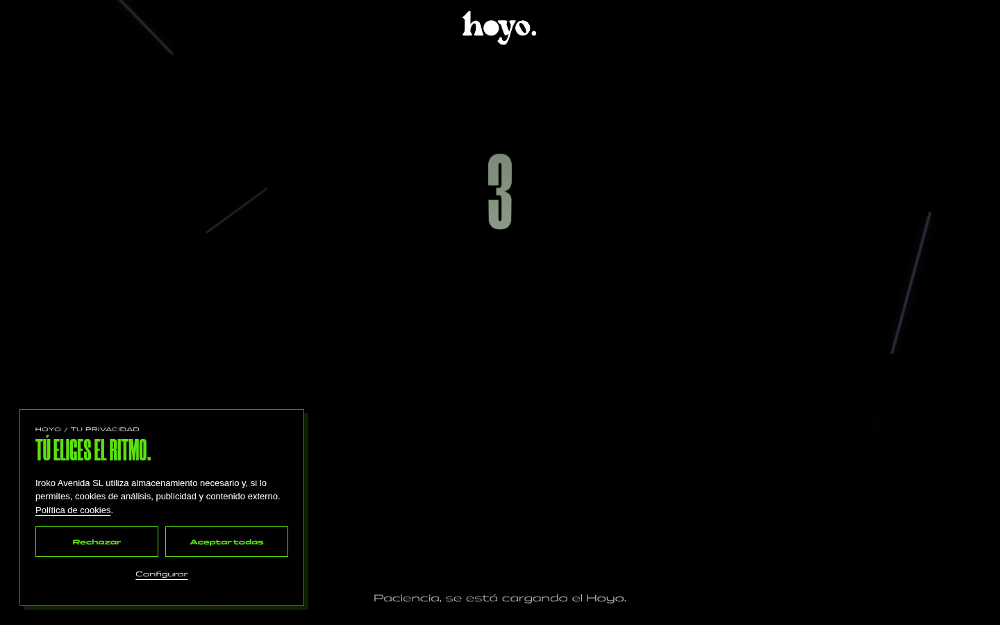

# UI Design System & Master Generation Blueprint: hoyojerez-com

> **HOYO Jerez · Discoteca en Jerez de la Frontera** (https://hoyojerez.com/) — HOYO, la discoteca de Jerez de la Frontera. Entra en el túnel: próximas fiestas y entradas, las fotos de cada noche y dónde encontrarnos.



---

## 1. Executive Visual Persona & Design Archetype

- **Brand Essence & Persona**: **HOYO Jerez · Discoteca en Jerez de la Frontera** (`https://hoyojerez.com/`). HOYO, la discoteca de Jerez de la Frontera. Entra en el túnel: próximas fiestas y entradas, las fotos de cada noche y dónde encontrarnos.
- **Capture Provenance**: Live browser capture (`tier2_webgl`, HTTP `200`, captured `2026-11-23`).
- **Visual Archetype**: **Dark-Substrate WebGL / Canvas Interactive Experience (`#010101` / `#5be010`)**.
- **Anti-AI-Slop Differentiators**:
  - **Live-Computed Chromatic Polarity**: Anchors the viewport in `#010101` (live computed `body` `background-color` (`computed_styles.json`)) paired with `#ffffff` primary typography and `#5be010` accents.
  - **Grounded Typographic Hierarchy**: Pairs `Panchang` for display copy (`Eventos`) with `Morganite` and not declared in live computed styles (uses primary stack / `ui-monospace`).
  - **Calibrated Spatial Grid & Motion**: Combines `1440px` container bounds (`gap: 20px`, padding `20px`) with `cubic-bezier(.2,.85,.25,1)` easing and Lenis Smooth Scroll (`data-lenis`), Three.js / WebGL Canvas Pipeline.

---

## 2. Spatial Architecture & Modular Grid Mathematics


### Viewport Allocation & Container Geometry
- **Captured Viewport Dimensions**: Desktop `1440×900px` (`assets/desktop.png`, single-viewport 100vh live capture (900px)), Mobile `390×844px` (`assets/mobile.png`, single-viewport 100vh live capture (844px)).
- **Master Container Bounds**: `1440px` (full-bleed `100%` desktop stage measured on `1440px` viewport).
- **Canvas Lateral Padding & Spacing**: `20px` lateral canvas padding with `20px` grid gap.
- **Border Radius Scale**: `50%`, `26px`, `28px`, `1px`.

### Responsive Breakpoint Architecture
- **Desktop Layout**: Multi-column CSS Grid / Flexbox layout at `1440px` (`max-width: 1440px`, `gap: 20px`).
- **Mobile Layout**: Single-column vertical stack at `390px` viewport width with `20px` horizontal padding.
- **Extracted CSS Media Queries**: `@media (prefers-reduced-motion)`, `@media (width>=767px)`, `@media (width>=1100px)`, `@media (prefers-reduced-motion:reduce)`.

---

## 3. Color System, Materiality & Atmospheric Lighting

### Semantic Palette & Source Grounding
| Semantic Role | Ground-Truth Value | Extracted Live / CSS Source |
|---|---|---|
| **Primary Canvas Substrate** | `#010101` | live computed `body` `background-color` (`computed_styles.json`) |
| **Primary Typography Ink** | `#ffffff` | live computed `p` `color` (`computed_styles.json`) |
| **Elevated Surface / Card Substrate** | `#1d1d1b` | `._linea_1qcud_61 { background: #1d1d1b }` |
| **Interactive Accent / Highlight** | `#5be010` | live computed `button` `color` (`computed_styles.json`) |
| **Secondary / Muted Copy** | `#5be010` | live computed `button` `color` (`computed_styles.json`) |
| **Structural Hairline Border** | `#343434` | `preferences_1d25v_98 ._necessar... { border-top: #343434 }` |

### Sanitized Root CSS Variables (`ui-ux.md` Ground Truth)
| Variable Name | Extracted Value | Semantic Role |
|---|---|---|
| `--tamano` | `22px` | Dimension / Scale Token |
| `--nivel` | `1` | Design System Custom Token |
| `--pista` | `2px` | Dimension / Scale Token |
| `--pulgar` | `9px` | Dimension / Scale Token |
| `--retraso` | `.2s` | Motion / Timing Token |
| `--cookies-tapa` | `311px` | Dimension / Scale Token |
| `--hoyojerez-com-bg` | `#010101` | Canvas Substrate (from live computed `body` `background-color` (`computed_styles.json`)) |
| `--hoyojerez-com-ink` | `#ffffff` | Primary Typography Ink (computed-derived) |
| `--hoyojerez-com-surface` | `#1d1d1b` | Surface Substrate (computed-derived) |
| `--hoyojerez-com-accent` | `#5be010` | Interactive Accent (computed-derived) |
| `--hoyojerez-com-muted` | `#5be010` | Secondary Ink (computed-derived) |
| `--hoyojerez-com-border` | `#343434` | Structural Border (computed-derived) |
| `--hoyojerez-com-container` | `1440px` | Container Bound (computed-derived) |
| `--hoyojerez-com-gap` | `20px` | Grid Gutter (computed-derived) |
| `--hoyojerez-com-pad` | `20px` | Lateral Padding (computed-derived) |
| `--hoyojerez-com-ease` | `cubic-bezier(.2,.85,.25,1)` | Primary Easing Function |

---

## 4. Typographic Scale & Editorial Hierarchy

### Font Family Stacks
- **Display Typography**: `Panchang`.
- **Primary Body Stack**: `Morganite`.
- **Technical / Metadata Stack**: not declared in live computed styles (uses primary stack / `ui-monospace`).

### Typographic Scale & Rules (Live Computed & Stylesheet Grounded)
- **Hero Display (`H1`)**: observed font-size ladder: `9.52381px`, `14px`, `10px`, `13px`, `28px`.
- **Section Heading (`H2`)**: live computed `h2` (`font-size: 9.52381px`, `line-height: 9.52381px`, `font-weight: 400`).
- **Body Copy**: live computed `body` (`font-size: 9.52381px`, `line-height: 9.52381px`, `font-weight: 400`); rule `p` (`font-size: 13px`).
- **Metadata & Navigation Labels**: live computed `nav/a` (`font-size: 9.52381px`, `line-height: 9.52381px`, `font-weight: 400`).

---

## 5. Choreographed Motion & Interaction Physics

### Primary Easing Curves
- **Extracted Timing Functions**: `cubic-bezier(.2,.85,.25,1)`, `cubic-bezier(.55,0,.35,1)`, `cubic-bezier(.22,1,.36,1)`.

### Per-Element Transition & Choreography Rules
- **Selector `._footer_c07n7_1`**: `transition: opacity .9s,filter .9s,visibility 0s linear .9s` extracted from `hoyojerez-com` stylesheet.
- **Selector `._footer_c07n7_1[data-arrancado=t...`**: `transition: opacity .9s,filter .9s` extracted from `hoyojerez-com` stylesheet.
- **Selector `._footer_c07n7_1[data-hidden=true]`**: `transition: opacity .3s,visibility 0s linear .3s` extracted from `hoyojerez-com` stylesheet.
- **Extracted Easing Curve (`cubic-bezier(.2,.85,.25,1)`)**: Governs interactive state transitions across `<header.lenis>` and `<main.main-content:nth(2)>`.
- **Runtime Interaction Engine**: Integrates Lenis Smooth Scroll (`data-lenis`), Three.js / WebGL Canvas Pipeline with `prefers-reduced-motion: reduce` fallback guards.

---

## 6. Component Wireframe & Structural DOM Map

### Visual Layout Schematic — Desktop (`1440px`, Grounded in `dom.html` & Landmark Bounding Boxes)
```
┌────────────────────────────────────────────────────────────────────────┐
│ DESKTOP VIEWPORT (1440px) — HOYO Jerez · Discoteca en Jerez de la Fron │
│ ====================================================================== │
│ [ <header.lenis> (1400x50px)          | Galería · Eventos · Contacto ] │
│ ---------------------------------------------------------------------- │
│ | HERO STAGE: <main.main-content> (w=1440px)                         | │
│ | H1: Eventos                                                        | │
│ | Substrate: #010101 | Ink: #ffffff | Accent: #5be010                | │
│ ---------------------------------------------------------------------- │
│ | SHOWCASE GRID (<main.main-content:nth(2)>) max-w: 1440px           | │
│ | +------------------------------+  +------------------------------+ | │
│ | | Galería                      |  | Proyección                   | | │
│ | +------------------------------+  +------------------------------+ | │
│ ---------------------------------------------------------------------- │
│ | DETAIL MODULE (<main.main-content:nth(3)>) — No se pudo cargar el  | │
│ ---------------------------------------------------------------------- │
│ [ FOOTER (<footer.intro-cargan) | https://hoyojerez.com/               │
└────────────────────────────────────────────────────────────────────────┘
```

### Visual Layout Schematic — Mobile Reflow (`390px`)
```
┌────────────────────────────────────────────────────────────────────────┐
│ MOBILE VIEWPORT REFLOW (390px) — Single-Column Stack (gap: 20px)       │
│ ====================================================================== │
│ [ HEADER BAR (<header.lenis>          ) | Compact Menu (390px)         │
│ ---------------------------------------------------------------------- │
│ | HERO STAGE (<main.main-content>) — 390px Vertical Lead             | │
│ | H1: Eventos                                                        | │
│ ---------------------------------------------------------------------- │
│ | SHOWCASE STACK (<main.main-content:nth) — 1-Col Stack              | │
│ | [ Item 1: Galería                                                ] | │
│ | [ Item 2: Proyección                                             ] | │
│ ---------------------------------------------------------------------- │
│ | DETAIL STACK (<main.main-content:nth(3) — 1-Col (No se pudo cargar ) │
│ ---------------------------------------------------------------------- │
│ [ FOOTER (<footer.intro-cargan) | Stacked 390px Colophon               │
└────────────────────────────────────────────────────────────────────────┘
```

### Granular DOM Region Breakdown
1. **Brand Header & Navigation Bar (<header.lenis> — `hoyojerez-com`)**:
   - Landmark `<header class="lenis">` (`1400x50px`) hosting `HOYO Jerez · Discoteca en Jerez de l` navigation (`Galería · Eventos · Contacto`), DOM attributes (`data-astro-cid-wetux6vv`, `data-astro-exec`, `data-astro-transition-persist="hoyo-tunnel"`, `data-persistent-tunnel`), and stylesheet rule `._panel_1d25v_1 { padding:22px;bottom:28px;left:28px }`.
2. **Hero Stage & Focal Lead (<main.main-content> — `Eventos`)**:
   - Landmark `<main class="main-content">` presenting display lead `Eventos` and copy excerpt *"Paciencia, se está cargando el Hoyo."* over `#010101` canvas and `#ffffff` ink.
3. **Primary Showcase & Content Grid (<main.main-content:nth(2)> — `Galería`)**:
   - Landmark `<main class="main-content">` rendering section `Galería` with copy *"La conexión va lenta · seguimos cargando"*, asset references (`index.astro_astro_type_script_ind...`, `alien.DVECqh-s.glb`, `pulsador.BQ51WIjM.glb`, `draco_wasm_wrapper.js`), and grid rule `._panel_1d25v_1 h2 { text-transform:uppercase;color:5be010;margin:8px 0 12px;font:900 44px/.9... }`.
4. **Interactive Detail & Feature Matrix (<main.main-content:nth(3)> — `Proyección`)**:
   - Landmark `<main class="main-content">` framing `Proyección` and `No se pudo cargar el Hoyo` (*"No se pudo cargar el Hoyo"*) with `#1d1d1b` surface cards, `#5be010` accents, and `._panel_1d25v_1 p { margin:0 0 14px;font-size:13px }`.
5. **Colophon & Global Directory Footer (<footer.intro-cargando> — `https://hoyojerez.com/`)**:
   - Landmark `<footer class="intro-cargando">` anchoring `HOYO Jerez · Discoteca en Jerez ` footer links (`Galería · Eventos · Contacto`), copy *"HOYO / Tu privacidad"*, and `#343434` structural dividers.

---

## 7. Master Zero-Shot AI Generation Prompt

```markdown
# Master Zero-Shot Frontend Generation Prompt: hoyojerez-com (HOYO Jerez · Discoteca en Jerez de la Frontera)

You are a principal frontend architect and design systems engineer. Build a complete, production-ready web application replicating the exact design system, DOM landmarks, typographic hierarchy, color tokens, and motion physics of `hoyojerez-com` (**HOYO Jerez · Discoteca en Jerez de la Frontera** — `https://hoyojerez.com/`).

### 1. Visual Archetype & Anti-AI-Slop Mandates
- **Archetype**: Dark-Substrate WebGL / Canvas Interactive Experience (`#010101` / `#5be010`).
- **Identity & Domain Context**: HOYO, la discoteca de Jerez de la Frontera. Entra en el túnel: próximas fiestas y entradas, las fotos de cada noche y dónde encontrarnos.
- **Primary Substrate**: `#010101` (live computed `body` `background-color` (`computed_styles.json`)), **Primary Ink**: `#ffffff`, **Accent / Highlight**: `#5be010`.
- **Site-Specific Differentiators**:
  - **Live-Computed Chromatic Polarity**: Anchors the viewport in `#010101` (live computed `body` `background-color` (`computed_styles.json`)) paired with `#ffffff` primary typography and `#5be010` accents.
  - **Grounded Typographic Hierarchy**: Pairs `Panchang` for display copy (`Eventos`) with `Morganite` and not declared in live computed styles (uses primary stack / `ui-monospace`).
  - **Calibrated Spatial Grid & Motion**: Combines `1440px` container bounds (`gap: 20px`, padding `20px`) with `cubic-bezier(.2,.85,.25,1)` easing and Lenis Smooth Scroll (`data-lenis`), Three.js / WebGL Canvas Pipeline.

### 2. Ground-Truth CSS Variables (`:root` Token Contract)
Declare and consume these exact custom properties extracted from `hoyojerez-com` in your global stylesheet:

:root {
  /* HOYO Jerez · Discoteca en Jerez de la Frontera (hoyojerez-com) — Live-Grounded CSS Variables */
  --tamano: 22px; /* Dimension / Scale Token (hoyojerez-com) */
  --nivel: 1; /* Design System Custom Token (hoyojerez-com) */
  --pista: 2px; /* Dimension / Scale Token (hoyojerez-com) */
  --pulgar: 9px; /* Dimension / Scale Token (hoyojerez-com) */
  --retraso: .2s; /* Motion / Timing Token (hoyojerez-com) */
  --cookies-tapa: 311px; /* Dimension / Scale Token (hoyojerez-com) */
  --hoyojerez-com-bg: #010101; /* Canvas Substrate (from live computed `body` `background-color` (`computed_styles.json`)) (hoyojerez-com) */
  --hoyojerez-com-ink: #ffffff; /* Primary Typography Ink (computed-derived) (hoyojerez-com) */
  --hoyojerez-com-surface: #1d1d1b; /* Surface Substrate (computed-derived) (hoyojerez-com) */
  --hoyojerez-com-accent: #5be010; /* Interactive Accent (computed-derived) (hoyojerez-com) */
  --hoyojerez-com-muted: #5be010; /* Secondary Ink (computed-derived) (hoyojerez-com) */
  --hoyojerez-com-border: #343434; /* Structural Border (computed-derived) (hoyojerez-com) */
  --hoyojerez-com-container: 1440px; /* Container Bound (computed-derived) (hoyojerez-com) */
  --hoyojerez-com-gap: 20px; /* Grid Gutter (computed-derived) (hoyojerez-com) */
  --hoyojerez-com-pad: 20px; /* Lateral Padding (computed-derived) (hoyojerez-com) */
  --hoyojerez-com-ease: cubic-bezier(.2,.85,.25,1); /* Primary Easing Function (hoyojerez-com) */
}

### 3. Semantic Color & Materiality Contract
Map every surface, ink, and border strictly to these source-grounded tokens:
- **Primary Canvas Substrate**: `#010101` — grounded in live computed `body` `background-color` (`computed_styles.json`)
- **Primary Typography Ink**: `#ffffff` — grounded in live computed `p` `color` (`computed_styles.json`)
- **Elevated Surface / Card Substrate**: `#1d1d1b` — grounded in `._linea_1qcud_61 { background: #1d1d1b }`
- **Interactive Accent / Highlight**: `#5be010` — grounded in live computed `button` `color` (`computed_styles.json`)
- **Secondary / Muted Copy**: `#5be010` — grounded in live computed `button` `color` (`computed_styles.json`)
- **Structural Hairline Border**: `#343434` — grounded in `preferences_1d25v_98 ._necessar... { border-top: #343434 }`

### 4. Spatial Grid, Container Bounds & Responsive Breakpoints
- **Desktop Viewport Reference**: `1440×900px` (single-viewport 100vh live capture (900px), `1440px` standard desktop width).
- **Mobile Viewport Reference**: `390×844px` (single-viewport 100vh live capture (844px), `390px` standard mobile width).
- **Container Max-Width**: `1440px` (full-bleed `100%` desktop stage measured on `1440px` viewport)
- **Padding & Gutters**: `20px` lateral canvas padding with `20px` grid gap
- **Desktop Grid**: Multi-column CSS Grid / Flexbox layout at `1440px` (`max-width: 1440px`, `gap: 20px`)
- **Mobile Adaptation**: Single-column vertical stack at `390px` viewport width with `20px` horizontal padding
- **Media Queries**: `@media (prefers-reduced-motion)`, `@media (width>=767px)`, `@media (width>=1100px)`, `@media (prefers-reduced-motion:reduce)`
- **Corner Radii**: `50%`, `26px`, `28px`, `1px`

### 5. Typography & Editorial Scale Contract
- **Display Font Stack**: `Panchang`
- **Body Font Stack**: `Morganite`
- **Monospace / Technical Font Stack**: not declared in live computed styles (uses primary stack / `ui-monospace`)
- **H1 Display Rule**: observed font-size ladder: `9.52381px`, `14px`, `10px`, `13px`, `28px`
- **H2 Section Rule**: live computed `h2` (`font-size: 9.52381px`, `line-height: 9.52381px`, `font-weight: 400`)
- **Body Copy Rule**: live computed `body` (`font-size: 9.52381px`, `line-height: 9.52381px`, `font-weight: 400`); rule `p` (`font-size: 13px`)
- **Metadata & Index Rule**: live computed `nav/a` (`font-size: 9.52381px`, `line-height: 9.52381px`, `font-weight: 400`)

### 6. Component Hierarchy, Verbatim Copy & Real DOM Landmarks
Scaffold `hoyojerez-com` (`HOYO Jerez · Discoteca en Jerez de la Frontera`) with these exact structural regions, extracted copy, and CSS rules from `dom.html`:
1. **Brand Header & Navigation Bar (<header.lenis> — `hoyojerez-com`)**:
   - DOM & Selectors: Landmark `<header class="lenis">` (`1400x50px`) hosting `HOYO Jerez · Discoteca en Jerez de l` navigation (`Galería · Eventos · Contacto`), DOM attributes (`data-astro-cid-wetux6vv`, `data-astro-exec`, `data-astro-transition-persist="hoyo-tunnel"`, `data-persistent-tunnel`), and stylesheet rule `._panel_1d25v_1 { padding:22px;bottom:28px;left:28px }`.
   - Responsive Contract: Header `Brand Header & Navigation Bar (<header.lenis> — `hoyojerez-com`)` (`hoyojerez-com`) adapts across `@media (prefers-reduced-motion)`, `@media (width>=767px)`, `@media (width>=1100px)`, `@media (prefers-reduced-motion:reduce)` with `cubic-bezier(.2,.85,.25,1)`, `cubic-bezier(.55,0,.35,1)`, `cubic-bezier(.22,1,.36,1)` transitions and links `Galería · Eventos · Contacto`.
2. **Hero Stage & Focal Lead (<main.main-content> — `Eventos`)**:
   - DOM & Selectors: Landmark `<main class="main-content">` presenting display lead `Eventos` and copy excerpt *"Paciencia, se está cargando el Hoyo."* over `#010101` canvas and `#ffffff` ink.
   - Responsive Contract: Hero stage (`1440×900px` desktop / `390×844px` mobile) sets `#010101` background with `#ffffff` headline `Eventos`.
3. **Primary Showcase & Content Grid (<main.main-content:nth(2)> — `Galería`)**:
   - DOM & Selectors: Landmark `<main class="main-content">` rendering section `Galería` with copy *"La conexión va lenta · seguimos cargando"*, asset references (`index.astro_astro_type_script_ind...`, `alien.DVECqh-s.glb`, `pulsador.BQ51WIjM.glb`, `draco_wasm_wrapper.js`), and grid rule `._panel_1d25v_1 h2 { text-transform:uppercase;color:5be010;margin:8px 0 12px;font:900 44px/.9... }`.
   - Responsive Contract: Showcase grid `Primary Showcase & Content Grid (<main.main-content:nth(2)> — `Galería`)` applies Multi-column CSS Grid / Flexbox layout at `1440px` (`max-width: 1440px`, `gap: 20px`) on desktop and Single-column vertical stack at `390px` viewport width with `20px` horizontal padding on mobile.
4. **Interactive Detail & Feature Matrix (<main.main-content:nth(3)> — `Proyección`)**:
   - DOM & Selectors: Landmark `<main class="main-content">` framing `Proyección` and `No se pudo cargar el Hoyo` (*"No se pudo cargar el Hoyo"*) with `#1d1d1b` surface cards, `#5be010` accents, and `._panel_1d25v_1 p { margin:0 0 14px;font-size:13px }`.
   - Responsive Contract: Detail module `Interactive Detail & Feature Matrix (<main.main-content:nth(3)> — `Proyección`)` uses `50%`, `26px`, `28px`, `1px` radii, `#5be010` highlights, and assets (index.astro_astro_type_script_ind..., alien.DVECqh-s.glb, pulsador.BQ51WIjM.glb).
5. **Colophon & Global Directory Footer (<footer.intro-cargando> — `https://hoyojerez.com/`)**:
   - DOM & Selectors: Landmark `<footer class="intro-cargando">` anchoring `HOYO Jerez · Discoteca en Jerez ` footer links (`Galería · Eventos · Contacto`), copy *"HOYO / Tu privacidad"*, and `#343434` structural dividers.
   - Responsive Contract: Footer `Colophon & Global Directory Footer (<footer.intro-cargando> — `https://hoyojerez.com/`)` aligns to `1440px` (full-bleed `100%` desktop stage measured on `1440px` viewport) with `20px` lateral canvas padding with `20px` grid gap and attributes (data-astro-cid-wetux6vv, data-astro-exec, data-astro-transition-persist="hoyo-tunnel").

#### Verbatim DOM Copy Excerpts (`dom.html`)
- Copy Excerpt 1: *"Paciencia, se está cargando el Hoyo."*
- Copy Excerpt 2: *"La conexión va lenta · seguimos cargando"*
- Copy Excerpt 3: *"No se pudo cargar el Hoyo"*
- Copy Excerpt 4: *"HOYO / Tu privacidad"*

### 7. Motion, Extracted Stylesheet Rules & Interaction Choreography
- **Primary Easing Functions**: `cubic-bezier(.2,.85,.25,1)`, `cubic-bezier(.55,0,.35,1)`, `cubic-bezier(.22,1,.36,1)`
- **Extracted Stylesheet Rules (`hoyojerez-com`)**:
- `._panel_1d25v_1 { padding:22px;bottom:28px;left:28px }`
- `._panel_1d25v_1 h2 { text-transform:uppercase;color:5be010;margin:8px 0 12px;font:900 44px/.9... }`
- `._panel_1d25v_1 p { margin:0 0 14px;font-size:13px }`
- `._panel_1d25v_1 a { color:fff;text-underline-offset:3px;text-decoration:underline }`
- `._panel_1d25v_1 button { cursor:pointer }`
- **Per-Selector Transition Rules**:
- **Selector `._footer_c07n7_1`**: `transition: opacity .9s,filter .9s,visibility 0s linear .9s` extracted from `hoyojerez-com` stylesheet.
- **Selector `._footer_c07n7_1[data-arrancado=t...`**: `transition: opacity .9s,filter .9s` extracted from `hoyojerez-com` stylesheet.
- **Selector `._footer_c07n7_1[data-hidden=true]`**: `transition: opacity .3s,visibility 0s linear .3s` extracted from `hoyojerez-com` stylesheet.
- **Extracted Easing Curve (`cubic-bezier(.2,.85,.25,1)`)**: Governs interactive state transitions across `<header.lenis>` and `<main.main-content:nth(2)>`.
- **Runtime Interaction Engine**: Integrates Lenis Smooth Scroll (`data-lenis`), Three.js / WebGL Canvas Pipeline with `prefers-reduced-motion: reduce` fallback guards.

### 8. Technical Deliverables
- Implement in Next.js (App Router) with TypeScript and Tailwind CSS consuming the `:root` custom properties defined above for `hoyojerez-com`.
- Reproduce both the `1440px` desktop architecture and `390px` mobile breakpoint transitions, preserving semantic HTML5 landmarks (`<header>`, `<nav>`, `<main>`, `<section>`, `<footer>`) and `prefers-reduced-motion` accessibility guards.
```
