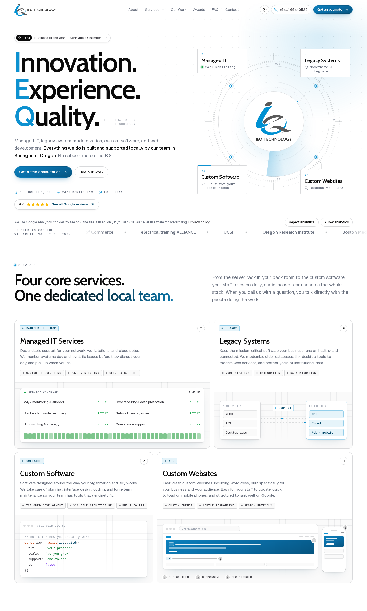
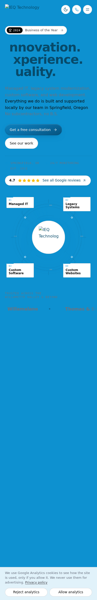

# UI Design System & Master Generation Blueprint: ieqtechnology-com

> **IEQ Technology · Innovation. Experience. Quality.** (https://ieqtechnology.com/) — Managed IT, legacy system modernization, custom software and custom websites from a 100% U.S.-based team in Springfield, Oregon. Since 2011.



---

## 1. Executive Visual Persona & Design Archetype

- **Brand Essence & Persona**: **IEQ Technology · Innovation. Experience. Quality.** (`https://ieqtechnology.com/`). Managed IT, legacy system modernization, custom software and custom websites from a 100% U.S.-based team in Springfield, Oregon. Since 2011.
- **Visual Archetype**: **Light-Substrate Editorial & Modular Grid System (`#0d91d0` canvas, `#fff` ink, `#e1eff6` accent)**.
- **Anti-AI-Slop Differentiators**:
  - **Source-Grounded Chromatic Polarity**: Anchors the viewport in `#0d91d0` (`var(--ieq-blue)` in `:root`) paired with `#fff` primary typography and `#e1eff6` accents.
  - **Extracted Typographic Hierarchy**: Pairs `Cabin` for display copy (`I nnovation. E xperience. Q uality. `) with `Geist` and `Geist Mono`.
  - **Calibrated Spatial Grid & Motion**: Combines `56ch` container bounds (`gap: 10px`, padding `4px`) with `cubic-bezier(.2,.7,.1,1)` easing.

---

## 2. Spatial Architecture & Modular Grid Mathematics



### Viewport Allocation & Container Geometry
- **Captured Viewport Dimensions**: Desktop `1440×9002px` (`assets/desktop.png`, full-page scroll capture), Mobile `390×2400px` (`assets/mobile.png`, capped at 2400px multi-section capture).
- **Master Container Bounds**: `56ch` extracted from `ieqtechnology-com` stylesheet.
- **Canvas Lateral Padding & Spacing**: `4px` lateral canvas padding with `10px` grid gap.
- **Border Radius Scale**: `4px`, `999px`, `5px`, `50%`.

### Responsive Breakpoint Architecture
- **Desktop Layout**: Multi-column CSS Grid / Flexbox layout at `1440px` (`max-width: 56ch`, `gap: 10px`).
- **Mobile Layout**: Single-column vertical stack at `390px` viewport width with `4px` horizontal padding.
- **Extracted CSS Media Queries**: `@media (width<=860px)`, `@media (width<=640px)`, `@media (width<=1240px)`, `@media (width<=1040px)`.

---

## 3. Color System, Materiality & Atmospheric Lighting

### Semantic Palette & Source Grounding
| Semantic Role | Ground-Truth Value | Extracted CSS Source / Selector |
|---|---|---|
| **Primary Canvas Substrate** | `#0d91d0` | `var(--ieq-blue)` in `:root` |
| **Primary Typography Ink** | `#074a6a` | `var(--ieq-teal)` in `:root` |
| **Elevated Surface / Card Substrate** | `#003e71` | `var(--ieq-navy)` in `:root` |
| **Interactive Accent / Highlight** | `#e1eff6` | `var(--ieq-tint)` in `:root` |
| **Secondary / Muted Copy** | `#d5ebf6` | `var(--ieq-tint-2)` in `:root` |
| **Structural Hairline Border** | `#fff` | `var(--bg)` in `:root` |
| **Variable Token (`--bg-2`)** | `#fafafa` | `var(--bg-2)` in `:root` |
| **Variable Token (`--bg-3`)** | `#f4f6f8` | `var(--bg-3)` in `:root` |

### Sanitized Root CSS Variables (`ui-ux.md` Ground Truth)
| Variable Name | Extracted Value | Semantic Role |
|---|---|---|
| `--font-sans` | `"Geist",ui-sans-serif,system-ui,-apple-system,"Segoe UI",sans-serif` | Typography / Scale Token |
| `--font-display` | `"Cabin","Geist",ui-sans-serif,system-ui,sans-serif` | Typography / Scale Token |
| `--font-mono` | `"Geist Mono",ui-monospace,SFMono-Regular,Menlo,monospace` | Typography / Scale Token |
| `--r-sm` | `6px` | Dimension / Scale Token |
| `--r-lg` | `16px` | Dimension / Scale Token |
| `--ease` | `cubic-bezier(.2,.7,.1,1)` | Motion / Easing Token |
| `--max` | `1440px` | Dimension / Scale Token |
| `--nav-h` | `76px` | Layout / Spatial Grid Token |
| `--ieq-blue` | `#0d91d0` | Color / Atmospheric Token |
| `--ieq-teal` | `#074a6a` | Color / Atmospheric Token |
| `--ieq-navy` | `#003e71` | Layout / Spatial Grid Token |
| `--ieq-tint` | `#e1eff6` | Canvas / Surface Token |
| `--ieq-tint-2` | `#d5ebf6` | Canvas / Surface Token |
| `--bg` | `#fff` | Canvas / Surface Token |
| `--bg-2` | `#fafafa` | Canvas / Surface Token |
| `--bg-3` | `#f4f6f8` | Canvas / Surface Token |

---

## 4. Typographic Scale & Editorial Hierarchy

### Font Family Stacks
- **Display Typography**: `Cabin`.
- **Primary Body Stack**: `Geist`.
- **Technical / Metadata Stack**: `Geist Mono`.

### Typographic Scale & Rules (Extracted from Stylesheet & Variables)
- **Hero Display (`H1`)**: CSS variables `--font-display: "Cabin","Geist",ui-sans-serif,system-ui,sans-serif`; rule `h1` (`font-size: 34px`, `letter-spacing: -.03em`).
- **Section Heading (`H2`)**: rule `.h2` (`font-size: clamp(40px,5vw,68px)`).
- **Body Copy**: rule `p` (`font-size: 15px`).
- **Metadata & Navigation Labels**: CSS variables `--font-mono: "Geist Mono",ui-monospace,SFMono-Regular,Menlo,monospace`; rule `small` (`font-size: 12px`, `font-weight: 400`).

---

## 5. Choreographed Motion & Interaction Physics

### Primary Easing Curves
- **Extracted Timing Functions**: `cubic-bezier(.2,.7,.1,1)`, `cubic-bezier(.65,0,.35,1)`, `cubic-bezier(0.2,0.7,0.1,1)`.

### Per-Element Transition & Choreography Rules
- **Selector `body`**: `transition: background-color .3s var(--ease),color .3s var(--ease)` extracted from `ieqtechnology-com` stylesheet.
- **Selector `.btn`**: `transition: transform .2s var(--ease),background-color .2s,border-color .2...` extracted from `ieqtechnology-com` stylesheet.
- **Selector `.btn svg`**: `transition: transform .25s var(--ease)` extracted from `ieqtechnology-com` stylesheet.
- **Extracted Easing Curve (`cubic-bezier(.2,.7,.1,1)`)**: Governs interactive state transitions across `<header.nav>` and `<section.block>`.
- **State & Hover Choreography**: Opacity and transform transitions on `<section.hero>` and `<section.block>` interactive targets.

---

## 6. Component Wireframe & Structural DOM Map

### Visual Layout Schematic (Grounded in `dom.html` — `1440px` Desktop & `390px` Mobile Reflow)
```
┌────────────────────────────────────────────────────────────────────────┐
│ DESKTOP VIEWPORT (1440px) — IEQ Technology · Innovation. Experience. Q │
│ ====================================================================== │
│ [ <header.nav>             | About · Services · All services · Our  ]  │
│ ---------------------------------------------------------------------- │
│ | HERO STAGE: <section.hero>                                       |   │
│ | H1: I nnovation. E xperience. Q uality. That's IEQ Te...         |   │
│ | Substrate: #0d91d0    | Ink: #fff       | Accent: #e1eff6        |   │
│ ---------------------------------------------------------------------- │
│ | SHOWCASE GRID (<section.block>           ) max-w: 56ch           |   │
│ | +------------------------------+  +------------------------------+ | │
│ | | Four core services. One dedi |  | Managed IT Services          | | │
│ | +------------------------------+  +------------------------------+ | │
│ ---------------------------------------------------------------------- │
│ | MOBILE VIEWPORT REFLOW (390px) — Single-Column Stack (gap: 10px  ) | │
│ | [<header.nav>] -> [<section.hero>] -> [<section.block>] |            │
│ ---------------------------------------------------------------------- │
│ [ FOOTER (<footer.block>        ) | https://ieqtechnology.com/         │
└────────────────────────────────────────────────────────────────────────┘
```

### Granular DOM Region Breakdown
1. **Brand Header & Navigation Bar (<header.nav> — `ieqtechnology-com`)**:
   - Landmark `<header class="nav">` hosting `IEQ Technology · Innovation. Experie` navigation (`About · Services · All services · Our Work · Awards`), DOM attributes (`data-theme="light"`, `data-k="nw"`, `data-k="ne"`, `data-k="sw"`), and stylesheet rule `after { box-sizing:border-box }`.
2. **Hero Stage & Focal Lead (<section.hero> — `I nnovation. E xperience. Q uality`)**:
   - Landmark `<section class="hero">` presenting display lead `I nnovation. E xperience. Q uality. That's IEQ Te...` and copy excerpt *"Managed IT Monitoring, security & support"* over `#0d91d0` canvas and `#fff` ink.
3. **Primary Showcase & Content Grid (<section.block> — `Four core services. One dedicated `)**:
   - Landmark `<section class="block">` rendering section `Four core services. One dedicated local team.` with copy *"Legacy Systems Modernize & integrate"*, asset references (`favicon.ico`, `favicon-32.png`, `apple-touch-icon.png`, `sitemap.xml`), and grid rule `html { scroll-behavior:smooth;-webkit-text-size-adjust:100% }`.
4. **Interactive Detail & Feature Matrix (<section.block> — `Managed IT Services`)**:
   - Landmark `<section class="block">` framing `Managed IT Services` and `Legacy Systems` (*"Custom Software Built for your exact needs"*) with `#003e71` surface cards, `#e1eff6` accents, and `svg { display:block }`.
5. **Colophon & Global Directory Footer (<footer.block> — `https://ieqtechnology.com/`)**:
   - Landmark `<footer class="block site-foot">` anchoring `IEQ Technology · Innovation. Exp` footer links (`About · Services · All services · Our Work · Awards`), copy *"Custom Websites Responsive · SEO"*, and `#fff` structural dividers.

---

## 7. Master Zero-Shot AI Generation Prompt

```markdown
# Master Zero-Shot Frontend Generation Prompt: ieqtechnology-com (IEQ Technology · Innovation. Experience. Quality.)

You are a principal frontend architect and design systems engineer. Build a complete, production-ready web application replicating the exact design system, DOM landmarks, typographic hierarchy, color tokens, and motion physics of `ieqtechnology-com` (**IEQ Technology · Innovation. Experience. Quality.** — `https://ieqtechnology.com/`).

### 1. Visual Archetype & Anti-AI-Slop Mandates
- **Archetype**: Light-Substrate Editorial & Modular Grid System (`#0d91d0` canvas, `#fff` ink, `#e1eff6` accent).
- **Identity & Domain Context**: Managed IT, legacy system modernization, custom software and custom websites from a 100% U.S.-based team in Springfield, Oregon. Since 2011.
- **Primary Substrate**: `#0d91d0` (`var(--ieq-blue)` in `:root`), **Primary Ink**: `#fff`, **Accent / Highlight**: `#e1eff6`.
- **Site-Specific Differentiators**:
  - **Source-Grounded Chromatic Polarity**: Anchors the viewport in `#0d91d0` (`var(--ieq-blue)` in `:root`) paired with `#fff` primary typography and `#e1eff6` accents.
  - **Extracted Typographic Hierarchy**: Pairs `Cabin` for display copy (`I nnovation. E xperience. Q uality. `) with `Geist` and `Geist Mono`.
  - **Calibrated Spatial Grid & Motion**: Combines `56ch` container bounds (`gap: 10px`, padding `4px`) with `cubic-bezier(.2,.7,.1,1)` easing.

### 2. Ground-Truth CSS Variables (`:root` Token Contract)
Declare and consume these exact custom properties extracted from `ieqtechnology-com` in your global stylesheet:

:root {
  /* IEQ Technology · Innovation. Experience. Quality. (ieqtechnology-com) — Ground-Truth Extracted CSS Variables */
  --font-sans: "Geist",ui-sans-serif,system-ui,-apple-system,"Segoe UI",sans-serif; /* Typography / Scale Token (ieqtechnology-com) */
  --font-display: "Cabin","Geist",ui-sans-serif,system-ui,sans-serif; /* Typography / Scale Token (ieqtechnology-com) */
  --font-mono: "Geist Mono",ui-monospace,SFMono-Regular,Menlo,monospace; /* Typography / Scale Token (ieqtechnology-com) */
  --r-sm: 6px; /* Dimension / Scale Token (ieqtechnology-com) */
  --r-lg: 16px; /* Dimension / Scale Token (ieqtechnology-com) */
  --ease: cubic-bezier(.2,.7,.1,1); /* Motion / Easing Token (ieqtechnology-com) */
  --max: 1440px; /* Dimension / Scale Token (ieqtechnology-com) */
  --nav-h: 76px; /* Layout / Spatial Grid Token (ieqtechnology-com) */
  --ieq-blue: #0d91d0; /* Color / Atmospheric Token (ieqtechnology-com) */
  --ieq-teal: #074a6a; /* Color / Atmospheric Token (ieqtechnology-com) */
  --ieq-navy: #003e71; /* Layout / Spatial Grid Token (ieqtechnology-com) */
  --ieq-tint: #e1eff6; /* Canvas / Surface Token (ieqtechnology-com) */
  --ieq-tint-2: #d5ebf6; /* Canvas / Surface Token (ieqtechnology-com) */
  --bg: #fff; /* Canvas / Surface Token (ieqtechnology-com) */
  --bg-2: #fafafa; /* Canvas / Surface Token (ieqtechnology-com) */
  --bg-3: #f4f6f8; /* Canvas / Surface Token (ieqtechnology-com) */
}

### 3. Semantic Color & Materiality Contract
Map every surface, ink, and border strictly to these source-grounded tokens:
- **Primary Canvas Substrate**: `#0d91d0` — grounded in `var(--ieq-blue)` in `:root`
- **Primary Typography Ink**: `#074a6a` — grounded in `var(--ieq-teal)` in `:root`
- **Elevated Surface / Card Substrate**: `#003e71` — grounded in `var(--ieq-navy)` in `:root`
- **Interactive Accent / Highlight**: `#e1eff6` — grounded in `var(--ieq-tint)` in `:root`
- **Secondary / Muted Copy**: `#d5ebf6` — grounded in `var(--ieq-tint-2)` in `:root`
- **Structural Hairline Border**: `#fff` — grounded in `var(--bg)` in `:root`
- **Variable Token (`--bg-2`)**: `#fafafa` — grounded in `var(--bg-2)` in `:root`
- **Variable Token (`--bg-3`)**: `#f4f6f8` — grounded in `var(--bg-3)` in `:root`

### 4. Spatial Grid, Container Bounds & Responsive Breakpoints
- **Desktop Viewport Reference**: `1440×9002px` (full-page scroll capture, `1440px` standard desktop width).
- **Mobile Viewport Reference**: `390×2400px` (capped at 2400px multi-section capture, `390px` standard mobile width).
- **Container Max-Width**: `56ch` extracted from `ieqtechnology-com` stylesheet
- **Padding & Gutters**: `4px` lateral canvas padding with `10px` grid gap
- **Desktop Grid**: Multi-column CSS Grid / Flexbox layout at `1440px` (`max-width: 56ch`, `gap: 10px`)
- **Mobile Adaptation**: Single-column vertical stack at `390px` viewport width with `4px` horizontal padding
- **Media Queries**: `@media (width<=860px)`, `@media (width<=640px)`, `@media (width<=1240px)`, `@media (width<=1040px)`
- **Corner Radii**: `4px`, `999px`, `5px`, `50%`

### 5. Typography & Editorial Scale Contract
- **Display Font Stack**: `Cabin`
- **Body Font Stack**: `Geist`
- **Monospace / Technical Font Stack**: `Geist Mono`
- **H1 Display Rule**: CSS variables `--font-display: "Cabin","Geist",ui-sans-serif,system-ui,sans-serif`; rule `h1` (`font-size: 34px`, `letter-spacing: -.03em`)
- **H2 Section Rule**: rule `.h2` (`font-size: clamp(40px,5vw,68px)`)
- **Body Copy Rule**: rule `p` (`font-size: 15px`)
- **Metadata & Index Rule**: CSS variables `--font-mono: "Geist Mono",ui-monospace,SFMono-Regular,Menlo,monospace`; rule `small` (`font-size: 12px`, `font-weight: 400`)

### 6. Component Hierarchy, Verbatim Copy & Real DOM Landmarks
Scaffold `ieqtechnology-com` (`IEQ Technology · Innovation. Experience. Quality.`) with these exact structural regions, extracted copy, and CSS rules from `dom.html`:
1. **Brand Header & Navigation Bar (<header.nav> — `ieqtechnology-com`)**:
   - DOM & Selectors: Landmark `<header class="nav">` hosting `IEQ Technology · Innovation. Experie` navigation (`About · Services · All services · Our Work · Awards`), DOM attributes (`data-theme="light"`, `data-k="nw"`, `data-k="ne"`, `data-k="sw"`), and stylesheet rule `after { box-sizing:border-box }`.
   - Responsive Contract: Header `Brand Header & Navigation Bar (<header.nav> — `ieqtechnology-com`)` (`ieqtechnology-com`) adapts across `@media (width<=860px)`, `@media (width<=640px)`, `@media (width<=1240px)`, `@media (width<=1040px)` with `cubic-bezier(.2,.7,.1,1)`, `cubic-bezier(.65,0,.35,1)`, `cubic-bezier(0.2,0.7,0.1,1)` transitions and links `About · Services · All services · Our Work · Awards`.
2. **Hero Stage & Focal Lead (<section.hero> — `I nnovation. E xperience. Q uality`)**:
   - DOM & Selectors: Landmark `<section class="hero">` presenting display lead `I nnovation. E xperience. Q uality. That's IEQ Te...` and copy excerpt *"Managed IT Monitoring, security & support"* over `#0d91d0` canvas and `#fff` ink.
   - Responsive Contract: Hero stage (`1440×9002px` desktop / `390×2400px` mobile) sets `#0d91d0` background with `#fff` headline `I nnovation. E xperience. Q uality. That's IEQ Te...`.
3. **Primary Showcase & Content Grid (<section.block> — `Four core services. One dedicated `)**:
   - DOM & Selectors: Landmark `<section class="block">` rendering section `Four core services. One dedicated local team.` with copy *"Legacy Systems Modernize & integrate"*, asset references (`favicon.ico`, `favicon-32.png`, `apple-touch-icon.png`, `sitemap.xml`), and grid rule `html { scroll-behavior:smooth;-webkit-text-size-adjust:100% }`.
   - Responsive Contract: Showcase grid `Primary Showcase & Content Grid (<section.block> — `Four core services. One dedicated `)` applies Multi-column CSS Grid / Flexbox layout at `1440px` (`max-width: 56ch`, `gap: 10px`) on desktop and Single-column vertical stack at `390px` viewport width with `4px` horizontal padding on mobile.
4. **Interactive Detail & Feature Matrix (<section.block> — `Managed IT Services`)**:
   - DOM & Selectors: Landmark `<section class="block">` framing `Managed IT Services` and `Legacy Systems` (*"Custom Software Built for your exact needs"*) with `#003e71` surface cards, `#e1eff6` accents, and `svg { display:block }`.
   - Responsive Contract: Detail module `Interactive Detail & Feature Matrix (<section.block> — `Managed IT Services`)` uses `4px`, `999px`, `5px`, `50%` radii, `#e1eff6` highlights, and assets (favicon.ico, favicon-32.png, apple-touch-icon.png).
5. **Colophon & Global Directory Footer (<footer.block> — `https://ieqtechnology.com/`)**:
   - DOM & Selectors: Landmark `<footer class="block site-foot">` anchoring `IEQ Technology · Innovation. Exp` footer links (`About · Services · All services · Our Work · Awards`), copy *"Custom Websites Responsive · SEO"*, and `#fff` structural dividers.
   - Responsive Contract: Footer `Colophon & Global Directory Footer (<footer.block> — `https://ieqtechnology.com/`)` aligns to `56ch` extracted from `ieqtechnology-com` stylesheet with `4px` lateral canvas padding with `10px` grid gap and attributes (data-theme="light", data-k="nw", data-k="ne").

#### Verbatim DOM Copy Excerpts (`dom.html`)
- Copy Excerpt 1: *"Managed IT Monitoring, security & support"*
- Copy Excerpt 2: *"Legacy Systems Modernize & integrate"*
- Copy Excerpt 3: *"Custom Software Built for your exact needs"*
- Copy Excerpt 4: *"Custom Websites Responsive · SEO"*

### 7. Motion, Extracted Stylesheet Rules & Interaction Choreography
- **Primary Easing Functions**: `cubic-bezier(.2,.7,.1,1)`, `cubic-bezier(.65,0,.35,1)`, `cubic-bezier(0.2,0.7,0.1,1)`
- **Extracted Stylesheet Rules (`ieqtechnology-com`)**:
- `after { box-sizing:border-box }`
- `html { scroll-behavior:smooth;-webkit-text-size-adjust:100% }`
- `svg { display:block }`
- `textarea { font:inherit;color:inherit }`
- `selection { background:var(--brand);color:fff }`
- **Per-Selector Transition Rules**:
- **Selector `body`**: `transition: background-color .3s var(--ease),color .3s var(--ease)` extracted from `ieqtechnology-com` stylesheet.
- **Selector `.btn`**: `transition: transform .2s var(--ease),background-color .2s,border-color .2...` extracted from `ieqtechnology-com` stylesheet.
- **Selector `.btn svg`**: `transition: transform .25s var(--ease)` extracted from `ieqtechnology-com` stylesheet.
- **Extracted Easing Curve (`cubic-bezier(.2,.7,.1,1)`)**: Governs interactive state transitions across `<header.nav>` and `<section.block>`.
- **State & Hover Choreography**: Opacity and transform transitions on `<section.hero>` and `<section.block>` interactive targets.

### 8. Technical Deliverables
- Implement in Next.js (App Router) with TypeScript and Tailwind CSS consuming the `:root` custom properties defined above for `ieqtechnology-com`.
- Reproduce both the `1440px` desktop architecture and `390px` mobile breakpoint transitions, preserving semantic HTML5 landmarks (`<header>`, `<nav>`, `<main>`, `<section>`, `<footer>`) and `prefers-reduced-motion` accessibility guards.
```
