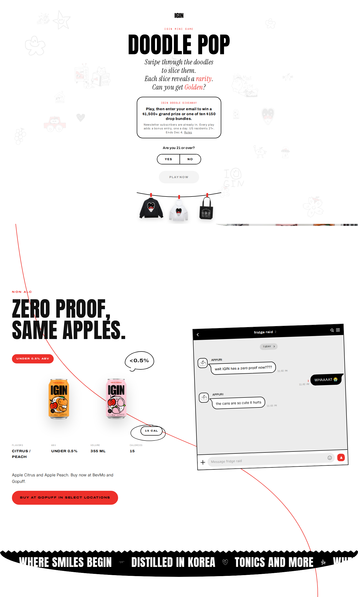

# UI Design System & Master Generation Blueprint: iginusa-com

> **IGIN USA · Official Home of IGIN in the United States** (https://iginusa.com) — IGIN in the USA. Doodle merch, non-alcoholic Apple Citrus and Apple Peach, and where to find IGIN near you. Official store.



---

## 1. Executive Visual Persona & Design Archetype

- **Brand Essence & Persona**: **IGIN USA · Official Home of IGIN in the United States** (`https://iginusa.com`). IGIN in the USA. Doodle merch, non-alcoholic Apple Citrus and Apple Peach, and where to find IGIN near you. Official store.
- **Visual Archetype**: **Light-Gallery WebGL / Canvas Interactive Experience (`#ffffff` / `#f5f3f0`)**.
- **Anti-AI-Slop Differentiators**:
  - **Source-Grounded Chromatic Polarity**: Anchors the viewport in `#ffffff` (`var(--igin-white)` in `:root`) paired with `#111111` primary typography and `#f5f3f0` accents.
  - **Extracted Typographic Hierarchy**: Pairs `Anton` for display copy (`Are you 21 or over?`) with `Archivo` and `JetBrains Mono`.
  - **Calibrated Spatial Grid & Motion**: Combines `var(--page-width)` container bounds (`gap: 1rem`, padding `var(--product-card-image-padding)`) with `cubic-bezier(0,0,.3,1)` easing and Three.js / WebGL Canvas Pipeline.

---

## 2. Spatial Architecture & Modular Grid Mathematics


### Viewport Allocation & Container Geometry
- **Captured Viewport Dimensions**: Desktop `1440×13053px` (`assets/desktop.png`, full-page scroll capture), Mobile `390×2400px` (`assets/mobile.png`, capped at 2400px multi-section capture).
- **Master Container Bounds**: `var(--page-width)` extracted from `iginusa-com` stylesheet.
- **Canvas Lateral Padding & Spacing**: `var(--product-card-image-padding)` lateral canvas padding with `1rem` grid gap.
- **Border Radius Scale**: `4px`, `var(--product-card-corner-radius)`, `var(--collection-card-corner-radius)`, `var(--blog-card-corner-radius)`.

### Responsive Breakpoint Architecture
- **Desktop Layout**: Multi-column CSS Grid / Flexbox layout at `1440px` (`max-width: var(--page-width)`, `gap: 1rem`).
- **Mobile Layout**: Single-column vertical stack at `390px` viewport width with `var(--product-card-image-padding)` horizontal padding.
- **Extracted CSS Media Queries**: `@media screen and (forced-colors:active)`, `@media screen and (width<=750px)`, `@media screen and (min-width:750px)`, `@media screen and (min-width:990px)`.

---

## 3. Color System, Materiality & Atmospheric Lighting

### Semantic Palette & Source Grounding
| Semantic Role | Ground-Truth Value | Extracted CSS Source / Selector |
|---|---|---|
| **Primary Canvas Substrate** | `#ffffff` | `var(--igin-white)` in `:root` |
| **Primary Typography Ink** | `#111111` | `var(--igin-black)` in `:root` |
| **Elevated Surface / Card Substrate** | `#ed302a` | `var(--igin-red)` in `:root` |
| **Interactive Accent / Highlight** | `#f5f3f0` | `var(--igin-gray-light)` in `:root` |
| **Secondary / Muted Copy** | `#999` | `var(--igin-gray-mid)` in `:root` |
| **Structural Hairline Border** | `#333` | `var(--igin-gray-dark)` in `:root` |

### Sanitized Root CSS Variables (`ui-ux.md` Ground Truth)
| Variable Name | Extracted Value | Semantic Role |
|---|---|---|
| `--alpha-button-background` | `1` | Canvas / Surface Token |
| `--alpha-button-border` | `1` | Elevation / Border Token |
| `--alpha-link` | `.85` | Typography Ink Token |
| `--alpha-badge-border` | `.1` | Elevation / Border Token |
| `--focused-base-outline` | `.2rem solid rgba(var(--color-foreground), .5)` | Elevation / Border Token |
| `--focused-base-outline-offset` | `.3rem` | Elevation / Border Token |
| `--border-radius` | `var(--product-card-corner-radius)` | Elevation / Border Token |
| `--border-width` | `var(--product-card-border-width)` | Layout / Spatial Grid Token |
| `--border-opacity` | `var(--product-card-border-opacity)` | Elevation / Border Token |
| `--shadow-horizontal-offset` | `var(--product-card-shadow-horizontal-offset)` | Elevation / Border Token |
| `--shadow-vertical-offset` | `var(--product-card-shadow-vertical-offset)` | Elevation / Border Token |
| `--shadow-blur-radius` | `var(--product-card-shadow-blur-radius)` | Elevation / Border Token |
| `--shadow-opacity` | `var(--product-card-shadow-opacity)` | Elevation / Border Token |
| `--shadow-visible` | `var(--product-card-shadow-visible)` | Elevation / Border Token |
| `--image-padding` | `var(--product-card-image-padding)` | Layout / Spatial Grid Token |
| `--text-alignment` | `var(--product-card-text-alignment)` | Typography Ink Token |

---

## 4. Typographic Scale & Editorial Hierarchy

### Font Family Stacks
- **Display Typography**: `Anton`.
- **Primary Body Stack**: `Archivo`.
- **Technical / Metadata Stack**: `JetBrains Mono`.

### Typographic Scale & Rules (Extracted from Stylesheet & Variables)
- **Hero Display (`H1`)**: CSS variables `--x-shell-disclosure-display: block`, `--x-shell-order-summary-display: none`, `--x-shell-content-display: grid`; rule `,.h1` (`font-size: calc(var(--font-heading-scale...`).
- **Section Heading (`H2`)**: rule `,.h2` (`font-size: calc(var(--font-heading-scale...`).
- **Body Copy**: CSS variables `--body: "Inter", "Helvetica Neue", Arial, sans-serif`, `--font-body-family: Assistant, sans-serif`, `--font-body-style: normal`; rule `p` (`font-size: 19px`, `line-height: 1.15`).
- **Metadata & Navigation Labels**: CSS variables `--mono: "JetBrains Mono", ui-monospace, "SF Mono", Menlo, monospace`, `--x-border-radius-small: 8px`, `--x-product-thumbnail-small-outer-size: 4.2rem`; rule `small` (`font-size: 10px`, `letter-spacing: .12em`, `font-weight: 600`).

---

## 5. Choreographed Motion & Interaction Physics

### Primary Easing Curves
- **Extracted Timing Functions**: `cubic-bezier(0,0,.3,1)`, `cubic-bezier(.25,.46,.45,.94)`, `cubic-bezier(.52,0,.61,.99)`.

### Per-Element Transition & Choreography Rules
- **Selector `.shopify-payment-button__button`**: `transition: background .2s ease-in-out` extracted from `iginusa-com` stylesheet.
- **Selector `media(prefers-reduced-motion)`**: `transition: none!important` extracted from `iginusa-com` stylesheet.
- **Selector `.inline-richtext a`**: `transition: text-decoration-thickness ease .1s` extracted from `iginusa-com` stylesheet.
- **Extracted Easing Curve (`cubic-bezier(0,0,.3,1)`)**: Governs interactive state transitions across `<header.igin-rv>` and `<section.shopify-section>`.
- **Runtime Interaction Engine**: Integrates Three.js / WebGL Canvas Pipeline with `prefers-reduced-motion: reduce` fallback guards.

---

## 6. Component Wireframe & Structural DOM Map

### Visual Layout Schematic (Grounded in `dom.html` — `1440px` Desktop & `390px` Mobile Reflow)
```
┌────────────────────────────────────────────────────────────────────────┐
│ DESKTOP VIEWPORT (1440px) — IGIN USA · Official Home of IGIN in the Un │
│ ====================================================================== │
│ [ <header.igin-rv>         | SHOP · Drinks · Our Story · Where to B ]  │
│ ---------------------------------------------------------------------- │
│ | HERO STAGE: <section.shopify-section>                            |   │
│ | H1: Are you 21 or over?                                          |   │
│ | Substrate: #ffffff    | Ink: #111111    | Accent: #f5f3f0        |   │
│ ---------------------------------------------------------------------- │
│ | SHOWCASE GRID (<section.shopify-section> ) max-w: var(--page-wid |   │
│ | +------------------------------+  +------------------------------+ | │
│ | | IGIN USA: Where Smiles Begin |  | Zero proof, same apples.     | | │
│ | +------------------------------+  +------------------------------+ | │
│ ---------------------------------------------------------------------- │
│ | MOBILE VIEWPORT REFLOW (390px) — Single-Column Stack (gap: 1rem  ) | │
│ | [<header.igin-rv>] -> [<section.shopify-s] -> [<section.shopify-s] | │
│ ---------------------------------------------------------------------- │
│ [ FOOTER (<footer.igin-rv>      ) | https://iginusa.com                │
└────────────────────────────────────────────────────────────────────────┘
```

### Granular DOM Region Breakdown
1. **Brand Header & Navigation Bar (<header.igin-rv> — `iginusa-com`)**:
   - Landmark `<header class="igin-rv hdr">` hosting `IGIN USA · Official Home of IGIN in ` navigation (`SHOP · Drinks · Our Story · Where to Buy · Play Doodle Pop`), DOM attributes (`data-source-attribution="shopify.exit_intersti..."`, `data-shop-id="100223058239"`, `data-venmo-supported="false"`, `data-environment="production"`), and stylesheet rule `.shopify-payment-button__button--... { visibility:hidden }`.
2. **Hero Stage & Focal Lead (<section.shopify-section> — `Are you 21 or over?`)**:
   - Landmark `<section class="shopify-section shopify-section-group-header-group">` presenting display lead `Are you 21 or over?` and copy excerpt *"Welcome to IGIN USA"* over `#ffffff` canvas and `#111111` ink.
3. **Primary Showcase & Content Grid (<section.shopify-section> — `IGIN USA: Where Smiles Begin`)**:
   - Landmark `<section class="shopify-section igin-doodle-pop-section">` rendering section `IGIN USA: Where Smiles Begin` with copy *"You must be 21 or over to enter this site."*, asset references (`2721185198297886`, `fbevents.js`, `LOGO-IGIN_USA_SNS_Profile.png`, `fonts.shopifycdn.com`), and grid rule `opify-payment-button__button--unb... { background-color:1990c6;padding:1em 2em }`.
4. **Interactive Detail & Feature Matrix (<section.shopify-section> — `Zero proof, same apples.`)**:
   - Landmark `<section class="shopify-section igin-rv-section">` framing `Zero proof, same apples.` and `Two fans chatting about the new IGIN non alcoholi...` (*"Please enjoy responsibly."*) with `#ed302a` surface cards, `#f5f3f0` accents, and `ptions.shopify-payment-button__sk... { width:50%;margin-left:25%;margin-right:25%;border-radius:4px!important;h... }`.
5. **Colophon & Global Directory Footer (<footer.igin-rv> — `https://iginusa.com`)**:
   - Landmark `<footer class="igin-rv ftr">` anchoring `IGIN USA · Official Home of IGIN` footer links (`SHOP · Drinks · Our Story · Where to Buy · Play Doodle Pop`), copy *"Shipping and tax at checkout."*, and `#333` structural dividers.

---

## 7. Master Zero-Shot AI Generation Prompt

```markdown
# Master Zero-Shot Frontend Generation Prompt: iginusa-com (IGIN USA · Official Home of IGIN in the United States)

You are a principal frontend architect and design systems engineer. Build a complete, production-ready web application replicating the exact design system, DOM landmarks, typographic hierarchy, color tokens, and motion physics of `iginusa-com` (**IGIN USA · Official Home of IGIN in the United States** — `https://iginusa.com`).

### 1. Visual Archetype & Anti-AI-Slop Mandates
- **Archetype**: Light-Gallery WebGL / Canvas Interactive Experience (`#ffffff` / `#f5f3f0`).
- **Identity & Domain Context**: IGIN in the USA. Doodle merch, non-alcoholic Apple Citrus and Apple Peach, and where to find IGIN near you. Official store.
- **Primary Substrate**: `#ffffff` (`var(--igin-white)` in `:root`), **Primary Ink**: `#111111`, **Accent / Highlight**: `#f5f3f0`.
- **Site-Specific Differentiators**:
  - **Source-Grounded Chromatic Polarity**: Anchors the viewport in `#ffffff` (`var(--igin-white)` in `:root`) paired with `#111111` primary typography and `#f5f3f0` accents.
  - **Extracted Typographic Hierarchy**: Pairs `Anton` for display copy (`Are you 21 or over?`) with `Archivo` and `JetBrains Mono`.
  - **Calibrated Spatial Grid & Motion**: Combines `var(--page-width)` container bounds (`gap: 1rem`, padding `var(--product-card-image-padding)`) with `cubic-bezier(0,0,.3,1)` easing and Three.js / WebGL Canvas Pipeline.

### 2. Ground-Truth CSS Variables (`:root` Token Contract)
Declare and consume these exact custom properties extracted from `iginusa-com` in your global stylesheet:

:root {
  /* IGIN USA · Official Home of IGIN in the United States (iginusa-com) — Ground-Truth Extracted CSS Variables */
  --alpha-button-background: 1; /* Canvas / Surface Token (iginusa-com) */
  --alpha-button-border: 1; /* Elevation / Border Token (iginusa-com) */
  --alpha-link: .85; /* Typography Ink Token (iginusa-com) */
  --alpha-badge-border: .1; /* Elevation / Border Token (iginusa-com) */
  --focused-base-outline: .2rem solid rgba(var(--color-foreground), .5); /* Elevation / Border Token (iginusa-com) */
  --focused-base-outline-offset: .3rem; /* Elevation / Border Token (iginusa-com) */
  --border-radius: var(--product-card-corner-radius); /* Elevation / Border Token (iginusa-com) */
  --border-width: var(--product-card-border-width); /* Layout / Spatial Grid Token (iginusa-com) */
  --border-opacity: var(--product-card-border-opacity); /* Elevation / Border Token (iginusa-com) */
  --shadow-horizontal-offset: var(--product-card-shadow-horizontal-offset); /* Elevation / Border Token (iginusa-com) */
  --shadow-vertical-offset: var(--product-card-shadow-vertical-offset); /* Elevation / Border Token (iginusa-com) */
  --shadow-blur-radius: var(--product-card-shadow-blur-radius); /* Elevation / Border Token (iginusa-com) */
  --shadow-opacity: var(--product-card-shadow-opacity); /* Elevation / Border Token (iginusa-com) */
  --shadow-visible: var(--product-card-shadow-visible); /* Elevation / Border Token (iginusa-com) */
  --image-padding: var(--product-card-image-padding); /* Layout / Spatial Grid Token (iginusa-com) */
  --text-alignment: var(--product-card-text-alignment); /* Typography Ink Token (iginusa-com) */
}

### 3. Semantic Color & Materiality Contract
Map every surface, ink, and border strictly to these source-grounded tokens:
- **Primary Canvas Substrate**: `#ffffff` — grounded in `var(--igin-white)` in `:root`
- **Primary Typography Ink**: `#111111` — grounded in `var(--igin-black)` in `:root`
- **Elevated Surface / Card Substrate**: `#ed302a` — grounded in `var(--igin-red)` in `:root`
- **Interactive Accent / Highlight**: `#f5f3f0` — grounded in `var(--igin-gray-light)` in `:root`
- **Secondary / Muted Copy**: `#999` — grounded in `var(--igin-gray-mid)` in `:root`
- **Structural Hairline Border**: `#333` — grounded in `var(--igin-gray-dark)` in `:root`

### 4. Spatial Grid, Container Bounds & Responsive Breakpoints
- **Desktop Viewport Reference**: `1440×13053px` (full-page scroll capture, `1440px` standard desktop width).
- **Mobile Viewport Reference**: `390×2400px` (capped at 2400px multi-section capture, `390px` standard mobile width).
- **Container Max-Width**: `var(--page-width)` extracted from `iginusa-com` stylesheet
- **Padding & Gutters**: `var(--product-card-image-padding)` lateral canvas padding with `1rem` grid gap
- **Desktop Grid**: Multi-column CSS Grid / Flexbox layout at `1440px` (`max-width: var(--page-width)`, `gap: 1rem`)
- **Mobile Adaptation**: Single-column vertical stack at `390px` viewport width with `var(--product-card-image-padding)` horizontal padding
- **Media Queries**: `@media screen and (forced-colors:active)`, `@media screen and (width<=750px)`, `@media screen and (min-width:750px)`, `@media screen and (min-width:990px)`
- **Corner Radii**: `4px`, `var(--product-card-corner-radius)`, `var(--collection-card-corner-radius)`, `var(--blog-card-corner-radius)`

### 5. Typography & Editorial Scale Contract
- **Display Font Stack**: `Anton`
- **Body Font Stack**: `Archivo`
- **Monospace / Technical Font Stack**: `JetBrains Mono`
- **H1 Display Rule**: CSS variables `--x-shell-disclosure-display: block`, `--x-shell-order-summary-display: none`, `--x-shell-content-display: grid`; rule `,.h1` (`font-size: calc(var(--font-heading-scale...`)
- **H2 Section Rule**: rule `,.h2` (`font-size: calc(var(--font-heading-scale...`)
- **Body Copy Rule**: CSS variables `--body: "Inter", "Helvetica Neue", Arial, sans-serif`, `--font-body-family: Assistant, sans-serif`, `--font-body-style: normal`; rule `p` (`font-size: 19px`, `line-height: 1.15`)
- **Metadata & Index Rule**: CSS variables `--mono: "JetBrains Mono", ui-monospace, "SF Mono", Menlo, monospace`, `--x-border-radius-small: 8px`, `--x-product-thumbnail-small-outer-size: 4.2rem`; rule `small` (`font-size: 10px`, `letter-spacing: .12em`, `font-weight: 600`)

### 6. Component Hierarchy, Verbatim Copy & Real DOM Landmarks
Scaffold `iginusa-com` (`IGIN USA · Official Home of IGIN in the United States`) with these exact structural regions, extracted copy, and CSS rules from `dom.html`:
1. **Brand Header & Navigation Bar (<header.igin-rv> — `iginusa-com`)**:
   - DOM & Selectors: Landmark `<header class="igin-rv hdr">` hosting `IGIN USA · Official Home of IGIN in ` navigation (`SHOP · Drinks · Our Story · Where to Buy · Play Doodle Pop`), DOM attributes (`data-source-attribution="shopify.exit_intersti..."`, `data-shop-id="100223058239"`, `data-venmo-supported="false"`, `data-environment="production"`), and stylesheet rule `.shopify-payment-button__button--... { visibility:hidden }`.
   - Responsive Contract: Header `Brand Header & Navigation Bar (<header.igin-rv> — `iginusa-com`)` (`iginusa-com`) adapts across `@media screen and (forced-colors:active)`, `@media screen and (width<=750px)`, `@media screen and (min-width:750px)`, `@media screen and (min-width:990px)` with `cubic-bezier(0,0,.3,1)`, `cubic-bezier(.25,.46,.45,.94)`, `cubic-bezier(.52,0,.61,.99)` transitions and links `SHOP · Drinks · Our Story · Where to Buy · Play Doodle Pop`.
2. **Hero Stage & Focal Lead (<section.shopify-section> — `Are you 21 or over?`)**:
   - DOM & Selectors: Landmark `<section class="shopify-section shopify-section-group-header-group">` presenting display lead `Are you 21 or over?` and copy excerpt *"Welcome to IGIN USA"* over `#ffffff` canvas and `#111111` ink.
   - Responsive Contract: Hero stage (`1440×13053px` desktop / `390×2400px` mobile) sets `#ffffff` background with `#111111` headline `Are you 21 or over?`.
3. **Primary Showcase & Content Grid (<section.shopify-section> — `IGIN USA: Where Smiles Begin`)**:
   - DOM & Selectors: Landmark `<section class="shopify-section igin-doodle-pop-section">` rendering section `IGIN USA: Where Smiles Begin` with copy *"You must be 21 or over to enter this site."*, asset references (`2721185198297886`, `fbevents.js`, `LOGO-IGIN_USA_SNS_Profile.png`, `fonts.shopifycdn.com`), and grid rule `opify-payment-button__button--unb... { background-color:1990c6;padding:1em 2em }`.
   - Responsive Contract: Showcase grid `Primary Showcase & Content Grid (<section.shopify-section> — `IGIN USA: Where Smiles Begin`)` applies Multi-column CSS Grid / Flexbox layout at `1440px` (`max-width: var(--page-width)`, `gap: 1rem`) on desktop and Single-column vertical stack at `390px` viewport width with `var(--product-card-image-padding)` horizontal padding on mobile.
4. **Interactive Detail & Feature Matrix (<section.shopify-section> — `Zero proof, same apples.`)**:
   - DOM & Selectors: Landmark `<section class="shopify-section igin-rv-section">` framing `Zero proof, same apples.` and `Two fans chatting about the new IGIN non alcoholi...` (*"Please enjoy responsibly."*) with `#ed302a` surface cards, `#f5f3f0` accents, and `ptions.shopify-payment-button__sk... { width:50%;margin-left:25%;margin-right:25%;border-radius:4px!important;h... }`.
   - Responsive Contract: Detail module `Interactive Detail & Feature Matrix (<section.shopify-section> — `Zero proof, same apples.`)` uses `4px`, `var(--product-card-corner-radius)`, `var(--collection-card-corner-radius)`, `var(--blog-card-corner-radius)` radii, `#f5f3f0` highlights, and assets (2721185198297886, fbevents.js, LOGO-IGIN_USA_SNS_Profile.png).
5. **Colophon & Global Directory Footer (<footer.igin-rv> — `https://iginusa.com`)**:
   - DOM & Selectors: Landmark `<footer class="igin-rv ftr">` anchoring `IGIN USA · Official Home of IGIN` footer links (`SHOP · Drinks · Our Story · Where to Buy · Play Doodle Pop`), copy *"Shipping and tax at checkout."*, and `#333` structural dividers.
   - Responsive Contract: Footer `Colophon & Global Directory Footer (<footer.igin-rv> — `https://iginusa.com`)` aligns to `var(--page-width)` extracted from `iginusa-com` stylesheet with `var(--product-card-image-padding)` lateral canvas padding with `1rem` grid gap and attributes (data-source-attribution="shopify.exit_intersti...", data-shop-id="100223058239", data-venmo-supported="false").

#### Verbatim DOM Copy Excerpts (`dom.html`)
- Copy Excerpt 1: *"Welcome to IGIN USA"*
- Copy Excerpt 2: *"You must be 21 or over to enter this site."*
- Copy Excerpt 3: *"Please enjoy responsibly."*
- Copy Excerpt 4: *"Shipping and tax at checkout."*

### 7. Motion, Extracted Stylesheet Rules & Interaction Choreography
- **Primary Easing Functions**: `cubic-bezier(0,0,.3,1)`, `cubic-bezier(.25,.46,.45,.94)`, `cubic-bezier(.52,0,.61,.99)`
- **Extracted Stylesheet Rules (`iginusa-com`)**:
- `.shopify-payment-button__button--... { visibility:hidden }`
- `opify-payment-button__button--unb... { background-color:1990c6;padding:1em 2em }`
- `ptions.shopify-payment-button__sk... { width:50%;margin-left:25%;margin-right:25%;border-radius:4px!important;h... }`
- `shopify-payment-button__button--b... { z-index:1;flex-direction:column;display:flex;position:relative }`
- `on__button--branded .shopify-clea... { flex-direction:column!important;flex:1!important;display:flex!important }`
- **Per-Selector Transition Rules**:
- **Selector `.shopify-payment-button__button`**: `transition: background .2s ease-in-out` extracted from `iginusa-com` stylesheet.
- **Selector `media(prefers-reduced-motion)`**: `transition: none!important` extracted from `iginusa-com` stylesheet.
- **Selector `.inline-richtext a`**: `transition: text-decoration-thickness ease .1s` extracted from `iginusa-com` stylesheet.
- **Extracted Easing Curve (`cubic-bezier(0,0,.3,1)`)**: Governs interactive state transitions across `<header.igin-rv>` and `<section.shopify-section>`.
- **Runtime Interaction Engine**: Integrates Three.js / WebGL Canvas Pipeline with `prefers-reduced-motion: reduce` fallback guards.

### 8. Technical Deliverables
- Implement in Next.js (App Router) with TypeScript and Tailwind CSS consuming the `:root` custom properties defined above for `iginusa-com`.
- Reproduce both the `1440px` desktop architecture and `390px` mobile breakpoint transitions, preserving semantic HTML5 landmarks (`<header>`, `<nav>`, `<main>`, `<section>`, `<footer>`) and `prefers-reduced-motion` accessibility guards.
```
