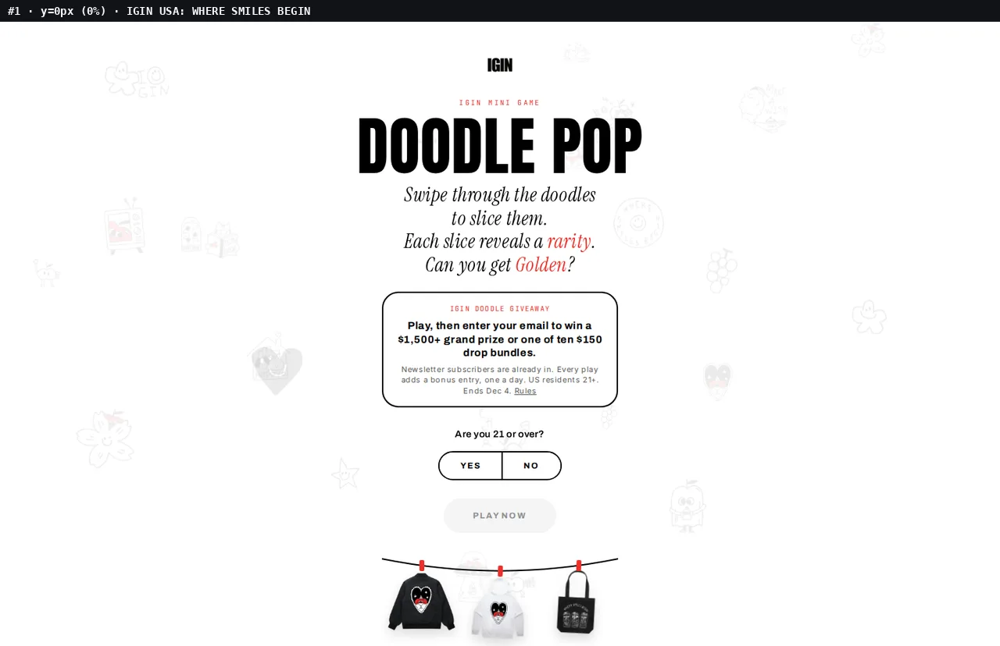
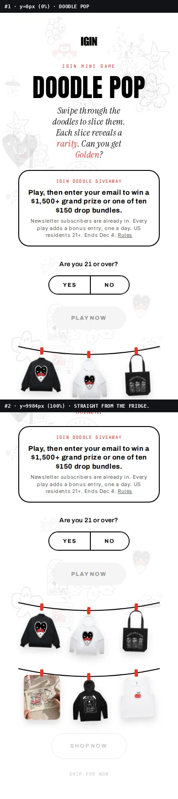

# UI Design System & Master Generation Blueprint: iginusa-com

> **IGIN USA · Official Home of IGIN in the United States** (https://iginusa.com) — IGIN in the USA. Doodle merch, non-alcoholic Apple Citrus and Apple Peach, and where to find IGIN near you. Official store.





---

## 1. Executive Visual Persona & Design Archetype

- **Brand Essence & Persona**: **IGIN USA · Official Home of IGIN in the United States** (`https://iginusa.com`). IGIN in the USA. Doodle merch, non-alcoholic Apple Citrus and Apple Peach, and where to find IGIN near you. Official store.
- **Capture Provenance**: Live browser capture (`tier1_fast`, HTTP `200`, captured `2026-11-24`).
- **Visual Archetype**: **Light-Gallery WebGL / Canvas Interactive Experience (`#ffffff` / `#ff0000`)**.
- **Anti-AI-Slop Differentiators**:
  - **Live-Computed Chromatic Polarity**: Anchors the viewport in `#ffffff` (live computed `body` `background-color` (`computed_styles.json`)) paired with `#000000` primary typography and `#ff0000` accents.
  - **Grounded Typographic Hierarchy**: Pairs `Anton` for display copy (`IGIN USA: WHERE SMILES BEGIN`) with `Inter` and `JetBrains Mono`.
  - **Calibrated Spatial Grid & Motion**: Combines `72.6rem` container bounds (`gap: 32px`, padding `var(--product-card-image-padding)`) with `cubic-bezier(0,0,.3,1)` easing and Three.js / WebGL Canvas Pipeline.

---

## 2. Spatial Architecture & Modular Grid Mathematics

### Viewport Allocation & Container Geometry
- **Captured Journey Filmstrips**: Desktop `1280×828px` (`assets/desktop-journey.webp`, `1` keyframes up to `y=0px` / doc `13053px`), Mobile `390×1744px` (`assets/mobile-journey.webp`, `2` keyframes).
- **Master Container Bounds**: `72.6rem` (non-`@media` desktop container stylesheet rule).
- **Canvas Lateral Padding & Spacing**: `var(--product-card-image-padding)` lateral canvas padding with `32px` grid gap.
- **Border Radius Scale**: `50%`, `var(--product-card-corner-radius)`, `var(--collection-card-corner-radius)`, `var(--blog-card-corner-radius)`.

### Responsive Breakpoint Architecture
- **Desktop Layout**: Multi-column CSS Grid / Flexbox layout at `1440px` (`max-width: 72.6rem`, `gap: 32px`).
- **Mobile Layout**: Single-column vertical stack at `390px` viewport width with `var(--product-card-image-padding)` horizontal padding.
- **Extracted CSS Media Queries**: `@media screen and (min-width:750px)`, `@media screen and (min-width:990px)`, `@media only screen and (min-width:750px)`, `@media screen and (max-width:749px)`.

---

## 3. Color System, Materiality & Atmospheric Lighting

### Semantic Palette & Source Grounding
| Semantic Role | Ground-Truth Value | Extracted Live / CSS Source |
|---|---|---|
| **Primary Canvas Substrate** | `#ffffff` | live computed `body` `background-color` (`computed_styles.json`) |
| **Primary Typography Ink** | `#000000` | live computed `h2` `color` (`computed_styles.json`) |
| **Elevated Surface / Card Substrate** | `#ececec` | `.igST__bar span { background: #ececec }` |
| **Interactive Accent / Highlight** | `#ff0000` | `.igin-btn-black:hover { background: red }` (`#ff0000`) |
| **Secondary / Muted Copy** | `#ff6b8a` | `var(--pink)` in `:root` |
| **Structural Hairline Border** | `#f9b9b7` | `.stage { border: #f9b9b7 }` |

### Sanitized Root CSS Variables (`ui-ux.md` Ground Truth)
| Variable Name | Extracted Value | Semantic Role |
|---|---|---|
| `--color-background` | `255,255,255` | Canvas / Surface Token |
| `--gradient-background` | `#ffffff` | Canvas / Surface Token |
| `--color-foreground` | `18,18,18` | Typography Ink Token |
| `--color-background-contrast` | `191,191,191` | Canvas / Surface Token |
| `--color-shadow` | `18,18,18` | Brand / Palette Token |
| `--color-button` | `18,18,18` | Brand / Palette Token |
| `--color-button-text` | `255,255,255` | Typography Ink Token |
| `--color-secondary-button` | `255,255,255` | Brand / Palette Token |
| `--color-secondary-button-text` | `18,18,18` | Typography Ink Token |
| `--color-link` | `18,18,18` | Typography Ink Token |
| `--color-badge-foreground` | `18,18,18` | Typography Ink Token |
| `--color-badge-background` | `255,255,255` | Canvas / Surface Token |
| `--color-badge-border` | `18,18,18` | Brand / Palette Token |
| `--payment-terms-background-color` | `rgb(255 255 255)` | Canvas / Surface Token |
| `--font-body-family` | `Assistant, sans-serif` | Typography / Scale Token |
| `--font-body-style` | `normal` | Typography / Scale Token |

---

## 4. Typographic Scale & Editorial Hierarchy

### Font Family Stacks
- **Display Typography**: `Anton`.
- **Primary Body Stack**: `Inter`.
- **Technical / Metadata Stack**: `JetBrains Mono`.

### Typographic Scale & Rules (Live Computed & Stylesheet Grounded)
- **Hero Display (`H1`)**: live computed `h1` (`font-size: 149.76px`, `line-height: 122.803px`, `font-weight: 400`, `letter-spacing: 0.59904px`); rule `,.h1` (`font-size: calc(var(--font-heading-scale...`).
- **Section Heading (`H2`)**: live computed `h2` (`font-size: 150px`, `line-height: 132px`, `font-weight: 400`, `letter-spacing: 0.6px`); rule `,.h2` (`font-size: calc(var(--font-heading-scale...`).
- **Body Copy**: live computed `body` (`font-size: 16px`, `line-height: 28.8px`, `font-weight: 400`, `letter-spacing: 0.6px`); CSS variables `--font-body-family: Assistant, sans-serif`, `--font-body-style: normal`, `--font-body-weight: 400`; rule `p` (`font-size: 19px`, `line-height: 1.15`).
- **Metadata & Navigation Labels**: live computed `nav/a` (`font-size: 16px`, `line-height: 26.4px`, `font-weight: 300`); CSS variables `--mono: "JetBrains Mono", ui-monospace, "SF Mono", Menlo, monospace`, `--dp-mono: 'JetBrains Mono',ui-monospace,'SF Mono',Menlo,monospace`; rule `small` (`font-size: 10px`, `letter-spacing: .12em`, `font-weight: 600`).

---

## 5. Choreographed Motion & Interaction Physics

### Primary Easing Curves
- **Extracted Timing Functions**: `cubic-bezier(0,0,.3,1)`, `cubic-bezier(.25,.46,.45,.94)`, `cubic-bezier(.52,0,.61,.99)`.

### Per-Element Transition & Choreography Rules
- **Selector `media(prefers-reduced-motion)`**: `transition: none!important` extracted from `iginusa-com` stylesheet.
- **Selector `.inline-richtext a`**: `transition: text-decoration-thickness ease .1s` extracted from `iginusa-com` stylesheet.
- **Selector `.animate-arrow .icon-arrow path`**: `transition: transform var(--duration-short) ease` extracted from `iginusa-com` stylesheet.
- **Extracted Easing Curve (`cubic-bezier(0,0,.3,1)`)**: Governs interactive state transitions across `<header.igin-rv>` and `<section.igin-rv-section>`.
- **Runtime Interaction Engine**: Integrates Three.js / WebGL Canvas Pipeline with `prefers-reduced-motion: reduce` fallback guards.
### Measured Runtime Scroll & Interaction Telemetry (`behavioral_journey_v2`)
- **Scroll Driver Mode**: `native` (max document height `13053px`, deepest scrollY reached `0px` across `1` desktop keyframes).
- **Detected Scroll / Motion Libraries**: Native browser scroll / standard CSS transitions.

---

## 6. Component Wireframe & Structural DOM Map

### Visual Layout Schematic — Desktop (`1440px`, Grounded in `dom.html` & Landmark Bounding Boxes)
```
┌────────────────────────────────────────────────────────────────────────┐
│ DESKTOP VIEWPORT (1440px) — IGIN USA · Official Home of IGIN in the Un │
│ ====================================================================== │
│ [ <header.igin-rv> (1440x104px)       | SHOP · Drinks · Our Story ·  ] │
│ ---------------------------------------------------------------------- │
│ | HERO STAGE: <section.shopify-section> (w=1440px)                   | │
│ | H1: IGIN USA: WHERE SMILES BEGIN                                   | │
│ | Substrate: #ffffff | Ink: #000000 | Accent: #ff0000                | │
│ ---------------------------------------------------------------------- │
│ | SHOWCASE GRID (<section.igin-rv-section>) max-w: 72.6rem           | │
│ | +------------------------------+  +------------------------------+ | │
│ | | IGIN USA: Where Smiles Begin |  | Zero proof, same apples.     | | │
│ | +------------------------------+  +------------------------------+ | │
│ ---------------------------------------------------------------------- │
│ | DETAIL MODULE (<section.igin-rv>) — Two fans chatting abo          | │
│ ---------------------------------------------------------------------- │
│ [ FOOTER (<footer.igin-rv>    ) | https://iginusa.com                  │
└────────────────────────────────────────────────────────────────────────┘
```

### Visual Layout Schematic — Mobile Reflow (`390px`)
```
┌────────────────────────────────────────────────────────────────────────┐
│ MOBILE VIEWPORT REFLOW (390px) — Single-Column Stack (gap: 32px)       │
│ ====================================================================== │
│ [ HEADER BAR (<header.igin-rv>        ) | Compact Menu (390px)         │
│ ---------------------------------------------------------------------- │
│ | HERO STAGE (<section.shopify-section) — 390px Vertical Lead        | │
│ | H1: IGIN USA: WHERE SMILES BEGIN                                   | │
│ ---------------------------------------------------------------------- │
│ | SHOWCASE STACK (<section.igin-rv-secti) — 1-Col Stack              | │
│ | [ Item 1: IGIN USA: Where Smiles Begin                           ] | │
│ | [ Item 2: Zero proof, same apples.                               ] | │
│ ---------------------------------------------------------------------- │
│ | DETAIL STACK (<section.igin-rv>) — 1-Col (Two fans chatting )      | │
│ ---------------------------------------------------------------------- │
│ [ FOOTER (<footer.igin-rv>    ) | Stacked 390px Colophon               │
└────────────────────────────────────────────────────────────────────────┘
```

### Granular DOM Region Breakdown
1. **Brand Header & Navigation Bar (<header.igin-rv> — `iginusa-com`)**:
   - Landmark `<header class="igin-rv hdr">` (`1440x104px`) hosting `IGIN USA · Official Home of IGIN in ` navigation (`SHOP · Drinks · Our Story · Where to Buy · Play Doodle Pop`), DOM attributes (`data-source-attribution="shopify.exit_intersti..."`, `data-shop-id="100223058239"`, `data-venmo-supported="false"`, `data-environment="production"`), and stylesheet rule `.page-width { max-width:var(--page-width);margin:0 auto;padding:0 1.5rem }`.
2. **Hero Stage & Focal Lead (<section.shopify-section> — `IGIN USA: WHERE SMILES BEGIN`)**:
   - Landmark `<section class="shopify-section igin-doodle-pop-section">` presenting display lead `IGIN USA: WHERE SMILES BEGIN` and copy excerpt *"KOREAN MODERN GIN AND APPLE TONIC"* over `#ffffff` canvas and `#000000` ink.
3. **Primary Showcase & Content Grid (<section.igin-rv-section> — `IGIN USA: Where Smiles Begin`)**:
   - Landmark `<section class="shopify-section igin-rv-section">` rendering section `IGIN USA: Where Smiles Begin` with copy *"Korean modern gin and apple tonic"*, asset references (`2721185198297886`, `fbevents.js`, `LOGO-IGIN_USA_SNS_Profile.png`, `fonts.shopifycdn.com`), and grid rule `.announcement-bar-section .page-w... { max-width:100% }`.
4. **Interactive Detail & Feature Matrix (<section.igin-rv> — `Zero proof, same apples.`)**:
   - Landmark `<section class="igin-rv hero">` framing `Zero proof, same apples.` and `Two fans chatting about the new IGIN non alcoholi...` (*"Such a good-looking gin."*) with `#ececec` surface cards, `#ff0000` accents, and `.page-width.drawer-menu { max-width:100% }`.
5. **Colophon & Global Directory Footer (<footer.igin-rv> — `https://iginusa.com`)**:
   - Landmark `<footer class="igin-rv ftr">` anchoring `IGIN USA · Official Home of IGIN` footer links (`SHOP · Drinks · Our Story · Where to Buy · Play Doodle Pop`), copy *"Apple Citrus and Apple Peach. Buy now at BevMo and Gopuff."*, and `#f9b9b7` structural dividers.
### Full Vertical Scroll Sequence (Desktop `1440×900` Keyframes)
- **Step 01** (`y=0px`, `0%`): Active landmark `IGIN USA: WHERE SMILES BEGIN` · sticky/fixed elements: `2`

---

## 7. Master Zero-Shot AI Generation Prompt

```markdown
# Master Zero-Shot Frontend Generation Prompt: iginusa-com (IGIN USA · Official Home of IGIN in the United States)

You are a principal frontend architect and design systems engineer. Build a complete, production-ready web application replicating the exact design system, DOM landmarks, typographic hierarchy, color tokens, and motion physics of `iginusa-com` (**IGIN USA · Official Home of IGIN in the United States** — `https://iginusa.com`).

### 1. Visual Archetype & Anti-AI-Slop Mandates
- **Archetype**: Light-Gallery WebGL / Canvas Interactive Experience (`#ffffff` / `#ff0000`).
- **Identity & Domain Context**: IGIN in the USA. Doodle merch, non-alcoholic Apple Citrus and Apple Peach, and where to find IGIN near you. Official store.
- **Primary Substrate**: `#ffffff` (live computed `body` `background-color` (`computed_styles.json`)), **Primary Ink**: `#000000`, **Accent / Highlight**: `#ff0000`.
- **Site-Specific Differentiators**:
  - **Live-Computed Chromatic Polarity**: Anchors the viewport in `#ffffff` (live computed `body` `background-color` (`computed_styles.json`)) paired with `#000000` primary typography and `#ff0000` accents.
  - **Grounded Typographic Hierarchy**: Pairs `Anton` for display copy (`IGIN USA: WHERE SMILES BEGIN`) with `Inter` and `JetBrains Mono`.
  - **Calibrated Spatial Grid & Motion**: Combines `72.6rem` container bounds (`gap: 32px`, padding `var(--product-card-image-padding)`) with `cubic-bezier(0,0,.3,1)` easing and Three.js / WebGL Canvas Pipeline.

### 2. Ground-Truth CSS Variables (`:root` Token Contract)
Declare and consume these exact custom properties extracted from `iginusa-com` in your global stylesheet:

:root {
  /* IGIN USA · Official Home of IGIN in the United States (iginusa-com) — Live-Grounded CSS Variables */
  --color-background: 255,255,255; /* Canvas / Surface Token (iginusa-com) */
  --gradient-background: #ffffff; /* Canvas / Surface Token (iginusa-com) */
  --color-foreground: 18,18,18; /* Typography Ink Token (iginusa-com) */
  --color-background-contrast: 191,191,191; /* Canvas / Surface Token (iginusa-com) */
  --color-shadow: 18,18,18; /* Brand / Palette Token (iginusa-com) */
  --color-button: 18,18,18; /* Brand / Palette Token (iginusa-com) */
  --color-button-text: 255,255,255; /* Typography Ink Token (iginusa-com) */
  --color-secondary-button: 255,255,255; /* Brand / Palette Token (iginusa-com) */
  --color-secondary-button-text: 18,18,18; /* Typography Ink Token (iginusa-com) */
  --color-link: 18,18,18; /* Typography Ink Token (iginusa-com) */
  --color-badge-foreground: 18,18,18; /* Typography Ink Token (iginusa-com) */
  --color-badge-background: 255,255,255; /* Canvas / Surface Token (iginusa-com) */
  --color-badge-border: 18,18,18; /* Brand / Palette Token (iginusa-com) */
  --payment-terms-background-color: rgb(255 255 255); /* Canvas / Surface Token (iginusa-com) */
  --font-body-family: Assistant, sans-serif; /* Typography / Scale Token (iginusa-com) */
  --font-body-style: normal; /* Typography / Scale Token (iginusa-com) */
}

### 3. Semantic Color & Materiality Contract
Map every surface, ink, and border strictly to these source-grounded tokens:
- **Primary Canvas Substrate**: `#ffffff` — grounded in live computed `body` `background-color` (`computed_styles.json`)
- **Primary Typography Ink**: `#000000` — grounded in live computed `h2` `color` (`computed_styles.json`)
- **Elevated Surface / Card Substrate**: `#ececec` — grounded in `.igST__bar span { background: #ececec }`
- **Interactive Accent / Highlight**: `#ff0000` — grounded in `.igin-btn-black:hover { background: red }` (`#ff0000`)
- **Secondary / Muted Copy**: `#ff6b8a` — grounded in `var(--pink)` in `:root`
- **Structural Hairline Border**: `#f9b9b7` — grounded in `.stage { border: #f9b9b7 }`

### 4. Spatial Grid, Container Bounds & Responsive Breakpoints
- **Desktop Viewport Reference**: `1280×828px` (single-viewport 100vh live capture (900px), `1440px` standard desktop width).
- **Mobile Viewport Reference**: `390×1744px` (full-page live capture (1744px), `390px` standard mobile width).
- **Container Max-Width**: `72.6rem` (non-`@media` desktop container stylesheet rule)
- **Padding & Gutters**: `var(--product-card-image-padding)` lateral canvas padding with `32px` grid gap
- **Desktop Grid**: Multi-column CSS Grid / Flexbox layout at `1440px` (`max-width: 72.6rem`, `gap: 32px`)
- **Mobile Adaptation**: Single-column vertical stack at `390px` viewport width with `var(--product-card-image-padding)` horizontal padding
- **Media Queries**: `@media screen and (min-width:750px)`, `@media screen and (min-width:990px)`, `@media only screen and (min-width:750px)`, `@media screen and (max-width:749px)`
- **Corner Radii**: `50%`, `var(--product-card-corner-radius)`, `var(--collection-card-corner-radius)`, `var(--blog-card-corner-radius)`

### 5. Typography & Editorial Scale Contract
- **Display Font Stack**: `Anton`
- **Body Font Stack**: `Inter`
- **Monospace / Technical Font Stack**: `JetBrains Mono`
- **H1 Display Rule**: live computed `h1` (`font-size: 149.76px`, `line-height: 122.803px`, `font-weight: 400`, `letter-spacing: 0.59904px`); rule `,.h1` (`font-size: calc(var(--font-heading-scale...`)
- **H2 Section Rule**: live computed `h2` (`font-size: 150px`, `line-height: 132px`, `font-weight: 400`, `letter-spacing: 0.6px`); rule `,.h2` (`font-size: calc(var(--font-heading-scale...`)
- **Body Copy Rule**: live computed `body` (`font-size: 16px`, `line-height: 28.8px`, `font-weight: 400`, `letter-spacing: 0.6px`); CSS variables `--font-body-family: Assistant, sans-serif`, `--font-body-style: normal`, `--font-body-weight: 400`; rule `p` (`font-size: 19px`, `line-height: 1.15`)
- **Metadata & Index Rule**: live computed `nav/a` (`font-size: 16px`, `line-height: 26.4px`, `font-weight: 300`); CSS variables `--mono: "JetBrains Mono", ui-monospace, "SF Mono", Menlo, monospace`, `--dp-mono: 'JetBrains Mono',ui-monospace,'SF Mono',Menlo,monospace`; rule `small` (`font-size: 10px`, `letter-spacing: .12em`, `font-weight: 600`)

### 6. Component Hierarchy, Verbatim Copy & Real DOM Landmarks
Scaffold `iginusa-com` (`IGIN USA · Official Home of IGIN in the United States`) with these exact structural regions, extracted copy, and CSS rules from `dom.html`:
1. **Brand Header & Navigation Bar (<header.igin-rv> — `iginusa-com`)**:
   - DOM & Selectors: Landmark `<header class="igin-rv hdr">` (`1440x104px`) hosting `IGIN USA · Official Home of IGIN in ` navigation (`SHOP · Drinks · Our Story · Where to Buy · Play Doodle Pop`), DOM attributes (`data-source-attribution="shopify.exit_intersti..."`, `data-shop-id="100223058239"`, `data-venmo-supported="false"`, `data-environment="production"`), and stylesheet rule `.page-width { max-width:var(--page-width);margin:0 auto;padding:0 1.5rem }`.
   - Responsive Contract: Header `Brand Header & Navigation Bar (<header.igin-rv> — `iginusa-com`)` (`iginusa-com`) adapts across `@media screen and (min-width:750px)`, `@media screen and (min-width:990px)`, `@media only screen and (min-width:750px)`, `@media screen and (max-width:749px)` with `cubic-bezier(0,0,.3,1)`, `cubic-bezier(.25,.46,.45,.94)`, `cubic-bezier(.52,0,.61,.99)` transitions and links `SHOP · Drinks · Our Story · Where to Buy · Play Doodle Pop`.
2. **Hero Stage & Focal Lead (<section.shopify-section> — `IGIN USA: WHERE SMILES BEGIN`)**:
   - DOM & Selectors: Landmark `<section class="shopify-section igin-doodle-pop-section">` presenting display lead `IGIN USA: WHERE SMILES BEGIN` and copy excerpt *"KOREAN MODERN GIN AND APPLE TONIC"* over `#ffffff` canvas and `#000000` ink.
   - Responsive Contract: Hero stage (`1280×828px` desktop / `390×1744px` mobile) sets `#ffffff` background with `#000000` headline `IGIN USA: WHERE SMILES BEGIN`.
3. **Primary Showcase & Content Grid (<section.igin-rv-section> — `IGIN USA: Where Smiles Begin`)**:
   - DOM & Selectors: Landmark `<section class="shopify-section igin-rv-section">` rendering section `IGIN USA: Where Smiles Begin` with copy *"Korean modern gin and apple tonic"*, asset references (`2721185198297886`, `fbevents.js`, `LOGO-IGIN_USA_SNS_Profile.png`, `fonts.shopifycdn.com`), and grid rule `.announcement-bar-section .page-w... { max-width:100% }`.
   - Responsive Contract: Showcase grid `Primary Showcase & Content Grid (<section.igin-rv-section> — `IGIN USA: Where Smiles Begin`)` applies Multi-column CSS Grid / Flexbox layout at `1440px` (`max-width: 72.6rem`, `gap: 32px`) on desktop and Single-column vertical stack at `390px` viewport width with `var(--product-card-image-padding)` horizontal padding on mobile.
4. **Interactive Detail & Feature Matrix (<section.igin-rv> — `Zero proof, same apples.`)**:
   - DOM & Selectors: Landmark `<section class="igin-rv hero">` framing `Zero proof, same apples.` and `Two fans chatting about the new IGIN non alcoholi...` (*"Such a good-looking gin."*) with `#ececec` surface cards, `#ff0000` accents, and `.page-width.drawer-menu { max-width:100% }`.
   - Responsive Contract: Detail module `Interactive Detail & Feature Matrix (<section.igin-rv> — `Zero proof, same apples.`)` uses `50%`, `var(--product-card-corner-radius)`, `var(--collection-card-corner-radius)`, `var(--blog-card-corner-radius)` radii, `#ff0000` highlights, and assets (2721185198297886, fbevents.js, LOGO-IGIN_USA_SNS_Profile.png).
5. **Colophon & Global Directory Footer (<footer.igin-rv> — `https://iginusa.com`)**:
   - DOM & Selectors: Landmark `<footer class="igin-rv ftr">` anchoring `IGIN USA · Official Home of IGIN` footer links (`SHOP · Drinks · Our Story · Where to Buy · Play Doodle Pop`), copy *"Apple Citrus and Apple Peach. Buy now at BevMo and Gopuff."*, and `#f9b9b7` structural dividers.
   - Responsive Contract: Footer `Colophon & Global Directory Footer (<footer.igin-rv> — `https://iginusa.com`)` aligns to `72.6rem` (non-`@media` desktop container stylesheet rule) with `var(--product-card-image-padding)` lateral canvas padding with `32px` grid gap and attributes (data-source-attribution="shopify.exit_intersti...", data-shop-id="100223058239", data-venmo-supported="false").

#### Verbatim DOM Copy Excerpts (`dom.html`)
- Copy Excerpt 1: *"KOREAN MODERN GIN AND APPLE TONIC"*
- Copy Excerpt 2: *"Korean modern gin and apple tonic"*
- Copy Excerpt 3: *"Such a good-looking gin."*
- Copy Excerpt 4: *"Apple Citrus and Apple Peach. Buy now at BevMo and Gopuff."*

### 7. Motion, Extracted Stylesheet Rules & Interaction Choreography
- **Primary Easing Functions**: `cubic-bezier(0,0,.3,1)`, `cubic-bezier(.25,.46,.45,.94)`, `cubic-bezier(.52,0,.61,.99)`
- **Extracted Stylesheet Rules (`iginusa-com`)**:
- `.page-width { max-width:var(--page-width);margin:0 auto;padding:0 1.5rem }`
- `.announcement-bar-section .page-w... { max-width:100% }`
- `.page-width.drawer-menu { max-width:100% }`
- `.page-width-desktop { padding:0;margin:0 auto }`
- `.utility-bar__grid.page-width { padding-left:3rem;padding-right:3rem }`
- **Per-Selector Transition Rules**:
- **Selector `media(prefers-reduced-motion)`**: `transition: none!important` extracted from `iginusa-com` stylesheet.
- **Selector `.inline-richtext a`**: `transition: text-decoration-thickness ease .1s` extracted from `iginusa-com` stylesheet.
- **Selector `.animate-arrow .icon-arrow path`**: `transition: transform var(--duration-short) ease` extracted from `iginusa-com` stylesheet.
- **Extracted Easing Curve (`cubic-bezier(0,0,.3,1)`)**: Governs interactive state transitions across `<header.igin-rv>` and `<section.igin-rv-section>`.
- **Runtime Interaction Engine**: Integrates Three.js / WebGL Canvas Pipeline with `prefers-reduced-motion: reduce` fallback guards.
### 7b. Full-Page Scroll Choreography, Interactive States & Multi-Page Routes
- **Scroll Mechanics**: Implement `native` vertical progression up to `13053px` across 1 distinct viewport chapters.
- **Vertical Chapter Sequence**: IGIN USA: WHERE SMILES BEGIN (0%).

### 8. Technical Deliverables
- Implement in Next.js (App Router) with TypeScript and Tailwind CSS consuming the `:root` custom properties defined above for `iginusa-com`.
- Reproduce both the `1440px` desktop architecture and `390px` mobile breakpoint transitions, preserving semantic HTML5 landmarks (`<header>`, `<nav>`, `<main>`, `<section>`, `<footer>`) and `prefers-reduced-motion` accessibility guards.
```
---

## 8. Full-Page Scroll Journey, Interactive States & Subpage Inventory

### Desktop Scroll Keyframes (`1440×900` WebP)
| Step | Scroll Y | Progress | Active Landmark / Section | Sticky/Fixed | Visual Asset |
| :---: | :---: | :---: | :--- | :---: | :--- |
| `#01` | `0px` | `0%` | IGIN USA: WHERE SMILES BEGIN | `2` | [desktop-step-01.webp](assets/desktop-step-01.webp) |

### Mobile Condensed Keyframes (`390×844` WebP)
| Step | Scroll Y | Progress | Active Landmark | Visual Asset |
| :---: | :---: | :---: | :--- | :--- |
| `#01` | `0px` | `0%` | DOODLE POP | [mobile-step-01.webp](assets/mobile-step-01.webp) |
| `#02` | `9984px` | `100%` | STRAIGHT FROM THE FRIDGE. | [mobile-step-02.webp](assets/mobile-step-02.webp) |

