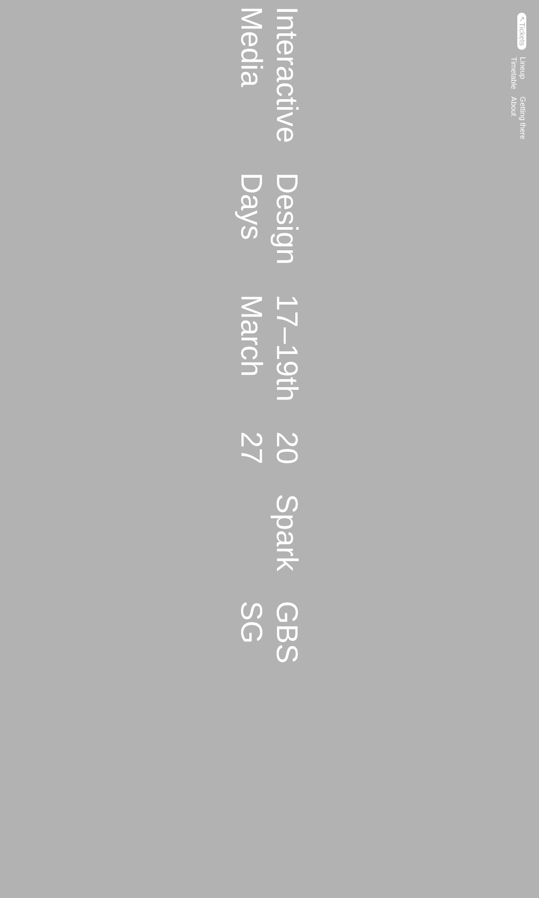

# UI Design System & Master Generation Blueprint: imdday-ch

> **IMDDay 2026** (https://imdday.ch/) — Dirk Koy, born in 1977, is a Basel-based artist active in various fields of moving image creation. He is a digital world-builder who samp...



---

## 1. Executive Visual Persona & Design Archetype

- **Brand Essence & Persona**: **IMDDay 2026** (`https://imdday.ch/`). Dirk Koy, born in 1977, is a Basel-based artist active in various fields of moving image creation. He is a digital world-builder who samp...
- **Visual Archetype**: **Light-Gallery WebGL / Canvas Interactive Experience (`#b2b2b2` / `#808080`)**.
- **Anti-AI-Slop Differentiators**:
  - **Source-Grounded Chromatic Polarity**: Anchors the viewport in `#b2b2b2` (`var(--grey)` in `:root`) paired with `#ffffff` primary typography and `#808080` accents.
  - **Extracted Typographic Hierarchy**: Pairs `Neue Montreal` for display copy (`Dirk Koy`) with `Neue Montreal` and not declared in static CSS (uses primary stack / `ui-monospace`).
  - **Calibrated Spatial Grid & Motion**: Combines `var(--bld-vw)` container bounds (`gap: var(--space-s)`, padding `var(--padding)`) with `cubic-bezier(0.37,0,0.63,1)` easing and Three.js / WebGL Canvas Pipeline.

---

## 2. Spatial Architecture & Modular Grid Mathematics


### Viewport Allocation & Container Geometry
- **Captured Viewport Dimensions**: Desktop `1440×2400px` (`assets/desktop.png`, capped at 2400px multi-section capture), Mobile `390×2400px` (`assets/mobile.png`, capped at 2400px multi-section capture).
- **Master Container Bounds**: `var(--bld-vw)` extracted from `imdday-ch` stylesheet.
- **Canvas Lateral Padding & Spacing**: `var(--padding)` lateral canvas padding with `var(--space-s)` grid gap.
- **Border Radius Scale**: `var(--bld-br)`, `2px`, `4px`, `100%`.

### Responsive Breakpoint Architecture
- **Desktop Layout**: Multi-column CSS Grid / Flexbox layout at `1440px` (`max-width: var(--bld-vw)`, `gap: var(--space-s)`).
- **Mobile Layout**: Single-column vertical stack at `390px` viewport width with `var(--padding)` horizontal padding.
- **Extracted CSS Media Queries**: `@media (min-width: 768px)`, `@media (min-width: 769px)`.

---

## 3. Color System, Materiality & Atmospheric Lighting

### Semantic Palette & Source Grounding
| Semantic Role | Ground-Truth Value | Extracted CSS Source / Selector |
|---|---|---|
| **Primary Canvas Substrate** | `#b2b2b2` | `var(--grey)` in `:root` |
| **Primary Typography Ink** | `#ffffff` | `var(--white)` in `:root` |
| **Elevated Surface / Card Substrate** | `#a1a1a1` | `::selection { background: #a1a1a1 }` |
| **Interactive Accent / Highlight** | `#808080` | `.Footer_Main { color: grey }` (`#808080`) |
| **Secondary / Muted Copy** | `#fff` | `.tp-svpv:focus .tp-svpv_m { border-color: #fff }` |

### Sanitized Root CSS Variables (`ui-ux.md` Ground Truth)
| Variable Name | Extracted Value | Semantic Role |
|---|---|---|
| `--main-font` | `"Neue Montreal"` | Typography / Scale Token |
| `--text-xs` | `calc(0.4231rem + 0.8974vw)` | Typography Ink Token |
| `--text-s` | `calc(-0.0962rem + 3.2051vw)` | Typography Ink Token |
| `--text-m` | `calc(1.2019rem + 1.6026vw)` | Typography Ink Token |
| `--text-l` | `calc(1.1731rem + 4.2308vw)` | Typography Ink Token |
| `--text-xl` | `calc(0.4519rem + 7.4359vw)` | Typography Ink Token |
| `--padding` | `calc(-33.8462px + 12.1795vw)` | Layout / Spatial Grid Token |
| `--left-column` | `calc(1.2019rem + 14.1026vw)` | Layout / Spatial Grid Token |
| `--space-xs` | `calc(7.6923px + 0.641vw)` | Layout / Spatial Grid Token |
| `--space-s` | `calc(2.1538px + 2.1795vw)` | Layout / Spatial Grid Token |
| `--space-m` | `calc(29.2308px + 1.6026vw)` | Layout / Spatial Grid Token |
| `--space-l` | `calc(50.7692px + 2.5641vw)` | Layout / Spatial Grid Token |
| `--ease-inout-sine` | `cubic-bezier(0.37, 0, 0.63, 1)` | Motion / Easing Token |
| `--ease-in-cubic` | `cubic-bezier(0.32, 0, 0.67, 0)` | Motion / Easing Token |
| `--ease-out-cubic` | `cubic-bezier(0.33, 1, 0.68, 1)` | Motion / Easing Token |
| `--ease-inout-cubic` | `cubic-bezier(0.65, 0, 0.35, 1)` | Motion / Easing Token |

---

## 4. Typographic Scale & Editorial Hierarchy

### Font Family Stacks
- **Display Typography**: `Neue Montreal`.
- **Primary Body Stack**: `Neue Montreal`.
- **Technical / Metadata Stack**: not declared in static CSS (uses primary stack / `ui-monospace`).

### Typographic Scale & Rules (Extracted from Stylesheet & Variables)
- **Hero Display (`H1`)**: not explicitly declared on tag in static CSS (stylesheet font-size ladder: `var(--text-xs)`, `var(--text-s)`, `var(--text-xl)`, `var(--text-l)`, `var(--text-m)`).
- **Section Heading (`H2`)**: not explicitly declared on tag in static CSS (stylesheet font-size ladder: `var(--text-xs)`, `var(--text-s)`, `var(--text-xl)`, `var(--text-l)`, `var(--text-m)`).
- **Body Copy**: not explicitly declared on tag in static CSS (stylesheet font-size ladder: `var(--text-xs)`, `var(--text-s)`, `var(--text-xl)`, `var(--text-l)`, `var(--text-m)`).
- **Metadata & Navigation Labels**: CSS variables `--text-xs: calc(0.4231rem + 0.8974vw)`.

---

## 5. Choreographed Motion & Interaction Physics

### Primary Easing Curves
- **Extracted Timing Functions**: `cubic-bezier(0.37,0,0.63,1)`, `cubic-bezier(0.32,0,0.67,0)`, `cubic-bezier(0.33,1,0.68,1)`.

### Per-Element Transition & Choreography Rules
- **Selector `.tp-fldv_b`**: `transition: border-radius .2s ease-in-out .2s` extracted from `imdday-ch` stylesheet.
- **Selector `.tp-fldv_m`**: `transition: transform .2s ease-in-out` extracted from `imdday-ch` stylesheet.
- **Selector `.tp-fldv_c`**: `transition: height .2s ease-in-out,opacity .2s linear,padding .2s ease-in-out` extracted from `imdday-ch` stylesheet.
- **Extracted Easing Curve (`cubic-bezier(0.37,0,0.63,1)`)**: Governs interactive state transitions across `<header.Navigation_Main>` and `<article.Speakers_Item>`.
- **Runtime Interaction Engine**: Integrates Three.js / WebGL Canvas Pipeline with `prefers-reduced-motion: reduce` fallback guards.

---

## 6. Component Wireframe & Structural DOM Map

### Visual Layout Schematic (Grounded in `dom.html` — `1440px` Desktop & `390px` Mobile Reflow)
```
┌────────────────────────────────────────────────────────────────────────┐
│ DESKTOP VIEWPORT (1440px) — IMDDay 2026                                │
│ ====================================================================== │
│ [ <header.Navigation_Main> | T ickets · L ineup · T imetable · G et ]  │
│ ---------------------------------------------------------------------- │
│ | HERO STAGE: <article.Speakers_Item>                              |   │
│ | H1: Dirk Koy                                                     |   │
│ | Substrate: #b2b2b2    | Ink: #ffffff    | Accent: #808080        |   │
│ ---------------------------------------------------------------------- │
│ | SHOWCASE GRID (<article.Speakers_Item>   ) max-w: var(--bld-vw)  |   │
│ | +------------------------------+  +------------------------------+ | │
│ | | Elodie Anglade               |  | Immo Schneider               | | │
│ | +------------------------------+  +------------------------------+ | │
│ ---------------------------------------------------------------------- │
│ | MOBILE VIEWPORT REFLOW (390px) — Single-Column Stack (gap: var(--) | │
│ | [<header.Navigation] -> [<article.Speakers_] -> [<article.Speakers_] │
│ ---------------------------------------------------------------------- │
│ [ FOOTER (<footer.Footer_Main>  ) | https://imdday.ch/                 │
└────────────────────────────────────────────────────────────────────────┘
```

### Granular DOM Region Breakdown
1. **Brand Header & Navigation Bar (<header.Navigation_Main> — `imdday-ch`)**:
   - Landmark `<header class="Navigation_Main">` hosting `IMDDay 2026` navigation (`T ickets · L ineup · T imetable · G etting there · A bout`), DOM attributes (`data-tp-style="plugin-default"`, `data-engine="three.js r181"`, `data-config="%7B%22speed%22:0.2,%2..."`, `data-id="lineup"`), and stylesheet rule `selection { background: a1a1a1; color: white; }`.
2. **Hero Stage & Focal Lead (<article.Speakers_Item> — `Dirk Koy`)**:
   - Landmark `<article class="Speakers_Item Stage_Node">` presenting display lead `Dirk Koy` and copy excerpt *"Dirk Koy, born in 1977, is a Basel-based artist active in various"* over `#b2b2b2` canvas and `#ffffff` ink.
3. **Primary Showcase & Content Grid (<article.Speakers_Item> — `Elodie Anglade`)**:
   - Landmark `<article class="Speakers_Item Stage_Node">` rendering section `Elodie Anglade` with copy *"In his visual logic, traces are not static. They continue to evol"*, asset references (`favicon.image-6ZC672GS.svg`, `favicon-TJBRTTS6.png`, `index.html`, `index.js`), and grid rule `.Html_Visible { opacity: 1; }`.
4. **Interactive Detail & Feature Matrix (<article.Speakers_Item> — `Immo Schneider`)**:
   - Landmark `<article class="Speakers_Item Stage_Node">` framing `Immo Schneider` and `Joëlle Bitton` (*"Elodie Anglade is a media and interaction designer based in Switz"*) with `#a1a1a1` surface cards, `#808080` accents, and `canvas { position: absolute; width: 100%; height: 100%; }`.
5. **Colophon & Global Directory Footer (<footer.Footer_Main> — `https://imdday.ch/`)**:
   - Landmark `<footer class="Footer_Main">` anchoring `IMDDay 2026` footer links (`T ickets · L ineup · T imetable · G etting there · A bout`), copy *"Her work often sits at the intersection of image-making, ani"*, and `#ffffff` structural dividers.

---

## 7. Master Zero-Shot AI Generation Prompt

```markdown
# Master Zero-Shot Frontend Generation Prompt: imdday-ch (IMDDay 2026)

You are a principal frontend architect and design systems engineer. Build a complete, production-ready web application replicating the exact design system, DOM landmarks, typographic hierarchy, color tokens, and motion physics of `imdday-ch` (**IMDDay 2026** — `https://imdday.ch/`).

### 1. Visual Archetype & Anti-AI-Slop Mandates
- **Archetype**: Light-Gallery WebGL / Canvas Interactive Experience (`#b2b2b2` / `#808080`).
- **Identity & Domain Context**: Dirk Koy, born in 1977, is a Basel-based artist active in various fields of moving image creation. He is a digital world-builder who samp...
- **Primary Substrate**: `#b2b2b2` (`var(--grey)` in `:root`), **Primary Ink**: `#ffffff`, **Accent / Highlight**: `#808080`.
- **Site-Specific Differentiators**:
  - **Source-Grounded Chromatic Polarity**: Anchors the viewport in `#b2b2b2` (`var(--grey)` in `:root`) paired with `#ffffff` primary typography and `#808080` accents.
  - **Extracted Typographic Hierarchy**: Pairs `Neue Montreal` for display copy (`Dirk Koy`) with `Neue Montreal` and not declared in static CSS (uses primary stack / `ui-monospace`).
  - **Calibrated Spatial Grid & Motion**: Combines `var(--bld-vw)` container bounds (`gap: var(--space-s)`, padding `var(--padding)`) with `cubic-bezier(0.37,0,0.63,1)` easing and Three.js / WebGL Canvas Pipeline.

### 2. Ground-Truth CSS Variables (`:root` Token Contract)
Declare and consume these exact custom properties extracted from `imdday-ch` in your global stylesheet:

:root {
  /* IMDDay 2026 (imdday-ch) — Ground-Truth Extracted CSS Variables */
  --main-font: "Neue Montreal"; /* Typography / Scale Token (imdday-ch) */
  --text-xs: calc(0.4231rem + 0.8974vw); /* Typography Ink Token (imdday-ch) */
  --text-s: calc(-0.0962rem + 3.2051vw); /* Typography Ink Token (imdday-ch) */
  --text-m: calc(1.2019rem + 1.6026vw); /* Typography Ink Token (imdday-ch) */
  --text-l: calc(1.1731rem + 4.2308vw); /* Typography Ink Token (imdday-ch) */
  --text-xl: calc(0.4519rem + 7.4359vw); /* Typography Ink Token (imdday-ch) */
  --padding: calc(-33.8462px + 12.1795vw); /* Layout / Spatial Grid Token (imdday-ch) */
  --left-column: calc(1.2019rem + 14.1026vw); /* Layout / Spatial Grid Token (imdday-ch) */
  --space-xs: calc(7.6923px + 0.641vw); /* Layout / Spatial Grid Token (imdday-ch) */
  --space-s: calc(2.1538px + 2.1795vw); /* Layout / Spatial Grid Token (imdday-ch) */
  --space-m: calc(29.2308px + 1.6026vw); /* Layout / Spatial Grid Token (imdday-ch) */
  --space-l: calc(50.7692px + 2.5641vw); /* Layout / Spatial Grid Token (imdday-ch) */
  --ease-inout-sine: cubic-bezier(0.37, 0, 0.63, 1); /* Motion / Easing Token (imdday-ch) */
  --ease-in-cubic: cubic-bezier(0.32, 0, 0.67, 0); /* Motion / Easing Token (imdday-ch) */
  --ease-out-cubic: cubic-bezier(0.33, 1, 0.68, 1); /* Motion / Easing Token (imdday-ch) */
  --ease-inout-cubic: cubic-bezier(0.65, 0, 0.35, 1); /* Motion / Easing Token (imdday-ch) */
}

### 3. Semantic Color & Materiality Contract
Map every surface, ink, and border strictly to these source-grounded tokens:
- **Primary Canvas Substrate**: `#b2b2b2` — grounded in `var(--grey)` in `:root`
- **Primary Typography Ink**: `#ffffff` — grounded in `var(--white)` in `:root`
- **Elevated Surface / Card Substrate**: `#a1a1a1` — grounded in `::selection { background: #a1a1a1 }`
- **Interactive Accent / Highlight**: `#808080` — grounded in `.Footer_Main { color: grey }` (`#808080`)
- **Secondary / Muted Copy**: `#fff` — grounded in `.tp-svpv:focus .tp-svpv_m { border-color: #fff }`

### 4. Spatial Grid, Container Bounds & Responsive Breakpoints
- **Desktop Viewport Reference**: `1440×2400px` (capped at 2400px multi-section capture, `1440px` standard desktop width).
- **Mobile Viewport Reference**: `390×2400px` (capped at 2400px multi-section capture, `390px` standard mobile width).
- **Container Max-Width**: `var(--bld-vw)` extracted from `imdday-ch` stylesheet
- **Padding & Gutters**: `var(--padding)` lateral canvas padding with `var(--space-s)` grid gap
- **Desktop Grid**: Multi-column CSS Grid / Flexbox layout at `1440px` (`max-width: var(--bld-vw)`, `gap: var(--space-s)`)
- **Mobile Adaptation**: Single-column vertical stack at `390px` viewport width with `var(--padding)` horizontal padding
- **Media Queries**: `@media (min-width: 768px)`, `@media (min-width: 769px)`
- **Corner Radii**: `var(--bld-br)`, `2px`, `4px`, `100%`

### 5. Typography & Editorial Scale Contract
- **Display Font Stack**: `Neue Montreal`
- **Body Font Stack**: `Neue Montreal`
- **Monospace / Technical Font Stack**: not declared in static CSS (uses primary stack / `ui-monospace`)
- **H1 Display Rule**: not explicitly declared on tag in static CSS (stylesheet font-size ladder: `var(--text-xs)`, `var(--text-s)`, `var(--text-xl)`, `var(--text-l)`, `var(--text-m)`)
- **H2 Section Rule**: not explicitly declared on tag in static CSS (stylesheet font-size ladder: `var(--text-xs)`, `var(--text-s)`, `var(--text-xl)`, `var(--text-l)`, `var(--text-m)`)
- **Body Copy Rule**: not explicitly declared on tag in static CSS (stylesheet font-size ladder: `var(--text-xs)`, `var(--text-s)`, `var(--text-xl)`, `var(--text-l)`, `var(--text-m)`)
- **Metadata & Index Rule**: CSS variables `--text-xs: calc(0.4231rem + 0.8974vw)`

### 6. Component Hierarchy, Verbatim Copy & Real DOM Landmarks
Scaffold `imdday-ch` (`IMDDay 2026`) with these exact structural regions, extracted copy, and CSS rules from `dom.html`:
1. **Brand Header & Navigation Bar (<header.Navigation_Main> — `imdday-ch`)**:
   - DOM & Selectors: Landmark `<header class="Navigation_Main">` hosting `IMDDay 2026` navigation (`T ickets · L ineup · T imetable · G etting there · A bout`), DOM attributes (`data-tp-style="plugin-default"`, `data-engine="three.js r181"`, `data-config="%7B%22speed%22:0.2,%2..."`, `data-id="lineup"`), and stylesheet rule `selection { background: a1a1a1; color: white; }`.
   - Responsive Contract: Header `Brand Header & Navigation Bar (<header.Navigation_Main> — `imdday-ch`)` (`imdday-ch`) adapts across `@media (min-width: 768px)`, `@media (min-width: 769px)` with `cubic-bezier(0.37,0,0.63,1)`, `cubic-bezier(0.32,0,0.67,0)`, `cubic-bezier(0.33,1,0.68,1)` transitions and links `T ickets · L ineup · T imetable · G etting there · A bout`.
2. **Hero Stage & Focal Lead (<article.Speakers_Item> — `Dirk Koy`)**:
   - DOM & Selectors: Landmark `<article class="Speakers_Item Stage_Node">` presenting display lead `Dirk Koy` and copy excerpt *"Dirk Koy, born in 1977, is a Basel-based artist active in various"* over `#b2b2b2` canvas and `#ffffff` ink.
   - Responsive Contract: Hero stage (`1440×2400px` desktop / `390×2400px` mobile) sets `#b2b2b2` background with `#ffffff` headline `Dirk Koy`.
3. **Primary Showcase & Content Grid (<article.Speakers_Item> — `Elodie Anglade`)**:
   - DOM & Selectors: Landmark `<article class="Speakers_Item Stage_Node">` rendering section `Elodie Anglade` with copy *"In his visual logic, traces are not static. They continue to evol"*, asset references (`favicon.image-6ZC672GS.svg`, `favicon-TJBRTTS6.png`, `index.html`, `index.js`), and grid rule `.Html_Visible { opacity: 1; }`.
   - Responsive Contract: Showcase grid `Primary Showcase & Content Grid (<article.Speakers_Item> — `Elodie Anglade`)` applies Multi-column CSS Grid / Flexbox layout at `1440px` (`max-width: var(--bld-vw)`, `gap: var(--space-s)`) on desktop and Single-column vertical stack at `390px` viewport width with `var(--padding)` horizontal padding on mobile.
4. **Interactive Detail & Feature Matrix (<article.Speakers_Item> — `Immo Schneider`)**:
   - DOM & Selectors: Landmark `<article class="Speakers_Item Stage_Node">` framing `Immo Schneider` and `Joëlle Bitton` (*"Elodie Anglade is a media and interaction designer based in Switz"*) with `#a1a1a1` surface cards, `#808080` accents, and `canvas { position: absolute; width: 100%; height: 100%; }`.
   - Responsive Contract: Detail module `Interactive Detail & Feature Matrix (<article.Speakers_Item> — `Immo Schneider`)` uses `var(--bld-br)`, `2px`, `4px`, `100%` radii, `#808080` highlights, and assets (favicon.image-6ZC672GS.svg, favicon-TJBRTTS6.png, index.html).
5. **Colophon & Global Directory Footer (<footer.Footer_Main> — `https://imdday.ch/`)**:
   - DOM & Selectors: Landmark `<footer class="Footer_Main">` anchoring `IMDDay 2026` footer links (`T ickets · L ineup · T imetable · G etting there · A bout`), copy *"Her work often sits at the intersection of image-making, ani"*, and `#ffffff` structural dividers.
   - Responsive Contract: Footer `Colophon & Global Directory Footer (<footer.Footer_Main> — `https://imdday.ch/`)` aligns to `var(--bld-vw)` extracted from `imdday-ch` stylesheet with `var(--padding)` lateral canvas padding with `var(--space-s)` grid gap and attributes (data-tp-style="plugin-default", data-engine="three.js r181", data-config="%7B%22speed%22:0.2,%2...").

#### Verbatim DOM Copy Excerpts (`dom.html`)
- Copy Excerpt 1: *"Dirk Koy, born in 1977, is a Basel-based artist active in various fields of moving..."*
- Copy Excerpt 2: *"In his visual logic, traces are not static. They continue to evolve and subtly uns..."*
- Copy Excerpt 3: *"Elodie Anglade is a media and interaction designer based in Switzerland, working a..."*
- Copy Excerpt 4: *"Her work often sits at the intersection of image-making, animation, and interactio..."*

### 7. Motion, Extracted Stylesheet Rules & Interaction Choreography
- **Primary Easing Functions**: `cubic-bezier(0.37,0,0.63,1)`, `cubic-bezier(0.32,0,0.67,0)`, `cubic-bezier(0.33,1,0.68,1)`
- **Extracted Stylesheet Rules (`imdday-ch`)**:
- `selection { background: a1a1a1; color: white; }`
- `.Html_Visible { opacity: 1; }`
- `canvas { position: absolute; width: 100%; height: 100%; }`
- `.Speakers_Main { padding: var(--padding); }`
- `.Speakers_Item { border-bottom: 1px solid 00000033; }`
- **Per-Selector Transition Rules**:
- **Selector `.tp-fldv_b`**: `transition: border-radius .2s ease-in-out .2s` extracted from `imdday-ch` stylesheet.
- **Selector `.tp-fldv_m`**: `transition: transform .2s ease-in-out` extracted from `imdday-ch` stylesheet.
- **Selector `.tp-fldv_c`**: `transition: height .2s ease-in-out,opacity .2s linear,padding .2s ease-in-out` extracted from `imdday-ch` stylesheet.
- **Extracted Easing Curve (`cubic-bezier(0.37,0,0.63,1)`)**: Governs interactive state transitions across `<header.Navigation_Main>` and `<article.Speakers_Item>`.
- **Runtime Interaction Engine**: Integrates Three.js / WebGL Canvas Pipeline with `prefers-reduced-motion: reduce` fallback guards.

### 8. Technical Deliverables
- Implement in Next.js (App Router) with TypeScript and Tailwind CSS consuming the `:root` custom properties defined above for `imdday-ch`.
- Reproduce both the `1440px` desktop architecture and `390px` mobile breakpoint transitions, preserving semantic HTML5 landmarks (`<header>`, `<nav>`, `<main>`, `<section>`, `<footer>`) and `prefers-reduced-motion` accessibility guards.
```
