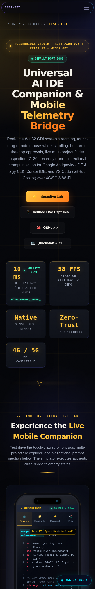

# UI Design System & Master Generation Blueprint: infinitytechstack-uk_pulsebridge

> **PulseBridge [2026] · AI IDE Mobile Companion (Free)** (https://infinitytechstack.uk/pulsebridge) — Free AI IDE mobile companion for Antigravity, Cursor & VS Code: stream live Win32 GDI screens, scroll code & inject prompts over Wi-Fi/4G...


---

## 1. Executive Visual Persona & Design Archetype

- **Brand Essence & Persona**: **PulseBridge [2026] · AI IDE Mobile Companion (Free)** (`https://infinitytechstack.uk/pulsebridge`). Free AI IDE mobile companion for Antigravity, Cursor & VS Code: stream live Win32 GDI screens, scroll code & inject prompts over Wi-Fi/4G...
- **Visual Archetype**: **High-Contrast Obsidian / Atmospheric Design System (`#05060a` canvas, `#3df5c0` ink, `#ffc53d` accent)**.
- **Anti-AI-Slop Differentiators**:
  - **Source-Grounded Chromatic Polarity**: Anchors the viewport in `#05060a` (`var(--pb-bg)` in `:root`) paired with `#3df5c0` primary typography and `#ffc53d` accents.
  - **Extracted Typographic Hierarchy**: Pairs `Inter` for display copy (`Universal AI IDE Companion & Mobile `) with `Inter Fallback` and `JetBrains Mono`.
  - **Calibrated Spatial Grid & Motion**: Combines `1240px` container bounds (`gap: .5rem`, padding `2rem`) with `cubic-bezier(.16,1,.3,1)` easing and Three.js / WebGL Canvas Pipeline.

---

## 2. Spatial Architecture & Modular Grid Mathematics



### Viewport Allocation & Container Geometry
- **Captured Viewport Dimensions**: Desktop `1440×2400px` (`assets/desktop.png`, capped at 2400px multi-section capture), Mobile `390×2400px` (`assets/mobile.png`, capped at 2400px multi-section capture).
- **Master Container Bounds**: `1240px` extracted from `infinitytechstack-uk_pulsebridge` stylesheet.
- **Canvas Lateral Padding & Spacing**: `2rem` lateral canvas padding with `.5rem` grid gap.
- **Border Radius Scale**: `999px`, `50%`, `10px`, `12px`.

### Responsive Breakpoint Architecture
- **Desktop Layout**: Multi-column CSS Grid / Flexbox layout at `1440px` (`max-width: 1240px`, `gap: .5rem`).
- **Mobile Layout**: Single-column vertical stack at `390px` viewport width with `2rem` horizontal padding.
- **Extracted CSS Media Queries**: `@media (max-width:1024px)`, `@media (max-width:900px)`, `@media (max-width:600px)`, `@media (prefers-reduced-motion:reduce)`.

---

## 3. Color System, Materiality & Atmospheric Lighting

### Semantic Palette & Source Grounding
| Semantic Role | Ground-Truth Value | Extracted CSS Source / Selector |
|---|---|---|
| **Primary Canvas Substrate** | `#05060a` | `var(--pb-bg)` in `:root` |
| **Primary Typography Ink** | `#0b0e16` | `var(--pb-surface)` in `:root` |
| **Elevated Surface / Card Substrate** | `#10141f` | `var(--pb-surface-2)` in `:root` |
| **Interactive Accent / Highlight** | `#ffc53d` | `var(--pb-amber)` in `:root` |
| **Secondary / Muted Copy** | `#ff7a1a` | `var(--pb-ember)` in `:root` |
| **Structural Hairline Border** | `#3df5c0` | `var(--pb-signal)` in `:root` |
| **Variable Token (`--pb-indigo`)** | `#5b5bf0` | `var(--pb-indigo)` in `:root` |
| **Variable Token (`--pb-text`)** | `#f4f1ea` | `var(--pb-text)` in `:root` |
| **Variable Token (`--pb-muted`)** | `#98a1b3` | `var(--pb-muted)` in `:root` |

### Sanitized Root CSS Variables (`ui-ux.md` Ground Truth)
| Variable Name | Extracted Value | Semantic Role |
|---|---|---|
| `--pb-bg` | `#05060a` | Canvas / Surface Token |
| `--pb-surface` | `#0b0e16` | Canvas / Surface Token |
| `--pb-surface-2` | `#10141f` | Canvas / Surface Token |
| `--pb-hair` | `rgba(255,255,255,0.06)` | Color / Atmospheric Token |
| `--pb-amber` | `#ffc53d` | Color / Atmospheric Token |
| `--pb-ember` | `#ff7a1a` | Color / Atmospheric Token |
| `--pb-amber-rgb` | `255,197,61` | Design System Custom Token |
| `--pb-signal` | `#3df5c0` | Color / Atmospheric Token |
| `--pb-signal-rgb` | `61,245,192` | Design System Custom Token |
| `--pb-indigo` | `#5b5bf0` | Color / Atmospheric Token |
| `--pb-indigo-rgb` | `91,91,240` | Design System Custom Token |
| `--pb-text` | `#f4f1ea` | Typography Ink Token |
| `--pb-muted` | `#98a1b3` | Color / Atmospheric Token |
| `--pb-ease` | `cubic-bezier(0.16,1,0.3,1)` | Motion / Easing Token |
| `--font-inter` | `"Inter","Inter Fallback"` | Typography / Scale Token |
| `--color-amber-300` | `oklch(87.9% .169 91.605)` | Brand / Palette Token |

---

## 4. Typographic Scale & Editorial Hierarchy

### Font Family Stacks
- **Display Typography**: `Inter`.
- **Primary Body Stack**: `Inter Fallback`.
- **Technical / Metadata Stack**: `JetBrains Mono`.

### Typographic Scale & Rules (Extracted from Stylesheet & Variables)
- **Hero Display (`H1`)**: CSS variables `--font-home-display: "Space Grotesk","Space Grotesk Fallback"`.
- **Section Heading (`H2`)**: CSS variables `--text-2xl: 1.5rem`, `--text-2xl--line-height: calc(2 / 1.5)`; rule `h2` (`font-size: clamp(1.15rem,4.8vw,1.4rem)!i...`, `line-height: 1.28!important`).
- **Body Copy**: CSS variables `--text-base: 1rem`, `--text-base--line-height: calc(1.5 / 1)`; rule `p` (`font-size: .95rem!important`, `line-height: 1.72!important`).
- **Metadata & Navigation Labels**: CSS variables `--text-xs: .75rem`, `--text-xs--line-height: calc(1 / .75)`, `--text-sm: .875rem`.

---

## 5. Choreographed Motion & Interaction Physics

### Primary Easing Curves
- **Extracted Timing Functions**: `cubic-bezier(.16,1,.3,1)`, `cubic-bezier(0.16,1,0.3,1)`, `cubic-bezier(0,0,.2,1)`.

### Per-Element Transition & Choreography Rules
- **Selector `.pb-breadcrumb a`**: `transition: color .2s ease` extracted from `infinitytechstack-uk_pulsebridge` stylesheet.
- **Selector `.pb-btn`**: `transition: all .25s cubic-bezier(.16,1,.3,1)` extracted from `infinitytechstack-uk_pulsebridge` stylesheet.
- **Selector `.pb-phone-mockup`**: `transition: transform .3s cubic-bezier(.16,1,.3,1),box-shadow .3s cubic-be...` extracted from `infinitytechstack-uk_pulsebridge` stylesheet.
- **Extracted Easing Curve (`cubic-bezier(.16,1,.3,1)`)**: Governs interactive state transitions across `<header.pb-hero>` and `<section.pb-captures-section>`.
- **Runtime Interaction Engine**: Integrates Three.js / WebGL Canvas Pipeline with `prefers-reduced-motion: reduce` fallback guards.

---

## 6. Component Wireframe & Structural DOM Map

### Visual Layout Schematic (Grounded in `dom.html` — `1440px` Desktop & `390px` Mobile Reflow)
```
┌────────────────────────────────────────────────────────────────────────┐
│ DESKTOP VIEWPORT (1440px) — PulseBridge [2026] · AI IDE Mobile Compani │
│ ====================================================================== │
│ [ <header.pb-hero>         | INFINITY · PropValuer Pro · Project SP ]  │
│ ---------------------------------------------------------------------- │
│ | HERO STAGE: <section.pb-simulator-section>                       |   │
│ | H1: Universal AI IDE Companion & Mobile Telemetry Bridge         |   │
│ | Substrate: #05060a    | Ink: #3df5c0    | Accent: #ffc53d        |   │
│ ---------------------------------------------------------------------- │
│ | SHOWCASE GRID (<section.pb-captures-secti) max-w: 1240px         |   │
│ | +------------------------------+  +------------------------------+ | │
│ | | Experience the Live Mobile C |  | Authentic Live Host Captures | | │
│ | +------------------------------+  +------------------------------+ | │
│ ---------------------------------------------------------------------- │
│ | MOBILE VIEWPORT REFLOW (390px) — Single-Column Stack (gap: .5rem ) | │
│ | [<header.pb-hero>] -> [<section.pb-simula] -> [<section.pb-captur] | │
│ ---------------------------------------------------------------------- │
│ [ FOOTER (<footer.gnav-inner>   ) | https://infinitytechstack.uk/pulse │
└────────────────────────────────────────────────────────────────────────┘
```

### Granular DOM Region Breakdown
1. **Brand Header & Navigation Bar (<header.pb-hero> — `infinitytechstack-uk_pulsebridge`)**:
   - Landmark `<header class="pb-hero">` hosting `PulseBridge [2026] · AI IDE Mobile C` navigation (`INFINITY · PropValuer Pro · Project SPINE · ChronoFact · About & Projects`), DOM attributes (`data-precedence="next"`, `data-precedence="next"`, `data-precedence="next"`, `data-sdkn="@vercel/analytics/next"`), and stylesheet rule `.pb-page:before { position:absolute;pointer-events:none;z-index:0 }`.
2. **Hero Stage & Focal Lead (<section.pb-simulator-section> — `Universal AI IDE Companion & Mobil`)**:
   - Landmark `<section class="pb-simulator-section">` presenting display lead `Universal AI IDE Companion & Mobile Telemetry Bridge` and copy excerpt *"Skip to main content"* over `#05060a` canvas and `#3df5c0` ink.
3. **Primary Showcase & Content Grid (<section.pb-captures-section> — `Experience the Live Mobile Compani`)**:
   - Landmark `<section class="pb-captures-section">` rendering section `Experience the Live Mobile Companion` with copy *"PULSEBRIDGE v2.0.0 · RUST AXUM 0.8 + REACT 19 + WIN32 GDI"*, asset references (`e4af272ccee01ff0-s.p.woff2`, `pulsebridge-live-preview.png`, `5f5eb15872b9862c.css`, `5770cea5f2af1200.css`), and grid rule `.pb-container { max-width:1240px;margin:0 auto;padding:0 1.5rem;position:relative;z-index:1 }`.
4. **Interactive Detail & Feature Matrix (<section.pb-architecture-section> — `Authentic Live Host Captures & Zer`)**:
   - Landmark `<section class="pb-architecture-section">` framing `Authentic Live Host Captures & Zero-Trust PWA` and `Engineered for Precision & Zero Latency` (*"Mobile Telemetry Bridge"*) with `#10141f` surface cards, `#ffc53d` accents, and `.pb-breadcrumb a { color:94a3b8;text-decoration:none;transition:color .2s ease }`.
5. **Colophon & Global Directory Footer (<footer.gnav-inner> — `https://infinitytechstack.uk/pulsebridge`)**:
   - Landmark `<footer class="gnav-inner">` anchoring `PulseBridge [2026] · AI IDE Mobi` footer links (`INFINITY · PropValuer Pro · Project SPINE · ChronoFact · About & Projects`), copy *"Real-time Win32 GDI screen streaming, touch-drag remote mous"*, and `#3df5c0` structural dividers.

---

## 7. Master Zero-Shot AI Generation Prompt

```markdown
# Master Zero-Shot Frontend Generation Prompt: infinitytechstack-uk_pulsebridge (PulseBridge [2026] · AI IDE Mobile Companion (Free))

You are a principal frontend architect and design systems engineer. Build a complete, production-ready web application replicating the exact design system, DOM landmarks, typographic hierarchy, color tokens, and motion physics of `infinitytechstack-uk_pulsebridge` (**PulseBridge [2026] · AI IDE Mobile Companion (Free)** — `https://infinitytechstack.uk/pulsebridge`).

### 1. Visual Archetype & Anti-AI-Slop Mandates
- **Archetype**: High-Contrast Obsidian / Atmospheric Design System (`#05060a` canvas, `#3df5c0` ink, `#ffc53d` accent).
- **Identity & Domain Context**: Free AI IDE mobile companion for Antigravity, Cursor & VS Code: stream live Win32 GDI screens, scroll code & inject prompts over Wi-Fi/4G...
- **Primary Substrate**: `#05060a` (`var(--pb-bg)` in `:root`), **Primary Ink**: `#3df5c0`, **Accent / Highlight**: `#ffc53d`.
- **Site-Specific Differentiators**:
  - **Source-Grounded Chromatic Polarity**: Anchors the viewport in `#05060a` (`var(--pb-bg)` in `:root`) paired with `#3df5c0` primary typography and `#ffc53d` accents.
  - **Extracted Typographic Hierarchy**: Pairs `Inter` for display copy (`Universal AI IDE Companion & Mobile `) with `Inter Fallback` and `JetBrains Mono`.
  - **Calibrated Spatial Grid & Motion**: Combines `1240px` container bounds (`gap: .5rem`, padding `2rem`) with `cubic-bezier(.16,1,.3,1)` easing and Three.js / WebGL Canvas Pipeline.

### 2. Ground-Truth CSS Variables (`:root` Token Contract)
Declare and consume these exact custom properties extracted from `infinitytechstack-uk_pulsebridge` in your global stylesheet:

:root {
  /* PulseBridge [2026] · AI IDE Mobile Companion (Free) (infinitytechstack-uk_pulsebridge) — Ground-Truth Extracted CSS Variables */
  --pb-bg: #05060a; /* Canvas / Surface Token (infinitytechstack-uk_pulsebridge) */
  --pb-surface: #0b0e16; /* Canvas / Surface Token (infinitytechstack-uk_pulsebridge) */
  --pb-surface-2: #10141f; /* Canvas / Surface Token (infinitytechstack-uk_pulsebridge) */
  --pb-hair: rgba(255,255,255,0.06); /* Color / Atmospheric Token (infinitytechstack-uk_pulsebridge) */
  --pb-amber: #ffc53d; /* Color / Atmospheric Token (infinitytechstack-uk_pulsebridge) */
  --pb-ember: #ff7a1a; /* Color / Atmospheric Token (infinitytechstack-uk_pulsebridge) */
  --pb-amber-rgb: 255,197,61; /* Design System Custom Token (infinitytechstack-uk_pulsebridge) */
  --pb-signal: #3df5c0; /* Color / Atmospheric Token (infinitytechstack-uk_pulsebridge) */
  --pb-signal-rgb: 61,245,192; /* Design System Custom Token (infinitytechstack-uk_pulsebridge) */
  --pb-indigo: #5b5bf0; /* Color / Atmospheric Token (infinitytechstack-uk_pulsebridge) */
  --pb-indigo-rgb: 91,91,240; /* Design System Custom Token (infinitytechstack-uk_pulsebridge) */
  --pb-text: #f4f1ea; /* Typography Ink Token (infinitytechstack-uk_pulsebridge) */
  --pb-muted: #98a1b3; /* Color / Atmospheric Token (infinitytechstack-uk_pulsebridge) */
  --pb-ease: cubic-bezier(0.16,1,0.3,1); /* Motion / Easing Token (infinitytechstack-uk_pulsebridge) */
  --font-inter: "Inter","Inter Fallback"; /* Typography / Scale Token (infinitytechstack-uk_pulsebridge) */
  --color-amber-300: oklch(87.9% .169 91.605); /* Brand / Palette Token (infinitytechstack-uk_pulsebridge) */
}

### 3. Semantic Color & Materiality Contract
Map every surface, ink, and border strictly to these source-grounded tokens:
- **Primary Canvas Substrate**: `#05060a` — grounded in `var(--pb-bg)` in `:root`
- **Primary Typography Ink**: `#0b0e16` — grounded in `var(--pb-surface)` in `:root`
- **Elevated Surface / Card Substrate**: `#10141f` — grounded in `var(--pb-surface-2)` in `:root`
- **Interactive Accent / Highlight**: `#ffc53d` — grounded in `var(--pb-amber)` in `:root`
- **Secondary / Muted Copy**: `#ff7a1a` — grounded in `var(--pb-ember)` in `:root`
- **Structural Hairline Border**: `#3df5c0` — grounded in `var(--pb-signal)` in `:root`
- **Variable Token (`--pb-indigo`)**: `#5b5bf0` — grounded in `var(--pb-indigo)` in `:root`
- **Variable Token (`--pb-text`)**: `#f4f1ea` — grounded in `var(--pb-text)` in `:root`
- **Variable Token (`--pb-muted`)**: `#98a1b3` — grounded in `var(--pb-muted)` in `:root`

### 4. Spatial Grid, Container Bounds & Responsive Breakpoints
- **Desktop Viewport Reference**: `1440×2400px` (capped at 2400px multi-section capture, `1440px` standard desktop width).
- **Mobile Viewport Reference**: `390×2400px` (capped at 2400px multi-section capture, `390px` standard mobile width).
- **Container Max-Width**: `1240px` extracted from `infinitytechstack-uk_pulsebridge` stylesheet
- **Padding & Gutters**: `2rem` lateral canvas padding with `.5rem` grid gap
- **Desktop Grid**: Multi-column CSS Grid / Flexbox layout at `1440px` (`max-width: 1240px`, `gap: .5rem`)
- **Mobile Adaptation**: Single-column vertical stack at `390px` viewport width with `2rem` horizontal padding
- **Media Queries**: `@media (max-width:1024px)`, `@media (max-width:900px)`, `@media (max-width:600px)`, `@media (prefers-reduced-motion:reduce)`
- **Corner Radii**: `999px`, `50%`, `10px`, `12px`

### 5. Typography & Editorial Scale Contract
- **Display Font Stack**: `Inter`
- **Body Font Stack**: `Inter Fallback`
- **Monospace / Technical Font Stack**: `JetBrains Mono`
- **H1 Display Rule**: CSS variables `--font-home-display: "Space Grotesk","Space Grotesk Fallback"`
- **H2 Section Rule**: CSS variables `--text-2xl: 1.5rem`, `--text-2xl--line-height: calc(2 / 1.5)`; rule `h2` (`font-size: clamp(1.15rem,4.8vw,1.4rem)!i...`, `line-height: 1.28!important`)
- **Body Copy Rule**: CSS variables `--text-base: 1rem`, `--text-base--line-height: calc(1.5 / 1)`; rule `p` (`font-size: .95rem!important`, `line-height: 1.72!important`)
- **Metadata & Index Rule**: CSS variables `--text-xs: .75rem`, `--text-xs--line-height: calc(1 / .75)`, `--text-sm: .875rem`

### 6. Component Hierarchy, Verbatim Copy & Real DOM Landmarks
Scaffold `infinitytechstack-uk_pulsebridge` (`PulseBridge [2026] · AI IDE Mobile Companion (Free)`) with these exact structural regions, extracted copy, and CSS rules from `dom.html`:
1. **Brand Header & Navigation Bar (<header.pb-hero> — `infinitytechstack-uk_pulsebridge`)**:
   - DOM & Selectors: Landmark `<header class="pb-hero">` hosting `PulseBridge [2026] · AI IDE Mobile C` navigation (`INFINITY · PropValuer Pro · Project SPINE · ChronoFact · About & Projects`), DOM attributes (`data-precedence="next"`, `data-precedence="next"`, `data-precedence="next"`, `data-sdkn="@vercel/analytics/next"`), and stylesheet rule `.pb-page:before { position:absolute;pointer-events:none;z-index:0 }`.
   - Responsive Contract: Header `Brand Header & Navigation Bar (<header.pb-hero> — `infinitytechstack-uk_pulsebridge`)` (`infinitytechstack-uk_pulsebridge`) adapts across `@media (max-width:1024px)`, `@media (max-width:900px)`, `@media (max-width:600px)`, `@media (prefers-reduced-motion:reduce)` with `cubic-bezier(.16,1,.3,1)`, `cubic-bezier(0.16,1,0.3,1)`, `cubic-bezier(0,0,.2,1)` transitions and links `INFINITY · PropValuer Pro · Project SPINE · ChronoFact · About & Projects`.
2. **Hero Stage & Focal Lead (<section.pb-simulator-section> — `Universal AI IDE Companion & Mobil`)**:
   - DOM & Selectors: Landmark `<section class="pb-simulator-section">` presenting display lead `Universal AI IDE Companion & Mobile Telemetry Bridge` and copy excerpt *"Skip to main content"* over `#05060a` canvas and `#3df5c0` ink.
   - Responsive Contract: Hero stage (`1440×2400px` desktop / `390×2400px` mobile) sets `#05060a` background with `#3df5c0` headline `Universal AI IDE Companion & Mobile Telemetry Bridge`.
3. **Primary Showcase & Content Grid (<section.pb-captures-section> — `Experience the Live Mobile Compani`)**:
   - DOM & Selectors: Landmark `<section class="pb-captures-section">` rendering section `Experience the Live Mobile Companion` with copy *"PULSEBRIDGE v2.0.0 · RUST AXUM 0.8 + REACT 19 + WIN32 GDI"*, asset references (`e4af272ccee01ff0-s.p.woff2`, `pulsebridge-live-preview.png`, `5f5eb15872b9862c.css`, `5770cea5f2af1200.css`), and grid rule `.pb-container { max-width:1240px;margin:0 auto;padding:0 1.5rem;position:relative;z-index:1 }`.
   - Responsive Contract: Showcase grid `Primary Showcase & Content Grid (<section.pb-captures-section> — `Experience the Live Mobile Compani`)` applies Multi-column CSS Grid / Flexbox layout at `1440px` (`max-width: 1240px`, `gap: .5rem`) on desktop and Single-column vertical stack at `390px` viewport width with `2rem` horizontal padding on mobile.
4. **Interactive Detail & Feature Matrix (<section.pb-architecture-section> — `Authentic Live Host Captures & Zer`)**:
   - DOM & Selectors: Landmark `<section class="pb-architecture-section">` framing `Authentic Live Host Captures & Zero-Trust PWA` and `Engineered for Precision & Zero Latency` (*"Mobile Telemetry Bridge"*) with `#10141f` surface cards, `#ffc53d` accents, and `.pb-breadcrumb a { color:94a3b8;text-decoration:none;transition:color .2s ease }`.
   - Responsive Contract: Detail module `Interactive Detail & Feature Matrix (<section.pb-architecture-section> — `Authentic Live Host Captures & Zer`)` uses `999px`, `50%`, `10px`, `12px` radii, `#ffc53d` highlights, and assets (e4af272ccee01ff0-s.p.woff2, pulsebridge-live-preview.png, 5f5eb15872b9862c.css).
5. **Colophon & Global Directory Footer (<footer.gnav-inner> — `https://infinitytechstack.uk/pulsebridge`)**:
   - DOM & Selectors: Landmark `<footer class="gnav-inner">` anchoring `PulseBridge [2026] · AI IDE Mobi` footer links (`INFINITY · PropValuer Pro · Project SPINE · ChronoFact · About & Projects`), copy *"Real-time Win32 GDI screen streaming, touch-drag remote mous"*, and `#3df5c0` structural dividers.
   - Responsive Contract: Footer `Colophon & Global Directory Footer (<footer.gnav-inner> — `https://infinitytechstack.uk/pulsebridge`)` aligns to `1240px` extracted from `infinitytechstack-uk_pulsebridge` stylesheet with `2rem` lateral canvas padding with `.5rem` grid gap and attributes (data-precedence="next", data-precedence="next", data-precedence="next").

#### Verbatim DOM Copy Excerpts (`dom.html`)
- Copy Excerpt 1: *"Skip to main content"*
- Copy Excerpt 2: *"PULSEBRIDGE v2.0.0 · RUST AXUM 0.8 + REACT 19 + WIN32 GDI"*
- Copy Excerpt 3: *"Mobile Telemetry Bridge"*
- Copy Excerpt 4: *"Real-time Win32 GDI screen streaming, touch-drag remote mouse-wheel scrolling, hum..."*

### 7. Motion, Extracted Stylesheet Rules & Interaction Choreography
- **Primary Easing Functions**: `cubic-bezier(.16,1,.3,1)`, `cubic-bezier(0.16,1,0.3,1)`, `cubic-bezier(0,0,.2,1)`
- **Extracted Stylesheet Rules (`infinitytechstack-uk_pulsebridge`)**:
- `.pb-page:before { position:absolute;pointer-events:none;z-index:0 }`
- `.pb-container { max-width:1240px;margin:0 auto;padding:0 1.5rem;position:relative;z-index:1 }`
- `.pb-breadcrumb a { color:94a3b8;text-decoration:none;transition:color .2s ease }`
- `.pb-breadcrumb a:hover { color:eab308 }`
- `.pb-hero { text-align:center;padding:2rem 0 4rem }`
- **Per-Selector Transition Rules**:
- **Selector `.pb-breadcrumb a`**: `transition: color .2s ease` extracted from `infinitytechstack-uk_pulsebridge` stylesheet.
- **Selector `.pb-btn`**: `transition: all .25s cubic-bezier(.16,1,.3,1)` extracted from `infinitytechstack-uk_pulsebridge` stylesheet.
- **Selector `.pb-phone-mockup`**: `transition: transform .3s cubic-bezier(.16,1,.3,1),box-shadow .3s cubic-be...` extracted from `infinitytechstack-uk_pulsebridge` stylesheet.
- **Extracted Easing Curve (`cubic-bezier(.16,1,.3,1)`)**: Governs interactive state transitions across `<header.pb-hero>` and `<section.pb-captures-section>`.
- **Runtime Interaction Engine**: Integrates Three.js / WebGL Canvas Pipeline with `prefers-reduced-motion: reduce` fallback guards.

### 8. Technical Deliverables
- Implement in Next.js (App Router) with TypeScript and Tailwind CSS consuming the `:root` custom properties defined above for `infinitytechstack-uk_pulsebridge`.
- Reproduce both the `1440px` desktop architecture and `390px` mobile breakpoint transitions, preserving semantic HTML5 landmarks (`<header>`, `<nav>`, `<main>`, `<section>`, `<footer>`) and `prefers-reduced-motion` accessibility guards.
```
