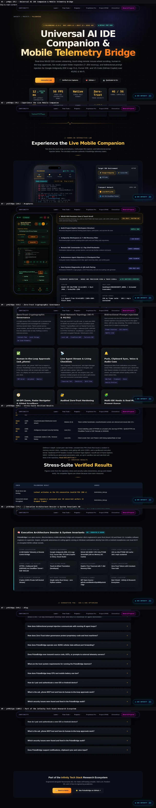
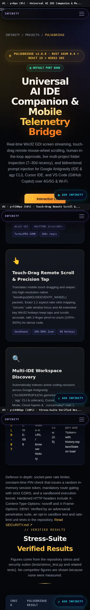

# UI Design System & Master Generation Blueprint: infinitytechstack-uk_pulsebridge

> **PulseBridge [2026] · AI IDE Mobile Companion (Free)** (https://infinitytechstack.uk/pulsebridge) — Free AI IDE mobile companion for Antigravity, Cursor & VS Code: stream live Win32 GDI screens, scroll code & inject prompts over Wi-Fi/4G...





---

## 1. Executive Visual Persona & Design Archetype

- **Brand Essence & Persona**: **PulseBridge [2026] · AI IDE Mobile Companion (Free)** (`https://infinitytechstack.uk/pulsebridge`). Free AI IDE mobile companion for Antigravity, Cursor & VS Code: stream live Win32 GDI screens, scroll code & inject prompts over Wi-Fi/4G...
- **Capture Provenance**: Live browser capture (`tier1_fast`, HTTP `200`, captured `2026-11-24`).
- **Visual Archetype**: **High-Contrast Obsidian / Atmospheric Design System (`#06060c` canvas, `#f4f1ea` ink, `#00f0ff` accent)**.
- **Anti-AI-Slop Differentiators**:
  - **Live-Computed Chromatic Polarity**: Anchors the viewport in `#06060c` (live computed `body` `background-color` (`computed_styles.json`)) paired with `#f4f1ea` primary typography and `#00f0ff` accents.
  - **Grounded Typographic Hierarchy**: Pairs `Space Grotesk` for display copy (`Universal AI IDE Companion & Mobile `) with `Inter` and `JetBrains Mono`.
  - **Calibrated Spatial Grid & Motion**: Combines `1192px` container bounds (`gap: .5rem`, padding `2rem`) with `cubic-bezier(.16,1,.3,1)` easing and Three.js / WebGL Canvas Pipeline.

---

## 2. Spatial Architecture & Modular Grid Mathematics

### Viewport Allocation & Container Geometry
- **Captured Journey Filmstrips**: Desktop `1280×6624px` (`assets/desktop-journey.webp`, `8` keyframes up to `y=9921px` / doc `10821px`), Mobile `390×2616px` (`assets/mobile-journey.webp`, `3` keyframes).
- **Master Container Bounds**: `1192px` (measured widest bounded `<section>` landmark width on `1440px` desktop).
- **Canvas Lateral Padding & Spacing**: `2rem` lateral canvas padding with `.5rem` grid gap.
- **Border Radius Scale**: `100px`, `999px`, `50%`, `10px`.

### Responsive Breakpoint Architecture
- **Desktop Layout**: Multi-column CSS Grid / Flexbox layout at `1440px` (`max-width: 1192px`, `gap: .5rem`).
- **Mobile Layout**: Single-column vertical stack at `390px` viewport width with `2rem` horizontal padding.
- **Extracted CSS Media Queries**: `@media (max-width:1024px)`, `@media (max-width:900px)`, `@media (max-width:600px)`, `@media (prefers-reduced-motion:reduce)`.

---

## 3. Color System, Materiality & Atmospheric Lighting

### Semantic Palette & Source Grounding
| Semantic Role | Ground-Truth Value | Extracted Live / CSS Source |
|---|---|---|
| **Primary Canvas Substrate** | `#06060c` | live computed `body` `background-color` (`computed_styles.json`) |
| **Primary Typography Ink** | `#f4f1ea` | live computed `h1` `color` (`computed_styles.json`) |
| **Elevated Surface / Card Substrate** | `#0a0a10` | live computed `nav` `background-color` (`computed_styles.json`) |
| **Interactive Accent / Highlight** | `#00f0ff` | `.lp-secnav-btn--active { color: #00f0ff }` |
| **Secondary / Muted Copy** | `#7a7a9e` | `var(--text-secondary)` in `:root` |
| **Structural Hairline Border** | `#1e1e3a` | `var(--border)` in `:root` |
| **Variable Token (`--bg-secondary`)** | `#0c0c18` | `var(--bg-secondary)` in `:root` |
| **Variable Token (`--bg-card`)** | `#111127` | `var(--bg-card)` in `:root` |
| **Variable Token (`--bg-card-hover`)** | `#181840` | `var(--bg-card-hover)` in `:root` |
| **Variable Token (`--bg-hover`)** | `#1e1e48` | `var(--bg-hover)` in `:root` |
| **Variable Token (`--bg-input`)** | `#0e0e22` | `var(--bg-input)` in `:root` |
| **Variable Token (`--text-primary`)** | `#e4e4f0` | `var(--text-primary)` in `:root` |
| **Variable Token (`--text-muted`)** | `#4e4e6e` | `var(--text-muted)` in `:root` |
| **Variable Token (`--accent`)** | `#8b5cf6` | `var(--accent)` in `:root` |
| **Variable Token (`--accent-light`)** | `#a78bfa` | `var(--accent-light)` in `:root` |
| **Variable Token (`--accent-dim`)** | `#6d40d9` | `var(--accent-dim)` in `:root` |
| **Variable Token (`--cyan`)** | `#22d3ee` | `var(--cyan)` in `:root` |

### Sanitized Root CSS Variables (`ui-ux.md` Ground Truth)
| Variable Name | Extracted Value | Semantic Role |
|---|---|---|
| `--bg-primary` | `#06060c` | Canvas / Surface Token |
| `--bg-secondary` | `#0c0c18` | Canvas / Surface Token |
| `--bg-card` | `#111127` | Canvas / Surface Token |
| `--bg-card-hover` | `#181840` | Canvas / Surface Token |
| `--bg-hover` | `#1e1e48` | Canvas / Surface Token |
| `--bg-input` | `#0e0e22` | Canvas / Surface Token |
| `--text-primary` | `#e4e4f0` | Typography Ink Token |
| `--text-secondary` | `#7a7a9e` | Typography Ink Token |
| `--text-muted` | `#4e4e6e` | Typography Ink Token |
| `--accent` | `#8b5cf6` | Brand / Palette Token |
| `--accent-light` | `#a78bfa` | Canvas / Surface Token |
| `--accent-dim` | `#6d40d9` | Brand / Palette Token |
| `--accent-glow` | `#8b5cf640` | Brand / Palette Token |
| `--accent-glow-strong` | `#8b5cf680` | Brand / Palette Token |
| `--cyan` | `#22d3ee` | Color / Atmospheric Token |
| `--cyan-glow` | `#22d3ee33` | Color / Atmospheric Token |

---

## 4. Typographic Scale & Editorial Hierarchy

### Font Family Stacks
- **Display Typography**: `Space Grotesk`.
- **Primary Body Stack**: `Inter`.
- **Technical / Metadata Stack**: `JetBrains Mono`.

### Typographic Scale & Rules (Live Computed & Stylesheet Grounded)
- **Hero Display (`H1`)**: live computed `h1` (`font-size: 83.2px`, `line-height: 86.528px`, `font-weight: 800`, `letter-spacing: -3.744px`); CSS variables `--font-home-display: "Space Grotesk","Space Grotesk Fallback"`, `--font-aca-display: "Plus Jakarta Sans","Plus Jakarta Sans Fallback"`; rule `h1` (`font-size: clamp(32px,10vw,46px)`).
- **Section Heading (`H2`)**: live computed `h2` (`font-size: 41.6px`, `line-height: 62.4px`, `font-weight: 800`, `letter-spacing: -1.456px`); CSS variables `--text-2xl: 1.5rem`, `--text-2xl--line-height: calc(2 / 1.5)`; rule `h2` (`letter-spacing: -.02em`).
- **Body Copy**: live computed `body` (`font-size: 16px`, `line-height: 24px`, `font-weight: 400`); CSS variables `--text-base: 1rem`, `--text-base--line-height: calc(1.5 / 1)`; rule `p` (`font-size: .94rem`, `line-height: 1.68`).
- **Metadata & Navigation Labels**: live computed `nav/a` (`font-size: 16px`, `line-height: 24px`, `font-weight: 400`); CSS variables `--font-home-mono: "JetBrains Mono","JetBrains Mono Fallback"`, `--c-mono: "SF Mono","Fira Code","JetBrains Mono","Cascadia Code",monospace`, `--font-aca-mono: "JetBrains Mono","JetBrains Mono Fallback"`; rule `small` (`font-size: .72rem`).

---

## 5. Choreographed Motion & Interaction Physics

### Primary Easing Curves
- **Extracted Timing Functions**: `cubic-bezier(.16,1,.3,1)`, `cubic-bezier(0.16,1,0.3,1)`, `cubic-bezier(.2,.8,.2,1)`.

### Per-Element Transition & Choreography Rules
- **Selector `.pb-breadcrumb a`**: `transition: color .2s ease` extracted from `infinitytechstack-uk_pulsebridge` stylesheet.
- **Selector `.pb-btn`**: `transition: all .25s cubic-bezier(.16,1,.3,1)` extracted from `infinitytechstack-uk_pulsebridge` stylesheet.
- **Selector `.pb-phone-mockup`**: `transition: transform .3s cubic-bezier(.16,1,.3,1),box-shadow .3s cubic-be...` extracted from `infinitytechstack-uk_pulsebridge` stylesheet.
- **Extracted Easing Curve (`cubic-bezier(.16,1,.3,1)`)**: Governs interactive state transitions across `<header.pb-hero>` and `<section.pb-captures-section>`.
- **Runtime Interaction Engine**: Integrates Three.js / WebGL Canvas Pipeline with `prefers-reduced-motion: reduce` fallback guards.
### Measured Runtime Scroll & Interaction Telemetry (`behavioral_journey_v2`)
- **Scroll Driver Mode**: `native` (max document height `10821px`, deepest scrollY reached `9921px` across `8` desktop keyframes).
- **Detected Scroll / Motion Libraries**: Native browser scroll / standard CSS transitions.
- **Nav / Drawer Probe (`Learn`)**: Triggered visual change (pixel diff `6.492`, captured in `assets/state-nav.webp`); revealed links: 00 Zero to Hero 14-Da..., 01 MCP Academy 2026-0..., 02 Cursor Academy Age..., 03 Open Source AI lla..., 04 AWS Bedrock Academ..., 05 Inference & Harnes....
- **Hover Physics (`primary_cta` · `⚡ Interactive Lab`)**: `transform`: `none` -> `matrix(1, 0, 0, 1, 0, -...`; `color`: `rgb(26, 15, 0)` -> `rgb(18, 10, 0)`; `borderColor`: `rgb(26, 15, 0)` -> `rgb(18, 10, 0)`; `boxShadow`: `rgba(255, 122, 26, 0.32...` -> `rgba(255, 122, 26, 0.5)...` (`transition-duration: 0.4s, 0.4s, 0.3s, 0.3s, 0.3s`, `timing: cubic-bezier(0.16, 1, 0.3, 1), cubic-bezier(0.16, 1, 0.3, 1), ease, ease, ease`).
- **Interactive Control Probe (`accordion` · `Which AI IDEs and code editors do...`)**: Triggered visual diff `6.261` (attr ` -> `, captured in `assets/state-interactive.webp`).
- **Route Transition Architecture**: First internal navigation (`/`) measured as `MPA` in `1593ms`.

---

## 6. Component Wireframe & Structural DOM Map

### Visual Layout Schematic — Desktop (`1440px`, Grounded in `dom.html` & Landmark Bounding Boxes)
```
┌────────────────────────────────────────────────────────────────────────┐
│ DESKTOP VIEWPORT (1440px) — PulseBridge [2026] · AI IDE Mobile Compani │
│ ====================================================================== │
│ [ <header.pb-hero> (1192x947px)       | INFINITY · PropValuer Pro ·  ] │
│ ---------------------------------------------------------------------- │
│ | HERO STAGE: <section.pb-simulator-section> (w=1440px)              | │
│ | H1: Universal AI IDE Companion & Mobile Telemetry Bridge           | │
│ | Substrate: #06060c | Ink: #f4f1ea | Accent: #00f0ff                | │
│ ---------------------------------------------------------------------- │
│ | SHOWCASE GRID (<section.pb-captures-secti) max-w: 1192px           | │
│ | +------------------------------+  +------------------------------+ | │
│ | | Experience the Live Mobile C |  | Authentic Live Host Captures | | │
│ | +------------------------------+  +------------------------------+ | │
│ ---------------------------------------------------------------------- │
│ | DETAIL MODULE (<section.pb-architecture-s) — Engineered for Precis | │
│ ---------------------------------------------------------------------- │
│ [ FOOTER (<footer.gnav-inner> ) | https://infinitytechstack.uk/pulseb  │
└────────────────────────────────────────────────────────────────────────┘
```

### Visual Layout Schematic — Mobile Reflow (`390px`)
```
┌────────────────────────────────────────────────────────────────────────┐
│ MOBILE VIEWPORT REFLOW (390px) — Single-Column Stack (gap: .5rem)      │
│ ====================================================================== │
│ [ HEADER BAR (<header.pb-hero>        ) | Compact Menu (390px)         │
│ ---------------------------------------------------------------------- │
│ | HERO STAGE (<section.pb-simulator-se) — 390px Vertical Lead        | │
│ | H1: Universal AI IDE Companion & Mobile Telemetry Bridge           | │
│ ---------------------------------------------------------------------- │
│ | SHOWCASE STACK (<section.pb-captures-s) — 1-Col Stack              | │
│ | [ Item 1: Experience the Live Mobile Companion                   ] | │
│ | [ Item 2: Authentic Live Host Captures & Zero-Trust PWA          ] | │
│ ---------------------------------------------------------------------- │
│ | DETAIL STACK (<section.pb-architecture) — 1-Col (Engineered for Pre) │
│ ---------------------------------------------------------------------- │
│ [ FOOTER (<footer.gnav-inner> ) | Stacked 390px Colophon               │
└────────────────────────────────────────────────────────────────────────┘
```

### Granular DOM Region Breakdown
1. **Brand Header & Navigation Bar (<header.pb-hero> — `infinitytechstack-uk_pulsebridge`)**:
   - Landmark `<header class="pb-hero">` (`1192x947px`) hosting `PulseBridge [2026] · AI IDE Mobile C` navigation (`INFINITY · PropValuer Pro · Project SPINE · ChronoFact · About & Projects`), DOM attributes (`data-precedence="next"`, `data-precedence="next"`, `data-precedence="next"`, `data-sdkn="@vercel/analytics/next"`), and stylesheet rule `.pb-page:before { position:absolute;pointer-events:none;z-index:0 }`.
2. **Hero Stage & Focal Lead (<section.pb-simulator-section> — `Universal AI IDE Companion & Mobil`)**:
   - Landmark `<section class="pb-simulator-section">` presenting display lead `Universal AI IDE Companion & Mobile Telemetry Bridge` and copy excerpt *"Real-time Win32 GDI screen streaming, touch-drag remote mouse-whe"* over `#06060c` canvas and `#f4f1ea` ink.
3. **Primary Showcase & Content Grid (<section.pb-captures-section> — `Experience the Live Mobile Compani`)**:
   - Landmark `<section class="pb-captures-section">` rendering section `Experience the Live Mobile Companion` with copy *"PULSEBRIDGE v2.0.0 · RUST AXUM 0.8 + REACT 19 + WIN32 GDI"*, asset references (`e4af272ccee01ff0-s.p.woff2`, `pulsebridge-live-preview.png`, `5f5eb15872b9862c.css`, `5770cea5f2af1200.css`), and grid rule `.pb-container { max-width:1240px;margin:0 auto;padding:0 1.5rem;position:relative;z-index:1 }`.
4. **Interactive Detail & Feature Matrix (<section.pb-architecture-section> — `Authentic Live Host Captures & Zer`)**:
   - Landmark `<section class="pb-architecture-section">` framing `Authentic Live Host Captures & Zero-Trust PWA` and `Engineered for Precision & Zero Latency` (*"Mobile Telemetry Bridge"*) with `#0a0a10` surface cards, `#00f0ff` accents, and `.pb-breadcrumb a { color:94a3b8;text-decoration:none;transition:color .2s ease }`.
5. **Colophon & Global Directory Footer (<footer.gnav-inner> — `https://infinitytechstack.uk/pulsebridge`)**:
   - Landmark `<footer class="gnav-inner">` anchoring `PulseBridge [2026] · AI IDE Mobi` footer links (`INFINITY · PropValuer Pro · Project SPINE · ChronoFact · About & Projects`), copy *"Live Mobile Companion"*, and `#1e1e3a` structural dividers.
### Full Vertical Scroll Sequence (Desktop `1440×900` Keyframes)
- **Step 01** (`y=0px`, `0%`): Active landmark `Universal AI IDE Companion & Mobile Telemetry Bridge` · sticky/fixed elements: `1`
- **Step 02** (`y=850px`, `9%`): Active landmark `Experience the Live Mobile Companion` · sticky/fixed elements: `1`
- **Step 03** (`y=2550px`, `26%`): Active landmark `#captures` · sticky/fixed elements: `1`
- **Step 04** (`y=4250px`, `43%`): Active landmark `Zero-Trust Cryptographic Governance` · sticky/fixed elements: `1`
- **Step 05** (`y=5950px`, `60%`): Active landmark `Stress-Suite Verified Results` · sticky/fixed elements: `1`
- **Step 06** (`y=7650px`, `77%`): Active landmark `🧠 Executive Architecture Dossier & System Invaria...` · sticky/fixed elements: `1`
- **Step 07** (`y=9350px`, `94%`): Active landmark `#faq` · sticky/fixed elements: `1`
- **Step 08** (`y=9921px`, `100%`): Active landmark `Part of the Infinity Tech Stack Research Ecosystem` · sticky/fixed elements: `1`

### Multi-Page Internal Route Map
- **Other Route (`/`)**: `https://infinitytechstack.uk/` — H1: `Elite AI Academies & HARNESS Pure-Rust Engine.`, scrollHeight `8935px`, transition `MPA` (`1593ms`)
- **Other Route (`/propvaluer`)**: `https://infinitytechstack.uk/propvaluer` — H1: `UK Property Valuation & Landlord Negotiation Inte...`, scrollHeight `4576px`, transition `direct` (`1769ms`)
- **Other Route (`/spine`)**: `https://infinitytechstack.uk/spine` — H1: `Project SPINE: The 33-Vertebrae Anti-Sycophancy A...`, scrollHeight `9376px`, transition `direct` (`701ms`)

---

## 7. Master Zero-Shot AI Generation Prompt

```markdown
# Master Zero-Shot Frontend Generation Prompt: infinitytechstack-uk_pulsebridge (PulseBridge [2026] · AI IDE Mobile Companion (Free))

You are a principal frontend architect and design systems engineer. Build a complete, production-ready web application replicating the exact design system, DOM landmarks, typographic hierarchy, color tokens, and motion physics of `infinitytechstack-uk_pulsebridge` (**PulseBridge [2026] · AI IDE Mobile Companion (Free)** — `https://infinitytechstack.uk/pulsebridge`).

### 1. Visual Archetype & Anti-AI-Slop Mandates
- **Archetype**: High-Contrast Obsidian / Atmospheric Design System (`#06060c` canvas, `#f4f1ea` ink, `#00f0ff` accent).
- **Identity & Domain Context**: Free AI IDE mobile companion for Antigravity, Cursor & VS Code: stream live Win32 GDI screens, scroll code & inject prompts over Wi-Fi/4G...
- **Primary Substrate**: `#06060c` (live computed `body` `background-color` (`computed_styles.json`)), **Primary Ink**: `#f4f1ea`, **Accent / Highlight**: `#00f0ff`.
- **Site-Specific Differentiators**:
  - **Live-Computed Chromatic Polarity**: Anchors the viewport in `#06060c` (live computed `body` `background-color` (`computed_styles.json`)) paired with `#f4f1ea` primary typography and `#00f0ff` accents.
  - **Grounded Typographic Hierarchy**: Pairs `Space Grotesk` for display copy (`Universal AI IDE Companion & Mobile `) with `Inter` and `JetBrains Mono`.
  - **Calibrated Spatial Grid & Motion**: Combines `1192px` container bounds (`gap: .5rem`, padding `2rem`) with `cubic-bezier(.16,1,.3,1)` easing and Three.js / WebGL Canvas Pipeline.

### 2. Ground-Truth CSS Variables (`:root` Token Contract)
Declare and consume these exact custom properties extracted from `infinitytechstack-uk_pulsebridge` in your global stylesheet:

:root {
  /* PulseBridge [2026] · AI IDE Mobile Companion (Free) (infinitytechstack-uk_pulsebridge) — Live-Grounded CSS Variables */
  --bg-primary: #06060c; /* Canvas / Surface Token (infinitytechstack-uk_pulsebridge) */
  --bg-secondary: #0c0c18; /* Canvas / Surface Token (infinitytechstack-uk_pulsebridge) */
  --bg-card: #111127; /* Canvas / Surface Token (infinitytechstack-uk_pulsebridge) */
  --bg-card-hover: #181840; /* Canvas / Surface Token (infinitytechstack-uk_pulsebridge) */
  --bg-hover: #1e1e48; /* Canvas / Surface Token (infinitytechstack-uk_pulsebridge) */
  --bg-input: #0e0e22; /* Canvas / Surface Token (infinitytechstack-uk_pulsebridge) */
  --text-primary: #e4e4f0; /* Typography Ink Token (infinitytechstack-uk_pulsebridge) */
  --text-secondary: #7a7a9e; /* Typography Ink Token (infinitytechstack-uk_pulsebridge) */
  --text-muted: #4e4e6e; /* Typography Ink Token (infinitytechstack-uk_pulsebridge) */
  --accent: #8b5cf6; /* Brand / Palette Token (infinitytechstack-uk_pulsebridge) */
  --accent-light: #a78bfa; /* Canvas / Surface Token (infinitytechstack-uk_pulsebridge) */
  --accent-dim: #6d40d9; /* Brand / Palette Token (infinitytechstack-uk_pulsebridge) */
  --accent-glow: #8b5cf640; /* Brand / Palette Token (infinitytechstack-uk_pulsebridge) */
  --accent-glow-strong: #8b5cf680; /* Brand / Palette Token (infinitytechstack-uk_pulsebridge) */
  --cyan: #22d3ee; /* Color / Atmospheric Token (infinitytechstack-uk_pulsebridge) */
  --cyan-glow: #22d3ee33; /* Color / Atmospheric Token (infinitytechstack-uk_pulsebridge) */
}

### 3. Semantic Color & Materiality Contract
Map every surface, ink, and border strictly to these source-grounded tokens:
- **Primary Canvas Substrate**: `#06060c` — grounded in live computed `body` `background-color` (`computed_styles.json`)
- **Primary Typography Ink**: `#f4f1ea` — grounded in live computed `h1` `color` (`computed_styles.json`)
- **Elevated Surface / Card Substrate**: `#0a0a10` — grounded in live computed `nav` `background-color` (`computed_styles.json`)
- **Interactive Accent / Highlight**: `#00f0ff` — grounded in `.lp-secnav-btn--active { color: #00f0ff }`
- **Secondary / Muted Copy**: `#7a7a9e` — grounded in `var(--text-secondary)` in `:root`
- **Structural Hairline Border**: `#1e1e3a` — grounded in `var(--border)` in `:root`
- **Variable Token (`--bg-secondary`)**: `#0c0c18` — grounded in `var(--bg-secondary)` in `:root`
- **Variable Token (`--bg-card`)**: `#111127` — grounded in `var(--bg-card)` in `:root`
- **Variable Token (`--bg-card-hover`)**: `#181840` — grounded in `var(--bg-card-hover)` in `:root`
- **Variable Token (`--bg-hover`)**: `#1e1e48` — grounded in `var(--bg-hover)` in `:root`
- **Variable Token (`--bg-input`)**: `#0e0e22` — grounded in `var(--bg-input)` in `:root`
- **Variable Token (`--text-primary`)**: `#e4e4f0` — grounded in `var(--text-primary)` in `:root`
- **Variable Token (`--text-muted`)**: `#4e4e6e` — grounded in `var(--text-muted)` in `:root`
- **Variable Token (`--accent`)**: `#8b5cf6` — grounded in `var(--accent)` in `:root`
- **Variable Token (`--accent-light`)**: `#a78bfa` — grounded in `var(--accent-light)` in `:root`
- **Variable Token (`--accent-dim`)**: `#6d40d9` — grounded in `var(--accent-dim)` in `:root`
- **Variable Token (`--cyan`)**: `#22d3ee` — grounded in `var(--cyan)` in `:root`

### 4. Spatial Grid, Container Bounds & Responsive Breakpoints
- **Desktop Viewport Reference**: `1280×6624px` (multi-frame vertical journey filmstrip (6624px), `1440px` standard desktop width).
- **Mobile Viewport Reference**: `390×2616px` (multi-frame vertical journey filmstrip (2616px), `390px` standard mobile width).
- **Container Max-Width**: `1192px` (measured widest bounded `<section>` landmark width on `1440px` desktop)
- **Padding & Gutters**: `2rem` lateral canvas padding with `.5rem` grid gap
- **Desktop Grid**: Multi-column CSS Grid / Flexbox layout at `1440px` (`max-width: 1192px`, `gap: .5rem`)
- **Mobile Adaptation**: Single-column vertical stack at `390px` viewport width with `2rem` horizontal padding
- **Media Queries**: `@media (max-width:1024px)`, `@media (max-width:900px)`, `@media (max-width:600px)`, `@media (prefers-reduced-motion:reduce)`
- **Corner Radii**: `100px`, `999px`, `50%`, `10px`

### 5. Typography & Editorial Scale Contract
- **Display Font Stack**: `Space Grotesk`
- **Body Font Stack**: `Inter`
- **Monospace / Technical Font Stack**: `JetBrains Mono`
- **H1 Display Rule**: live computed `h1` (`font-size: 83.2px`, `line-height: 86.528px`, `font-weight: 800`, `letter-spacing: -3.744px`); CSS variables `--font-home-display: "Space Grotesk","Space Grotesk Fallback"`, `--font-aca-display: "Plus Jakarta Sans","Plus Jakarta Sans Fallback"`; rule `h1` (`font-size: clamp(32px,10vw,46px)`)
- **H2 Section Rule**: live computed `h2` (`font-size: 41.6px`, `line-height: 62.4px`, `font-weight: 800`, `letter-spacing: -1.456px`); CSS variables `--text-2xl: 1.5rem`, `--text-2xl--line-height: calc(2 / 1.5)`; rule `h2` (`letter-spacing: -.02em`)
- **Body Copy Rule**: live computed `body` (`font-size: 16px`, `line-height: 24px`, `font-weight: 400`); CSS variables `--text-base: 1rem`, `--text-base--line-height: calc(1.5 / 1)`; rule `p` (`font-size: .94rem`, `line-height: 1.68`)
- **Metadata & Index Rule**: live computed `nav/a` (`font-size: 16px`, `line-height: 24px`, `font-weight: 400`); CSS variables `--font-home-mono: "JetBrains Mono","JetBrains Mono Fallback"`, `--c-mono: "SF Mono","Fira Code","JetBrains Mono","Cascadia Code",monospace`, `--font-aca-mono: "JetBrains Mono","JetBrains Mono Fallback"`; rule `small` (`font-size: .72rem`)

### 6. Component Hierarchy, Verbatim Copy & Real DOM Landmarks
Scaffold `infinitytechstack-uk_pulsebridge` (`PulseBridge [2026] · AI IDE Mobile Companion (Free)`) with these exact structural regions, extracted copy, and CSS rules from `dom.html`:
1. **Brand Header & Navigation Bar (<header.pb-hero> — `infinitytechstack-uk_pulsebridge`)**:
   - DOM & Selectors: Landmark `<header class="pb-hero">` (`1192x947px`) hosting `PulseBridge [2026] · AI IDE Mobile C` navigation (`INFINITY · PropValuer Pro · Project SPINE · ChronoFact · About & Projects`), DOM attributes (`data-precedence="next"`, `data-precedence="next"`, `data-precedence="next"`, `data-sdkn="@vercel/analytics/next"`), and stylesheet rule `.pb-page:before { position:absolute;pointer-events:none;z-index:0 }`.
   - Responsive Contract: Header `Brand Header & Navigation Bar (<header.pb-hero> — `infinitytechstack-uk_pulsebridge`)` (`infinitytechstack-uk_pulsebridge`) adapts across `@media (max-width:1024px)`, `@media (max-width:900px)`, `@media (max-width:600px)`, `@media (prefers-reduced-motion:reduce)` with `cubic-bezier(.16,1,.3,1)`, `cubic-bezier(0.16,1,0.3,1)`, `cubic-bezier(.2,.8,.2,1)` transitions and links `INFINITY · PropValuer Pro · Project SPINE · ChronoFact · About & Projects`.
2. **Hero Stage & Focal Lead (<section.pb-simulator-section> — `Universal AI IDE Companion & Mobil`)**:
   - DOM & Selectors: Landmark `<section class="pb-simulator-section">` presenting display lead `Universal AI IDE Companion & Mobile Telemetry Bridge` and copy excerpt *"Real-time Win32 GDI screen streaming, touch-drag remote mouse-whe"* over `#06060c` canvas and `#f4f1ea` ink.
   - Responsive Contract: Hero stage (`1280×6624px` desktop / `390×2616px` mobile) sets `#06060c` background with `#f4f1ea` headline `Universal AI IDE Companion & Mobile Telemetry Bridge`.
3. **Primary Showcase & Content Grid (<section.pb-captures-section> — `Experience the Live Mobile Compani`)**:
   - DOM & Selectors: Landmark `<section class="pb-captures-section">` rendering section `Experience the Live Mobile Companion` with copy *"PULSEBRIDGE v2.0.0 · RUST AXUM 0.8 + REACT 19 + WIN32 GDI"*, asset references (`e4af272ccee01ff0-s.p.woff2`, `pulsebridge-live-preview.png`, `5f5eb15872b9862c.css`, `5770cea5f2af1200.css`), and grid rule `.pb-container { max-width:1240px;margin:0 auto;padding:0 1.5rem;position:relative;z-index:1 }`.
   - Responsive Contract: Showcase grid `Primary Showcase & Content Grid (<section.pb-captures-section> — `Experience the Live Mobile Compani`)` applies Multi-column CSS Grid / Flexbox layout at `1440px` (`max-width: 1192px`, `gap: .5rem`) on desktop and Single-column vertical stack at `390px` viewport width with `2rem` horizontal padding on mobile.
4. **Interactive Detail & Feature Matrix (<section.pb-architecture-section> — `Authentic Live Host Captures & Zer`)**:
   - DOM & Selectors: Landmark `<section class="pb-architecture-section">` framing `Authentic Live Host Captures & Zero-Trust PWA` and `Engineered for Precision & Zero Latency` (*"Mobile Telemetry Bridge"*) with `#0a0a10` surface cards, `#00f0ff` accents, and `.pb-breadcrumb a { color:94a3b8;text-decoration:none;transition:color .2s ease }`.
   - Responsive Contract: Detail module `Interactive Detail & Feature Matrix (<section.pb-architecture-section> — `Authentic Live Host Captures & Zer`)` uses `100px`, `999px`, `50%`, `10px` radii, `#00f0ff` highlights, and assets (e4af272ccee01ff0-s.p.woff2, pulsebridge-live-preview.png, 5f5eb15872b9862c.css).
5. **Colophon & Global Directory Footer (<footer.gnav-inner> — `https://infinitytechstack.uk/pulsebridge`)**:
   - DOM & Selectors: Landmark `<footer class="gnav-inner">` anchoring `PulseBridge [2026] · AI IDE Mobi` footer links (`INFINITY · PropValuer Pro · Project SPINE · ChronoFact · About & Projects`), copy *"Live Mobile Companion"*, and `#1e1e3a` structural dividers.
   - Responsive Contract: Footer `Colophon & Global Directory Footer (<footer.gnav-inner> — `https://infinitytechstack.uk/pulsebridge`)` aligns to `1192px` (measured widest bounded `<section>` landmark width on `1440px` desktop) with `2rem` lateral canvas padding with `.5rem` grid gap and attributes (data-precedence="next", data-precedence="next", data-precedence="next").

#### Verbatim DOM Copy Excerpts (`dom.html`)
- Copy Excerpt 1: *"Real-time Win32 GDI screen streaming, touch-drag remote mouse-wheel scrolling, hum..."*
- Copy Excerpt 2: *"PULSEBRIDGE v2.0.0 · RUST AXUM 0.8 + REACT 19 + WIN32 GDI"*
- Copy Excerpt 3: *"Mobile Telemetry Bridge"*
- Copy Excerpt 4: *"Live Mobile Companion"*

### 7. Motion, Extracted Stylesheet Rules & Interaction Choreography
- **Primary Easing Functions**: `cubic-bezier(.16,1,.3,1)`, `cubic-bezier(0.16,1,0.3,1)`, `cubic-bezier(.2,.8,.2,1)`
- **Extracted Stylesheet Rules (`infinitytechstack-uk_pulsebridge`)**:
- `.pb-page:before { position:absolute;pointer-events:none;z-index:0 }`
- `.pb-container { max-width:1240px;margin:0 auto;padding:0 1.5rem;position:relative;z-index:1 }`
- `.pb-breadcrumb a { color:94a3b8;text-decoration:none;transition:color .2s ease }`
- `.pb-breadcrumb a:hover { color:eab308 }`
- `.pb-hero { text-align:center;padding:2rem 0 4rem }`
- **Per-Selector Transition Rules**:
- **Selector `.pb-breadcrumb a`**: `transition: color .2s ease` extracted from `infinitytechstack-uk_pulsebridge` stylesheet.
- **Selector `.pb-btn`**: `transition: all .25s cubic-bezier(.16,1,.3,1)` extracted from `infinitytechstack-uk_pulsebridge` stylesheet.
- **Selector `.pb-phone-mockup`**: `transition: transform .3s cubic-bezier(.16,1,.3,1),box-shadow .3s cubic-be...` extracted from `infinitytechstack-uk_pulsebridge` stylesheet.
- **Extracted Easing Curve (`cubic-bezier(.16,1,.3,1)`)**: Governs interactive state transitions across `<header.pb-hero>` and `<section.pb-captures-section>`.
- **Runtime Interaction Engine**: Integrates Three.js / WebGL Canvas Pipeline with `prefers-reduced-motion: reduce` fallback guards.
### 7b. Full-Page Scroll Choreography, Interactive States & Multi-Page Routes
- **Scroll Mechanics**: Implement `native` vertical progression up to `10821px` across 8 distinct viewport chapters.
- **Vertical Chapter Sequence**: Universal AI IDE Companion... (0%) -> Experience the Live Mobile... (9%) -> #captures (26%) -> Zero-Trust Cryptographic Go... (43%) -> Stress-Suite Verified Results (60%) -> 🧠 Executive Architecture Do... (77%) -> #faq (94%) -> Part of the Infinity Tech S... (100%).
- **Navigation Drawer / Menu State**: Replicate interactive menu toggle (`Learn`) with Escape-to-close keyboard handling.
- **Hover Micro-Interaction (`primary_cta`)**: Animate `transform, color, borderColor, boxShadow` with `0.4s, 0.4s, 0.3s, 0.3s, 0.3s cubic-bezier(0.16, 1, 0.3, 1), cubic-bezier(0.16, 1, 0.3, 1), ease, ease, ease`.
- **Multi-Page Routes**: Scaffold internal routes `/` (other, MPA), `/propvaluer` (other, direct), `/spine` (other, direct) sharing the global header/footer shell and design tokens.

### 8. Technical Deliverables
- Implement in Next.js (App Router) with TypeScript and Tailwind CSS consuming the `:root` custom properties defined above for `infinitytechstack-uk_pulsebridge`.
- Reproduce both the `1440px` desktop architecture and `390px` mobile breakpoint transitions, preserving semantic HTML5 landmarks (`<header>`, `<nav>`, `<main>`, `<section>`, `<footer>`) and `prefers-reduced-motion` accessibility guards.
```
---

## 8. Full-Page Scroll Journey, Interactive States & Subpage Inventory

### Desktop Scroll Keyframes (`1440×900` WebP)
| Step | Scroll Y | Progress | Active Landmark / Section | Sticky/Fixed | Visual Asset |
| :---: | :---: | :---: | :--- | :---: | :--- |
| `#01` | `0px` | `0%` | Universal AI IDE Companion & Mobile Telemetry... | `1` | [desktop-step-01.webp](assets/desktop-step-01.webp) |
| `#02` | `850px` | `9%` | Experience the Live Mobile Companion | `1` | [desktop-step-02.webp](assets/desktop-step-02.webp) |
| `#03` | `2550px` | `26%` | #captures | `1` | [desktop-step-03.webp](assets/desktop-step-03.webp) |
| `#04` | `4250px` | `43%` | Zero-Trust Cryptographic Governance | `1` | [desktop-step-04.webp](assets/desktop-step-04.webp) |
| `#05` | `5950px` | `60%` | Stress-Suite Verified Results | `1` | [desktop-step-05.webp](assets/desktop-step-05.webp) |
| `#06` | `7650px` | `77%` | 🧠 Executive Architecture Dossier & System Inv... | `1` | [desktop-step-06.webp](assets/desktop-step-06.webp) |
| `#07` | `9350px` | `94%` | #faq | `1` | [desktop-step-07.webp](assets/desktop-step-07.webp) |
| `#08` | `9921px` | `100%` | Part of the Infinity Tech Stack Research Ecos... | `1` | [desktop-step-08.webp](assets/desktop-step-08.webp) |

### Mobile Condensed Keyframes (`390×844` WebP)
| Step | Scroll Y | Progress | Active Landmark | Visual Asset |
| :---: | :---: | :---: | :--- | :--- |
| `#01` | `0px` | `0%` | Universal AI IDE Companion & Mobile Telem... | [mobile-step-01.webp](assets/mobile-step-01.webp) |
| `#02` | `7200px` | `50%` | Touch-Drag Remote Scroll & Precision Tap | [mobile-step-02.webp](assets/mobile-step-02.webp) |
| `#03` | `14400px` | `100%` | Stress-Suite Verified Results | [mobile-step-03.webp](assets/mobile-step-03.webp) |

### Interactive UI State Captures (`1440×900` WebP)
| State Type | Trigger / Observation | Visual Asset |
| :--- | :--- | :--- |
| `nav_menu` | Nav/Menu opened (`Learn`, diff `6.492`) | [state-nav.webp](assets/state-nav.webp) |
| `interactive_control` | Control `accordion` (`Which AI IDEs and code editor...`, diff `6.261`) | [state-interactive.webp](assets/state-interactive.webp) |

### Internal Subpage Filmstrips (`1080px` Wide WebP)
| # | Template | Route URL | H1 / Title | Scroll Height | Transition | Filmstrip Asset |
| :-: | :---: | :--- | :--- | :---: | :---: | :--- |
| `1` | `other` | `https://infinitytechstack.uk/` | Elite AI Academies & HARNESS Pure-Rus... | `8935px` | `MPA` (`1593ms`) | [subpage-01-page.webp](assets/subpage-01-page.webp) |
| `2` | `other` | `https://infinitytechstack.uk/propvaluer` | UK Property Valuation & Landlord Nego... | `4576px` | `direct` (`1769ms`) | [subpage-02-propvaluer.webp](assets/subpage-02-propvaluer.webp) |
| `3` | `other` | `https://infinitytechstack.uk/spine` | Project SPINE: The 33-Vertebrae Anti-... | `9376px` | `direct` (`701ms`) | [subpage-03-spine.webp](assets/subpage-03-spine.webp) |

