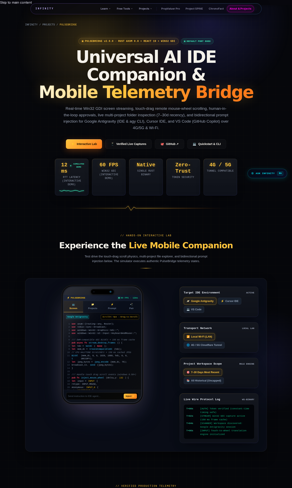

# UI Design System & Master Generation Blueprint: infinitytechstack-uk_pulsebridge

> **PulseBridge [2026] · AI IDE Mobile Companion (Free)** (https://infinitytechstack.uk/pulsebridge) — Free AI IDE mobile companion for Antigravity, Cursor & VS Code: stream live Win32 GDI screens, scroll code & inject prompts over Wi-Fi/4G...



---

## 1. Executive Visual Persona & Design Archetype

- **Brand Essence & Persona**: **PulseBridge [2026] · AI IDE Mobile Companion (Free)** (`https://infinitytechstack.uk/pulsebridge`). Free AI IDE mobile companion for Antigravity, Cursor & VS Code: stream live Win32 GDI screens, scroll code & inject prompts over Wi-Fi/4G...
- **Capture Provenance**: Live browser capture (`tier1_fast`, HTTP `200`, captured `2026-11-23`).
- **Visual Archetype**: **High-Contrast Obsidian / Atmospheric Design System (`#06060c` canvas, `#f4f1ea` ink, `#ff00e5` accent)**.
- **Anti-AI-Slop Differentiators**:
  - **Live-Computed Chromatic Polarity**: Anchors the viewport in `#06060c` (live computed `body` `background-color` (`computed_styles.json`)) paired with `#f4f1ea` primary typography and `#ff00e5` accents.
  - **Grounded Typographic Hierarchy**: Pairs `Space Grotesk` for display copy (`Universal AI IDE Companion & Mobile `) with `Inter` and `JetBrains Mono`.
  - **Calibrated Spatial Grid & Motion**: Combines `1192px` container bounds (`gap: .75rem`, padding `1px`) with `cubic-bezier(.16,1,.3,1)` easing and Three.js / WebGL Canvas Pipeline.

---

## 2. Spatial Architecture & Modular Grid Mathematics


### Viewport Allocation & Container Geometry
- **Captured Viewport Dimensions**: Desktop `1440×2400px` (`assets/desktop.png`, clamped at 2400px live multi-section capture), Mobile `390×2400px` (`assets/mobile.png`, clamped at 2400px live multi-section capture).
- **Master Container Bounds**: `1192px` (measured widest bounded `<section>` landmark width on `1440px` desktop).
- **Canvas Lateral Padding & Spacing**: `1px` lateral canvas padding with `.75rem` grid gap.
- **Border Radius Scale**: `100px`, `18px`, `10px`, `2px`.

### Responsive Breakpoint Architecture
- **Desktop Layout**: Multi-column CSS Grid / Flexbox layout at `1440px` (`max-width: 1192px`, `gap: .75rem`).
- **Mobile Layout**: Single-column vertical stack at `390px` viewport width with `1px` horizontal padding.
- **Extracted CSS Media Queries**: `@media (max-width:1120px)`, `@media (max-width:960px)`, `@media (max-width:860px)`, `@media (max-width:768px)`.

---

## 3. Color System, Materiality & Atmospheric Lighting

### Semantic Palette & Source Grounding
| Semantic Role | Ground-Truth Value | Extracted Live / CSS Source |
|---|---|---|
| **Primary Canvas Substrate** | `#06060c` | live computed `body` `background-color` (`computed_styles.json`) |
| **Primary Typography Ink** | `#f4f1ea` | live computed `h1` `color` (`computed_styles.json`) |
| **Elevated Surface / Card Substrate** | `#08080e` | live computed `nav` `background-color` (`computed_styles.json`) |
| **Interactive Accent / Highlight** | `#ff00e5` | `.gnav-quick--cta { color: #ff00e5 }` |
| **Secondary / Muted Copy** | `#7a7a9e` | `var(--text-secondary)` in `:root` |
| **Structural Hairline Border** | `#1e1e3a` | `var(--border)` in `:root` |
| **Variable Token (`--bg-secondary`)** | `#0c0c18` | `var(--bg-secondary)` in `:root` |
| **Variable Token (`--bg-card`)** | `#111127` | `var(--bg-card)` in `:root` |
| **Variable Token (`--bg-card-hover`)** | `#181840` | `var(--bg-card-hover)` in `:root` |
| **Variable Token (`--bg-hover`)** | `#1e1e48` | `var(--bg-hover)` in `:root` |
| **Variable Token (`--bg-input`)** | `#0e0e22` | `var(--bg-input)` in `:root` |
| **Variable Token (`--text-primary`)** | `#e4e4f0` | `var(--text-primary)` in `:root` |
| **Variable Token (`--text-muted`)** | `#4e4e6e` | `var(--text-muted)` in `:root` |
| **Variable Token (`--accent`)** | `#8b5cf6` | `var(--accent)` in `:root` |
| **Variable Token (`--accent-light`)** | `#a78bfa` | `var(--accent-light)` in `:root` |
| **Variable Token (`--accent-dim`)** | `#6d40d9` | `var(--accent-dim)` in `:root` |
| **Variable Token (`--cyan`)** | `#22d3ee` | `var(--cyan)` in `:root` |

### Sanitized Root CSS Variables (`ui-ux.md` Ground Truth)
| Variable Name | Extracted Value | Semantic Role |
|---|---|---|
| `--bg-primary` | `#06060c` | Canvas / Surface Token |
| `--bg-secondary` | `#0c0c18` | Canvas / Surface Token |
| `--bg-card` | `#111127` | Canvas / Surface Token |
| `--bg-card-hover` | `#181840` | Canvas / Surface Token |
| `--bg-hover` | `#1e1e48` | Canvas / Surface Token |
| `--bg-input` | `#0e0e22` | Canvas / Surface Token |
| `--text-primary` | `#e4e4f0` | Typography Ink Token |
| `--text-secondary` | `#7a7a9e` | Typography Ink Token |
| `--text-muted` | `#4e4e6e` | Typography Ink Token |
| `--accent` | `#8b5cf6` | Brand / Palette Token |
| `--accent-light` | `#a78bfa` | Canvas / Surface Token |
| `--accent-dim` | `#6d40d9` | Brand / Palette Token |
| `--accent-glow` | `#8b5cf640` | Brand / Palette Token |
| `--accent-glow-strong` | `#8b5cf680` | Brand / Palette Token |
| `--cyan` | `#22d3ee` | Color / Atmospheric Token |
| `--cyan-glow` | `#22d3ee33` | Color / Atmospheric Token |

---

## 4. Typographic Scale & Editorial Hierarchy

### Font Family Stacks
- **Display Typography**: `Space Grotesk`.
- **Primary Body Stack**: `Inter`.
- **Technical / Metadata Stack**: `JetBrains Mono`.

### Typographic Scale & Rules (Live Computed & Stylesheet Grounded)
- **Hero Display (`H1`)**: live computed `h1` (`font-size: 83.2px`, `line-height: 86.528px`, `font-weight: 800`, `letter-spacing: -3.744px`); CSS variables `--font-home-display: "Space Grotesk","Space Grotesk Fallback"`.
- **Section Heading (`H2`)**: live computed `h2` (`font-size: 41.6px`, `line-height: 62.4px`, `font-weight: 800`, `letter-spacing: -1.456px`); CSS variables `--text-2xl: 1.5rem`, `--text-2xl--line-height: calc(2 / 1.5)`; rule `h2` (`font-size: clamp(1.15rem,4.8vw,1.4rem)`, `line-height: 1.28`).
- **Body Copy**: live computed `body` (`font-size: 16px`, `line-height: 24px`, `font-weight: 400`); CSS variables `--text-base: 1rem`, `--text-base--line-height: calc(1.5 / 1)`; rule `p` (`font-size: .95rem`, `line-height: 1.72`).
- **Metadata & Navigation Labels**: live computed `nav/a` (`font-size: 16px`, `line-height: 24px`, `font-weight: 400`); CSS variables `--text-xs: .75rem`, `--text-xs--line-height: calc(1 / .75)`, `--text-sm: .875rem`.

---

## 5. Choreographed Motion & Interaction Physics

### Primary Easing Curves
- **Extracted Timing Functions**: `cubic-bezier(.16,1,.3,1)`, `cubic-bezier(0,0,.2,1)`, `cubic-bezier(.4,0,.6,1)`.

### Per-Element Transition & Choreography Rules
- **Selector `.gnav`**: `transition: transform .4s cubic-bezier(.16,1,.3,1),background-color .4s,bo...` extracted from `infinitytechstack-uk_pulsebridge` stylesheet.
- **Selector `.gnav-logo`**: `transition: all .3s` extracted from `infinitytechstack-uk_pulsebridge` stylesheet.
- **Selector `.gnav-cat-btn`**: `transition: all .3s cubic-bezier(.16,1,.3,1)` extracted from `infinitytechstack-uk_pulsebridge` stylesheet.
- **Extracted Easing Curve (`cubic-bezier(.16,1,.3,1)`)**: Governs interactive state transitions across `<header.pb-hero>` and `<section.pb-captures-section>`.
- **Runtime Interaction Engine**: Integrates Three.js / WebGL Canvas Pipeline with `prefers-reduced-motion: reduce` fallback guards.

---

## 6. Component Wireframe & Structural DOM Map

### Visual Layout Schematic — Desktop (`1440px`, Grounded in `dom.html` & Landmark Bounding Boxes)
```
┌────────────────────────────────────────────────────────────────────────┐
│ DESKTOP VIEWPORT (1440px) — PulseBridge [2026] · AI IDE Mobile Compani │
│ ====================================================================== │
│ [ <header.pb-hero> (1192x947px)       | INFINITY · PropValuer Pro ·  ] │
│ ---------------------------------------------------------------------- │
│ | HERO STAGE: <section.pb-simulator-section> (w=1440px)              | │
│ | H1: Universal AI IDE Companion & Mobile Telemetry Bridge           | │
│ | Substrate: #06060c | Ink: #f4f1ea | Accent: #ff00e5                | │
│ ---------------------------------------------------------------------- │
│ | SHOWCASE GRID (<section.pb-captures-secti) max-w: 1192px           | │
│ | +------------------------------+  +------------------------------+ | │
│ | | Experience the Live Mobile C |  | Authentic Live Host Captures | | │
│ | +------------------------------+  +------------------------------+ | │
│ ---------------------------------------------------------------------- │
│ | DETAIL MODULE (<section.pb-architecture-s) — Engineered for Precis | │
│ ---------------------------------------------------------------------- │
│ [ FOOTER (<footer.gnav-inner> ) | https://infinitytechstack.uk/pulseb  │
└────────────────────────────────────────────────────────────────────────┘
```

### Visual Layout Schematic — Mobile Reflow (`390px`)
```
┌────────────────────────────────────────────────────────────────────────┐
│ MOBILE VIEWPORT REFLOW (390px) — Single-Column Stack (gap: .75rem)     │
│ ====================================================================== │
│ [ HEADER BAR (<header.pb-hero>        ) | Compact Menu (390px)         │
│ ---------------------------------------------------------------------- │
│ | HERO STAGE (<section.pb-simulator-se) — 390px Vertical Lead        | │
│ | H1: Universal AI IDE Companion & Mobile Telemetry Bridge           | │
│ ---------------------------------------------------------------------- │
│ | SHOWCASE STACK (<section.pb-captures-s) — 1-Col Stack              | │
│ | [ Item 1: Experience the Live Mobile Companion                   ] | │
│ | [ Item 2: Authentic Live Host Captures & Zero-Trust PWA          ] | │
│ ---------------------------------------------------------------------- │
│ | DETAIL STACK (<section.pb-architecture) — 1-Col (Engineered for Pre) │
│ ---------------------------------------------------------------------- │
│ [ FOOTER (<footer.gnav-inner> ) | Stacked 390px Colophon               │
└────────────────────────────────────────────────────────────────────────┘
```

### Granular DOM Region Breakdown
1. **Brand Header & Navigation Bar (<header.pb-hero> — `infinitytechstack-uk_pulsebridge`)**:
   - Landmark `<header class="pb-hero">` (`1192x947px`) hosting `PulseBridge [2026] · AI IDE Mobile C` navigation (`INFINITY · PropValuer Pro · Project SPINE · ChronoFact · About & Projects`), DOM attributes (`data-precedence="next"`, `data-precedence="next"`, `data-precedence="next"`, `data-sdkn="@vercel/analytics/next"`), and stylesheet rule `.gnav-inner { justify-content:space-between;gap:.75rem;height:52px;margin:0 auto;paddi... }`.
2. **Hero Stage & Focal Lead (<section.pb-simulator-section> — `Universal AI IDE Companion & Mobil`)**:
   - Landmark `<section class="pb-simulator-section">` presenting display lead `Universal AI IDE Companion & Mobile Telemetry Bridge` and copy excerpt *"Real-time Win32 GDI screen streaming, touch-drag remote mouse-whe"* over `#06060c` canvas and `#f4f1ea` ink.
3. **Primary Showcase & Content Grid (<section.pb-captures-section> — `Experience the Live Mobile Compani`)**:
   - Landmark `<section class="pb-captures-section">` rendering section `Experience the Live Mobile Companion` with copy *"PULSEBRIDGE v2.0.0 · RUST AXUM 0.8 + REACT 19 + WIN32 GDI"*, asset references (`e4af272ccee01ff0-s.p.woff2`, `pulsebridge-live-preview.png`, `5f5eb15872b9862c.css`, `5770cea5f2af1200.css`), and grid rule `.gnav-logo { align-items:center;display:flex }`.
4. **Interactive Detail & Feature Matrix (<section.pb-architecture-section> — `Authentic Live Host Captures & Zer`)**:
   - Landmark `<section class="pb-architecture-section">` framing `Authentic Live Host Captures & Zero-Trust PWA` and `Engineered for Precision & Zero Latency` (*"Mobile Telemetry Bridge"*) with `#08080e` surface cards, `#ff00e5` accents, and `.gnav-logo:hover { opacity:.9;transform:scale(1.02) }`.
5. **Colophon & Global Directory Footer (<footer.gnav-inner> — `https://infinitytechstack.uk/pulsebridge`)**:
   - Landmark `<footer class="gnav-inner">` anchoring `PulseBridge [2026] · AI IDE Mobi` footer links (`INFINITY · PropValuer Pro · Project SPINE · ChronoFact · About & Projects`), copy *"Live Mobile Companion"*, and `#1e1e3a` structural dividers.

---

## 7. Master Zero-Shot AI Generation Prompt

```markdown
# Master Zero-Shot Frontend Generation Prompt: infinitytechstack-uk_pulsebridge (PulseBridge [2026] · AI IDE Mobile Companion (Free))

You are a principal frontend architect and design systems engineer. Build a complete, production-ready web application replicating the exact design system, DOM landmarks, typographic hierarchy, color tokens, and motion physics of `infinitytechstack-uk_pulsebridge` (**PulseBridge [2026] · AI IDE Mobile Companion (Free)** — `https://infinitytechstack.uk/pulsebridge`).

### 1. Visual Archetype & Anti-AI-Slop Mandates
- **Archetype**: High-Contrast Obsidian / Atmospheric Design System (`#06060c` canvas, `#f4f1ea` ink, `#ff00e5` accent).
- **Identity & Domain Context**: Free AI IDE mobile companion for Antigravity, Cursor & VS Code: stream live Win32 GDI screens, scroll code & inject prompts over Wi-Fi/4G...
- **Primary Substrate**: `#06060c` (live computed `body` `background-color` (`computed_styles.json`)), **Primary Ink**: `#f4f1ea`, **Accent / Highlight**: `#ff00e5`.
- **Site-Specific Differentiators**:
  - **Live-Computed Chromatic Polarity**: Anchors the viewport in `#06060c` (live computed `body` `background-color` (`computed_styles.json`)) paired with `#f4f1ea` primary typography and `#ff00e5` accents.
  - **Grounded Typographic Hierarchy**: Pairs `Space Grotesk` for display copy (`Universal AI IDE Companion & Mobile `) with `Inter` and `JetBrains Mono`.
  - **Calibrated Spatial Grid & Motion**: Combines `1192px` container bounds (`gap: .75rem`, padding `1px`) with `cubic-bezier(.16,1,.3,1)` easing and Three.js / WebGL Canvas Pipeline.

### 2. Ground-Truth CSS Variables (`:root` Token Contract)
Declare and consume these exact custom properties extracted from `infinitytechstack-uk_pulsebridge` in your global stylesheet:

:root {
  /* PulseBridge [2026] · AI IDE Mobile Companion (Free) (infinitytechstack-uk_pulsebridge) — Live-Grounded CSS Variables */
  --bg-primary: #06060c; /* Canvas / Surface Token (infinitytechstack-uk_pulsebridge) */
  --bg-secondary: #0c0c18; /* Canvas / Surface Token (infinitytechstack-uk_pulsebridge) */
  --bg-card: #111127; /* Canvas / Surface Token (infinitytechstack-uk_pulsebridge) */
  --bg-card-hover: #181840; /* Canvas / Surface Token (infinitytechstack-uk_pulsebridge) */
  --bg-hover: #1e1e48; /* Canvas / Surface Token (infinitytechstack-uk_pulsebridge) */
  --bg-input: #0e0e22; /* Canvas / Surface Token (infinitytechstack-uk_pulsebridge) */
  --text-primary: #e4e4f0; /* Typography Ink Token (infinitytechstack-uk_pulsebridge) */
  --text-secondary: #7a7a9e; /* Typography Ink Token (infinitytechstack-uk_pulsebridge) */
  --text-muted: #4e4e6e; /* Typography Ink Token (infinitytechstack-uk_pulsebridge) */
  --accent: #8b5cf6; /* Brand / Palette Token (infinitytechstack-uk_pulsebridge) */
  --accent-light: #a78bfa; /* Canvas / Surface Token (infinitytechstack-uk_pulsebridge) */
  --accent-dim: #6d40d9; /* Brand / Palette Token (infinitytechstack-uk_pulsebridge) */
  --accent-glow: #8b5cf640; /* Brand / Palette Token (infinitytechstack-uk_pulsebridge) */
  --accent-glow-strong: #8b5cf680; /* Brand / Palette Token (infinitytechstack-uk_pulsebridge) */
  --cyan: #22d3ee; /* Color / Atmospheric Token (infinitytechstack-uk_pulsebridge) */
  --cyan-glow: #22d3ee33; /* Color / Atmospheric Token (infinitytechstack-uk_pulsebridge) */
}

### 3. Semantic Color & Materiality Contract
Map every surface, ink, and border strictly to these source-grounded tokens:
- **Primary Canvas Substrate**: `#06060c` — grounded in live computed `body` `background-color` (`computed_styles.json`)
- **Primary Typography Ink**: `#f4f1ea` — grounded in live computed `h1` `color` (`computed_styles.json`)
- **Elevated Surface / Card Substrate**: `#08080e` — grounded in live computed `nav` `background-color` (`computed_styles.json`)
- **Interactive Accent / Highlight**: `#ff00e5` — grounded in `.gnav-quick--cta { color: #ff00e5 }`
- **Secondary / Muted Copy**: `#7a7a9e` — grounded in `var(--text-secondary)` in `:root`
- **Structural Hairline Border**: `#1e1e3a` — grounded in `var(--border)` in `:root`
- **Variable Token (`--bg-secondary`)**: `#0c0c18` — grounded in `var(--bg-secondary)` in `:root`
- **Variable Token (`--bg-card`)**: `#111127` — grounded in `var(--bg-card)` in `:root`
- **Variable Token (`--bg-card-hover`)**: `#181840` — grounded in `var(--bg-card-hover)` in `:root`
- **Variable Token (`--bg-hover`)**: `#1e1e48` — grounded in `var(--bg-hover)` in `:root`
- **Variable Token (`--bg-input`)**: `#0e0e22` — grounded in `var(--bg-input)` in `:root`
- **Variable Token (`--text-primary`)**: `#e4e4f0` — grounded in `var(--text-primary)` in `:root`
- **Variable Token (`--text-muted`)**: `#4e4e6e` — grounded in `var(--text-muted)` in `:root`
- **Variable Token (`--accent`)**: `#8b5cf6` — grounded in `var(--accent)` in `:root`
- **Variable Token (`--accent-light`)**: `#a78bfa` — grounded in `var(--accent-light)` in `:root`
- **Variable Token (`--accent-dim`)**: `#6d40d9` — grounded in `var(--accent-dim)` in `:root`
- **Variable Token (`--cyan`)**: `#22d3ee` — grounded in `var(--cyan)` in `:root`

### 4. Spatial Grid, Container Bounds & Responsive Breakpoints
- **Desktop Viewport Reference**: `1440×2400px` (clamped at 2400px live multi-section capture, `1440px` standard desktop width).
- **Mobile Viewport Reference**: `390×2400px` (clamped at 2400px live multi-section capture, `390px` standard mobile width).
- **Container Max-Width**: `1192px` (measured widest bounded `<section>` landmark width on `1440px` desktop)
- **Padding & Gutters**: `1px` lateral canvas padding with `.75rem` grid gap
- **Desktop Grid**: Multi-column CSS Grid / Flexbox layout at `1440px` (`max-width: 1192px`, `gap: .75rem`)
- **Mobile Adaptation**: Single-column vertical stack at `390px` viewport width with `1px` horizontal padding
- **Media Queries**: `@media (max-width:1120px)`, `@media (max-width:960px)`, `@media (max-width:860px)`, `@media (max-width:768px)`
- **Corner Radii**: `100px`, `18px`, `10px`, `2px`

### 5. Typography & Editorial Scale Contract
- **Display Font Stack**: `Space Grotesk`
- **Body Font Stack**: `Inter`
- **Monospace / Technical Font Stack**: `JetBrains Mono`
- **H1 Display Rule**: live computed `h1` (`font-size: 83.2px`, `line-height: 86.528px`, `font-weight: 800`, `letter-spacing: -3.744px`); CSS variables `--font-home-display: "Space Grotesk","Space Grotesk Fallback"`
- **H2 Section Rule**: live computed `h2` (`font-size: 41.6px`, `line-height: 62.4px`, `font-weight: 800`, `letter-spacing: -1.456px`); CSS variables `--text-2xl: 1.5rem`, `--text-2xl--line-height: calc(2 / 1.5)`; rule `h2` (`font-size: clamp(1.15rem,4.8vw,1.4rem)`, `line-height: 1.28`)
- **Body Copy Rule**: live computed `body` (`font-size: 16px`, `line-height: 24px`, `font-weight: 400`); CSS variables `--text-base: 1rem`, `--text-base--line-height: calc(1.5 / 1)`; rule `p` (`font-size: .95rem`, `line-height: 1.72`)
- **Metadata & Index Rule**: live computed `nav/a` (`font-size: 16px`, `line-height: 24px`, `font-weight: 400`); CSS variables `--text-xs: .75rem`, `--text-xs--line-height: calc(1 / .75)`, `--text-sm: .875rem`

### 6. Component Hierarchy, Verbatim Copy & Real DOM Landmarks
Scaffold `infinitytechstack-uk_pulsebridge` (`PulseBridge [2026] · AI IDE Mobile Companion (Free)`) with these exact structural regions, extracted copy, and CSS rules from `dom.html`:
1. **Brand Header & Navigation Bar (<header.pb-hero> — `infinitytechstack-uk_pulsebridge`)**:
   - DOM & Selectors: Landmark `<header class="pb-hero">` (`1192x947px`) hosting `PulseBridge [2026] · AI IDE Mobile C` navigation (`INFINITY · PropValuer Pro · Project SPINE · ChronoFact · About & Projects`), DOM attributes (`data-precedence="next"`, `data-precedence="next"`, `data-precedence="next"`, `data-sdkn="@vercel/analytics/next"`), and stylesheet rule `.gnav-inner { justify-content:space-between;gap:.75rem;height:52px;margin:0 auto;paddi... }`.
   - Responsive Contract: Header `Brand Header & Navigation Bar (<header.pb-hero> — `infinitytechstack-uk_pulsebridge`)` (`infinitytechstack-uk_pulsebridge`) adapts across `@media (max-width:1120px)`, `@media (max-width:960px)`, `@media (max-width:860px)`, `@media (max-width:768px)` with `cubic-bezier(.16,1,.3,1)`, `cubic-bezier(0,0,.2,1)`, `cubic-bezier(.4,0,.6,1)` transitions and links `INFINITY · PropValuer Pro · Project SPINE · ChronoFact · About & Projects`.
2. **Hero Stage & Focal Lead (<section.pb-simulator-section> — `Universal AI IDE Companion & Mobil`)**:
   - DOM & Selectors: Landmark `<section class="pb-simulator-section">` presenting display lead `Universal AI IDE Companion & Mobile Telemetry Bridge` and copy excerpt *"Real-time Win32 GDI screen streaming, touch-drag remote mouse-whe"* over `#06060c` canvas and `#f4f1ea` ink.
   - Responsive Contract: Hero stage (`1440×2400px` desktop / `390×2400px` mobile) sets `#06060c` background with `#f4f1ea` headline `Universal AI IDE Companion & Mobile Telemetry Bridge`.
3. **Primary Showcase & Content Grid (<section.pb-captures-section> — `Experience the Live Mobile Compani`)**:
   - DOM & Selectors: Landmark `<section class="pb-captures-section">` rendering section `Experience the Live Mobile Companion` with copy *"PULSEBRIDGE v2.0.0 · RUST AXUM 0.8 + REACT 19 + WIN32 GDI"*, asset references (`e4af272ccee01ff0-s.p.woff2`, `pulsebridge-live-preview.png`, `5f5eb15872b9862c.css`, `5770cea5f2af1200.css`), and grid rule `.gnav-logo { align-items:center;display:flex }`.
   - Responsive Contract: Showcase grid `Primary Showcase & Content Grid (<section.pb-captures-section> — `Experience the Live Mobile Compani`)` applies Multi-column CSS Grid / Flexbox layout at `1440px` (`max-width: 1192px`, `gap: .75rem`) on desktop and Single-column vertical stack at `390px` viewport width with `1px` horizontal padding on mobile.
4. **Interactive Detail & Feature Matrix (<section.pb-architecture-section> — `Authentic Live Host Captures & Zer`)**:
   - DOM & Selectors: Landmark `<section class="pb-architecture-section">` framing `Authentic Live Host Captures & Zero-Trust PWA` and `Engineered for Precision & Zero Latency` (*"Mobile Telemetry Bridge"*) with `#08080e` surface cards, `#ff00e5` accents, and `.gnav-logo:hover { opacity:.9;transform:scale(1.02) }`.
   - Responsive Contract: Detail module `Interactive Detail & Feature Matrix (<section.pb-architecture-section> — `Authentic Live Host Captures & Zer`)` uses `100px`, `18px`, `10px`, `2px` radii, `#ff00e5` highlights, and assets (e4af272ccee01ff0-s.p.woff2, pulsebridge-live-preview.png, 5f5eb15872b9862c.css).
5. **Colophon & Global Directory Footer (<footer.gnav-inner> — `https://infinitytechstack.uk/pulsebridge`)**:
   - DOM & Selectors: Landmark `<footer class="gnav-inner">` anchoring `PulseBridge [2026] · AI IDE Mobi` footer links (`INFINITY · PropValuer Pro · Project SPINE · ChronoFact · About & Projects`), copy *"Live Mobile Companion"*, and `#1e1e3a` structural dividers.
   - Responsive Contract: Footer `Colophon & Global Directory Footer (<footer.gnav-inner> — `https://infinitytechstack.uk/pulsebridge`)` aligns to `1192px` (measured widest bounded `<section>` landmark width on `1440px` desktop) with `1px` lateral canvas padding with `.75rem` grid gap and attributes (data-precedence="next", data-precedence="next", data-precedence="next").

#### Verbatim DOM Copy Excerpts (`dom.html`)
- Copy Excerpt 1: *"Real-time Win32 GDI screen streaming, touch-drag remote mouse-wheel scrolling, hum..."*
- Copy Excerpt 2: *"PULSEBRIDGE v2.0.0 · RUST AXUM 0.8 + REACT 19 + WIN32 GDI"*
- Copy Excerpt 3: *"Mobile Telemetry Bridge"*
- Copy Excerpt 4: *"Live Mobile Companion"*

### 7. Motion, Extracted Stylesheet Rules & Interaction Choreography
- **Primary Easing Functions**: `cubic-bezier(.16,1,.3,1)`, `cubic-bezier(0,0,.2,1)`, `cubic-bezier(.4,0,.6,1)`
- **Extracted Stylesheet Rules (`infinitytechstack-uk_pulsebridge`)**:
- `.gnav-inner { justify-content:space-between;gap:.75rem;height:52px;margin:0 auto;paddi... }`
- `.gnav-logo { align-items:center;display:flex }`
- `.gnav-logo:hover { opacity:.9;transform:scale(1.02) }`
- `.gnav-desktop { flex-shrink:0;align-items:center;gap:4px;display:flex }`
- `.gnav-dropdown-wrapper { position:relative }`
- **Per-Selector Transition Rules**:
- **Selector `.gnav`**: `transition: transform .4s cubic-bezier(.16,1,.3,1),background-color .4s,bo...` extracted from `infinitytechstack-uk_pulsebridge` stylesheet.
- **Selector `.gnav-logo`**: `transition: all .3s` extracted from `infinitytechstack-uk_pulsebridge` stylesheet.
- **Selector `.gnav-cat-btn`**: `transition: all .3s cubic-bezier(.16,1,.3,1)` extracted from `infinitytechstack-uk_pulsebridge` stylesheet.
- **Extracted Easing Curve (`cubic-bezier(.16,1,.3,1)`)**: Governs interactive state transitions across `<header.pb-hero>` and `<section.pb-captures-section>`.
- **Runtime Interaction Engine**: Integrates Three.js / WebGL Canvas Pipeline with `prefers-reduced-motion: reduce` fallback guards.

### 8. Technical Deliverables
- Implement in Next.js (App Router) with TypeScript and Tailwind CSS consuming the `:root` custom properties defined above for `infinitytechstack-uk_pulsebridge`.
- Reproduce both the `1440px` desktop architecture and `390px` mobile breakpoint transitions, preserving semantic HTML5 landmarks (`<header>`, `<nav>`, `<main>`, `<section>`, `<footer>`) and `prefers-reduced-motion` accessibility guards.
```
