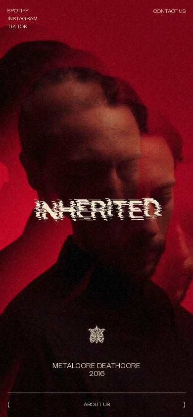

# UI Design System & Master Generation Blueprint: inherited-band

> **INHERITED** (https://inherited.band/) — INHERITED BAND


---

## 1. Executive Visual Persona & Design Archetype

- **Brand Essence & Persona**: **INHERITED** (`https://inherited.band/`). INHERITED BAND
- **Capture Provenance**: Live browser capture (`tier1_fast`, HTTP `200`, captured `2026-11-23`).
- **Visual Archetype**: **High-Contrast Obsidian / Atmospheric Design System (`#000000` canvas, `#eee2c5` ink, `#fcfffe` accent)**.
- **Anti-AI-Slop Differentiators**:
  - **Live-Computed Chromatic Polarity**: Anchors the viewport in `#000000` (live computed `html` `background-color` (`computed_styles.json`)) paired with `#eee2c5` primary typography and `#fcfffe` accents.
  - **Grounded Typographic Hierarchy**: Pairs `Founders Grotesk` for display copy (`I N H E R I T E D`) with `Founders Grotesk` and not declared in live computed styles (uses primary stack / `ui-monospace`).
  - **Calibrated Spatial Grid & Motion**: Combines `1440px` container bounds (`gap: 18px`, padding `18px`) with `cubic-bezier(.6,.14,0,1)` easing and Lenis Smooth Scroll (`data-lenis`).

---

## 2. Spatial Architecture & Modular Grid Mathematics



### Viewport Allocation & Container Geometry
- **Captured Viewport Dimensions**: Desktop `1440×2400px` (`assets/desktop.png`, clamped at 2400px live multi-section capture), Mobile `390×844px` (`assets/mobile.png`, single-viewport 100vh live capture (844px)).
- **Master Container Bounds**: `1440px` (full-bleed `100%` desktop stage measured on `1440px` viewport).
- **Canvas Lateral Padding & Spacing**: `18px` lateral canvas padding with `18px` grid gap.
- **Border Radius Scale**: `0px` (sharp unrounded corners).

### Responsive Breakpoint Architecture
- **Desktop Layout**: Multi-column CSS Grid / Flexbox layout at `1440px` (`max-width: 1440px`, `gap: 18px`).
- **Mobile Layout**: Single-column vertical stack at `390px` viewport width with `18px` horizontal padding.
- **Extracted CSS Media Queries**: `@media (max-width: 1024px)`.

---

## 3. Color System, Materiality & Atmospheric Lighting

### Semantic Palette & Source Grounding
| Semantic Role | Ground-Truth Value | Extracted Live / CSS Source |
|---|---|---|
| **Primary Canvas Substrate** | `#000000` | live computed `html` `background-color` (`computed_styles.json`) |
| **Primary Typography Ink** | `#eee2c5` | live computed `h1` `color` (`computed_styles.json`) |
| **Elevated Surface / Card Substrate** | `#d50305` | live computed `header` `background-color` (`computed_styles.json`) |
| **Interactive Accent / Highlight** | `#fcfffe` | `<meta name="theme-color" content="#FCFFFE">` in `dom.html` |
| **Secondary / Muted Copy** | `#eee2c5` | secondary opacity step of live computed `h1` `color` (`computed_styles.json`) |
| **Structural Hairline Border** | `#eee2c5` | hairline divider derived from secondary opacity step of live computed `h1` `color` (`computed_styles.json`) |

### Sanitized Root CSS Variables (`ui-ux.md` Ground Truth)
| Variable Name | Extracted Value | Semantic Role |
|---|---|---|
| `--margin` | `20rem` | Layout / Spatial Grid Token |
| `--gap` | `20rem` | Layout / Spatial Grid Token |
| `--column` | `calc((var(--rvw) * 100 - var(--margin) * 2 - var(--gap) * 5) / 6)` | Layout / Spatial Grid Token |
| `--rvw` | `14.4px` | Layout / Spatial Grid Token |
| `--right-height` | `692px` | Layout / Spatial Grid Token |
| `--inherited-band-bg` | `#000000` | Canvas Substrate (from live computed `html` `background-color` (`computed_styles.json`)) |
| `--inherited-band-ink` | `#eee2c5` | Primary Typography Ink (computed-derived) |
| `--inherited-band-surface` | `#d50305` | Surface Substrate (computed-derived) |
| `--inherited-band-accent` | `#fcfffe` | Interactive Accent (computed-derived) |
| `--inherited-band-muted` | `#eee2c5` | Secondary Ink (computed-derived) |
| `--inherited-band-border` | `#eee2c5` | Structural Border (computed-derived) |
| `--inherited-band-container` | `1440px` | Container Bound (computed-derived) |
| `--inherited-band-gap` | `18px` | Grid Gutter (computed-derived) |
| `--inherited-band-pad` | `18px` | Lateral Padding (computed-derived) |
| `--inherited-band-ease` | `cubic-bezier(.6,.14,0,1)` | Primary Easing Function |
| `--inherited-band-radius` | `0px` | Corner Radius (computed-derived) |

---

## 4. Typographic Scale & Editorial Hierarchy

### Font Family Stacks
- **Display Typography**: `Founders Grotesk`.
- **Primary Body Stack**: `Founders Grotesk`.
- **Technical / Metadata Stack**: not declared in live computed styles (uses primary stack / `ui-monospace`).

### Typographic Scale & Rules (Live Computed & Stylesheet Grounded)
- **Hero Display (`H1`)**: live computed `h1` (`font-size: 103.5px`, `line-height: 103.5px`, `font-weight: 700`, `letter-spacing: -10.35px`); rule `.h1` (`line-height: .85`, `letter-spacing: -.1em`).
- **Section Heading (`H2`)**: live computed `h2` (`font-size: 22.5px`, `line-height: 22.5px`, `font-weight: 400`, `letter-spacing: -0.3375px`).
- **Body Copy**: live computed `body` (`font-size: 13.5px`, `line-height: 16.335px`, `font-weight: 400`).
- **Metadata & Navigation Labels**: live computed `nav/a` (`font-size: 13.5px`, `line-height: 16.335px`, `font-weight: 400`).

---

## 5. Choreographed Motion & Interaction Physics

### Primary Easing Curves
- **Extracted Timing Functions**: `cubic-bezier(.6,.14,0,1)`, `cubic-bezier(.35,.42,0,1)`, `cubic-bezier(.19,1,.22,1)`.

### Per-Element Transition & Choreography Rules
- **Selector `#loading`**: `transition: opacity .5s cubic-bezier(.6,.14,0,1)` extracted from `inherited-band` stylesheet.
- **Selector `.rich-text a:after`**: `transition: transform 1s cubic-bezier(.6,.14,0,1)` extracted from `inherited-band` stylesheet.
- **Selector `#nav a:after`**: `transition: transform 1s cubic-bezier(.6,.14,0,1)` extracted from `inherited-band` stylesheet.
- **Extracted Easing Curve (`cubic-bezier(.6,.14,0,1)`)**: Governs interactive state transitions across `<header.header>` and `<section.no-transition>`.
- **Runtime Interaction Engine**: Integrates Lenis Smooth Scroll (`data-lenis`) with `prefers-reduced-motion: reduce` fallback guards.

---

## 6. Component Wireframe & Structural DOM Map

### Visual Layout Schematic — Desktop (`1440px`, Grounded in `dom.html` & Landmark Bounding Boxes)
```
┌────────────────────────────────────────────────────────────────────────┐
│ DESKTOP VIEWPORT (1440px) — INHERITED                                  │
│ ====================================================================== │
│ [ <header.header> (1440x900px)        | INHERITED · Spotify · Instag ] │
│ ---------------------------------------------------------------------- │
│ | HERO STAGE: <section.member> (w=1440px)                            | │
│ | H1: I N H E R I T E D                                              | │
│ | Substrate: #000000 | Ink: #eee2c5 | Accent: #fcfffe                | │
│ ---------------------------------------------------------------------- │
│ | SHOWCASE GRID (<section.no-transition>) max-w: 1440px              | │
│ | +------------------------------+  +------------------------------+ | │
│ | | 2016 Deathcore Metalcore     |  | E d e r A n a y a            | | │
│ | +------------------------------+  +------------------------------+ | │
│ ---------------------------------------------------------------------- │
│ | DETAIL MODULE (<section.member:nth(2)>) — ( Me, Myself, and Sam    | │
│ ---------------------------------------------------------------------- │
│ [ FOOTER (<footer.items>      ) | https://inherited.band/              │
└────────────────────────────────────────────────────────────────────────┘
```

### Visual Layout Schematic — Mobile Reflow (`390px`)
```
┌────────────────────────────────────────────────────────────────────────┐
│ MOBILE VIEWPORT REFLOW (390px) — Single-Column Stack (gap: 18px)       │
│ ====================================================================== │
│ [ HEADER BAR (<header.header>         ) | Compact Menu (390px)         │
│ ---------------------------------------------------------------------- │
│ | HERO STAGE (<section.member>) — 390px Vertical Lead                | │
│ | H1: I N H E R I T E D                                              | │
│ ---------------------------------------------------------------------- │
│ | SHOWCASE STACK (<section.no-transition) — 1-Col Stack              | │
│ | [ Item 1: 2016 Deathcore Metalcore                               ] | │
│ | [ Item 2: E d e r A n a y a                                      ] | │
│ ---------------------------------------------------------------------- │
│ | DETAIL STACK (<section.member:nth(2)>) — 1-Col (( Me, Myself, and )  │
│ ---------------------------------------------------------------------- │
│ [ FOOTER (<footer.items>      ) | Stacked 390px Colophon               │
└────────────────────────────────────────────────────────────────────────┘
```

### Granular DOM Region Breakdown
1. **Brand Header & Navigation Bar (<header.header> — `inherited-band`)**:
   - Landmark `<header class="header">` (`1440x900px`) hosting `INHERITED` navigation (`INHERITED · Spotify · Instagram · Tik Tok · Contact us`), DOM attributes (`data-touch="false"`, `data-custom-loaded="true"`, `data-title="about"`, `data-title="members"`), and stylesheet rule `body { font-size:15rem;line-height:1.21;font-weight:400 }`.
2. **Hero Stage & Focal Lead (<section.member> — `I N H E R I T E D`)**:
   - Landmark `<section class="member show">` presenting display lead `I N H E R I T E D` and copy excerpt *"Metalcore Deathcore"* over `#000000` canvas and `#eee2c5` ink.
3. **Primary Showcase & Content Grid (<section.no-transition> — `2016 Deathcore Metalcore`)**:
   - Landmark `<section class="member no-transition">` rendering section `2016 Deathcore Metalcore` with copy *"Guitarist Producer"*, asset references (`fav.ico`, `fav.svg`, `fav-mask.svg`, `apple-touch.png`), and grid rule `.h3 { line-height:1;letter-spacing:-.015em;margin:0;text-transform:uppercase;f... }`.
4. **Interactive Detail & Feature Matrix (<section.member:nth(2)> — `E d e r A n a y a`)**:
   - Landmark `<section class="member no-transition">` framing `E d e r A n a y a` and `( Me, Myself, and Sam )` (*"( Me, Myself, and Sam )"*) with `#d50305` surface cards, `#fcfffe` accents, and `.h1 { font-size:115rem }`.
5. **Colophon & Global Directory Footer (<footer.items> — `https://inherited.band/`)**:
   - Landmark `<footer class="items">` anchoring `INHERITED` footer links (`INHERITED · Spotify · Instagram · Tik Tok · Contact us`), copy *"E d e r A n a y a"*, and `#eee2c5` structural dividers.

---

## 7. Master Zero-Shot AI Generation Prompt

```markdown
# Master Zero-Shot Frontend Generation Prompt: inherited-band (INHERITED)

You are a principal frontend architect and design systems engineer. Build a complete, production-ready web application replicating the exact design system, DOM landmarks, typographic hierarchy, color tokens, and motion physics of `inherited-band` (**INHERITED** — `https://inherited.band/`).

### 1. Visual Archetype & Anti-AI-Slop Mandates
- **Archetype**: High-Contrast Obsidian / Atmospheric Design System (`#000000` canvas, `#eee2c5` ink, `#fcfffe` accent).
- **Identity & Domain Context**: INHERITED BAND
- **Primary Substrate**: `#000000` (live computed `html` `background-color` (`computed_styles.json`)), **Primary Ink**: `#eee2c5`, **Accent / Highlight**: `#fcfffe`.
- **Site-Specific Differentiators**:
  - **Live-Computed Chromatic Polarity**: Anchors the viewport in `#000000` (live computed `html` `background-color` (`computed_styles.json`)) paired with `#eee2c5` primary typography and `#fcfffe` accents.
  - **Grounded Typographic Hierarchy**: Pairs `Founders Grotesk` for display copy (`I N H E R I T E D`) with `Founders Grotesk` and not declared in live computed styles (uses primary stack / `ui-monospace`).
  - **Calibrated Spatial Grid & Motion**: Combines `1440px` container bounds (`gap: 18px`, padding `18px`) with `cubic-bezier(.6,.14,0,1)` easing and Lenis Smooth Scroll (`data-lenis`).

### 2. Ground-Truth CSS Variables (`:root` Token Contract)
Declare and consume these exact custom properties extracted from `inherited-band` in your global stylesheet:

:root {
  /* INHERITED (inherited-band) — Live-Grounded CSS Variables */
  --margin: 20rem; /* Layout / Spatial Grid Token (inherited-band) */
  --gap: 20rem; /* Layout / Spatial Grid Token (inherited-band) */
  --column: calc((var(--rvw) * 100 - var(--margin) * 2 - var(--gap) * 5) / 6); /* Layout / Spatial Grid Token (inherited-band) */
  --rvw: 14.4px; /* Layout / Spatial Grid Token (inherited-band) */
  --right-height: 692px; /* Layout / Spatial Grid Token (inherited-band) */
  --inherited-band-bg: #000000; /* Canvas Substrate (from live computed `html` `background-color` (`computed_styles.json`)) (inherited-band) */
  --inherited-band-ink: #eee2c5; /* Primary Typography Ink (computed-derived) (inherited-band) */
  --inherited-band-surface: #d50305; /* Surface Substrate (computed-derived) (inherited-band) */
  --inherited-band-accent: #fcfffe; /* Interactive Accent (computed-derived) (inherited-band) */
  --inherited-band-muted: #eee2c5; /* Secondary Ink (computed-derived) (inherited-band) */
  --inherited-band-border: #eee2c5; /* Structural Border (computed-derived) (inherited-band) */
  --inherited-band-container: 1440px; /* Container Bound (computed-derived) (inherited-band) */
  --inherited-band-gap: 18px; /* Grid Gutter (computed-derived) (inherited-band) */
  --inherited-band-pad: 18px; /* Lateral Padding (computed-derived) (inherited-band) */
  --inherited-band-ease: cubic-bezier(.6,.14,0,1); /* Primary Easing Function (inherited-band) */
  --inherited-band-radius: 0px; /* Corner Radius (computed-derived) (inherited-band) */
}

### 3. Semantic Color & Materiality Contract
Map every surface, ink, and border strictly to these source-grounded tokens:
- **Primary Canvas Substrate**: `#000000` — grounded in live computed `html` `background-color` (`computed_styles.json`)
- **Primary Typography Ink**: `#eee2c5` — grounded in live computed `h1` `color` (`computed_styles.json`)
- **Elevated Surface / Card Substrate**: `#d50305` — grounded in live computed `header` `background-color` (`computed_styles.json`)
- **Interactive Accent / Highlight**: `#fcfffe` — grounded in `<meta name="theme-color" content="#FCFFFE">` in `dom.html`
- **Secondary / Muted Copy**: `#eee2c5` — grounded in secondary opacity step of live computed `h1` `color` (`computed_styles.json`)
- **Structural Hairline Border**: `#eee2c5` — grounded in hairline divider derived from secondary opacity step of live computed `h1` `color` (`computed_styles.json`)

### 4. Spatial Grid, Container Bounds & Responsive Breakpoints
- **Desktop Viewport Reference**: `1440×2400px` (clamped at 2400px live multi-section capture, `1440px` standard desktop width).
- **Mobile Viewport Reference**: `390×844px` (single-viewport 100vh live capture (844px), `390px` standard mobile width).
- **Container Max-Width**: `1440px` (full-bleed `100%` desktop stage measured on `1440px` viewport)
- **Padding & Gutters**: `18px` lateral canvas padding with `18px` grid gap
- **Desktop Grid**: Multi-column CSS Grid / Flexbox layout at `1440px` (`max-width: 1440px`, `gap: 18px`)
- **Mobile Adaptation**: Single-column vertical stack at `390px` viewport width with `18px` horizontal padding
- **Media Queries**: `@media (max-width: 1024px)`
- **Corner Radii**: `0px` (sharp unrounded corners)

### 5. Typography & Editorial Scale Contract
- **Display Font Stack**: `Founders Grotesk`
- **Body Font Stack**: `Founders Grotesk`
- **Monospace / Technical Font Stack**: not declared in live computed styles (uses primary stack / `ui-monospace`)
- **H1 Display Rule**: live computed `h1` (`font-size: 103.5px`, `line-height: 103.5px`, `font-weight: 700`, `letter-spacing: -10.35px`); rule `.h1` (`line-height: .85`, `letter-spacing: -.1em`)
- **H2 Section Rule**: live computed `h2` (`font-size: 22.5px`, `line-height: 22.5px`, `font-weight: 400`, `letter-spacing: -0.3375px`)
- **Body Copy Rule**: live computed `body` (`font-size: 13.5px`, `line-height: 16.335px`, `font-weight: 400`)
- **Metadata & Index Rule**: live computed `nav/a` (`font-size: 13.5px`, `line-height: 16.335px`, `font-weight: 400`)

### 6. Component Hierarchy, Verbatim Copy & Real DOM Landmarks
Scaffold `inherited-band` (`INHERITED`) with these exact structural regions, extracted copy, and CSS rules from `dom.html`:
1. **Brand Header & Navigation Bar (<header.header> — `inherited-band`)**:
   - DOM & Selectors: Landmark `<header class="header">` (`1440x900px`) hosting `INHERITED` navigation (`INHERITED · Spotify · Instagram · Tik Tok · Contact us`), DOM attributes (`data-touch="false"`, `data-custom-loaded="true"`, `data-title="about"`, `data-title="members"`), and stylesheet rule `body { font-size:15rem;line-height:1.21;font-weight:400 }`.
   - Responsive Contract: Header `Brand Header & Navigation Bar (<header.header> — `inherited-band`)` (`inherited-band`) adapts across `@media (max-width: 1024px)` with `cubic-bezier(.6,.14,0,1)`, `cubic-bezier(.35,.42,0,1)`, `cubic-bezier(.19,1,.22,1)` transitions and links `INHERITED · Spotify · Instagram · Tik Tok · Contact us`.
2. **Hero Stage & Focal Lead (<section.member> — `I N H E R I T E D`)**:
   - DOM & Selectors: Landmark `<section class="member show">` presenting display lead `I N H E R I T E D` and copy excerpt *"Metalcore Deathcore"* over `#000000` canvas and `#eee2c5` ink.
   - Responsive Contract: Hero stage (`1440×2400px` desktop / `390×844px` mobile) sets `#000000` background with `#eee2c5` headline `I N H E R I T E D`.
3. **Primary Showcase & Content Grid (<section.no-transition> — `2016 Deathcore Metalcore`)**:
   - DOM & Selectors: Landmark `<section class="member no-transition">` rendering section `2016 Deathcore Metalcore` with copy *"Guitarist Producer"*, asset references (`fav.ico`, `fav.svg`, `fav-mask.svg`, `apple-touch.png`), and grid rule `.h3 { line-height:1;letter-spacing:-.015em;margin:0;text-transform:uppercase;f... }`.
   - Responsive Contract: Showcase grid `Primary Showcase & Content Grid (<section.no-transition> — `2016 Deathcore Metalcore`)` applies Multi-column CSS Grid / Flexbox layout at `1440px` (`max-width: 1440px`, `gap: 18px`) on desktop and Single-column vertical stack at `390px` viewport width with `18px` horizontal padding on mobile.
4. **Interactive Detail & Feature Matrix (<section.member:nth(2)> — `E d e r A n a y a`)**:
   - DOM & Selectors: Landmark `<section class="member no-transition">` framing `E d e r A n a y a` and `( Me, Myself, and Sam )` (*"( Me, Myself, and Sam )"*) with `#d50305` surface cards, `#fcfffe` accents, and `.h1 { font-size:115rem }`.
   - Responsive Contract: Detail module `Interactive Detail & Feature Matrix (<section.member:nth(2)> — `E d e r A n a y a`)` uses `0px` (sharp unrounded corners) radii, `#fcfffe` highlights, and assets (fav.ico, fav.svg, fav-mask.svg).
5. **Colophon & Global Directory Footer (<footer.items> — `https://inherited.band/`)**:
   - DOM & Selectors: Landmark `<footer class="items">` anchoring `INHERITED` footer links (`INHERITED · Spotify · Instagram · Tik Tok · Contact us`), copy *"E d e r A n a y a"*, and `#eee2c5` structural dividers.
   - Responsive Contract: Footer `Colophon & Global Directory Footer (<footer.items> — `https://inherited.band/`)` aligns to `1440px` (full-bleed `100%` desktop stage measured on `1440px` viewport) with `18px` lateral canvas padding with `18px` grid gap and attributes (data-touch="false", data-custom-loaded="true", data-title="about").

#### Verbatim DOM Copy Excerpts (`dom.html`)
- Copy Excerpt 1: *"Metalcore Deathcore"*
- Copy Excerpt 2: *"Guitarist Producer"*
- Copy Excerpt 3: *"( Me, Myself, and Sam )"*

### 7. Motion, Extracted Stylesheet Rules & Interaction Choreography
- **Primary Easing Functions**: `cubic-bezier(.6,.14,0,1)`, `cubic-bezier(.35,.42,0,1)`, `cubic-bezier(.19,1,.22,1)`
- **Extracted Stylesheet Rules (`inherited-band`)**:
- `body { font-size:15rem;line-height:1.21;font-weight:400 }`
- `.h3 { line-height:1;letter-spacing:-.015em;margin:0;text-transform:uppercase;f... }`
- `.h1 { font-size:115rem }`
- `.h2 { font-size:80rem }`
- `root { --margin: 20rem;--gap: 20rem;--column: calc((var(--rvw) * 100 - var(--ma... }`
- **Per-Selector Transition Rules**:
- **Selector `#loading`**: `transition: opacity .5s cubic-bezier(.6,.14,0,1)` extracted from `inherited-band` stylesheet.
- **Selector `.rich-text a:after`**: `transition: transform 1s cubic-bezier(.6,.14,0,1)` extracted from `inherited-band` stylesheet.
- **Selector `#nav a:after`**: `transition: transform 1s cubic-bezier(.6,.14,0,1)` extracted from `inherited-band` stylesheet.
- **Extracted Easing Curve (`cubic-bezier(.6,.14,0,1)`)**: Governs interactive state transitions across `<header.header>` and `<section.no-transition>`.
- **Runtime Interaction Engine**: Integrates Lenis Smooth Scroll (`data-lenis`) with `prefers-reduced-motion: reduce` fallback guards.

### 8. Technical Deliverables
- Implement in Next.js (App Router) with TypeScript and Tailwind CSS consuming the `:root` custom properties defined above for `inherited-band`.
- Reproduce both the `1440px` desktop architecture and `390px` mobile breakpoint transitions, preserving semantic HTML5 landmarks (`<header>`, `<nav>`, `<main>`, `<section>`, `<footer>`) and `prefers-reduced-motion` accessibility guards.
```
