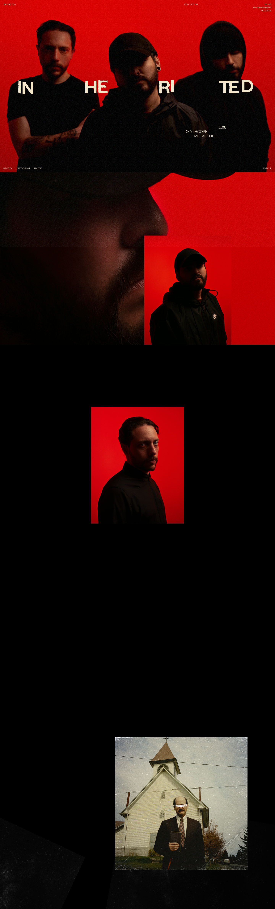

# UI Design System & Master Generation Blueprint: inherited-band

> **INHERITED** (https://inherited.band/) — INHERITED BAND



---

## 1. Executive Visual Persona & Design Archetype

- **Brand Essence & Persona**: **INHERITED** (`https://inherited.band/`). INHERITED BAND
- **Visual Archetype**: **High-Contrast Obsidian / Atmospheric Design System (`#000` canvas, `#FCFFFE` ink, `#d50305` accent)**.
- **Anti-AI-Slop Differentiators**:
  - **Source-Grounded Chromatic Polarity**: Anchors the viewport in `#000` (`#loading { background: #000 }`) paired with `#FCFFFE` primary typography and `#d50305` accents.
  - **Extracted Typographic Hierarchy**: Pairs `Founders Grotesk` for display copy (`I N H E R I T E D`) with `Founders Grotesk` and not declared in static CSS (uses primary stack / `ui-monospace`).
  - **Calibrated Spatial Grid & Motion**: Combines `1024px` container bounds (`gap: 20rem`, padding `15rem`) with `cubic-bezier(.6,.14,0,1)` easing and Lenis Smooth Scroll (`data-lenis`).

---

## 2. Spatial Architecture & Modular Grid Mathematics


### Viewport Allocation & Container Geometry
- **Captured Viewport Dimensions**: Desktop `1440×4747px` (`assets/desktop.png`, full-page scroll capture), Mobile `390×2400px` (`assets/mobile.png`, capped at 2400px multi-section capture).
- **Master Container Bounds**: `1024px` extracted from `inherited-band` stylesheet.
- **Canvas Lateral Padding & Spacing**: `15rem` lateral canvas padding with `20rem` grid gap.
- **Border Radius Scale**: `0px` (sharp unrounded corners).

### Responsive Breakpoint Architecture
- **Desktop Layout**: Multi-column CSS Grid / Flexbox layout at `1440px` (`max-width: 1024px`, `gap: 20rem`).
- **Mobile Layout**: Single-column vertical stack at `390px` viewport width with `15rem` horizontal padding.
- **Extracted CSS Media Queries**: `@media (max-width: 1024px)`.

---

## 3. Color System, Materiality & Atmospheric Lighting

### Semantic Palette & Source Grounding
| Semantic Role | Ground-Truth Value | Extracted CSS Source / Selector |
|---|---|---|
| **Primary Canvas Substrate** | `#000` | `#loading { background: #000 }` |
| **Primary Typography Ink** | `#ff03` | `#grid div { background: #ff03 }` |
| **Elevated Surface / Card Substrate** | `#eee2c5` | `#nav-mobile-bar span { background: #eee2c5 }` |
| **Interactive Accent / Highlight** | `#d50305` | `.header { background: #d50305 }` |
| **Secondary / Muted Copy** | `#FCFFFE` | `<meta name="theme-color" content="#FCFFFE">` in `dom.html` |

### Sanitized Root CSS Variables (`ui-ux.md` Ground Truth)
| Variable Name | Extracted Value | Semantic Role |
|---|---|---|
| `--margin` | `20rem` | Layout / Spatial Grid Token |
| `--gap` | `20rem` | Layout / Spatial Grid Token |
| `--column` | `calc((var(--rvw) * 100 - var(--margin) * 2 - var(--gap) * 5) / 6)` | Layout / Spatial Grid Token |
| `--rvw` | `14.4px` | Layout / Spatial Grid Token |
| `--right-height` | `692px` | Layout / Spatial Grid Token |
| `--inherited-band-bg` | `#000` | Canvas Substrate (from `#loading { background: #000 }`) |
| `--inherited-band-ink` | `#FCFFFE` | Primary Typography Ink (stylesheet-derived) |
| `--inherited-band-surface` | `#eee2c5` | Surface Substrate (stylesheet-derived) |
| `--inherited-band-accent` | `#d50305` | Interactive Accent (stylesheet-derived) |
| `--inherited-band-muted` | `#FCFFFE` | Secondary Ink (stylesheet-derived) |
| `--inherited-band-border` | `#FCFFFE` | Structural Border (stylesheet-derived) |
| `--inherited-band-container` | `1024px` | Container Bound (stylesheet-derived) |
| `--inherited-band-gap` | `20rem` | Grid Gutter (stylesheet-derived) |
| `--inherited-band-pad` | `15rem` | Lateral Padding (stylesheet-derived) |
| `--inherited-band-ease` | `cubic-bezier(.6,.14,0,1)` | Primary Easing Function |
| `--inherited-band-radius` | `0px` | Corner Radius (stylesheet-derived) |

---

## 4. Typographic Scale & Editorial Hierarchy

### Font Family Stacks
- **Display Typography**: `Founders Grotesk`.
- **Primary Body Stack**: `Founders Grotesk`.
- **Technical / Metadata Stack**: not declared in static CSS (uses primary stack / `ui-monospace`).

### Typographic Scale & Rules (Extracted from Stylesheet & Variables)
- **Hero Display (`H1`)**: rule `.h1` (`line-height: .85`, `letter-spacing: -.1em`).
- **Section Heading (`H2`)**: not explicitly declared on tag in static CSS (stylesheet font-size ladder: `15rem`, `115rem`, `80rem`, `25rem`, `12px`).
- **Body Copy**: not explicitly declared on tag in static CSS (stylesheet font-size ladder: `15rem`, `115rem`, `80rem`, `25rem`, `12px`).
- **Metadata & Navigation Labels**: not explicitly declared on tag in static CSS (stylesheet font-size ladder: `15rem`, `115rem`, `80rem`, `25rem`, `12px`).

---

## 5. Choreographed Motion & Interaction Physics

### Primary Easing Curves
- **Extracted Timing Functions**: `cubic-bezier(.6,.14,0,1)`, `cubic-bezier(.35,.42,0,1)`, `cubic-bezier(.19,1,.22,1)`.

### Per-Element Transition & Choreography Rules
- **Selector `#loading`**: `transition: opacity .5s cubic-bezier(.6,.14,0,1)` extracted from `inherited-band` stylesheet.
- **Selector `.rich-text a:after`**: `transition: transform 1s cubic-bezier(.6,.14,0,1)` extracted from `inherited-band` stylesheet.
- **Selector `#nav a:after`**: `transition: transform 1s cubic-bezier(.6,.14,0,1)` extracted from `inherited-band` stylesheet.
- **Extracted Easing Curve (`cubic-bezier(.6,.14,0,1)`)**: Governs interactive state transitions across `<header.header>` and `<section.member>`.
- **Runtime Interaction Engine**: Integrates Lenis Smooth Scroll (`data-lenis`) with `prefers-reduced-motion: reduce` fallback guards.

---

## 6. Component Wireframe & Structural DOM Map

### Visual Layout Schematic (Grounded in `dom.html` — `1440px` Desktop & `390px` Mobile Reflow)
```
┌────────────────────────────────────────────────────────────────────────┐
│ DESKTOP VIEWPORT (1440px) — INHERITED                                  │
│ ====================================================================== │
│ [ <header.header>          | INHERITED · Spotify · Instagram · Tik  ]  │
│ ---------------------------------------------------------------------- │
│ | HERO STAGE: <section.member>                                     |   │
│ | H1: I N H E R I T E D                                            |   │
│ | Substrate: #000       | Ink: #FCFFFE    | Accent: #d50305        |   │
│ ---------------------------------------------------------------------- │
│ | SHOWCASE GRID (<section.member>          ) max-w: 1024px         |   │
│ | +------------------------------+  +------------------------------+ | │
│ | | 2016 Deathcore Metalcore     |  | E d e r A n a y a            | | │
│ | +------------------------------+  +------------------------------+ | │
│ ---------------------------------------------------------------------- │
│ | MOBILE VIEWPORT REFLOW (390px) — Single-Column Stack (gap: 20rem ) | │
│ | [<header.header>] -> [<section.member>] -> [<section.member>] |      │
│ ---------------------------------------------------------------------- │
│ [ FOOTER (<footer.items>        ) | https://inherited.band/            │
└────────────────────────────────────────────────────────────────────────┘
```

### Granular DOM Region Breakdown
1. **Brand Header & Navigation Bar (<header.header> — `inherited-band`)**:
   - Landmark `<header class="header">` hosting `INHERITED` navigation (`INHERITED · Spotify · Instagram · Tik Tok · Contact us`), DOM attributes (`data-touch="false"`, `data-custom-loaded="true"`, `data-title="about"`, `data-title="members"`), and stylesheet rule `body { font-size:15rem;line-height:1.21;font-weight:400 }`.
2. **Hero Stage & Focal Lead (<section.member> — `I N H E R I T E D`)**:
   - Landmark `<section class="member no-transition">` presenting display lead `I N H E R I T E D` and copy excerpt *"m e e t @ i n h e r i t e d . b a n d"* over `#000` canvas and `#FCFFFE` ink.
3. **Primary Showcase & Content Grid (<section.member> — `2016 Deathcore Metalcore`)**:
   - Landmark `<section class="member no-transition">` rendering section `2016 Deathcore Metalcore` with copy *"Metalcore Deathcore"*, asset references (`fav.ico`, `fav.svg`, `fav-mask.svg`, `apple-touch.png`), and grid rule `.h3 { line-height:1;letter-spacing:-.015em;margin:0;text-transform:uppercase;f... }`.
4. **Interactive Detail & Feature Matrix (<section.member> — `E d e r A n a y a`)**:
   - Landmark `<section class="member no-transition">` framing `E d e r A n a y a` and `Guitarist Producer` (*"Guitarist Producer"*) with `#eee2c5` surface cards, `#d50305` accents, and `.h1 { font-size:115rem }`.
5. **Colophon & Global Directory Footer (<footer.items> — `https://inherited.band/`)**:
   - Landmark `<footer class="items">` anchoring `INHERITED` footer links (`INHERITED · Spotify · Instagram · Tik Tok · Contact us`), copy *"( Me, Myself, and Sam )"*, and `#FCFFFE` structural dividers.

---

## 7. Master Zero-Shot AI Generation Prompt

```markdown
# Master Zero-Shot Frontend Generation Prompt: inherited-band (INHERITED)

You are a principal frontend architect and design systems engineer. Build a complete, production-ready web application replicating the exact design system, DOM landmarks, typographic hierarchy, color tokens, and motion physics of `inherited-band` (**INHERITED** — `https://inherited.band/`).

### 1. Visual Archetype & Anti-AI-Slop Mandates
- **Archetype**: High-Contrast Obsidian / Atmospheric Design System (`#000` canvas, `#FCFFFE` ink, `#d50305` accent).
- **Identity & Domain Context**: INHERITED BAND
- **Primary Substrate**: `#000` (`#loading { background: #000 }`), **Primary Ink**: `#FCFFFE`, **Accent / Highlight**: `#d50305`.
- **Site-Specific Differentiators**:
  - **Source-Grounded Chromatic Polarity**: Anchors the viewport in `#000` (`#loading { background: #000 }`) paired with `#FCFFFE` primary typography and `#d50305` accents.
  - **Extracted Typographic Hierarchy**: Pairs `Founders Grotesk` for display copy (`I N H E R I T E D`) with `Founders Grotesk` and not declared in static CSS (uses primary stack / `ui-monospace`).
  - **Calibrated Spatial Grid & Motion**: Combines `1024px` container bounds (`gap: 20rem`, padding `15rem`) with `cubic-bezier(.6,.14,0,1)` easing and Lenis Smooth Scroll (`data-lenis`).

### 2. Ground-Truth CSS Variables (`:root` Token Contract)
Declare and consume these exact custom properties extracted from `inherited-band` in your global stylesheet:

:root {
  /* INHERITED (inherited-band) — Ground-Truth Extracted CSS Variables */
  --margin: 20rem; /* Layout / Spatial Grid Token (inherited-band) */
  --gap: 20rem; /* Layout / Spatial Grid Token (inherited-band) */
  --column: calc((var(--rvw) * 100 - var(--margin) * 2 - var(--gap) * 5) / 6); /* Layout / Spatial Grid Token (inherited-band) */
  --rvw: 14.4px; /* Layout / Spatial Grid Token (inherited-band) */
  --right-height: 692px; /* Layout / Spatial Grid Token (inherited-band) */
  --inherited-band-bg: #000; /* Canvas Substrate (from `#loading { background: #000 }`) (inherited-band) */
  --inherited-band-ink: #FCFFFE; /* Primary Typography Ink (stylesheet-derived) (inherited-band) */
  --inherited-band-surface: #eee2c5; /* Surface Substrate (stylesheet-derived) (inherited-band) */
  --inherited-band-accent: #d50305; /* Interactive Accent (stylesheet-derived) (inherited-band) */
  --inherited-band-muted: #FCFFFE; /* Secondary Ink (stylesheet-derived) (inherited-band) */
  --inherited-band-border: #FCFFFE; /* Structural Border (stylesheet-derived) (inherited-band) */
  --inherited-band-container: 1024px; /* Container Bound (stylesheet-derived) (inherited-band) */
  --inherited-band-gap: 20rem; /* Grid Gutter (stylesheet-derived) (inherited-band) */
  --inherited-band-pad: 15rem; /* Lateral Padding (stylesheet-derived) (inherited-band) */
  --inherited-band-ease: cubic-bezier(.6,.14,0,1); /* Primary Easing Function (inherited-band) */
  --inherited-band-radius: 0px; /* Corner Radius (stylesheet-derived) (inherited-band) */
}

### 3. Semantic Color & Materiality Contract
Map every surface, ink, and border strictly to these source-grounded tokens:
- **Primary Canvas Substrate**: `#000` — grounded in `#loading { background: #000 }`
- **Primary Typography Ink**: `#ff03` — grounded in `#grid div { background: #ff03 }`
- **Elevated Surface / Card Substrate**: `#eee2c5` — grounded in `#nav-mobile-bar span { background: #eee2c5 }`
- **Interactive Accent / Highlight**: `#d50305` — grounded in `.header { background: #d50305 }`
- **Secondary / Muted Copy**: `#FCFFFE` — grounded in `<meta name="theme-color" content="#FCFFFE">` in `dom.html`

### 4. Spatial Grid, Container Bounds & Responsive Breakpoints
- **Desktop Viewport Reference**: `1440×4747px` (full-page scroll capture, `1440px` standard desktop width).
- **Mobile Viewport Reference**: `390×2400px` (capped at 2400px multi-section capture, `390px` standard mobile width).
- **Container Max-Width**: `1024px` extracted from `inherited-band` stylesheet
- **Padding & Gutters**: `15rem` lateral canvas padding with `20rem` grid gap
- **Desktop Grid**: Multi-column CSS Grid / Flexbox layout at `1440px` (`max-width: 1024px`, `gap: 20rem`)
- **Mobile Adaptation**: Single-column vertical stack at `390px` viewport width with `15rem` horizontal padding
- **Media Queries**: `@media (max-width: 1024px)`
- **Corner Radii**: `0px` (sharp unrounded corners)

### 5. Typography & Editorial Scale Contract
- **Display Font Stack**: `Founders Grotesk`
- **Body Font Stack**: `Founders Grotesk`
- **Monospace / Technical Font Stack**: not declared in static CSS (uses primary stack / `ui-monospace`)
- **H1 Display Rule**: rule `.h1` (`line-height: .85`, `letter-spacing: -.1em`)
- **H2 Section Rule**: not explicitly declared on tag in static CSS (stylesheet font-size ladder: `15rem`, `115rem`, `80rem`, `25rem`, `12px`)
- **Body Copy Rule**: not explicitly declared on tag in static CSS (stylesheet font-size ladder: `15rem`, `115rem`, `80rem`, `25rem`, `12px`)
- **Metadata & Index Rule**: not explicitly declared on tag in static CSS (stylesheet font-size ladder: `15rem`, `115rem`, `80rem`, `25rem`, `12px`)

### 6. Component Hierarchy, Verbatim Copy & Real DOM Landmarks
Scaffold `inherited-band` (`INHERITED`) with these exact structural regions, extracted copy, and CSS rules from `dom.html`:
1. **Brand Header & Navigation Bar (<header.header> — `inherited-band`)**:
   - DOM & Selectors: Landmark `<header class="header">` hosting `INHERITED` navigation (`INHERITED · Spotify · Instagram · Tik Tok · Contact us`), DOM attributes (`data-touch="false"`, `data-custom-loaded="true"`, `data-title="about"`, `data-title="members"`), and stylesheet rule `body { font-size:15rem;line-height:1.21;font-weight:400 }`.
   - Responsive Contract: Header `Brand Header & Navigation Bar (<header.header> — `inherited-band`)` (`inherited-band`) adapts across `@media (max-width: 1024px)` with `cubic-bezier(.6,.14,0,1)`, `cubic-bezier(.35,.42,0,1)`, `cubic-bezier(.19,1,.22,1)` transitions and links `INHERITED · Spotify · Instagram · Tik Tok · Contact us`.
2. **Hero Stage & Focal Lead (<section.member> — `I N H E R I T E D`)**:
   - DOM & Selectors: Landmark `<section class="member no-transition">` presenting display lead `I N H E R I T E D` and copy excerpt *"m e e t @ i n h e r i t e d . b a n d"* over `#000` canvas and `#FCFFFE` ink.
   - Responsive Contract: Hero stage (`1440×4747px` desktop / `390×2400px` mobile) sets `#000` background with `#FCFFFE` headline `I N H E R I T E D`.
3. **Primary Showcase & Content Grid (<section.member> — `2016 Deathcore Metalcore`)**:
   - DOM & Selectors: Landmark `<section class="member no-transition">` rendering section `2016 Deathcore Metalcore` with copy *"Metalcore Deathcore"*, asset references (`fav.ico`, `fav.svg`, `fav-mask.svg`, `apple-touch.png`), and grid rule `.h3 { line-height:1;letter-spacing:-.015em;margin:0;text-transform:uppercase;f... }`.
   - Responsive Contract: Showcase grid `Primary Showcase & Content Grid (<section.member> — `2016 Deathcore Metalcore`)` applies Multi-column CSS Grid / Flexbox layout at `1440px` (`max-width: 1024px`, `gap: 20rem`) on desktop and Single-column vertical stack at `390px` viewport width with `15rem` horizontal padding on mobile.
4. **Interactive Detail & Feature Matrix (<section.member> — `E d e r A n a y a`)**:
   - DOM & Selectors: Landmark `<section class="member no-transition">` framing `E d e r A n a y a` and `Guitarist Producer` (*"Guitarist Producer"*) with `#eee2c5` surface cards, `#d50305` accents, and `.h1 { font-size:115rem }`.
   - Responsive Contract: Detail module `Interactive Detail & Feature Matrix (<section.member> — `E d e r A n a y a`)` uses `0px` (sharp unrounded corners) radii, `#d50305` highlights, and assets (fav.ico, fav.svg, fav-mask.svg).
5. **Colophon & Global Directory Footer (<footer.items> — `https://inherited.band/`)**:
   - DOM & Selectors: Landmark `<footer class="items">` anchoring `INHERITED` footer links (`INHERITED · Spotify · Instagram · Tik Tok · Contact us`), copy *"( Me, Myself, and Sam )"*, and `#FCFFFE` structural dividers.
   - Responsive Contract: Footer `Colophon & Global Directory Footer (<footer.items> — `https://inherited.band/`)` aligns to `1024px` extracted from `inherited-band` stylesheet with `15rem` lateral canvas padding with `20rem` grid gap and attributes (data-touch="false", data-custom-loaded="true", data-title="about").

#### Verbatim DOM Copy Excerpts (`dom.html`)
- Copy Excerpt 1: *"m e e t @ i n h e r i t e d . b a n d"*
- Copy Excerpt 2: *"Metalcore Deathcore"*
- Copy Excerpt 3: *"Guitarist Producer"*
- Copy Excerpt 4: *"( Me, Myself, and Sam )"*

### 7. Motion, Extracted Stylesheet Rules & Interaction Choreography
- **Primary Easing Functions**: `cubic-bezier(.6,.14,0,1)`, `cubic-bezier(.35,.42,0,1)`, `cubic-bezier(.19,1,.22,1)`
- **Extracted Stylesheet Rules (`inherited-band`)**:
- `body { font-size:15rem;line-height:1.21;font-weight:400 }`
- `.h3 { line-height:1;letter-spacing:-.015em;margin:0;text-transform:uppercase;f... }`
- `.h1 { font-size:115rem }`
- `.h2 { font-size:80rem }`
- `root { --margin: 20rem;--gap: 20rem;--column: calc((var(--rvw) * 100 - var(--ma... }`
- **Per-Selector Transition Rules**:
- **Selector `#loading`**: `transition: opacity .5s cubic-bezier(.6,.14,0,1)` extracted from `inherited-band` stylesheet.
- **Selector `.rich-text a:after`**: `transition: transform 1s cubic-bezier(.6,.14,0,1)` extracted from `inherited-band` stylesheet.
- **Selector `#nav a:after`**: `transition: transform 1s cubic-bezier(.6,.14,0,1)` extracted from `inherited-band` stylesheet.
- **Extracted Easing Curve (`cubic-bezier(.6,.14,0,1)`)**: Governs interactive state transitions across `<header.header>` and `<section.member>`.
- **Runtime Interaction Engine**: Integrates Lenis Smooth Scroll (`data-lenis`) with `prefers-reduced-motion: reduce` fallback guards.

### 8. Technical Deliverables
- Implement in Next.js (App Router) with TypeScript and Tailwind CSS consuming the `:root` custom properties defined above for `inherited-band`.
- Reproduce both the `1440px` desktop architecture and `390px` mobile breakpoint transitions, preserving semantic HTML5 landmarks (`<header>`, `<nav>`, `<main>`, `<section>`, `<footer>`) and `prefers-reduced-motion` accessibility guards.
```
