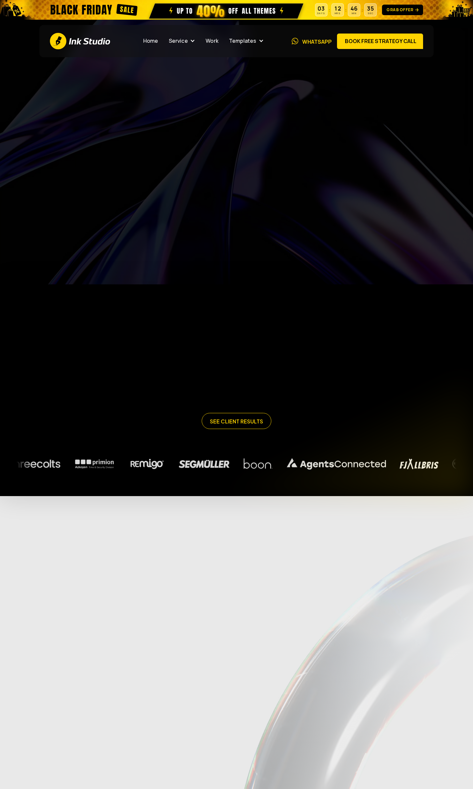

# UI Design System & Master Generation Blueprint: inks-studio

> **Ink Studio - UI UX Design, CRO & Webflow Development Agency** (http://inks.studio/) — Ink Studio is a UI/UX design and CRO agency. We build high-converting Webflow sites, mobile & web apps, and design systems for SaaS and s...



---

## 1. Executive Visual Persona & Design Archetype

- **Brand Essence & Persona**: **Ink Studio - UI UX Design, CRO & Webflow Development Agency** (`http://inks.studio/`). Ink Studio is a UI/UX design and CRO agency. We build high-converting Webflow sites, mobile & web apps, and design systems for SaaS and s...
- **Final Redirected URL**: [https://www.inks.studio/](https://www.inks.studio/)
- **Capture Provenance**: Live browser capture (`tier1_fast`, HTTP `200`, captured `2026-11-23`).
- **Visual Archetype**: **Light-Substrate Editorial & Modular Grid System (`#ffffff` canvas, `#000000` ink, `#ffd401` accent)**.
- **Anti-AI-Slop Differentiators**:
  - **Live-Computed Chromatic Polarity**: Anchors the viewport in `#ffffff` (live computed `body` `background-color` (`computed_styles.json`)) paired with `#000000` primary typography and `#ffd401` accents.
  - **Grounded Typographic Hierarchy**: Pairs `Plus Jakarta Sans` for display copy (`Level up your SaaS.Turn sign-ups int`) with `Manrope` and not declared in live computed styles (uses primary stack / `ui-monospace`).
  - **Calibrated Spatial Grid & Motion**: Combines `1440px` container bounds (`gap: 0px (flush layout)`, padding `40px`) with `cubic-bezier(0.25,0.1,0.25,1)` easing and GSAP Timeline & ScrollTrigger, Three.js / WebGL Canvas Pipeline.

---

## 2. Spatial Architecture & Modular Grid Mathematics


### Viewport Allocation & Container Geometry
- **Captured Viewport Dimensions**: Desktop `1440×2400px` (`assets/desktop.png`, clamped at 2400px live multi-section capture), Mobile `390×2400px` (`assets/mobile.png`, clamped at 2400px live multi-section capture).
- **Master Container Bounds**: `1440px` (full-bleed `100%` desktop stage measured on `1440px` viewport).
- **Canvas Lateral Padding & Spacing**: `40px` lateral canvas padding with `0px (flush layout)` grid gap.
- **Border Radius Scale**: `6px`.

### Responsive Breakpoint Architecture
- **Desktop Layout**: Multi-column CSS Grid / Flexbox layout at `1440px` (`max-width: 1440px`, `gap: 0px (flush layout)`).
- **Mobile Layout**: Single-column vertical stack at `390px` viewport width with `40px` horizontal padding.
- **Extracted CSS Media Queries**: `@media (min-width:640px)`.

---

## 3. Color System, Materiality & Atmospheric Lighting

### Semantic Palette & Source Grounding
| Semantic Role | Ground-Truth Value | Extracted Live / CSS Source |
|---|---|---|
| **Primary Canvas Substrate** | `#ffffff` | live computed `body` `background-color` (`computed_styles.json`) |
| **Primary Typography Ink** | `#000000` | live computed `h1` `color` (`computed_styles.json`) |
| **Elevated Surface / Card Substrate** | `#ffd401` | live computed `footer` `background-color` (`computed_styles.json`) |
| **Interactive Accent / Highlight** | `#ffd401` | live computed `button` `color` (`computed_styles.json`) |
| **Secondary / Muted Copy** | `#4141f2` | live computed `a` `color` (`computed_styles.json`) |
| **Structural Hairline Border** | `#e8e8e8` | `var(--divider)` in `:root` |
| **Variable Token (`--gray`)** | `#959ba6` | `var(--gray)` in `:root` |
| **Variable Token (`--white-light`)** | `#afafaf` | `var(--white-light)` in `:root` |
| **Variable Token (`--white-tiny`)** | `#f2f9fe` | `var(--white-tiny)` in `:root` |
| **Variable Token (`--dark-light`)** | `#3f3f3f` | `var(--dark-light)` in `:root` |
| **Variable Token (`--gray-bg`)** | `#e9e9e9` | `var(--gray-bg)` in `:root` |
| **Variable Token (`--bg-color`)** | `#0f1115` | `var(--bg-color)` in `:root` |
| **Variable Token (`--bg-blue`)** | `#d5ecf8` | `var(--bg-blue)` in `:root` |
| **Variable Token (`--purple`)** | `#27104e` | `var(--purple)` in `:root` |
| **Variable Token (`--green`)** | `#104e3b` | `var(--green)` in `:root` |
| **Variable Token (`--color`)** | `#ffefed` | `var(--color)` in `:root` |

### Sanitized Root CSS Variables (`ui-ux.md` Ground Truth)
| Variable Name | Extracted Value | Semantic Role |
|---|---|---|
| `--black` | `#000` | Canvas / Surface Token |
| `--background` | `whitesmoke` | Canvas / Surface Token |
| `--blue` | `#4141f2` | Color / Atmospheric Token |
| `--primary` | `#ffd401` | Brand / Palette Token |
| `--gray` | `#959ba6` | Color / Atmospheric Token |
| `--white-light` | `#afafaf` | Canvas / Surface Token |
| `--white-tiny` | `#f2f9fe` | Canvas / Surface Token |
| `--dark-light` | `#3f3f3f` | Canvas / Surface Token |
| `--gray-bg` | `#e9e9e9` | Canvas / Surface Token |
| `--white` | `white` | Canvas / Surface Token |
| `--bg-color` | `#0f1115` | Canvas / Surface Token |
| `--divider` | `#e8e8e8` | Color / Atmospheric Token |
| `--bg-blue` | `#d5ecf8` | Canvas / Surface Token |
| `--purple` | `#27104e` | Color / Atmospheric Token |
| `--green` | `#104e3b` | Color / Atmospheric Token |
| `--color` | `#ffefed` | Brand / Palette Token |

---

## 4. Typographic Scale & Editorial Hierarchy

### Font Family Stacks
- **Display Typography**: `Plus Jakarta Sans`.
- **Primary Body Stack**: `Manrope`.
- **Technical / Metadata Stack**: not declared in live computed styles (uses primary stack / `ui-monospace`).

### Typographic Scale & Rules (Live Computed & Stylesheet Grounded)
- **Hero Display (`H1`)**: live computed `h1` (`font-size: 44.8px`, `line-height: 53.76px`, `font-weight: 500`, `letter-spacing: -1.2px`).
- **Section Heading (`H2`)**: live computed `h2` (`font-size: 48px`, `line-height: 57.6px`, `font-weight: 500`).
- **Body Copy**: live computed `body` (`font-size: 16px`, `line-height: 20px`, `font-weight: 400`).
- **Metadata & Navigation Labels**: live computed `nav/a` (`font-size: 16px`, `line-height: 20px`, `font-weight: 400`).

---

## 5. Choreographed Motion & Interaction Physics

### Primary Easing Curves
- **Extracted Timing Functions**: `cubic-bezier(0.25,0.1,0.25,1)`.

### Per-Element Transition & Choreography Rules
- **Selector `style]`**: `transition: all` extracted from `inks-studio` stylesheet.
- **Selector `style]`**: `transition: all` extracted from `inks-studio` stylesheet.
- **Selector `style]`**: `transition: all` extracted from `inks-studio` stylesheet.
- **Standard CSS Easing (`cubic-bezier(0.25,0.1,0.25,1)`)**: Default timing curve (no custom `cubic-bezier()` declared in captured CSS).
- **Runtime Interaction Engine**: Integrates GSAP Timeline & ScrollTrigger, Three.js / WebGL Canvas Pipeline, Framer Motion Layout Physics with `prefers-reduced-motion: reduce` fallback guards.

---

## 6. Component Wireframe & Structural DOM Map

### Visual Layout Schematic — Desktop (`1440px`, Grounded in `dom.html` & Landmark Bounding Boxes)
```
┌────────────────────────────────────────────────────────────────────────┐
│ DESKTOP VIEWPORT (1440px) — Ink Studio - UI UX Design, CRO & Webflow D │
│ ====================================================================== │
│ [ <header.section-hero> (1440x805px)  | Home · Work · Webflow · Fram ] │
│ ---------------------------------------------------------------------- │
│ | HERO STAGE: <section.section-featured-item> (w=1440px)             | │
│ | H1: Level up your SaaS.Turn sign-ups into paying users.            | │
│ | Substrate: #ffffff | Ink: #000000 | Accent: #ffd401                | │
│ ---------------------------------------------------------------------- │
│ | SHOWCASE GRID (<section.section-service>) max-w: 1440px            | │
│ | +------------------------------+  +------------------------------+ | │
│ | | Building Impact              |  | Trusted by founders. Built f | | │
│ | +------------------------------+  +------------------------------+ | │
│ ---------------------------------------------------------------------- │
│ | DETAIL MODULE (<section.section-trust>) — Before & After: How W    | │
│ ---------------------------------------------------------------------- │
│ [ FOOTER (<footer.footer>     ) | http://inks.studio/                  │
└────────────────────────────────────────────────────────────────────────┘
```

### Visual Layout Schematic — Mobile Reflow (`390px`)
```
┌────────────────────────────────────────────────────────────────────────┐
│ MOBILE VIEWPORT REFLOW (390px) — Single-Column Stack (gap: 0px (flu)   │
│ ====================================================================== │
│ [ HEADER BAR (<header.section-hero>   ) | Compact Menu (390px)         │
│ ---------------------------------------------------------------------- │
│ | HERO STAGE (<section.section-feature) — 390px Vertical Lead        | │
│ | H1: Level up your SaaS.Turn sign-ups into paying users.            | │
│ ---------------------------------------------------------------------- │
│ | SHOWCASE STACK (<section.section-servi) — 1-Col Stack              | │
│ | [ Item 1: Building Impact                                        ] | │
│ | [ Item 2: Trusted by founders. Built for measurable growth.      ] | │
│ ---------------------------------------------------------------------- │
│ | DETAIL STACK (<section.section-trust>) — 1-Col (Before & After: Ho)  │
│ ---------------------------------------------------------------------- │
│ [ FOOTER (<footer.footer>     ) | Stacked 390px Colophon               │
└────────────────────────────────────────────────────────────────────────┘
```

### Granular DOM Region Breakdown
1. **Brand Header & Navigation Bar (<header.section-hero> — `inks-studio`)**:
   - Landmark `<header class="section-hero">` (`1440x805px`) hosting `Ink Studio - UI UX Design, CRO & Web` navigation (`Home · Work · Webflow · Framer · Astro`), DOM attributes (`data-wf-domain="www.inks.studio"`, `data-wf-page="67375bd348251862372613c7"`, `data-wf-site="67375bd348251862372613c8"`, `data-gtag-id="AW-18125669814"`), and stylesheet rule `.scheduler-wrapper { --gridDefaultSize:1.75rem;--hoursInDay:24;--minuteInHour:60;--gridMobile... }`.
2. **Hero Stage & Focal Lead (<section.section-featured-item> — `Level up your SaaS.Turn sign-ups i`)**:
   - Landmark `<section class="section-featured-item">` presenting display lead `Level up your SaaS.Turn sign-ups into paying users.` and copy excerpt *"120+ Satisfied Clients"* over `#ffffff` canvas and `#000000` ink.
3. **Primary Showcase & Content Grid (<section.section-service> — `Building Impact`)**:
   - Landmark `<section class="section-service">` rendering section `Building Impact` with copy *"We find where your product leaks revenue, redesign the flows that"*, asset references (`cdn.prod.website-files.com`, `inks-studio.webflow.shared.1e5091...`, `inks-studio.webflow.67375bd348251...`, `fonts.googleapis.com`), and grid rule `.scheduler-grid-row-template { grid-template-rows:var(--gridMobileSize) repeat(attr(data-gridstoperperd... }`.
4. **Interactive Detail & Feature Matrix (<section.section-trust> — `Trusted by founders. Built for mea`)**:
   - Landmark `<section class="section-trust">` framing `Trusted by founders. Built for measurable growth.` and `Before & After: How We Transformed These Products` (*"Trusted by 100+ founders"*) with `#ffd401` surface cards, `#ffd401` accents, and `focus { outline:none; }`.
5. **Colophon & Global Directory Footer (<footer.footer> — `http://inks.studio/`)**:
   - Landmark `<footer class="footer">` anchoring `Ink Studio - UI UX Design, CRO &` footer links (`Home · Work · Webflow · Framer · Astro`), copy *"45+ products redesigned"*, and `#e8e8e8` structural dividers.

---

## 7. Master Zero-Shot AI Generation Prompt

```markdown
# Master Zero-Shot Frontend Generation Prompt: inks-studio (Ink Studio - UI UX Design, CRO & Webflow Development Agency)

You are a principal frontend architect and design systems engineer. Build a complete, production-ready web application replicating the exact design system, DOM landmarks, typographic hierarchy, color tokens, and motion physics of `inks-studio` (**Ink Studio - UI UX Design, CRO & Webflow Development Agency** — `http://inks.studio/`).

### 1. Visual Archetype & Anti-AI-Slop Mandates
- **Archetype**: Light-Substrate Editorial & Modular Grid System (`#ffffff` canvas, `#000000` ink, `#ffd401` accent).
- **Identity & Domain Context**: Ink Studio is a UI/UX design and CRO agency. We build high-converting Webflow sites, mobile & web apps, and design systems for SaaS and s...
- **Primary Substrate**: `#ffffff` (live computed `body` `background-color` (`computed_styles.json`)), **Primary Ink**: `#000000`, **Accent / Highlight**: `#ffd401`.
- **Site-Specific Differentiators**:
  - **Live-Computed Chromatic Polarity**: Anchors the viewport in `#ffffff` (live computed `body` `background-color` (`computed_styles.json`)) paired with `#000000` primary typography and `#ffd401` accents.
  - **Grounded Typographic Hierarchy**: Pairs `Plus Jakarta Sans` for display copy (`Level up your SaaS.Turn sign-ups int`) with `Manrope` and not declared in live computed styles (uses primary stack / `ui-monospace`).
  - **Calibrated Spatial Grid & Motion**: Combines `1440px` container bounds (`gap: 0px (flush layout)`, padding `40px`) with `cubic-bezier(0.25,0.1,0.25,1)` easing and GSAP Timeline & ScrollTrigger, Three.js / WebGL Canvas Pipeline.

### 2. Ground-Truth CSS Variables (`:root` Token Contract)
Declare and consume these exact custom properties extracted from `inks-studio` in your global stylesheet:

:root {
  /* Ink Studio - UI UX Design, CRO & Webflow Development Agency (inks-studio) — Live-Grounded CSS Variables */
  --black: #000; /* Canvas / Surface Token (inks-studio) */
  --background: whitesmoke; /* Canvas / Surface Token (inks-studio) */
  --blue: #4141f2; /* Color / Atmospheric Token (inks-studio) */
  --primary: #ffd401; /* Brand / Palette Token (inks-studio) */
  --gray: #959ba6; /* Color / Atmospheric Token (inks-studio) */
  --white-light: #afafaf; /* Canvas / Surface Token (inks-studio) */
  --white-tiny: #f2f9fe; /* Canvas / Surface Token (inks-studio) */
  --dark-light: #3f3f3f; /* Canvas / Surface Token (inks-studio) */
  --gray-bg: #e9e9e9; /* Canvas / Surface Token (inks-studio) */
  --white: white; /* Canvas / Surface Token (inks-studio) */
  --bg-color: #0f1115; /* Canvas / Surface Token (inks-studio) */
  --divider: #e8e8e8; /* Color / Atmospheric Token (inks-studio) */
  --bg-blue: #d5ecf8; /* Canvas / Surface Token (inks-studio) */
  --purple: #27104e; /* Color / Atmospheric Token (inks-studio) */
  --green: #104e3b; /* Color / Atmospheric Token (inks-studio) */
  --color: #ffefed; /* Brand / Palette Token (inks-studio) */
}

### 3. Semantic Color & Materiality Contract
Map every surface, ink, and border strictly to these source-grounded tokens:
- **Primary Canvas Substrate**: `#ffffff` — grounded in live computed `body` `background-color` (`computed_styles.json`)
- **Primary Typography Ink**: `#000000` — grounded in live computed `h1` `color` (`computed_styles.json`)
- **Elevated Surface / Card Substrate**: `#ffd401` — grounded in live computed `footer` `background-color` (`computed_styles.json`)
- **Interactive Accent / Highlight**: `#ffd401` — grounded in live computed `button` `color` (`computed_styles.json`)
- **Secondary / Muted Copy**: `#4141f2` — grounded in live computed `a` `color` (`computed_styles.json`)
- **Structural Hairline Border**: `#e8e8e8` — grounded in `var(--divider)` in `:root`
- **Variable Token (`--gray`)**: `#959ba6` — grounded in `var(--gray)` in `:root`
- **Variable Token (`--white-light`)**: `#afafaf` — grounded in `var(--white-light)` in `:root`
- **Variable Token (`--white-tiny`)**: `#f2f9fe` — grounded in `var(--white-tiny)` in `:root`
- **Variable Token (`--dark-light`)**: `#3f3f3f` — grounded in `var(--dark-light)` in `:root`
- **Variable Token (`--gray-bg`)**: `#e9e9e9` — grounded in `var(--gray-bg)` in `:root`
- **Variable Token (`--bg-color`)**: `#0f1115` — grounded in `var(--bg-color)` in `:root`
- **Variable Token (`--bg-blue`)**: `#d5ecf8` — grounded in `var(--bg-blue)` in `:root`
- **Variable Token (`--purple`)**: `#27104e` — grounded in `var(--purple)` in `:root`
- **Variable Token (`--green`)**: `#104e3b` — grounded in `var(--green)` in `:root`
- **Variable Token (`--color`)**: `#ffefed` — grounded in `var(--color)` in `:root`

### 4. Spatial Grid, Container Bounds & Responsive Breakpoints
- **Desktop Viewport Reference**: `1440×2400px` (clamped at 2400px live multi-section capture, `1440px` standard desktop width).
- **Mobile Viewport Reference**: `390×2400px` (clamped at 2400px live multi-section capture, `390px` standard mobile width).
- **Container Max-Width**: `1440px` (full-bleed `100%` desktop stage measured on `1440px` viewport)
- **Padding & Gutters**: `40px` lateral canvas padding with `0px (flush layout)` grid gap
- **Desktop Grid**: Multi-column CSS Grid / Flexbox layout at `1440px` (`max-width: 1440px`, `gap: 0px (flush layout)`)
- **Mobile Adaptation**: Single-column vertical stack at `390px` viewport width with `40px` horizontal padding
- **Media Queries**: `@media (min-width:640px)`
- **Corner Radii**: `6px`

### 5. Typography & Editorial Scale Contract
- **Display Font Stack**: `Plus Jakarta Sans`
- **Body Font Stack**: `Manrope`
- **Monospace / Technical Font Stack**: not declared in live computed styles (uses primary stack / `ui-monospace`)
- **H1 Display Rule**: live computed `h1` (`font-size: 44.8px`, `line-height: 53.76px`, `font-weight: 500`, `letter-spacing: -1.2px`)
- **H2 Section Rule**: live computed `h2` (`font-size: 48px`, `line-height: 57.6px`, `font-weight: 500`)
- **Body Copy Rule**: live computed `body` (`font-size: 16px`, `line-height: 20px`, `font-weight: 400`)
- **Metadata & Index Rule**: live computed `nav/a` (`font-size: 16px`, `line-height: 20px`, `font-weight: 400`)

### 6. Component Hierarchy, Verbatim Copy & Real DOM Landmarks
Scaffold `inks-studio` (`Ink Studio - UI UX Design, CRO & Webflow Development Agency`) with these exact structural regions, extracted copy, and CSS rules from `dom.html`:
1. **Brand Header & Navigation Bar (<header.section-hero> — `inks-studio`)**:
   - DOM & Selectors: Landmark `<header class="section-hero">` (`1440x805px`) hosting `Ink Studio - UI UX Design, CRO & Web` navigation (`Home · Work · Webflow · Framer · Astro`), DOM attributes (`data-wf-domain="www.inks.studio"`, `data-wf-page="67375bd348251862372613c7"`, `data-wf-site="67375bd348251862372613c8"`, `data-gtag-id="AW-18125669814"`), and stylesheet rule `.scheduler-wrapper { --gridDefaultSize:1.75rem;--hoursInDay:24;--minuteInHour:60;--gridMobile... }`.
   - Responsive Contract: Header `Brand Header & Navigation Bar (<header.section-hero> — `inks-studio`)` (`inks-studio`) adapts across `@media (min-width:640px)` with `cubic-bezier(0.25,0.1,0.25,1)` transitions and links `Home · Work · Webflow · Framer · Astro`.
2. **Hero Stage & Focal Lead (<section.section-featured-item> — `Level up your SaaS.Turn sign-ups i`)**:
   - DOM & Selectors: Landmark `<section class="section-featured-item">` presenting display lead `Level up your SaaS.Turn sign-ups into paying users.` and copy excerpt *"120+ Satisfied Clients"* over `#ffffff` canvas and `#000000` ink.
   - Responsive Contract: Hero stage (`1440×2400px` desktop / `390×2400px` mobile) sets `#ffffff` background with `#000000` headline `Level up your SaaS.Turn sign-ups into paying users.`.
3. **Primary Showcase & Content Grid (<section.section-service> — `Building Impact`)**:
   - DOM & Selectors: Landmark `<section class="section-service">` rendering section `Building Impact` with copy *"We find where your product leaks revenue, redesign the flows that"*, asset references (`cdn.prod.website-files.com`, `inks-studio.webflow.shared.1e5091...`, `inks-studio.webflow.67375bd348251...`, `fonts.googleapis.com`), and grid rule `.scheduler-grid-row-template { grid-template-rows:var(--gridMobileSize) repeat(attr(data-gridstoperperd... }`.
   - Responsive Contract: Showcase grid `Primary Showcase & Content Grid (<section.section-service> — `Building Impact`)` applies Multi-column CSS Grid / Flexbox layout at `1440px` (`max-width: 1440px`, `gap: 0px (flush layout)`) on desktop and Single-column vertical stack at `390px` viewport width with `40px` horizontal padding on mobile.
4. **Interactive Detail & Feature Matrix (<section.section-trust> — `Trusted by founders. Built for mea`)**:
   - DOM & Selectors: Landmark `<section class="section-trust">` framing `Trusted by founders. Built for measurable growth.` and `Before & After: How We Transformed These Products` (*"Trusted by 100+ founders"*) with `#ffd401` surface cards, `#ffd401` accents, and `focus { outline:none; }`.
   - Responsive Contract: Detail module `Interactive Detail & Feature Matrix (<section.section-trust> — `Trusted by founders. Built for mea`)` uses `6px` radii, `#ffd401` highlights, and assets (cdn.prod.website-files.com, inks-studio.webflow.shared.1e5091..., inks-studio.webflow.67375bd348251...).
5. **Colophon & Global Directory Footer (<footer.footer> — `http://inks.studio/`)**:
   - DOM & Selectors: Landmark `<footer class="footer">` anchoring `Ink Studio - UI UX Design, CRO &` footer links (`Home · Work · Webflow · Framer · Astro`), copy *"45+ products redesigned"*, and `#e8e8e8` structural dividers.
   - Responsive Contract: Footer `Colophon & Global Directory Footer (<footer.footer> — `http://inks.studio/`)` aligns to `1440px` (full-bleed `100%` desktop stage measured on `1440px` viewport) with `40px` lateral canvas padding with `0px (flush layout)` grid gap and attributes (data-wf-domain="www.inks.studio", data-wf-page="67375bd348251862372613c7", data-wf-site="67375bd348251862372613c8").

#### Verbatim DOM Copy Excerpts (`dom.html`)
- Copy Excerpt 1: *"120+ Satisfied Clients"*
- Copy Excerpt 2: *"We find where your product leaks revenue, redesign the flows that matter, and ship..."*
- Copy Excerpt 3: *"Trusted by 100+ founders"*
- Copy Excerpt 4: *"45+ products redesigned"*

### 7. Motion, Extracted Stylesheet Rules & Interaction Choreography
- **Primary Easing Functions**: `cubic-bezier(0.25,0.1,0.25,1)`
- **Extracted Stylesheet Rules (`inks-studio`)**:
- `.scheduler-wrapper { --gridDefaultSize:1.75rem;--hoursInDay:24;--minuteInHour:60;--gridMobile... }`
- `.scheduler-grid-row-template { grid-template-rows:var(--gridMobileSize) repeat(attr(data-gridstoperperd... }`
- `focus { outline:none; }`
- `.cal-embed { border:0;width:100%;min-height:300px;margin:0 auto;color-scheme:unset!im... }`
- `.testimonial-video { width: 100%; height: 100%; position: relative; }`
- **Per-Selector Transition Rules**:
- **Selector `style]`**: `transition: all` extracted from `inks-studio` stylesheet.
- **Selector `style]`**: `transition: all` extracted from `inks-studio` stylesheet.
- **Selector `style]`**: `transition: all` extracted from `inks-studio` stylesheet.
- **Standard CSS Easing (`cubic-bezier(0.25,0.1,0.25,1)`)**: Default timing curve (no custom `cubic-bezier()` declared in captured CSS).
- **Runtime Interaction Engine**: Integrates GSAP Timeline & ScrollTrigger, Three.js / WebGL Canvas Pipeline, Framer Motion Layout Physics with `prefers-reduced-motion: reduce` fallback guards.

### 8. Technical Deliverables
- Implement in Next.js (App Router) with TypeScript and Tailwind CSS consuming the `:root` custom properties defined above for `inks-studio`.
- Reproduce both the `1440px` desktop architecture and `390px` mobile breakpoint transitions, preserving semantic HTML5 landmarks (`<header>`, `<nav>`, `<main>`, `<section>`, `<footer>`) and `prefers-reduced-motion` accessibility guards.
```
