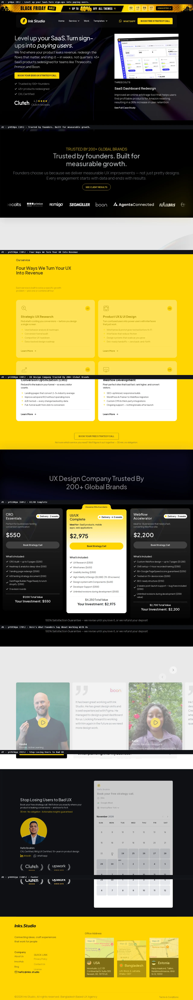
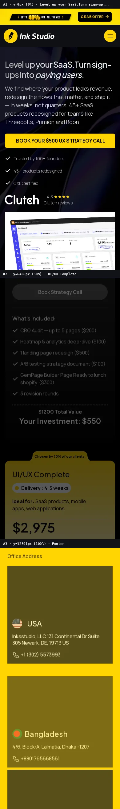

# UI Design System & Master Generation Blueprint: inks-studio

> **Ink Studio - UI UX Design, CRO & Webflow Development Agency** (http://inks.studio/) — Ink Studio is a UI/UX design and CRO agency. We build high-converting Webflow sites, mobile & web apps, and design systems for SaaS and s...





---

## 1. Executive Visual Persona & Design Archetype

- **Brand Essence & Persona**: **Ink Studio - UI UX Design, CRO & Webflow Development Agency** (`http://inks.studio/`). Ink Studio is a UI/UX design and CRO agency. We build high-converting Webflow sites, mobile & web apps, and design systems for SaaS and s...
- **Final Redirected URL**: [https://www.inks.studio/](https://www.inks.studio/)
- **Capture Provenance**: Live browser capture (`tier1_fast`, HTTP `200`, captured `2026-11-24`).
- **Visual Archetype**: **Light-Substrate Editorial & Modular Grid System (`#ffffff` canvas, `#000000` ink, `#0000ff` accent)**.
- **Anti-AI-Slop Differentiators**:
  - **Live-Computed Chromatic Polarity**: Anchors the viewport in `#ffffff` (live computed `body` `background-color` (`computed_styles.json`)) paired with `#000000` primary typography and `#0000ff` accents.
  - **Grounded Typographic Hierarchy**: Pairs `Plus Jakarta Sans` for display copy (`Level up your SaaS.Turn sign-ups int`) with `Manrope`.
  - **Calibrated Spatial Grid & Motion**: Combines `1784px` container bounds (`gap: 16px`, padding `40px`) with `cubic-bezier(.4,0,1,1)` easing and GSAP Timeline & ScrollTrigger, Three.js / WebGL Canvas Pipeline.

---

## 2. Spatial Architecture & Modular Grid Mathematics

### Viewport Allocation & Container Geometry
- **Captured Journey Filmstrips**: Desktop `1280×6624px` (`assets/desktop-journey.webp`, `8` keyframes up to `y=8442px` / doc `9346px`), Mobile `390×2616px` (`assets/mobile-journey.webp`, `3` keyframes).
- **Master Container Bounds**: `1784px` (non-`@media` desktop container stylesheet rule).
- **Canvas Lateral Padding & Spacing**: `40px` lateral canvas padding with `16px` grid gap.
- **Border Radius Scale**: `6px`, `3px`, `100%`, `50%`.

### Responsive Breakpoint Architecture
- **Desktop Layout**: Multi-column CSS Grid / Flexbox layout at `1440px` (`max-width: 1784px`, `gap: 16px`).
- **Mobile Layout**: Single-column vertical stack at `390px` viewport width with `40px` horizontal padding.
- **Extracted CSS Media Queries**: `@media screen and (max-width:991px)`, `@media screen and (max-width:767px)`, `@media screen and (max-width:479px)`, `@media (min-width:768px)`.

---

## 3. Color System, Materiality & Atmospheric Lighting

### Semantic Palette & Source Grounding
| Semantic Role | Ground-Truth Value | Extracted Live / CSS Source |
|---|---|---|
| **Primary Canvas Substrate** | `#ffffff` | live computed `body` `background-color` (`computed_styles.json`) |
| **Primary Typography Ink** | `#000000` | live computed `h1` `color` (`computed_styles.json`) |
| **Elevated Surface / Card Substrate** | `#ffd401` | live computed `footer` `background-color` (`computed_styles.json`) |
| **Interactive Accent / Highlight** | `#0000ff` | `:text-blue-600 a:hover { color: blue }` (`#0000ff`) |
| **Secondary / Muted Copy** | `#6b7280` | `var(--cal-text-subtle)` in `:root` |
| **Structural Hairline Border** | `#e8e8e8` | `var(--divider)` in `:root` |
| **Variable Token (`--blue`)** | `#4141f2` | `var(--blue)` in `:root` |
| **Variable Token (`--gray`)** | `#959ba6` | `var(--gray)` in `:root` |
| **Variable Token (`--white-light`)** | `#afafaf` | `var(--white-light)` in `:root` |
| **Variable Token (`--white-tiny`)** | `#f2f9fe` | `var(--white-tiny)` in `:root` |
| **Variable Token (`--dark-light`)** | `#3f3f3f` | `var(--dark-light)` in `:root` |
| **Variable Token (`--gray-bg`)** | `#e9e9e9` | `var(--gray-bg)` in `:root` |
| **Variable Token (`--bg-color`)** | `#0f1115` | `var(--bg-color)` in `:root` |
| **Variable Token (`--bg-blue`)** | `#d5ecf8` | `var(--bg-blue)` in `:root` |
| **Variable Token (`--purple`)** | `#27104e` | `var(--purple)` in `:root` |
| **Variable Token (`--green`)** | `#104e3b` | `var(--green)` in `:root` |
| **Variable Token (`--color`)** | `#ffefed` | `var(--color)` in `:root` |

### Sanitized Root CSS Variables (`ui-ux.md` Ground Truth)
| Variable Name | Extracted Value | Semantic Role |
|---|---|---|
| `--black` | `#000` | Canvas / Surface Token |
| `--background` | `whitesmoke` | Canvas / Surface Token |
| `--blue` | `#4141f2` | Color / Atmospheric Token |
| `--primary` | `#ffd401` | Brand / Palette Token |
| `--gray` | `#959ba6` | Color / Atmospheric Token |
| `--white-light` | `#afafaf` | Canvas / Surface Token |
| `--white-tiny` | `#f2f9fe` | Canvas / Surface Token |
| `--dark-light` | `#3f3f3f` | Canvas / Surface Token |
| `--gray-bg` | `#e9e9e9` | Canvas / Surface Token |
| `--white` | `white` | Canvas / Surface Token |
| `--bg-color` | `#0f1115` | Canvas / Surface Token |
| `--divider` | `#e8e8e8` | Color / Atmospheric Token |
| `--bg-blue` | `#d5ecf8` | Canvas / Surface Token |
| `--purple` | `#27104e` | Color / Atmospheric Token |
| `--green` | `#104e3b` | Color / Atmospheric Token |
| `--color` | `#ffefed` | Brand / Palette Token |

---

## 4. Typographic Scale & Editorial Hierarchy

### Font Family Stacks
- **Display Typography**: `Plus Jakarta Sans`.
- **Primary Body Stack**: `Manrope`.
- **Technical / Metadata Stack**: not declared in live computed styles (uses primary stack / `ui-monospace`).

### Typographic Scale & Rules (Live Computed & Stylesheet Grounded)
- **Hero Display (`H1`)**: live computed `h1` (`font-size: 44.8px`, `line-height: 53.76px`, `font-weight: 500`, `letter-spacing: -1.2px`); CSS variables `--text-4xl: 2.25rem`, `--text-4xl--line-height: calc(2.5/2.25)`, `--text-5xl: 3rem`; rule `h1` (`font-size: var(--text-base)`, `line-height: var(--tw-leading,var(...`).
- **Section Heading (`H2`)**: live computed `h2` (`font-size: 28.8px`, `line-height: 34.56px`, `font-weight: 500`); CSS variables `--text-2xl: 1.5rem`, `--text-2xl--line-height: calc(2/1.5)`, `--text-3xl: 1.875rem`; rule `h2` (`font-size: var(--text-sm)`, `line-height: var(--tw-leading,var(...`).
- **Body Copy**: live computed `body` (`font-size: 16px`, `line-height: 20px`, `font-weight: 400`); CSS variables `--text-base: 1rem`, `--text-base--line-height: calc(1.5/1)`; rule `p` (`font-size: var(--text-sm)`, `line-height: var(--tw-leading,var(...`).
- **Metadata & Navigation Labels**: live computed `nav/a` (`font-size: 16px`, `line-height: 20px`, `font-weight: 400`); CSS variables `--text-xs: .75rem`, `--text-xs--line-height: calc(1/.75)`, `--text-sm: .875rem`.

---

## 5. Choreographed Motion & Interaction Physics

### Primary Easing Curves
- **Extracted Timing Functions**: `cubic-bezier(.4,0,1,1)`, `cubic-bezier(0,0,.2,1)`, `cubic-bezier(.4,0,.2,1)`.

### Per-Element Transition & Choreography Rules
- **Selector `.w-webflow-badge>img`**: `transition: unset` extracted from `inks-studio` stylesheet.
- **Selector `.w-slider-dot`**: `transition: background-color .1s,color .1s` extracted from `inks-studio` stylesheet.
- **Selector `.w-lightbox-control`**: `transition: all .3s` extracted from `inks-studio` stylesheet.
- **Extracted Easing Curve (`cubic-bezier(.4,0,1,1)`)**: Governs interactive state transitions across `<header.section-hero>` and `<section.section-service>`.
- **Runtime Interaction Engine**: Integrates GSAP Timeline & ScrollTrigger, Three.js / WebGL Canvas Pipeline, Framer Motion Layout Physics with `prefers-reduced-motion: reduce` fallback guards.
### Measured Runtime Scroll & Interaction Telemetry (`behavioral_journey_v2`)
- **Scroll Driver Mode**: `native` (max document height `9346px`, deepest scrollY reached `8442px` across `8` desktop keyframes).
- **Detected Scroll / Motion Libraries**: `GSAP/ScrollTrigger`.
- **Hover Physics (`first_card` · `Trusted by 100+ founders 45+ prod...`)**: Computed transition `0s` / `ease` (no static color/transform shift captured at rest).
- **Interactive Control Probe (`tab` · `Retainer`)**: Triggered visual diff `10.937` (attr `false -> true`, captured in `assets/state-interactive.webp`).
- **Route Transition Architecture**: First internal navigation (`/work`) measured as `MPA` in `1657ms`.

---

## 6. Component Wireframe & Structural DOM Map

### Visual Layout Schematic — Desktop (`1440px`, Grounded in `dom.html` & Landmark Bounding Boxes)
```
┌────────────────────────────────────────────────────────────────────────┐
│ DESKTOP VIEWPORT (1440px) — Ink Studio - UI UX Design, CRO & Webflow D │
│ ====================================================================== │
│ [ <header.section-hero> (1440x805px)  | Home · Work · Webflow · Fram ] │
│ ---------------------------------------------------------------------- │
│ | HERO STAGE: <section.section-featured-item> (w=1440px)             | │
│ | H1: Level up your SaaS.Turn sign-ups into paying users.            | │
│ | Substrate: #ffffff | Ink: #000000 | Accent: #0000ff                | │
│ ---------------------------------------------------------------------- │
│ | SHOWCASE GRID (<section.section-service>) max-w: 1784px            | │
│ | +------------------------------+  +------------------------------+ | │
│ | | Building Impact              |  | Trusted by founders. Built f | | │
│ | +------------------------------+  +------------------------------+ | │
│ ---------------------------------------------------------------------- │
│ | DETAIL MODULE (<section.section-trust>) — Before & After: How W    | │
│ ---------------------------------------------------------------------- │
│ [ FOOTER (<footer.footer>     ) | http://inks.studio/                  │
└────────────────────────────────────────────────────────────────────────┘
```

### Visual Layout Schematic — Mobile Reflow (`390px`)
```
┌────────────────────────────────────────────────────────────────────────┐
│ MOBILE VIEWPORT REFLOW (390px) — Single-Column Stack (gap: 16px)       │
│ ====================================================================== │
│ [ HEADER BAR (<header.section-hero>   ) | Compact Menu (390px)         │
│ ---------------------------------------------------------------------- │
│ | HERO STAGE (<section.section-feature) — 390px Vertical Lead        | │
│ | H1: Level up your SaaS.Turn sign-ups into paying users.            | │
│ ---------------------------------------------------------------------- │
│ | SHOWCASE STACK (<section.section-servi) — 1-Col Stack              | │
│ | [ Item 1: Building Impact                                        ] | │
│ | [ Item 2: Trusted by founders. Built for measurable growth.      ] | │
│ ---------------------------------------------------------------------- │
│ | DETAIL STACK (<section.section-trust>) — 1-Col (Before & After: Ho)  │
│ ---------------------------------------------------------------------- │
│ [ FOOTER (<footer.footer>     ) | Stacked 390px Colophon               │
└────────────────────────────────────────────────────────────────────────┘
```

### Granular DOM Region Breakdown
1. **Brand Header & Navigation Bar (<header.section-hero> — `inks-studio`)**:
   - Landmark `<header class="section-hero">` (`1440x805px`) hosting `Ink Studio - UI UX Design, CRO & Web` navigation (`Home · Work · Webflow · Framer · Astro`), DOM attributes (`data-wf-domain="www.inks.studio"`, `data-wf-page="67375bd348251862372613c7"`, `data-wf-site="67375bd348251862372613c8"`, `data-gtag-id="AW-18125669814"`), and stylesheet rule `html { -webkit-text-size-adjust:100%;-ms-text-size-adjust:100%;font-family:sans... }`.
2. **Hero Stage & Focal Lead (<section.section-featured-item> — `Level up your SaaS.Turn sign-ups i`)**:
   - Landmark `<section class="section-featured-item">` presenting display lead `Level up your SaaS.Turn sign-ups into paying users.` and copy excerpt *"120+ Satisfied Clients"* over `#ffffff` canvas and `#000000` ink.
3. **Primary Showcase & Content Grid (<section.section-service> — `Building Impact`)**:
   - Landmark `<section class="section-service">` rendering section `Building Impact` with copy *"We find where your product leaks revenue, redesign the flows that"*, asset references (`cdn.prod.website-files.com`, `inks-studio.webflow.shared.1e5091...`, `inks-studio.webflow.67375bd348251...`, `fonts.googleapis.com`), and grid rule `summary { display:block }`.
4. **Interactive Detail & Feature Matrix (<section.section-trust> — `Trusted by founders. Built for mea`)**:
   - Landmark `<section class="section-trust">` framing `Trusted by founders. Built for measurable growth.` and `Before & After: How We Transformed These Products` (*"Trusted by 100+ founders"*) with `#ffd401` surface cards, `#0000ff` accents, and `video { vertical-align:baseline;display:inline-block }`.
5. **Colophon & Global Directory Footer (<footer.footer> — `http://inks.studio/`)**:
   - Landmark `<footer class="footer">` anchoring `Ink Studio - UI UX Design, CRO &` footer links (`Home · Work · Webflow · Framer · Astro`), copy *"45+ products redesigned"*, and `#e8e8e8` structural dividers.
### Full Vertical Scroll Sequence (Desktop `1440×900` Keyframes)
- **Step 01** (`y=0px`, `0%`): Active landmark `Level up your SaaS.Turn sign-ups into paying users.` · sticky/fixed elements: `1`
- **Step 02** (`y=850px`, `10%`): Active landmark `Trusted by founders. Built for measurable growth.` · sticky/fixed elements: `0`
- **Step 03** (`y=2550px`, `30%`): Active landmark `Four Ways We Turn Your UX Into Revenue` · sticky/fixed elements: `0`
- **Step 04** (`y=3400px`, `40%`): Active landmark `UX Design Company Trusted By 200+ Global Brands` · sticky/fixed elements: `0`
- **Step 05** (`y=5100px`, `60%`): Active landmark `UI/UX Complete` · sticky/fixed elements: `0`
- **Step 06** (`y=5950px`, `70%`): Active landmark `Here's What Founders Say About Working With Us` · sticky/fixed elements: `0`
- **Step 07** (`y=7650px`, `91%`): Active landmark `Stop Losing Users to Bad UX` · sticky/fixed elements: `0`
- **Step 08** (`y=8442px`, `100%`): Active landmark `Footer` · sticky/fixed elements: `0`

### Multi-Page Internal Route Map
- **Listing Route (`/work`)**: `https://www.inks.studio/work` — H1: `Our Works`, scrollHeight `3367px`, transition `MPA` (`1657ms`)
- **Detail Route (`/project/tactical-arbitrage`)**: `https://www.inks.studio/project/tactical-arbitrage` — H1: `SaaS Dashboard Redesign`, scrollHeight `6720px`, transition `direct` (`897ms`)
- **About Route (`/about-us`)**: `https://www.inks.studio/about-us` — H1: `Ink Studio is a digital design and development ag...`, scrollHeight `5335px`, transition `direct` (`1547ms`)

---

## 7. Master Zero-Shot AI Generation Prompt

```markdown
# Master Zero-Shot Frontend Generation Prompt: inks-studio (Ink Studio - UI UX Design, CRO & Webflow Development Agency)

You are a principal frontend architect and design systems engineer. Build a complete, production-ready web application replicating the exact design system, DOM landmarks, typographic hierarchy, color tokens, and motion physics of `inks-studio` (**Ink Studio - UI UX Design, CRO & Webflow Development Agency** — `http://inks.studio/`).

### 1. Visual Archetype & Anti-AI-Slop Mandates
- **Archetype**: Light-Substrate Editorial & Modular Grid System (`#ffffff` canvas, `#000000` ink, `#0000ff` accent).
- **Identity & Domain Context**: Ink Studio is a UI/UX design and CRO agency. We build high-converting Webflow sites, mobile & web apps, and design systems for SaaS and s...
- **Primary Substrate**: `#ffffff` (live computed `body` `background-color` (`computed_styles.json`)), **Primary Ink**: `#000000`, **Accent / Highlight**: `#0000ff`.
- **Site-Specific Differentiators**:
  - **Live-Computed Chromatic Polarity**: Anchors the viewport in `#ffffff` (live computed `body` `background-color` (`computed_styles.json`)) paired with `#000000` primary typography and `#0000ff` accents.
  - **Grounded Typographic Hierarchy**: Pairs `Plus Jakarta Sans` for display copy (`Level up your SaaS.Turn sign-ups int`) with `Manrope`.
  - **Calibrated Spatial Grid & Motion**: Combines `1784px` container bounds (`gap: 16px`, padding `40px`) with `cubic-bezier(.4,0,1,1)` easing and GSAP Timeline & ScrollTrigger, Three.js / WebGL Canvas Pipeline.

### 2. Ground-Truth CSS Variables (`:root` Token Contract)
Declare and consume these exact custom properties extracted from `inks-studio` in your global stylesheet:

:root {
  /* Ink Studio - UI UX Design, CRO & Webflow Development Agency (inks-studio) — Live-Grounded CSS Variables */
  --black: #000; /* Canvas / Surface Token (inks-studio) */
  --background: whitesmoke; /* Canvas / Surface Token (inks-studio) */
  --blue: #4141f2; /* Color / Atmospheric Token (inks-studio) */
  --primary: #ffd401; /* Brand / Palette Token (inks-studio) */
  --gray: #959ba6; /* Color / Atmospheric Token (inks-studio) */
  --white-light: #afafaf; /* Canvas / Surface Token (inks-studio) */
  --white-tiny: #f2f9fe; /* Canvas / Surface Token (inks-studio) */
  --dark-light: #3f3f3f; /* Canvas / Surface Token (inks-studio) */
  --gray-bg: #e9e9e9; /* Canvas / Surface Token (inks-studio) */
  --white: white; /* Canvas / Surface Token (inks-studio) */
  --bg-color: #0f1115; /* Canvas / Surface Token (inks-studio) */
  --divider: #e8e8e8; /* Color / Atmospheric Token (inks-studio) */
  --bg-blue: #d5ecf8; /* Canvas / Surface Token (inks-studio) */
  --purple: #27104e; /* Color / Atmospheric Token (inks-studio) */
  --green: #104e3b; /* Color / Atmospheric Token (inks-studio) */
  --color: #ffefed; /* Brand / Palette Token (inks-studio) */
}

### 3. Semantic Color & Materiality Contract
Map every surface, ink, and border strictly to these source-grounded tokens:
- **Primary Canvas Substrate**: `#ffffff` — grounded in live computed `body` `background-color` (`computed_styles.json`)
- **Primary Typography Ink**: `#000000` — grounded in live computed `h1` `color` (`computed_styles.json`)
- **Elevated Surface / Card Substrate**: `#ffd401` — grounded in live computed `footer` `background-color` (`computed_styles.json`)
- **Interactive Accent / Highlight**: `#0000ff` — grounded in `:text-blue-600 a:hover { color: blue }` (`#0000ff`)
- **Secondary / Muted Copy**: `#6b7280` — grounded in `var(--cal-text-subtle)` in `:root`
- **Structural Hairline Border**: `#e8e8e8` — grounded in `var(--divider)` in `:root`
- **Variable Token (`--blue`)**: `#4141f2` — grounded in `var(--blue)` in `:root`
- **Variable Token (`--gray`)**: `#959ba6` — grounded in `var(--gray)` in `:root`
- **Variable Token (`--white-light`)**: `#afafaf` — grounded in `var(--white-light)` in `:root`
- **Variable Token (`--white-tiny`)**: `#f2f9fe` — grounded in `var(--white-tiny)` in `:root`
- **Variable Token (`--dark-light`)**: `#3f3f3f` — grounded in `var(--dark-light)` in `:root`
- **Variable Token (`--gray-bg`)**: `#e9e9e9` — grounded in `var(--gray-bg)` in `:root`
- **Variable Token (`--bg-color`)**: `#0f1115` — grounded in `var(--bg-color)` in `:root`
- **Variable Token (`--bg-blue`)**: `#d5ecf8` — grounded in `var(--bg-blue)` in `:root`
- **Variable Token (`--purple`)**: `#27104e` — grounded in `var(--purple)` in `:root`
- **Variable Token (`--green`)**: `#104e3b` — grounded in `var(--green)` in `:root`
- **Variable Token (`--color`)**: `#ffefed` — grounded in `var(--color)` in `:root`

### 4. Spatial Grid, Container Bounds & Responsive Breakpoints
- **Desktop Viewport Reference**: `1280×6624px` (multi-frame vertical journey filmstrip (6624px), `1440px` standard desktop width).
- **Mobile Viewport Reference**: `390×2616px` (multi-frame vertical journey filmstrip (2616px), `390px` standard mobile width).
- **Container Max-Width**: `1784px` (non-`@media` desktop container stylesheet rule)
- **Padding & Gutters**: `40px` lateral canvas padding with `16px` grid gap
- **Desktop Grid**: Multi-column CSS Grid / Flexbox layout at `1440px` (`max-width: 1784px`, `gap: 16px`)
- **Mobile Adaptation**: Single-column vertical stack at `390px` viewport width with `40px` horizontal padding
- **Media Queries**: `@media screen and (max-width:991px)`, `@media screen and (max-width:767px)`, `@media screen and (max-width:479px)`, `@media (min-width:768px)`
- **Corner Radii**: `6px`, `3px`, `100%`, `50%`

### 5. Typography & Editorial Scale Contract
- **Display Font Stack**: `Plus Jakarta Sans`
- **Body Font Stack**: `Manrope`
- **Monospace / Technical Font Stack**: not declared in live computed styles (uses primary stack / `ui-monospace`)
- **H1 Display Rule**: live computed `h1` (`font-size: 44.8px`, `line-height: 53.76px`, `font-weight: 500`, `letter-spacing: -1.2px`); CSS variables `--text-4xl: 2.25rem`, `--text-4xl--line-height: calc(2.5/2.25)`, `--text-5xl: 3rem`; rule `h1` (`font-size: var(--text-base)`, `line-height: var(--tw-leading,var(...`)
- **H2 Section Rule**: live computed `h2` (`font-size: 28.8px`, `line-height: 34.56px`, `font-weight: 500`); CSS variables `--text-2xl: 1.5rem`, `--text-2xl--line-height: calc(2/1.5)`, `--text-3xl: 1.875rem`; rule `h2` (`font-size: var(--text-sm)`, `line-height: var(--tw-leading,var(...`)
- **Body Copy Rule**: live computed `body` (`font-size: 16px`, `line-height: 20px`, `font-weight: 400`); CSS variables `--text-base: 1rem`, `--text-base--line-height: calc(1.5/1)`; rule `p` (`font-size: var(--text-sm)`, `line-height: var(--tw-leading,var(...`)
- **Metadata & Index Rule**: live computed `nav/a` (`font-size: 16px`, `line-height: 20px`, `font-weight: 400`); CSS variables `--text-xs: .75rem`, `--text-xs--line-height: calc(1/.75)`, `--text-sm: .875rem`

### 6. Component Hierarchy, Verbatim Copy & Real DOM Landmarks
Scaffold `inks-studio` (`Ink Studio - UI UX Design, CRO & Webflow Development Agency`) with these exact structural regions, extracted copy, and CSS rules from `dom.html`:
1. **Brand Header & Navigation Bar (<header.section-hero> — `inks-studio`)**:
   - DOM & Selectors: Landmark `<header class="section-hero">` (`1440x805px`) hosting `Ink Studio - UI UX Design, CRO & Web` navigation (`Home · Work · Webflow · Framer · Astro`), DOM attributes (`data-wf-domain="www.inks.studio"`, `data-wf-page="67375bd348251862372613c7"`, `data-wf-site="67375bd348251862372613c8"`, `data-gtag-id="AW-18125669814"`), and stylesheet rule `html { -webkit-text-size-adjust:100%;-ms-text-size-adjust:100%;font-family:sans... }`.
   - Responsive Contract: Header `Brand Header & Navigation Bar (<header.section-hero> — `inks-studio`)` (`inks-studio`) adapts across `@media screen and (max-width:991px)`, `@media screen and (max-width:767px)`, `@media screen and (max-width:479px)`, `@media (min-width:768px)` with `cubic-bezier(.4,0,1,1)`, `cubic-bezier(0,0,.2,1)`, `cubic-bezier(.4,0,.2,1)` transitions and links `Home · Work · Webflow · Framer · Astro`.
2. **Hero Stage & Focal Lead (<section.section-featured-item> — `Level up your SaaS.Turn sign-ups i`)**:
   - DOM & Selectors: Landmark `<section class="section-featured-item">` presenting display lead `Level up your SaaS.Turn sign-ups into paying users.` and copy excerpt *"120+ Satisfied Clients"* over `#ffffff` canvas and `#000000` ink.
   - Responsive Contract: Hero stage (`1280×6624px` desktop / `390×2616px` mobile) sets `#ffffff` background with `#000000` headline `Level up your SaaS.Turn sign-ups into paying users.`.
3. **Primary Showcase & Content Grid (<section.section-service> — `Building Impact`)**:
   - DOM & Selectors: Landmark `<section class="section-service">` rendering section `Building Impact` with copy *"We find where your product leaks revenue, redesign the flows that"*, asset references (`cdn.prod.website-files.com`, `inks-studio.webflow.shared.1e5091...`, `inks-studio.webflow.67375bd348251...`, `fonts.googleapis.com`), and grid rule `summary { display:block }`.
   - Responsive Contract: Showcase grid `Primary Showcase & Content Grid (<section.section-service> — `Building Impact`)` applies Multi-column CSS Grid / Flexbox layout at `1440px` (`max-width: 1784px`, `gap: 16px`) on desktop and Single-column vertical stack at `390px` viewport width with `40px` horizontal padding on mobile.
4. **Interactive Detail & Feature Matrix (<section.section-trust> — `Trusted by founders. Built for mea`)**:
   - DOM & Selectors: Landmark `<section class="section-trust">` framing `Trusted by founders. Built for measurable growth.` and `Before & After: How We Transformed These Products` (*"Trusted by 100+ founders"*) with `#ffd401` surface cards, `#0000ff` accents, and `video { vertical-align:baseline;display:inline-block }`.
   - Responsive Contract: Detail module `Interactive Detail & Feature Matrix (<section.section-trust> — `Trusted by founders. Built for mea`)` uses `6px`, `3px`, `100%`, `50%` radii, `#0000ff` highlights, and assets (cdn.prod.website-files.com, inks-studio.webflow.shared.1e5091..., inks-studio.webflow.67375bd348251...).
5. **Colophon & Global Directory Footer (<footer.footer> — `http://inks.studio/`)**:
   - DOM & Selectors: Landmark `<footer class="footer">` anchoring `Ink Studio - UI UX Design, CRO &` footer links (`Home · Work · Webflow · Framer · Astro`), copy *"45+ products redesigned"*, and `#e8e8e8` structural dividers.
   - Responsive Contract: Footer `Colophon & Global Directory Footer (<footer.footer> — `http://inks.studio/`)` aligns to `1784px` (non-`@media` desktop container stylesheet rule) with `40px` lateral canvas padding with `16px` grid gap and attributes (data-wf-domain="www.inks.studio", data-wf-page="67375bd348251862372613c7", data-wf-site="67375bd348251862372613c8").

#### Verbatim DOM Copy Excerpts (`dom.html`)
- Copy Excerpt 1: *"120+ Satisfied Clients"*
- Copy Excerpt 2: *"We find where your product leaks revenue, redesign the flows that matter, and ship..."*
- Copy Excerpt 3: *"Trusted by 100+ founders"*
- Copy Excerpt 4: *"45+ products redesigned"*

### 7. Motion, Extracted Stylesheet Rules & Interaction Choreography
- **Primary Easing Functions**: `cubic-bezier(.4,0,1,1)`, `cubic-bezier(0,0,.2,1)`, `cubic-bezier(.4,0,.2,1)`
- **Extracted Stylesheet Rules (`inks-studio`)**:
- `html { -webkit-text-size-adjust:100%;-ms-text-size-adjust:100%;font-family:sans... }`
- `summary { display:block }`
- `video { vertical-align:baseline;display:inline-block }`
- `template { display:none }`
- `strong { font-weight:700 }`
- **Per-Selector Transition Rules**:
- **Selector `.w-webflow-badge>img`**: `transition: unset` extracted from `inks-studio` stylesheet.
- **Selector `.w-slider-dot`**: `transition: background-color .1s,color .1s` extracted from `inks-studio` stylesheet.
- **Selector `.w-lightbox-control`**: `transition: all .3s` extracted from `inks-studio` stylesheet.
- **Extracted Easing Curve (`cubic-bezier(.4,0,1,1)`)**: Governs interactive state transitions across `<header.section-hero>` and `<section.section-service>`.
- **Runtime Interaction Engine**: Integrates GSAP Timeline & ScrollTrigger, Three.js / WebGL Canvas Pipeline, Framer Motion Layout Physics with `prefers-reduced-motion: reduce` fallback guards.
### 7b. Full-Page Scroll Choreography, Interactive States & Multi-Page Routes
- **Scroll Mechanics**: Implement `native` vertical progression up to `9346px` across 8 distinct viewport chapters using GSAP/ScrollTrigger.
- **Vertical Chapter Sequence**: Level up your SaaS.Turn sig... (0%) -> Trusted by founders. Built... (10%) -> Four Ways We Turn Your UX I... (30%) -> UX Design Company Trusted B... (40%) -> UI/UX Complete (60%) -> Here's What Founders Say Ab... (70%) -> Stop Losing Users to Bad UX (91%) -> Footer (100%).
- **Multi-Page Routes**: Scaffold internal routes `/work` (listing, MPA), `/project/tactical-arbitrage` (detail, direct), `/about-us` (about, direct) sharing the global header/footer shell and design tokens.

### 8. Technical Deliverables
- Implement in Next.js (App Router) with TypeScript and Tailwind CSS consuming the `:root` custom properties defined above for `inks-studio`.
- Reproduce both the `1440px` desktop architecture and `390px` mobile breakpoint transitions, preserving semantic HTML5 landmarks (`<header>`, `<nav>`, `<main>`, `<section>`, `<footer>`) and `prefers-reduced-motion` accessibility guards.
```
---

## 8. Full-Page Scroll Journey, Interactive States & Subpage Inventory

### Desktop Scroll Keyframes (`1440×900` WebP)
| Step | Scroll Y | Progress | Active Landmark / Section | Sticky/Fixed | Visual Asset |
| :---: | :---: | :---: | :--- | :---: | :--- |
| `#01` | `0px` | `0%` | Level up your SaaS.Turn sign-ups into paying... | `1` | [desktop-step-01.webp](assets/desktop-step-01.webp) |
| `#02` | `850px` | `10%` | Trusted by founders. Built for measurable gro... | `0` | [desktop-step-02.webp](assets/desktop-step-02.webp) |
| `#03` | `2550px` | `30%` | Four Ways We Turn Your UX Into Revenue | `0` | [desktop-step-03.webp](assets/desktop-step-03.webp) |
| `#04` | `3400px` | `40%` | UX Design Company Trusted By 200+ Global Brands | `0` | [desktop-step-04.webp](assets/desktop-step-04.webp) |
| `#05` | `5100px` | `60%` | UI/UX Complete | `0` | [desktop-step-05.webp](assets/desktop-step-05.webp) |
| `#06` | `5950px` | `70%` | Here's What Founders Say About Working With Us | `0` | [desktop-step-06.webp](assets/desktop-step-06.webp) |
| `#07` | `7650px` | `91%` | Stop Losing Users to Bad UX | `0` | [desktop-step-07.webp](assets/desktop-step-07.webp) |
| `#08` | `8442px` | `100%` | Footer | `0` | [desktop-step-08.webp](assets/desktop-step-08.webp) |

### Mobile Condensed Keyframes (`390×844` WebP)
| Step | Scroll Y | Progress | Active Landmark | Visual Asset |
| :---: | :---: | :---: | :--- | :--- |
| `#01` | `0px` | `0%` | Level up your SaaS.Turn sign-ups into pay... | [mobile-step-01.webp](assets/mobile-step-01.webp) |
| `#02` | `6466px` | `50%` | UI/UX Complete | [mobile-step-02.webp](assets/mobile-step-02.webp) |
| `#03` | `12391px` | `100%` | Footer | [mobile-step-03.webp](assets/mobile-step-03.webp) |

### Interactive UI State Captures (`1440×900` WebP)
| State Type | Trigger / Observation | Visual Asset |
| :--- | :--- | :--- |
| `interactive_control` | Control `tab` (`Retainer`, diff `10.937`) | [state-interactive.webp](assets/state-interactive.webp) |

### Internal Subpage Filmstrips (`1080px` Wide WebP)
| # | Template | Route URL | H1 / Title | Scroll Height | Transition | Filmstrip Asset |
| :-: | :---: | :--- | :--- | :---: | :---: | :--- |
| `1` | `listing` | `https://www.inks.studio/work` | Our Works | `3367px` | `MPA` (`1657ms`) | [subpage-01-work.webp](assets/subpage-01-work.webp) |
| `2` | `detail` | `https://www.inks.studio/project/tactical-arbitrage` | SaaS Dashboard Redesign | `6720px` | `direct` (`897ms`) | [subpage-02-project-tactical-arbitrage.webp](assets/subpage-02-project-tactical-arbitrage.webp) |
| `3` | `about` | `https://www.inks.studio/about-us` | Ink Studio is a digital design and de... | `5335px` | `direct` (`1547ms`) | [subpage-03-about-us.webp](assets/subpage-03-about-us.webp) |

