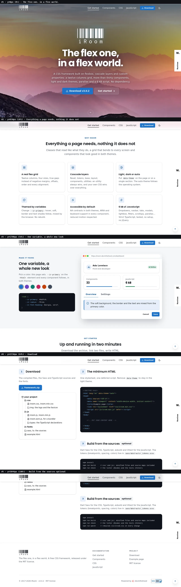
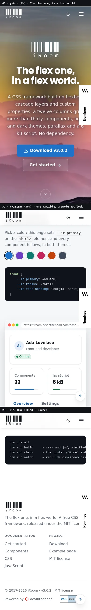

# UI Design System & Master Generation Blueprint: iroom-devinthehood-com

> **iRoom framework 3 · Get started** (https://iroom.devinthehood.com/) — iRoom, the flex CSS framework: a twelve columns grid, 30+ components, light and dark themes driven by CSS custom properties, parallax, a...





---

## 1. Executive Visual Persona & Design Archetype

- **Brand Essence & Persona**: **iRoom framework 3 · Get started** (`https://iroom.devinthehood.com/`). iRoom, the flex CSS framework: a twelve columns grid, 30+ components, light and dark themes driven by CSS custom properties, parallax, a...
- **Capture Provenance**: Live browser capture (`tier1_fast`, HTTP `200`, captured `2026-11-24`).
- **Visual Archetype**: **Light-Substrate Editorial & Modular Grid System (`#ffffff` canvas, `#14181f` ink, `#1f72c7` accent)**.
- **Anti-AI-Slop Differentiators**:
  - **Live-Computed Chromatic Polarity**: Anchors the viewport in `#ffffff` (live computed `body` `background-color` (`computed_styles.json`)) paired with `#14181f` primary typography and `#1f72c7` accents.
  - **Grounded Typographic Hierarchy**: Pairs `Poppins` for display copy (`The flex one, in a flex world.`) with `Segoe UI` and `SFMono-Regular`.
  - **Calibrated Spatial Grid & Motion**: Combines `1440px` container bounds (`gap: 16px`, padding `2rem`) with `cubic-bezier(0.2,0.7,0.3,1)` easing.

---

## 2. Spatial Architecture & Modular Grid Mathematics

### Viewport Allocation & Container Geometry
- **Captured Journey Filmstrips**: Desktop `1280×4140px` (`assets/desktop-journey.webp`, `5` keyframes up to `y=3044px` / doc `3944px`), Mobile `390×2616px` (`assets/mobile-journey.webp`, `3` keyframes).
- **Master Container Bounds**: `1440px` (full-bleed `100%` desktop stage measured on `1440px` viewport).
- **Canvas Lateral Padding & Spacing**: `2rem` lateral canvas padding with `16px` grid gap.
- **Border Radius Scale**: `8px`, `50%`, `var(--ir-radius)`, `var(--ir-radius-full)`.

### Responsive Breakpoint Architecture
- **Desktop Layout**: Multi-column CSS Grid / Flexbox layout at `1440px` (`max-width: 1440px`, `gap: 16px`).
- **Mobile Layout**: Single-column vertical stack at `390px` viewport width with `2rem` horizontal padding.
- **Extracted CSS Media Queries**: `@media (max-width: 992px)`, `@media (prefers-reduced-motion: reduce)`, `@media (prefers-reduced-motion: no-preference)`, `@media (min-width: 601px)`.

---

## 3. Color System, Materiality & Atmospheric Lighting

### Semantic Palette & Source Grounding
| Semantic Role | Ground-Truth Value | Extracted Live / CSS Source |
|---|---|---|
| **Primary Canvas Substrate** | `#ffffff` | live computed `body` `background-color` (`computed_styles.json`) |
| **Primary Typography Ink** | `#14181f` | live computed `main` `color` (`computed_styles.json`) |
| **Elevated Surface / Card Substrate** | `#f6f7f9` | `var(--ir-surface-2)` in `:root` |
| **Interactive Accent / Highlight** | `#1f72c7` | `var(--ir-primary)` in `:root` |
| **Secondary / Muted Copy** | `#8b93a1` | `var(--ir-text-subtle)` in `:root` |
| **Structural Hairline Border** | `#e3e6eb` | `var(--ir-border)` in `:root` |
| **Variable Token (`--ir-surface-3`)** | `#eceef2` | `var(--ir-surface-3)` in `:root` |
| **Variable Token (`--ir-border-strong`)** | `#cdd2da` | `var(--ir-border-strong)` in `:root` |
| **Variable Token (`--ir-text-muted`)** | `#5d6675` | `var(--ir-text-muted)` in `:root` |

### Sanitized Root CSS Variables (`ui-ux.md` Ground Truth)
| Variable Name | Extracted Value | Semantic Role |
|---|---|---|
| `--btn-bg` | `rgb(255 255 255 / .1)` | Canvas / Surface Token |
| `--btn-fg` | `#ffffff` | Typography Ink Token |
| `--btn-border` | `rgb(255 255 255 / .35)` | Elevation / Border Token |
| `--btn-bg-hover` | `rgb(255 255 255 / .2)` | Canvas / Surface Token |
| `--ir-sticky-top` | `calc(var(--ir-navbar-height) + 1.5rem)` | Dimension / Scale Token |
| `--ir-bg` | `#ffffff` | Canvas / Surface Token |
| `--ir-surface` | `#ffffff` | Canvas / Surface Token |
| `--ir-surface-2` | `#f6f7f9` | Canvas / Surface Token |
| `--ir-surface-3` | `#eceef2` | Canvas / Surface Token |
| `--ir-border` | `#e3e6eb` | Elevation / Border Token |
| `--ir-border-strong` | `#cdd2da` | Elevation / Border Token |
| `--ir-text` | `#14181f` | Typography Ink Token |
| `--ir-text-muted` | `#5d6675` | Typography Ink Token |
| `--ir-text-subtle` | `#8b93a1` | Typography Ink Token |
| `--ir-inverse-bg` | `#14181f` | Canvas / Surface Token |
| `--ir-inverse-fg` | `#f6f7f9` | Typography Ink Token |

---

## 4. Typographic Scale & Editorial Hierarchy

### Font Family Stacks
- **Display Typography**: `Poppins`.
- **Primary Body Stack**: `Segoe UI`.
- **Technical / Metadata Stack**: `SFMono-Regular`.

### Typographic Scale & Rules (Live Computed & Stylesheet Grounded)
- **Hero Display (`H1`)**: live computed `h1` (`font-size: 76px`, `line-height: 79.04px`, `font-weight: 700`, `letter-spacing: -2.66px`); rule `,.h1` (`font-size: clamp(2rem,1.55rem + 1.9vw,2....`, `letter-spacing: -0.02em`).
- **Section Heading (`H2`)**: live computed `h2` (`font-size: 32px`, `line-height: 38.4px`, `font-weight: 600`, `letter-spacing: -0.48px`); rule `,.h2` (`font-size: clamp(1.5rem,1.3rem + .9vw,2rem)`, `letter-spacing: -0.015em`).
- **Body Copy**: live computed `body` (`font-size: 16px`, `line-height: 25.6px`, `font-weight: 400`).
- **Metadata & Navigation Labels**: live computed `nav/a` (`font-size: 16px`, `line-height: 25.6px`, `font-weight: 400`).

---

## 5. Choreographed Motion & Interaction Physics

### Primary Easing Curves
- **Extracted Timing Functions**: `cubic-bezier(0.2,0.7,0.3,1)`.

### Per-Element Transition & Choreography Rules
- **Selector `.demo-swatch`**: `transition: scale var(--ir-duration) var(--ir-ease)` extracted from `iroom-devinthehood-com` stylesheet.
- **Selector `.demo-anchor`**: `transition: opacity var(--ir-duration) var(--ir-ease)` extracted from `iroom-devinthehood-com` stylesheet.
- **Selector `.demo-copy`**: `transition: opacity var(--ir-duration) var(--ir-ease), color var(--ir-dura...` extracted from `iroom-devinthehood-com` stylesheet.
- **Extracted Easing Curve (`cubic-bezier(0.2,0.7,0.3,1)`)**: Governs interactive state transitions across `<header.navbar>` and `<section.demo-section>`.
- **State & Hover Choreography**: Opacity and transform transitions on `<section.demo-hero>` and `<section.demo-section>` interactive targets.
### Measured Runtime Scroll & Interaction Telemetry (`behavioral_journey_v2`)
- **Scroll Driver Mode**: `native` (max document height `3944px`, deepest scrollY reached `3044px` across `5` desktop keyframes).
- **Detected Scroll / Motion Libraries**: Native browser scroll / standard CSS transitions.
- **Hover Physics (`primary_cta` · `Download v3.0.2`)**: `backgroundColor`: `rgb(31, 114, 199)` -> `color(srgb 0.103333 0.3...` (`transition-duration: 0.18s, 0.18s, 0.18s, 0.18s`, `timing: cubic-bezier(0.2, 0.7, 0.3, 1), cubic-bezier(0.2, 0.7, 0.3, 1), cubic-bezier(0.2, 0.7, 0.3, 1), cubic-bezier(0.2, 0.7, 0.3, 1)`).
- **Interactive Control Probe (`tab` · `Settings`)**: Triggered visual diff `11.306` (attr `false -> true`, captured in `assets/state-interactive.webp`).
- **Theme Toggle Probe (`Dark theme`)**: Toggled body background `rgb(255, 255, 255)` -> `rgb(14, 17, 23)` and ink `rgb(20, 24, 31)` -> `rgb(231, 234, 240)`.
- **Route Transition Architecture**: First internal navigation (`/index.html`) measured as `MPA` in `1145ms`.

---

## 6. Component Wireframe & Structural DOM Map

### Visual Layout Schematic — Desktop (`1440px`, Grounded in `dom.html` & Landmark Bounding Boxes)
```
┌────────────────────────────────────────────────────────────────────────┐
│ DESKTOP VIEWPORT (1440px) — iRoom framework 3 · Get started            │
│ ====================================================================== │
│ [ <header.navbar> (1440x65px)         | Get started · Components · C ] │
│ ---------------------------------------------------------------------- │
│ | HERO STAGE: <section.demo-hero> (w=1440px)                         | │
│ | H1: The flex one, in a flex world.                                 | │
│ | Substrate: #ffffff | Ink: #14181f | Accent: #1f72c7                | │
│ ---------------------------------------------------------------------- │
│ | SHOWCASE GRID (<section.demo-section>) max-w: 1440px               | │
│ | +------------------------------+  +------------------------------+ | │
│ | | Everything a page needs, not |  | A real flex grid             | | │
│ | +------------------------------+  +------------------------------+ | │
│ ---------------------------------------------------------------------- │
│ | DETAIL MODULE (<section.bg-subtle>) — Cascade layers               | │
│ ---------------------------------------------------------------------- │
│ [ FOOTER (<footer.demo-footer>) | https://iroom.devinthehood.com/      │
└────────────────────────────────────────────────────────────────────────┘
```

### Visual Layout Schematic — Mobile Reflow (`390px`)
```
┌────────────────────────────────────────────────────────────────────────┐
│ MOBILE VIEWPORT REFLOW (390px) — Single-Column Stack (gap: 16px)       │
│ ====================================================================== │
│ [ HEADER BAR (<header.navbar>         ) | Compact Menu (390px)         │
│ ---------------------------------------------------------------------- │
│ | HERO STAGE (<section.demo-hero>) — 390px Vertical Lead             | │
│ | H1: The flex one, in a flex world.                                 | │
│ ---------------------------------------------------------------------- │
│ | SHOWCASE STACK (<section.demo-section>) — 1-Col Stack              | │
│ | [ Item 1: Everything a page needs, nothing it does not           ] | │
│ | [ Item 2: A real flex grid                                       ] | │
│ ---------------------------------------------------------------------- │
│ | DETAIL STACK (<section.bg-subtle>) — 1-Col (Cascade layers)        | │
│ ---------------------------------------------------------------------- │
│ [ FOOTER (<footer.demo-footer>) | Stacked 390px Colophon               │
└────────────────────────────────────────────────────────────────────────┘
```

### Granular DOM Region Breakdown
1. **Brand Header & Navigation Bar (<header.navbar> — `iroom-devinthehood-com`)**:
   - Landmark `<header class="navbar navbar-sticky">` (`1440x65px`) hosting `iRoom framework 3 · Get started` navigation (`Get started · Components · CSS · JavaScript · Download`), DOM attributes (`data-theme="auto"`, `data-theme-toggle`, `data-tooltip="Dark theme"`, `data-tooltip-position="bottom"`), and stylesheet rule `.demo-brand { font-family: 'Libre Barcode 128 Text', cursive; font-size: 2.75rem; font... }`.
2. **Hero Stage & Focal Lead (<section.demo-hero> — `The flex one, in a flex world.`)**:
   - Landmark `<section class="demo-hero parallax">` presenting display lead `The flex one, in a flex world.` and copy excerpt *"A CSS framework built on flexbox, cascade layers and custom prope"* over `#ffffff` canvas and `#14181f` ink.
3. **Primary Showcase & Content Grid (<section.demo-section> — `Everything a page needs, nothing i`)**:
   - Landmark `<section class="demo-section">` rendering section `Everything a page needs, nothing it does not` with copy *"Classes that read like what they do, a grid that bends to every s"*, asset references (`iroom.ico`, `favicon.png`, `iroom.min.css`, `demo.css`), and grid rule `.demo-logo-pending .demo-hero-bar... { visibility: hidden; }`.
4. **Interactive Detail & Feature Matrix (<section.bg-subtle> — `A real flex grid`)**:
   - Landmark `<section class="demo-section bg-subtle">` framing `A real flex grid` and `Cascade layers` (*"Twelve columns, four sizes, true gaps instead of negative margins"*) with `#f6f7f9` surface cards, `#1f72c7` accents, and `.demo-hero .lead { max-width: 40rem; color: rgb(255 255 255 / .88); text-shadow: 0 1px 12px... }`.
5. **Colophon & Global Directory Footer (<footer.demo-footer> — `https://iroom.devinthehood.com/`)**:
   - Landmark `<footer class="demo-footer">` anchoring `iRoom framework 3 · Get started` footer links (`Get started · Components · CSS · JavaScript · Download`), copy *"Reset, tokens, base, layout, components, utilities: an utili"*, and `#e3e6eb` structural dividers.
### Full Vertical Scroll Sequence (Desktop `1440×900` Keyframes)
- **Step 01** (`y=0px`, `0%`): Active landmark `The flex one, in a flex world.` · sticky/fixed elements: `2`
- **Step 02** (`y=850px`, `28%`): Active landmark `Everything a page needs, nothing it does not` · sticky/fixed elements: `2`
- **Step 03** (`y=1700px`, `56%`): Active landmark `One variable, a whole new look` · sticky/fixed elements: `2`
- **Step 04** (`y=2550px`, `84%`): Active landmark `Download` · sticky/fixed elements: `2`
- **Step 05** (`y=3044px`, `100%`): Active landmark `Build from the sources optional` · sticky/fixed elements: `2`

### Multi-Page Internal Route Map
- **Other Route (`/index.html`)**: `https://iroom.devinthehood.com/index.html` — H1: `The flex one, in a flex world.`, scrollHeight `3944px`, transition `MPA` (`1145ms`)
- **Other Route (`/components.html`)**: `https://iroom.devinthehood.com/components.html` — H1: `Components`, scrollHeight `27933px`, transition `direct` (`2027ms`)
- **Other Route (`/css.html`)**: `https://iroom.devinthehood.com/css.html` — H1: `CSS`, scrollHeight `14369px`, transition `direct` (`612ms`)

---

## 7. Master Zero-Shot AI Generation Prompt

```markdown
# Master Zero-Shot Frontend Generation Prompt: iroom-devinthehood-com (iRoom framework 3 · Get started)

You are a principal frontend architect and design systems engineer. Build a complete, production-ready web application replicating the exact design system, DOM landmarks, typographic hierarchy, color tokens, and motion physics of `iroom-devinthehood-com` (**iRoom framework 3 · Get started** — `https://iroom.devinthehood.com/`).

### 1. Visual Archetype & Anti-AI-Slop Mandates
- **Archetype**: Light-Substrate Editorial & Modular Grid System (`#ffffff` canvas, `#14181f` ink, `#1f72c7` accent).
- **Identity & Domain Context**: iRoom, the flex CSS framework: a twelve columns grid, 30+ components, light and dark themes driven by CSS custom properties, parallax, a...
- **Primary Substrate**: `#ffffff` (live computed `body` `background-color` (`computed_styles.json`)), **Primary Ink**: `#14181f`, **Accent / Highlight**: `#1f72c7`.
- **Site-Specific Differentiators**:
  - **Live-Computed Chromatic Polarity**: Anchors the viewport in `#ffffff` (live computed `body` `background-color` (`computed_styles.json`)) paired with `#14181f` primary typography and `#1f72c7` accents.
  - **Grounded Typographic Hierarchy**: Pairs `Poppins` for display copy (`The flex one, in a flex world.`) with `Segoe UI` and `SFMono-Regular`.
  - **Calibrated Spatial Grid & Motion**: Combines `1440px` container bounds (`gap: 16px`, padding `2rem`) with `cubic-bezier(0.2,0.7,0.3,1)` easing.

### 2. Ground-Truth CSS Variables (`:root` Token Contract)
Declare and consume these exact custom properties extracted from `iroom-devinthehood-com` in your global stylesheet:

:root {
  /* iRoom framework 3 · Get started (iroom-devinthehood-com) — Live-Grounded CSS Variables */
  --btn-bg: rgb(255 255 255 / .1); /* Canvas / Surface Token (iroom-devinthehood-com) */
  --btn-fg: #ffffff; /* Typography Ink Token (iroom-devinthehood-com) */
  --btn-border: rgb(255 255 255 / .35); /* Elevation / Border Token (iroom-devinthehood-com) */
  --btn-bg-hover: rgb(255 255 255 / .2); /* Canvas / Surface Token (iroom-devinthehood-com) */
  --ir-sticky-top: calc(var(--ir-navbar-height) + 1.5rem); /* Dimension / Scale Token (iroom-devinthehood-com) */
  --ir-bg: #ffffff; /* Canvas / Surface Token (iroom-devinthehood-com) */
  --ir-surface: #ffffff; /* Canvas / Surface Token (iroom-devinthehood-com) */
  --ir-surface-2: #f6f7f9; /* Canvas / Surface Token (iroom-devinthehood-com) */
  --ir-surface-3: #eceef2; /* Canvas / Surface Token (iroom-devinthehood-com) */
  --ir-border: #e3e6eb; /* Elevation / Border Token (iroom-devinthehood-com) */
  --ir-border-strong: #cdd2da; /* Elevation / Border Token (iroom-devinthehood-com) */
  --ir-text: #14181f; /* Typography Ink Token (iroom-devinthehood-com) */
  --ir-text-muted: #5d6675; /* Typography Ink Token (iroom-devinthehood-com) */
  --ir-text-subtle: #8b93a1; /* Typography Ink Token (iroom-devinthehood-com) */
  --ir-inverse-bg: #14181f; /* Canvas / Surface Token (iroom-devinthehood-com) */
  --ir-inverse-fg: #f6f7f9; /* Typography Ink Token (iroom-devinthehood-com) */
}

### 3. Semantic Color & Materiality Contract
Map every surface, ink, and border strictly to these source-grounded tokens:
- **Primary Canvas Substrate**: `#ffffff` — grounded in live computed `body` `background-color` (`computed_styles.json`)
- **Primary Typography Ink**: `#14181f` — grounded in live computed `main` `color` (`computed_styles.json`)
- **Elevated Surface / Card Substrate**: `#f6f7f9` — grounded in `var(--ir-surface-2)` in `:root`
- **Interactive Accent / Highlight**: `#1f72c7` — grounded in `var(--ir-primary)` in `:root`
- **Secondary / Muted Copy**: `#8b93a1` — grounded in `var(--ir-text-subtle)` in `:root`
- **Structural Hairline Border**: `#e3e6eb` — grounded in `var(--ir-border)` in `:root`
- **Variable Token (`--ir-surface-3`)**: `#eceef2` — grounded in `var(--ir-surface-3)` in `:root`
- **Variable Token (`--ir-border-strong`)**: `#cdd2da` — grounded in `var(--ir-border-strong)` in `:root`
- **Variable Token (`--ir-text-muted`)**: `#5d6675` — grounded in `var(--ir-text-muted)` in `:root`

### 4. Spatial Grid, Container Bounds & Responsive Breakpoints
- **Desktop Viewport Reference**: `1280×4140px` (multi-frame vertical journey filmstrip (4140px), `1440px` standard desktop width).
- **Mobile Viewport Reference**: `390×2616px` (multi-frame vertical journey filmstrip (2616px), `390px` standard mobile width).
- **Container Max-Width**: `1440px` (full-bleed `100%` desktop stage measured on `1440px` viewport)
- **Padding & Gutters**: `2rem` lateral canvas padding with `16px` grid gap
- **Desktop Grid**: Multi-column CSS Grid / Flexbox layout at `1440px` (`max-width: 1440px`, `gap: 16px`)
- **Mobile Adaptation**: Single-column vertical stack at `390px` viewport width with `2rem` horizontal padding
- **Media Queries**: `@media (max-width: 992px)`, `@media (prefers-reduced-motion: reduce)`, `@media (prefers-reduced-motion: no-preference)`, `@media (min-width: 601px)`
- **Corner Radii**: `8px`, `50%`, `var(--ir-radius)`, `var(--ir-radius-full)`

### 5. Typography & Editorial Scale Contract
- **Display Font Stack**: `Poppins`
- **Body Font Stack**: `Segoe UI`
- **Monospace / Technical Font Stack**: `SFMono-Regular`
- **H1 Display Rule**: live computed `h1` (`font-size: 76px`, `line-height: 79.04px`, `font-weight: 700`, `letter-spacing: -2.66px`); rule `,.h1` (`font-size: clamp(2rem,1.55rem + 1.9vw,2....`, `letter-spacing: -0.02em`)
- **H2 Section Rule**: live computed `h2` (`font-size: 32px`, `line-height: 38.4px`, `font-weight: 600`, `letter-spacing: -0.48px`); rule `,.h2` (`font-size: clamp(1.5rem,1.3rem + .9vw,2rem)`, `letter-spacing: -0.015em`)
- **Body Copy Rule**: live computed `body` (`font-size: 16px`, `line-height: 25.6px`, `font-weight: 400`)
- **Metadata & Index Rule**: live computed `nav/a` (`font-size: 16px`, `line-height: 25.6px`, `font-weight: 400`)

### 6. Component Hierarchy, Verbatim Copy & Real DOM Landmarks
Scaffold `iroom-devinthehood-com` (`iRoom framework 3 · Get started`) with these exact structural regions, extracted copy, and CSS rules from `dom.html`:
1. **Brand Header & Navigation Bar (<header.navbar> — `iroom-devinthehood-com`)**:
   - DOM & Selectors: Landmark `<header class="navbar navbar-sticky">` (`1440x65px`) hosting `iRoom framework 3 · Get started` navigation (`Get started · Components · CSS · JavaScript · Download`), DOM attributes (`data-theme="auto"`, `data-theme-toggle`, `data-tooltip="Dark theme"`, `data-tooltip-position="bottom"`), and stylesheet rule `.demo-brand { font-family: 'Libre Barcode 128 Text', cursive; font-size: 2.75rem; font... }`.
   - Responsive Contract: Header `Brand Header & Navigation Bar (<header.navbar> — `iroom-devinthehood-com`)` (`iroom-devinthehood-com`) adapts across `@media (max-width: 992px)`, `@media (prefers-reduced-motion: reduce)`, `@media (prefers-reduced-motion: no-preference)`, `@media (min-width: 601px)` with `cubic-bezier(0.2,0.7,0.3,1)` transitions and links `Get started · Components · CSS · JavaScript · Download`.
2. **Hero Stage & Focal Lead (<section.demo-hero> — `The flex one, in a flex world.`)**:
   - DOM & Selectors: Landmark `<section class="demo-hero parallax">` presenting display lead `The flex one, in a flex world.` and copy excerpt *"A CSS framework built on flexbox, cascade layers and custom prope"* over `#ffffff` canvas and `#14181f` ink.
   - Responsive Contract: Hero stage (`1280×4140px` desktop / `390×2616px` mobile) sets `#ffffff` background with `#14181f` headline `The flex one, in a flex world.`.
3. **Primary Showcase & Content Grid (<section.demo-section> — `Everything a page needs, nothing i`)**:
   - DOM & Selectors: Landmark `<section class="demo-section">` rendering section `Everything a page needs, nothing it does not` with copy *"Classes that read like what they do, a grid that bends to every s"*, asset references (`iroom.ico`, `favicon.png`, `iroom.min.css`, `demo.css`), and grid rule `.demo-logo-pending .demo-hero-bar... { visibility: hidden; }`.
   - Responsive Contract: Showcase grid `Primary Showcase & Content Grid (<section.demo-section> — `Everything a page needs, nothing i`)` applies Multi-column CSS Grid / Flexbox layout at `1440px` (`max-width: 1440px`, `gap: 16px`) on desktop and Single-column vertical stack at `390px` viewport width with `2rem` horizontal padding on mobile.
4. **Interactive Detail & Feature Matrix (<section.bg-subtle> — `A real flex grid`)**:
   - DOM & Selectors: Landmark `<section class="demo-section bg-subtle">` framing `A real flex grid` and `Cascade layers` (*"Twelve columns, four sizes, true gaps instead of negative margins"*) with `#f6f7f9` surface cards, `#1f72c7` accents, and `.demo-hero .lead { max-width: 40rem; color: rgb(255 255 255 / .88); text-shadow: 0 1px 12px... }`.
   - Responsive Contract: Detail module `Interactive Detail & Feature Matrix (<section.bg-subtle> — `A real flex grid`)` uses `8px`, `50%`, `var(--ir-radius)`, `var(--ir-radius-full)` radii, `#1f72c7` highlights, and assets (iroom.ico, favicon.png, iroom.min.css).
5. **Colophon & Global Directory Footer (<footer.demo-footer> — `https://iroom.devinthehood.com/`)**:
   - DOM & Selectors: Landmark `<footer class="demo-footer">` anchoring `iRoom framework 3 · Get started` footer links (`Get started · Components · CSS · JavaScript · Download`), copy *"Reset, tokens, base, layout, components, utilities: an utili"*, and `#e3e6eb` structural dividers.
   - Responsive Contract: Footer `Colophon & Global Directory Footer (<footer.demo-footer> — `https://iroom.devinthehood.com/`)` aligns to `1440px` (full-bleed `100%` desktop stage measured on `1440px` viewport) with `2rem` lateral canvas padding with `16px` grid gap and attributes (data-theme="auto", data-theme-toggle, data-tooltip="Dark theme").

#### Verbatim DOM Copy Excerpts (`dom.html`)
- Copy Excerpt 1: *"A CSS framework built on flexbox, cascade layers and custom properties: a twelve c..."*
- Copy Excerpt 2: *"Classes that read like what they do, a grid that bends to every screen and compone..."*
- Copy Excerpt 3: *"Twelve columns, four sizes, true gaps instead of negative margins, offsets, order..."*
- Copy Excerpt 4: *"Reset, tokens, base, layout, components, utilities: an utility always wins, and yo..."*

### 7. Motion, Extracted Stylesheet Rules & Interaction Choreography
- **Primary Easing Functions**: `cubic-bezier(0.2,0.7,0.3,1)`
- **Extracted Stylesheet Rules (`iroom-devinthehood-com`)**:
- `.demo-brand { font-family: 'Libre Barcode 128 Text', cursive; font-size: 2.75rem; font... }`
- `.demo-logo-pending .demo-hero-bar... { visibility: hidden; }`
- `.demo-hero .lead { max-width: 40rem; color: rgb(255 255 255 / .88); text-shadow: 0 1px 12px... }`
- `.demo-hero .display { text-shadow: 0 2px 30px rgb(9 13 36 / .6); }`
- `.demo-hero-scroll:hover { color: ffffff; background-color: rgb(255 255 255 / .12); }`
- **Per-Selector Transition Rules**:
- **Selector `.demo-swatch`**: `transition: scale var(--ir-duration) var(--ir-ease)` extracted from `iroom-devinthehood-com` stylesheet.
- **Selector `.demo-anchor`**: `transition: opacity var(--ir-duration) var(--ir-ease)` extracted from `iroom-devinthehood-com` stylesheet.
- **Selector `.demo-copy`**: `transition: opacity var(--ir-duration) var(--ir-ease), color var(--ir-dura...` extracted from `iroom-devinthehood-com` stylesheet.
- **Extracted Easing Curve (`cubic-bezier(0.2,0.7,0.3,1)`)**: Governs interactive state transitions across `<header.navbar>` and `<section.demo-section>`.
- **State & Hover Choreography**: Opacity and transform transitions on `<section.demo-hero>` and `<section.demo-section>` interactive targets.
### 7b. Full-Page Scroll Choreography, Interactive States & Multi-Page Routes
- **Scroll Mechanics**: Implement `native` vertical progression up to `3944px` across 5 distinct viewport chapters.
- **Vertical Chapter Sequence**: The flex one, in a flex world. (0%) -> Everything a page needs, no... (28%) -> One variable, a whole new look (56%) -> Download (84%) -> Build from the sources opti... (100%).
- **Hover Micro-Interaction (`primary_cta`)**: Animate `backgroundColor` with `0.18s, 0.18s, 0.18s, 0.18s cubic-bezier(0.2, 0.7, 0.3, 1), cubic-bezier(0.2, 0.7, 0.3, 1), cubic-bezier(0.2, 0.7, 0.3, 1), cubic-bezier(0.2, 0.7, 0.3, 1)`.
- **Multi-Page Routes**: Scaffold internal routes `/index.html` (other, MPA), `/components.html` (other, direct), `/css.html` (other, direct) sharing the global header/footer shell and design tokens.

### 8. Technical Deliverables
- Implement in Next.js (App Router) with TypeScript and Tailwind CSS consuming the `:root` custom properties defined above for `iroom-devinthehood-com`.
- Reproduce both the `1440px` desktop architecture and `390px` mobile breakpoint transitions, preserving semantic HTML5 landmarks (`<header>`, `<nav>`, `<main>`, `<section>`, `<footer>`) and `prefers-reduced-motion` accessibility guards.
```
---

## 8. Full-Page Scroll Journey, Interactive States & Subpage Inventory

### Desktop Scroll Keyframes (`1440×900` WebP)
| Step | Scroll Y | Progress | Active Landmark / Section | Sticky/Fixed | Visual Asset |
| :---: | :---: | :---: | :--- | :---: | :--- |
| `#01` | `0px` | `0%` | The flex one, in a flex world. | `2` | [desktop-step-01.webp](assets/desktop-step-01.webp) |
| `#02` | `850px` | `28%` | Everything a page needs, nothing it does not | `2` | [desktop-step-02.webp](assets/desktop-step-02.webp) |
| `#03` | `1700px` | `56%` | One variable, a whole new look | `2` | [desktop-step-03.webp](assets/desktop-step-03.webp) |
| `#04` | `2550px` | `84%` | Download | `2` | [desktop-step-04.webp](assets/desktop-step-04.webp) |
| `#05` | `3044px` | `100%` | Build from the sources optional | `2` | [desktop-step-05.webp](assets/desktop-step-05.webp) |

### Mobile Condensed Keyframes (`390×844` WebP)
| Step | Scroll Y | Progress | Active Landmark | Visual Asset |
| :---: | :---: | :---: | :--- | :--- |
| `#01` | `0px` | `0%` | The flex one, in a flex world. | [mobile-step-01.webp](assets/mobile-step-01.webp) |
| `#02` | `2815px` | `50%` | One variable, a whole new look | [mobile-step-02.webp](assets/mobile-step-02.webp) |
| `#03` | `5631px` | `100%` | Footer | [mobile-step-03.webp](assets/mobile-step-03.webp) |

### Interactive UI State Captures (`1440×900` WebP)
| State Type | Trigger / Observation | Visual Asset |
| :--- | :--- | :--- |
| `interactive_control` | Control `tab` (`Settings`, diff `11.306`) | [state-interactive.webp](assets/state-interactive.webp) |

### Internal Subpage Filmstrips (`1080px` Wide WebP)
| # | Template | Route URL | H1 / Title | Scroll Height | Transition | Filmstrip Asset |
| :-: | :---: | :--- | :--- | :---: | :---: | :--- |
| `1` | `other` | `https://iroom.devinthehood.com/index.html` | The flex one, in a flex world. | `3944px` | `MPA` (`1145ms`) | [subpage-01-index-html.webp](assets/subpage-01-index-html.webp) |
| `2` | `other` | `https://iroom.devinthehood.com/components.html` | Components | `27933px` | `direct` (`2027ms`) | [subpage-02-components-html.webp](assets/subpage-02-components-html.webp) |
| `3` | `other` | `https://iroom.devinthehood.com/css.html` | CSS | `14369px` | `direct` (`612ms`) | [subpage-03-css-html.webp](assets/subpage-03-css-html.webp) |

