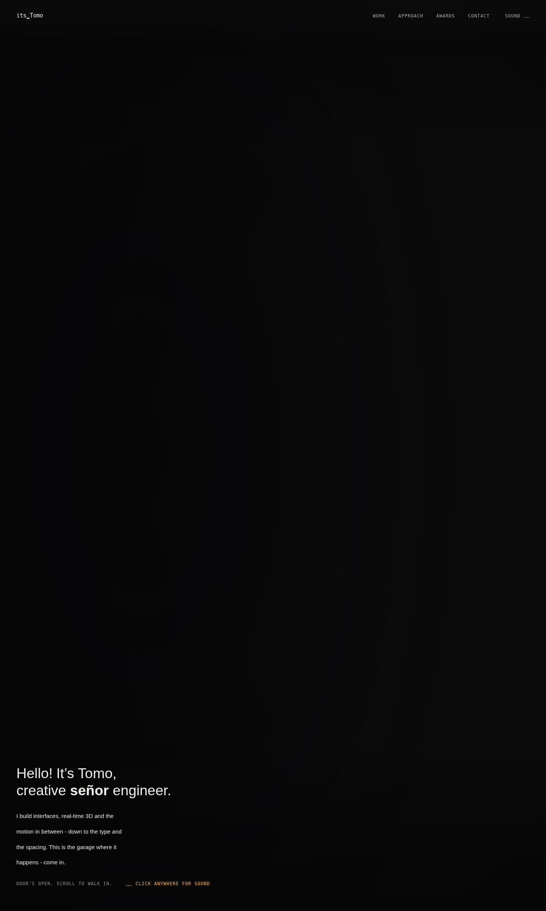
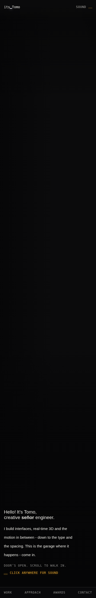

# UI Design System & Master Generation Blueprint: its-tomo-dev

> **its_tomo - creative engineer** (https://its-tomo.dev/) — Tomo - creative señor engineer from Zagreb. Interfaces, real-time 3D and motion, built with an eye for design. Come in, the garage is open.



---

## 1. Executive Visual Persona & Design Archetype

- **Brand Essence & Persona**: **its_tomo - creative engineer** (`https://its-tomo.dev/`). Tomo - creative señor engineer from Zagreb. Interfaces, real-time 3D and motion, built with an eye for design. Come in, the garage is open.
- **Visual Archetype**: **Dark-Substrate WebGL / Canvas Interactive Experience (`#0b0b0c` / `#fffaee`)**.
- **Anti-AI-Slop Differentiators**:
  - **Source-Grounded Chromatic Polarity**: Anchors the viewport in `#0b0b0c` (`var(--bg)` in `:root`) paired with `#fffaee` primary typography and `#fffaee` accents.
  - **Extracted Typographic Hierarchy**: Pairs `Archivo` for display copy (`Hello! It’s Tomo, creative señor eng`) with `JetBrains Mono` and `JetBrains Mono`.
  - **Calibrated Spatial Grid & Motion**: Combines `800px` container bounds (`gap: .625rem`, padding `.625rem`) with `cubic-bezier(0.16,1,0.3,1)` easing and Lenis Smooth Scroll (`data-lenis`), GSAP Timeline & ScrollTrigger.

---

## 2. Spatial Architecture & Modular Grid Mathematics



### Viewport Allocation & Container Geometry
- **Captured Viewport Dimensions**: Desktop `1440×2400px` (`assets/desktop.png`, capped at 2400px multi-section capture), Mobile `390×2400px` (`assets/mobile.png`, capped at 2400px multi-section capture).
- **Master Container Bounds**: `800px` extracted from `its-tomo-dev` stylesheet.
- **Canvas Lateral Padding & Spacing**: `.625rem` lateral canvas padding with `.625rem` grid gap.
- **Border Radius Scale**: `.25rem`, `50%`.

### Responsive Breakpoint Architecture
- **Desktop Layout**: Multi-column CSS Grid / Flexbox layout at `1440px` (`max-width: 800px`, `gap: .625rem`).
- **Mobile Layout**: Single-column vertical stack at `390px` viewport width with `.625rem` horizontal padding.
- **Extracted CSS Media Queries**: `@media (min-width: 1920px)`, `@media (prefers-reduced-motion: reduce)`, `@media (max-width: 800px)`, `@media (max-width: 800px)and (prefers-reduced-motion: reduce)`.

---

## 3. Color System, Materiality & Atmospheric Lighting

### Semantic Palette & Source Grounding
| Semantic Role | Ground-Truth Value | Extracted CSS Source / Selector |
|---|---|---|
| **Primary Canvas Substrate** | `#0b0b0c` | `var(--bg)` in `:root` |
| **Primary Typography Ink** | `#ecebe6` | `var(--fg)` in `:root` |
| **Elevated Surface / Card Substrate** | `#f7b334` | `var(--neon)` in `:root` |
| **Interactive Accent / Highlight** | `#fffaee` | `.c-intro__heads { stroke: #fffaee }` |
| **Secondary / Muted Copy** | `#f4f6ff` | `.c-logo__underscore::after { background: #f4f6ff }` |

### Sanitized Root CSS Variables (`ui-ux.md` Ground Truth)
| Variable Name | Extracted Value | Semantic Role |
|---|---|---|
| `--bg` | `#0b0b0c` | Canvas / Surface Token |
| `--fg` | `#ecebe6` | Typography Ink Token |
| `--fg-2` | `rgb(236 235 230 / 70%)` | Typography Ink Token |
| `--fg-3` | `rgb(236 235 230 / 60%)` | Typography Ink Token |
| `--rule` | `rgb(236 235 230 / 16%)` | Color / Atmospheric Token |
| `--neon` | `#f7b334` | Color / Atmospheric Token |
| `--f-display` | `archivo, "Helvetica Neue", arial, sans-serif` | Dimension / Scale Token |
| `--f-mono` | `"JetBrains Mono", ui-monospace, menlo, monospace` | Typography / Scale Token |
| `--f-logo` | `var(--f-mono)` | Design System Custom Token |
| `--t-hero` | `clamp(2.6rem, 6.2vw, 7.2rem)` | Dimension / Scale Token |
| `--t-h2` | `clamp(1.9rem, 3.2vw, 3.4rem)` | Typography / Scale Token |
| `--t-lede` | `clamp(1.05rem, 1.2vw, 1.3rem)` | Dimension / Scale Token |
| `--t-body` | `clamp(0.95rem, 0.95vw, 1.05rem)` | Dimension / Scale Token |
| `--t-mono` | `clamp(0.75rem, 0.75vw, 0.8125rem)` | Typography / Scale Token |
| `--gutter` | `clamp(1rem, 3vw, 3rem)` | Layout / Spatial Grid Token |
| `--header-h` | `clamp(3.5rem, 6vw, 5.25rem)` | Layout / Spatial Grid Token |

---

## 4. Typographic Scale & Editorial Hierarchy

### Font Family Stacks
- **Display Typography**: `Archivo`.
- **Primary Body Stack**: `JetBrains Mono`.
- **Technical / Metadata Stack**: `JetBrains Mono`.

### Typographic Scale & Rules (Extracted from Stylesheet & Variables)
- **Hero Display (`H1`)**: CSS variables `--f-display: archivo, "Helvetica Neue", arial, sans-serif`.
- **Section Heading (`H2`)**: CSS variables `--t-h2: clamp(1.9rem, 3.2vw, 3.4rem)`.
- **Body Copy**: CSS variables `--t-body: clamp(0.95rem, 0.95vw, 1.05rem)`.
- **Metadata & Navigation Labels**: CSS variables `--f-mono: "JetBrains Mono", ui-monospace, menlo, monospace`, `--t-mono: clamp(0.75rem, 0.75vw, 0.8125rem)`.

---

## 5. Choreographed Motion & Interaction Physics

### Primary Easing Curves
- **Extracted Timing Functions**: `cubic-bezier(0.16,1,0.3,1)`, `cubic-bezier(0.7,0,0.3,1)`.

### Per-Element Transition & Choreography Rules
- **Selector `.c-stage__poster`**: `transition: filter var(--focus-pull) var(--ease-out)` extracted from `its-tomo-dev` stylesheet.
- **Selector `.is-live .c-stage__poster`**: `transition: opacity 0s .9s,filter var(--focus-pull) var(--ease-out)` extracted from `its-tomo-dev` stylesheet.
- **Selector `.c-stage__canvas`**: `transition: opacity .8s ease,filter var(--focus-pull) var(--ease-out)` extracted from `its-tomo-dev` stylesheet.
- **Extracted Easing Curve (`cubic-bezier(0.16,1,0.3,1)`)**: Governs interactive state transitions across `<header.c-header>` and `<section.c-station>`.
- **Runtime Interaction Engine**: Integrates Lenis Smooth Scroll (`data-lenis`), GSAP Timeline & ScrollTrigger, Three.js / WebGL Canvas Pipeline with `prefers-reduced-motion: reduce` fallback guards.

---

## 6. Component Wireframe & Structural DOM Map

### Visual Layout Schematic (Grounded in `dom.html` — `1440px` Desktop & `390px` Mobile Reflow)
```
┌────────────────────────────────────────────────────────────────────────┐
│ DESKTOP VIEWPORT (1440px) — its_tomo - creative engineer               │
│ ====================================================================== │
│ [ <header.c-header>        | Work · Approach · Awards · Contact     ]  │
│ ---------------------------------------------------------------------- │
│ | HERO STAGE: <section.c-station>                                  |   │
│ | H1: Hello! It’s Tomo, creative señor engineer.                   |   │
│ | Substrate: #0b0b0c    | Ink: #fffaee    | Accent: #fffaee        |   │
│ ---------------------------------------------------------------------- │
│ | SHOWCASE GRID (<section.c-station>       ) max-w: 800px          |   │
│ | +------------------------------+  +------------------------------+ | │
│ | | C a r s , h a r d w a r e a  |  | O n t h e b e n c h .        | | │
│ | +------------------------------+  +------------------------------+ | │
│ ---------------------------------------------------------------------- │
│ | MOBILE VIEWPORT REFLOW (390px) — Single-Column Stack (gap: .625re) | │
│ | [<header.c-header>] -> [<section.c-station] -> [<section.c-station]  │
│ ---------------------------------------------------------------------- │
│ [ FOOTER (<footer.c-footer>     ) | https://its-tomo.dev/              │
└────────────────────────────────────────────────────────────────────────┘
```

### Granular DOM Region Breakdown
1. **Brand Header & Navigation Bar (<header.c-header> — `its-tomo-dev`)**:
   - Landmark `<header class="c-header">` hosting `its_tomo - creative engineer` navigation (`Work · Approach · Awards · Contact`), DOM attributes (`data-engine="three.js r186 webgpu"`, `data-side="left"`, `data-side="right"`, `data-station="door"`), and stylesheet rule `after { box-sizing:border-box }`.
2. **Hero Stage & Focal Lead (<section.c-station> — `Hello! It’s Tomo, creative señor e`)**:
   - Landmark `<section class="c-station c-station--door">` presenting display lead `Hello! It’s Tomo, creative señor engineer.` and copy excerpt *"its _ Tomo Creative Front Dev tomo, back to the door"* over `#0b0b0c` canvas and `#fffaee` ink.
3. **Primary Showcase & Content Grid (<section.c-station> — `C a r s , h a r d w a r e a n d t `)**:
   - Landmark `<section class="c-station c-station--car">` rendering section `C a r s , h a r d w a r e a n d t h i n g s t h a...` with copy *"Tomo Creative Front Dev"*, asset references (`favicon.ico`, `favicon.svg`, `apple-touch-icon.png`, `site.webmanifest`), and grid rule `canvas { display:block;max-width:100% }`.
4. **Interactive Detail & Feature Matrix (<section.c-station> — `O n t h e b e n c h .`)**:
   - Landmark `<section class="c-station c-station--bench">` framing `O n t h e b e n c h .` and `01 DARC ROOM` (*"tomo, back to the door"*) with `#f7b334` surface cards, `#fffaee` accents, and `button { font:inherit;color:inherit;background:none;border:0;padding:0;cursor:poi... }`.
5. **Colophon & Global Directory Footer (<footer.c-footer> — `https://its-tomo.dev/`)**:
   - Landmark `<footer class="c-footer js-fade">` anchoring `its_tomo - creative engineer` footer links (`Work · Approach · Awards · Contact`), copy *"creative señor engineer."*, and `#fffaee` structural dividers.

---

## 7. Master Zero-Shot AI Generation Prompt

```markdown
# Master Zero-Shot Frontend Generation Prompt: its-tomo-dev (its_tomo - creative engineer)

You are a principal frontend architect and design systems engineer. Build a complete, production-ready web application replicating the exact design system, DOM landmarks, typographic hierarchy, color tokens, and motion physics of `its-tomo-dev` (**its_tomo - creative engineer** — `https://its-tomo.dev/`).

### 1. Visual Archetype & Anti-AI-Slop Mandates
- **Archetype**: Dark-Substrate WebGL / Canvas Interactive Experience (`#0b0b0c` / `#fffaee`).
- **Identity & Domain Context**: Tomo - creative señor engineer from Zagreb. Interfaces, real-time 3D and motion, built with an eye for design. Come in, the garage is open.
- **Primary Substrate**: `#0b0b0c` (`var(--bg)` in `:root`), **Primary Ink**: `#fffaee`, **Accent / Highlight**: `#fffaee`.
- **Site-Specific Differentiators**:
  - **Source-Grounded Chromatic Polarity**: Anchors the viewport in `#0b0b0c` (`var(--bg)` in `:root`) paired with `#fffaee` primary typography and `#fffaee` accents.
  - **Extracted Typographic Hierarchy**: Pairs `Archivo` for display copy (`Hello! It’s Tomo, creative señor eng`) with `JetBrains Mono` and `JetBrains Mono`.
  - **Calibrated Spatial Grid & Motion**: Combines `800px` container bounds (`gap: .625rem`, padding `.625rem`) with `cubic-bezier(0.16,1,0.3,1)` easing and Lenis Smooth Scroll (`data-lenis`), GSAP Timeline & ScrollTrigger.

### 2. Ground-Truth CSS Variables (`:root` Token Contract)
Declare and consume these exact custom properties extracted from `its-tomo-dev` in your global stylesheet:

:root {
  /* its_tomo - creative engineer (its-tomo-dev) — Ground-Truth Extracted CSS Variables */
  --bg: #0b0b0c; /* Canvas / Surface Token (its-tomo-dev) */
  --fg: #ecebe6; /* Typography Ink Token (its-tomo-dev) */
  --fg-2: rgb(236 235 230 / 70%); /* Typography Ink Token (its-tomo-dev) */
  --fg-3: rgb(236 235 230 / 60%); /* Typography Ink Token (its-tomo-dev) */
  --rule: rgb(236 235 230 / 16%); /* Color / Atmospheric Token (its-tomo-dev) */
  --neon: #f7b334; /* Color / Atmospheric Token (its-tomo-dev) */
  --f-display: archivo, "Helvetica Neue", arial, sans-serif; /* Dimension / Scale Token (its-tomo-dev) */
  --f-mono: "JetBrains Mono", ui-monospace, menlo, monospace; /* Typography / Scale Token (its-tomo-dev) */
  --f-logo: var(--f-mono); /* Design System Custom Token (its-tomo-dev) */
  --t-hero: clamp(2.6rem, 6.2vw, 7.2rem); /* Dimension / Scale Token (its-tomo-dev) */
  --t-h2: clamp(1.9rem, 3.2vw, 3.4rem); /* Typography / Scale Token (its-tomo-dev) */
  --t-lede: clamp(1.05rem, 1.2vw, 1.3rem); /* Dimension / Scale Token (its-tomo-dev) */
  --t-body: clamp(0.95rem, 0.95vw, 1.05rem); /* Dimension / Scale Token (its-tomo-dev) */
  --t-mono: clamp(0.75rem, 0.75vw, 0.8125rem); /* Typography / Scale Token (its-tomo-dev) */
  --gutter: clamp(1rem, 3vw, 3rem); /* Layout / Spatial Grid Token (its-tomo-dev) */
  --header-h: clamp(3.5rem, 6vw, 5.25rem); /* Layout / Spatial Grid Token (its-tomo-dev) */
}

### 3. Semantic Color & Materiality Contract
Map every surface, ink, and border strictly to these source-grounded tokens:
- **Primary Canvas Substrate**: `#0b0b0c` — grounded in `var(--bg)` in `:root`
- **Primary Typography Ink**: `#ecebe6` — grounded in `var(--fg)` in `:root`
- **Elevated Surface / Card Substrate**: `#f7b334` — grounded in `var(--neon)` in `:root`
- **Interactive Accent / Highlight**: `#fffaee` — grounded in `.c-intro__heads { stroke: #fffaee }`
- **Secondary / Muted Copy**: `#f4f6ff` — grounded in `.c-logo__underscore::after { background: #f4f6ff }`

### 4. Spatial Grid, Container Bounds & Responsive Breakpoints
- **Desktop Viewport Reference**: `1440×2400px` (capped at 2400px multi-section capture, `1440px` standard desktop width).
- **Mobile Viewport Reference**: `390×2400px` (capped at 2400px multi-section capture, `390px` standard mobile width).
- **Container Max-Width**: `800px` extracted from `its-tomo-dev` stylesheet
- **Padding & Gutters**: `.625rem` lateral canvas padding with `.625rem` grid gap
- **Desktop Grid**: Multi-column CSS Grid / Flexbox layout at `1440px` (`max-width: 800px`, `gap: .625rem`)
- **Mobile Adaptation**: Single-column vertical stack at `390px` viewport width with `.625rem` horizontal padding
- **Media Queries**: `@media (min-width: 1920px)`, `@media (prefers-reduced-motion: reduce)`, `@media (max-width: 800px)`, `@media (max-width: 800px)and (prefers-reduced-motion: reduce)`
- **Corner Radii**: `.25rem`, `50%`

### 5. Typography & Editorial Scale Contract
- **Display Font Stack**: `Archivo`
- **Body Font Stack**: `JetBrains Mono`
- **Monospace / Technical Font Stack**: `JetBrains Mono`
- **H1 Display Rule**: CSS variables `--f-display: archivo, "Helvetica Neue", arial, sans-serif`
- **H2 Section Rule**: CSS variables `--t-h2: clamp(1.9rem, 3.2vw, 3.4rem)`
- **Body Copy Rule**: CSS variables `--t-body: clamp(0.95rem, 0.95vw, 1.05rem)`
- **Metadata & Index Rule**: CSS variables `--f-mono: "JetBrains Mono", ui-monospace, menlo, monospace`, `--t-mono: clamp(0.75rem, 0.75vw, 0.8125rem)`

### 6. Component Hierarchy, Verbatim Copy & Real DOM Landmarks
Scaffold `its-tomo-dev` (`its_tomo - creative engineer`) with these exact structural regions, extracted copy, and CSS rules from `dom.html`:
1. **Brand Header & Navigation Bar (<header.c-header> — `its-tomo-dev`)**:
   - DOM & Selectors: Landmark `<header class="c-header">` hosting `its_tomo - creative engineer` navigation (`Work · Approach · Awards · Contact`), DOM attributes (`data-engine="three.js r186 webgpu"`, `data-side="left"`, `data-side="right"`, `data-station="door"`), and stylesheet rule `after { box-sizing:border-box }`.
   - Responsive Contract: Header `Brand Header & Navigation Bar (<header.c-header> — `its-tomo-dev`)` (`its-tomo-dev`) adapts across `@media (min-width: 1920px)`, `@media (prefers-reduced-motion: reduce)`, `@media (max-width: 800px)`, `@media (max-width: 800px)and (prefers-reduced-motion: reduce)` with `cubic-bezier(0.16,1,0.3,1)`, `cubic-bezier(0.7,0,0.3,1)` transitions and links `Work · Approach · Awards · Contact`.
2. **Hero Stage & Focal Lead (<section.c-station> — `Hello! It’s Tomo, creative señor e`)**:
   - DOM & Selectors: Landmark `<section class="c-station c-station--door">` presenting display lead `Hello! It’s Tomo, creative señor engineer.` and copy excerpt *"its _ Tomo Creative Front Dev tomo, back to the door"* over `#0b0b0c` canvas and `#fffaee` ink.
   - Responsive Contract: Hero stage (`1440×2400px` desktop / `390×2400px` mobile) sets `#0b0b0c` background with `#fffaee` headline `Hello! It’s Tomo, creative señor engineer.`.
3. **Primary Showcase & Content Grid (<section.c-station> — `C a r s , h a r d w a r e a n d t `)**:
   - DOM & Selectors: Landmark `<section class="c-station c-station--car">` rendering section `C a r s , h a r d w a r e a n d t h i n g s t h a...` with copy *"Tomo Creative Front Dev"*, asset references (`favicon.ico`, `favicon.svg`, `apple-touch-icon.png`, `site.webmanifest`), and grid rule `canvas { display:block;max-width:100% }`.
   - Responsive Contract: Showcase grid `Primary Showcase & Content Grid (<section.c-station> — `C a r s , h a r d w a r e a n d t `)` applies Multi-column CSS Grid / Flexbox layout at `1440px` (`max-width: 800px`, `gap: .625rem`) on desktop and Single-column vertical stack at `390px` viewport width with `.625rem` horizontal padding on mobile.
4. **Interactive Detail & Feature Matrix (<section.c-station> — `O n t h e b e n c h .`)**:
   - DOM & Selectors: Landmark `<section class="c-station c-station--bench">` framing `O n t h e b e n c h .` and `01 DARC ROOM` (*"tomo, back to the door"*) with `#f7b334` surface cards, `#fffaee` accents, and `button { font:inherit;color:inherit;background:none;border:0;padding:0;cursor:poi... }`.
   - Responsive Contract: Detail module `Interactive Detail & Feature Matrix (<section.c-station> — `O n t h e b e n c h .`)` uses `.25rem`, `50%` radii, `#fffaee` highlights, and assets (favicon.ico, favicon.svg, apple-touch-icon.png).
5. **Colophon & Global Directory Footer (<footer.c-footer> — `https://its-tomo.dev/`)**:
   - DOM & Selectors: Landmark `<footer class="c-footer js-fade">` anchoring `its_tomo - creative engineer` footer links (`Work · Approach · Awards · Contact`), copy *"creative señor engineer."*, and `#fffaee` structural dividers.
   - Responsive Contract: Footer `Colophon & Global Directory Footer (<footer.c-footer> — `https://its-tomo.dev/`)` aligns to `800px` extracted from `its-tomo-dev` stylesheet with `.625rem` lateral canvas padding with `.625rem` grid gap and attributes (data-engine="three.js r186 webgpu", data-side="left", data-side="right").

#### Verbatim DOM Copy Excerpts (`dom.html`)
- Copy Excerpt 1: *"its _ Tomo Creative Front Dev tomo, back to the door"*
- Copy Excerpt 2: *"Tomo Creative Front Dev"*
- Copy Excerpt 3: *"tomo, back to the door"*
- Copy Excerpt 4: *"creative señor engineer."*

### 7. Motion, Extracted Stylesheet Rules & Interaction Choreography
- **Primary Easing Functions**: `cubic-bezier(0.16,1,0.3,1)`, `cubic-bezier(0.7,0,0.3,1)`
- **Extracted Stylesheet Rules (`its-tomo-dev`)**:
- `after { box-sizing:border-box }`
- `canvas { display:block;max-width:100% }`
- `button { font:inherit;color:inherit;background:none;border:0;padding:0;cursor:poi... }`
- `html { font-size:.8333333333vw }`
- `html::-webkit-scrollbar { display:none }`
- **Per-Selector Transition Rules**:
- **Selector `.c-stage__poster`**: `transition: filter var(--focus-pull) var(--ease-out)` extracted from `its-tomo-dev` stylesheet.
- **Selector `.is-live .c-stage__poster`**: `transition: opacity 0s .9s,filter var(--focus-pull) var(--ease-out)` extracted from `its-tomo-dev` stylesheet.
- **Selector `.c-stage__canvas`**: `transition: opacity .8s ease,filter var(--focus-pull) var(--ease-out)` extracted from `its-tomo-dev` stylesheet.
- **Extracted Easing Curve (`cubic-bezier(0.16,1,0.3,1)`)**: Governs interactive state transitions across `<header.c-header>` and `<section.c-station>`.
- **Runtime Interaction Engine**: Integrates Lenis Smooth Scroll (`data-lenis`), GSAP Timeline & ScrollTrigger, Three.js / WebGL Canvas Pipeline with `prefers-reduced-motion: reduce` fallback guards.

### 8. Technical Deliverables
- Implement in Next.js (App Router) with TypeScript and Tailwind CSS consuming the `:root` custom properties defined above for `its-tomo-dev`.
- Reproduce both the `1440px` desktop architecture and `390px` mobile breakpoint transitions, preserving semantic HTML5 landmarks (`<header>`, `<nav>`, `<main>`, `<section>`, `<footer>`) and `prefers-reduced-motion` accessibility guards.
```
