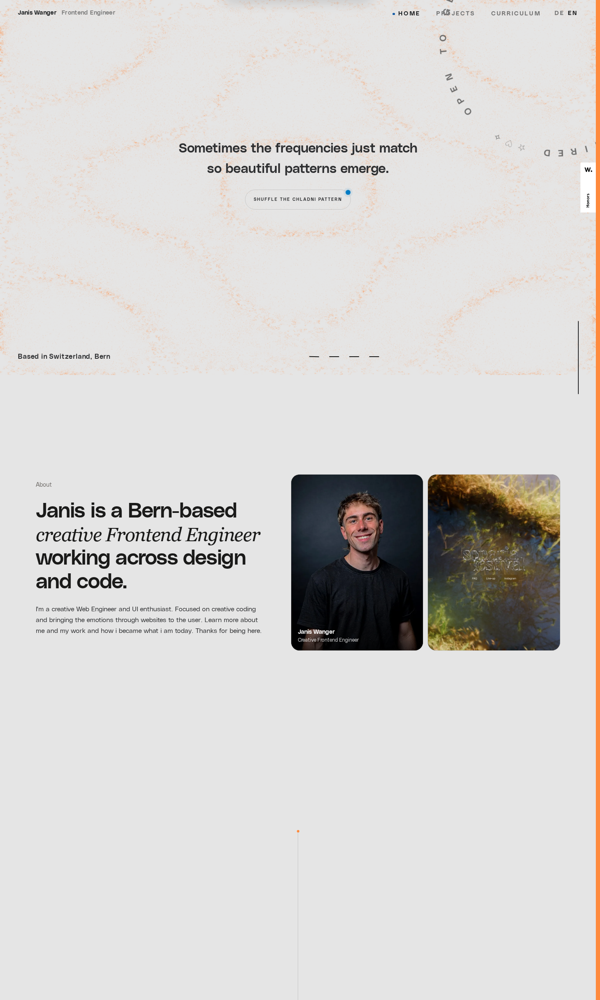
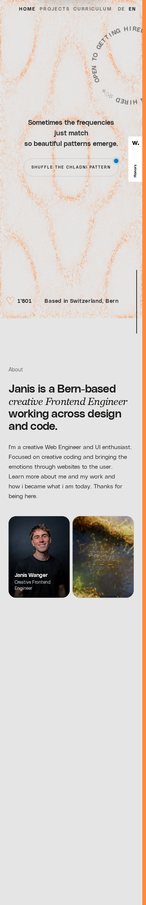

# UI Design System & Master Generation Blueprint: janiswanger-ch

> **Janis Wanger — Creative Engineer in Bern** (https://janiswanger.ch) — Portfolio of Janis Wanger, a creative Frontend Engineer in Bern working across design and code. Projects, experience, and how to get in t...



---

## 1. Executive Visual Persona & Design Archetype

- **Brand Essence & Persona**: **Janis Wanger — Creative Engineer in Bern** (`https://janiswanger.ch`). Portfolio of Janis Wanger, a creative Frontend Engineer in Bern working across design and code. Projects, experience, and how to get in t...
- **Capture Provenance**: Live browser capture (`tier1_fast`, HTTP `200`, captured `2026-11-23`).
- **Visual Archetype**: **Light-Gallery WebGL / Canvas Interactive Experience (`#e5e5e5` / `#007bc4`)**.
- **Anti-AI-Slop Differentiators**:
  - **Live-Computed Chromatic Polarity**: Anchors the viewport in `#e5e5e5` (live computed `body` `background-color` (`computed_styles.json`)) paired with `#1a1a19` primary typography and `#007bc4` accents.
  - **Grounded Typographic Hierarchy**: Pairs `PolySans` for display copy (`Janis is a Bern-based creative Front`) with `PolySans` and `SFMono-Regular`.
  - **Calibrated Spatial Grid & Motion**: Combines `1440px` container bounds (`gap: 8px`, padding `var(--spacing-container-level-1)`) with `cubic-bezier(.4,0,1,1)` easing and GSAP Timeline & ScrollTrigger, Swiper Touch Carousel Engine.

---

## 2. Spatial Architecture & Modular Grid Mathematics



### Viewport Allocation & Container Geometry
- **Captured Viewport Dimensions**: Desktop `1440×2400px` (`assets/desktop.png`, clamped at 2400px live multi-section capture), Mobile `390×2400px` (`assets/mobile.png`, clamped at 2400px live multi-section capture).
- **Master Container Bounds**: `1440px` (full-bleed `100%` desktop stage measured on `1440px` viewport).
- **Canvas Lateral Padding & Spacing**: `var(--spacing-container-level-1)` lateral canvas padding with `8px` grid gap.
- **Border Radius Scale**: `3.35544e+07px`, `.25rem`, `999px`, `50%`.

### Responsive Breakpoint Architecture
- **Desktop Layout**: Multi-column CSS Grid / Flexbox layout at `1440px` (`max-width: 1440px`, `gap: 8px`).
- **Mobile Layout**: Single-column vertical stack at `390px` viewport width with `var(--spacing-container-level-1)` horizontal padding.
- **Extracted CSS Media Queries**: `@media (width>=48rem)`, `@media (prefers-reduced-motion:reduce)`, `@media not all and (width>=64rem)`, `@media not all and (width>=48rem)`.

---

## 3. Color System, Materiality & Atmospheric Lighting

### Semantic Palette & Source Grounding
| Semantic Role | Ground-Truth Value | Extracted Live / CSS Source |
|---|---|---|
| **Primary Canvas Substrate** | `#e5e5e5` | live computed `body` `background-color` (`computed_styles.json`) |
| **Primary Typography Ink** | `#1a1a19` | live computed `h1` `color` (`computed_styles.json`) |
| **Elevated Surface / Card Substrate** | `#ff8a3d` | live computed `footer` `background-color` (`computed_styles.json`) |
| **Interactive Accent / Highlight** | `#007bc4` | `var(--color-accent-inverted)` in `:root` |
| **Secondary / Muted Copy** | `#6d6a66` | `var(--color-muted)` in `:root` |
| **Structural Hairline Border** | `#c8c8c8` | `var(--color-hairline)` in `:root` (`1a1a1924`) |

### Sanitized Root CSS Variables (`ui-ux.md` Ground Truth)
| Variable Name | Extracted Value | Semantic Role |
|---|---|---|
| `--page-transition-duration` | `.45s` | Motion / Easing Token |
| `--page-transition-ease` | `cubic-bezier(.22, 1, .36, 1)` | Motion / Easing Token |
| `--page-transition-blur` | `1rem` | Motion / Easing Token |
| `--spacing-container-level-1` | `4svw` | Layout / Spatial Grid Token |
| `--spacing-container-level-2` | `6svw` | Layout / Spatial Grid Token |
| `--spacing-container-level-3` | `8svw` | Layout / Spatial Grid Token |
| `--spacing-container-level-4` | `10svw` | Layout / Spatial Grid Token |
| `--navbar-height` | `3rem` | Layout / Spatial Grid Token |
| `--font-sans` | `PolySans, ui-sans-serif, system-ui, sans-serif` | Typography / Scale Token |
| `--font-serif` | `Georgia, ui-serif, "Times New Roman", Times, serif` | Typography / Scale Token |
| `--spacing` | `.25rem` | Layout / Spatial Grid Token |
| `--text-xs` | `.75rem` | Typography Ink Token |
| `--text-xs--line-height` | `1.33333` | Typography Ink Token |
| `--text-sm` | `.875rem` | Typography Ink Token |
| `--text-sm--line-height` | `1.42857` | Typography Ink Token |
| `--text-base` | `1rem` | Typography Ink Token |

---

## 4. Typographic Scale & Editorial Hierarchy

### Font Family Stacks
- **Display Typography**: `PolySans`.
- **Primary Body Stack**: `PolySans`.
- **Technical / Metadata Stack**: `SFMono-Regular`.

### Typographic Scale & Rules (Live Computed & Stylesheet Grounded)
- **Hero Display (`H1`)**: live computed `h1` (`font-size: 50.4px`, `line-height: 56.448px`, `font-weight: 700`, `letter-spacing: -1.26px`).
- **Section Heading (`H2`)**: CSS variables `--text-2xl: 1.5rem`, `--text-2xl--line-height: 1.33333`.
- **Body Copy**: live computed `body` (`font-size: 16px`, `line-height: 25.6px`, `font-weight: 400`); CSS variables `--text-base: 1rem`, `--text-base--line-height: 1.5`.
- **Metadata & Navigation Labels**: live computed `nav/a` (`font-size: 16px`, `line-height: 25.6px`, `font-weight: 400`); CSS variables `--text-xs: .75rem`, `--text-xs--line-height: 1.33333`, `--text-sm: .875rem`.

---

## 5. Choreographed Motion & Interaction Physics

### Primary Easing Curves
- **Extracted Timing Functions**: `cubic-bezier(.4,0,1,1)`, `cubic-bezier(0,0,.2,1)`, `cubic-bezier(.4,0,.2,1)`.

### Per-Element Transition & Choreography Rules
- **Selector `layer theme`**: `transition: .15s` extracted from `janiswanger-ch` stylesheet.
- **Selector `.page-leave-active`**: `transition: opacity var(--page-transition-duration) var(--page-transition-...` extracted from `janiswanger-ch` stylesheet.
- **Selector `.site-header`**: `transition: opacity var(--page-transition-duration) var(--page-transition-...` extracted from `janiswanger-ch` stylesheet.
- **Extracted Easing Curve (`cubic-bezier(.4,0,1,1)`)**: Governs interactive state transitions across `<header.hero-home>` and `<section.scroll-mt-navbar-height>`.
- **Runtime Interaction Engine**: Integrates GSAP Timeline & ScrollTrigger, Swiper Touch Carousel Engine, HTML5 `<canvas>` Interactive Viewport Surface with `prefers-reduced-motion: reduce` fallback guards.

---

## 6. Component Wireframe & Structural DOM Map

### Visual Layout Schematic — Desktop (`1440px`, Grounded in `dom.html` & Landmark Bounding Boxes)
```
┌────────────────────────────────────────────────────────────────────────┐
│ DESKTOP VIEWPORT (1440px) — Janis Wanger — Creative Engineer in Bern   │
│ ====================================================================== │
│ [ <header.hero-home> (1430x900px)     | Main navigation              ] │
│ ---------------------------------------------------------------------- │
│ | HERO STAGE: <section.py-32> (w=1430px)                             | │
│ | H1: Janis is a Bern-based creative Frontend Engineer...            | │
│ | Substrate: #e5e5e5 | Ink: #1a1a19 | Accent: #007bc4                | │
│ ---------------------------------------------------------------------- │
│ | SHOWCASE GRID (<section.scroll-mt-navbar-) max-w: 1440px           | │
│ | +------------------------------+  +------------------------------+ | │
│ | | Technical skills             |  | Want to work together ?      | | │
│ | +------------------------------+  +------------------------------+ | │
│ ---------------------------------------------------------------------- │
│ | DETAIL MODULE (<article.skills-enter>) — Will I fit in your of     | │
│ ---------------------------------------------------------------------- │
│ [ FOOTER (<footer.site-footer>) | https://janiswanger.ch               │
└────────────────────────────────────────────────────────────────────────┘
```

### Visual Layout Schematic — Mobile Reflow (`390px`)
```
┌────────────────────────────────────────────────────────────────────────┐
│ MOBILE VIEWPORT REFLOW (390px) — Single-Column Stack (gap: 8px)        │
│ ====================================================================== │
│ [ HEADER BAR (<header.hero-home>      ) | Compact Menu (390px)         │
│ ---------------------------------------------------------------------- │
│ | HERO STAGE (<section.py-32>) — 390px Vertical Lead                 | │
│ | H1: Janis is a Bern-based creative Frontend Engineer...            | │
│ ---------------------------------------------------------------------- │
│ | SHOWCASE STACK (<section.scroll-mt-nav) — 1-Col Stack              | │
│ | [ Item 1: Technical skills                                       ] | │
│ | [ Item 2: Want to work together ?                                ] | │
│ ---------------------------------------------------------------------- │
│ | DETAIL STACK (<article.skills-enter>) — 1-Col (Will I fit in your) | │
│ ---------------------------------------------------------------------- │
│ [ FOOTER (<footer.site-footer>) | Stacked 390px Colophon               │
└────────────────────────────────────────────────────────────────────────┘
```

### Granular DOM Region Breakdown
1. **Brand Header & Navigation Bar (<header.hero-home> — `janiswanger-ch`)**:
   - Landmark `<header class="hero-home gap-2">` (`1430x900px`) hosting `Janis Wanger — Creative Engineer in ` navigation (`Main navigation`), DOM attributes (`data-hid="canonical"`, `data-hid="hreflang-de-CH"`, `data-hid="hreflang-en"`, `data-hid="hreflang-x-default"`), and stylesheet rule `webkit-media-controls { display:none!important }`.
2. **Hero Stage & Focal Lead (<section.py-32> — `Janis is a Bern-based creative Fro`)**:
   - Landmark `<section class="py-32 scroll-mt-navbar-height">` presenting display lead `Janis is a Bern-based creative Frontend Engineer...` and copy excerpt *"Sometimes the frequencies just match"* over `#e5e5e5` canvas and `#1a1a19` ink.
3. **Primary Showcase & Content Grid (<section.scroll-mt-navbar-height> — `Technical skills`)**:
   - Landmark `<section class="py-32 scroll-mt-navbar-height">` rendering section `Technical skills` with copy *"O P E N T O G E T T I N G H I R E D ☆ ♡ ✧ O P E N T O G E T T I N"*, asset references (`entry.CeVzuLMF.css`, `HireBadge.BgIwIulx.css`, `AutoplayVideo.ulh4C2Gx.css`, `DsRIxAzj.js`), and grid rule `it-media-controls-start-playback-... { display:none!important }`.
4. **Interactive Detail & Feature Matrix (<article.skills-enter> — `Want to work together ?`)**:
   - Landmark `<article class="skills-enter relative">` framing `Want to work together ?` and `Will I fit in your office?` (*"so beautiful patterns emerge."*) with `#ff8a3d` surface cards, `#007bc4` accents, and `before { box-sizing:border-box;border:0 solid;margin:0;padding:0 }`.
5. **Colophon & Global Directory Footer (<footer.site-footer> — `https://janiswanger.ch`)**:
   - Landmark `<footer class="site-footer overflow-x-clip">` anchoring `Janis Wanger — Creative Engineer` footer links (`Main navigation`), copy *"Based in Switzerland, Bern"*, and `#c8c8c8` structural dividers.

---

## 7. Master Zero-Shot AI Generation Prompt

```markdown
# Master Zero-Shot Frontend Generation Prompt: janiswanger-ch (Janis Wanger — Creative Engineer in Bern)

You are a principal frontend architect and design systems engineer. Build a complete, production-ready web application replicating the exact design system, DOM landmarks, typographic hierarchy, color tokens, and motion physics of `janiswanger-ch` (**Janis Wanger — Creative Engineer in Bern** — `https://janiswanger.ch`).

### 1. Visual Archetype & Anti-AI-Slop Mandates
- **Archetype**: Light-Gallery WebGL / Canvas Interactive Experience (`#e5e5e5` / `#007bc4`).
- **Identity & Domain Context**: Portfolio of Janis Wanger, a creative Frontend Engineer in Bern working across design and code. Projects, experience, and how to get in t...
- **Primary Substrate**: `#e5e5e5` (live computed `body` `background-color` (`computed_styles.json`)), **Primary Ink**: `#1a1a19`, **Accent / Highlight**: `#007bc4`.
- **Site-Specific Differentiators**:
  - **Live-Computed Chromatic Polarity**: Anchors the viewport in `#e5e5e5` (live computed `body` `background-color` (`computed_styles.json`)) paired with `#1a1a19` primary typography and `#007bc4` accents.
  - **Grounded Typographic Hierarchy**: Pairs `PolySans` for display copy (`Janis is a Bern-based creative Front`) with `PolySans` and `SFMono-Regular`.
  - **Calibrated Spatial Grid & Motion**: Combines `1440px` container bounds (`gap: 8px`, padding `var(--spacing-container-level-1)`) with `cubic-bezier(.4,0,1,1)` easing and GSAP Timeline & ScrollTrigger, Swiper Touch Carousel Engine.

### 2. Ground-Truth CSS Variables (`:root` Token Contract)
Declare and consume these exact custom properties extracted from `janiswanger-ch` in your global stylesheet:

:root {
  /* Janis Wanger — Creative Engineer in Bern (janiswanger-ch) — Live-Grounded CSS Variables */
  --page-transition-duration: .45s; /* Motion / Easing Token (janiswanger-ch) */
  --page-transition-ease: cubic-bezier(.22, 1, .36, 1); /* Motion / Easing Token (janiswanger-ch) */
  --page-transition-blur: 1rem; /* Motion / Easing Token (janiswanger-ch) */
  --spacing-container-level-1: 4svw; /* Layout / Spatial Grid Token (janiswanger-ch) */
  --spacing-container-level-2: 6svw; /* Layout / Spatial Grid Token (janiswanger-ch) */
  --spacing-container-level-3: 8svw; /* Layout / Spatial Grid Token (janiswanger-ch) */
  --spacing-container-level-4: 10svw; /* Layout / Spatial Grid Token (janiswanger-ch) */
  --navbar-height: 3rem; /* Layout / Spatial Grid Token (janiswanger-ch) */
  --font-sans: PolySans, ui-sans-serif, system-ui, sans-serif; /* Typography / Scale Token (janiswanger-ch) */
  --font-serif: Georgia, ui-serif, "Times New Roman", Times, serif; /* Typography / Scale Token (janiswanger-ch) */
  --spacing: .25rem; /* Layout / Spatial Grid Token (janiswanger-ch) */
  --text-xs: .75rem; /* Typography Ink Token (janiswanger-ch) */
  --text-xs--line-height: 1.33333; /* Typography Ink Token (janiswanger-ch) */
  --text-sm: .875rem; /* Typography Ink Token (janiswanger-ch) */
  --text-sm--line-height: 1.42857; /* Typography Ink Token (janiswanger-ch) */
  --text-base: 1rem; /* Typography Ink Token (janiswanger-ch) */
}

### 3. Semantic Color & Materiality Contract
Map every surface, ink, and border strictly to these source-grounded tokens:
- **Primary Canvas Substrate**: `#e5e5e5` — grounded in live computed `body` `background-color` (`computed_styles.json`)
- **Primary Typography Ink**: `#1a1a19` — grounded in live computed `h1` `color` (`computed_styles.json`)
- **Elevated Surface / Card Substrate**: `#ff8a3d` — grounded in live computed `footer` `background-color` (`computed_styles.json`)
- **Interactive Accent / Highlight**: `#007bc4` — grounded in `var(--color-accent-inverted)` in `:root`
- **Secondary / Muted Copy**: `#6d6a66` — grounded in `var(--color-muted)` in `:root`
- **Structural Hairline Border**: `#c8c8c8` — grounded in `var(--color-hairline)` in `:root` (`1a1a1924`)

### 4. Spatial Grid, Container Bounds & Responsive Breakpoints
- **Desktop Viewport Reference**: `1440×2400px` (clamped at 2400px live multi-section capture, `1440px` standard desktop width).
- **Mobile Viewport Reference**: `390×2400px` (clamped at 2400px live multi-section capture, `390px` standard mobile width).
- **Container Max-Width**: `1440px` (full-bleed `100%` desktop stage measured on `1440px` viewport)
- **Padding & Gutters**: `var(--spacing-container-level-1)` lateral canvas padding with `8px` grid gap
- **Desktop Grid**: Multi-column CSS Grid / Flexbox layout at `1440px` (`max-width: 1440px`, `gap: 8px`)
- **Mobile Adaptation**: Single-column vertical stack at `390px` viewport width with `var(--spacing-container-level-1)` horizontal padding
- **Media Queries**: `@media (width>=48rem)`, `@media (prefers-reduced-motion:reduce)`, `@media not all and (width>=64rem)`, `@media not all and (width>=48rem)`
- **Corner Radii**: `3.35544e+07px`, `.25rem`, `999px`, `50%`

### 5. Typography & Editorial Scale Contract
- **Display Font Stack**: `PolySans`
- **Body Font Stack**: `PolySans`
- **Monospace / Technical Font Stack**: `SFMono-Regular`
- **H1 Display Rule**: live computed `h1` (`font-size: 50.4px`, `line-height: 56.448px`, `font-weight: 700`, `letter-spacing: -1.26px`)
- **H2 Section Rule**: CSS variables `--text-2xl: 1.5rem`, `--text-2xl--line-height: 1.33333`
- **Body Copy Rule**: live computed `body` (`font-size: 16px`, `line-height: 25.6px`, `font-weight: 400`); CSS variables `--text-base: 1rem`, `--text-base--line-height: 1.5`
- **Metadata & Index Rule**: live computed `nav/a` (`font-size: 16px`, `line-height: 25.6px`, `font-weight: 400`); CSS variables `--text-xs: .75rem`, `--text-xs--line-height: 1.33333`, `--text-sm: .875rem`

### 6. Component Hierarchy, Verbatim Copy & Real DOM Landmarks
Scaffold `janiswanger-ch` (`Janis Wanger — Creative Engineer in Bern`) with these exact structural regions, extracted copy, and CSS rules from `dom.html`:
1. **Brand Header & Navigation Bar (<header.hero-home> — `janiswanger-ch`)**:
   - DOM & Selectors: Landmark `<header class="hero-home gap-2">` (`1430x900px`) hosting `Janis Wanger — Creative Engineer in ` navigation (`Main navigation`), DOM attributes (`data-hid="canonical"`, `data-hid="hreflang-de-CH"`, `data-hid="hreflang-en"`, `data-hid="hreflang-x-default"`), and stylesheet rule `webkit-media-controls { display:none!important }`.
   - Responsive Contract: Header `Brand Header & Navigation Bar (<header.hero-home> — `janiswanger-ch`)` (`janiswanger-ch`) adapts across `@media (width>=48rem)`, `@media (prefers-reduced-motion:reduce)`, `@media not all and (width>=64rem)`, `@media not all and (width>=48rem)` with `cubic-bezier(.4,0,1,1)`, `cubic-bezier(0,0,.2,1)`, `cubic-bezier(.4,0,.2,1)` transitions and links `Main navigation`.
2. **Hero Stage & Focal Lead (<section.py-32> — `Janis is a Bern-based creative Fro`)**:
   - DOM & Selectors: Landmark `<section class="py-32 scroll-mt-navbar-height">` presenting display lead `Janis is a Bern-based creative Frontend Engineer...` and copy excerpt *"Sometimes the frequencies just match"* over `#e5e5e5` canvas and `#1a1a19` ink.
   - Responsive Contract: Hero stage (`1440×2400px` desktop / `390×2400px` mobile) sets `#e5e5e5` background with `#1a1a19` headline `Janis is a Bern-based creative Frontend Engineer...`.
3. **Primary Showcase & Content Grid (<section.scroll-mt-navbar-height> — `Technical skills`)**:
   - DOM & Selectors: Landmark `<section class="py-32 scroll-mt-navbar-height">` rendering section `Technical skills` with copy *"O P E N T O G E T T I N G H I R E D ☆ ♡ ✧ O P E N T O G E T T I N"*, asset references (`entry.CeVzuLMF.css`, `HireBadge.BgIwIulx.css`, `AutoplayVideo.ulh4C2Gx.css`, `DsRIxAzj.js`), and grid rule `it-media-controls-start-playback-... { display:none!important }`.
   - Responsive Contract: Showcase grid `Primary Showcase & Content Grid (<section.scroll-mt-navbar-height> — `Technical skills`)` applies Multi-column CSS Grid / Flexbox layout at `1440px` (`max-width: 1440px`, `gap: 8px`) on desktop and Single-column vertical stack at `390px` viewport width with `var(--spacing-container-level-1)` horizontal padding on mobile.
4. **Interactive Detail & Feature Matrix (<article.skills-enter> — `Want to work together ?`)**:
   - DOM & Selectors: Landmark `<article class="skills-enter relative">` framing `Want to work together ?` and `Will I fit in your office?` (*"so beautiful patterns emerge."*) with `#ff8a3d` surface cards, `#007bc4` accents, and `before { box-sizing:border-box;border:0 solid;margin:0;padding:0 }`.
   - Responsive Contract: Detail module `Interactive Detail & Feature Matrix (<article.skills-enter> — `Want to work together ?`)` uses `3.35544e+07px`, `.25rem`, `999px`, `50%` radii, `#007bc4` highlights, and assets (entry.CeVzuLMF.css, HireBadge.BgIwIulx.css, AutoplayVideo.ulh4C2Gx.css).
5. **Colophon & Global Directory Footer (<footer.site-footer> — `https://janiswanger.ch`)**:
   - DOM & Selectors: Landmark `<footer class="site-footer overflow-x-clip">` anchoring `Janis Wanger — Creative Engineer` footer links (`Main navigation`), copy *"Based in Switzerland, Bern"*, and `#c8c8c8` structural dividers.
   - Responsive Contract: Footer `Colophon & Global Directory Footer (<footer.site-footer> — `https://janiswanger.ch`)` aligns to `1440px` (full-bleed `100%` desktop stage measured on `1440px` viewport) with `var(--spacing-container-level-1)` lateral canvas padding with `8px` grid gap and attributes (data-hid="canonical", data-hid="hreflang-de-CH", data-hid="hreflang-en").

#### Verbatim DOM Copy Excerpts (`dom.html`)
- Copy Excerpt 1: *"Sometimes the frequencies just match"*
- Copy Excerpt 2: *"O P E N T O G E T T I N G H I R E D ☆ ♡ ✧ O P E N T O G E T T I N G H I R E D ☆ ♡ ✧"*
- Copy Excerpt 3: *"so beautiful patterns emerge."*
- Copy Excerpt 4: *"Based in Switzerland, Bern"*

### 7. Motion, Extracted Stylesheet Rules & Interaction Choreography
- **Primary Easing Functions**: `cubic-bezier(.4,0,1,1)`, `cubic-bezier(0,0,.2,1)`, `cubic-bezier(.4,0,.2,1)`
- **Extracted Stylesheet Rules (`janiswanger-ch`)**:
- `webkit-media-controls { display:none!important }`
- `it-media-controls-start-playback-... { display:none!important }`
- `before { box-sizing:border-box;border:0 solid;margin:0;padding:0 }`
- `file-selector-button { box-sizing:border-box;border:0 solid;margin:0;padding:0 }`
- `strong { font-weight:bolder }`
- **Per-Selector Transition Rules**:
- **Selector `layer theme`**: `transition: .15s` extracted from `janiswanger-ch` stylesheet.
- **Selector `.page-leave-active`**: `transition: opacity var(--page-transition-duration) var(--page-transition-...` extracted from `janiswanger-ch` stylesheet.
- **Selector `.site-header`**: `transition: opacity var(--page-transition-duration) var(--page-transition-...` extracted from `janiswanger-ch` stylesheet.
- **Extracted Easing Curve (`cubic-bezier(.4,0,1,1)`)**: Governs interactive state transitions across `<header.hero-home>` and `<section.scroll-mt-navbar-height>`.
- **Runtime Interaction Engine**: Integrates GSAP Timeline & ScrollTrigger, Swiper Touch Carousel Engine, HTML5 `<canvas>` Interactive Viewport Surface with `prefers-reduced-motion: reduce` fallback guards.

### 8. Technical Deliverables
- Implement in Next.js (App Router) with TypeScript and Tailwind CSS consuming the `:root` custom properties defined above for `janiswanger-ch`.
- Reproduce both the `1440px` desktop architecture and `390px` mobile breakpoint transitions, preserving semantic HTML5 landmarks (`<header>`, `<nav>`, `<main>`, `<section>`, `<footer>`) and `prefers-reduced-motion` accessibility guards.
```
