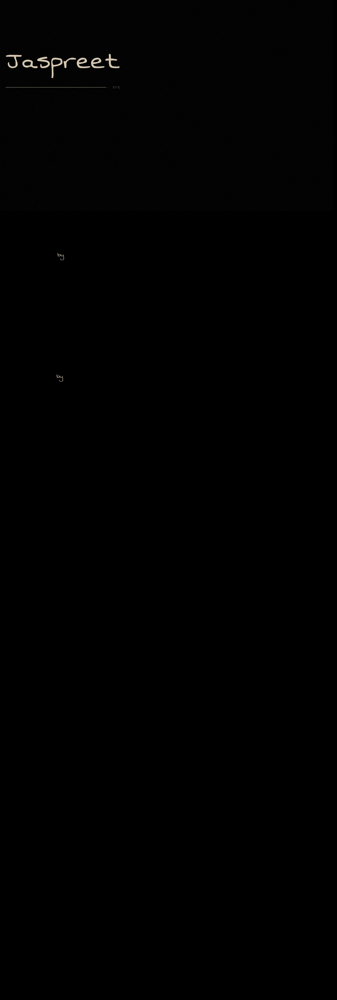
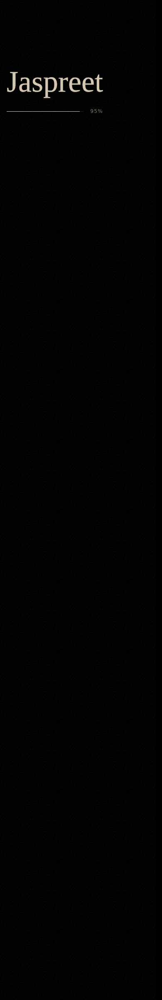

# UI Design System & Master Generation Blueprint: jaspreetsingh-xyz

> **Jaspreet Singh · Designer & Developer** (https://jaspreetsingh.xyz/) — Jaspreet Singh designs and builds products that make complex things feel simple, from UX and design systems to production front-end engin...



---

## 1. Executive Visual Persona & Design Archetype

- **Brand Essence & Persona**: **Jaspreet Singh · Designer & Developer** (`https://jaspreetsingh.xyz/`). Jaspreet Singh designs and builds products that make complex things feel simple, from UX and design systems to production front-end engin...
- **Visual Archetype**: **Dark-Substrate WebGL / Canvas Interactive Experience (`#000` / `#2f2c29`)**.
- **Anti-AI-Slop Differentiators**:
  - **Source-Grounded Chromatic Polarity**: Anchors the viewport in `#000` (`var(--color-black)` in `:root`) paired with `#fff` primary typography and `#2f2c29` accents.
  - **Extracted Typographic Hierarchy**: Pairs `Inter` for display copy (`Hello, I'm Jaspreet`) with `Swanky and Moo Moo` and `SFMono-Regular`.
  - **Calibrated Spatial Grid & Motion**: Combines `var(--container-2xl)` container bounds (`gap: 1px`, padding `16px`) with `cubic-bezier(0,0,.2,1)` easing and Three.js / WebGL Canvas Pipeline.

---

## 2. Spatial Architecture & Modular Grid Mathematics



### Viewport Allocation & Container Geometry
- **Captured Viewport Dimensions**: Desktop `1440×4265px` (`assets/desktop.png`, full-page scroll capture), Mobile `390×2400px` (`assets/mobile.png`, capped at 2400px multi-section capture).
- **Master Container Bounds**: `var(--container-2xl)` extracted from `jaspreetsingh-xyz` stylesheet.
- **Canvas Lateral Padding & Spacing**: `16px` lateral canvas padding with `1px` grid gap.
- **Border Radius Scale**: `.25rem`, `var(--radius-2xl)`, `var(--radius-lg)`, `var(--radius-md)`.

### Responsive Breakpoint Architecture
- **Desktop Layout**: Multi-column CSS Grid / Flexbox layout at `1440px` (`max-width: var(--container-2xl)`, `gap: 1px`).
- **Mobile Layout**: Single-column vertical stack at `390px` viewport width with `16px` horizontal padding.
- **Extracted CSS Media Queries**: `@media (prefers-reduced-motion:reduce)`, `@media not all and (min-width:40rem)`, `@media (min-width:40rem)`, `@media (min-width:48rem)`.

---

## 3. Color System, Materiality & Atmospheric Lighting

### Semantic Palette & Source Grounding
| Semantic Role | Ground-Truth Value | Extracted CSS Source / Selector |
|---|---|---|
| **Primary Canvas Substrate** | `#000` | `var(--color-black)` in `:root` |
| **Primary Typography Ink** | `#fff` | `var(--color-white)` in `:root` |
| **Elevated Surface / Card Substrate** | `#f7f4ed` | `var(--color-case-ground)` in `:root` |
| **Interactive Accent / Highlight** | `#2f2c29` | `var(--color-case-ink)` in `:root` |
| **Secondary / Muted Copy** | `#625b52` | `var(--color-case-muted)` in `:root` |
| **Structural Hairline Border** | `#4b453e` | `var(--color-case-header-muted)` in `:root` |

### Sanitized Root CSS Variables (`ui-ux.md` Ground Truth)
| Variable Name | Extracted Value | Semantic Role |
|---|---|---|
| `--color-red-100` | `oklch(93.6% .032 17.717)` | Brand / Palette Token |
| `--color-red-500` | `oklch(63.7% .237 25.331)` | Brand / Palette Token |
| `--color-red-950` | `oklch(25.8% .092 26.042)` | Brand / Palette Token |
| `--color-orange-200` | `oklch(90.1% .076 70.697)` | Brand / Palette Token |
| `--color-orange-700` | `oklch(55.3% .195 38.402)` | Brand / Palette Token |
| `--color-orange-800` | `oklch(47% .157 37.304)` | Brand / Palette Token |
| `--color-orange-950` | `oklch(26.6% .079 36.259)` | Brand / Palette Token |
| `--color-amber-100` | `oklch(96.2% .059 95.617)` | Brand / Palette Token |
| `--color-amber-400` | `oklch(82.8% .189 84.429)` | Brand / Palette Token |
| `--color-amber-950` | `oklch(27.9% .077 45.635)` | Brand / Palette Token |
| `--color-emerald-100` | `oklch(95% .052 163.051)` | Brand / Palette Token |
| `--color-emerald-500` | `oklch(69.6% .17 162.48)` | Brand / Palette Token |
| `--color-emerald-950` | `oklch(26.2% .051 172.552)` | Brand / Palette Token |
| `--color-blue-50` | `oklch(97% .014 254.604)` | Brand / Palette Token |
| `--color-blue-100` | `oklch(93.2% .032 255.585)` | Brand / Palette Token |
| `--color-blue-500` | `oklch(62.3% .214 259.815)` | Brand / Palette Token |

---

## 4. Typographic Scale & Editorial Hierarchy

### Font Family Stacks
- **Display Typography**: `Inter`.
- **Primary Body Stack**: `Swanky and Moo Moo`.
- **Technical / Metadata Stack**: `SFMono-Regular`.

### Typographic Scale & Rules (Extracted from Stylesheet & Variables)
- **Hero Display (`H1`)**: CSS variables `--text-4xl: 2.25rem`, `--text-4xl--line-height: calc(2.5 / 2.25)`, `--text-5xl: 3rem`.
- **Section Heading (`H2`)**: CSS variables `--text-2xl: 1.5rem`, `--text-2xl--line-height: calc(2 / 1.5)`, `--text-3xl: 1.875rem`.
- **Body Copy**: CSS variables `--text-base: 1rem`, `--text-base--line-height: 1.5`; rule `p` (`font-size: var(--text-sm)`, `line-height: var(--tw-leading,var(...`).
- **Metadata & Navigation Labels**: CSS variables `--text-xs: .75rem`, `--text-xs--line-height: calc(1 / .75)`, `--text-sm: .875rem`.

---

## 5. Choreographed Motion & Interaction Physics

### Primary Easing Curves
- **Extracted Timing Functions**: `cubic-bezier(0,0,.2,1)`, `cubic-bezier(.4,0,.2,1)`, `cubic-bezier(.16,1,.3,1)`.

### Per-Element Transition & Choreography Rules
- **Selector `layer theme`**: `transition: .15s` extracted from `jaspreetsingh-xyz` stylesheet.
- **Selector `.transition`**: `transition: var(--tw-ease,var(--default-transition-timing-function))` extracted from `jaspreetsingh-xyz` stylesheet.
- **Selector `.transition-colors`**: `transition: var(--tw-ease,var(--default-transition-timing-function))` extracted from `jaspreetsingh-xyz` stylesheet.
- **Extracted Easing Curve (`cubic-bezier(0,0,.2,1)`)**: Governs interactive state transitions across `<header.box-border>` and `<section.site-container>`.
- **Runtime Interaction Engine**: Integrates Three.js / WebGL Canvas Pipeline with `prefers-reduced-motion: reduce` fallback guards.

---

## 6. Component Wireframe & Structural DOM Map

### Visual Layout Schematic (Grounded in `dom.html` — `1440px` Desktop & `390px` Mobile Reflow)
```
┌────────────────────────────────────────────────────────────────────────┐
│ DESKTOP VIEWPORT (1440px) — Jaspreet Singh · Designer & Developer      │
│ ====================================================================== │
│ [ <header.box-border>      | About About · Work Work · Contact Cont ]  │
│ ---------------------------------------------------------------------- │
│ | HERO STAGE: <section.site-container>                             |   │
│ | H1: Hello, I'm Jaspreet                                          |   │
│ | Substrate: #000       | Ink: #fff       | Accent: #2f2c29        |   │
│ ---------------------------------------------------------------------- │
│ | SHOWCASE GRID (<section.site-container>  ) max-w: var(--containe |   │
│ | +------------------------------+  +------------------------------+ | │
│ | | Designer, Developer by profe |  | Polymath by ambition         | | │
│ | +------------------------------+  +------------------------------+ | │
│ ---------------------------------------------------------------------- │
│ | MOBILE VIEWPORT REFLOW (390px) — Single-Column Stack (gap: 1px   ) | │
│ | [<header.box-border] -> [<section.site-cont] -> [<section.site-cont] │
│ ---------------------------------------------------------------------- │
│ [ FOOTER (<footer.relative>     ) | https://jaspreetsingh.xyz/         │
└────────────────────────────────────────────────────────────────────────┘
```

### Granular DOM Region Breakdown
1. **Brand Header & Navigation Bar (<header.box-border> — `jaspreetsingh-xyz`)**:
   - Landmark `<header class="box-border absolute">` hosting `Jaspreet Singh · Designer & Develope` navigation (`About About · Work Work · Contact Contact`), DOM attributes (`data-portfolio-hydrated="true"`, `data-slot="link"`, `data-slot="link"`, `data-slot="link"`), and stylesheet rule `backdrop { box-sizing:border-box;border:0 solid;margin:0;padding:0 }`.
2. **Hero Stage & Focal Lead (<section.site-container> — `Hello, I'm Jaspreet`)**:
   - Landmark `<section class="site-container relative">` presenting display lead `Hello, I'm Jaspreet` and copy excerpt *"Designer & Developer"* over `#000` canvas and `#fff` ink.
3. **Primary Showcase & Content Grid (<section.site-container> — `Designer, Developer by profession`)**:
   - Landmark `<section class="site-container relative">` rendering section `Designer, Developer by profession` with copy *"Hello, I'm Jaspreet"*, asset references (`main-BQKRg_5e.js`, `vendor-CUM6pZK6.js`, `motion-DEa3jZ1l.js`, `index-CCN64OyI.js`), and grid rule `file-selector-button { box-sizing:border-box;border:0 solid;margin:0;padding:0 }`.
4. **Interactive Detail & Feature Matrix (<article.relative> — `Polymath by ambition`)**:
   - Landmark `<article class="relative block">` framing `Polymath by ambition` and `Selected works` (*"I design and build digital products for a living. Still figuring "*) with `#f7f4ed` surface cards, `#2f2c29` accents, and `strong { font-weight:bolder }`.
5. **Colophon & Global Directory Footer (<footer.relative> — `https://jaspreetsingh.xyz/`)**:
   - Landmark `<footer class="relative pt-16">` anchoring `Jaspreet Singh · Designer & Deve` footer links (`About About · Work Work · Contact Contact`), copy *"I design and build digital products for a living."*, and `#4b453e` structural dividers.

---

## 7. Master Zero-Shot AI Generation Prompt

```markdown
# Master Zero-Shot Frontend Generation Prompt: jaspreetsingh-xyz (Jaspreet Singh · Designer & Developer)

You are a principal frontend architect and design systems engineer. Build a complete, production-ready web application replicating the exact design system, DOM landmarks, typographic hierarchy, color tokens, and motion physics of `jaspreetsingh-xyz` (**Jaspreet Singh · Designer & Developer** — `https://jaspreetsingh.xyz/`).

### 1. Visual Archetype & Anti-AI-Slop Mandates
- **Archetype**: Dark-Substrate WebGL / Canvas Interactive Experience (`#000` / `#2f2c29`).
- **Identity & Domain Context**: Jaspreet Singh designs and builds products that make complex things feel simple, from UX and design systems to production front-end engin...
- **Primary Substrate**: `#000` (`var(--color-black)` in `:root`), **Primary Ink**: `#fff`, **Accent / Highlight**: `#2f2c29`.
- **Site-Specific Differentiators**:
  - **Source-Grounded Chromatic Polarity**: Anchors the viewport in `#000` (`var(--color-black)` in `:root`) paired with `#fff` primary typography and `#2f2c29` accents.
  - **Extracted Typographic Hierarchy**: Pairs `Inter` for display copy (`Hello, I'm Jaspreet`) with `Swanky and Moo Moo` and `SFMono-Regular`.
  - **Calibrated Spatial Grid & Motion**: Combines `var(--container-2xl)` container bounds (`gap: 1px`, padding `16px`) with `cubic-bezier(0,0,.2,1)` easing and Three.js / WebGL Canvas Pipeline.

### 2. Ground-Truth CSS Variables (`:root` Token Contract)
Declare and consume these exact custom properties extracted from `jaspreetsingh-xyz` in your global stylesheet:

:root {
  /* Jaspreet Singh · Designer & Developer (jaspreetsingh-xyz) — Ground-Truth Extracted CSS Variables */
  --color-red-100: oklch(93.6% .032 17.717); /* Brand / Palette Token (jaspreetsingh-xyz) */
  --color-red-500: oklch(63.7% .237 25.331); /* Brand / Palette Token (jaspreetsingh-xyz) */
  --color-red-950: oklch(25.8% .092 26.042); /* Brand / Palette Token (jaspreetsingh-xyz) */
  --color-orange-200: oklch(90.1% .076 70.697); /* Brand / Palette Token (jaspreetsingh-xyz) */
  --color-orange-700: oklch(55.3% .195 38.402); /* Brand / Palette Token (jaspreetsingh-xyz) */
  --color-orange-800: oklch(47% .157 37.304); /* Brand / Palette Token (jaspreetsingh-xyz) */
  --color-orange-950: oklch(26.6% .079 36.259); /* Brand / Palette Token (jaspreetsingh-xyz) */
  --color-amber-100: oklch(96.2% .059 95.617); /* Brand / Palette Token (jaspreetsingh-xyz) */
  --color-amber-400: oklch(82.8% .189 84.429); /* Brand / Palette Token (jaspreetsingh-xyz) */
  --color-amber-950: oklch(27.9% .077 45.635); /* Brand / Palette Token (jaspreetsingh-xyz) */
  --color-emerald-100: oklch(95% .052 163.051); /* Brand / Palette Token (jaspreetsingh-xyz) */
  --color-emerald-500: oklch(69.6% .17 162.48); /* Brand / Palette Token (jaspreetsingh-xyz) */
  --color-emerald-950: oklch(26.2% .051 172.552); /* Brand / Palette Token (jaspreetsingh-xyz) */
  --color-blue-50: oklch(97% .014 254.604); /* Brand / Palette Token (jaspreetsingh-xyz) */
  --color-blue-100: oklch(93.2% .032 255.585); /* Brand / Palette Token (jaspreetsingh-xyz) */
  --color-blue-500: oklch(62.3% .214 259.815); /* Brand / Palette Token (jaspreetsingh-xyz) */
}

### 3. Semantic Color & Materiality Contract
Map every surface, ink, and border strictly to these source-grounded tokens:
- **Primary Canvas Substrate**: `#000` — grounded in `var(--color-black)` in `:root`
- **Primary Typography Ink**: `#fff` — grounded in `var(--color-white)` in `:root`
- **Elevated Surface / Card Substrate**: `#f7f4ed` — grounded in `var(--color-case-ground)` in `:root`
- **Interactive Accent / Highlight**: `#2f2c29` — grounded in `var(--color-case-ink)` in `:root`
- **Secondary / Muted Copy**: `#625b52` — grounded in `var(--color-case-muted)` in `:root`
- **Structural Hairline Border**: `#4b453e` — grounded in `var(--color-case-header-muted)` in `:root`

### 4. Spatial Grid, Container Bounds & Responsive Breakpoints
- **Desktop Viewport Reference**: `1440×4265px` (full-page scroll capture, `1440px` standard desktop width).
- **Mobile Viewport Reference**: `390×2400px` (capped at 2400px multi-section capture, `390px` standard mobile width).
- **Container Max-Width**: `var(--container-2xl)` extracted from `jaspreetsingh-xyz` stylesheet
- **Padding & Gutters**: `16px` lateral canvas padding with `1px` grid gap
- **Desktop Grid**: Multi-column CSS Grid / Flexbox layout at `1440px` (`max-width: var(--container-2xl)`, `gap: 1px`)
- **Mobile Adaptation**: Single-column vertical stack at `390px` viewport width with `16px` horizontal padding
- **Media Queries**: `@media (prefers-reduced-motion:reduce)`, `@media not all and (min-width:40rem)`, `@media (min-width:40rem)`, `@media (min-width:48rem)`
- **Corner Radii**: `.25rem`, `var(--radius-2xl)`, `var(--radius-lg)`, `var(--radius-md)`

### 5. Typography & Editorial Scale Contract
- **Display Font Stack**: `Inter`
- **Body Font Stack**: `Swanky and Moo Moo`
- **Monospace / Technical Font Stack**: `SFMono-Regular`
- **H1 Display Rule**: CSS variables `--text-4xl: 2.25rem`, `--text-4xl--line-height: calc(2.5 / 2.25)`, `--text-5xl: 3rem`
- **H2 Section Rule**: CSS variables `--text-2xl: 1.5rem`, `--text-2xl--line-height: calc(2 / 1.5)`, `--text-3xl: 1.875rem`
- **Body Copy Rule**: CSS variables `--text-base: 1rem`, `--text-base--line-height: 1.5`; rule `p` (`font-size: var(--text-sm)`, `line-height: var(--tw-leading,var(...`)
- **Metadata & Index Rule**: CSS variables `--text-xs: .75rem`, `--text-xs--line-height: calc(1 / .75)`, `--text-sm: .875rem`

### 6. Component Hierarchy, Verbatim Copy & Real DOM Landmarks
Scaffold `jaspreetsingh-xyz` (`Jaspreet Singh · Designer & Developer`) with these exact structural regions, extracted copy, and CSS rules from `dom.html`:
1. **Brand Header & Navigation Bar (<header.box-border> — `jaspreetsingh-xyz`)**:
   - DOM & Selectors: Landmark `<header class="box-border absolute">` hosting `Jaspreet Singh · Designer & Develope` navigation (`About About · Work Work · Contact Contact`), DOM attributes (`data-portfolio-hydrated="true"`, `data-slot="link"`, `data-slot="link"`, `data-slot="link"`), and stylesheet rule `backdrop { box-sizing:border-box;border:0 solid;margin:0;padding:0 }`.
   - Responsive Contract: Header `Brand Header & Navigation Bar (<header.box-border> — `jaspreetsingh-xyz`)` (`jaspreetsingh-xyz`) adapts across `@media (prefers-reduced-motion:reduce)`, `@media not all and (min-width:40rem)`, `@media (min-width:40rem)`, `@media (min-width:48rem)` with `cubic-bezier(0,0,.2,1)`, `cubic-bezier(.4,0,.2,1)`, `cubic-bezier(.16,1,.3,1)` transitions and links `About About · Work Work · Contact Contact`.
2. **Hero Stage & Focal Lead (<section.site-container> — `Hello, I'm Jaspreet`)**:
   - DOM & Selectors: Landmark `<section class="site-container relative">` presenting display lead `Hello, I'm Jaspreet` and copy excerpt *"Designer & Developer"* over `#000` canvas and `#fff` ink.
   - Responsive Contract: Hero stage (`1440×4265px` desktop / `390×2400px` mobile) sets `#000` background with `#fff` headline `Hello, I'm Jaspreet`.
3. **Primary Showcase & Content Grid (<section.site-container> — `Designer, Developer by profession`)**:
   - DOM & Selectors: Landmark `<section class="site-container relative">` rendering section `Designer, Developer by profession` with copy *"Hello, I'm Jaspreet"*, asset references (`main-BQKRg_5e.js`, `vendor-CUM6pZK6.js`, `motion-DEa3jZ1l.js`, `index-CCN64OyI.js`), and grid rule `file-selector-button { box-sizing:border-box;border:0 solid;margin:0;padding:0 }`.
   - Responsive Contract: Showcase grid `Primary Showcase & Content Grid (<section.site-container> — `Designer, Developer by profession`)` applies Multi-column CSS Grid / Flexbox layout at `1440px` (`max-width: var(--container-2xl)`, `gap: 1px`) on desktop and Single-column vertical stack at `390px` viewport width with `16px` horizontal padding on mobile.
4. **Interactive Detail & Feature Matrix (<article.relative> — `Polymath by ambition`)**:
   - DOM & Selectors: Landmark `<article class="relative block">` framing `Polymath by ambition` and `Selected works` (*"I design and build digital products for a living. Still figuring "*) with `#f7f4ed` surface cards, `#2f2c29` accents, and `strong { font-weight:bolder }`.
   - Responsive Contract: Detail module `Interactive Detail & Feature Matrix (<article.relative> — `Polymath by ambition`)` uses `.25rem`, `var(--radius-2xl)`, `var(--radius-lg)`, `var(--radius-md)` radii, `#2f2c29` highlights, and assets (main-BQKRg_5e.js, vendor-CUM6pZK6.js, motion-DEa3jZ1l.js).
5. **Colophon & Global Directory Footer (<footer.relative> — `https://jaspreetsingh.xyz/`)**:
   - DOM & Selectors: Landmark `<footer class="relative pt-16">` anchoring `Jaspreet Singh · Designer & Deve` footer links (`About About · Work Work · Contact Contact`), copy *"I design and build digital products for a living."*, and `#4b453e` structural dividers.
   - Responsive Contract: Footer `Colophon & Global Directory Footer (<footer.relative> — `https://jaspreetsingh.xyz/`)` aligns to `var(--container-2xl)` extracted from `jaspreetsingh-xyz` stylesheet with `16px` lateral canvas padding with `1px` grid gap and attributes (data-portfolio-hydrated="true", data-slot="link", data-slot="link").

#### Verbatim DOM Copy Excerpts (`dom.html`)
- Copy Excerpt 1: *"Designer & Developer"*
- Copy Excerpt 2: *"Hello, I'm Jaspreet"*
- Copy Excerpt 3: *"I design and build digital products for a living. Still figuring out the living part."*
- Copy Excerpt 4: *"I design and build digital products for a living."*

### 7. Motion, Extracted Stylesheet Rules & Interaction Choreography
- **Primary Easing Functions**: `cubic-bezier(0,0,.2,1)`, `cubic-bezier(.4,0,.2,1)`, `cubic-bezier(.16,1,.3,1)`
- **Extracted Stylesheet Rules (`jaspreetsingh-xyz`)**:
- `backdrop { box-sizing:border-box;border:0 solid;margin:0;padding:0 }`
- `file-selector-button { box-sizing:border-box;border:0 solid;margin:0;padding:0 }`
- `strong { font-weight:bolder }`
- `small { font-size:80% }`
- `sup { vertical-align:baseline;font-size:75%;line-height:0;position:relative }`
- **Per-Selector Transition Rules**:
- **Selector `layer theme`**: `transition: .15s` extracted from `jaspreetsingh-xyz` stylesheet.
- **Selector `.transition`**: `transition: var(--tw-ease,var(--default-transition-timing-function))` extracted from `jaspreetsingh-xyz` stylesheet.
- **Selector `.transition-colors`**: `transition: var(--tw-ease,var(--default-transition-timing-function))` extracted from `jaspreetsingh-xyz` stylesheet.
- **Extracted Easing Curve (`cubic-bezier(0,0,.2,1)`)**: Governs interactive state transitions across `<header.box-border>` and `<section.site-container>`.
- **Runtime Interaction Engine**: Integrates Three.js / WebGL Canvas Pipeline with `prefers-reduced-motion: reduce` fallback guards.

### 8. Technical Deliverables
- Implement in Next.js (App Router) with TypeScript and Tailwind CSS consuming the `:root` custom properties defined above for `jaspreetsingh-xyz`.
- Reproduce both the `1440px` desktop architecture and `390px` mobile breakpoint transitions, preserving semantic HTML5 landmarks (`<header>`, `<nav>`, `<main>`, `<section>`, `<footer>`) and `prefers-reduced-motion` accessibility guards.
```
