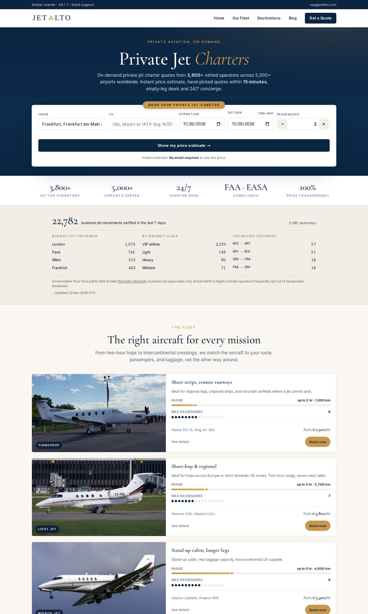

# UI Design System & Master Generation Blueprint: jetalto-com

> **JetALto, Private Jet Charter · Fly Anywhere, On Your Schedule** (https://jetalto.com/) — Instant private jet charter quotes from vetted operators. On-demand flights to 5,000+ airports worldwide. Empty-leg alerts, transparent p...



---

## 1. Executive Visual Persona & Design Archetype

- **Brand Essence & Persona**: **JetALto, Private Jet Charter · Fly Anywhere, On Your Schedule** (`https://jetalto.com/`). Instant private jet charter quotes from vetted operators. On-demand flights to 5,000+ airports worldwide. Empty-leg alerts, transparent p...
- **Visual Archetype**: **Light-Substrate Editorial & Modular Grid System (`#ccc` canvas, `#0b1220` ink, `#122d4d` accent)**.
- **Anti-AI-Slop Differentiators**:
  - **Source-Grounded Chromatic Polarity**: Anchors the viewport in `#ccc` (`var(--iti-border-color)` in `:root`) paired with `#0b1220` primary typography and `#122d4d` accents.
  - **Extracted Typographic Hierarchy**: Pairs `Cormorant Garamond` for display copy (`Private Jet Charters`) with `Inter` and `SFMono-Regular`.
  - **Calibrated Spatial Grid & Motion**: Combines `500px` container bounds (`gap: 5px`, padding `7px`) with `cubic-bezier(0.36,0.07,0.19,0.97)` easing and Three.js / WebGL Canvas Pipeline.

---

## 2. Spatial Architecture & Modular Grid Mathematics


### Viewport Allocation & Container Geometry
- **Captured Viewport Dimensions**: Desktop `1440×17478px` (`assets/desktop.png`, full-page scroll capture), Mobile `390×2400px` (`assets/mobile.png`, capped at 2400px multi-section capture).
- **Master Container Bounds**: `500px` extracted from `jetalto-com` stylesheet.
- **Canvas Lateral Padding & Spacing**: `7px` lateral canvas padding with `5px` grid gap.
- **Border Radius Scale**: `3px`, `1px`, `50%`, `8px`.

### Responsive Breakpoint Architecture
- **Desktop Layout**: Multi-column CSS Grid / Flexbox layout at `1440px` (`max-width: 500px`, `gap: 5px`).
- **Mobile Layout**: Single-column vertical stack at `390px` viewport width with `7px` horizontal padding.
- **Extracted CSS Media Queries**: `@media (max-width: 500px)`, `@media (prefers-reduced-motion: reduce)`, `@media (max-width:480px)`, `@media (max-width:600px)`.

---

## 3. Color System, Materiality & Atmospheric Lighting

### Semantic Palette & Source Grounding
| Semantic Role | Ground-Truth Value | Extracted CSS Source / Selector |
|---|---|---|
| **Primary Canvas Substrate** | `#ccc` | `var(--iti-border-color)` in `:root` |
| **Primary Typography Ink** | `#555` | `var(--iti-icon-color)` in `:root` |
| **Elevated Surface / Card Substrate** | `#0a2540` | `var(--navy)` in `:root` |
| **Interactive Accent / Highlight** | `#122d4d` | `var(--navy-2)` in `:root` |
| **Secondary / Muted Copy** | `#1a3860` | `var(--navy-3)` in `:root` |
| **Structural Hairline Border** | `#0b1220` | `var(--ink)` in `:root` |

### Sanitized Root CSS Variables (`ui-ux.md` Ground Truth)
| Variable Name | Extracted Value | Semantic Role |
|---|---|---|
| `--iti-flag-width` | `20px` | Layout / Spatial Grid Token |
| `--iti-flag-count` | `244` | Design System Custom Token |
| `--iti-flag-offset` | `0` | Design System Custom Token |
| `--iti-hover-color` | `rgba(0, 0, 0, 0.05)` | Brand / Palette Token |
| `--iti-border-color` | `#ccc` | Brand / Palette Token |
| `--iti-country-selector-bg` | `white` | Canvas / Surface Token |
| `--iti-icon-color` | `#555` | Brand / Palette Token |
| `--iti-spacer-horizontal` | `10px` | Layout / Spatial Grid Token |
| `--iti-flag-height` | `calc(var(--iti-flag-width) * 3 / 4)` | Layout / Spatial Grid Token |
| `--iti-globe-icon-size` | `17px` | Layout / Spatial Grid Token |
| `--iti-clear-icon-size` | `15px` | Layout / Spatial Grid Token |
| `--iti-close-icon-size` | `20px` | Layout / Spatial Grid Token |
| `--iti-border-width` | `1px` | Layout / Spatial Grid Token |
| `--iti-arrow-size` | `5px` | Layout / Spatial Grid Token |
| `--iti-arrow-width` | `1.5px` | Layout / Spatial Grid Token |
| `--iti-arrow-padding` | `7px` | Layout / Spatial Grid Token |

---

## 4. Typographic Scale & Editorial Hierarchy

### Font Family Stacks
- **Display Typography**: `Cormorant Garamond`.
- **Primary Body Stack**: `Inter`.
- **Technical / Metadata Stack**: `SFMono-Regular`.

### Typographic Scale & Rules (Extracted from Stylesheet & Variables)
- **Hero Display (`H1`)**: rule `h1` (`font-size: clamp(30px,4.4vw,52px)`, `line-height: 1.06`, `letter-spacing: -.01em`).
- **Section Heading (`H2`)**: rule `h2` (`font-size: 26px`, `letter-spacing: -.005em`, `font-weight: 600`).
- **Body Copy**: rule `body` (`font-size: 16px`, `line-height: 1.55`).
- **Metadata & Navigation Labels**: rule `small` (`font-size: 11px`, `letter-spacing: .06em`, `font-weight: 600`).

---

## 5. Choreographed Motion & Interaction Physics

### Primary Easing Curves
- **Extracted Timing Functions**: `cubic-bezier(0.36,0.07,0.19,0.97)`, `cubic-bezier(.2,.7,.2,1)`, `cubic-bezier(.4,.1,.3,1)`.

### Per-Element Transition & Choreography Rules
- **Selector `.iti__search-clear`**: `transition: background-color 0.15s ease` extracted from `jetalto-com` stylesheet.
- **Selector `.nav-toggle-bars span`**: `transition: transform .28s cubic-bezier(0.36,0.07,0.19,0.97), opacity .18s ease, to...` extracted from `jetalto-com` stylesheet.
- **Selector `.trip-type label`**: `transition: .15s` extracted from `jetalto-com` stylesheet.
- **Extracted Easing Curve (`cubic-bezier(0.36,0.07,0.19,0.97)`)**: Governs interactive state transitions across `<header.site-header>` and `<section.pad>`.
- **Runtime Interaction Engine**: Integrates Three.js / WebGL Canvas Pipeline with `prefers-reduced-motion: reduce` fallback guards.

---

## 6. Component Wireframe & Structural DOM Map

### Visual Layout Schematic (Grounded in `dom.html` — `1440px` Desktop & `390px` Mobile Reflow)
```
┌────────────────────────────────────────────────────────────────────────┐
│ DESKTOP VIEWPORT (1440px) — JetALto, Private Jet Charter · Fly Anywher │
│ ====================================================================== │
│ [ <header.site-header>     | Home · Our Fleet · Destinations · Blog ]  │
│ ---------------------------------------------------------------------- │
│ | HERO STAGE: <section.hero>                                       |   │
│ | H1: Private Jet Charters                                         |   │
│ | Substrate: #ccc       | Ink: #0b1220    | Accent: #122d4d        |   │
│ ---------------------------------------------------------------------- │
│ | SHOWCASE GRID (<section.pad>             ) max-w: 500px          |   │
│ | +------------------------------+  +------------------------------+ | │
│ | | Get a private jet charter qu |  | Almost done, where should we | | │
│ | +------------------------------+  +------------------------------+ | │
│ ---------------------------------------------------------------------- │
│ | MOBILE VIEWPORT REFLOW (390px) — Single-Column Stack (gap: 5px   ) | │
│ | [<header.site-heade] -> [<section.hero>] -> [<section.pad>] |        │
│ ---------------------------------------------------------------------- │
│ [ FOOTER (<footer.nav>          ) | https://jetalto.com/               │
└────────────────────────────────────────────────────────────────────────┘
```

### Granular DOM Region Breakdown
1. **Brand Header & Navigation Bar (<header.site-header> — `jetalto-com`)**:
   - Landmark `<header class="site-header">` hosting `JetALto, Private Jet Charter · Fly A` navigation (`Home · Our Fleet · Destinations · Blog · Get a Quote`), DOM attributes (`data-step-panel="1"`, `data-lat="50.0333"`, `data-lon="8.5706"`, `data-min="1"`), and stylesheet rule `root { --iti-flag-width: 20px; --iti-flag-count: 244; }`.
2. **Hero Stage & Focal Lead (<section.hero> — `Private Jet Charters`)**:
   - Landmark `<section class="hero hero-wide">` presenting display lead `Private Jet Charters` and copy excerpt *"Global charter · 24 / 7 · Email support"* over `#ccc` canvas and `#0b1220` ink.
3. **Primary Showcase & Content Grid (<section.pad> — `Get a private jet charter quote`)**:
   - Landmark `<section class="pad step2-only">` rendering section `Get a private jet charter quote` with copy *"Home Get an instant charter quote"*, asset references (`favicon.ico`, `favicon-16.png`, `favicon-32.png`, `favicon-96.png`), and grid rule `.iti__ac { --iti-flag-offset: 0; }`.
4. **Interactive Detail & Feature Matrix (<section.pad> — `Almost done, where should we send `)**:
   - Landmark `<section class="pad section-dark">` framing `Almost done, where should we send it?` and `Aircraft options for your trip` (*"Get an instant charter quote"*) with `#0a2540` surface cards, `#122d4d` accents, and `.iti__ad { --iti-flag-offset: -1; }`.
5. **Colophon & Global Directory Footer (<footer.nav> — `https://jetalto.com/`)**:
   - Landmark `<footer class="nav">` anchoring `JetALto, Private Jet Charter · F` footer links (`Home · Our Fleet · Destinations · Blog · Get a Quote`), copy *"Our Fleet 6 classes, 18 models"*, and `#0b1220` structural dividers.

---

## 7. Master Zero-Shot AI Generation Prompt

```markdown
# Master Zero-Shot Frontend Generation Prompt: jetalto-com (JetALto, Private Jet Charter · Fly Anywhere, On Your Schedule)

You are a principal frontend architect and design systems engineer. Build a complete, production-ready web application replicating the exact design system, DOM landmarks, typographic hierarchy, color tokens, and motion physics of `jetalto-com` (**JetALto, Private Jet Charter · Fly Anywhere, On Your Schedule** — `https://jetalto.com/`).

### 1. Visual Archetype & Anti-AI-Slop Mandates
- **Archetype**: Light-Substrate Editorial & Modular Grid System (`#ccc` canvas, `#0b1220` ink, `#122d4d` accent).
- **Identity & Domain Context**: Instant private jet charter quotes from vetted operators. On-demand flights to 5,000+ airports worldwide. Empty-leg alerts, transparent p...
- **Primary Substrate**: `#ccc` (`var(--iti-border-color)` in `:root`), **Primary Ink**: `#0b1220`, **Accent / Highlight**: `#122d4d`.
- **Site-Specific Differentiators**:
  - **Source-Grounded Chromatic Polarity**: Anchors the viewport in `#ccc` (`var(--iti-border-color)` in `:root`) paired with `#0b1220` primary typography and `#122d4d` accents.
  - **Extracted Typographic Hierarchy**: Pairs `Cormorant Garamond` for display copy (`Private Jet Charters`) with `Inter` and `SFMono-Regular`.
  - **Calibrated Spatial Grid & Motion**: Combines `500px` container bounds (`gap: 5px`, padding `7px`) with `cubic-bezier(0.36,0.07,0.19,0.97)` easing and Three.js / WebGL Canvas Pipeline.

### 2. Ground-Truth CSS Variables (`:root` Token Contract)
Declare and consume these exact custom properties extracted from `jetalto-com` in your global stylesheet:

:root {
  /* JetALto, Private Jet Charter · Fly Anywhere, On Your Schedule (jetalto-com) — Ground-Truth Extracted CSS Variables */
  --iti-flag-width: 20px; /* Layout / Spatial Grid Token (jetalto-com) */
  --iti-flag-count: 244; /* Design System Custom Token (jetalto-com) */
  --iti-flag-offset: 0; /* Design System Custom Token (jetalto-com) */
  --iti-hover-color: rgba(0, 0, 0, 0.05); /* Brand / Palette Token (jetalto-com) */
  --iti-border-color: #ccc; /* Brand / Palette Token (jetalto-com) */
  --iti-country-selector-bg: white; /* Canvas / Surface Token (jetalto-com) */
  --iti-icon-color: #555; /* Brand / Palette Token (jetalto-com) */
  --iti-spacer-horizontal: 10px; /* Layout / Spatial Grid Token (jetalto-com) */
  --iti-flag-height: calc(var(--iti-flag-width) * 3 / 4); /* Layout / Spatial Grid Token (jetalto-com) */
  --iti-globe-icon-size: 17px; /* Layout / Spatial Grid Token (jetalto-com) */
  --iti-clear-icon-size: 15px; /* Layout / Spatial Grid Token (jetalto-com) */
  --iti-close-icon-size: 20px; /* Layout / Spatial Grid Token (jetalto-com) */
  --iti-border-width: 1px; /* Layout / Spatial Grid Token (jetalto-com) */
  --iti-arrow-size: 5px; /* Layout / Spatial Grid Token (jetalto-com) */
  --iti-arrow-width: 1.5px; /* Layout / Spatial Grid Token (jetalto-com) */
  --iti-arrow-padding: 7px; /* Layout / Spatial Grid Token (jetalto-com) */
}

### 3. Semantic Color & Materiality Contract
Map every surface, ink, and border strictly to these source-grounded tokens:
- **Primary Canvas Substrate**: `#ccc` — grounded in `var(--iti-border-color)` in `:root`
- **Primary Typography Ink**: `#555` — grounded in `var(--iti-icon-color)` in `:root`
- **Elevated Surface / Card Substrate**: `#0a2540` — grounded in `var(--navy)` in `:root`
- **Interactive Accent / Highlight**: `#122d4d` — grounded in `var(--navy-2)` in `:root`
- **Secondary / Muted Copy**: `#1a3860` — grounded in `var(--navy-3)` in `:root`
- **Structural Hairline Border**: `#0b1220` — grounded in `var(--ink)` in `:root`

### 4. Spatial Grid, Container Bounds & Responsive Breakpoints
- **Desktop Viewport Reference**: `1440×17478px` (full-page scroll capture, `1440px` standard desktop width).
- **Mobile Viewport Reference**: `390×2400px` (capped at 2400px multi-section capture, `390px` standard mobile width).
- **Container Max-Width**: `500px` extracted from `jetalto-com` stylesheet
- **Padding & Gutters**: `7px` lateral canvas padding with `5px` grid gap
- **Desktop Grid**: Multi-column CSS Grid / Flexbox layout at `1440px` (`max-width: 500px`, `gap: 5px`)
- **Mobile Adaptation**: Single-column vertical stack at `390px` viewport width with `7px` horizontal padding
- **Media Queries**: `@media (max-width: 500px)`, `@media (prefers-reduced-motion: reduce)`, `@media (max-width:480px)`, `@media (max-width:600px)`
- **Corner Radii**: `3px`, `1px`, `50%`, `8px`

### 5. Typography & Editorial Scale Contract
- **Display Font Stack**: `Cormorant Garamond`
- **Body Font Stack**: `Inter`
- **Monospace / Technical Font Stack**: `SFMono-Regular`
- **H1 Display Rule**: rule `h1` (`font-size: clamp(30px,4.4vw,52px)`, `line-height: 1.06`, `letter-spacing: -.01em`)
- **H2 Section Rule**: rule `h2` (`font-size: 26px`, `letter-spacing: -.005em`, `font-weight: 600`)
- **Body Copy Rule**: rule `body` (`font-size: 16px`, `line-height: 1.55`)
- **Metadata & Index Rule**: rule `small` (`font-size: 11px`, `letter-spacing: .06em`, `font-weight: 600`)

### 6. Component Hierarchy, Verbatim Copy & Real DOM Landmarks
Scaffold `jetalto-com` (`JetALto, Private Jet Charter · Fly Anywhere, On Your Schedule`) with these exact structural regions, extracted copy, and CSS rules from `dom.html`:
1. **Brand Header & Navigation Bar (<header.site-header> — `jetalto-com`)**:
   - DOM & Selectors: Landmark `<header class="site-header">` hosting `JetALto, Private Jet Charter · Fly A` navigation (`Home · Our Fleet · Destinations · Blog · Get a Quote`), DOM attributes (`data-step-panel="1"`, `data-lat="50.0333"`, `data-lon="8.5706"`, `data-min="1"`), and stylesheet rule `root { --iti-flag-width: 20px; --iti-flag-count: 244; }`.
   - Responsive Contract: Header `Brand Header & Navigation Bar (<header.site-header> — `jetalto-com`)` (`jetalto-com`) adapts across `@media (max-width: 500px)`, `@media (prefers-reduced-motion: reduce)`, `@media (max-width:480px)`, `@media (max-width:600px)` with `cubic-bezier(0.36,0.07,0.19,0.97)`, `cubic-bezier(.2,.7,.2,1)`, `cubic-bezier(.4,.1,.3,1)` transitions and links `Home · Our Fleet · Destinations · Blog · Get a Quote`.
2. **Hero Stage & Focal Lead (<section.hero> — `Private Jet Charters`)**:
   - DOM & Selectors: Landmark `<section class="hero hero-wide">` presenting display lead `Private Jet Charters` and copy excerpt *"Global charter · 24 / 7 · Email support"* over `#ccc` canvas and `#0b1220` ink.
   - Responsive Contract: Hero stage (`1440×17478px` desktop / `390×2400px` mobile) sets `#ccc` background with `#0b1220` headline `Private Jet Charters`.
3. **Primary Showcase & Content Grid (<section.pad> — `Get a private jet charter quote`)**:
   - DOM & Selectors: Landmark `<section class="pad step2-only">` rendering section `Get a private jet charter quote` with copy *"Home Get an instant charter quote"*, asset references (`favicon.ico`, `favicon-16.png`, `favicon-32.png`, `favicon-96.png`), and grid rule `.iti__ac { --iti-flag-offset: 0; }`.
   - Responsive Contract: Showcase grid `Primary Showcase & Content Grid (<section.pad> — `Get a private jet charter quote`)` applies Multi-column CSS Grid / Flexbox layout at `1440px` (`max-width: 500px`, `gap: 5px`) on desktop and Single-column vertical stack at `390px` viewport width with `7px` horizontal padding on mobile.
4. **Interactive Detail & Feature Matrix (<section.pad> — `Almost done, where should we send `)**:
   - DOM & Selectors: Landmark `<section class="pad section-dark">` framing `Almost done, where should we send it?` and `Aircraft options for your trip` (*"Get an instant charter quote"*) with `#0a2540` surface cards, `#122d4d` accents, and `.iti__ad { --iti-flag-offset: -1; }`.
   - Responsive Contract: Detail module `Interactive Detail & Feature Matrix (<section.pad> — `Almost done, where should we send `)` uses `3px`, `1px`, `50%`, `8px` radii, `#122d4d` highlights, and assets (favicon.ico, favicon-16.png, favicon-32.png).
5. **Colophon & Global Directory Footer (<footer.nav> — `https://jetalto.com/`)**:
   - DOM & Selectors: Landmark `<footer class="nav">` anchoring `JetALto, Private Jet Charter · F` footer links (`Home · Our Fleet · Destinations · Blog · Get a Quote`), copy *"Our Fleet 6 classes, 18 models"*, and `#0b1220` structural dividers.
   - Responsive Contract: Footer `Colophon & Global Directory Footer (<footer.nav> — `https://jetalto.com/`)` aligns to `500px` extracted from `jetalto-com` stylesheet with `7px` lateral canvas padding with `5px` grid gap and attributes (data-step-panel="1", data-lat="50.0333", data-lon="8.5706").

#### Verbatim DOM Copy Excerpts (`dom.html`)
- Copy Excerpt 1: *"Global charter · 24 / 7 · Email support"*
- Copy Excerpt 2: *"Home Get an instant charter quote"*
- Copy Excerpt 3: *"Get an instant charter quote"*
- Copy Excerpt 4: *"Our Fleet 6 classes, 18 models"*

### 7. Motion, Extracted Stylesheet Rules & Interaction Choreography
- **Primary Easing Functions**: `cubic-bezier(0.36,0.07,0.19,0.97)`, `cubic-bezier(.2,.7,.2,1)`, `cubic-bezier(.4,.1,.3,1)`
- **Extracted Stylesheet Rules (`jetalto-com`)**:
- `root { --iti-flag-width: 20px; --iti-flag-count: 244; }`
- `.iti__ac { --iti-flag-offset: 0; }`
- `.iti__ad { --iti-flag-offset: -1; }`
- `.iti__ae { --iti-flag-offset: -2; }`
- `.iti__af { --iti-flag-offset: -3; }`
- **Per-Selector Transition Rules**:
- **Selector `.iti__search-clear`**: `transition: background-color 0.15s ease` extracted from `jetalto-com` stylesheet.
- **Selector `.nav-toggle-bars span`**: `transition: transform .28s cubic-bezier(0.36,0.07,0.19,0.97), opacity .18s ease, to...` extracted from `jetalto-com` stylesheet.
- **Selector `.trip-type label`**: `transition: .15s` extracted from `jetalto-com` stylesheet.
- **Extracted Easing Curve (`cubic-bezier(0.36,0.07,0.19,0.97)`)**: Governs interactive state transitions across `<header.site-header>` and `<section.pad>`.
- **Runtime Interaction Engine**: Integrates Three.js / WebGL Canvas Pipeline with `prefers-reduced-motion: reduce` fallback guards.

### 8. Technical Deliverables
- Implement in Next.js (App Router) with TypeScript and Tailwind CSS consuming the `:root` custom properties defined above for `jetalto-com`.
- Reproduce both the `1440px` desktop architecture and `390px` mobile breakpoint transitions, preserving semantic HTML5 landmarks (`<header>`, `<nav>`, `<main>`, `<section>`, `<footer>`) and `prefers-reduced-motion` accessibility guards.
```
