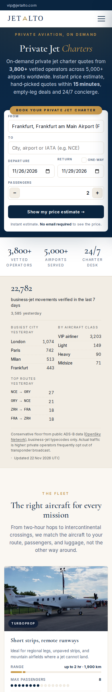

# UI Design System & Master Generation Blueprint: jetalto-com

> **JetALto, Private Jet Charter · Fly Anywhere, On Your Schedule** (https://jetalto.com/) — Instant private jet charter quotes from vetted operators. On-demand flights to 5,000+ airports worldwide. Empty-leg alerts, transparent p...


---

## 1. Executive Visual Persona & Design Archetype

- **Brand Essence & Persona**: **JetALto, Private Jet Charter · Fly Anywhere, On Your Schedule** (`https://jetalto.com/`). Instant private jet charter quotes from vetted operators. On-demand flights to 5,000+ airports worldwide. Empty-leg alerts, transparent p...
- **Capture Provenance**: Live browser capture (`tier1_fast`, HTTP `200`, captured `2026-11-23`).
- **Visual Archetype**: **Light-Substrate Editorial & Modular Grid System (`#faf7f2` canvas, `#0b1220` ink, `#000080` accent)**.
- **Anti-AI-Slop Differentiators**:
  - **Live-Computed Chromatic Polarity**: Anchors the viewport in `#faf7f2` (live computed `body` `background-color` (`computed_styles.json`)) paired with `#0b1220` primary typography and `#000080` accents.
  - **Grounded Typographic Hierarchy**: Pairs `Cormorant Garamond` for display copy (`Private Jet Charters`) with `Inter` and `SFMono-Regular`.
  - **Calibrated Spatial Grid & Motion**: Combines `1192px` container bounds (`gap: 32px`, padding `136px`) with `cubic-bezier(.2,.7,.2,1)` easing and Three.js / WebGL Canvas Pipeline.

---

## 2. Spatial Architecture & Modular Grid Mathematics



### Viewport Allocation & Container Geometry
- **Captured Viewport Dimensions**: Desktop `1440×2400px` (`assets/desktop.png`, clamped at 2400px live multi-section capture), Mobile `390×2400px` (`assets/mobile.png`, clamped at 2400px live multi-section capture).
- **Master Container Bounds**: `1192px` (measured widest bounded `<section>` landmark width on `1440px` desktop).
- **Canvas Lateral Padding & Spacing**: `136px` lateral canvas padding with `32px` grid gap.
- **Border Radius Scale**: `8px`, `var(--radius)`, `2px`, `999px`.

### Responsive Breakpoint Architecture
- **Desktop Layout**: Multi-column CSS Grid / Flexbox layout at `1440px` (`max-width: 1192px`, `gap: 32px`).
- **Mobile Layout**: Single-column vertical stack at `390px` viewport width with `136px` horizontal padding.
- **Extracted CSS Media Queries**: `@media (max-width:480px)`, `@media (max-width:600px)`, `@media (max-width:900px)`, `@media (max-width:520px)`.

---

## 3. Color System, Materiality & Atmospheric Lighting

### Semantic Palette & Source Grounding
| Semantic Role | Ground-Truth Value | Extracted Live / CSS Source |
|---|---|---|
| **Primary Canvas Substrate** | `#faf7f2` | live computed `body` `background-color` (`computed_styles.json`) |
| **Primary Typography Ink** | `#0b1220` | live computed `body` `color` (`computed_styles.json`) |
| **Elevated Surface / Card Substrate** | `#ffffff` | live computed `header` `background-color` (`computed_styles.json`) |
| **Interactive Accent / Highlight** | `#000080` | `.nav .cta { background: navy }` (`#000080`) |
| **Secondary / Muted Copy** | `#5d6b82` | `var(--muted)` in `:root` |
| **Structural Hairline Border** | `#e5ded1` | `var(--line)` in `:root` |
| **Variable Token (`--navy`)** | `#0a2540` | `var(--navy)` in `:root` |
| **Variable Token (`--navy-2`)** | `#122d4d` | `var(--navy-2)` in `:root` |
| **Variable Token (`--navy-3`)** | `#1a3860` | `var(--navy-3)` in `:root` |
| **Variable Token (`--paper-2`)** | `#f2ede4` | `var(--paper-2)` in `:root` |
| **Variable Token (`--gold`)** | `#c5964b` | `var(--gold)` in `:root` |
| **Variable Token (`--gold-2`)** | `#d4a24c` | `var(--gold-2)` in `:root` |
| **Variable Token (`--gold-soft`)** | `#f3e4c1` | `var(--gold-soft)` in `:root` |
| **Variable Token (`--danger`)** | `#b93a2a` | `var(--danger)` in `:root` |
| **Variable Token (`--ok`)** | `#1f7a4e` | `var(--ok)` in `:root` |

### Sanitized Root CSS Variables (`ui-ux.md` Ground Truth)
| Variable Name | Extracted Value | Semantic Role |
|---|---|---|
| `--navy` | `#0a2540` | Layout / Spatial Grid Token |
| `--navy-2` | `#122d4d` | Layout / Spatial Grid Token |
| `--navy-3` | `#1a3860` | Layout / Spatial Grid Token |
| `--ink` | `#0b1220` | Typography Ink Token |
| `--paper` | `#faf7f2` | Canvas / Surface Token |
| `--paper-2` | `#f2ede4` | Canvas / Surface Token |
| `--line` | `#e5ded1` | Color / Atmospheric Token |
| `--muted` | `#5d6b82` | Color / Atmospheric Token |
| `--gold` | `#c5964b` | Color / Atmospheric Token |
| `--gold-2` | `#d4a24c` | Color / Atmospheric Token |
| `--gold-soft` | `#f3e4c1` | Color / Atmospheric Token |
| `--danger` | `#b93a2a` | Color / Atmospheric Token |
| `--ok` | `#1f7a4e` | Color / Atmospheric Token |
| `--radius` | `6px` | Elevation / Border Token |
| `--shadow-lg` | `0 40px 80px -30px rgba(10,37,64,.35), 0 8px 24px -8px rgba(10,37,64,.2)` | Elevation / Border Token |
| `--shadow-md` | `0 10px 24px -12px rgba(10,37,64,.25)` | Elevation / Border Token |

---

## 4. Typographic Scale & Editorial Hierarchy

### Font Family Stacks
- **Display Typography**: `Cormorant Garamond`.
- **Primary Body Stack**: `Inter`.
- **Technical / Metadata Stack**: `SFMono-Regular`.

### Typographic Scale & Rules (Live Computed & Stylesheet Grounded)
- **Hero Display (`H1`)**: live computed `h1` (`font-size: 72px`, `line-height: 73.44px`, `font-weight: 500`, `letter-spacing: -1.08px`); rule `h1` (`font-size: clamp(30px,4.4vw,52px)`, `line-height: 1.06`, `letter-spacing: -.01em`).
- **Section Heading (`H2`)**: live computed `h2` (`font-size: 26px`, `line-height: 40.3px`, `font-weight: 600`, `letter-spacing: -0.13px`); rule `h2` (`font-size: 26px`, `letter-spacing: -.005em`, `font-weight: 600`).
- **Body Copy**: live computed `body` (`font-size: 16px`, `line-height: 24.8px`, `font-weight: 400`); rule `body` (`font-size: 16px`, `line-height: 1.55`).
- **Metadata & Navigation Labels**: live computed `nav/a` (`font-size: 16px`, `line-height: 24.8px`, `font-weight: 400`); rule `small` (`font-size: 11px`, `letter-spacing: .06em`, `font-weight: 600`).

---

## 5. Choreographed Motion & Interaction Physics

### Primary Easing Curves
- **Extracted Timing Functions**: `cubic-bezier(.2,.7,.2,1)`, `cubic-bezier(.4,.1,.3,1)`, `cubic-bezier(0.36,0.07,0.19,0.97)`.

### Per-Element Transition & Choreography Rules
- **Selector `.nav-toggle-bars span`**: `transition: transform .28s cubic-bezier(.2,.7,.2,1), opacity .18s ease, to...` extracted from `jetalto-com` stylesheet.
- **Selector `.trip-type label`**: `transition: .15s` extracted from `jetalto-com` stylesheet.
- **Selector `.field textarea`**: `transition: border-color .15s, box-shadow .15s` extracted from `jetalto-com` stylesheet.
- **Extracted Easing Curve (`cubic-bezier(.2,.7,.2,1)`)**: Governs interactive state transitions across `<header.site-header>` and `<section.pad>`.
- **Runtime Interaction Engine**: Integrates Three.js / WebGL Canvas Pipeline with `prefers-reduced-motion: reduce` fallback guards.

---

## 6. Component Wireframe & Structural DOM Map

### Visual Layout Schematic — Desktop (`1440px`, Grounded in `dom.html` & Landmark Bounding Boxes)
```
┌────────────────────────────────────────────────────────────────────────┐
│ DESKTOP VIEWPORT (1440px) — JetALto, Private Jet Charter · Fly Anywher │
│ ====================================================================== │
│ [ <header.site-header> (1440x71px)    | Home · Our Fleet · Destinati ] │
│ ---------------------------------------------------------------------- │
│ | HERO STAGE: <section.hero> (w=1440px)                              | │
│ | H1: Private Jet Charters                                           | │
│ | Substrate: #faf7f2 | Ink: #0b1220 | Accent: #000080                | │
│ ---------------------------------------------------------------------- │
│ | SHOWCASE GRID (<section.pad>) max-w: 1192px                        | │
│ | +------------------------------+  +------------------------------+ | │
│ | | Get a private jet charter qu |  | Almost done, where should we | | │
│ | +------------------------------+  +------------------------------+ | │
│ ---------------------------------------------------------------------- │
│ | DETAIL MODULE (<section.section-dark>) — Get an instant charte     | │
│ ---------------------------------------------------------------------- │
│ [ FOOTER (<footer.nav>        ) | https://jetalto.com/                 │
└────────────────────────────────────────────────────────────────────────┘
```

### Visual Layout Schematic — Mobile Reflow (`390px`)
```
┌────────────────────────────────────────────────────────────────────────┐
│ MOBILE VIEWPORT REFLOW (390px) — Single-Column Stack (gap: 32px)       │
│ ====================================================================== │
│ [ HEADER BAR (<header.site-header>    ) | Compact Menu (390px)         │
│ ---------------------------------------------------------------------- │
│ | HERO STAGE (<section.hero>) — 390px Vertical Lead                  | │
│ | H1: Private Jet Charters                                           | │
│ ---------------------------------------------------------------------- │
│ | SHOWCASE STACK (<section.pad>) — 1-Col Stack                       | │
│ | [ Item 1: Get a private jet charter quote                        ] | │
│ | [ Item 2: Almost done, where should we send it?                  ] | │
│ ---------------------------------------------------------------------- │
│ | DETAIL STACK (<section.section-dark>) — 1-Col (Get an instant cha) | │
│ ---------------------------------------------------------------------- │
│ [ FOOTER (<footer.nav>        ) | Stacked 390px Colophon               │
└────────────────────────────────────────────────────────────────────────┘
```

### Granular DOM Region Breakdown
1. **Brand Header & Navigation Bar (<header.site-header> — `jetalto-com`)**:
   - Landmark `<header class="site-header">` (`1440x71px`) hosting `JetALto, Private Jet Charter · Fly A` navigation (`Home · Our Fleet · Destinations · Blog · Get a Quote`), DOM attributes (`data-step-panel="1"`, `data-lat="50.0333"`, `data-lon="8.5706"`, `data-min="1"`), and stylesheet rule `.phone-field .iti { width:100%;--iti-border-color:d8dee6;--iti-border-radius:8px;--iti-hover... }`.
2. **Hero Stage & Focal Lead (<section.hero> — `Private Jet Charters`)**:
   - Landmark `<section class="hero hero-wide">` presenting display lead `Private Jet Charters` and copy excerpt *"On-demand private jet charter quotes from 3,800+ vetted operators"* over `#faf7f2` canvas and `#0b1220` ink.
3. **Primary Showcase & Content Grid (<section.pad> — `Get a private jet charter quote`)**:
   - Landmark `<section class="pad step2-only">` rendering section `Get a private jet charter quote` with copy *"Global charter · 24 / 7 · Email support"*, asset references (`favicon.ico`, `favicon-16.png`, `favicon-32.png`, `favicon-96.png`), and grid rule `.phone-field .iti__country-container { max-width:130px }`.
4. **Interactive Detail & Feature Matrix (<section.section-dark> — `Almost done, where should we send `)**:
   - Landmark `<section class="pad section-dark">` framing `Almost done, where should we send it?` and `Get an instant charter quote` (*"Get an instant charter quote"*) with `#ffffff` surface cards, `#000080` accents, and `.phone-field .iti__selected-country { font:inherit;font-size:13px;color:0a2540;padding:0 8px 0 0;border-right:... }`.
5. **Colophon & Global Directory Footer (<footer.nav> — `https://jetalto.com/`)**:
   - Landmark `<footer class="nav">` anchoring `JetALto, Private Jet Charter · F` footer links (`Home · Our Fleet · Destinations · Blog · Get a Quote`), copy *"6 classes, 18 models"*, and `#e5ded1` structural dividers.

---

## 7. Master Zero-Shot AI Generation Prompt

```markdown
# Master Zero-Shot Frontend Generation Prompt: jetalto-com (JetALto, Private Jet Charter · Fly Anywhere, On Your Schedule)

You are a principal frontend architect and design systems engineer. Build a complete, production-ready web application replicating the exact design system, DOM landmarks, typographic hierarchy, color tokens, and motion physics of `jetalto-com` (**JetALto, Private Jet Charter · Fly Anywhere, On Your Schedule** — `https://jetalto.com/`).

### 1. Visual Archetype & Anti-AI-Slop Mandates
- **Archetype**: Light-Substrate Editorial & Modular Grid System (`#faf7f2` canvas, `#0b1220` ink, `#000080` accent).
- **Identity & Domain Context**: Instant private jet charter quotes from vetted operators. On-demand flights to 5,000+ airports worldwide. Empty-leg alerts, transparent p...
- **Primary Substrate**: `#faf7f2` (live computed `body` `background-color` (`computed_styles.json`)), **Primary Ink**: `#0b1220`, **Accent / Highlight**: `#000080`.
- **Site-Specific Differentiators**:
  - **Live-Computed Chromatic Polarity**: Anchors the viewport in `#faf7f2` (live computed `body` `background-color` (`computed_styles.json`)) paired with `#0b1220` primary typography and `#000080` accents.
  - **Grounded Typographic Hierarchy**: Pairs `Cormorant Garamond` for display copy (`Private Jet Charters`) with `Inter` and `SFMono-Regular`.
  - **Calibrated Spatial Grid & Motion**: Combines `1192px` container bounds (`gap: 32px`, padding `136px`) with `cubic-bezier(.2,.7,.2,1)` easing and Three.js / WebGL Canvas Pipeline.

### 2. Ground-Truth CSS Variables (`:root` Token Contract)
Declare and consume these exact custom properties extracted from `jetalto-com` in your global stylesheet:

:root {
  /* JetALto, Private Jet Charter · Fly Anywhere, On Your Schedule (jetalto-com) — Live-Grounded CSS Variables */
  --navy: #0a2540; /* Layout / Spatial Grid Token (jetalto-com) */
  --navy-2: #122d4d; /* Layout / Spatial Grid Token (jetalto-com) */
  --navy-3: #1a3860; /* Layout / Spatial Grid Token (jetalto-com) */
  --ink: #0b1220; /* Typography Ink Token (jetalto-com) */
  --paper: #faf7f2; /* Canvas / Surface Token (jetalto-com) */
  --paper-2: #f2ede4; /* Canvas / Surface Token (jetalto-com) */
  --line: #e5ded1; /* Color / Atmospheric Token (jetalto-com) */
  --muted: #5d6b82; /* Color / Atmospheric Token (jetalto-com) */
  --gold: #c5964b; /* Color / Atmospheric Token (jetalto-com) */
  --gold-2: #d4a24c; /* Color / Atmospheric Token (jetalto-com) */
  --gold-soft: #f3e4c1; /* Color / Atmospheric Token (jetalto-com) */
  --danger: #b93a2a; /* Color / Atmospheric Token (jetalto-com) */
  --ok: #1f7a4e; /* Color / Atmospheric Token (jetalto-com) */
  --radius: 6px; /* Elevation / Border Token (jetalto-com) */
  --shadow-lg: 0 40px 80px -30px rgba(10,37,64,.35), 0 8px 24px -8px rgba(10,37,64,.2); /* Elevation / Border Token (jetalto-com) */
  --shadow-md: 0 10px 24px -12px rgba(10,37,64,.25); /* Elevation / Border Token (jetalto-com) */
}

### 3. Semantic Color & Materiality Contract
Map every surface, ink, and border strictly to these source-grounded tokens:
- **Primary Canvas Substrate**: `#faf7f2` — grounded in live computed `body` `background-color` (`computed_styles.json`)
- **Primary Typography Ink**: `#0b1220` — grounded in live computed `body` `color` (`computed_styles.json`)
- **Elevated Surface / Card Substrate**: `#ffffff` — grounded in live computed `header` `background-color` (`computed_styles.json`)
- **Interactive Accent / Highlight**: `#000080` — grounded in `.nav .cta { background: navy }` (`#000080`)
- **Secondary / Muted Copy**: `#5d6b82` — grounded in `var(--muted)` in `:root`
- **Structural Hairline Border**: `#e5ded1` — grounded in `var(--line)` in `:root`
- **Variable Token (`--navy`)**: `#0a2540` — grounded in `var(--navy)` in `:root`
- **Variable Token (`--navy-2`)**: `#122d4d` — grounded in `var(--navy-2)` in `:root`
- **Variable Token (`--navy-3`)**: `#1a3860` — grounded in `var(--navy-3)` in `:root`
- **Variable Token (`--paper-2`)**: `#f2ede4` — grounded in `var(--paper-2)` in `:root`
- **Variable Token (`--gold`)**: `#c5964b` — grounded in `var(--gold)` in `:root`
- **Variable Token (`--gold-2`)**: `#d4a24c` — grounded in `var(--gold-2)` in `:root`
- **Variable Token (`--gold-soft`)**: `#f3e4c1` — grounded in `var(--gold-soft)` in `:root`
- **Variable Token (`--danger`)**: `#b93a2a` — grounded in `var(--danger)` in `:root`
- **Variable Token (`--ok`)**: `#1f7a4e` — grounded in `var(--ok)` in `:root`

### 4. Spatial Grid, Container Bounds & Responsive Breakpoints
- **Desktop Viewport Reference**: `1440×2400px` (clamped at 2400px live multi-section capture, `1440px` standard desktop width).
- **Mobile Viewport Reference**: `390×2400px` (clamped at 2400px live multi-section capture, `390px` standard mobile width).
- **Container Max-Width**: `1192px` (measured widest bounded `<section>` landmark width on `1440px` desktop)
- **Padding & Gutters**: `136px` lateral canvas padding with `32px` grid gap
- **Desktop Grid**: Multi-column CSS Grid / Flexbox layout at `1440px` (`max-width: 1192px`, `gap: 32px`)
- **Mobile Adaptation**: Single-column vertical stack at `390px` viewport width with `136px` horizontal padding
- **Media Queries**: `@media (max-width:480px)`, `@media (max-width:600px)`, `@media (max-width:900px)`, `@media (max-width:520px)`
- **Corner Radii**: `8px`, `var(--radius)`, `2px`, `999px`

### 5. Typography & Editorial Scale Contract
- **Display Font Stack**: `Cormorant Garamond`
- **Body Font Stack**: `Inter`
- **Monospace / Technical Font Stack**: `SFMono-Regular`
- **H1 Display Rule**: live computed `h1` (`font-size: 72px`, `line-height: 73.44px`, `font-weight: 500`, `letter-spacing: -1.08px`); rule `h1` (`font-size: clamp(30px,4.4vw,52px)`, `line-height: 1.06`, `letter-spacing: -.01em`)
- **H2 Section Rule**: live computed `h2` (`font-size: 26px`, `line-height: 40.3px`, `font-weight: 600`, `letter-spacing: -0.13px`); rule `h2` (`font-size: 26px`, `letter-spacing: -.005em`, `font-weight: 600`)
- **Body Copy Rule**: live computed `body` (`font-size: 16px`, `line-height: 24.8px`, `font-weight: 400`); rule `body` (`font-size: 16px`, `line-height: 1.55`)
- **Metadata & Index Rule**: live computed `nav/a` (`font-size: 16px`, `line-height: 24.8px`, `font-weight: 400`); rule `small` (`font-size: 11px`, `letter-spacing: .06em`, `font-weight: 600`)

### 6. Component Hierarchy, Verbatim Copy & Real DOM Landmarks
Scaffold `jetalto-com` (`JetALto, Private Jet Charter · Fly Anywhere, On Your Schedule`) with these exact structural regions, extracted copy, and CSS rules from `dom.html`:
1. **Brand Header & Navigation Bar (<header.site-header> — `jetalto-com`)**:
   - DOM & Selectors: Landmark `<header class="site-header">` (`1440x71px`) hosting `JetALto, Private Jet Charter · Fly A` navigation (`Home · Our Fleet · Destinations · Blog · Get a Quote`), DOM attributes (`data-step-panel="1"`, `data-lat="50.0333"`, `data-lon="8.5706"`, `data-min="1"`), and stylesheet rule `.phone-field .iti { width:100%;--iti-border-color:d8dee6;--iti-border-radius:8px;--iti-hover... }`.
   - Responsive Contract: Header `Brand Header & Navigation Bar (<header.site-header> — `jetalto-com`)` (`jetalto-com`) adapts across `@media (max-width:480px)`, `@media (max-width:600px)`, `@media (max-width:900px)`, `@media (max-width:520px)` with `cubic-bezier(.2,.7,.2,1)`, `cubic-bezier(.4,.1,.3,1)`, `cubic-bezier(0.36,0.07,0.19,0.97)` transitions and links `Home · Our Fleet · Destinations · Blog · Get a Quote`.
2. **Hero Stage & Focal Lead (<section.hero> — `Private Jet Charters`)**:
   - DOM & Selectors: Landmark `<section class="hero hero-wide">` presenting display lead `Private Jet Charters` and copy excerpt *"On-demand private jet charter quotes from 3,800+ vetted operators"* over `#faf7f2` canvas and `#0b1220` ink.
   - Responsive Contract: Hero stage (`1440×2400px` desktop / `390×2400px` mobile) sets `#faf7f2` background with `#0b1220` headline `Private Jet Charters`.
3. **Primary Showcase & Content Grid (<section.pad> — `Get a private jet charter quote`)**:
   - DOM & Selectors: Landmark `<section class="pad step2-only">` rendering section `Get a private jet charter quote` with copy *"Global charter · 24 / 7 · Email support"*, asset references (`favicon.ico`, `favicon-16.png`, `favicon-32.png`, `favicon-96.png`), and grid rule `.phone-field .iti__country-container { max-width:130px }`.
   - Responsive Contract: Showcase grid `Primary Showcase & Content Grid (<section.pad> — `Get a private jet charter quote`)` applies Multi-column CSS Grid / Flexbox layout at `1440px` (`max-width: 1192px`, `gap: 32px`) on desktop and Single-column vertical stack at `390px` viewport width with `136px` horizontal padding on mobile.
4. **Interactive Detail & Feature Matrix (<section.section-dark> — `Almost done, where should we send `)**:
   - DOM & Selectors: Landmark `<section class="pad section-dark">` framing `Almost done, where should we send it?` and `Get an instant charter quote` (*"Get an instant charter quote"*) with `#ffffff` surface cards, `#000080` accents, and `.phone-field .iti__selected-country { font:inherit;font-size:13px;color:0a2540;padding:0 8px 0 0;border-right:... }`.
   - Responsive Contract: Detail module `Interactive Detail & Feature Matrix (<section.section-dark> — `Almost done, where should we send `)` uses `8px`, `var(--radius)`, `2px`, `999px` radii, `#000080` highlights, and assets (favicon.ico, favicon-16.png, favicon-32.png).
5. **Colophon & Global Directory Footer (<footer.nav> — `https://jetalto.com/`)**:
   - DOM & Selectors: Landmark `<footer class="nav">` anchoring `JetALto, Private Jet Charter · F` footer links (`Home · Our Fleet · Destinations · Blog · Get a Quote`), copy *"6 classes, 18 models"*, and `#e5ded1` structural dividers.
   - Responsive Contract: Footer `Colophon & Global Directory Footer (<footer.nav> — `https://jetalto.com/`)` aligns to `1192px` (measured widest bounded `<section>` landmark width on `1440px` desktop) with `136px` lateral canvas padding with `32px` grid gap and attributes (data-step-panel="1", data-lat="50.0333", data-lon="8.5706").

#### Verbatim DOM Copy Excerpts (`dom.html`)
- Copy Excerpt 1: *"On-demand private jet charter quotes from 3,800+ vetted operators across 5,000+ ai..."*
- Copy Excerpt 2: *"Global charter · 24 / 7 · Email support"*
- Copy Excerpt 3: *"Get an instant charter quote"*
- Copy Excerpt 4: *"6 classes, 18 models"*

### 7. Motion, Extracted Stylesheet Rules & Interaction Choreography
- **Primary Easing Functions**: `cubic-bezier(.2,.7,.2,1)`, `cubic-bezier(.4,.1,.3,1)`, `cubic-bezier(0.36,0.07,0.19,0.97)`
- **Extracted Stylesheet Rules (`jetalto-com`)**:
- `.phone-field .iti { width:100%;--iti-border-color:d8dee6;--iti-border-radius:8px;--iti-hover... }`
- `.phone-field .iti__country-container { max-width:130px }`
- `.phone-field .iti__selected-country { font:inherit;font-size:13px;color:0a2540;padding:0 8px 0 0;border-right:... }`
- `ne-field .iti__selected-country-p... { gap:5px;padding:0 7px;background:transparent }`
- `.phone-field .iti__selected-dial-... { margin:0;font-size:13px;font-weight:600 }`
- **Per-Selector Transition Rules**:
- **Selector `.nav-toggle-bars span`**: `transition: transform .28s cubic-bezier(.2,.7,.2,1), opacity .18s ease, to...` extracted from `jetalto-com` stylesheet.
- **Selector `.trip-type label`**: `transition: .15s` extracted from `jetalto-com` stylesheet.
- **Selector `.field textarea`**: `transition: border-color .15s, box-shadow .15s` extracted from `jetalto-com` stylesheet.
- **Extracted Easing Curve (`cubic-bezier(.2,.7,.2,1)`)**: Governs interactive state transitions across `<header.site-header>` and `<section.pad>`.
- **Runtime Interaction Engine**: Integrates Three.js / WebGL Canvas Pipeline with `prefers-reduced-motion: reduce` fallback guards.

### 8. Technical Deliverables
- Implement in Next.js (App Router) with TypeScript and Tailwind CSS consuming the `:root` custom properties defined above for `jetalto-com`.
- Reproduce both the `1440px` desktop architecture and `390px` mobile breakpoint transitions, preserving semantic HTML5 landmarks (`<header>`, `<nav>`, `<main>`, `<section>`, `<footer>`) and `prefers-reduced-motion` accessibility guards.
```
