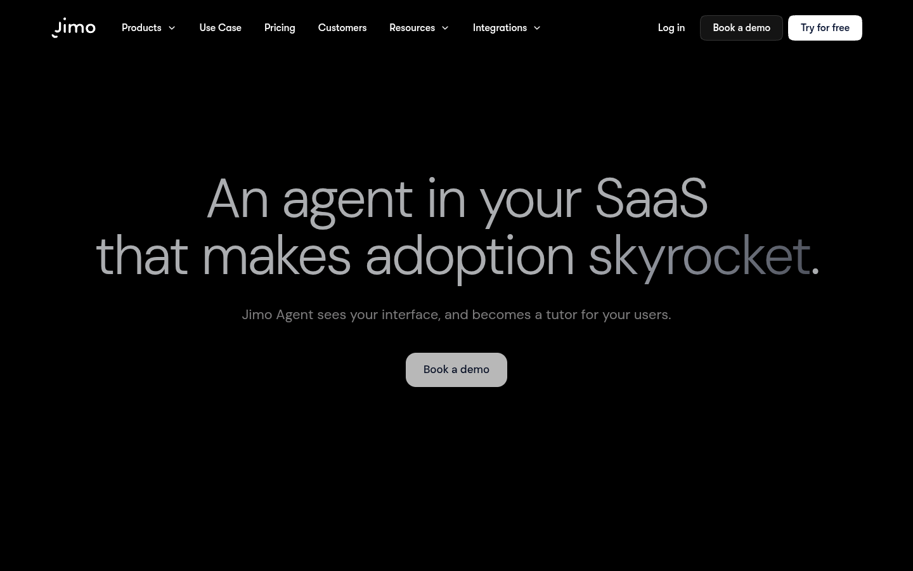
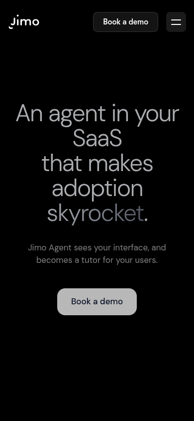

# UI Design System & Master Generation Blueprint: jimo-ai_product-ai

> **AI Agent for User Onboarding in SaaS · Jimo** (https://jimo.ai/product/ai) — Jimo's Adoption Agent lives inside your SaaS. It guides users step by step, answers questions from your docs, and takes actions for them....



---

## 1. Executive Visual Persona & Design Archetype

- **Brand Essence & Persona**: **AI Agent for User Onboarding in SaaS · Jimo** (`https://jimo.ai/product/ai`). Jimo's Adoption Agent lives inside your SaaS. It guides users step by step, answers questions from your docs, and takes actions for them....
- **Capture Provenance**: Live browser capture (`tier2_webgl`, HTTP `200`, captured `2026-11-23`).
- **Visual Archetype**: **Dark-Substrate WebGL / Canvas Interactive Experience (`#000000` / `#2b7fff`)**.
- **Anti-AI-Slop Differentiators**:
  - **Live-Computed Chromatic Polarity**: Anchors the viewport in `#000000` (live computed `meta-theme-color` `background-color` (`computed_styles.json`)) paired with `#ffffff` primary typography and `#2b7fff` accents.
  - **Grounded Typographic Hierarchy**: Pairs `GT Walsheim Pro Regular` for display copy (`An agent in your SaaS that makes ado`) with `GT Walsheim Pro Bold` and not declared in live computed styles (uses primary stack / `ui-monospace`).
  - **Calibrated Spatial Grid & Motion**: Combines `96rem` container bounds (`gap: 24px`, padding `24px`) with `cubic-bezier(.22,1,.36,1)` easing and Three.js / WebGL Canvas Pipeline, Framer Motion Layout Physics.

---

## 2. Spatial Architecture & Modular Grid Mathematics



### Viewport Allocation & Container Geometry
- **Captured Viewport Dimensions**: Desktop `1440×900px` (`assets/desktop.png`, single-viewport 100vh live capture (900px)), Mobile `390×844px` (`assets/mobile.png`, single-viewport 100vh live capture (844px)).
- **Master Container Bounds**: `96rem` (non-`@media` desktop container stylesheet rule).
- **Canvas Lateral Padding & Spacing**: `24px` lateral canvas padding with `24px` grid gap.
- **Border Radius Scale**: `50%`, `var(--jlp-btn-r-round)`, `var(--jlp-btn-r)`, `22px`.

### Responsive Breakpoint Architecture
- **Desktop Layout**: Multi-column CSS Grid / Flexbox layout at `1440px` (`max-width: 96rem`, `gap: 24px`).
- **Mobile Layout**: Single-column vertical stack at `390px` viewport width with `24px` horizontal padding.
- **Extracted CSS Media Queries**: `@media (min-width:1280px)`, `@media (min-width:768px) and (max-width:1279.98px)`, `@media (max-width:767.98px)`, `@media (prefers-reduced-motion:reduce)`.

---

## 3. Color System, Materiality & Atmospheric Lighting

### Semantic Palette & Source Grounding
| Semantic Role | Ground-Truth Value | Extracted Live / CSS Source |
|---|---|---|
| **Primary Canvas Substrate** | `#000000` | live computed `meta-theme-color` `background-color` (`computed_styles.json`) |
| **Primary Typography Ink** | `#ffffff` | `var(--jlp-btn-fg)` in `:root` |
| **Elevated Surface / Card Substrate** | `#16254f` | `var(--jlp-btn-bg-hover)` in `:root` |
| **Interactive Accent / Highlight** | `#2b7fff` | `.jlp-root .jlp-launcher-btn--start { background: #2b7fff }` |
| **Secondary / Muted Copy** | `#9aa3b5` | `var(--muted-foreground)` in `:root` |
| **Structural Hairline Border** | `#141414` | `var(--line)` in `:root` (`ffffff14`) |
| **Variable Token (`--token-c5f3a181-ce4f-4420-a296-873f4d681873`)** | `#fff0` | `var(--token-c5f3a181-ce4f-4420-a296-873f4d681873)` in `:root` |
| **Variable Token (`--token-f50d19c8-b71c-4ab6-8ff6-6267c86824d4`)** | `#071331` | `var(--token-f50d19c8-b71c-4ab6-8ff6-6267c86824d4)` in `:root` |
| **Variable Token (`--token-f4cc4358-9285-4b73-95d1-a84a305a5e4c`)** | `#2c2c2c` | `var(--token-f4cc4358-9285-4b73-95d1-a84a305a5e4c)` in `:root` |
| **Variable Token (`--token-019ac301-73c6-46eb-9851-3eb602913d3e`)** | `#9aa0b0` | `var(--token-019ac301-73c6-46eb-9851-3eb602913d3e)` in `:root` |
| **Variable Token (`--token-88c94126-8d08-4d70-ad93-089fe72c39c1`)** | `#1261eb` | `var(--token-88c94126-8d08-4d70-ad93-089fe72c39c1)` in `:root` |
| **Variable Token (`--token-6051c877-d0ec-4b68-8d57-1bfdb02b909c`)** | `#ffe6b8` | `var(--token-6051c877-d0ec-4b68-8d57-1bfdb02b909c)` in `:root` |
| **Variable Token (`--token-9eb2db68-5dd1-49a4-b3f4-b9acc27e81e7`)** | `#bdffea` | `var(--token-9eb2db68-5dd1-49a4-b3f4-b9acc27e81e7)` in `:root` |
| **Variable Token (`--token-b6e57dc6-83ba-4f1b-bdf7-3940ef910fb9`)** | `#deffad` | `var(--token-b6e57dc6-83ba-4f1b-bdf7-3940ef910fb9)` in `:root` |
| **Variable Token (`--token-da636760-7871-4b98-bdd9-6abbce729e64`)** | `#f0e3fc` | `var(--token-da636760-7871-4b98-bdd9-6abbce729e64)` in `:root` |
| **Variable Token (`--token-9711da88-e2ac-4365-a65b-ef48675c3f3b`)** | `#c7dbff` | `var(--token-9711da88-e2ac-4365-a65b-ef48675c3f3b)` in `:root` |
| **Variable Token (`--token-1f3054c2-a968-4818-ae15-ed9f1e78b6d9`)** | `#e1f5fa` | `var(--token-1f3054c2-a968-4818-ae15-ed9f1e78b6d9)` in `:root` |
| **Variable Token (`--token-ec921a20-8685-4652-8a21-8eb46519c519`)** | `#f7f7f7` | `var(--token-ec921a20-8685-4652-8a21-8eb46519c519)` in `:root` |

### Sanitized Root CSS Variables (`ui-ux.md` Ground Truth)
| Variable Name | Extracted Value | Semantic Role |
|---|---|---|
| `--token-c5f3a181-ce4f-4420-a296-873f4d681873` | `#fff0` | Color / Atmospheric Token |
| `--token-f50d19c8-b71c-4ab6-8ff6-6267c86824d4` | `#071331` | Color / Atmospheric Token |
| `--token-f4cc4358-9285-4b73-95d1-a84a305a5e4c` | `#2c2c2c` | Color / Atmospheric Token |
| `--token-019ac301-73c6-46eb-9851-3eb602913d3e` | `#9aa0b0` | Color / Atmospheric Token |
| `--token-88c94126-8d08-4d70-ad93-089fe72c39c1` | `#1261eb` | Color / Atmospheric Token |
| `--token-7188acac-d059-4734-8660-0335540563b7` | `#000` | Color / Atmospheric Token |
| `--token-dcec509e-a65c-4559-bb8f-57a34c587571` | `#fff` | Color / Atmospheric Token |
| `--token-44c50bb1-0df2-493f-9bd1-8c00c0158dcb` | `#071331` | Color / Atmospheric Token |
| `--token-6051c877-d0ec-4b68-8d57-1bfdb02b909c` | `#ffe6b8` | Color / Atmospheric Token |
| `--token-9eb2db68-5dd1-49a4-b3f4-b9acc27e81e7` | `#bdffea` | Color / Atmospheric Token |
| `--token-b6e57dc6-83ba-4f1b-bdf7-3940ef910fb9` | `#deffad` | Color / Atmospheric Token |
| `--token-da636760-7871-4b98-bdd9-6abbce729e64` | `#f0e3fc` | Color / Atmospheric Token |
| `--token-9711da88-e2ac-4365-a65b-ef48675c3f3b` | `#c7dbff` | Color / Atmospheric Token |
| `--token-9474cd41-b035-4b11-aa31-8dd01bab53fe` | `#141414` | Color / Atmospheric Token |
| `--token-1f3054c2-a968-4818-ae15-ed9f1e78b6d9` | `#e1f5fa` | Color / Atmospheric Token |
| `--token-ec921a20-8685-4652-8a21-8eb46519c519` | `#f7f7f7` | Color / Atmospheric Token |

---

## 4. Typographic Scale & Editorial Hierarchy

### Font Family Stacks
- **Display Typography**: `GT Walsheim Pro Regular`.
- **Primary Body Stack**: `GT Walsheim Pro Bold`.
- **Technical / Metadata Stack**: not declared in live computed styles (uses primary stack / `ui-monospace`).

### Typographic Scale & Rules (Live Computed & Stylesheet Grounded)
- **Hero Display (`H1`)**: observed font-size ladder: `10px`, `var(--jlp-btn-size)`, `12px`, `var(--code)`, `11px`.
- **Section Heading (`H2`)**: observed font-size ladder: `10px`, `var(--jlp-btn-size)`, `12px`, `var(--code)`, `11px`.
- **Body Copy**: rule `p` (`font-size: 32px`, `line-height: 1`, `letter-spacing: -.01em`, `font-weight: 400`).
- **Metadata & Navigation Labels**: CSS variables `--text-sm: .875rem`, `--text-sm--line-height: calc(1.25 / .875)`, `--default-mono-font-family: var(--font-mono)`; rule `small` (`font-size: 12px`, `line-height: 16px`).

---

## 5. Choreographed Motion & Interaction Physics

### Primary Easing Curves
- **Extracted Timing Functions**: `cubic-bezier(.22,1,.36,1)`, `cubic-bezier(.34,1.26,.64,1)`, `cubic-bezier(.65,0,.35,1)`.

### Per-Element Transition & Choreography Rules
- **Selector `.jlp-fnav nav [data-highlight]`**: `transition: background-color .28s cubic-bezier(.22,1,.36,1)` extracted from `jimo-ai_product-ai` stylesheet.
- **Selector `.jlp-fnav nav a[href*="apply.jimo...`**: `transition: transform .42s cubic-bezier(.22,1,.36,1),background-color .42s...` extracted from `jimo-ai_product-ai` stylesheet.
- **Selector `.jlp-fnav .framer-fy2yk`**: `transition: background-color .18s ease-out` extracted from `jimo-ai_product-ai` stylesheet.
- **Extracted Easing Curve (`cubic-bezier(.22,1,.36,1)`)**: Governs interactive state transitions across `<header.jlp-fnav>` and `<section.relative>`.
- **Runtime Interaction Engine**: Integrates Three.js / WebGL Canvas Pipeline, Framer Motion Layout Physics with `prefers-reduced-motion: reduce` fallback guards.

---

## 6. Component Wireframe & Structural DOM Map

### Visual Layout Schematic — Desktop (`1440px`, Grounded in `dom.html` & Landmark Bounding Boxes)
```
┌────────────────────────────────────────────────────────────────────────┐
│ DESKTOP VIEWPORT (1440px) — AI Agent for User Onboarding in SaaS · Jim │
│ ====================================================================== │
│ [ <header.jlp-fnav> (1440px)          | Products · Use Case · Pricin ] │
│ ---------------------------------------------------------------------- │
│ | HERO STAGE: <section.text-center> (w=1440px)                       | │
│ | H1: An agent in your SaaS that makes adoption skyrock...           | │
│ | Substrate: #000000 | Ink: #ffffff | Accent: #2b7fff                | │
│ ---------------------------------------------------------------------- │
│ | SHOWCASE GRID (<section.relative>) max-w: 96rem                    | │
│ | +------------------------------+  +------------------------------+ | │
│ | | One agent. Three modes .     |  | Guides users on the fly      | | │
│ | +------------------------------+  +------------------------------+ | │
│ ---------------------------------------------------------------------- │
│ | DETAIL MODULE (<section.relative:nth(2)>) — Answers contextual qu  | │
│ ---------------------------------------------------------------------- │
│ [ FOOTER (<footer.footer-modul) | https://jimo.ai/product/ai           │
└────────────────────────────────────────────────────────────────────────┘
```

### Visual Layout Schematic — Mobile Reflow (`390px`)
```
┌────────────────────────────────────────────────────────────────────────┐
│ MOBILE VIEWPORT REFLOW (390px) — Single-Column Stack (gap: 24px)       │
│ ====================================================================== │
│ [ HEADER BAR (<header.jlp-fnav>       ) | Compact Menu (390px)         │
│ ---------------------------------------------------------------------- │
│ | HERO STAGE (<section.text-center>) — 390px Vertical Lead           | │
│ | H1: An agent in your SaaS that makes adoption skyrock...           | │
│ ---------------------------------------------------------------------- │
│ | SHOWCASE STACK (<section.relative>) — 1-Col Stack                  | │
│ | [ Item 1: One agent. Three modes .                               ] | │
│ | [ Item 2: Guides users on the fly                                ] | │
│ ---------------------------------------------------------------------- │
│ | DETAIL STACK (<section.relative:nth(2)) — 1-Col (Answers contextual) │
│ ---------------------------------------------------------------------- │
│ [ FOOTER (<footer.footer-modul) | Stacked 390px Colophon               │
└────────────────────────────────────────────────────────────────────────┘
```

### Granular DOM Region Breakdown
1. **Brand Header & Navigation Bar (<header.jlp-fnav> — `jimo-ai_product-ai`)**:
   - Landmark `<header class="jlp-fnav jlp-btn-dark">` (`1440px`) hosting `AI Agent for User Onboarding in SaaS` navigation (`Products · Use Case · Pricing · Customers · Resources`), DOM attributes (`data-precedence="next"`, `data-precedence="next"`, `data-precedence="next"`, `data-precedence="next"`), and stylesheet rule `.is-open { background-color:ffffff1c!important }`.
2. **Hero Stage & Focal Lead (<section.text-center> — `An agent in your SaaS that makes a`)**:
   - Landmark `<section class="text-center relative">` presenting display lead `An agent in your SaaS that makes adoption skyrock...` and copy excerpt *"Jimo Agent sees your interface, and becomes a tutor for your user"* over `#000000` canvas and `#ffffff` ink.
3. **Primary Showcase & Content Grid (<section.relative> — `One agent. Three modes .`)**:
   - Landmark `<section class="relative">` rendering section `One agent. Three modes .` with copy *"Every user gets a guide"*, asset references (`5c285b27cdda1fe8-s.p.0yo6-5yoeeud...`, `83afe278b6a6bb3c-s.p.0q-301v4kxxn...`, `gt-walsheim-medium.ttf`, `gt-walsheim-regular.ttf`), and grid rule `hover { transform:scale(1.05);background-color:99eefe!important }`.
4. **Interactive Detail & Feature Matrix (<section.relative:nth(2)> — `Guides users on the fly`)**:
   - Landmark `<section class="relative">` framing `Guides users on the fly` and `Answers contextual questions` (*"Help your users convert with a personal guide."*) with `#16254f` surface cards, `#2b7fff` accents, and `active { transform:scale(.98) }`.
5. **Colophon & Global Directory Footer (<footer.footer-module__d_pQKq__root> — `https://jimo.ai/product/ai`)**:
   - Landmark `<footer class="footer-module__d_pQKq__root">` anchoring `AI Agent for User Onboarding in ` footer links (`Products · Use Case · Pricing · Customers · Resources`), copy *"Help your users convert"*, and `#141414` structural dividers.

---

## 7. Master Zero-Shot AI Generation Prompt

```markdown
# Master Zero-Shot Frontend Generation Prompt: jimo-ai_product-ai (AI Agent for User Onboarding in SaaS · Jimo)

You are a principal frontend architect and design systems engineer. Build a complete, production-ready web application replicating the exact design system, DOM landmarks, typographic hierarchy, color tokens, and motion physics of `jimo-ai_product-ai` (**AI Agent for User Onboarding in SaaS · Jimo** — `https://jimo.ai/product/ai`).

### 1. Visual Archetype & Anti-AI-Slop Mandates
- **Archetype**: Dark-Substrate WebGL / Canvas Interactive Experience (`#000000` / `#2b7fff`).
- **Identity & Domain Context**: Jimo's Adoption Agent lives inside your SaaS. It guides users step by step, answers questions from your docs, and takes actions for them....
- **Primary Substrate**: `#000000` (live computed `meta-theme-color` `background-color` (`computed_styles.json`)), **Primary Ink**: `#ffffff`, **Accent / Highlight**: `#2b7fff`.
- **Site-Specific Differentiators**:
  - **Live-Computed Chromatic Polarity**: Anchors the viewport in `#000000` (live computed `meta-theme-color` `background-color` (`computed_styles.json`)) paired with `#ffffff` primary typography and `#2b7fff` accents.
  - **Grounded Typographic Hierarchy**: Pairs `GT Walsheim Pro Regular` for display copy (`An agent in your SaaS that makes ado`) with `GT Walsheim Pro Bold` and not declared in live computed styles (uses primary stack / `ui-monospace`).
  - **Calibrated Spatial Grid & Motion**: Combines `96rem` container bounds (`gap: 24px`, padding `24px`) with `cubic-bezier(.22,1,.36,1)` easing and Three.js / WebGL Canvas Pipeline, Framer Motion Layout Physics.

### 2. Ground-Truth CSS Variables (`:root` Token Contract)
Declare and consume these exact custom properties extracted from `jimo-ai_product-ai` in your global stylesheet:

:root {
  /* AI Agent for User Onboarding in SaaS · Jimo (jimo-ai_product-ai) — Live-Grounded CSS Variables */
  --token-c5f3a181-ce4f-4420-a296-873f4d681873: #fff0; /* Color / Atmospheric Token (jimo-ai_product-ai) */
  --token-f50d19c8-b71c-4ab6-8ff6-6267c86824d4: #071331; /* Color / Atmospheric Token (jimo-ai_product-ai) */
  --token-f4cc4358-9285-4b73-95d1-a84a305a5e4c: #2c2c2c; /* Color / Atmospheric Token (jimo-ai_product-ai) */
  --token-019ac301-73c6-46eb-9851-3eb602913d3e: #9aa0b0; /* Color / Atmospheric Token (jimo-ai_product-ai) */
  --token-88c94126-8d08-4d70-ad93-089fe72c39c1: #1261eb; /* Color / Atmospheric Token (jimo-ai_product-ai) */
  --token-7188acac-d059-4734-8660-0335540563b7: #000; /* Color / Atmospheric Token (jimo-ai_product-ai) */
  --token-dcec509e-a65c-4559-bb8f-57a34c587571: #fff; /* Color / Atmospheric Token (jimo-ai_product-ai) */
  --token-44c50bb1-0df2-493f-9bd1-8c00c0158dcb: #071331; /* Color / Atmospheric Token (jimo-ai_product-ai) */
  --token-6051c877-d0ec-4b68-8d57-1bfdb02b909c: #ffe6b8; /* Color / Atmospheric Token (jimo-ai_product-ai) */
  --token-9eb2db68-5dd1-49a4-b3f4-b9acc27e81e7: #bdffea; /* Color / Atmospheric Token (jimo-ai_product-ai) */
  --token-b6e57dc6-83ba-4f1b-bdf7-3940ef910fb9: #deffad; /* Color / Atmospheric Token (jimo-ai_product-ai) */
  --token-da636760-7871-4b98-bdd9-6abbce729e64: #f0e3fc; /* Color / Atmospheric Token (jimo-ai_product-ai) */
  --token-9711da88-e2ac-4365-a65b-ef48675c3f3b: #c7dbff; /* Color / Atmospheric Token (jimo-ai_product-ai) */
  --token-9474cd41-b035-4b11-aa31-8dd01bab53fe: #141414; /* Color / Atmospheric Token (jimo-ai_product-ai) */
  --token-1f3054c2-a968-4818-ae15-ed9f1e78b6d9: #e1f5fa; /* Color / Atmospheric Token (jimo-ai_product-ai) */
  --token-ec921a20-8685-4652-8a21-8eb46519c519: #f7f7f7; /* Color / Atmospheric Token (jimo-ai_product-ai) */
}

### 3. Semantic Color & Materiality Contract
Map every surface, ink, and border strictly to these source-grounded tokens:
- **Primary Canvas Substrate**: `#000000` — grounded in live computed `meta-theme-color` `background-color` (`computed_styles.json`)
- **Primary Typography Ink**: `#ffffff` — grounded in `var(--jlp-btn-fg)` in `:root`
- **Elevated Surface / Card Substrate**: `#16254f` — grounded in `var(--jlp-btn-bg-hover)` in `:root`
- **Interactive Accent / Highlight**: `#2b7fff` — grounded in `.jlp-root .jlp-launcher-btn--start { background: #2b7fff }`
- **Secondary / Muted Copy**: `#9aa3b5` — grounded in `var(--muted-foreground)` in `:root`
- **Structural Hairline Border**: `#141414` — grounded in `var(--line)` in `:root` (`ffffff14`)
- **Variable Token (`--token-c5f3a181-ce4f-4420-a296-873f4d681873`)**: `#fff0` — grounded in `var(--token-c5f3a181-ce4f-4420-a296-873f4d681873)` in `:root`
- **Variable Token (`--token-f50d19c8-b71c-4ab6-8ff6-6267c86824d4`)**: `#071331` — grounded in `var(--token-f50d19c8-b71c-4ab6-8ff6-6267c86824d4)` in `:root`
- **Variable Token (`--token-f4cc4358-9285-4b73-95d1-a84a305a5e4c`)**: `#2c2c2c` — grounded in `var(--token-f4cc4358-9285-4b73-95d1-a84a305a5e4c)` in `:root`
- **Variable Token (`--token-019ac301-73c6-46eb-9851-3eb602913d3e`)**: `#9aa0b0` — grounded in `var(--token-019ac301-73c6-46eb-9851-3eb602913d3e)` in `:root`
- **Variable Token (`--token-88c94126-8d08-4d70-ad93-089fe72c39c1`)**: `#1261eb` — grounded in `var(--token-88c94126-8d08-4d70-ad93-089fe72c39c1)` in `:root`
- **Variable Token (`--token-6051c877-d0ec-4b68-8d57-1bfdb02b909c`)**: `#ffe6b8` — grounded in `var(--token-6051c877-d0ec-4b68-8d57-1bfdb02b909c)` in `:root`
- **Variable Token (`--token-9eb2db68-5dd1-49a4-b3f4-b9acc27e81e7`)**: `#bdffea` — grounded in `var(--token-9eb2db68-5dd1-49a4-b3f4-b9acc27e81e7)` in `:root`
- **Variable Token (`--token-b6e57dc6-83ba-4f1b-bdf7-3940ef910fb9`)**: `#deffad` — grounded in `var(--token-b6e57dc6-83ba-4f1b-bdf7-3940ef910fb9)` in `:root`
- **Variable Token (`--token-da636760-7871-4b98-bdd9-6abbce729e64`)**: `#f0e3fc` — grounded in `var(--token-da636760-7871-4b98-bdd9-6abbce729e64)` in `:root`
- **Variable Token (`--token-9711da88-e2ac-4365-a65b-ef48675c3f3b`)**: `#c7dbff` — grounded in `var(--token-9711da88-e2ac-4365-a65b-ef48675c3f3b)` in `:root`
- **Variable Token (`--token-1f3054c2-a968-4818-ae15-ed9f1e78b6d9`)**: `#e1f5fa` — grounded in `var(--token-1f3054c2-a968-4818-ae15-ed9f1e78b6d9)` in `:root`
- **Variable Token (`--token-ec921a20-8685-4652-8a21-8eb46519c519`)**: `#f7f7f7` — grounded in `var(--token-ec921a20-8685-4652-8a21-8eb46519c519)` in `:root`

### 4. Spatial Grid, Container Bounds & Responsive Breakpoints
- **Desktop Viewport Reference**: `1440×900px` (single-viewport 100vh live capture (900px), `1440px` standard desktop width).
- **Mobile Viewport Reference**: `390×844px` (single-viewport 100vh live capture (844px), `390px` standard mobile width).
- **Container Max-Width**: `96rem` (non-`@media` desktop container stylesheet rule)
- **Padding & Gutters**: `24px` lateral canvas padding with `24px` grid gap
- **Desktop Grid**: Multi-column CSS Grid / Flexbox layout at `1440px` (`max-width: 96rem`, `gap: 24px`)
- **Mobile Adaptation**: Single-column vertical stack at `390px` viewport width with `24px` horizontal padding
- **Media Queries**: `@media (min-width:1280px)`, `@media (min-width:768px) and (max-width:1279.98px)`, `@media (max-width:767.98px)`, `@media (prefers-reduced-motion:reduce)`
- **Corner Radii**: `50%`, `var(--jlp-btn-r-round)`, `var(--jlp-btn-r)`, `22px`

### 5. Typography & Editorial Scale Contract
- **Display Font Stack**: `GT Walsheim Pro Regular`
- **Body Font Stack**: `GT Walsheim Pro Bold`
- **Monospace / Technical Font Stack**: not declared in live computed styles (uses primary stack / `ui-monospace`)
- **H1 Display Rule**: observed font-size ladder: `10px`, `var(--jlp-btn-size)`, `12px`, `var(--code)`, `11px`
- **H2 Section Rule**: observed font-size ladder: `10px`, `var(--jlp-btn-size)`, `12px`, `var(--code)`, `11px`
- **Body Copy Rule**: rule `p` (`font-size: 32px`, `line-height: 1`, `letter-spacing: -.01em`, `font-weight: 400`)
- **Metadata & Index Rule**: CSS variables `--text-sm: .875rem`, `--text-sm--line-height: calc(1.25 / .875)`, `--default-mono-font-family: var(--font-mono)`; rule `small` (`font-size: 12px`, `line-height: 16px`)

### 6. Component Hierarchy, Verbatim Copy & Real DOM Landmarks
Scaffold `jimo-ai_product-ai` (`AI Agent for User Onboarding in SaaS · Jimo`) with these exact structural regions, extracted copy, and CSS rules from `dom.html`:
1. **Brand Header & Navigation Bar (<header.jlp-fnav> — `jimo-ai_product-ai`)**:
   - DOM & Selectors: Landmark `<header class="jlp-fnav jlp-btn-dark">` (`1440px`) hosting `AI Agent for User Onboarding in SaaS` navigation (`Products · Use Case · Pricing · Customers · Resources`), DOM attributes (`data-precedence="next"`, `data-precedence="next"`, `data-precedence="next"`, `data-precedence="next"`), and stylesheet rule `.is-open { background-color:ffffff1c!important }`.
   - Responsive Contract: Header `Brand Header & Navigation Bar (<header.jlp-fnav> — `jimo-ai_product-ai`)` (`jimo-ai_product-ai`) adapts across `@media (min-width:1280px)`, `@media (min-width:768px) and (max-width:1279.98px)`, `@media (max-width:767.98px)`, `@media (prefers-reduced-motion:reduce)` with `cubic-bezier(.22,1,.36,1)`, `cubic-bezier(.34,1.26,.64,1)`, `cubic-bezier(.65,0,.35,1)` transitions and links `Products · Use Case · Pricing · Customers · Resources`.
2. **Hero Stage & Focal Lead (<section.text-center> — `An agent in your SaaS that makes a`)**:
   - DOM & Selectors: Landmark `<section class="text-center relative">` presenting display lead `An agent in your SaaS that makes adoption skyrock...` and copy excerpt *"Jimo Agent sees your interface, and becomes a tutor for your user"* over `#000000` canvas and `#ffffff` ink.
   - Responsive Contract: Hero stage (`1440×900px` desktop / `390×844px` mobile) sets `#000000` background with `#ffffff` headline `An agent in your SaaS that makes adoption skyrock...`.
3. **Primary Showcase & Content Grid (<section.relative> — `One agent. Three modes .`)**:
   - DOM & Selectors: Landmark `<section class="relative">` rendering section `One agent. Three modes .` with copy *"Every user gets a guide"*, asset references (`5c285b27cdda1fe8-s.p.0yo6-5yoeeud...`, `83afe278b6a6bb3c-s.p.0q-301v4kxxn...`, `gt-walsheim-medium.ttf`, `gt-walsheim-regular.ttf`), and grid rule `hover { transform:scale(1.05);background-color:99eefe!important }`.
   - Responsive Contract: Showcase grid `Primary Showcase & Content Grid (<section.relative> — `One agent. Three modes .`)` applies Multi-column CSS Grid / Flexbox layout at `1440px` (`max-width: 96rem`, `gap: 24px`) on desktop and Single-column vertical stack at `390px` viewport width with `24px` horizontal padding on mobile.
4. **Interactive Detail & Feature Matrix (<section.relative:nth(2)> — `Guides users on the fly`)**:
   - DOM & Selectors: Landmark `<section class="relative">` framing `Guides users on the fly` and `Answers contextual questions` (*"Help your users convert with a personal guide."*) with `#16254f` surface cards, `#2b7fff` accents, and `active { transform:scale(.98) }`.
   - Responsive Contract: Detail module `Interactive Detail & Feature Matrix (<section.relative:nth(2)> — `Guides users on the fly`)` uses `50%`, `var(--jlp-btn-r-round)`, `var(--jlp-btn-r)`, `22px` radii, `#2b7fff` highlights, and assets (5c285b27cdda1fe8-s.p.0yo6-5yoeeud..., 83afe278b6a6bb3c-s.p.0q-301v4kxxn..., gt-walsheim-medium.ttf).
5. **Colophon & Global Directory Footer (<footer.footer-module__d_pQKq__root> — `https://jimo.ai/product/ai`)**:
   - DOM & Selectors: Landmark `<footer class="footer-module__d_pQKq__root">` anchoring `AI Agent for User Onboarding in ` footer links (`Products · Use Case · Pricing · Customers · Resources`), copy *"Help your users convert"*, and `#141414` structural dividers.
   - Responsive Contract: Footer `Colophon & Global Directory Footer (<footer.footer-module__d_pQKq__root> — `https://jimo.ai/product/ai`)` aligns to `96rem` (non-`@media` desktop container stylesheet rule) with `24px` lateral canvas padding with `24px` grid gap and attributes (data-precedence="next", data-precedence="next", data-precedence="next").

#### Verbatim DOM Copy Excerpts (`dom.html`)
- Copy Excerpt 1: *"Jimo Agent sees your interface, and becomes a tutor for your users."*
- Copy Excerpt 2: *"Every user gets a guide"*
- Copy Excerpt 3: *"Help your users convert with a personal guide."*
- Copy Excerpt 4: *"Help your users convert"*

### 7. Motion, Extracted Stylesheet Rules & Interaction Choreography
- **Primary Easing Functions**: `cubic-bezier(.22,1,.36,1)`, `cubic-bezier(.34,1.26,.64,1)`, `cubic-bezier(.65,0,.35,1)`
- **Extracted Stylesheet Rules (`jimo-ai_product-ai`)**:
- `.is-open { background-color:ffffff1c!important }`
- `hover { transform:scale(1.05);background-color:99eefe!important }`
- `active { transform:scale(.98) }`
- `.jlp-fnav .framer-fy2yk { transition:background-color .18s ease-out }`
- `.jlp-fnav .framer-fy2yk:hover { background-color:f0f2f4!important }`
- **Per-Selector Transition Rules**:
- **Selector `.jlp-fnav nav [data-highlight]`**: `transition: background-color .28s cubic-bezier(.22,1,.36,1)` extracted from `jimo-ai_product-ai` stylesheet.
- **Selector `.jlp-fnav nav a[href*="apply.jimo...`**: `transition: transform .42s cubic-bezier(.22,1,.36,1),background-color .42s...` extracted from `jimo-ai_product-ai` stylesheet.
- **Selector `.jlp-fnav .framer-fy2yk`**: `transition: background-color .18s ease-out` extracted from `jimo-ai_product-ai` stylesheet.
- **Extracted Easing Curve (`cubic-bezier(.22,1,.36,1)`)**: Governs interactive state transitions across `<header.jlp-fnav>` and `<section.relative>`.
- **Runtime Interaction Engine**: Integrates Three.js / WebGL Canvas Pipeline, Framer Motion Layout Physics with `prefers-reduced-motion: reduce` fallback guards.

### 8. Technical Deliverables
- Implement in Next.js (App Router) with TypeScript and Tailwind CSS consuming the `:root` custom properties defined above for `jimo-ai_product-ai`.
- Reproduce both the `1440px` desktop architecture and `390px` mobile breakpoint transitions, preserving semantic HTML5 landmarks (`<header>`, `<nav>`, `<main>`, `<section>`, `<footer>`) and `prefers-reduced-motion` accessibility guards.
```
