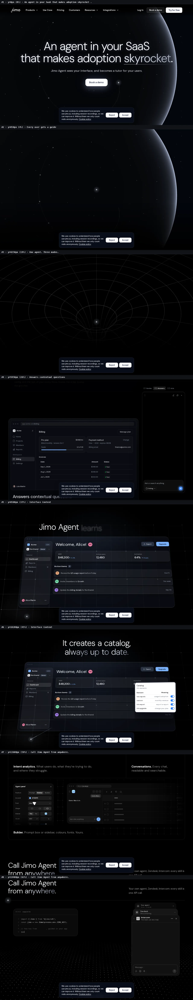
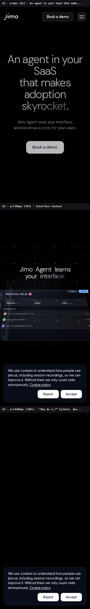

# UI Design System & Master Generation Blueprint: jimo-ai_product-ai

> **AI Agent for User Onboarding in SaaS · Jimo** (https://jimo.ai/product/ai) — Jimo's Adoption Agent lives inside your SaaS. It guides users step by step, answers questions from your docs, and takes actions for them....





---

## 1. Executive Visual Persona & Design Archetype

- **Brand Essence & Persona**: **AI Agent for User Onboarding in SaaS · Jimo** (`https://jimo.ai/product/ai`). Jimo's Adoption Agent lives inside your SaaS. It guides users step by step, answers questions from your docs, and takes actions for them....
- **Capture Provenance**: Live browser capture (`tier1_fast`, HTTP `200`, captured `2026-11-24`).
- **Visual Archetype**: **Dark-Substrate WebGL / Canvas Interactive Experience (`#000000` / `#2b7fff`)**.
- **Anti-AI-Slop Differentiators**:
  - **Live-Computed Chromatic Polarity**: Anchors the viewport in `#000000` (live computed `html` `background-color` (`computed_styles.json`)) paired with `#ffffff` primary typography and `#2b7fff` accents.
  - **Grounded Typographic Hierarchy**: Pairs `DM Sans` for display copy (`An agent in your SaaS that makes ado`) with `Inter`.
  - **Calibrated Spatial Grid & Motion**: Combines `1400px` container bounds (`gap: 16px`, padding `46px`) with `cubic-bezier(.22,1,.36,1)` easing and Three.js / WebGL Canvas Pipeline, Framer Motion Layout Physics.

---

## 2. Spatial Architecture & Modular Grid Mathematics

### Viewport Allocation & Container Geometry
- **Captured Journey Filmstrips**: Desktop `1280×6624px` (`assets/desktop-journey.webp`, `8` keyframes up to `y=14400px` / doc `23805px`), Mobile `390×2616px` (`assets/mobile-journey.webp`, `3` keyframes).
- **Master Container Bounds**: `1400px` (measured widest bounded `<section>` landmark width on `1440px` desktop).
- **Canvas Lateral Padding & Spacing**: `46px` lateral canvas padding with `16px` grid gap.
- **Border Radius Scale**: `8px`, `24px`, `6px`, `999px`.

### Responsive Breakpoint Architecture
- **Desktop Layout**: Multi-column CSS Grid / Flexbox layout at `1440px` (`max-width: 1400px`, `gap: 16px`).
- **Mobile Layout**: Single-column vertical stack at `390px` viewport width with `46px` horizontal padding.
- **Extracted CSS Media Queries**: `@media (max-width:640px)`, `@media (prefers-reduced-motion:reduce)`, `@media (max-width:767.98px)`, `@media (min-width:480px) and (max-width:1023px)`.

---

## 3. Color System, Materiality & Atmospheric Lighting

### Semantic Palette & Source Grounding
| Semantic Role | Ground-Truth Value | Extracted Live / CSS Source |
|---|---|---|
| **Primary Canvas Substrate** | `#000000` | live computed `html` `background-color` (`computed_styles.json`) |
| **Primary Typography Ink** | `#ffffff` | live computed `body` `color` (`computed_styles.json`) |
| **Elevated Surface / Card Substrate** | `#0f0f0f` | `var(--pbg)` in `:root` |
| **Interactive Accent / Highlight** | `#2b7fff` | `.jlp-root .jlp-launcher-btn--start { background: #2b7fff }` |
| **Secondary / Muted Copy** | `#9aa3b5` | `var(--muted-foreground)` in `:root` |
| **Structural Hairline Border** | `#141414` | `var(--line)` in `:root` (`ffffff14`) |
| **Variable Token (`--pm-fg`)** | `#071331` | `var(--pm-fg)` in `:root` |
| **Variable Token (`--pm-2`)** | `#7c8a99` | `var(--pm-2)` in `:root` |
| **Variable Token (`--pm-2-on`)** | `#4d637b` | `var(--pm-2-on)` in `:root` |
| **Variable Token (`--pm-hl`)** | `#f2f4f6` | `var(--pm-hl)` in `:root` |

### Sanitized Root CSS Variables (`ui-ux.md` Ground Truth)
| Variable Name | Extracted Value | Semantic Role |
|---|---|---|
| `--card-w` | `344px` | Dimension / Scale Token |
| `--card-h` | `300px` | Dimension / Scale Token |
| `--pad` | `22px` | Layout / Spatial Grid Token |
| `--book-w` | `176px` | Dimension / Scale Token |
| `--mx` | `50%` | Dimension / Scale Token |
| `--my` | `50%` | Dimension / Scale Token |
| `--open` | `0` | Design System Custom Token |
| `--jlp-fnav-lift` | `10px` | Layout / Spatial Grid Token |
| `--jlp-fnav-fade` | `36px` | Layout / Spatial Grid Token |
| `--jlp-fnav-veil` | `1` | Layout / Spatial Grid Token |
| `--jlp-fnav-ease` | `cubic-bezier(.22, 1, .36, 1)` | Layout / Spatial Grid Token |
| `--pm-fg` | `#071331` | Typography Ink Token |
| `--pm-soft` | `#071331cc` | Color / Atmospheric Token |
| `--pm-2` | `#7c8a99` | Color / Atmospheric Token |
| `--pm-2-on` | `#4d637b` | Color / Atmospheric Token |
| `--pm-hl` | `#f2f4f6` | Color / Atmospheric Token |

---

## 4. Typographic Scale & Editorial Hierarchy

### Font Family Stacks
- **Display Typography**: `DM Sans`.
- **Primary Body Stack**: `Inter`.
- **Technical / Metadata Stack**: not declared in live computed styles (uses primary stack / `ui-monospace`).

### Typographic Scale & Rules (Live Computed & Stylesheet Grounded)
- **Hero Display (`H1`)**: live computed `h1` (`font-size: 86.4px`, `line-height: 89.856px`, `font-weight: 300`, `letter-spacing: -3.024px`).
- **Section Heading (`H2`)**: live computed `h2` (`font-size: 60.8px`, `line-height: 65.664px`, `font-weight: 300`, `letter-spacing: -1.824px`).
- **Body Copy**: live computed `body` (`font-size: 16px`, `line-height: 24px`, `font-weight: 400`); rule `p` (`font-size: 32px`, `line-height: 1`, `letter-spacing: -.01em`, `font-weight: 400`).
- **Metadata & Navigation Labels**: live computed `nav/a` (`font-size: 16px`, `line-height: 19.2px`, `font-weight: 400`); CSS variables `--text-sm: .875rem`, `--text-sm--line-height: calc(1.25 / .875)`, `--default-mono-font-family: var(--font-mono)`; rule `small` (`font-size: 11.5px`).

---

## 5. Choreographed Motion & Interaction Physics

### Primary Easing Curves
- **Extracted Timing Functions**: `cubic-bezier(.22,1,.36,1)`, `cubic-bezier(.34,1.5,.64,1)`, `cubic-bezier(.55,0,.75,.2)`.

### Per-Element Transition & Choreography Rules
- **Selector `.customer-stories-module__rJ0bIq_...`**: `transition: transform .5s cubic-bezier(.22,1,.36,1),box-shadow .3s` extracted from `jimo-ai_product-ai` stylesheet.
- **Selector `.customer-stories-module__rJ0bIq_...`**: `transition: opacity .6s` extracted from `jimo-ai_product-ai` stylesheet.
- **Selector `ustomer-stories-module__rJ0bIq__a...`**: `transition: transform 1.2s cubic-bezier(.22,1,.36,1)` extracted from `jimo-ai_product-ai` stylesheet.
- **Extracted Easing Curve (`cubic-bezier(.22,1,.36,1)`)**: Governs interactive state transitions across `<header.jlp-fnav>` and `<section.relative>`.
- **Runtime Interaction Engine**: Integrates Three.js / WebGL Canvas Pipeline, Framer Motion Layout Physics with `prefers-reduced-motion: reduce` fallback guards.
### Measured Runtime Scroll & Interaction Telemetry (`behavioral_journey_v2`)
- **Scroll Driver Mode**: `native` (max document height `23805px`, deepest scrollY reached `14400px` across `8` desktop keyframes).
- **Detected Scroll / Motion Libraries**: `WebGL/Canvas`.
- **Hover Physics (`primary_cta` · `Book a demo`)**: `backgroundColor`: `rgb(255, 255, 255)` -> `rgb(230, 233, 241)` (`transition-duration: 0.18s, 0.18s`, `timing: ease, ease`).
- **Interactive Control Probe (`tab`)**: Tested `02 Answers` (diff `0.228`).
- **Route Transition Architecture**: First internal navigation (`/pricing`) measured as `MPA` in `1446ms`.

---

## 6. Component Wireframe & Structural DOM Map

### Visual Layout Schematic — Desktop (`1440px`, Grounded in `dom.html` & Landmark Bounding Boxes)
```
┌────────────────────────────────────────────────────────────────────────┐
│ DESKTOP VIEWPORT (1440px) — AI Agent for User Onboarding in SaaS · Jim │
│ ====================================================================== │
│ [ <header.jlp-fnav> (1440x88px)       | Products · Use Case · Pricin ] │
│ ---------------------------------------------------------------------- │
│ | HERO STAGE: <section.text-center> (w=1440px)                       | │
│ | H1: An agent in your SaaS that makes adoption skyrock...           | │
│ | Substrate: #000000 | Ink: #ffffff | Accent: #2b7fff                | │
│ ---------------------------------------------------------------------- │
│ | SHOWCASE GRID (<section.relative>) max-w: 1400px                   | │
│ | +------------------------------+  +------------------------------+ | │
│ | | One agent. Three modes .     |  | Guides users on the fly      | | │
│ | +------------------------------+  +------------------------------+ | │
│ ---------------------------------------------------------------------- │
│ | DETAIL MODULE (<section.relative:nth(2)>) — Answers contextual qu  | │
│ ---------------------------------------------------------------------- │
│ [ FOOTER (<footer.footer-modul) | https://jimo.ai/product/ai           │
└────────────────────────────────────────────────────────────────────────┘
```

### Visual Layout Schematic — Mobile Reflow (`390px`)
```
┌────────────────────────────────────────────────────────────────────────┐
│ MOBILE VIEWPORT REFLOW (390px) — Single-Column Stack (gap: 16px)       │
│ ====================================================================== │
│ [ HEADER BAR (<header.jlp-fnav>       ) | Compact Menu (390px)         │
│ ---------------------------------------------------------------------- │
│ | HERO STAGE (<section.text-center>) — 390px Vertical Lead           | │
│ | H1: An agent in your SaaS that makes adoption skyrock...           | │
│ ---------------------------------------------------------------------- │
│ | SHOWCASE STACK (<section.relative>) — 1-Col Stack                  | │
│ | [ Item 1: One agent. Three modes .                               ] | │
│ | [ Item 2: Guides users on the fly                                ] | │
│ ---------------------------------------------------------------------- │
│ | DETAIL STACK (<section.relative:nth(2)) — 1-Col (Answers contextual) │
│ ---------------------------------------------------------------------- │
│ [ FOOTER (<footer.footer-modul) | Stacked 390px Colophon               │
└────────────────────────────────────────────────────────────────────────┘
```

### Granular DOM Region Breakdown
1. **Brand Header & Navigation Bar (<header.jlp-fnav> — `jimo-ai_product-ai`)**:
   - Landmark `<header class="jlp-fnav jlp-btn-dark">` (`1440x88px`) hosting `AI Agent for User Onboarding in SaaS` navigation (`Products · Use Case · Pricing · Customers · Resources`), DOM attributes (`data-precedence="next"`, `data-precedence="next"`, `data-precedence="next"`, `data-precedence="next"`), and stylesheet rule `module__rJ0bIq__row::-webkit-scro... { display:none }`.
2. **Hero Stage & Focal Lead (<section.text-center> — `An agent in your SaaS that makes a`)**:
   - Landmark `<section class="text-center relative">` presenting display lead `An agent in your SaaS that makes adoption skyrock...` and copy excerpt *"Jimo Agent sees your interface, and becomes a tutor for your user"* over `#000000` canvas and `#ffffff` ink.
3. **Primary Showcase & Content Grid (<section.relative> — `One agent. Three modes .`)**:
   - Landmark `<section class="relative">` rendering section `One agent. Three modes .` with copy *"Every user gets a guide"*, asset references (`5c285b27cdda1fe8-s.p.0yo6-5yoeeud...`, `83afe278b6a6bb3c-s.p.0q-301v4kxxn...`, `gt-walsheim-medium.ttf`, `gt-walsheim-regular.ttf`), and grid rule `.customer-stories-module__rJ0bIq_... { --card-w:344px;--card-h:300px;--pad:22px;--book-w:176px;flex:0 0 var(--c... }`.
4. **Interactive Detail & Feature Matrix (<section.relative:nth(2)> — `Guides users on the fly`)**:
   - Landmark `<section class="relative">` framing `Guides users on the fly` and `Answers contextual questions` (*"Help your users convert with a personal guide."*) with `#0f0f0f` surface cards, `#2b7fff` accents, and `ries-module__rJ0bIq__card:focus-v... { transform:translateY(-4px);box-shadow:inset 0 0 0 1px fff3,0 24px 60px 0... }`.
5. **Colophon & Global Directory Footer (<footer.footer-module__d_pQKq__root> — `https://jimo.ai/product/ai`)**:
   - Landmark `<footer class="footer-module__d_pQKq__root">` anchoring `AI Agent for User Onboarding in ` footer links (`Products · Use Case · Pricing · Customers · Resources`), copy *"Help your users convert"*, and `#141414` structural dividers.
### Full Vertical Scroll Sequence (Desktop `1440×900` Keyframes)
- **Step 01** (`y=0px`, `0%`): Active landmark `An agent in your SaaS that makes adoption skyrock...` · sticky/fixed elements: `2`
- **Step 02** (`y=850px`, `4%`): Active landmark `Every user gets a guide` · sticky/fixed elements: `1`
- **Step 03** (`y=4250px`, `19%`): Active landmark `One agent. Three modes.` · sticky/fixed elements: `1`
- **Step 04** (`y=5950px`, `26%`): Active landmark `Answers contextual questions` · sticky/fixed elements: `1`
- **Step 05** (`y=8500px`, `37%`): Active landmark `Interface Context` · sticky/fixed elements: `1`
- **Step 06** (`y=10200px`, `45%`): Active landmark `Interface Context` · sticky/fixed elements: `1`
- **Step 07** (`y=13600px`, `59%`): Active landmark `Call Jimo Agent from anywhere.` · sticky/fixed elements: `1`
- **Step 08** (`y=14400px`, `63%`): Active landmark `Call Jimo Agent from anywhere.` · sticky/fixed elements: `1`

### Multi-Page Internal Route Map
- **Listing Route (`/pricing`)**: `https://jimo.ai/pricing` — H1: `Guide users before they ask. Answer them when the...`, scrollHeight `7857px`, transition `MPA` (`1446ms`)
- **Detail Route (`/solutions/user-onboarding`)**: `https://jimo.ai/solutions/user-onboarding` — H1: `Convert New Users Into Loyal Ones`, scrollHeight `15400px`, transition `direct` (`1403ms`)
- **Listing Route (`/blog`)**: `https://jimo.ai/blog` — H1: `All Blogs`, scrollHeight `29837px`, transition `direct` (`1985ms`)

---

## 7. Master Zero-Shot AI Generation Prompt

```markdown
# Master Zero-Shot Frontend Generation Prompt: jimo-ai_product-ai (AI Agent for User Onboarding in SaaS · Jimo)

You are a principal frontend architect and design systems engineer. Build a complete, production-ready web application replicating the exact design system, DOM landmarks, typographic hierarchy, color tokens, and motion physics of `jimo-ai_product-ai` (**AI Agent for User Onboarding in SaaS · Jimo** — `https://jimo.ai/product/ai`).

### 1. Visual Archetype & Anti-AI-Slop Mandates
- **Archetype**: Dark-Substrate WebGL / Canvas Interactive Experience (`#000000` / `#2b7fff`).
- **Identity & Domain Context**: Jimo's Adoption Agent lives inside your SaaS. It guides users step by step, answers questions from your docs, and takes actions for them....
- **Primary Substrate**: `#000000` (live computed `html` `background-color` (`computed_styles.json`)), **Primary Ink**: `#ffffff`, **Accent / Highlight**: `#2b7fff`.
- **Site-Specific Differentiators**:
  - **Live-Computed Chromatic Polarity**: Anchors the viewport in `#000000` (live computed `html` `background-color` (`computed_styles.json`)) paired with `#ffffff` primary typography and `#2b7fff` accents.
  - **Grounded Typographic Hierarchy**: Pairs `DM Sans` for display copy (`An agent in your SaaS that makes ado`) with `Inter`.
  - **Calibrated Spatial Grid & Motion**: Combines `1400px` container bounds (`gap: 16px`, padding `46px`) with `cubic-bezier(.22,1,.36,1)` easing and Three.js / WebGL Canvas Pipeline, Framer Motion Layout Physics.

### 2. Ground-Truth CSS Variables (`:root` Token Contract)
Declare and consume these exact custom properties extracted from `jimo-ai_product-ai` in your global stylesheet:

:root {
  /* AI Agent for User Onboarding in SaaS · Jimo (jimo-ai_product-ai) — Live-Grounded CSS Variables */
  --card-w: 344px; /* Dimension / Scale Token (jimo-ai_product-ai) */
  --card-h: 300px; /* Dimension / Scale Token (jimo-ai_product-ai) */
  --pad: 22px; /* Layout / Spatial Grid Token (jimo-ai_product-ai) */
  --book-w: 176px; /* Dimension / Scale Token (jimo-ai_product-ai) */
  --mx: 50%; /* Dimension / Scale Token (jimo-ai_product-ai) */
  --my: 50%; /* Dimension / Scale Token (jimo-ai_product-ai) */
  --open: 0; /* Design System Custom Token (jimo-ai_product-ai) */
  --jlp-fnav-lift: 10px; /* Layout / Spatial Grid Token (jimo-ai_product-ai) */
  --jlp-fnav-fade: 36px; /* Layout / Spatial Grid Token (jimo-ai_product-ai) */
  --jlp-fnav-veil: 1; /* Layout / Spatial Grid Token (jimo-ai_product-ai) */
  --jlp-fnav-ease: cubic-bezier(.22, 1, .36, 1); /* Layout / Spatial Grid Token (jimo-ai_product-ai) */
  --pm-fg: #071331; /* Typography Ink Token (jimo-ai_product-ai) */
  --pm-soft: #071331cc; /* Color / Atmospheric Token (jimo-ai_product-ai) */
  --pm-2: #7c8a99; /* Color / Atmospheric Token (jimo-ai_product-ai) */
  --pm-2-on: #4d637b; /* Color / Atmospheric Token (jimo-ai_product-ai) */
  --pm-hl: #f2f4f6; /* Color / Atmospheric Token (jimo-ai_product-ai) */
}

### 3. Semantic Color & Materiality Contract
Map every surface, ink, and border strictly to these source-grounded tokens:
- **Primary Canvas Substrate**: `#000000` — grounded in live computed `html` `background-color` (`computed_styles.json`)
- **Primary Typography Ink**: `#ffffff` — grounded in live computed `body` `color` (`computed_styles.json`)
- **Elevated Surface / Card Substrate**: `#0f0f0f` — grounded in `var(--pbg)` in `:root`
- **Interactive Accent / Highlight**: `#2b7fff` — grounded in `.jlp-root .jlp-launcher-btn--start { background: #2b7fff }`
- **Secondary / Muted Copy**: `#9aa3b5` — grounded in `var(--muted-foreground)` in `:root`
- **Structural Hairline Border**: `#141414` — grounded in `var(--line)` in `:root` (`ffffff14`)
- **Variable Token (`--pm-fg`)**: `#071331` — grounded in `var(--pm-fg)` in `:root`
- **Variable Token (`--pm-2`)**: `#7c8a99` — grounded in `var(--pm-2)` in `:root`
- **Variable Token (`--pm-2-on`)**: `#4d637b` — grounded in `var(--pm-2-on)` in `:root`
- **Variable Token (`--pm-hl`)**: `#f2f4f6` — grounded in `var(--pm-hl)` in `:root`

### 4. Spatial Grid, Container Bounds & Responsive Breakpoints
- **Desktop Viewport Reference**: `1280×6624px` (multi-frame vertical journey filmstrip (6624px), `1440px` standard desktop width).
- **Mobile Viewport Reference**: `390×2616px` (multi-frame vertical journey filmstrip (2616px), `390px` standard mobile width).
- **Container Max-Width**: `1400px` (measured widest bounded `<section>` landmark width on `1440px` desktop)
- **Padding & Gutters**: `46px` lateral canvas padding with `16px` grid gap
- **Desktop Grid**: Multi-column CSS Grid / Flexbox layout at `1440px` (`max-width: 1400px`, `gap: 16px`)
- **Mobile Adaptation**: Single-column vertical stack at `390px` viewport width with `46px` horizontal padding
- **Media Queries**: `@media (max-width:640px)`, `@media (prefers-reduced-motion:reduce)`, `@media (max-width:767.98px)`, `@media (min-width:480px) and (max-width:1023px)`
- **Corner Radii**: `8px`, `24px`, `6px`, `999px`

### 5. Typography & Editorial Scale Contract
- **Display Font Stack**: `DM Sans`
- **Body Font Stack**: `Inter`
- **Monospace / Technical Font Stack**: not declared in live computed styles (uses primary stack / `ui-monospace`)
- **H1 Display Rule**: live computed `h1` (`font-size: 86.4px`, `line-height: 89.856px`, `font-weight: 300`, `letter-spacing: -3.024px`)
- **H2 Section Rule**: live computed `h2` (`font-size: 60.8px`, `line-height: 65.664px`, `font-weight: 300`, `letter-spacing: -1.824px`)
- **Body Copy Rule**: live computed `body` (`font-size: 16px`, `line-height: 24px`, `font-weight: 400`); rule `p` (`font-size: 32px`, `line-height: 1`, `letter-spacing: -.01em`, `font-weight: 400`)
- **Metadata & Index Rule**: live computed `nav/a` (`font-size: 16px`, `line-height: 19.2px`, `font-weight: 400`); CSS variables `--text-sm: .875rem`, `--text-sm--line-height: calc(1.25 / .875)`, `--default-mono-font-family: var(--font-mono)`; rule `small` (`font-size: 11.5px`)

### 6. Component Hierarchy, Verbatim Copy & Real DOM Landmarks
Scaffold `jimo-ai_product-ai` (`AI Agent for User Onboarding in SaaS · Jimo`) with these exact structural regions, extracted copy, and CSS rules from `dom.html`:
1. **Brand Header & Navigation Bar (<header.jlp-fnav> — `jimo-ai_product-ai`)**:
   - DOM & Selectors: Landmark `<header class="jlp-fnav jlp-btn-dark">` (`1440x88px`) hosting `AI Agent for User Onboarding in SaaS` navigation (`Products · Use Case · Pricing · Customers · Resources`), DOM attributes (`data-precedence="next"`, `data-precedence="next"`, `data-precedence="next"`, `data-precedence="next"`), and stylesheet rule `module__rJ0bIq__row::-webkit-scro... { display:none }`.
   - Responsive Contract: Header `Brand Header & Navigation Bar (<header.jlp-fnav> — `jimo-ai_product-ai`)` (`jimo-ai_product-ai`) adapts across `@media (max-width:640px)`, `@media (prefers-reduced-motion:reduce)`, `@media (max-width:767.98px)`, `@media (min-width:480px) and (max-width:1023px)` with `cubic-bezier(.22,1,.36,1)`, `cubic-bezier(.34,1.5,.64,1)`, `cubic-bezier(.55,0,.75,.2)` transitions and links `Products · Use Case · Pricing · Customers · Resources`.
2. **Hero Stage & Focal Lead (<section.text-center> — `An agent in your SaaS that makes a`)**:
   - DOM & Selectors: Landmark `<section class="text-center relative">` presenting display lead `An agent in your SaaS that makes adoption skyrock...` and copy excerpt *"Jimo Agent sees your interface, and becomes a tutor for your user"* over `#000000` canvas and `#ffffff` ink.
   - Responsive Contract: Hero stage (`1280×6624px` desktop / `390×2616px` mobile) sets `#000000` background with `#ffffff` headline `An agent in your SaaS that makes adoption skyrock...`.
3. **Primary Showcase & Content Grid (<section.relative> — `One agent. Three modes .`)**:
   - DOM & Selectors: Landmark `<section class="relative">` rendering section `One agent. Three modes .` with copy *"Every user gets a guide"*, asset references (`5c285b27cdda1fe8-s.p.0yo6-5yoeeud...`, `83afe278b6a6bb3c-s.p.0q-301v4kxxn...`, `gt-walsheim-medium.ttf`, `gt-walsheim-regular.ttf`), and grid rule `.customer-stories-module__rJ0bIq_... { --card-w:344px;--card-h:300px;--pad:22px;--book-w:176px;flex:0 0 var(--c... }`.
   - Responsive Contract: Showcase grid `Primary Showcase & Content Grid (<section.relative> — `One agent. Three modes .`)` applies Multi-column CSS Grid / Flexbox layout at `1440px` (`max-width: 1400px`, `gap: 16px`) on desktop and Single-column vertical stack at `390px` viewport width with `46px` horizontal padding on mobile.
4. **Interactive Detail & Feature Matrix (<section.relative:nth(2)> — `Guides users on the fly`)**:
   - DOM & Selectors: Landmark `<section class="relative">` framing `Guides users on the fly` and `Answers contextual questions` (*"Help your users convert with a personal guide."*) with `#0f0f0f` surface cards, `#2b7fff` accents, and `ries-module__rJ0bIq__card:focus-v... { transform:translateY(-4px);box-shadow:inset 0 0 0 1px fff3,0 24px 60px 0... }`.
   - Responsive Contract: Detail module `Interactive Detail & Feature Matrix (<section.relative:nth(2)> — `Guides users on the fly`)` uses `8px`, `24px`, `6px`, `999px` radii, `#2b7fff` highlights, and assets (5c285b27cdda1fe8-s.p.0yo6-5yoeeud..., 83afe278b6a6bb3c-s.p.0q-301v4kxxn..., gt-walsheim-medium.ttf).
5. **Colophon & Global Directory Footer (<footer.footer-module__d_pQKq__root> — `https://jimo.ai/product/ai`)**:
   - DOM & Selectors: Landmark `<footer class="footer-module__d_pQKq__root">` anchoring `AI Agent for User Onboarding in ` footer links (`Products · Use Case · Pricing · Customers · Resources`), copy *"Help your users convert"*, and `#141414` structural dividers.
   - Responsive Contract: Footer `Colophon & Global Directory Footer (<footer.footer-module__d_pQKq__root> — `https://jimo.ai/product/ai`)` aligns to `1400px` (measured widest bounded `<section>` landmark width on `1440px` desktop) with `46px` lateral canvas padding with `16px` grid gap and attributes (data-precedence="next", data-precedence="next", data-precedence="next").

#### Verbatim DOM Copy Excerpts (`dom.html`)
- Copy Excerpt 1: *"Jimo Agent sees your interface, and becomes a tutor for your users."*
- Copy Excerpt 2: *"Every user gets a guide"*
- Copy Excerpt 3: *"Help your users convert with a personal guide."*
- Copy Excerpt 4: *"Help your users convert"*

### 7. Motion, Extracted Stylesheet Rules & Interaction Choreography
- **Primary Easing Functions**: `cubic-bezier(.22,1,.36,1)`, `cubic-bezier(.34,1.5,.64,1)`, `cubic-bezier(.55,0,.75,.2)`
- **Extracted Stylesheet Rules (`jimo-ai_product-ai`)**:
- `module__rJ0bIq__row::-webkit-scro... { display:none }`
- `.customer-stories-module__rJ0bIq_... { --card-w:344px;--card-h:300px;--pad:22px;--book-w:176px;flex:0 0 var(--c... }`
- `ries-module__rJ0bIq__card:focus-v... { transform:translateY(-4px);box-shadow:inset 0 0 0 1px fff3,0 24px 60px 0... }`
- `ustomer-stories-module__rJ0bIq__a... { z-index:-1;border-radius:inherit;opacity:0;transition:opacity .6s;positi... }`
- `r-stories-module__rJ0bIq__ambient... { content:"";background:linear-gradient(0000001a,0000008c);position:absolu... }`
- **Per-Selector Transition Rules**:
- **Selector `.customer-stories-module__rJ0bIq_...`**: `transition: transform .5s cubic-bezier(.22,1,.36,1),box-shadow .3s` extracted from `jimo-ai_product-ai` stylesheet.
- **Selector `.customer-stories-module__rJ0bIq_...`**: `transition: opacity .6s` extracted from `jimo-ai_product-ai` stylesheet.
- **Selector `ustomer-stories-module__rJ0bIq__a...`**: `transition: transform 1.2s cubic-bezier(.22,1,.36,1)` extracted from `jimo-ai_product-ai` stylesheet.
- **Extracted Easing Curve (`cubic-bezier(.22,1,.36,1)`)**: Governs interactive state transitions across `<header.jlp-fnav>` and `<section.relative>`.
- **Runtime Interaction Engine**: Integrates Three.js / WebGL Canvas Pipeline, Framer Motion Layout Physics with `prefers-reduced-motion: reduce` fallback guards.
### 7b. Full-Page Scroll Choreography, Interactive States & Multi-Page Routes
- **Scroll Mechanics**: Implement `native` vertical progression up to `23805px` across 8 distinct viewport chapters using WebGL/Canvas.
- **Vertical Chapter Sequence**: An agent in your SaaS that... (0%) -> Every user gets a guide (4%) -> One agent. Three modes. (19%) -> Answers contextual questions (26%) -> Interface Context (37%) -> Interface Context (45%) -> Call Jimo Agent from anywhere. (59%) -> Call Jimo Agent from anywhere. (63%).
- **Hover Micro-Interaction (`primary_cta`)**: Animate `backgroundColor` with `0.18s, 0.18s ease, ease`.
- **Multi-Page Routes**: Scaffold internal routes `/pricing` (listing, MPA), `/solutions/user-onboarding` (detail, direct), `/blog` (listing, direct) sharing the global header/footer shell and design tokens.

### 8. Technical Deliverables
- Implement in Next.js (App Router) with TypeScript and Tailwind CSS consuming the `:root` custom properties defined above for `jimo-ai_product-ai`.
- Reproduce both the `1440px` desktop architecture and `390px` mobile breakpoint transitions, preserving semantic HTML5 landmarks (`<header>`, `<nav>`, `<main>`, `<section>`, `<footer>`) and `prefers-reduced-motion` accessibility guards.
```
---

## 8. Full-Page Scroll Journey, Interactive States & Subpage Inventory

### Desktop Scroll Keyframes (`1440×900` WebP)
| Step | Scroll Y | Progress | Active Landmark / Section | Sticky/Fixed | Visual Asset |
| :---: | :---: | :---: | :--- | :---: | :--- |
| `#01` | `0px` | `0%` | An agent in your SaaS that makes adoption sky... | `2` | [desktop-step-01.webp](assets/desktop-step-01.webp) |
| `#02` | `850px` | `4%` | Every user gets a guide | `1` | [desktop-step-02.webp](assets/desktop-step-02.webp) |
| `#03` | `4250px` | `19%` | One agent. Three modes. | `1` | [desktop-step-03.webp](assets/desktop-step-03.webp) |
| `#04` | `5950px` | `26%` | Answers contextual questions | `1` | [desktop-step-04.webp](assets/desktop-step-04.webp) |
| `#05` | `8500px` | `37%` | Interface Context | `1` | [desktop-step-05.webp](assets/desktop-step-05.webp) |
| `#06` | `10200px` | `45%` | Interface Context | `1` | [desktop-step-06.webp](assets/desktop-step-06.webp) |
| `#07` | `13600px` | `59%` | Call Jimo Agent from anywhere. | `1` | [desktop-step-07.webp](assets/desktop-step-07.webp) |
| `#08` | `14400px` | `63%` | Call Jimo Agent from anywhere. | `1` | [desktop-step-08.webp](assets/desktop-step-08.webp) |

### Mobile Condensed Keyframes (`390×844` WebP)
| Step | Scroll Y | Progress | Active Landmark | Visual Asset |
| :---: | :---: | :---: | :--- | :--- |
| `#01` | `0px` | `0%` | An agent in your SaaS that makes adoption... | [mobile-step-01.webp](assets/mobile-step-01.webp) |
| `#02` | `7200px` | `50%` | Interface Context | [mobile-step-02.webp](assets/mobile-step-02.webp) |
| `#03` | `14400px` | `100%` | “How do I…?” tickets, down to 0. | [mobile-step-03.webp](assets/mobile-step-03.webp) |

### Internal Subpage Filmstrips (`1080px` Wide WebP)
| # | Template | Route URL | H1 / Title | Scroll Height | Transition | Filmstrip Asset |
| :-: | :---: | :--- | :--- | :---: | :---: | :--- |
| `1` | `listing` | `https://jimo.ai/pricing` | Guide users before they ask. Answer t... | `7857px` | `MPA` (`1446ms`) | [subpage-01-pricing.webp](assets/subpage-01-pricing.webp) |
| `2` | `detail` | `https://jimo.ai/solutions/user-onboarding` | Convert New Users Into Loyal Ones | `15400px` | `direct` (`1403ms`) | [subpage-02-solutions-user-onboarding.webp](assets/subpage-02-solutions-user-onboarding.webp) |
| `3` | `listing` | `https://jimo.ai/blog` | All Blogs | `29837px` | `direct` (`1985ms`) | [subpage-03-blog.webp](assets/subpage-03-blog.webp) |

