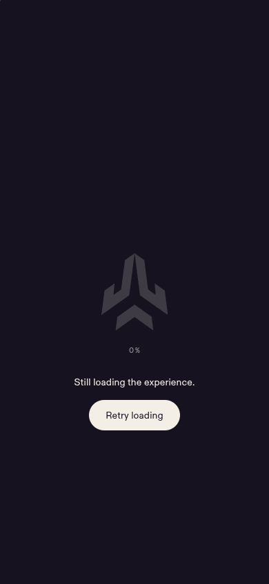

# UI Design System & Master Generation Blueprint: jjettas-com

> **Justin Jefferson** (https://jjettas.com) — Justin Jefferson, wide receiver for the Minnesota Vikings. Records, career stats, partnerships, the JJets Foundation and his journal.


---

## 1. Executive Visual Persona & Design Archetype

- **Brand Essence & Persona**: **Justin Jefferson** (`https://jjettas.com`). Justin Jefferson, wide receiver for the Minnesota Vikings. Records, career stats, partnerships, the JJets Foundation and his journal.
- **Capture Provenance**: Live browser capture (`tier2_webgl`, HTTP `200`, captured `2026-11-23`).
- **Visual Archetype**: **Dark-Substrate WebGL / Canvas Interactive Experience (`#0b0a0f` / `#eeac1a`)**.
- **Anti-AI-Slop Differentiators**:
  - **Live-Computed Chromatic Polarity**: Anchors the viewport in `#0b0a0f` (live computed `html` `background-color` (`computed_styles.json`)) paired with `#f4efe6` primary typography and `#eeac1a` accents.
  - **Grounded Typographic Hierarchy**: Pairs `fontBody` for display copy (`Justin Jefferson`) with `fontBody` and `fontMono`.
  - **Calibrated Spatial Grid & Motion**: Combines `96rem` container bounds (`gap: 2.5px`, padding `48px`) with `cubic-bezier(0,0,.2,1)` easing and Lenis Smooth Scroll (`data-lenis`), Three.js / WebGL Canvas Pipeline.

---

## 2. Spatial Architecture & Modular Grid Mathematics



### Viewport Allocation & Container Geometry
- **Captured Viewport Dimensions**: Desktop `1440×900px` (`assets/desktop.png`, single-viewport 100vh live capture (900px)), Mobile `390×844px` (`assets/mobile.png`, single-viewport 100vh live capture (844px)).
- **Master Container Bounds**: `96rem` (non-`@media` desktop container stylesheet rule).
- **Canvas Lateral Padding & Spacing**: `48px` lateral canvas padding with `2.5px` grid gap.
- **Border Radius Scale**: `3.35544e+07px`, `9999px`, `.25rem`, `var(--radius-2xl)`.

### Responsive Breakpoint Architecture
- **Desktop Layout**: Multi-column CSS Grid / Flexbox layout at `1440px` (`max-width: 96rem`, `gap: 2.5px`).
- **Mobile Layout**: Single-column vertical stack at `390px` viewport width with `48px` horizontal padding.
- **Extracted CSS Media Queries**: `@media (prefers-reduced-motion:reduce)`, `@media (min-width:40rem)`, `@media (min-width:48rem)`, `@media (min-width:64rem)`.

---

## 3. Color System, Materiality & Atmospheric Lighting

### Semantic Palette & Source Grounding
| Semantic Role | Ground-Truth Value | Extracted Live / CSS Source |
|---|---|---|
| **Primary Canvas Substrate** | `#0b0a0f` | live computed `html` `background-color` (`computed_styles.json`) |
| **Primary Typography Ink** | `#f4efe6` | live computed `footer` `color` (`computed_styles.json`) |
| **Elevated Surface / Card Substrate** | `#000000` | `.bg-black { background-color: black }` (`#000000`) |
| **Interactive Accent / Highlight** | `#eeac1a` | `var(--color-cta-yellow)` in `:root` |
| **Secondary / Muted Copy** | `#a9a1b5` | `var(--color-purple-muted)` in `:root` |
| **Structural Hairline Border** | `#242327` | `10 { border-color: #242327 }` |
| **Variable Token (`--logo-color`)** | `#f6f3ef` | `var(--logo-color)` in `:root` |

### Sanitized Root CSS Variables (`ui-ux.md` Ground Truth)
| Variable Name | Extracted Value | Semantic Role |
|---|---|---|
| `--theme-bg` | `var(--color-ink)` | Canvas / Surface Token |
| `--theme-fg` | `var(--color-bone)` | Typography Ink Token |
| `--theme-accent` | `var(--color-gold)` | Brand / Palette Token |
| `--theme-surface` | `var(--color-smoke)` | Canvas / Surface Token |
| `--logo-color` | `#f6f3ef` | Brand / Palette Token |
| `--hamburger-halo` | `drop-shadow(0 1px 5px #0b0a0f8c)` | Color / Atmospheric Token |
| `--pebble-multiply-opacity` | `1` | Design System Custom Token |
| `--pebble-screen-opacity` | `0` | Design System Custom Token |
| `--marquee-opacity` | `0` | Design System Custom Token |
| `--min-h` | `700px` | Dimension / Scale Token |
| `--min-h-phone` | `640px` | Dimension / Scale Token |
| `--content-max` | `1728px` | Dimension / Scale Token |
| `--page-w` | `min(100vw,var(--content-max))` | Dimension / Scale Token |
| `--page-x` | `max(0px,calc((100vw - var(--content-max)) / 2))` | Dimension / Scale Token |
| `--vu` | `min(calc(var(--page-w) / 100),calc(1.8 * max(1vh, var(--min-h) / 100)))` | Dimension / Scale Token |
| `--pu` | `min(1vw,calc(.5 * max(1lvh, var(--min-h-phone) / 100)))` | Dimension / Scale Token |

---

## 4. Typographic Scale & Editorial Hierarchy

### Font Family Stacks
- **Display Typography**: `fontBody`.
- **Primary Body Stack**: `fontBody`.
- **Technical / Metadata Stack**: `fontMono`.

### Typographic Scale & Rules (Live Computed & Stylesheet Grounded)
- **Hero Display (`H1`)**: live computed `h1` (`font-size: 15.12px`, `line-height: 23.436px`, `font-weight: 800`, `letter-spacing: 0.1512px`); CSS variables `--text-4xl: 2.25rem`, `--text-4xl--line-height: calc(2.5 / 2.25)`, `--text-5xl: 3rem`.
- **Section Heading (`H2`)**: live computed `h2` (`font-size: 313.344px`, `line-height: 260.076px`, `font-weight: 700`, `letter-spacing: -9.40032px`); CSS variables `--text-2xl: 1.5rem`, `--text-2xl--line-height: calc(2 / 1.5)`, `--text-3xl: 1.875rem`; rule `h2` (`font-size: calc(20.5 * var(--pu))`).
- **Body Copy**: live computed `body` (`font-size: 15.12px`, `line-height: 23.436px`, `font-weight: 400`, `letter-spacing: 0.1512px`); CSS variables `--font-body-family: "fontBody","fontBody Fallback"`, `--text-base: 1rem`, `--text-base--line-height: calc(1.5 / 1)`.
- **Metadata & Navigation Labels**: live computed `nav/a` (`font-size: 15.12px`, `line-height: 23.436px`, `font-weight: 400`, `letter-spacing: 0.1512px`); CSS variables `--font-mono-family: "fontMono","fontMono Fallback"`, `--font-numono: "fontNuMono","fontNuMono Fallback"`, `--font-mono: var(--font-mono-family),ui-monospace,SFMono-Regular,Menlo,monospace`.

---

## 5. Choreographed Motion & Interaction Physics

### Primary Easing Curves
- **Extracted Timing Functions**: `cubic-bezier(0,0,.2,1)`, `cubic-bezier(.4,0,.2,1)`, `cubic-bezier(.65,.05,.36,1)`.

### Per-Element Transition & Choreography Rules
- **Selector `layer theme`**: `transition: .15s` extracted from `jjettas-com` stylesheet.
- **Selector `.transition`**: `transition: var(--tw-ease,var(--default-transition-timing-function))` extracted from `jjettas-com` stylesheet.
- **Selector `color\]`**: `transition: var(--tw-ease,var(--default-transition-timing-function))` extracted from `jjettas-com` stylesheet.
- **Extracted Easing Curve (`cubic-bezier(0,0,.2,1)`)**: Governs interactive state transitions across `<header.pointer-events-none>` and `<section.items-end>`.
- **Runtime Interaction Engine**: Integrates Lenis Smooth Scroll (`data-lenis`), Three.js / WebGL Canvas Pipeline with `prefers-reduced-motion: reduce` fallback guards.

---

## 6. Component Wireframe & Structural DOM Map

### Visual Layout Schematic — Desktop (`1440px`, Grounded in `dom.html` & Landmark Bounding Boxes)
```
┌────────────────────────────────────────────────────────────────────────┐
│ DESKTOP VIEWPORT (1440px) — Justin Jefferson                           │
│ ====================================================================== │
│ [ <header.pointer-events (1440x104px) | Home · On-Field On-Field · O ] │
│ ---------------------------------------------------------------------- │
│ | HERO STAGE: <section.relative> (w=1440px)                          | │
│ | H1: Justin Jefferson                                               | │
│ | Substrate: #0b0a0f | Ink: #f4efe6 | Accent: #eeac1a                | │
│ ---------------------------------------------------------------------- │
│ | SHOWCASE GRID (<section.items-end>) max-w: 96rem                   | │
│ | +------------------------------+  +------------------------------+ | │
│ | | Signature Moments            |  | Building something that last | | │
│ | +------------------------------+  +------------------------------+ | │
│ ---------------------------------------------------------------------- │
│ | DETAIL MODULE (<section.w-full>) — The JJets Foundation            | │
│ ---------------------------------------------------------------------- │
│ [ FOOTER (<footer.h-auto>     ) | https://jjettas.com                  │
└────────────────────────────────────────────────────────────────────────┘
```

### Visual Layout Schematic — Mobile Reflow (`390px`)
```
┌────────────────────────────────────────────────────────────────────────┐
│ MOBILE VIEWPORT REFLOW (390px) — Single-Column Stack (gap: 2.5px)      │
│ ====================================================================== │
│ [ HEADER BAR (<header.pointer-events-n) | Compact Menu (390px)         │
│ ---------------------------------------------------------------------- │
│ | HERO STAGE (<section.relative>) — 390px Vertical Lead              | │
│ | H1: Justin Jefferson                                               | │
│ ---------------------------------------------------------------------- │
│ | SHOWCASE STACK (<section.items-end>) — 1-Col Stack                 | │
│ | [ Item 1: Signature Moments                                      ] | │
│ | [ Item 2: Building something that lasts                          ] | │
│ ---------------------------------------------------------------------- │
│ | DETAIL STACK (<section.w-full>) — 1-Col (The JJets Foundati)       | │
│ ---------------------------------------------------------------------- │
│ [ FOOTER (<footer.h-auto>     ) | Stacked 390px Colophon               │
└────────────────────────────────────────────────────────────────────────┘
```

### Granular DOM Region Breakdown
1. **Brand Header & Navigation Bar (<header.pointer-events-none> — `jjettas-com`)**:
   - Landmark `<header class="pointer-events-none inset-x-0">` (`1440x104px`) hosting `Justin Jefferson` navigation (`Home · On-Field On-Field · Off-Field Off-Field · Journal Journal · Inquiries Inquiries`), DOM attributes (`data-precedence="next"`, `data-precedence="next"`, `data-precedence="next"`, `data-precedence="next"`), and stylesheet rule `.__className_cf619f { font-family:fontBody,fontBody Fallback }`.
2. **Hero Stage & Focal Lead (<section.relative> — `Justin Jefferson`)**:
   - Landmark `<section class="relative w-full">` presenting display lead `Justin Jefferson` and copy excerpt *"From a St. Rose, Louisiana to the Met Gala runway. Every move Jus"* over `#0b0a0f` canvas and `#f4efe6` ink.
3. **Primary Showcase & Content Grid (<section.items-end> — `Signature Moments`)**:
   - Landmark `<section class="items-end relative">` rendering section `Signature Moments` with copy *"F r o m a S t . R o s e , L o u i s i a n a t o t h e M e t G a l"*, asset references (`0ad3faa61cd26fd6-s.p.woff2`, `34310d7f0559b2f8-s.p.woff2`, `45f4bf9bd5d902fa-s.p.woff2`, `c39007f2e37cc928-s.p.otf`), and grid rule `.__variable_cf619f { --font-body-family:"fontBody","fontBody Fallback" }`.
4. **Interactive Detail & Feature Matrix (<section.w-full> — `Building something that lasts`)**:
   - Landmark `<section class="relative w-full">` framing `Building something that lasts` and `The JJets Foundation` (*"The 2020 first-round pick out of LSU who rewrote the record books"*) with `#000000` surface cards, `#eeac1a` accents, and `.__className_b92fdb { font-family:fontMono,fontMono Fallback;font-weight:500 }`.
5. **Colophon & Global Directory Footer (<footer.h-auto> — `https://jjettas.com`)**:
   - Landmark `<footer class="h-auto relative">` anchoring `Justin Jefferson` footer links (`Home · On-Field On-Field · Off-Field Off-Field · Journal Journal · Inquiries Inquiries`), copy *"14 REC · 227 YDS · 4 TD"*, and `#242327` structural dividers.

---

## 7. Master Zero-Shot AI Generation Prompt

```markdown
# Master Zero-Shot Frontend Generation Prompt: jjettas-com (Justin Jefferson)

You are a principal frontend architect and design systems engineer. Build a complete, production-ready web application replicating the exact design system, DOM landmarks, typographic hierarchy, color tokens, and motion physics of `jjettas-com` (**Justin Jefferson** — `https://jjettas.com`).

### 1. Visual Archetype & Anti-AI-Slop Mandates
- **Archetype**: Dark-Substrate WebGL / Canvas Interactive Experience (`#0b0a0f` / `#eeac1a`).
- **Identity & Domain Context**: Justin Jefferson, wide receiver for the Minnesota Vikings. Records, career stats, partnerships, the JJets Foundation and his journal.
- **Primary Substrate**: `#0b0a0f` (live computed `html` `background-color` (`computed_styles.json`)), **Primary Ink**: `#f4efe6`, **Accent / Highlight**: `#eeac1a`.
- **Site-Specific Differentiators**:
  - **Live-Computed Chromatic Polarity**: Anchors the viewport in `#0b0a0f` (live computed `html` `background-color` (`computed_styles.json`)) paired with `#f4efe6` primary typography and `#eeac1a` accents.
  - **Grounded Typographic Hierarchy**: Pairs `fontBody` for display copy (`Justin Jefferson`) with `fontBody` and `fontMono`.
  - **Calibrated Spatial Grid & Motion**: Combines `96rem` container bounds (`gap: 2.5px`, padding `48px`) with `cubic-bezier(0,0,.2,1)` easing and Lenis Smooth Scroll (`data-lenis`), Three.js / WebGL Canvas Pipeline.

### 2. Ground-Truth CSS Variables (`:root` Token Contract)
Declare and consume these exact custom properties extracted from `jjettas-com` in your global stylesheet:

:root {
  /* Justin Jefferson (jjettas-com) — Live-Grounded CSS Variables */
  --theme-bg: var(--color-ink); /* Canvas / Surface Token (jjettas-com) */
  --theme-fg: var(--color-bone); /* Typography Ink Token (jjettas-com) */
  --theme-accent: var(--color-gold); /* Brand / Palette Token (jjettas-com) */
  --theme-surface: var(--color-smoke); /* Canvas / Surface Token (jjettas-com) */
  --logo-color: #f6f3ef; /* Brand / Palette Token (jjettas-com) */
  --hamburger-halo: drop-shadow(0 1px 5px #0b0a0f8c); /* Color / Atmospheric Token (jjettas-com) */
  --pebble-multiply-opacity: 1; /* Design System Custom Token (jjettas-com) */
  --pebble-screen-opacity: 0; /* Design System Custom Token (jjettas-com) */
  --marquee-opacity: 0; /* Design System Custom Token (jjettas-com) */
  --min-h: 700px; /* Dimension / Scale Token (jjettas-com) */
  --min-h-phone: 640px; /* Dimension / Scale Token (jjettas-com) */
  --content-max: 1728px; /* Dimension / Scale Token (jjettas-com) */
  --page-w: min(100vw,var(--content-max)); /* Dimension / Scale Token (jjettas-com) */
  --page-x: max(0px,calc((100vw - var(--content-max)) / 2)); /* Dimension / Scale Token (jjettas-com) */
  --vu: min(calc(var(--page-w) / 100),calc(1.8 * max(1vh, var(--min-h) / 100))); /* Dimension / Scale Token (jjettas-com) */
  --pu: min(1vw,calc(.5 * max(1lvh, var(--min-h-phone) / 100))); /* Dimension / Scale Token (jjettas-com) */
}

### 3. Semantic Color & Materiality Contract
Map every surface, ink, and border strictly to these source-grounded tokens:
- **Primary Canvas Substrate**: `#0b0a0f` — grounded in live computed `html` `background-color` (`computed_styles.json`)
- **Primary Typography Ink**: `#f4efe6` — grounded in live computed `footer` `color` (`computed_styles.json`)
- **Elevated Surface / Card Substrate**: `#000000` — grounded in `.bg-black { background-color: black }` (`#000000`)
- **Interactive Accent / Highlight**: `#eeac1a` — grounded in `var(--color-cta-yellow)` in `:root`
- **Secondary / Muted Copy**: `#a9a1b5` — grounded in `var(--color-purple-muted)` in `:root`
- **Structural Hairline Border**: `#242327` — grounded in `10 { border-color: #242327 }`
- **Variable Token (`--logo-color`)**: `#f6f3ef` — grounded in `var(--logo-color)` in `:root`

### 4. Spatial Grid, Container Bounds & Responsive Breakpoints
- **Desktop Viewport Reference**: `1440×900px` (single-viewport 100vh live capture (900px), `1440px` standard desktop width).
- **Mobile Viewport Reference**: `390×844px` (single-viewport 100vh live capture (844px), `390px` standard mobile width).
- **Container Max-Width**: `96rem` (non-`@media` desktop container stylesheet rule)
- **Padding & Gutters**: `48px` lateral canvas padding with `2.5px` grid gap
- **Desktop Grid**: Multi-column CSS Grid / Flexbox layout at `1440px` (`max-width: 96rem`, `gap: 2.5px`)
- **Mobile Adaptation**: Single-column vertical stack at `390px` viewport width with `48px` horizontal padding
- **Media Queries**: `@media (prefers-reduced-motion:reduce)`, `@media (min-width:40rem)`, `@media (min-width:48rem)`, `@media (min-width:64rem)`
- **Corner Radii**: `3.35544e+07px`, `9999px`, `.25rem`, `var(--radius-2xl)`

### 5. Typography & Editorial Scale Contract
- **Display Font Stack**: `fontBody`
- **Body Font Stack**: `fontBody`
- **Monospace / Technical Font Stack**: `fontMono`
- **H1 Display Rule**: live computed `h1` (`font-size: 15.12px`, `line-height: 23.436px`, `font-weight: 800`, `letter-spacing: 0.1512px`); CSS variables `--text-4xl: 2.25rem`, `--text-4xl--line-height: calc(2.5 / 2.25)`, `--text-5xl: 3rem`
- **H2 Section Rule**: live computed `h2` (`font-size: 313.344px`, `line-height: 260.076px`, `font-weight: 700`, `letter-spacing: -9.40032px`); CSS variables `--text-2xl: 1.5rem`, `--text-2xl--line-height: calc(2 / 1.5)`, `--text-3xl: 1.875rem`; rule `h2` (`font-size: calc(20.5 * var(--pu))`)
- **Body Copy Rule**: live computed `body` (`font-size: 15.12px`, `line-height: 23.436px`, `font-weight: 400`, `letter-spacing: 0.1512px`); CSS variables `--font-body-family: "fontBody","fontBody Fallback"`, `--text-base: 1rem`, `--text-base--line-height: calc(1.5 / 1)`
- **Metadata & Index Rule**: live computed `nav/a` (`font-size: 15.12px`, `line-height: 23.436px`, `font-weight: 400`, `letter-spacing: 0.1512px`); CSS variables `--font-mono-family: "fontMono","fontMono Fallback"`, `--font-numono: "fontNuMono","fontNuMono Fallback"`, `--font-mono: var(--font-mono-family),ui-monospace,SFMono-Regular,Menlo,monospace`

### 6. Component Hierarchy, Verbatim Copy & Real DOM Landmarks
Scaffold `jjettas-com` (`Justin Jefferson`) with these exact structural regions, extracted copy, and CSS rules from `dom.html`:
1. **Brand Header & Navigation Bar (<header.pointer-events-none> — `jjettas-com`)**:
   - DOM & Selectors: Landmark `<header class="pointer-events-none inset-x-0">` (`1440x104px`) hosting `Justin Jefferson` navigation (`Home · On-Field On-Field · Off-Field Off-Field · Journal Journal · Inquiries Inquiries`), DOM attributes (`data-precedence="next"`, `data-precedence="next"`, `data-precedence="next"`, `data-precedence="next"`), and stylesheet rule `.__className_cf619f { font-family:fontBody,fontBody Fallback }`.
   - Responsive Contract: Header `Brand Header & Navigation Bar (<header.pointer-events-none> — `jjettas-com`)` (`jjettas-com`) adapts across `@media (prefers-reduced-motion:reduce)`, `@media (min-width:40rem)`, `@media (min-width:48rem)`, `@media (min-width:64rem)` with `cubic-bezier(0,0,.2,1)`, `cubic-bezier(.4,0,.2,1)`, `cubic-bezier(.65,.05,.36,1)` transitions and links `Home · On-Field On-Field · Off-Field Off-Field · Journal Journal · Inquiries Inquiries`.
2. **Hero Stage & Focal Lead (<section.relative> — `Justin Jefferson`)**:
   - DOM & Selectors: Landmark `<section class="relative w-full">` presenting display lead `Justin Jefferson` and copy excerpt *"From a St. Rose, Louisiana to the Met Gala runway. Every move Jus"* over `#0b0a0f` canvas and `#f4efe6` ink.
   - Responsive Contract: Hero stage (`1440×900px` desktop / `390×844px` mobile) sets `#0b0a0f` background with `#f4efe6` headline `Justin Jefferson`.
3. **Primary Showcase & Content Grid (<section.items-end> — `Signature Moments`)**:
   - DOM & Selectors: Landmark `<section class="items-end relative">` rendering section `Signature Moments` with copy *"F r o m a S t . R o s e , L o u i s i a n a t o t h e M e t G a l"*, asset references (`0ad3faa61cd26fd6-s.p.woff2`, `34310d7f0559b2f8-s.p.woff2`, `45f4bf9bd5d902fa-s.p.woff2`, `c39007f2e37cc928-s.p.otf`), and grid rule `.__variable_cf619f { --font-body-family:"fontBody","fontBody Fallback" }`.
   - Responsive Contract: Showcase grid `Primary Showcase & Content Grid (<section.items-end> — `Signature Moments`)` applies Multi-column CSS Grid / Flexbox layout at `1440px` (`max-width: 96rem`, `gap: 2.5px`) on desktop and Single-column vertical stack at `390px` viewport width with `48px` horizontal padding on mobile.
4. **Interactive Detail & Feature Matrix (<section.w-full> — `Building something that lasts`)**:
   - DOM & Selectors: Landmark `<section class="relative w-full">` framing `Building something that lasts` and `The JJets Foundation` (*"The 2020 first-round pick out of LSU who rewrote the record books"*) with `#000000` surface cards, `#eeac1a` accents, and `.__className_b92fdb { font-family:fontMono,fontMono Fallback;font-weight:500 }`.
   - Responsive Contract: Detail module `Interactive Detail & Feature Matrix (<section.w-full> — `Building something that lasts`)` uses `3.35544e+07px`, `9999px`, `.25rem`, `var(--radius-2xl)` radii, `#eeac1a` highlights, and assets (0ad3faa61cd26fd6-s.p.woff2, 34310d7f0559b2f8-s.p.woff2, 45f4bf9bd5d902fa-s.p.woff2).
5. **Colophon & Global Directory Footer (<footer.h-auto> — `https://jjettas.com`)**:
   - DOM & Selectors: Landmark `<footer class="h-auto relative">` anchoring `Justin Jefferson` footer links (`Home · On-Field On-Field · Off-Field Off-Field · Journal Journal · Inquiries Inquiries`), copy *"14 REC · 227 YDS · 4 TD"*, and `#242327` structural dividers.
   - Responsive Contract: Footer `Colophon & Global Directory Footer (<footer.h-auto> — `https://jjettas.com`)` aligns to `96rem` (non-`@media` desktop container stylesheet rule) with `48px` lateral canvas padding with `2.5px` grid gap and attributes (data-precedence="next", data-precedence="next", data-precedence="next").

#### Verbatim DOM Copy Excerpts (`dom.html`)
- Copy Excerpt 1: *"From a St. Rose, Louisiana to the Met Gala runway. Every move Justin makes carries..."*
- Copy Excerpt 2: *"F r o m a S t . R o s e , L o u i s i a n a t o t h e M e t G a l a r u n w a y ...."*
- Copy Excerpt 3: *"The 2020 first-round pick out of LSU who rewrote the record books — the rookie car..."*
- Copy Excerpt 4: *"14 REC · 227 YDS · 4 TD"*

### 7. Motion, Extracted Stylesheet Rules & Interaction Choreography
- **Primary Easing Functions**: `cubic-bezier(0,0,.2,1)`, `cubic-bezier(.4,0,.2,1)`, `cubic-bezier(.65,.05,.36,1)`
- **Extracted Stylesheet Rules (`jjettas-com`)**:
- `.__className_cf619f { font-family:fontBody,fontBody Fallback }`
- `.__variable_cf619f { --font-body-family:"fontBody","fontBody Fallback" }`
- `.__className_b92fdb { font-family:fontMono,fontMono Fallback;font-weight:500 }`
- `.__variable_b92fdb { --font-mono-family:"fontMono","fontMono Fallback" }`
- `.__className_f728a0 { font-family:fontNuMono,fontNuMono Fallback;font-weight:400 }`
- **Per-Selector Transition Rules**:
- **Selector `layer theme`**: `transition: .15s` extracted from `jjettas-com` stylesheet.
- **Selector `.transition`**: `transition: var(--tw-ease,var(--default-transition-timing-function))` extracted from `jjettas-com` stylesheet.
- **Selector `color\]`**: `transition: var(--tw-ease,var(--default-transition-timing-function))` extracted from `jjettas-com` stylesheet.
- **Extracted Easing Curve (`cubic-bezier(0,0,.2,1)`)**: Governs interactive state transitions across `<header.pointer-events-none>` and `<section.items-end>`.
- **Runtime Interaction Engine**: Integrates Lenis Smooth Scroll (`data-lenis`), Three.js / WebGL Canvas Pipeline with `prefers-reduced-motion: reduce` fallback guards.

### 8. Technical Deliverables
- Implement in Next.js (App Router) with TypeScript and Tailwind CSS consuming the `:root` custom properties defined above for `jjettas-com`.
- Reproduce both the `1440px` desktop architecture and `390px` mobile breakpoint transitions, preserving semantic HTML5 landmarks (`<header>`, `<nav>`, `<main>`, `<section>`, `<footer>`) and `prefers-reduced-motion` accessibility guards.
```
