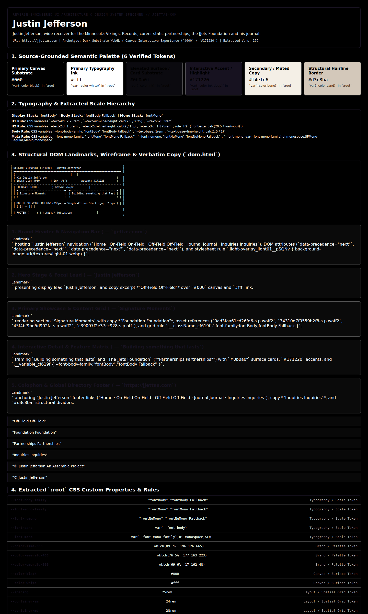

# UI Design System & Master Generation Blueprint: jjettas-com

> **Justin Jefferson** (https://jjettas.com) — Justin Jefferson, wide receiver for the Minnesota Vikings. Records, career stats, partnerships, the JJets Foundation and his journal.



---

## 1. Executive Visual Persona & Design Archetype

- **Brand Essence & Persona**: **Justin Jefferson** (`https://jjettas.com`). Justin Jefferson, wide receiver for the Minnesota Vikings. Records, career stats, partnerships, the JJets Foundation and his journal.
- **Visual Archetype**: **Dark-Substrate WebGL / Canvas Interactive Experience (`#000` / `#171220`)**.
- **Anti-AI-Slop Differentiators**:
  - **Source-Grounded Chromatic Polarity**: Anchors the viewport in `#000` (`var(--color-black)` in `:root`) paired with `#fff` primary typography and `#171220` accents.
  - **Extracted Typographic Hierarchy**: Pairs `fontBody` for display copy (`Justin Jefferson`) with `fontBody Fallback` and `fontMono`.
  - **Calibrated Spatial Grid & Motion**: Combines `767px` container bounds (`gap: 2.5px`, padding `var(--mat)`) with `cubic-bezier(0,0,.2,1)` easing and Lenis Smooth Scroll (`data-lenis`), HTML5 `<canvas>` Interactive Viewport Surface.

---

## 2. Spatial Architecture & Modular Grid Mathematics


### Viewport Allocation & Container Geometry
- **Captured Viewport Dimensions**: Desktop `1440×2400px` (`assets/desktop.png`, capped at 2400px multi-section capture), Mobile `390×2400px` (`assets/mobile.png`, capped at 2400px multi-section capture).
- **Master Container Bounds**: `767px` extracted from `jjettas-com` stylesheet.
- **Canvas Lateral Padding & Spacing**: `var(--mat)` lateral canvas padding with `2.5px` grid gap.
- **Border Radius Scale**: `.25rem`, `var(--radius-2xl)`, `3px`, `4%`.

### Responsive Breakpoint Architecture
- **Desktop Layout**: Multi-column CSS Grid / Flexbox layout at `1440px` (`max-width: 767px`, `gap: 2.5px`).
- **Mobile Layout**: Single-column vertical stack at `390px` viewport width with `var(--mat)` horizontal padding.
- **Extracted CSS Media Queries**: `@media (max-width:767px),(max-width:900px) and (pointer:coarse)`, `@media (min-width:40rem)`, `@media (min-width:48rem)`, `@media (min-width:64rem)`.

---

## 3. Color System, Materiality & Atmospheric Lighting

### Semantic Palette & Source Grounding
| Semantic Role | Ground-Truth Value | Extracted CSS Source / Selector |
|---|---|---|
| **Primary Canvas Substrate** | `#000` | `var(--color-black)` in `:root` |
| **Primary Typography Ink** | `#fff` | `var(--color-white)` in `:root` |
| **Elevated Surface / Card Substrate** | `#0b0a0f` | `var(--color-ink)` in `:root` |
| **Interactive Accent / Highlight** | `#171220` | `var(--color-ink-deep)` in `:root` |
| **Secondary / Muted Copy** | `#f4efe6` | `var(--color-bone)` in `:root` |
| **Structural Hairline Border** | `#d3c8ba` | `var(--color-sand)` in `:root` |

### Sanitized Root CSS Variables (`ui-ux.md` Ground Truth)
| Variable Name | Extracted Value | Semantic Role |
|---|---|---|
| `--font-body-family` | `"fontBody","fontBody Fallback"` | Typography / Scale Token |
| `--font-mono-family` | `"fontMono","fontMono Fallback"` | Typography / Scale Token |
| `--font-numono` | `"fontNuMono","fontNuMono Fallback"` | Typography / Scale Token |
| `--font-sans` | `var(--font-body)` | Typography / Scale Token |
| `--font-mono` | `var(--font-mono-family),ui-monospace,SFMono-Regular,Menlo,monospace` | Typography / Scale Token |
| `--color-lime-300` | `oklch(89.7% .196 126.665)` | Brand / Palette Token |
| `--color-emerald-400` | `oklch(76.5% .177 163.223)` | Brand / Palette Token |
| `--color-emerald-500` | `oklch(69.6% .17 162.48)` | Brand / Palette Token |
| `--color-black` | `#000` | Canvas / Surface Token |
| `--color-white` | `#fff` | Canvas / Surface Token |
| `--spacing` | `.25rem` | Layout / Spatial Grid Token |
| `--container-sm` | `24rem` | Layout / Spatial Grid Token |
| `--container-md` | `28rem` | Layout / Spatial Grid Token |
| `--container-xl` | `36rem` | Layout / Spatial Grid Token |
| `--container-2xl` | `42rem` | Layout / Spatial Grid Token |
| `--container-3xl` | `48rem` | Layout / Spatial Grid Token |

---

## 4. Typographic Scale & Editorial Hierarchy

### Font Family Stacks
- **Display Typography**: `fontBody`.
- **Primary Body Stack**: `fontBody Fallback`.
- **Technical / Metadata Stack**: `fontMono`.

### Typographic Scale & Rules (Extracted from Stylesheet & Variables)
- **Hero Display (`H1`)**: CSS variables `--text-4xl: 2.25rem`, `--text-4xl--line-height: calc(2.5 / 2.25)`, `--text-5xl: 3rem`.
- **Section Heading (`H2`)**: CSS variables `--text-2xl: 1.5rem`, `--text-2xl--line-height: calc(2 / 1.5)`, `--text-3xl: 1.875rem`; rule `h2` (`font-size: calc(20.5 * var(--pu))`).
- **Body Copy**: CSS variables `--font-body-family: "fontBody","fontBody Fallback"`, `--text-base: 1rem`, `--text-base--line-height: calc(1.5 / 1)`.
- **Metadata & Navigation Labels**: CSS variables `--font-mono-family: "fontMono","fontMono Fallback"`, `--font-numono: "fontNuMono","fontNuMono Fallback"`, `--font-mono: var(--font-mono-family),ui-monospace,SFMono-Regular,Menlo,monospace`.

---

## 5. Choreographed Motion & Interaction Physics

### Primary Easing Curves
- **Extracted Timing Functions**: `cubic-bezier(0,0,.2,1)`, `cubic-bezier(.4,0,.2,1)`, `cubic-bezier(.65,.05,.36,1)`.

### Per-Element Transition & Choreography Rules
- **Selector `layer theme`**: `transition: .15s` extracted from `jjettas-com` stylesheet.
- **Selector `.transition`**: `transition: var(--tw-ease,var(--default-transition-timing-function))` extracted from `jjettas-com` stylesheet.
- **Selector `color\]`**: `transition: var(--tw-ease,var(--default-transition-timing-function))` extracted from `jjettas-com` stylesheet.
- **Extracted Easing Curve (`cubic-bezier(0,0,.2,1)`)**: Governs interactive state transitions across `<header.pointer-events-none>` and `<section.relative>`.
- **Runtime Interaction Engine**: Integrates Lenis Smooth Scroll (`data-lenis`), HTML5 `<canvas>` Interactive Viewport Surface with `prefers-reduced-motion: reduce` fallback guards.

---

## 6. Component Wireframe & Structural DOM Map

### Visual Layout Schematic (Grounded in `dom.html` — `1440px` Desktop & `390px` Mobile Reflow)
```
┌────────────────────────────────────────────────────────────────────────┐
│ DESKTOP VIEWPORT (1440px) — Justin Jefferson                           │
│ ====================================================================== │
│ [ <header.pointer-events-n | Home · On-Field On-Field · Off-Field O ]  │
│ ---------------------------------------------------------------------- │
│ | HERO STAGE: <section.relative>                                   |   │
│ | H1: Justin Jefferson                                             |   │
│ | Substrate: #000       | Ink: #fff       | Accent: #171220        |   │
│ ---------------------------------------------------------------------- │
│ | SHOWCASE GRID (<section.relative>        ) max-w: 767px          |   │
│ | +------------------------------+  +------------------------------+ | │
│ | | Signature Moments            |  | Building something that last | | │
│ | +------------------------------+  +------------------------------+ | │
│ ---------------------------------------------------------------------- │
│ | MOBILE VIEWPORT REFLOW (390px) — Single-Column Stack (gap: 2.5px ) | │
│ | [<header.pointer-ev] -> [<section.relative>] -> [<section.relative>] │
│ ---------------------------------------------------------------------- │
│ [ FOOTER (<footer.relative>     ) | https://jjettas.com                │
└────────────────────────────────────────────────────────────────────────┘
```

### Granular DOM Region Breakdown
1. **Brand Header & Navigation Bar (<header.pointer-events-none> — `jjettas-com`)**:
   - Landmark `<header class="pointer-events-none fixed">` hosting `Justin Jefferson` navigation (`Home · On-Field On-Field · Off-Field Off-Field · Journal Journal · Inquiries Inquiries`), DOM attributes (`data-precedence="next"`, `data-precedence="next"`, `data-precedence="next"`, `data-precedence="next"`), and stylesheet rule `.light-overlay_light01__pSQNv { background-image:url(/textures/light-01.webp) }`.
2. **Hero Stage & Focal Lead (<section.relative> — `Justin Jefferson`)**:
   - Landmark `<section class="relative w-full">` presenting display lead `Justin Jefferson` and copy excerpt *"Off-Field Off-Field"* over `#000` canvas and `#fff` ink.
3. **Primary Showcase & Content Grid (<section.relative> — `Signature Moments`)**:
   - Landmark `<section class="relative flex">` rendering section `Signature Moments` with copy *"Foundation Foundation"*, asset references (`0ad3faa61cd26fd6-s.p.woff2`, `34310d7f0559b2f8-s.p.woff2`, `45f4bf9bd5d902fa-s.p.woff2`, `c39007f2e37cc928-s.p.otf`), and grid rule `.__className_cf619f { font-family:fontBody,fontBody Fallback }`.
4. **Interactive Detail & Feature Matrix (<section.relative> — `Building something that lasts`)**:
   - Landmark `<section class="relative w-full">` framing `Building something that lasts` and `The JJets Foundation` (*"Partnerships Partnerships"*) with `#0b0a0f` surface cards, `#171220` accents, and `.__variable_cf619f { --font-body-family:"fontBody","fontBody Fallback" }`.
5. **Colophon & Global Directory Footer (<footer.relative> — `https://jjettas.com`)**:
   - Landmark `<footer class="relative flex">` anchoring `Justin Jefferson` footer links (`Home · On-Field On-Field · Off-Field Off-Field · Journal Journal · Inquiries Inquiries`), copy *"Inquiries Inquiries"*, and `#d3c8ba` structural dividers.

---

## 7. Master Zero-Shot AI Generation Prompt

```markdown
# Master Zero-Shot Frontend Generation Prompt: jjettas-com (Justin Jefferson)

You are a principal frontend architect and design systems engineer. Build a complete, production-ready web application replicating the exact design system, DOM landmarks, typographic hierarchy, color tokens, and motion physics of `jjettas-com` (**Justin Jefferson** — `https://jjettas.com`).

### 1. Visual Archetype & Anti-AI-Slop Mandates
- **Archetype**: Dark-Substrate WebGL / Canvas Interactive Experience (`#000` / `#171220`).
- **Identity & Domain Context**: Justin Jefferson, wide receiver for the Minnesota Vikings. Records, career stats, partnerships, the JJets Foundation and his journal.
- **Primary Substrate**: `#000` (`var(--color-black)` in `:root`), **Primary Ink**: `#fff`, **Accent / Highlight**: `#171220`.
- **Site-Specific Differentiators**:
  - **Source-Grounded Chromatic Polarity**: Anchors the viewport in `#000` (`var(--color-black)` in `:root`) paired with `#fff` primary typography and `#171220` accents.
  - **Extracted Typographic Hierarchy**: Pairs `fontBody` for display copy (`Justin Jefferson`) with `fontBody Fallback` and `fontMono`.
  - **Calibrated Spatial Grid & Motion**: Combines `767px` container bounds (`gap: 2.5px`, padding `var(--mat)`) with `cubic-bezier(0,0,.2,1)` easing and Lenis Smooth Scroll (`data-lenis`), HTML5 `<canvas>` Interactive Viewport Surface.

### 2. Ground-Truth CSS Variables (`:root` Token Contract)
Declare and consume these exact custom properties extracted from `jjettas-com` in your global stylesheet:

:root {
  /* Justin Jefferson (jjettas-com) — Ground-Truth Extracted CSS Variables */
  --font-body-family: "fontBody","fontBody Fallback"; /* Typography / Scale Token (jjettas-com) */
  --font-mono-family: "fontMono","fontMono Fallback"; /* Typography / Scale Token (jjettas-com) */
  --font-numono: "fontNuMono","fontNuMono Fallback"; /* Typography / Scale Token (jjettas-com) */
  --font-sans: var(--font-body); /* Typography / Scale Token (jjettas-com) */
  --font-mono: var(--font-mono-family),ui-monospace,SFMono-Regular,Menlo,monospace; /* Typography / Scale Token (jjettas-com) */
  --color-lime-300: oklch(89.7% .196 126.665); /* Brand / Palette Token (jjettas-com) */
  --color-emerald-400: oklch(76.5% .177 163.223); /* Brand / Palette Token (jjettas-com) */
  --color-emerald-500: oklch(69.6% .17 162.48); /* Brand / Palette Token (jjettas-com) */
  --color-black: #000; /* Canvas / Surface Token (jjettas-com) */
  --color-white: #fff; /* Canvas / Surface Token (jjettas-com) */
  --spacing: .25rem; /* Layout / Spatial Grid Token (jjettas-com) */
  --container-sm: 24rem; /* Layout / Spatial Grid Token (jjettas-com) */
  --container-md: 28rem; /* Layout / Spatial Grid Token (jjettas-com) */
  --container-xl: 36rem; /* Layout / Spatial Grid Token (jjettas-com) */
  --container-2xl: 42rem; /* Layout / Spatial Grid Token (jjettas-com) */
  --container-3xl: 48rem; /* Layout / Spatial Grid Token (jjettas-com) */
}

### 3. Semantic Color & Materiality Contract
Map every surface, ink, and border strictly to these source-grounded tokens:
- **Primary Canvas Substrate**: `#000` — grounded in `var(--color-black)` in `:root`
- **Primary Typography Ink**: `#fff` — grounded in `var(--color-white)` in `:root`
- **Elevated Surface / Card Substrate**: `#0b0a0f` — grounded in `var(--color-ink)` in `:root`
- **Interactive Accent / Highlight**: `#171220` — grounded in `var(--color-ink-deep)` in `:root`
- **Secondary / Muted Copy**: `#f4efe6` — grounded in `var(--color-bone)` in `:root`
- **Structural Hairline Border**: `#d3c8ba` — grounded in `var(--color-sand)` in `:root`

### 4. Spatial Grid, Container Bounds & Responsive Breakpoints
- **Desktop Viewport Reference**: `1440×2400px` (capped at 2400px multi-section capture, `1440px` standard desktop width).
- **Mobile Viewport Reference**: `390×2400px` (capped at 2400px multi-section capture, `390px` standard mobile width).
- **Container Max-Width**: `767px` extracted from `jjettas-com` stylesheet
- **Padding & Gutters**: `var(--mat)` lateral canvas padding with `2.5px` grid gap
- **Desktop Grid**: Multi-column CSS Grid / Flexbox layout at `1440px` (`max-width: 767px`, `gap: 2.5px`)
- **Mobile Adaptation**: Single-column vertical stack at `390px` viewport width with `var(--mat)` horizontal padding
- **Media Queries**: `@media (max-width:767px),(max-width:900px) and (pointer:coarse)`, `@media (min-width:40rem)`, `@media (min-width:48rem)`, `@media (min-width:64rem)`
- **Corner Radii**: `.25rem`, `var(--radius-2xl)`, `3px`, `4%`

### 5. Typography & Editorial Scale Contract
- **Display Font Stack**: `fontBody`
- **Body Font Stack**: `fontBody Fallback`
- **Monospace / Technical Font Stack**: `fontMono`
- **H1 Display Rule**: CSS variables `--text-4xl: 2.25rem`, `--text-4xl--line-height: calc(2.5 / 2.25)`, `--text-5xl: 3rem`
- **H2 Section Rule**: CSS variables `--text-2xl: 1.5rem`, `--text-2xl--line-height: calc(2 / 1.5)`, `--text-3xl: 1.875rem`; rule `h2` (`font-size: calc(20.5 * var(--pu))`)
- **Body Copy Rule**: CSS variables `--font-body-family: "fontBody","fontBody Fallback"`, `--text-base: 1rem`, `--text-base--line-height: calc(1.5 / 1)`
- **Metadata & Index Rule**: CSS variables `--font-mono-family: "fontMono","fontMono Fallback"`, `--font-numono: "fontNuMono","fontNuMono Fallback"`, `--font-mono: var(--font-mono-family),ui-monospace,SFMono-Regular,Menlo,monospace`

### 6. Component Hierarchy, Verbatim Copy & Real DOM Landmarks
Scaffold `jjettas-com` (`Justin Jefferson`) with these exact structural regions, extracted copy, and CSS rules from `dom.html`:
1. **Brand Header & Navigation Bar (<header.pointer-events-none> — `jjettas-com`)**:
   - DOM & Selectors: Landmark `<header class="pointer-events-none fixed">` hosting `Justin Jefferson` navigation (`Home · On-Field On-Field · Off-Field Off-Field · Journal Journal · Inquiries Inquiries`), DOM attributes (`data-precedence="next"`, `data-precedence="next"`, `data-precedence="next"`, `data-precedence="next"`), and stylesheet rule `.light-overlay_light01__pSQNv { background-image:url(/textures/light-01.webp) }`.
   - Responsive Contract: Header `Brand Header & Navigation Bar (<header.pointer-events-none> — `jjettas-com`)` (`jjettas-com`) adapts across `@media (max-width:767px),(max-width:900px) and (pointer:coarse)`, `@media (min-width:40rem)`, `@media (min-width:48rem)`, `@media (min-width:64rem)` with `cubic-bezier(0,0,.2,1)`, `cubic-bezier(.4,0,.2,1)`, `cubic-bezier(.65,.05,.36,1)` transitions and links `Home · On-Field On-Field · Off-Field Off-Field · Journal Journal · Inquiries Inquiries`.
2. **Hero Stage & Focal Lead (<section.relative> — `Justin Jefferson`)**:
   - DOM & Selectors: Landmark `<section class="relative w-full">` presenting display lead `Justin Jefferson` and copy excerpt *"Off-Field Off-Field"* over `#000` canvas and `#fff` ink.
   - Responsive Contract: Hero stage (`1440×2400px` desktop / `390×2400px` mobile) sets `#000` background with `#fff` headline `Justin Jefferson`.
3. **Primary Showcase & Content Grid (<section.relative> — `Signature Moments`)**:
   - DOM & Selectors: Landmark `<section class="relative flex">` rendering section `Signature Moments` with copy *"Foundation Foundation"*, asset references (`0ad3faa61cd26fd6-s.p.woff2`, `34310d7f0559b2f8-s.p.woff2`, `45f4bf9bd5d902fa-s.p.woff2`, `c39007f2e37cc928-s.p.otf`), and grid rule `.__className_cf619f { font-family:fontBody,fontBody Fallback }`.
   - Responsive Contract: Showcase grid `Primary Showcase & Content Grid (<section.relative> — `Signature Moments`)` applies Multi-column CSS Grid / Flexbox layout at `1440px` (`max-width: 767px`, `gap: 2.5px`) on desktop and Single-column vertical stack at `390px` viewport width with `var(--mat)` horizontal padding on mobile.
4. **Interactive Detail & Feature Matrix (<section.relative> — `Building something that lasts`)**:
   - DOM & Selectors: Landmark `<section class="relative w-full">` framing `Building something that lasts` and `The JJets Foundation` (*"Partnerships Partnerships"*) with `#0b0a0f` surface cards, `#171220` accents, and `.__variable_cf619f { --font-body-family:"fontBody","fontBody Fallback" }`.
   - Responsive Contract: Detail module `Interactive Detail & Feature Matrix (<section.relative> — `Building something that lasts`)` uses `.25rem`, `var(--radius-2xl)`, `3px`, `4%` radii, `#171220` highlights, and assets (0ad3faa61cd26fd6-s.p.woff2, 34310d7f0559b2f8-s.p.woff2, 45f4bf9bd5d902fa-s.p.woff2).
5. **Colophon & Global Directory Footer (<footer.relative> — `https://jjettas.com`)**:
   - DOM & Selectors: Landmark `<footer class="relative flex">` anchoring `Justin Jefferson` footer links (`Home · On-Field On-Field · Off-Field Off-Field · Journal Journal · Inquiries Inquiries`), copy *"Inquiries Inquiries"*, and `#d3c8ba` structural dividers.
   - Responsive Contract: Footer `Colophon & Global Directory Footer (<footer.relative> — `https://jjettas.com`)` aligns to `767px` extracted from `jjettas-com` stylesheet with `var(--mat)` lateral canvas padding with `2.5px` grid gap and attributes (data-precedence="next", data-precedence="next", data-precedence="next").

#### Verbatim DOM Copy Excerpts (`dom.html`)
- Copy Excerpt 1: *"Off-Field Off-Field"*
- Copy Excerpt 2: *"Foundation Foundation"*
- Copy Excerpt 3: *"Partnerships Partnerships"*
- Copy Excerpt 4: *"Inquiries Inquiries"*

### 7. Motion, Extracted Stylesheet Rules & Interaction Choreography
- **Primary Easing Functions**: `cubic-bezier(0,0,.2,1)`, `cubic-bezier(.4,0,.2,1)`, `cubic-bezier(.65,.05,.36,1)`
- **Extracted Stylesheet Rules (`jjettas-com`)**:
- `.light-overlay_light01__pSQNv { background-image:url(/textures/light-01.webp) }`
- `.__className_cf619f { font-family:fontBody,fontBody Fallback }`
- `.__variable_cf619f { --font-body-family:"fontBody","fontBody Fallback" }`
- `.__className_b92fdb { font-family:fontMono,fontMono Fallback;font-weight:500 }`
- `.__variable_b92fdb { --font-mono-family:"fontMono","fontMono Fallback" }`
- **Per-Selector Transition Rules**:
- **Selector `layer theme`**: `transition: .15s` extracted from `jjettas-com` stylesheet.
- **Selector `.transition`**: `transition: var(--tw-ease,var(--default-transition-timing-function))` extracted from `jjettas-com` stylesheet.
- **Selector `color\]`**: `transition: var(--tw-ease,var(--default-transition-timing-function))` extracted from `jjettas-com` stylesheet.
- **Extracted Easing Curve (`cubic-bezier(0,0,.2,1)`)**: Governs interactive state transitions across `<header.pointer-events-none>` and `<section.relative>`.
- **Runtime Interaction Engine**: Integrates Lenis Smooth Scroll (`data-lenis`), HTML5 `<canvas>` Interactive Viewport Surface with `prefers-reduced-motion: reduce` fallback guards.

### 8. Technical Deliverables
- Implement in Next.js (App Router) with TypeScript and Tailwind CSS consuming the `:root` custom properties defined above for `jjettas-com`.
- Reproduce both the `1440px` desktop architecture and `390px` mobile breakpoint transitions, preserving semantic HTML5 landmarks (`<header>`, `<nav>`, `<main>`, `<section>`, `<footer>`) and `prefers-reduced-motion` accessibility guards.
```
