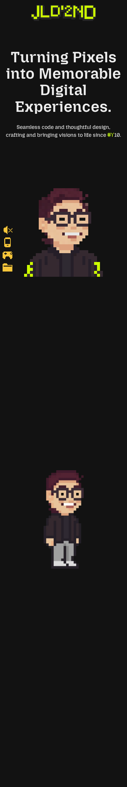

# UI Design System & Master Generation Blueprint: jld2nd-dev

> **JLD'2nd – Designer & Developer** (https://jld2nd.dev) — I believe web design should be as expressive as the ideas behind it. Driven by curiosity, I explore new possibilities at the intersection...


---

## 1. Executive Visual Persona & Design Archetype

- **Brand Essence & Persona**: **JLD'2nd – Designer & Developer** (`https://jld2nd.dev`). I believe web design should be as expressive as the ideas behind it. Driven by curiosity, I explore new possibilities at the intersection...
- **Visual Archetype**: **Light-Substrate Editorial & Modular Grid System (`#ffd64f` canvas, `#212121` ink, `#616161` accent)**.
- **Anti-AI-Slop Differentiators**:
  - **Source-Grounded Chromatic Polarity**: Anchors the viewport in `#ffd64f` (`var(--color-primary)` in `:root`) paired with `#212121` primary typography and `#616161` accents.
  - **Extracted Typographic Hierarchy**: Pairs `Mozilla Headline` for display copy (`T u r n i n g P i x e l s i n t o M `) with `Minecraft` and not declared in static CSS (uses primary stack / `ui-monospace`).
  - **Calibrated Spatial Grid & Motion**: Combines `60px` container bounds (`gap: 10px`, padding `30px`) with `cubic-bezier(0.25,0.1,0.25,1)` easing.

---

## 2. Spatial Architecture & Modular Grid Mathematics



### Viewport Allocation & Container Geometry
- **Captured Viewport Dimensions**: Desktop `1440×24450px` (`assets/desktop.png`, full-page scroll capture), Mobile `390×2400px` (`assets/mobile.png`, capped at 2400px multi-section capture).
- **Master Container Bounds**: `60px` extracted from `jld2nd-dev` stylesheet.
- **Canvas Lateral Padding & Spacing**: `30px` lateral canvas padding with `10px` grid gap.
- **Border Radius Scale**: `4px`.

### Responsive Breakpoint Architecture
- **Desktop Layout**: Multi-column CSS Grid / Flexbox layout at `1440px` (`max-width: 60px`, `gap: 10px`).
- **Mobile Layout**: Single-column vertical stack at `390px` viewport width with `30px` horizontal padding.
- **Extracted CSS Media Queries**: `@media (width<=767px)`, `@media (width<=991px)`, `@media (width>=1440px)`, `@media (width>=1920px)`.

---

## 3. Color System, Materiality & Atmospheric Lighting

### Semantic Palette & Source Grounding
| Semantic Role | Ground-Truth Value | Extracted CSS Source / Selector |
|---|---|---|
| **Primary Canvas Substrate** | `#ffd64f` | `var(--color-primary)` in `:root` |
| **Primary Typography Ink** | `#fc5778` | `var(--color-secondary)` in `:root` |
| **Elevated Surface / Card Substrate** | `#212121` | `var(--base-text-dark)` in `:root` |
| **Interactive Accent / Highlight** | `#616161` | `var(--base-text-medium)` in `:root` |
| **Secondary / Muted Copy** | `#9e9e9e` | `var(--base-text-light)` in `:root` |
| **Structural Hairline Border** | `#00b0f4` | `var(--base-text-info)` in `:root` |
| **Variable Token (`--base-text-success`)** | `#11b76b` | `var(--base-text-success)` in `:root` |
| **Variable Token (`--base-text-warning`)** | `#ffa100` | `var(--base-text-warning)` in `:root` |
| **Variable Token (`--base-text-danger`)** | `#fa4362` | `var(--base-text-danger)` in `:root` |
| **Variable Token (`--base-bg-info`)** | `#e5f3ff` | `var(--base-bg-info)` in `:root` |
| **Variable Token (`--base-bg-success`)** | `#e6f6ed` | `var(--base-bg-success)` in `:root` |
| **Variable Token (`--base-bg-warning`)** | `#fff2d7` | `var(--base-bg-warning)` in `:root` |
| **Variable Token (`--base-bg-danger`)** | `#ffe6ec` | `var(--base-bg-danger)` in `:root` |
| **Variable Token (`--base-bg-dark`)** | `#263238` | `var(--base-bg-dark)` in `:root` |

### Sanitized Root CSS Variables (`ui-ux.md` Ground Truth)
| Variable Name | Extracted Value | Semantic Role |
|---|---|---|
| `--base-vh` | `1vh` | Layout / Spatial Grid Token |
| `--base-transition` | `all .2s` | Motion / Easing Token |
| `--color-primary` | `#ffd64f` | Brand / Palette Token |
| `--color-secondary` | `#fc5778` | Brand / Palette Token |
| `--base-text-dark` | `#212121` | Canvas / Surface Token |
| `--base-text-medium` | `#616161` | Typography Ink Token |
| `--base-text-light` | `#9e9e9e` | Canvas / Surface Token |
| `--base-text-info` | `#00b0f4` | Typography Ink Token |
| `--base-text-success` | `#11b76b` | Typography Ink Token |
| `--base-text-warning` | `#ffa100` | Typography Ink Token |
| `--base-text-danger` | `#fa4362` | Typography Ink Token |
| `--base-bg-info` | `#e5f3ff` | Canvas / Surface Token |
| `--base-bg-success` | `#e6f6ed` | Canvas / Surface Token |
| `--base-bg-warning` | `#fff2d7` | Canvas / Surface Token |
| `--base-bg-danger` | `#ffe6ec` | Canvas / Surface Token |
| `--base-bg-dark` | `#263238` | Canvas / Surface Token |

---

## 4. Typographic Scale & Editorial Hierarchy

### Font Family Stacks
- **Display Typography**: `Mozilla Headline`.
- **Primary Body Stack**: `Minecraft`.
- **Technical / Metadata Stack**: not declared in static CSS (uses primary stack / `ui-monospace`).

### Typographic Scale & Rules (Extracted from Stylesheet & Variables)
- **Hero Display (`H1`)**: CSS variables `--fs-display-2xl: clamp(3.75rem, 3.5536rem + .9821vw, 5.125rem)`, `--fs-display-xl: clamp(3.5rem, calc(3.4rem + .5vw), 4rem)`, `--fs-display-lg: clamp(3.125rem, 2.9018rem + 1.1161vw, 4.6875rem)`.
- **Section Heading (`H2`)**: not explicitly declared on tag in static CSS (stylesheet font-size ladder: `100%`, `62.5%`, `15px`, `2.1em`, `1.8em`).
- **Body Copy**: not explicitly declared on tag in static CSS (stylesheet font-size ladder: `100%`, `62.5%`, `15px`, `2.1em`, `1.8em`).
- **Metadata & Navigation Labels**: CSS variables `--fs-text-sm: .875rem`, `--fs-text-xs: .75rem`.

---

## 5. Choreographed Motion & Interaction Physics

### Primary Easing Curves
- **Extracted Timing Functions**: `cubic-bezier(0.25,0.1,0.25,1)`.

### Per-Element Transition & Choreography Rules
- **Selector `layer base`**: `transition: all .2s` extracted from `jld2nd-dev` stylesheet.
- **Selector `.popup .popup-backdrop`**: `transition: all 1s ease-in-out` extracted from `jld2nd-dev` stylesheet.
- **Selector `body`**: `transition: var(--base-transition)` extracted from `jld2nd-dev` stylesheet.
- **Standard CSS Easing (`cubic-bezier(0.25,0.1,0.25,1)`)**: Default timing curve (no custom `cubic-bezier()` declared in static CSS).
- **State & Hover Choreography**: Opacity and transform transitions on `<section.section>` and `<section.section>` interactive targets.

---

## 6. Component Wireframe & Structural DOM Map

### Visual Layout Schematic (Grounded in `dom.html` — `1440px` Desktop & `390px` Mobile Reflow)
```
┌────────────────────────────────────────────────────────────────────────┐
│ DESKTOP VIEWPORT (1440px) — JLD'2nd – Designer & Developer             │
│ ====================================================================== │
│ [ <header.sticky>          | Overview · Index · Archive · About · C ]  │
│ ---------------------------------------------------------------------- │
│ | HERO STAGE: <section.section>                                    |   │
│ | H1: T u r n i n g P i x e l s i n t o M e m o r a b l...         |   │
│ | Substrate: #ffd64f    | Ink: #212121    | Accent: #616161        |   │
│ ---------------------------------------------------------------------- │
│ | SHOWCASE GRID (<section.section>         ) max-w: 60px           |   │
│ | +------------------------------+  +------------------------------+ | │
│ | | T h e C r e a t o r B e h i  |  | I t a l l s t a r t s w i t  | | │
│ | +------------------------------+  +------------------------------+ | │
│ ---------------------------------------------------------------------- │
│ | MOBILE VIEWPORT REFLOW (390px) — Single-Column Stack (gap: 10px  ) | │
│ | [<header.sticky>] -> [<section.section>] -> [<section.section>] |    │
│ ---------------------------------------------------------------------- │
│ [ FOOTER (<footer.home-footer>  ) | https://jld2nd.dev                 │
└────────────────────────────────────────────────────────────────────────┘
```

### Granular DOM Region Breakdown
1. **Brand Header & Navigation Bar (<header.sticky> — `jld2nd-dev`)**:
   - Landmark `<header class="sticky">` hosting `JLD'2nd – Designer & Developer` navigation (`Overview · Index · Archive · About · Contact`), DOM attributes (`data-no-grid`, `data-section="hero"`, `data-section="about"`, `data-section="pixels"`), and stylesheet rule `main-content:focus { outline:none }`.
2. **Hero Stage & Focal Lead (<section.section> — `T u r n i n g P i x e l s i n t o `)**:
   - Landmark `<section class="section">` presenting display lead `T u r n i n g P i x e l s i n t o M e m o r a b l...` and copy excerpt *"E x p e r i e n c e s ."* over `#ffd64f` canvas and `#212121` ink.
3. **Primary Showcase & Content Grid (<section.section> — `T h e C r e a t o r B e h i n d t `)**:
   - Landmark `<section class="section grid-container">` rendering section `T h e C r e a t o r B e h i n d t h e C o d e a n...` with copy *"t h o u g h t f u l"*, asset references (`favicon.ico`, `favicon-32x32.png`, `apple-touch-icon.png`, `site.webmanifest`), and grid rule `html { -webkit-text-size-adjust:100%;text-size-adjust:auto;line-height:1.15 }`.
4. **Interactive Detail & Feature Matrix (<section.section> — `I t a l l s t a r t s w i t h t h `)**:
   - Landmark `<section class="section p-relative">` framing `I t a l l s t a r t s w i t h t h e p i x e l s .` and `T h i s i s w h e r e i d e a s t a k e s h a p e .` (*"s t r u c t u r e ,"*) with `#212121` surface cards, `#616161` accents, and `section { display:block }`.
5. **Colophon & Global Directory Footer (<footer.home-footer> — `https://jld2nd.dev`)**:
   - Landmark `<footer class="home-footer">` anchoring `JLD'2nd – Designer & Developer` footer links (`Overview · Index · Archive · About · Contact`), copy *"i n t e r a c t i o n ,"*, and `#00b0f4` structural dividers.

---

## 7. Master Zero-Shot AI Generation Prompt

```markdown
# Master Zero-Shot Frontend Generation Prompt: jld2nd-dev (JLD'2nd – Designer & Developer)

You are a principal frontend architect and design systems engineer. Build a complete, production-ready web application replicating the exact design system, DOM landmarks, typographic hierarchy, color tokens, and motion physics of `jld2nd-dev` (**JLD'2nd – Designer & Developer** — `https://jld2nd.dev`).

### 1. Visual Archetype & Anti-AI-Slop Mandates
- **Archetype**: Light-Substrate Editorial & Modular Grid System (`#ffd64f` canvas, `#212121` ink, `#616161` accent).
- **Identity & Domain Context**: I believe web design should be as expressive as the ideas behind it. Driven by curiosity, I explore new possibilities at the intersection...
- **Primary Substrate**: `#ffd64f` (`var(--color-primary)` in `:root`), **Primary Ink**: `#212121`, **Accent / Highlight**: `#616161`.
- **Site-Specific Differentiators**:
  - **Source-Grounded Chromatic Polarity**: Anchors the viewport in `#ffd64f` (`var(--color-primary)` in `:root`) paired with `#212121` primary typography and `#616161` accents.
  - **Extracted Typographic Hierarchy**: Pairs `Mozilla Headline` for display copy (`T u r n i n g P i x e l s i n t o M `) with `Minecraft` and not declared in static CSS (uses primary stack / `ui-monospace`).
  - **Calibrated Spatial Grid & Motion**: Combines `60px` container bounds (`gap: 10px`, padding `30px`) with `cubic-bezier(0.25,0.1,0.25,1)` easing.

### 2. Ground-Truth CSS Variables (`:root` Token Contract)
Declare and consume these exact custom properties extracted from `jld2nd-dev` in your global stylesheet:

:root {
  /* JLD'2nd – Designer & Developer (jld2nd-dev) — Ground-Truth Extracted CSS Variables */
  --base-vh: 1vh; /* Layout / Spatial Grid Token (jld2nd-dev) */
  --base-transition: all .2s; /* Motion / Easing Token (jld2nd-dev) */
  --color-primary: #ffd64f; /* Brand / Palette Token (jld2nd-dev) */
  --color-secondary: #fc5778; /* Brand / Palette Token (jld2nd-dev) */
  --base-text-dark: #212121; /* Canvas / Surface Token (jld2nd-dev) */
  --base-text-medium: #616161; /* Typography Ink Token (jld2nd-dev) */
  --base-text-light: #9e9e9e; /* Canvas / Surface Token (jld2nd-dev) */
  --base-text-info: #00b0f4; /* Typography Ink Token (jld2nd-dev) */
  --base-text-success: #11b76b; /* Typography Ink Token (jld2nd-dev) */
  --base-text-warning: #ffa100; /* Typography Ink Token (jld2nd-dev) */
  --base-text-danger: #fa4362; /* Typography Ink Token (jld2nd-dev) */
  --base-bg-info: #e5f3ff; /* Canvas / Surface Token (jld2nd-dev) */
  --base-bg-success: #e6f6ed; /* Canvas / Surface Token (jld2nd-dev) */
  --base-bg-warning: #fff2d7; /* Canvas / Surface Token (jld2nd-dev) */
  --base-bg-danger: #ffe6ec; /* Canvas / Surface Token (jld2nd-dev) */
  --base-bg-dark: #263238; /* Canvas / Surface Token (jld2nd-dev) */
}

### 3. Semantic Color & Materiality Contract
Map every surface, ink, and border strictly to these source-grounded tokens:
- **Primary Canvas Substrate**: `#ffd64f` — grounded in `var(--color-primary)` in `:root`
- **Primary Typography Ink**: `#fc5778` — grounded in `var(--color-secondary)` in `:root`
- **Elevated Surface / Card Substrate**: `#212121` — grounded in `var(--base-text-dark)` in `:root`
- **Interactive Accent / Highlight**: `#616161` — grounded in `var(--base-text-medium)` in `:root`
- **Secondary / Muted Copy**: `#9e9e9e` — grounded in `var(--base-text-light)` in `:root`
- **Structural Hairline Border**: `#00b0f4` — grounded in `var(--base-text-info)` in `:root`
- **Variable Token (`--base-text-success`)**: `#11b76b` — grounded in `var(--base-text-success)` in `:root`
- **Variable Token (`--base-text-warning`)**: `#ffa100` — grounded in `var(--base-text-warning)` in `:root`
- **Variable Token (`--base-text-danger`)**: `#fa4362` — grounded in `var(--base-text-danger)` in `:root`
- **Variable Token (`--base-bg-info`)**: `#e5f3ff` — grounded in `var(--base-bg-info)` in `:root`
- **Variable Token (`--base-bg-success`)**: `#e6f6ed` — grounded in `var(--base-bg-success)` in `:root`
- **Variable Token (`--base-bg-warning`)**: `#fff2d7` — grounded in `var(--base-bg-warning)` in `:root`
- **Variable Token (`--base-bg-danger`)**: `#ffe6ec` — grounded in `var(--base-bg-danger)` in `:root`
- **Variable Token (`--base-bg-dark`)**: `#263238` — grounded in `var(--base-bg-dark)` in `:root`

### 4. Spatial Grid, Container Bounds & Responsive Breakpoints
- **Desktop Viewport Reference**: `1440×24450px` (full-page scroll capture, `1440px` standard desktop width).
- **Mobile Viewport Reference**: `390×2400px` (capped at 2400px multi-section capture, `390px` standard mobile width).
- **Container Max-Width**: `60px` extracted from `jld2nd-dev` stylesheet
- **Padding & Gutters**: `30px` lateral canvas padding with `10px` grid gap
- **Desktop Grid**: Multi-column CSS Grid / Flexbox layout at `1440px` (`max-width: 60px`, `gap: 10px`)
- **Mobile Adaptation**: Single-column vertical stack at `390px` viewport width with `30px` horizontal padding
- **Media Queries**: `@media (width<=767px)`, `@media (width<=991px)`, `@media (width>=1440px)`, `@media (width>=1920px)`
- **Corner Radii**: `4px`

### 5. Typography & Editorial Scale Contract
- **Display Font Stack**: `Mozilla Headline`
- **Body Font Stack**: `Minecraft`
- **Monospace / Technical Font Stack**: not declared in static CSS (uses primary stack / `ui-monospace`)
- **H1 Display Rule**: CSS variables `--fs-display-2xl: clamp(3.75rem, 3.5536rem + .9821vw, 5.125rem)`, `--fs-display-xl: clamp(3.5rem, calc(3.4rem + .5vw), 4rem)`, `--fs-display-lg: clamp(3.125rem, 2.9018rem + 1.1161vw, 4.6875rem)`
- **H2 Section Rule**: not explicitly declared on tag in static CSS (stylesheet font-size ladder: `100%`, `62.5%`, `15px`, `2.1em`, `1.8em`)
- **Body Copy Rule**: not explicitly declared on tag in static CSS (stylesheet font-size ladder: `100%`, `62.5%`, `15px`, `2.1em`, `1.8em`)
- **Metadata & Index Rule**: CSS variables `--fs-text-sm: .875rem`, `--fs-text-xs: .75rem`

### 6. Component Hierarchy, Verbatim Copy & Real DOM Landmarks
Scaffold `jld2nd-dev` (`JLD'2nd – Designer & Developer`) with these exact structural regions, extracted copy, and CSS rules from `dom.html`:
1. **Brand Header & Navigation Bar (<header.sticky> — `jld2nd-dev`)**:
   - DOM & Selectors: Landmark `<header class="sticky">` hosting `JLD'2nd – Designer & Developer` navigation (`Overview · Index · Archive · About · Contact`), DOM attributes (`data-no-grid`, `data-section="hero"`, `data-section="about"`, `data-section="pixels"`), and stylesheet rule `main-content:focus { outline:none }`.
   - Responsive Contract: Header `Brand Header & Navigation Bar (<header.sticky> — `jld2nd-dev`)` (`jld2nd-dev`) adapts across `@media (width<=767px)`, `@media (width<=991px)`, `@media (width>=1440px)`, `@media (width>=1920px)` with `cubic-bezier(0.25,0.1,0.25,1)` transitions and links `Overview · Index · Archive · About · Contact`.
2. **Hero Stage & Focal Lead (<section.section> — `T u r n i n g P i x e l s i n t o `)**:
   - DOM & Selectors: Landmark `<section class="section">` presenting display lead `T u r n i n g P i x e l s i n t o M e m o r a b l...` and copy excerpt *"E x p e r i e n c e s ."* over `#ffd64f` canvas and `#212121` ink.
   - Responsive Contract: Hero stage (`1440×24450px` desktop / `390×2400px` mobile) sets `#ffd64f` background with `#212121` headline `T u r n i n g P i x e l s i n t o M e m o r a b l...`.
3. **Primary Showcase & Content Grid (<section.section> — `T h e C r e a t o r B e h i n d t `)**:
   - DOM & Selectors: Landmark `<section class="section grid-container">` rendering section `T h e C r e a t o r B e h i n d t h e C o d e a n...` with copy *"t h o u g h t f u l"*, asset references (`favicon.ico`, `favicon-32x32.png`, `apple-touch-icon.png`, `site.webmanifest`), and grid rule `html { -webkit-text-size-adjust:100%;text-size-adjust:auto;line-height:1.15 }`.
   - Responsive Contract: Showcase grid `Primary Showcase & Content Grid (<section.section> — `T h e C r e a t o r B e h i n d t `)` applies Multi-column CSS Grid / Flexbox layout at `1440px` (`max-width: 60px`, `gap: 10px`) on desktop and Single-column vertical stack at `390px` viewport width with `30px` horizontal padding on mobile.
4. **Interactive Detail & Feature Matrix (<section.section> — `I t a l l s t a r t s w i t h t h `)**:
   - DOM & Selectors: Landmark `<section class="section p-relative">` framing `I t a l l s t a r t s w i t h t h e p i x e l s .` and `T h i s i s w h e r e i d e a s t a k e s h a p e .` (*"s t r u c t u r e ,"*) with `#212121` surface cards, `#616161` accents, and `section { display:block }`.
   - Responsive Contract: Detail module `Interactive Detail & Feature Matrix (<section.section> — `I t a l l s t a r t s w i t h t h `)` uses `4px` radii, `#616161` highlights, and assets (favicon.ico, favicon-32x32.png, apple-touch-icon.png).
5. **Colophon & Global Directory Footer (<footer.home-footer> — `https://jld2nd.dev`)**:
   - DOM & Selectors: Landmark `<footer class="home-footer">` anchoring `JLD'2nd – Designer & Developer` footer links (`Overview · Index · Archive · About · Contact`), copy *"i n t e r a c t i o n ,"*, and `#00b0f4` structural dividers.
   - Responsive Contract: Footer `Colophon & Global Directory Footer (<footer.home-footer> — `https://jld2nd.dev`)` aligns to `60px` extracted from `jld2nd-dev` stylesheet with `30px` lateral canvas padding with `10px` grid gap and attributes (data-no-grid, data-section="hero", data-section="about").

#### Verbatim DOM Copy Excerpts (`dom.html`)
- Copy Excerpt 1: *"E x p e r i e n c e s ."*
- Copy Excerpt 2: *"t h o u g h t f u l"*
- Copy Excerpt 3: *"s t r u c t u r e ,"*
- Copy Excerpt 4: *"i n t e r a c t i o n ,"*

### 7. Motion, Extracted Stylesheet Rules & Interaction Choreography
- **Primary Easing Functions**: `cubic-bezier(0.25,0.1,0.25,1)`
- **Extracted Stylesheet Rules (`jld2nd-dev`)**:
- `main-content:focus { outline:none }`
- `html { -webkit-text-size-adjust:100%;text-size-adjust:auto;line-height:1.15 }`
- `section { display:block }`
- `img { border-style:none }`
- `input { margin:0;font-family:sans-serif;font-size:100%;line-height:1.15;overflow... }`
- **Per-Selector Transition Rules**:
- **Selector `layer base`**: `transition: all .2s` extracted from `jld2nd-dev` stylesheet.
- **Selector `.popup .popup-backdrop`**: `transition: all 1s ease-in-out` extracted from `jld2nd-dev` stylesheet.
- **Selector `body`**: `transition: var(--base-transition)` extracted from `jld2nd-dev` stylesheet.
- **Standard CSS Easing (`cubic-bezier(0.25,0.1,0.25,1)`)**: Default timing curve (no custom `cubic-bezier()` declared in static CSS).
- **State & Hover Choreography**: Opacity and transform transitions on `<section.section>` and `<section.section>` interactive targets.

### 8. Technical Deliverables
- Implement in Next.js (App Router) with TypeScript and Tailwind CSS consuming the `:root` custom properties defined above for `jld2nd-dev`.
- Reproduce both the `1440px` desktop architecture and `390px` mobile breakpoint transitions, preserving semantic HTML5 landmarks (`<header>`, `<nav>`, `<main>`, `<section>`, `<footer>`) and `prefers-reduced-motion` accessibility guards.
```
