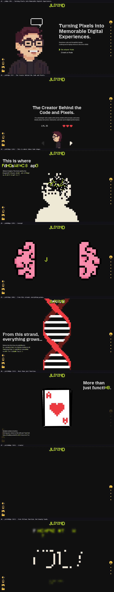
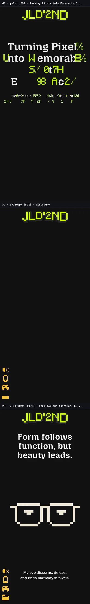

# UI Design System & Master Generation Blueprint: jld2nd-dev

> **JLD'2nd – Designer & Developer** (https://jld2nd.dev) — I believe web design should be as expressive as the ideas behind it. Driven by curiosity, I explore new possibilities at the intersection...





---

## 1. Executive Visual Persona & Design Archetype

- **Brand Essence & Persona**: **JLD'2nd – Designer & Developer** (`https://jld2nd.dev`). I believe web design should be as expressive as the ideas behind it. Driven by curiosity, I explore new possibilities at the intersection...
- **Capture Provenance**: Live browser capture (`tier1_fast`, HTTP `200`, captured `2026-11-24`).
- **Visual Archetype**: **High-Contrast Obsidian / Atmospheric Design System (`#121212` canvas, `#ffffff` ink, `#f6c53a` accent)**.
- **Anti-AI-Slop Differentiators**:
  - **Live-Computed Chromatic Polarity**: Anchors the viewport in `#121212` (live computed `html` `background-color` (`computed_styles.json`)) paired with `#ffffff` primary typography and `#f6c53a` accents.
  - **Grounded Typographic Hierarchy**: Pairs `Minecraft` for display copy (`T u r n i n g P i x e l s i n t o M `) with `Mozilla Headline`.
  - **Calibrated Spatial Grid & Motion**: Combines `1440px` container bounds (`gap: 10px`, padding `30px`) with `cubic-bezier(.65,0,.35,1)` easing.

---

## 2. Spatial Architecture & Modular Grid Mathematics

### Viewport Allocation & Container Geometry
- **Captured Journey Filmstrips**: Desktop `1280×6624px` (`assets/desktop-journey.webp`, `8` keyframes up to `y=14400px` / doc `24450px`), Mobile `390×2616px` (`assets/mobile-journey.webp`, `3` keyframes).
- **Master Container Bounds**: `1440px` (full-bleed `100%` desktop stage measured on `1440px` viewport).
- **Canvas Lateral Padding & Spacing**: `30px` lateral canvas padding with `10px` grid gap.
- **Border Radius Scale**: `4px`.

### Responsive Breakpoint Architecture
- **Desktop Layout**: Multi-column CSS Grid / Flexbox layout at `1440px` (`max-width: 1440px`, `gap: 10px`).
- **Mobile Layout**: Single-column vertical stack at `390px` viewport width with `30px` horizontal padding.
- **Extracted CSS Media Queries**: `@media (width<=767px)`, `@media (width<=991px)`, `@media (width>=1440px)`, `@media (width>=1920px)`.

---

## 3. Color System, Materiality & Atmospheric Lighting

### Semantic Palette & Source Grounding
| Semantic Role | Ground-Truth Value | Extracted Live / CSS Source |
|---|---|---|
| **Primary Canvas Substrate** | `#121212` | live computed `html` `background-color` (`computed_styles.json`) |
| **Primary Typography Ink** | `#ffffff` | live computed `main` `color` (`computed_styles.json`) |
| **Elevated Surface / Card Substrate** | `#263238` | `var(--base-bg-dark)` in `:root` |
| **Interactive Accent / Highlight** | `#f6c53a` | `.dock-btn { color: #f6c53a }` |
| **Secondary / Muted Copy** | `#11b76b` | `var(--base-text-success)` in `:root` |
| **Structural Hairline Border** | `#dddedf` | `var(--base-border-color)` in `:root` |
| **Variable Token (`--color-lime`)** | `#ceff00` | `var(--color-lime)` in `:root` |

### Sanitized Root CSS Variables (`ui-ux.md` Ground Truth)
| Variable Name | Extracted Value | Semantic Role |
|---|---|---|
| `--page-gutter` | `40px` | Layout / Spatial Grid Token |
| `--fs-display-2xl` | `clamp(3.75rem, 3.5536rem + .9821vw, 5.125rem)` | Dimension / Scale Token |
| `--fs-display-xl` | `clamp(3.5rem, calc(3.4rem + .5vw), 4rem)` | Dimension / Scale Token |
| `--fs-display-lg` | `clamp(3.125rem, 2.9018rem + 1.1161vw, 4.6875rem)` | Dimension / Scale Token |
| `--fs-display-md` | `clamp(2.8125rem, 2.6339rem + .8929vw, 4.0625rem)` | Dimension / Scale Token |
| `--fs-display-sm` | `clamp(2.25rem , calc(2.2rem + .25vw), 2.5rem)` | Dimension / Scale Token |
| `--fs-display-xs` | `clamp(1.875rem, calc(1.85rem + .125vw), 2rem)` | Dimension / Scale Token |
| `--fs-text-xl` | `clamp(1.25rem , calc(1.2rem + .25vw), 1.5rem)` | Typography Ink Token |
| `--fs-text-lg` | `clamp(1.125rem, calc(1.1rem + .125vw),1.25rem)` | Typography Ink Token |
| `--fs-text-md` | `clamp(1rem, .9821rem + .0893vw, 1.125rem)` | Typography Ink Token |
| `--fs-text-sm` | `.875rem` | Typography Ink Token |
| `--fs-text-xs` | `.75rem` | Typography Ink Token |
| `--color-ink` | `#121212` | Typography Ink Token |
| `--color-lime` | `#ceff00` | Brand / Palette Token |
| `--color-white` | `#fff` | Canvas / Surface Token |
| `--form-gap` | `20px` | Layout / Spatial Grid Token |

---

## 4. Typographic Scale & Editorial Hierarchy

### Font Family Stacks
- **Display Typography**: `Minecraft`.
- **Primary Body Stack**: `Mozilla Headline`.
- **Technical / Metadata Stack**: not declared in live computed styles (uses primary stack / `ui-monospace`).

### Typographic Scale & Rules (Live Computed & Stylesheet Grounded)
- **Hero Display (`H1`)**: CSS variables `--fs-display-2xl: clamp(3.75rem, 3.5536rem + .9821vw, 5.125rem)`, `--fs-display-xl: clamp(3.5rem, calc(3.4rem + .5vw), 4rem)`, `--fs-display-lg: clamp(3.125rem, 2.9018rem + 1.1161vw, 4.6875rem)`.
- **Section Heading (`H2`)**: live computed `h2` (`font-size: 70.9998px`, `line-height: 70.9998px`, `font-weight: 600`, `letter-spacing: 5px`).
- **Body Copy**: live computed `body` (`font-size: 16.9995px`, `line-height: 25.4993px`, `font-weight: 400`).
- **Metadata & Navigation Labels**: live computed `nav/a` (`font-size: 16.9995px`, `line-height: 25.4993px`, `font-weight: 400`); CSS variables `--fs-text-sm: .875rem`, `--fs-text-xs: .75rem`.

---

## 5. Choreographed Motion & Interaction Physics

### Primary Easing Curves
- **Extracted Timing Functions**: `cubic-bezier(.65,0,.35,1)`.

### Per-Element Transition & Choreography Rules
- **Selector `layer base`**: `transition: all .2s` extracted from `jld2nd-dev` stylesheet.
- **Selector `.popup .popup-backdrop`**: `transition: all 1s ease-in-out` extracted from `jld2nd-dev` stylesheet.
- **Selector `body`**: `transition: var(--base-transition)` extracted from `jld2nd-dev` stylesheet.
- **Extracted Easing Curve (`cubic-bezier(.65,0,.35,1)`)**: Governs interactive state transitions across `<header.sticky>` and `<section.p-relative>`.
- **State & Hover Choreography**: Opacity and transform transitions on `<section.section>` and `<section.p-relative>` interactive targets.
### Measured Runtime Scroll & Interaction Telemetry (`behavioral_journey_v2`)
- **Scroll Driver Mode**: `native` (max document height `24450px`, deepest scrollY reached `14400px` across `8` desktop keyframes).
- **Detected Scroll / Motion Libraries**: Native browser scroll / standard CSS transitions.
- **Route Transition Architecture**: First internal navigation (`/projects`) measured as `MPA` in `1786ms`.

---

## 6. Component Wireframe & Structural DOM Map

### Visual Layout Schematic — Desktop (`1440px`, Grounded in `dom.html` & Landmark Bounding Boxes)
```
┌────────────────────────────────────────────────────────────────────────┐
│ DESKTOP VIEWPORT (1440px) — JLD'2nd – Designer & Developer             │
│ ====================================================================== │
│ [ <header.sticky> (1440x0px)          | Overview · Index · Archive · ] │
│ ---------------------------------------------------------------------- │
│ | HERO STAGE: <section.section> (w=1440px)                           | │
│ | H1: T u r n i n g P i x e l s i n t o M e m o r a b l...           | │
│ | Substrate: #121212 | Ink: #ffffff | Accent: #f6c53a                | │
│ ---------------------------------------------------------------------- │
│ | SHOWCASE GRID (<section.p-relative>) max-w: 1440px                 | │
│ | +------------------------------+  +------------------------------+ | │
│ | | T h e C r e a t o r B e h i  |  | I t a l l s t a r t s w i t  | | │
│ | +------------------------------+  +------------------------------+ | │
│ ---------------------------------------------------------------------- │
│ | DETAIL MODULE (<section.h-150>) — T h i s i s w h e r e            | │
│ ---------------------------------------------------------------------- │
│ [ FOOTER (<footer.home-footer>) | https://jld2nd.dev                   │
└────────────────────────────────────────────────────────────────────────┘
```

### Visual Layout Schematic — Mobile Reflow (`390px`)
```
┌────────────────────────────────────────────────────────────────────────┐
│ MOBILE VIEWPORT REFLOW (390px) — Single-Column Stack (gap: 10px)       │
│ ====================================================================== │
│ [ HEADER BAR (<header.sticky>         ) | Compact Menu (390px)         │
│ ---------------------------------------------------------------------- │
│ | HERO STAGE (<section.section>) — 390px Vertical Lead               | │
│ | H1: T u r n i n g P i x e l s i n t o M e m o r a b l...           | │
│ ---------------------------------------------------------------------- │
│ | SHOWCASE STACK (<section.p-relative>) — 1-Col Stack                | │
│ | [ Item 1: T h e C r e a t o r B e h i n d t h e C o d e a n...   ] | │
│ | [ Item 2: I t a l l s t a r t s w i t h t h e p i x e l s .      ] | │
│ ---------------------------------------------------------------------- │
│ | DETAIL STACK (<section.h-150>) — 1-Col (T h i s i s w h e )        | │
│ ---------------------------------------------------------------------- │
│ [ FOOTER (<footer.home-footer>) | Stacked 390px Colophon               │
└────────────────────────────────────────────────────────────────────────┘
```

### Granular DOM Region Breakdown
1. **Brand Header & Navigation Bar (<header.sticky> — `jld2nd-dev`)**:
   - Landmark `<header class="sticky">` (`1440x0px`) hosting `JLD'2nd – Designer & Developer` navigation (`Overview · Index · Archive · About · Contact`), DOM attributes (`data-no-grid`, `data-section="hero"`, `data-section="about"`, `data-section="pixels"`), and stylesheet rule `main-content:focus { outline:none }`.
2. **Hero Stage & Focal Lead (<section.section> — `T u r n i n g P i x e l s i n t o `)**:
   - Landmark `<section class="section grid-container">` presenting display lead `T u r n i n g P i x e l s i n t o M e m o r a b l...` and copy excerpt *"E x p e r i e n c e s ."* over `#121212` canvas and `#ffffff` ink.
3. **Primary Showcase & Content Grid (<section.p-relative> — `T h e C r e a t o r B e h i n d t `)**:
   - Landmark `<section class="section p-relative">` rendering section `T h e C r e a t o r B e h i n d t h e C o d e a n...` with copy *"t h o u g h t f u l"*, asset references (`favicon.ico`, `favicon-32x32.png`, `apple-touch-icon.png`, `site.webmanifest`), and grid rule `html { -webkit-text-size-adjust:100%;text-size-adjust:auto;line-height:1.15 }`.
4. **Interactive Detail & Feature Matrix (<section.h-150> — `I t a l l s t a r t s w i t h t h `)**:
   - Landmark `<section class="section p-relative">` framing `I t a l l s t a r t s w i t h t h e p i x e l s .` and `T h i s i s w h e r e i d e a s t a k e s h a p e .` (*"s t r u c t u r e ,"*) with `#263238` surface cards, `#f6c53a` accents, and `section { display:block }`.
5. **Colophon & Global Directory Footer (<footer.home-footer> — `https://jld2nd.dev`)**:
   - Landmark `<footer class="home-footer">` anchoring `JLD'2nd – Designer & Developer` footer links (`Overview · Index · Archive · About · Contact`), copy *"i n t e r a c t i o n ,"*, and `#dddedf` structural dividers.
### Full Vertical Scroll Sequence (Desktop `1440×900` Keyframes)
- **Step 01** (`y=0px`, `0%`): Active landmark `Turning Pixels into Memorable Digital Experiences.` · sticky/fixed elements: `2`
- **Step 02** (`y=850px`, `4%`): Active landmark `The Creator Behind the Code and Pixels.` · sticky/fixed elements: `2`
- **Step 03** (`y=4250px`, `18%`): Active landmark `This is where ideas take shape.` · sticky/fixed elements: `2`
- **Step 04** (`y=6800px`, `29%`): Active landmark `Concept` · sticky/fixed elements: `2`
- **Step 05** (`y=9350px`, `40%`): Active landmark `From this strand, everything grows…` · sticky/fixed elements: `2`
- **Step 06** (`y=11900px`, `51%`): Active landmark `More than just function.` · sticky/fixed elements: `2`
- **Step 07** (`y=13600px`, `58%`): Active landmark `Creator` · sticky/fixed elements: `2`
- **Step 08** (`y=14400px`, `61%`): Active landmark `Form follows function, but beauty leads.` · sticky/fixed elements: `2`

### Multi-Page Internal Route Map
- **Listing Route (`/projects`)**: `https://jld2nd.dev/projects` — H1: `Projects – JLD'2nd`, scrollHeight `900px`, transition `MPA` (`1786ms`)
- **Other Route (`/game`)**: `https://jld2nd.dev/game` — H1: `Game – JLD'2nd`, scrollHeight `900px`, transition `direct` (`4004ms`)

---

## 7. Master Zero-Shot AI Generation Prompt

```markdown
# Master Zero-Shot Frontend Generation Prompt: jld2nd-dev (JLD'2nd – Designer & Developer)

You are a principal frontend architect and design systems engineer. Build a complete, production-ready web application replicating the exact design system, DOM landmarks, typographic hierarchy, color tokens, and motion physics of `jld2nd-dev` (**JLD'2nd – Designer & Developer** — `https://jld2nd.dev`).

### 1. Visual Archetype & Anti-AI-Slop Mandates
- **Archetype**: High-Contrast Obsidian / Atmospheric Design System (`#121212` canvas, `#ffffff` ink, `#f6c53a` accent).
- **Identity & Domain Context**: I believe web design should be as expressive as the ideas behind it. Driven by curiosity, I explore new possibilities at the intersection...
- **Primary Substrate**: `#121212` (live computed `html` `background-color` (`computed_styles.json`)), **Primary Ink**: `#ffffff`, **Accent / Highlight**: `#f6c53a`.
- **Site-Specific Differentiators**:
  - **Live-Computed Chromatic Polarity**: Anchors the viewport in `#121212` (live computed `html` `background-color` (`computed_styles.json`)) paired with `#ffffff` primary typography and `#f6c53a` accents.
  - **Grounded Typographic Hierarchy**: Pairs `Minecraft` for display copy (`T u r n i n g P i x e l s i n t o M `) with `Mozilla Headline`.
  - **Calibrated Spatial Grid & Motion**: Combines `1440px` container bounds (`gap: 10px`, padding `30px`) with `cubic-bezier(.65,0,.35,1)` easing.

### 2. Ground-Truth CSS Variables (`:root` Token Contract)
Declare and consume these exact custom properties extracted from `jld2nd-dev` in your global stylesheet:

:root {
  /* JLD'2nd – Designer & Developer (jld2nd-dev) — Live-Grounded CSS Variables */
  --page-gutter: 40px; /* Layout / Spatial Grid Token (jld2nd-dev) */
  --fs-display-2xl: clamp(3.75rem, 3.5536rem + .9821vw, 5.125rem); /* Dimension / Scale Token (jld2nd-dev) */
  --fs-display-xl: clamp(3.5rem, calc(3.4rem + .5vw), 4rem); /* Dimension / Scale Token (jld2nd-dev) */
  --fs-display-lg: clamp(3.125rem, 2.9018rem + 1.1161vw, 4.6875rem); /* Dimension / Scale Token (jld2nd-dev) */
  --fs-display-md: clamp(2.8125rem, 2.6339rem + .8929vw, 4.0625rem); /* Dimension / Scale Token (jld2nd-dev) */
  --fs-display-sm: clamp(2.25rem , calc(2.2rem + .25vw), 2.5rem); /* Dimension / Scale Token (jld2nd-dev) */
  --fs-display-xs: clamp(1.875rem, calc(1.85rem + .125vw), 2rem); /* Dimension / Scale Token (jld2nd-dev) */
  --fs-text-xl: clamp(1.25rem , calc(1.2rem + .25vw), 1.5rem); /* Typography Ink Token (jld2nd-dev) */
  --fs-text-lg: clamp(1.125rem, calc(1.1rem + .125vw),1.25rem); /* Typography Ink Token (jld2nd-dev) */
  --fs-text-md: clamp(1rem, .9821rem + .0893vw, 1.125rem); /* Typography Ink Token (jld2nd-dev) */
  --fs-text-sm: .875rem; /* Typography Ink Token (jld2nd-dev) */
  --fs-text-xs: .75rem; /* Typography Ink Token (jld2nd-dev) */
  --color-ink: #121212; /* Typography Ink Token (jld2nd-dev) */
  --color-lime: #ceff00; /* Brand / Palette Token (jld2nd-dev) */
  --color-white: #fff; /* Canvas / Surface Token (jld2nd-dev) */
  --form-gap: 20px; /* Layout / Spatial Grid Token (jld2nd-dev) */
}

### 3. Semantic Color & Materiality Contract
Map every surface, ink, and border strictly to these source-grounded tokens:
- **Primary Canvas Substrate**: `#121212` — grounded in live computed `html` `background-color` (`computed_styles.json`)
- **Primary Typography Ink**: `#ffffff` — grounded in live computed `main` `color` (`computed_styles.json`)
- **Elevated Surface / Card Substrate**: `#263238` — grounded in `var(--base-bg-dark)` in `:root`
- **Interactive Accent / Highlight**: `#f6c53a` — grounded in `.dock-btn { color: #f6c53a }`
- **Secondary / Muted Copy**: `#11b76b` — grounded in `var(--base-text-success)` in `:root`
- **Structural Hairline Border**: `#dddedf` — grounded in `var(--base-border-color)` in `:root`
- **Variable Token (`--color-lime`)**: `#ceff00` — grounded in `var(--color-lime)` in `:root`

### 4. Spatial Grid, Container Bounds & Responsive Breakpoints
- **Desktop Viewport Reference**: `1280×6624px` (multi-frame vertical journey filmstrip (6624px), `1440px` standard desktop width).
- **Mobile Viewport Reference**: `390×2616px` (multi-frame vertical journey filmstrip (2616px), `390px` standard mobile width).
- **Container Max-Width**: `1440px` (full-bleed `100%` desktop stage measured on `1440px` viewport)
- **Padding & Gutters**: `30px` lateral canvas padding with `10px` grid gap
- **Desktop Grid**: Multi-column CSS Grid / Flexbox layout at `1440px` (`max-width: 1440px`, `gap: 10px`)
- **Mobile Adaptation**: Single-column vertical stack at `390px` viewport width with `30px` horizontal padding
- **Media Queries**: `@media (width<=767px)`, `@media (width<=991px)`, `@media (width>=1440px)`, `@media (width>=1920px)`
- **Corner Radii**: `4px`

### 5. Typography & Editorial Scale Contract
- **Display Font Stack**: `Minecraft`
- **Body Font Stack**: `Mozilla Headline`
- **Monospace / Technical Font Stack**: not declared in live computed styles (uses primary stack / `ui-monospace`)
- **H1 Display Rule**: CSS variables `--fs-display-2xl: clamp(3.75rem, 3.5536rem + .9821vw, 5.125rem)`, `--fs-display-xl: clamp(3.5rem, calc(3.4rem + .5vw), 4rem)`, `--fs-display-lg: clamp(3.125rem, 2.9018rem + 1.1161vw, 4.6875rem)`
- **H2 Section Rule**: live computed `h2` (`font-size: 70.9998px`, `line-height: 70.9998px`, `font-weight: 600`, `letter-spacing: 5px`)
- **Body Copy Rule**: live computed `body` (`font-size: 16.9995px`, `line-height: 25.4993px`, `font-weight: 400`)
- **Metadata & Index Rule**: live computed `nav/a` (`font-size: 16.9995px`, `line-height: 25.4993px`, `font-weight: 400`); CSS variables `--fs-text-sm: .875rem`, `--fs-text-xs: .75rem`

### 6. Component Hierarchy, Verbatim Copy & Real DOM Landmarks
Scaffold `jld2nd-dev` (`JLD'2nd – Designer & Developer`) with these exact structural regions, extracted copy, and CSS rules from `dom.html`:
1. **Brand Header & Navigation Bar (<header.sticky> — `jld2nd-dev`)**:
   - DOM & Selectors: Landmark `<header class="sticky">` (`1440x0px`) hosting `JLD'2nd – Designer & Developer` navigation (`Overview · Index · Archive · About · Contact`), DOM attributes (`data-no-grid`, `data-section="hero"`, `data-section="about"`, `data-section="pixels"`), and stylesheet rule `main-content:focus { outline:none }`.
   - Responsive Contract: Header `Brand Header & Navigation Bar (<header.sticky> — `jld2nd-dev`)` (`jld2nd-dev`) adapts across `@media (width<=767px)`, `@media (width<=991px)`, `@media (width>=1440px)`, `@media (width>=1920px)` with `cubic-bezier(.65,0,.35,1)` transitions and links `Overview · Index · Archive · About · Contact`.
2. **Hero Stage & Focal Lead (<section.section> — `T u r n i n g P i x e l s i n t o `)**:
   - DOM & Selectors: Landmark `<section class="section grid-container">` presenting display lead `T u r n i n g P i x e l s i n t o M e m o r a b l...` and copy excerpt *"E x p e r i e n c e s ."* over `#121212` canvas and `#ffffff` ink.
   - Responsive Contract: Hero stage (`1280×6624px` desktop / `390×2616px` mobile) sets `#121212` background with `#ffffff` headline `T u r n i n g P i x e l s i n t o M e m o r a b l...`.
3. **Primary Showcase & Content Grid (<section.p-relative> — `T h e C r e a t o r B e h i n d t `)**:
   - DOM & Selectors: Landmark `<section class="section p-relative">` rendering section `T h e C r e a t o r B e h i n d t h e C o d e a n...` with copy *"t h o u g h t f u l"*, asset references (`favicon.ico`, `favicon-32x32.png`, `apple-touch-icon.png`, `site.webmanifest`), and grid rule `html { -webkit-text-size-adjust:100%;text-size-adjust:auto;line-height:1.15 }`.
   - Responsive Contract: Showcase grid `Primary Showcase & Content Grid (<section.p-relative> — `T h e C r e a t o r B e h i n d t `)` applies Multi-column CSS Grid / Flexbox layout at `1440px` (`max-width: 1440px`, `gap: 10px`) on desktop and Single-column vertical stack at `390px` viewport width with `30px` horizontal padding on mobile.
4. **Interactive Detail & Feature Matrix (<section.h-150> — `I t a l l s t a r t s w i t h t h `)**:
   - DOM & Selectors: Landmark `<section class="section p-relative">` framing `I t a l l s t a r t s w i t h t h e p i x e l s .` and `T h i s i s w h e r e i d e a s t a k e s h a p e .` (*"s t r u c t u r e ,"*) with `#263238` surface cards, `#f6c53a` accents, and `section { display:block }`.
   - Responsive Contract: Detail module `Interactive Detail & Feature Matrix (<section.h-150> — `I t a l l s t a r t s w i t h t h `)` uses `4px` radii, `#f6c53a` highlights, and assets (favicon.ico, favicon-32x32.png, apple-touch-icon.png).
5. **Colophon & Global Directory Footer (<footer.home-footer> — `https://jld2nd.dev`)**:
   - DOM & Selectors: Landmark `<footer class="home-footer">` anchoring `JLD'2nd – Designer & Developer` footer links (`Overview · Index · Archive · About · Contact`), copy *"i n t e r a c t i o n ,"*, and `#dddedf` structural dividers.
   - Responsive Contract: Footer `Colophon & Global Directory Footer (<footer.home-footer> — `https://jld2nd.dev`)` aligns to `1440px` (full-bleed `100%` desktop stage measured on `1440px` viewport) with `30px` lateral canvas padding with `10px` grid gap and attributes (data-no-grid, data-section="hero", data-section="about").

#### Verbatim DOM Copy Excerpts (`dom.html`)
- Copy Excerpt 1: *"E x p e r i e n c e s ."*
- Copy Excerpt 2: *"t h o u g h t f u l"*
- Copy Excerpt 3: *"s t r u c t u r e ,"*
- Copy Excerpt 4: *"i n t e r a c t i o n ,"*

### 7. Motion, Extracted Stylesheet Rules & Interaction Choreography
- **Primary Easing Functions**: `cubic-bezier(.65,0,.35,1)`
- **Extracted Stylesheet Rules (`jld2nd-dev`)**:
- `main-content:focus { outline:none }`
- `html { -webkit-text-size-adjust:100%;text-size-adjust:auto;line-height:1.15 }`
- `section { display:block }`
- `img { border-style:none }`
- `input { margin:0;font-family:sans-serif;font-size:100%;line-height:1.15;overflow... }`
- **Per-Selector Transition Rules**:
- **Selector `layer base`**: `transition: all .2s` extracted from `jld2nd-dev` stylesheet.
- **Selector `.popup .popup-backdrop`**: `transition: all 1s ease-in-out` extracted from `jld2nd-dev` stylesheet.
- **Selector `body`**: `transition: var(--base-transition)` extracted from `jld2nd-dev` stylesheet.
- **Extracted Easing Curve (`cubic-bezier(.65,0,.35,1)`)**: Governs interactive state transitions across `<header.sticky>` and `<section.p-relative>`.
- **State & Hover Choreography**: Opacity and transform transitions on `<section.section>` and `<section.p-relative>` interactive targets.
### 7b. Full-Page Scroll Choreography, Interactive States & Multi-Page Routes
- **Scroll Mechanics**: Implement `native` vertical progression up to `24450px` across 8 distinct viewport chapters.
- **Vertical Chapter Sequence**: Turning Pixels into Memorab... (0%) -> The Creator Behind the Code... (4%) -> This is where ideas take sh... (18%) -> Concept (29%) -> From this strand, everythin... (40%) -> More than just function. (51%) -> Creator (58%) -> Form follows function, but... (61%).
- **Multi-Page Routes**: Scaffold internal routes `/projects` (listing, MPA), `/game` (other, direct) sharing the global header/footer shell and design tokens.

### 8. Technical Deliverables
- Implement in Next.js (App Router) with TypeScript and Tailwind CSS consuming the `:root` custom properties defined above for `jld2nd-dev`.
- Reproduce both the `1440px` desktop architecture and `390px` mobile breakpoint transitions, preserving semantic HTML5 landmarks (`<header>`, `<nav>`, `<main>`, `<section>`, `<footer>`) and `prefers-reduced-motion` accessibility guards.
```
---

## 8. Full-Page Scroll Journey, Interactive States & Subpage Inventory

### Desktop Scroll Keyframes (`1440×900` WebP)
| Step | Scroll Y | Progress | Active Landmark / Section | Sticky/Fixed | Visual Asset |
| :---: | :---: | :---: | :--- | :---: | :--- |
| `#01` | `0px` | `0%` | Turning Pixels into Memorable Digital Experie... | `2` | [desktop-step-01.webp](assets/desktop-step-01.webp) |
| `#02` | `850px` | `4%` | The Creator Behind the Code and Pixels. | `2` | [desktop-step-02.webp](assets/desktop-step-02.webp) |
| `#03` | `4250px` | `18%` | This is where ideas take shape. | `2` | [desktop-step-03.webp](assets/desktop-step-03.webp) |
| `#04` | `6800px` | `29%` | Concept | `2` | [desktop-step-04.webp](assets/desktop-step-04.webp) |
| `#05` | `9350px` | `40%` | From this strand, everything grows… | `2` | [desktop-step-05.webp](assets/desktop-step-05.webp) |
| `#06` | `11900px` | `51%` | More than just function. | `2` | [desktop-step-06.webp](assets/desktop-step-06.webp) |
| `#07` | `13600px` | `58%` | Creator | `2` | [desktop-step-07.webp](assets/desktop-step-07.webp) |
| `#08` | `14400px` | `61%` | Form follows function, but beauty leads. | `2` | [desktop-step-08.webp](assets/desktop-step-08.webp) |

### Mobile Condensed Keyframes (`390×844` WebP)
| Step | Scroll Y | Progress | Active Landmark | Visual Asset |
| :---: | :---: | :---: | :--- | :--- |
| `#01` | `0px` | `0%` | Turning Pixels into Memorable Digital Exp... | [mobile-step-01.webp](assets/mobile-step-01.webp) |
| `#02` | `7200px` | `50%` | Discovery | [mobile-step-02.webp](assets/mobile-step-02.webp) |
| `#03` | `14400px` | `100%` | Form follows function, but beauty leads. | [mobile-step-03.webp](assets/mobile-step-03.webp) |

### Internal Subpage Filmstrips (`1080px` Wide WebP)
| # | Template | Route URL | H1 / Title | Scroll Height | Transition | Filmstrip Asset |
| :-: | :---: | :--- | :--- | :---: | :---: | :--- |
| `1` | `listing` | `https://jld2nd.dev/projects` | Projects – JLD'2nd | `900px` | `MPA` (`1786ms`) | [subpage-01-projects.webp](assets/subpage-01-projects.webp) |
| `2` | `other` | `https://jld2nd.dev/game` | Game – JLD'2nd | `900px` | `direct` (`4004ms`) | [subpage-02-game.webp](assets/subpage-02-game.webp) |

