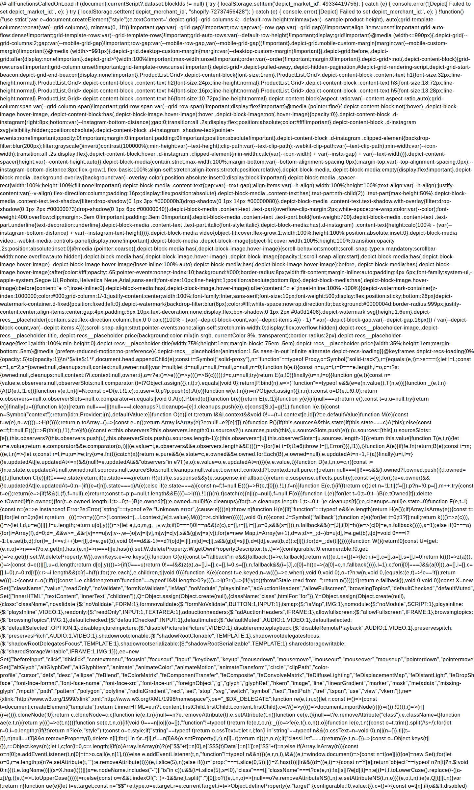
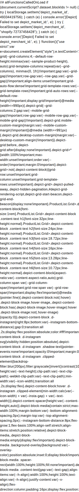

# UI Design System & Master Generation Blueprint: johnhardy-com_collections-billie-eilish-and-finneas

> **Billie Eilish and FINNEAS – John Hardy** (https://johnhardy.com/collections/billie-eilish-and-finneas) — John Hardy fine luxury jewelry. Made in Bali since 1975. Enjoy complimentary shipping and returns on all orders. Bracelets, Rings, Neckla...



---

## 1. Executive Visual Persona & Design Archetype

- **Brand Essence & Persona**: **Billie Eilish and FINNEAS – John Hardy** (`https://johnhardy.com/collections/billie-eilish-and-finneas`). John Hardy fine luxury jewelry. Made in Bali since 1975. Enjoy complimentary shipping and returns on all orders. Bracelets, Rings, Neckla...
- **Visual Archetype**: **Dark-Substrate WebGL / Canvas Interactive Experience (`#161514` / `#535353`)**.
- **Anti-AI-Slop Differentiators**:
  - **Source-Grounded Chromatic Polarity**: Anchors the viewport in `#161514` (`var(--color-neutral-black)` in `:root`) paired with `#ffffff` primary typography and `#535353` accents.
  - **Extracted Typographic Hierarchy**: Pairs `itc-avant-garde-gothic-pro` for display copy (`Billie Eilish & FINNEAS`) with `ivypresto-text` and `Source Code Pro`.
  - **Calibrated Spatial Grid & Motion**: Combines `var(--max-content-width)` container bounds (`gap: var(--spacing-xs)`, padding `var(--arrows-padding)`) with `cubic-bezier(.65,.05,.36,1)` easing and Lenis Smooth Scroll (`data-lenis`), Three.js / WebGL Canvas Pipeline.

---

## 2. Spatial Architecture & Modular Grid Mathematics



### Viewport Allocation & Container Geometry
- **Captured Viewport Dimensions**: Desktop `1440×2400px` (`assets/desktop.png`, capped at 2400px multi-section capture), Mobile `390×2400px` (`assets/mobile.png`, capped at 2400px multi-section capture).
- **Master Container Bounds**: `var(--max-content-width)` extracted from `johnhardy-com_collections-billie-eilish-and-finneas` stylesheet.
- **Canvas Lateral Padding & Spacing**: `var(--arrows-padding)` lateral canvas padding with `var(--spacing-xs)` grid gap.
- **Border Radius Scale**: `4px`, `50%`, `12px`, `5px`.

### Responsive Breakpoint Architecture
- **Desktop Layout**: Multi-column CSS Grid / Flexbox layout at `1440px` (`max-width: var(--max-content-width)`, `gap: var(--spacing-xs)`).
- **Mobile Layout**: Single-column vertical stack at `390px` viewport width with `var(--arrows-padding)` horizontal padding.
- **Extracted CSS Media Queries**: `@media screen and (forced-colors:active)`, `@media screen and (width<=750px)`, `@media (min-width:64em)`, `@media (max-width:63.99em)`.

---

## 3. Color System, Materiality & Atmospheric Lighting

### Semantic Palette & Source Grounding
| Semantic Role | Ground-Truth Value | Extracted CSS Source / Selector |
|---|---|---|
| **Primary Canvas Substrate** | `#161514` | `var(--color-neutral-black)` in `:root` |
| **Primary Typography Ink** | `#212529` | `var(--jh-concierge-bubble-bg)` in `:root` |
| **Elevated Surface / Card Substrate** | `#ffffff` | `var(--rb-smart-search-quick-view-button-text-color)` in `:root` |
| **Interactive Accent / Highlight** | `#535353` | `var(--rb-smart-search-quick-view-reviews-text-color)` in `:root` |
| **Secondary / Muted Copy** | `#232323` | `var(--rb-smart-search-results-product-title-color)` in `:root` |
| **Structural Hairline Border** | `#000000` | `var(--rb-smart-search-results-button-border-color)` in `:root` |

### Sanitized Root CSS Variables (`ui-ux.md` Ground Truth)
| Variable Name | Extracted Value | Semantic Role |
|---|---|---|
| `--arrow-size` | `40px` | Layout / Spatial Grid Token |
| `--arrow-icon-size` | `calc(var(--arrow-size) / 2)` | Layout / Spatial Grid Token |
| `--arrows-padding` | `0 var(--spacing-l)` | Layout / Spatial Grid Token |
| `--arrows-width` | `100%` | Layout / Spatial Grid Token |
| `--arrows-translate` | `0 -50%` | Dimension / Scale Token |
| `--arrows-top` | `50%` | Dimension / Scale Token |
| `--pagination-margin-y` | `var(--spacing-2xl)` | Layout / Spatial Grid Token |
| `--pagination-padding-x` | `0` | Layout / Spatial Grid Token |
| `--page-active-bg` | `var(--color-neutral-black)` | Canvas / Surface Token |
| `--page-bg` | `var(--color-neutral-medium-grey)` | Canvas / Surface Token |
| `--page-height` | `4px` | Layout / Spatial Grid Token |
| `--page-width` | `4px` | Layout / Spatial Grid Token |
| `--page-radius` | `0` | Elevation / Border Token |
| `--padding` | `var(--spacing-s)` | Layout / Spatial Grid Token |
| `--ratio-height` | `273` | Layout / Spatial Grid Token |
| `--ratio-height-px` | `273px` | Layout / Spatial Grid Token |

---

## 4. Typographic Scale & Editorial Hierarchy

### Font Family Stacks
- **Display Typography**: `itc-avant-garde-gothic-pro`.
- **Primary Body Stack**: `ivypresto-text`.
- **Technical / Metadata Stack**: `Source Code Pro`.

### Typographic Scale & Rules (Extracted from Stylesheet & Variables)
- **Hero Display (`H1`)**: CSS variables `--option-select-label-display: none`, `--bonsai-agent-share-display: none`; rule `h1` (`font-size: 1.5rem`, `line-height: 1.2`).
- **Section Heading (`H2`)**: rule `h2` (`font-size: var(--hero-title-size-mobile,...`).
- **Body Copy**: CSS variables `--bonsai-font-body: var(--font-family-general-sans)`, `--bonsai-agent-body-bold-weight: 550`; rule `,p` (`font-size: var(--font-size-3)`, `line-height: var(--line-height-0)`, `letter-spacing: var(--letter-spacing-0)`, `font-weight: var(--font-we...`).
- **Metadata & Navigation Labels**: CSS variables `--letter-spacing-0: 0.5px`, `--letter-spacing-1: 1px`, `--letter-spacing-2: 1px`.

---

## 5. Choreographed Motion & Interaction Physics

### Primary Easing Curves
- **Extracted Timing Functions**: `cubic-bezier(.65,.05,.36,1)`, `cubic-bezier(0.22,0.61,0.36,1)`, `cubic-bezier(.22,.61,.36,1)`.

### Per-Element Transition & Choreography Rules
- **Selector `.shopify-payment-button__button`**: `transition: background .2s ease-in-out` extracted from `johnhardy-com_collections-billie-eilish-and-finneas` stylesheet.
- **Selector `.splide__arrows`**: `transition: opacity var(--timing-normal) var(--easing-normal)` extracted from `johnhardy-com_collections-billie-eilish-and-finneas` stylesheet.
- **Selector `.splide__arrow`**: `transition: opacity var(--timing-normal) var(--easing-normal),visibility v...` extracted from `johnhardy-com_collections-billie-eilish-and-finneas` stylesheet.
- **Extracted Easing Curve (`cubic-bezier(.65,.05,.36,1)`)**: Governs interactive state transitions across `<header.site-header>` and `<section.site-header-group>`.
- **Runtime Interaction Engine**: Integrates Lenis Smooth Scroll (`data-lenis`), Three.js / WebGL Canvas Pipeline, Swiper Touch Carousel Engine, Barba.js Page Transition Router, Framer Motion Layout Physics with `prefers-reduced-motion: reduce` fallback guards.

---

## 6. Component Wireframe & Structural DOM Map

### Visual Layout Schematic (Grounded in `dom.html` — `1440px` Desktop & `390px` Mobile Reflow)
```
┌────────────────────────────────────────────────────────────────────────┐
│ DESKTOP VIEWPORT (1440px) — Billie Eilish and FINNEAS – John Hardy     │
│ ====================================================================== │
│ [ <header.site-header>     | Wishlist · New Arrivals · Best Sellers ]  │
│ ---------------------------------------------------------------------- │
│ | HERO STAGE: <section.accessibility>                              |   │
│ | H1: Billie Eilish & FINNEAS                                      |   │
│ | Substrate: #161514    | Ink: #ffffff    | Accent: #535353        |   │
│ ---------------------------------------------------------------------- │
│ | SHOWCASE GRID (<section.site-header-group) max-w: var(--max-cont |   │
│ | +------------------------------+  +------------------------------+ | │
│ | | Two Expressions of One Creat |  | “Jewelry has always been an  | | │
│ | +------------------------------+  +------------------------------+ | │
│ ---------------------------------------------------------------------- │
│ | MOBILE VIEWPORT REFLOW (390px) — Single-Column Stack (gap: var(--) | │
│ | [<header.site-heade] -> [<section.accessibi] -> [<section.site-head] │
│ ---------------------------------------------------------------------- │
│ [ FOOTER (<footer.has-overlay>  ) | https://johnhardy.com/collections/ │
└────────────────────────────────────────────────────────────────────────┘
```

### Granular DOM Region Breakdown
1. **Brand Header & Navigation Bar (<header.site-header> — `johnhardy-com_collections-billie-eilish-and-finneas`)**:
   - Landmark `<header class="site-header">` hosting `Billie Eilish and FINNEAS – John Har` navigation (`Wishlist · New Arrivals · Best Sellers · Holiday Gifting · Bracelets`), DOM attributes (`data-source-attribution="shopify.exit_intersti..."`, `data-rapid="true"`, `data-shop-id="72737456428"`, `data-venmo-supported="true"`), and stylesheet rule `.shopify-payment-button__button--... { visibility:hidden }`.
2. **Hero Stage & Focal Lead (<section.accessibility> — `Billie Eilish & FINNEAS`)**:
   - Landmark `<section class="accessibility critical-hide">` presenting display lead `Billie Eilish & FINNEAS` and copy excerpt *"Enable accessibility"* over `#161514` canvas and `#ffffff` ink.
3. **Primary Showcase & Content Grid (<section.site-header-group> — `Two Expressions of One Creative Vi`)**:
   - Landmark `<section class="site-header-group is-open">` rendering section `Two Expressions of One Creative Vision Two Expres...` with copy *"Press Option/Alt + K at any time to jump back to these sign posts"*, asset references (`rebuy.js`, `loader.js`, `01HNXAYFWDBE125P1ZK44ZZ829`, `117791.ct.js`), and grid rule `opify-payment-button__button--unb... { background-color:1990c6;padding:1em 2em }`.
4. **Interactive Detail & Feature Matrix (<section.template-collection> — `“Jewelry has always been an enormo`)**:
   - Landmark `<section class="template-collection">` framing `“Jewelry has always been an enormous part of how...` and `Two years in the making` (*"Skip to main content"*) with `#ffffff` surface cards, `#535353` accents, and `ptions.shopify-payment-button__sk... { width:50%;margin-left:25%;margin-right:25%;border-radius:4px!important;h... }`.
5. **Colophon & Global Directory Footer (<footer.has-overlay> — `https://johnhardy.com/collections/billie-eilish-and-finneas`)**:
   - Landmark `<footer class="has-overlay">` anchoring `Billie Eilish and FINNEAS – John` footer links (`Wishlist · New Arrivals · Best Sellers · Holiday Gifting · Bracelets`), copy *"Skip to site header"*, and `#000000` structural dividers.

---

## 7. Master Zero-Shot AI Generation Prompt

```markdown
# Master Zero-Shot Frontend Generation Prompt: johnhardy-com_collections-billie-eilish-and-finneas (Billie Eilish and FINNEAS – John Hardy)

You are a principal frontend architect and design systems engineer. Build a complete, production-ready web application replicating the exact design system, DOM landmarks, typographic hierarchy, color tokens, and motion physics of `johnhardy-com_collections-billie-eilish-and-finneas` (**Billie Eilish and FINNEAS – John Hardy** — `https://johnhardy.com/collections/billie-eilish-and-finneas`).

### 1. Visual Archetype & Anti-AI-Slop Mandates
- **Archetype**: Dark-Substrate WebGL / Canvas Interactive Experience (`#161514` / `#535353`).
- **Identity & Domain Context**: John Hardy fine luxury jewelry. Made in Bali since 1975. Enjoy complimentary shipping and returns on all orders. Bracelets, Rings, Neckla...
- **Primary Substrate**: `#161514` (`var(--color-neutral-black)` in `:root`), **Primary Ink**: `#ffffff`, **Accent / Highlight**: `#535353`.
- **Site-Specific Differentiators**:
  - **Source-Grounded Chromatic Polarity**: Anchors the viewport in `#161514` (`var(--color-neutral-black)` in `:root`) paired with `#ffffff` primary typography and `#535353` accents.
  - **Extracted Typographic Hierarchy**: Pairs `itc-avant-garde-gothic-pro` for display copy (`Billie Eilish & FINNEAS`) with `ivypresto-text` and `Source Code Pro`.
  - **Calibrated Spatial Grid & Motion**: Combines `var(--max-content-width)` container bounds (`gap: var(--spacing-xs)`, padding `var(--arrows-padding)`) with `cubic-bezier(.65,.05,.36,1)` easing and Lenis Smooth Scroll (`data-lenis`), Three.js / WebGL Canvas Pipeline.

### 2. Ground-Truth CSS Variables (`:root` Token Contract)
Declare and consume these exact custom properties extracted from `johnhardy-com_collections-billie-eilish-and-finneas` in your global stylesheet:

:root {
  /* Billie Eilish and FINNEAS – John Hardy (johnhardy-com_collections-billie-eilish-and-finneas) — Ground-Truth Extracted CSS Variables */
  --arrow-size: 40px; /* Layout / Spatial Grid Token (johnhardy-com_collections-billie-eilish-and-finneas) */
  --arrow-icon-size: calc(var(--arrow-size) / 2); /* Layout / Spatial Grid Token (johnhardy-com_collections-billie-eilish-and-finneas) */
  --arrows-padding: 0 var(--spacing-l); /* Layout / Spatial Grid Token (johnhardy-com_collections-billie-eilish-and-finneas) */
  --arrows-width: 100%; /* Layout / Spatial Grid Token (johnhardy-com_collections-billie-eilish-and-finneas) */
  --arrows-translate: 0 -50%; /* Dimension / Scale Token (johnhardy-com_collections-billie-eilish-and-finneas) */
  --arrows-top: 50%; /* Dimension / Scale Token (johnhardy-com_collections-billie-eilish-and-finneas) */
  --pagination-margin-y: var(--spacing-2xl); /* Layout / Spatial Grid Token (johnhardy-com_collections-billie-eilish-and-finneas) */
  --pagination-padding-x: 0; /* Layout / Spatial Grid Token (johnhardy-com_collections-billie-eilish-and-finneas) */
  --page-active-bg: var(--color-neutral-black); /* Canvas / Surface Token (johnhardy-com_collections-billie-eilish-and-finneas) */
  --page-bg: var(--color-neutral-medium-grey); /* Canvas / Surface Token (johnhardy-com_collections-billie-eilish-and-finneas) */
  --page-height: 4px; /* Layout / Spatial Grid Token (johnhardy-com_collections-billie-eilish-and-finneas) */
  --page-width: 4px; /* Layout / Spatial Grid Token (johnhardy-com_collections-billie-eilish-and-finneas) */
  --page-radius: 0; /* Elevation / Border Token (johnhardy-com_collections-billie-eilish-and-finneas) */
  --padding: var(--spacing-s); /* Layout / Spatial Grid Token (johnhardy-com_collections-billie-eilish-and-finneas) */
  --ratio-height: 273; /* Layout / Spatial Grid Token (johnhardy-com_collections-billie-eilish-and-finneas) */
  --ratio-height-px: 273px; /* Layout / Spatial Grid Token (johnhardy-com_collections-billie-eilish-and-finneas) */
}

### 3. Semantic Color & Materiality Contract
Map every surface, ink, and border strictly to these source-grounded tokens:
- **Primary Canvas Substrate**: `#161514` — grounded in `var(--color-neutral-black)` in `:root`
- **Primary Typography Ink**: `#212529` — grounded in `var(--jh-concierge-bubble-bg)` in `:root`
- **Elevated Surface / Card Substrate**: `#ffffff` — grounded in `var(--rb-smart-search-quick-view-button-text-color)` in `:root`
- **Interactive Accent / Highlight**: `#535353` — grounded in `var(--rb-smart-search-quick-view-reviews-text-color)` in `:root`
- **Secondary / Muted Copy**: `#232323` — grounded in `var(--rb-smart-search-results-product-title-color)` in `:root`
- **Structural Hairline Border**: `#000000` — grounded in `var(--rb-smart-search-results-button-border-color)` in `:root`

### 4. Spatial Grid, Container Bounds & Responsive Breakpoints
- **Desktop Viewport Reference**: `1440×2400px` (capped at 2400px multi-section capture, `1440px` standard desktop width).
- **Mobile Viewport Reference**: `390×2400px` (capped at 2400px multi-section capture, `390px` standard mobile width).
- **Container Max-Width**: `var(--max-content-width)` extracted from `johnhardy-com_collections-billie-eilish-and-finneas` stylesheet
- **Padding & Gutters**: `var(--arrows-padding)` lateral canvas padding with `var(--spacing-xs)` grid gap
- **Desktop Grid**: Multi-column CSS Grid / Flexbox layout at `1440px` (`max-width: var(--max-content-width)`, `gap: var(--spacing-xs)`)
- **Mobile Adaptation**: Single-column vertical stack at `390px` viewport width with `var(--arrows-padding)` horizontal padding
- **Media Queries**: `@media screen and (forced-colors:active)`, `@media screen and (width<=750px)`, `@media (min-width:64em)`, `@media (max-width:63.99em)`
- **Corner Radii**: `4px`, `50%`, `12px`, `5px`

### 5. Typography & Editorial Scale Contract
- **Display Font Stack**: `itc-avant-garde-gothic-pro`
- **Body Font Stack**: `ivypresto-text`
- **Monospace / Technical Font Stack**: `Source Code Pro`
- **H1 Display Rule**: CSS variables `--option-select-label-display: none`, `--bonsai-agent-share-display: none`; rule `h1` (`font-size: 1.5rem`, `line-height: 1.2`)
- **H2 Section Rule**: rule `h2` (`font-size: var(--hero-title-size-mobile,...`)
- **Body Copy Rule**: CSS variables `--bonsai-font-body: var(--font-family-general-sans)`, `--bonsai-agent-body-bold-weight: 550`; rule `,p` (`font-size: var(--font-size-3)`, `line-height: var(--line-height-0)`, `letter-spacing: var(--letter-spacing-0)`, `font-weight: var(--font-we...`)
- **Metadata & Index Rule**: CSS variables `--letter-spacing-0: 0.5px`, `--letter-spacing-1: 1px`, `--letter-spacing-2: 1px`

### 6. Component Hierarchy, Verbatim Copy & Real DOM Landmarks
Scaffold `johnhardy-com_collections-billie-eilish-and-finneas` (`Billie Eilish and FINNEAS – John Hardy`) with these exact structural regions, extracted copy, and CSS rules from `dom.html`:
1. **Brand Header & Navigation Bar (<header.site-header> — `johnhardy-com_collections-billie-eilish-and-finneas`)**:
   - DOM & Selectors: Landmark `<header class="site-header">` hosting `Billie Eilish and FINNEAS – John Har` navigation (`Wishlist · New Arrivals · Best Sellers · Holiday Gifting · Bracelets`), DOM attributes (`data-source-attribution="shopify.exit_intersti..."`, `data-rapid="true"`, `data-shop-id="72737456428"`, `data-venmo-supported="true"`), and stylesheet rule `.shopify-payment-button__button--... { visibility:hidden }`.
   - Responsive Contract: Header `Brand Header & Navigation Bar (<header.site-header> — `johnhardy-com_collections-billie-eilish-and-finneas`)` (`johnhardy-com_collections-billie-eilish-and-finneas`) adapts across `@media screen and (forced-colors:active)`, `@media screen and (width<=750px)`, `@media (min-width:64em)`, `@media (max-width:63.99em)` with `cubic-bezier(.65,.05,.36,1)`, `cubic-bezier(0.22,0.61,0.36,1)`, `cubic-bezier(.22,.61,.36,1)` transitions and links `Wishlist · New Arrivals · Best Sellers · Holiday Gifting · Bracelets`.
2. **Hero Stage & Focal Lead (<section.accessibility> — `Billie Eilish & FINNEAS`)**:
   - DOM & Selectors: Landmark `<section class="accessibility critical-hide">` presenting display lead `Billie Eilish & FINNEAS` and copy excerpt *"Enable accessibility"* over `#161514` canvas and `#ffffff` ink.
   - Responsive Contract: Hero stage (`1440×2400px` desktop / `390×2400px` mobile) sets `#161514` background with `#ffffff` headline `Billie Eilish & FINNEAS`.
3. **Primary Showcase & Content Grid (<section.site-header-group> — `Two Expressions of One Creative Vi`)**:
   - DOM & Selectors: Landmark `<section class="site-header-group is-open">` rendering section `Two Expressions of One Creative Vision Two Expres...` with copy *"Press Option/Alt + K at any time to jump back to these sign posts"*, asset references (`rebuy.js`, `loader.js`, `01HNXAYFWDBE125P1ZK44ZZ829`, `117791.ct.js`), and grid rule `opify-payment-button__button--unb... { background-color:1990c6;padding:1em 2em }`.
   - Responsive Contract: Showcase grid `Primary Showcase & Content Grid (<section.site-header-group> — `Two Expressions of One Creative Vi`)` applies Multi-column CSS Grid / Flexbox layout at `1440px` (`max-width: var(--max-content-width)`, `gap: var(--spacing-xs)`) on desktop and Single-column vertical stack at `390px` viewport width with `var(--arrows-padding)` horizontal padding on mobile.
4. **Interactive Detail & Feature Matrix (<section.template-collection> — `“Jewelry has always been an enormo`)**:
   - DOM & Selectors: Landmark `<section class="template-collection">` framing `“Jewelry has always been an enormous part of how...` and `Two years in the making` (*"Skip to main content"*) with `#ffffff` surface cards, `#535353` accents, and `ptions.shopify-payment-button__sk... { width:50%;margin-left:25%;margin-right:25%;border-radius:4px!important;h... }`.
   - Responsive Contract: Detail module `Interactive Detail & Feature Matrix (<section.template-collection> — `“Jewelry has always been an enormo`)` uses `4px`, `50%`, `12px`, `5px` radii, `#535353` highlights, and assets (rebuy.js, loader.js, 01HNXAYFWDBE125P1ZK44ZZ829).
5. **Colophon & Global Directory Footer (<footer.has-overlay> — `https://johnhardy.com/collections/billie-eilish-and-finneas`)**:
   - DOM & Selectors: Landmark `<footer class="has-overlay">` anchoring `Billie Eilish and FINNEAS – John` footer links (`Wishlist · New Arrivals · Best Sellers · Holiday Gifting · Bracelets`), copy *"Skip to site header"*, and `#000000` structural dividers.
   - Responsive Contract: Footer `Colophon & Global Directory Footer (<footer.has-overlay> — `https://johnhardy.com/collections/billie-eilish-and-finneas`)` aligns to `var(--max-content-width)` extracted from `johnhardy-com_collections-billie-eilish-and-finneas` stylesheet with `var(--arrows-padding)` lateral canvas padding with `var(--spacing-xs)` grid gap and attributes (data-source-attribution="shopify.exit_intersti...", data-rapid="true", data-shop-id="72737456428").

#### Verbatim DOM Copy Excerpts (`dom.html`)
- Copy Excerpt 1: *"Enable accessibility"*
- Copy Excerpt 2: *"Press Option/Alt + K at any time to jump back to these sign posts, or continue tab..."*
- Copy Excerpt 3: *"Skip to main content"*
- Copy Excerpt 4: *"Skip to site header"*

### 7. Motion, Extracted Stylesheet Rules & Interaction Choreography
- **Primary Easing Functions**: `cubic-bezier(.65,.05,.36,1)`, `cubic-bezier(0.22,0.61,0.36,1)`, `cubic-bezier(.22,.61,.36,1)`
- **Extracted Stylesheet Rules (`johnhardy-com_collections-billie-eilish-and-finneas`)**:
- `.shopify-payment-button__button--... { visibility:hidden }`
- `opify-payment-button__button--unb... { background-color:1990c6;padding:1em 2em }`
- `ptions.shopify-payment-button__sk... { width:50%;margin-left:25%;margin-right:25%;border-radius:4px!important;h... }`
- `shopify-payment-button__button--b... { z-index:1;flex-direction:column;display:flex;position:relative }`
- `on__button--branded .shopify-clea... { flex-direction:column!important;flex:1!important;display:flex!important }`
- **Per-Selector Transition Rules**:
- **Selector `.shopify-payment-button__button`**: `transition: background .2s ease-in-out` extracted from `johnhardy-com_collections-billie-eilish-and-finneas` stylesheet.
- **Selector `.splide__arrows`**: `transition: opacity var(--timing-normal) var(--easing-normal)` extracted from `johnhardy-com_collections-billie-eilish-and-finneas` stylesheet.
- **Selector `.splide__arrow`**: `transition: opacity var(--timing-normal) var(--easing-normal),visibility v...` extracted from `johnhardy-com_collections-billie-eilish-and-finneas` stylesheet.
- **Extracted Easing Curve (`cubic-bezier(.65,.05,.36,1)`)**: Governs interactive state transitions across `<header.site-header>` and `<section.site-header-group>`.
- **Runtime Interaction Engine**: Integrates Lenis Smooth Scroll (`data-lenis`), Three.js / WebGL Canvas Pipeline, Swiper Touch Carousel Engine, Barba.js Page Transition Router, Framer Motion Layout Physics with `prefers-reduced-motion: reduce` fallback guards.

### 8. Technical Deliverables
- Implement in Next.js (App Router) with TypeScript and Tailwind CSS consuming the `:root` custom properties defined above for `johnhardy-com_collections-billie-eilish-and-finneas`.
- Reproduce both the `1440px` desktop architecture and `390px` mobile breakpoint transitions, preserving semantic HTML5 landmarks (`<header>`, `<nav>`, `<main>`, `<section>`, `<footer>`) and `prefers-reduced-motion` accessibility guards.
```
