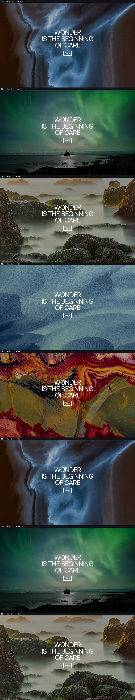
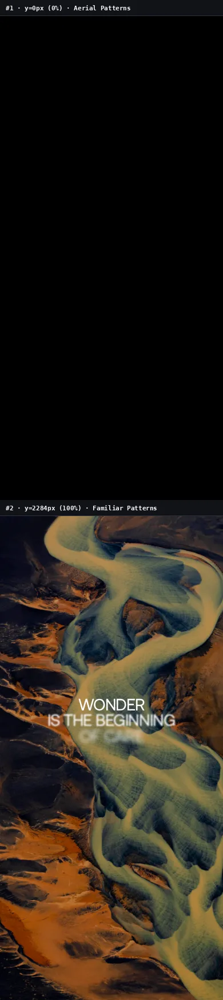

# UI Design System & Master Generation Blueprint: jonmccormack-com

> **Patterns - Jon McCormack** (https://jonmccormack.com/) — Explore the intriguing repeating patterns in nature that captivate the eye and remind us of the awe and beauty in the world.





---

## 1. Executive Visual Persona & Design Archetype

- **Brand Essence & Persona**: **Patterns - Jon McCormack** (`https://jonmccormack.com/`). Explore the intriguing repeating patterns in nature that captivate the eye and remind us of the awe and beauty in the world.
- **Capture Provenance**: Live browser capture (`tier1_fast`, HTTP `200`, captured `2026-11-24`).
- **Visual Archetype**: **Light-Substrate Editorial & Modular Grid System (`#ffffff` canvas, `#111111` ink, `#ffcc00` accent)**.
- **Anti-AI-Slop Differentiators**:
  - **Live-Computed Chromatic Polarity**: Anchors the viewport in `#ffffff` (live computed `body` `background-color` (`computed_styles.json`)) paired with `#111111` primary typography and `#ffcc00` accents.
  - **Grounded Typographic Hierarchy**: Uses `Aeonik Pro` across display (`Patterns - Jon McCormack`) and body copy, paired with `Fira Code` for monospace/code.
  - **Calibrated Spatial Grid & Motion**: Combines `1440px` container bounds (`gap: 19.2px`, padding `0.875rem`) with `cubic-bezier(0.22,1,0.36,1)` easing and GSAP Timeline & ScrollTrigger.

---

## 2. Spatial Architecture & Modular Grid Mathematics

### Viewport Allocation & Container Geometry
- **Captured Journey Filmstrips**: Desktop `1280×6624px` (`assets/desktop-journey.webp`, `8` keyframes up to `y=0px` / doc `900px`), Mobile `390×1744px` (`assets/mobile-journey.webp`, `2` keyframes).
- **Master Container Bounds**: `1440px` (full-bleed `100%` viewport stage).
- **Canvas Lateral Padding & Spacing**: `0.875rem` lateral canvas padding with `19.2px` grid gap.
- **Border Radius Scale**: `50%`, `5px`, `8px`, `28px`.

### Responsive Breakpoint Architecture
- **Desktop Layout**: Multi-column CSS Grid / Flexbox layout at `1440px` (`max-width: 1440px`, `gap: 19.2px`).
- **Mobile Layout**: Single-column vertical stack at `390px` viewport width with `0.875rem` horizontal padding.
- **Extracted CSS Media Queries**: `@media only screen and (max-width: 781px)`, `@media (min-width: 769px)`, `@media only screen and (max-width: 768px)`, `@media only screen and (min-width: 769px) and (max-width: 1200px)`.

---

## 3. Color System, Materiality & Atmospheric Lighting

### Semantic Palette & Source Grounding
| Semantic Role | Ground-Truth Value | Extracted Live / CSS Source |
|---|---|---|
| **Primary Canvas Substrate** | `#ffffff` | live computed `body` `background-color` (`computed_styles.json`) |
| **Primary Typography Ink** | `#111111` | live computed `body` `color` (`computed_styles.json`) |
| **Elevated Surface / Card Substrate** | `#dddddd` | `var(--wp-editor-canvas-background)` in `:root` |
| **Interactive Accent / Highlight** | `#ffcc00` | `crubber-button.ytp-swatch-backg... { background-color: #ffcc00 }` |
| **Secondary / Muted Copy** | `#888888` | `.ytp-ad-overlay-attribution { color: #888888 }` |
| **Structural Hairline Border** | `#e2e2e2` | `elative-container .ytp-ad-info-... { border-color: #e2e2e2 }` |
| **Variable Token (`--wp-block-synced-color`)** | `#7a00df` | `var(--wp-block-synced-color)` in `:root` |
| **Variable Token (`--wp-admin-theme-color`)** | `#007cba` | `var(--wp-admin-theme-color)` in `:root` |
| **Variable Token (`--wp-admin-theme-color-darker-10`)** | `#006ba1` | `var(--wp-admin-theme-color-darker-10)` in `:root` |
| **Variable Token (`--wp-admin-theme-color-darker-20`)** | `#005a87` | `var(--wp-admin-theme-color-darker-20)` in `:root` |

### Sanitized Root CSS Variables (`ui-ux.md` Ground Truth)
| Variable Name | Extracted Value | Semantic Role |
|---|---|---|
| `--wp-block-synced-color` | `#7a00df` | Brand / Palette Token |
| `--wp-block-synced-color--rgb` | `122,0,223` | Brand / Palette Token |
| `--wp-bound-block-color` | `var(--wp-block-synced-color)` | Brand / Palette Token |
| `--wp-editor-canvas-background` | `#ddd` | Canvas / Surface Token |
| `--wp-admin-theme-color` | `#007cba` | Brand / Palette Token |
| `--wp-admin-theme-color--rgb` | `0,124,186` | Brand / Palette Token |
| `--wp-admin-theme-color-darker-10` | `#006ba1` | Canvas / Surface Token |
| `--wp-admin-theme-color-darker-10--rgb` | `0,107,160.5` | Canvas / Surface Token |
| `--wp-admin-theme-color-darker-20` | `#005a87` | Canvas / Surface Token |
| `--wp-admin-theme-color-darker-20--rgb` | `0,90,135` | Canvas / Surface Token |
| `--wp-admin-border-width-focus` | `2px` | Layout / Spatial Grid Token |
| `--wp-admin--admin-bar--position-offset` | `var(--wp-admin--admin-bar--height,0px)` | Dimension / Scale Token |
| `--wp--style--global--content-size` | `735px` | Layout / Spatial Grid Token |
| `--wp--style--global--wide-size` | `2200px` | Layout / Spatial Grid Token |
| `--wp--style--block-gap` | `1.2rem` | Layout / Spatial Grid Token |
| `--jm-shell-header` | `10vh` | Layout / Spatial Grid Token |

---

## 4. Typographic Scale & Editorial Hierarchy

### Font Family Stacks
- **Display Typography**: `Aeonik Pro`.
- **Primary Body Stack**: `Aeonik Pro`.
- **Technical / Metadata Stack**: `Fira Code`.

### Typographic Scale & Rules (Live Computed & Stylesheet Grounded)
- **Hero Display (`H1`)**: observed font-size ladder: `31.68px`, `18.4064px`, `20.304px`, `31.2px`, `clamp(1.95rem, 1.6vw, 2.8rem)`.
- **Section Heading (`H2`)**: live computed `h3 (primary section heading)` (`font-size: 31.68px`, `line-height: 34.848px`, `font-weight: 400`); rule `h2` (`font-size: 13px`, `line-height: 15px`, `font-weight: 500`).
- **Body Copy**: live computed `body` (`font-size: 18.4064px`, `line-height: 27.6096px`, `font-weight: 300`); rule `p` (`line-height: 18px`).
- **Metadata & Navigation Labels**: live computed `nav/a` (`font-size: 20.304px`, `line-height: 30.456px`, `font-weight: 300`).

---

## 5. Choreographed Motion & Interaction Physics

### Primary Easing Curves
- **Extracted Timing Functions**: `cubic-bezier(0.22,1,0.36,1)`, `cubic-bezier(0,0,.2,1)`, `cubic-bezier(.4,0,1,1)`.

### Per-Element Transition & Choreography Rules
- **Selector `footer li`**: `transition: all 0.3s ease-in-out` extracted from `jonmccormack-com` stylesheet.
- **Selector `.is-style-editorial-heading`**: `transition: all 0.3s ease-in-out` extracted from `jonmccormack-com` stylesheet.
- **Selector `.jm-attachment-modal .jm-attachme...`**: `transition: opacity 250ms ease, transform 350ms cubic-bezier(0.22, 1, 0.36...` extracted from `jonmccormack-com` stylesheet.
- **Extracted Easing Curve (`cubic-bezier(0.22,1,0.36,1)`)**: Governs interactive state transitions across `<header.wp-block-template-part>` and `<article.jm-patterns-landing__item:nth(2)>`.
- **Runtime Interaction Engine**: Integrates GSAP Timeline & ScrollTrigger with `prefers-reduced-motion: reduce` fallback guards.
### Measured Runtime Scroll & Interaction Telemetry (`behavioral_journey_v2`)
- **Scroll Driver Mode**: `wheel` (max document height `900px`, deepest scrollY reached `0px` across `8` desktop keyframes).
- **Detected Scroll / Motion Libraries**: `GSAP/ScrollTrigger`.
- **Hover Physics (`primary_cta` · `Jon McCormack`)**: Computed transition `0s` / `ease` (no static color/transform shift captured at rest).
- **Hover Physics (`first_card` · `Patterns in Plants`)**: Computed transition `0s` / `ease` (no static color/transform shift captured at rest).
- **Route Transition Architecture**: First internal navigation (`/news/`) measured as `direct` in `967ms`.

---

## 6. Component Wireframe & Structural DOM Map

### Visual Layout Schematic — Desktop (`1440px`, Grounded in `dom.html` & Landmark Bounding Boxes)
```
┌────────────────────────────────────────────────────────────────────────┐
│ DESKTOP VIEWPORT (1440px) — Patterns - Jon McCormack                   │
│ ====================================================================== │
│ [ <header.wp-block-templ (1440x87px)  | Patterns · News · TEDx · Boo ] │
│ ---------------------------------------------------------------------- │
│ | HERO STAGE: <article.jm-patterns-landing__item> (w=1440px)         | │
│ | H1: Patterns - Jon McCormack                                       | │
│ | Substrate: #ffffff | Ink: #111111 | Accent: #ffcc00                | │
│ ---------------------------------------------------------------------- │
│ | SHOWCASE GRID (<article.jm-patterns-landi) max-w: 1440px           | │
│ | +------------------------------+  +------------------------------+ | │
│ | | Featured Work & Interactive  |  | Technical Architecture & Nar | | │
│ | +------------------------------+  +------------------------------+ | │
│ ---------------------------------------------------------------------- │
│ | DETAIL MODULE (<article.jm-patterns-landi) — Global Directory & Co | │
│ ---------------------------------------------------------------------- │
│ [ FOOTER (<footer.wp-block-tem) | https://jonmccormack.com/            │
└────────────────────────────────────────────────────────────────────────┘
```

### Visual Layout Schematic — Mobile Reflow (`390px`)
```
┌────────────────────────────────────────────────────────────────────────┐
│ MOBILE VIEWPORT REFLOW (390px) — Single-Column Stack (gap: 19.2px)     │
│ ====================================================================== │
│ [ HEADER BAR (<header.wp-block-templat) | Compact Menu (390px)         │
│ ---------------------------------------------------------------------- │
│ | HERO STAGE (<article.jm-patterns-lan) — 390px Vertical Lead        | │
│ | H1: Patterns - Jon McCormack                                       | │
│ ---------------------------------------------------------------------- │
│ | SHOWCASE STACK (<article.jm-patterns-l) — 1-Col Stack              | │
│ | [ Item 1: Featured Work & Interactive Showcase                   ] | │
│ | [ Item 2: Technical Architecture & Narrative                     ] | │
│ ---------------------------------------------------------------------- │
│ | DETAIL STACK (<article.jm-patterns-lan) — 1-Col (Global Directory &) │
│ ---------------------------------------------------------------------- │
│ [ FOOTER (<footer.wp-block-tem) | Stacked 390px Colophon               │
└────────────────────────────────────────────────────────────────────────┘
```

### Granular DOM Region Breakdown
1. **Brand Header & Navigation Bar (<header.wp-block-template-part> — `jonmccormack-com`)**:
   - Landmark `<header class="wp-block-template-part">` (`1440x87px`) hosting `Patterns - Jon McCormack` navigation (`Patterns · News · TEDx · Book · Bio`), DOM attributes (`data-wp-strategy="defer"`, `data-wp-interactive="core/navigation"`, `data-wp-context="("overlayOpenedBy":("..."`, `data-wp-on--click="actions.openMenuOnClick"`), and stylesheet rule `html.jm-splash-viewed .jm-splash { display: none !important; }`.
2. **Hero Stage & Focal Lead (<article.jm-patterns-landing__item> — `Patterns - Jon McCormack`)**:
   - Landmark `<article class="jm-patterns-landing__item">` presenting display lead `Patterns - Jon McCormack` and copy excerpt *"Explore the intriguing repeating patterns in nature that captivat"* over `#ffffff` canvas and `#111111` ink.
3. **Primary Showcase & Content Grid (<article.jm-patterns-landing__item:nth(2)> — `Featured Work & Interactive Showca`)**:
   - Landmark `<article class="jm-patterns-landing__item">` rendering section `Featured Work & Interactive Showcase` with copy *"Patterns - Jon McCormack"*, asset references (`cdnjs.cloudflare.com`, `www.googletagmanager.com`, `embed`, `splash.css`), and grid rule `textarea:focus { outline: none !important; box-shadow: none !important; }`.
4. **Interactive Detail & Feature Matrix (<article.jm-patterns-landing__item:nth(3)> — `Technical Architecture & Narrative`)**:
   - Landmark `<article class="jm-patterns-landing__item">` framing `Technical Architecture & Narrative` and `Global Directory & Contact` (*"Featured Work & Interactive Showcase"*) with `#dddddd` surface cards, `#ffcc00` accents, and `selection { background: rgb(144, 144, 144); color: white; }`.
5. **Colophon & Global Directory Footer (<footer.wp-block-template-part> — `https://jonmccormack.com/`)**:
   - Landmark `<footer class="wp-block-template-part">` anchoring `Patterns - Jon McCormack` footer links (`Patterns · News · TEDx · Book · Bio`), copy *"Technical Architecture & Narrative"*, and `#e2e2e2` structural dividers.
### Full Vertical Scroll Sequence (Desktop `1440×900` Keyframes)
- **Step 01** (`y=0px`, `0%`): Active landmark `Hero` · sticky/fixed elements: `3`
- **Step 02** (`y=0px`, `8%`): Active landmark `Hero` · sticky/fixed elements: `3`
- **Step 03** (`y=0px`, `17%`): Active landmark `Hero` · sticky/fixed elements: `3`
- **Step 04** (`y=0px`, `25%`): Active landmark `Hero` · sticky/fixed elements: `3`
- **Step 05** (`y=0px`, `33%`): Active landmark `Hero` · sticky/fixed elements: `3`
- **Step 06** (`y=0px`, `42%`): Active landmark `Hero` · sticky/fixed elements: `3`
- **Step 07** (`y=0px`, `50%`): Active landmark `Hero` · sticky/fixed elements: `3`
- **Step 08** (`y=0px`, `58%`): Active landmark `Hero` · sticky/fixed elements: `3`

### Multi-Page Internal Route Map
- **Listing Route (`/news/`)**: `https://jonmccormack.com/news/` — H1: `News`, scrollHeight `1671px`, transition `direct` (`967ms`)
- **Other Route (`/tedx/`)**: `https://jonmccormack.com/tedx/` — H1: `TEDx Berkeley`, scrollHeight `1292px`, transition `direct` (`479ms`)
- **Other Route (`/book/`)**: `https://jonmccormack.com/book/` — H1: `Book`, scrollHeight `2220px`, transition `direct` (`581ms`)

---

## 7. Master Zero-Shot AI Generation Prompt

```markdown
# Master Zero-Shot Frontend Generation Prompt: jonmccormack-com (Patterns - Jon McCormack)

You are a principal frontend architect and design systems engineer. Build a complete, production-ready web application replicating the exact design system, DOM landmarks, typographic hierarchy, color tokens, and motion physics of `jonmccormack-com` (**Patterns - Jon McCormack** — `https://jonmccormack.com/`).

### 1. Visual Archetype & Anti-AI-Slop Mandates
- **Archetype**: Light-Substrate Editorial & Modular Grid System (`#ffffff` canvas, `#111111` ink, `#ffcc00` accent).
- **Identity & Domain Context**: Explore the intriguing repeating patterns in nature that captivate the eye and remind us of the awe and beauty in the world.
- **Primary Substrate**: `#ffffff` (live computed `body` `background-color` (`computed_styles.json`)), **Primary Ink**: `#111111`, **Accent / Highlight**: `#ffcc00`.
- **Site-Specific Differentiators**:
  - **Live-Computed Chromatic Polarity**: Anchors the viewport in `#ffffff` (live computed `body` `background-color` (`computed_styles.json`)) paired with `#111111` primary typography and `#ffcc00` accents.
  - **Grounded Typographic Hierarchy**: Uses `Aeonik Pro` across display (`Patterns - Jon McCormack`) and body copy, paired with `Fira Code` for monospace/code.
  - **Calibrated Spatial Grid & Motion**: Combines `1440px` container bounds (`gap: 19.2px`, padding `0.875rem`) with `cubic-bezier(0.22,1,0.36,1)` easing and GSAP Timeline & ScrollTrigger.

### 2. Ground-Truth CSS Variables (`:root` Token Contract)
Declare and consume these exact custom properties extracted from `jonmccormack-com` in your global stylesheet:

:root {
  /* Patterns - Jon McCormack (jonmccormack-com) — Live-Grounded CSS Variables */
  --wp-block-synced-color: #7a00df; /* Brand / Palette Token (jonmccormack-com) */
  --wp-block-synced-color--rgb: 122,0,223; /* Brand / Palette Token (jonmccormack-com) */
  --wp-bound-block-color: var(--wp-block-synced-color); /* Brand / Palette Token (jonmccormack-com) */
  --wp-editor-canvas-background: #ddd; /* Canvas / Surface Token (jonmccormack-com) */
  --wp-admin-theme-color: #007cba; /* Brand / Palette Token (jonmccormack-com) */
  --wp-admin-theme-color--rgb: 0,124,186; /* Brand / Palette Token (jonmccormack-com) */
  --wp-admin-theme-color-darker-10: #006ba1; /* Canvas / Surface Token (jonmccormack-com) */
  --wp-admin-theme-color-darker-10--rgb: 0,107,160.5; /* Canvas / Surface Token (jonmccormack-com) */
  --wp-admin-theme-color-darker-20: #005a87; /* Canvas / Surface Token (jonmccormack-com) */
  --wp-admin-theme-color-darker-20--rgb: 0,90,135; /* Canvas / Surface Token (jonmccormack-com) */
  --wp-admin-border-width-focus: 2px; /* Layout / Spatial Grid Token (jonmccormack-com) */
  --wp-admin--admin-bar--position-offset: var(--wp-admin--admin-bar--height,0px); /* Dimension / Scale Token (jonmccormack-com) */
  --wp--style--global--content-size: 735px; /* Layout / Spatial Grid Token (jonmccormack-com) */
  --wp--style--global--wide-size: 2200px; /* Layout / Spatial Grid Token (jonmccormack-com) */
  --wp--style--block-gap: 1.2rem; /* Layout / Spatial Grid Token (jonmccormack-com) */
  --jm-shell-header: 10vh; /* Layout / Spatial Grid Token (jonmccormack-com) */
}

### 3. Semantic Color & Materiality Contract
Map every surface, ink, and border strictly to these source-grounded tokens:
- **Primary Canvas Substrate**: `#ffffff` — grounded in live computed `body` `background-color` (`computed_styles.json`)
- **Primary Typography Ink**: `#111111` — grounded in live computed `body` `color` (`computed_styles.json`)
- **Elevated Surface / Card Substrate**: `#dddddd` — grounded in `var(--wp-editor-canvas-background)` in `:root`
- **Interactive Accent / Highlight**: `#ffcc00` — grounded in `crubber-button.ytp-swatch-backg... { background-color: #ffcc00 }`
- **Secondary / Muted Copy**: `#888888` — grounded in `.ytp-ad-overlay-attribution { color: #888888 }`
- **Structural Hairline Border**: `#e2e2e2` — grounded in `elative-container .ytp-ad-info-... { border-color: #e2e2e2 }`
- **Variable Token (`--wp-block-synced-color`)**: `#7a00df` — grounded in `var(--wp-block-synced-color)` in `:root`
- **Variable Token (`--wp-admin-theme-color`)**: `#007cba` — grounded in `var(--wp-admin-theme-color)` in `:root`
- **Variable Token (`--wp-admin-theme-color-darker-10`)**: `#006ba1` — grounded in `var(--wp-admin-theme-color-darker-10)` in `:root`
- **Variable Token (`--wp-admin-theme-color-darker-20`)**: `#005a87` — grounded in `var(--wp-admin-theme-color-darker-20)` in `:root`

### 4. Spatial Grid, Container Bounds & Responsive Breakpoints
- **Desktop Viewport Reference**: `1280×6624px` (multi-frame vertical journey filmstrip (6624px), `1440px` standard desktop width).
- **Mobile Viewport Reference**: `390×1744px` (full-page live capture (1744px), `390px` standard mobile width).
- **Container Max-Width**: `1440px` (full-bleed `100%` viewport stage)
- **Padding & Gutters**: `0.875rem` lateral canvas padding with `19.2px` grid gap
- **Desktop Grid**: Multi-column CSS Grid / Flexbox layout at `1440px` (`max-width: 1440px`, `gap: 19.2px`)
- **Mobile Adaptation**: Single-column vertical stack at `390px` viewport width with `0.875rem` horizontal padding
- **Media Queries**: `@media only screen and (max-width: 781px)`, `@media (min-width: 769px)`, `@media only screen and (max-width: 768px)`, `@media only screen and (min-width: 769px) and (max-width: 1200px)`
- **Corner Radii**: `50%`, `5px`, `8px`, `28px`

### 5. Typography & Editorial Scale Contract
- **Display Font Stack**: `Aeonik Pro`
- **Body Font Stack**: `Aeonik Pro`
- **Monospace / Technical Font Stack**: `Fira Code`
- **H1 Display Rule**: observed font-size ladder: `31.68px`, `18.4064px`, `20.304px`, `31.2px`, `clamp(1.95rem, 1.6vw, 2.8rem)`
- **H2 Section Rule**: live computed `h3 (primary section heading)` (`font-size: 31.68px`, `line-height: 34.848px`, `font-weight: 400`); rule `h2` (`font-size: 13px`, `line-height: 15px`, `font-weight: 500`)
- **Body Copy Rule**: live computed `body` (`font-size: 18.4064px`, `line-height: 27.6096px`, `font-weight: 300`); rule `p` (`line-height: 18px`)
- **Metadata & Index Rule**: live computed `nav/a` (`font-size: 20.304px`, `line-height: 30.456px`, `font-weight: 300`)

### 6. Component Hierarchy, Verbatim Copy & Real DOM Landmarks
Scaffold `jonmccormack-com` (`Patterns - Jon McCormack`) with these exact structural regions, extracted copy, and CSS rules from `dom.html`:
1. **Brand Header & Navigation Bar (<header.wp-block-template-part> — `jonmccormack-com`)**:
   - DOM & Selectors: Landmark `<header class="wp-block-template-part">` (`1440x87px`) hosting `Patterns - Jon McCormack` navigation (`Patterns · News · TEDx · Book · Bio`), DOM attributes (`data-wp-strategy="defer"`, `data-wp-interactive="core/navigation"`, `data-wp-context="("overlayOpenedBy":("..."`, `data-wp-on--click="actions.openMenuOnClick"`), and stylesheet rule `html.jm-splash-viewed .jm-splash { display: none !important; }`.
   - Responsive Contract: Header `Brand Header & Navigation Bar (<header.wp-block-template-part> — `jonmccormack-com`)` (`jonmccormack-com`) adapts across `@media only screen and (max-width: 781px)`, `@media (min-width: 769px)`, `@media only screen and (max-width: 768px)`, `@media only screen and (min-width: 769px) and (max-width: 1200px)` with `cubic-bezier(0.22,1,0.36,1)`, `cubic-bezier(0,0,.2,1)`, `cubic-bezier(.4,0,1,1)` transitions and links `Patterns · News · TEDx · Book · Bio`.
2. **Hero Stage & Focal Lead (<article.jm-patterns-landing__item> — `Patterns - Jon McCormack`)**:
   - DOM & Selectors: Landmark `<article class="jm-patterns-landing__item">` presenting display lead `Patterns - Jon McCormack` and copy excerpt *"Explore the intriguing repeating patterns in nature that captivat"* over `#ffffff` canvas and `#111111` ink.
   - Responsive Contract: Hero stage (`1280×6624px` desktop / `390×1744px` mobile) sets `#ffffff` background with `#111111` headline `Patterns - Jon McCormack`.
3. **Primary Showcase & Content Grid (<article.jm-patterns-landing__item:nth(2)> — `Featured Work & Interactive Showca`)**:
   - DOM & Selectors: Landmark `<article class="jm-patterns-landing__item">` rendering section `Featured Work & Interactive Showcase` with copy *"Patterns - Jon McCormack"*, asset references (`cdnjs.cloudflare.com`, `www.googletagmanager.com`, `embed`, `splash.css`), and grid rule `textarea:focus { outline: none !important; box-shadow: none !important; }`.
   - Responsive Contract: Showcase grid `Primary Showcase & Content Grid (<article.jm-patterns-landing__item:nth(2)> — `Featured Work & Interactive Showca`)` applies Multi-column CSS Grid / Flexbox layout at `1440px` (`max-width: 1440px`, `gap: 19.2px`) on desktop and Single-column vertical stack at `390px` viewport width with `0.875rem` horizontal padding on mobile.
4. **Interactive Detail & Feature Matrix (<article.jm-patterns-landing__item:nth(3)> — `Technical Architecture & Narrative`)**:
   - DOM & Selectors: Landmark `<article class="jm-patterns-landing__item">` framing `Technical Architecture & Narrative` and `Global Directory & Contact` (*"Featured Work & Interactive Showcase"*) with `#dddddd` surface cards, `#ffcc00` accents, and `selection { background: rgb(144, 144, 144); color: white; }`.
   - Responsive Contract: Detail module `Interactive Detail & Feature Matrix (<article.jm-patterns-landing__item:nth(3)> — `Technical Architecture & Narrative`)` uses `50%`, `5px`, `8px`, `28px` radii, `#ffcc00` highlights, and assets (cdnjs.cloudflare.com, www.googletagmanager.com, embed).
5. **Colophon & Global Directory Footer (<footer.wp-block-template-part> — `https://jonmccormack.com/`)**:
   - DOM & Selectors: Landmark `<footer class="wp-block-template-part">` anchoring `Patterns - Jon McCormack` footer links (`Patterns · News · TEDx · Book · Bio`), copy *"Technical Architecture & Narrative"*, and `#e2e2e2` structural dividers.
   - Responsive Contract: Footer `Colophon & Global Directory Footer (<footer.wp-block-template-part> — `https://jonmccormack.com/`)` aligns to `1440px` (full-bleed `100%` viewport stage) with `0.875rem` lateral canvas padding with `19.2px` grid gap and attributes (data-wp-strategy="defer", data-wp-interactive="core/navigation", data-wp-context="("overlayOpenedBy":("...").

#### Verbatim DOM Copy Excerpts (`dom.html`)
- Lead Copy: *"Explore the intriguing repeating patterns in nature that captivate the eye and remind us of the awe and beauty in the world."*

### 7. Motion, Extracted Stylesheet Rules & Interaction Choreography
- **Primary Easing Functions**: `cubic-bezier(0.22,1,0.36,1)`, `cubic-bezier(0,0,.2,1)`, `cubic-bezier(.4,0,1,1)`
- **Extracted Stylesheet Rules (`jonmccormack-com`)**:
- `html.jm-splash-viewed .jm-splash { display: none !important; }`
- `textarea:focus { outline: none !important; box-shadow: none !important; }`
- `selection { background: rgb(144, 144, 144); color: white; }`
- `.wp-block-site-title a { letter-spacing: 0; font-size: clamp(1.95rem, 1.6vw, 2.8rem); }`
- `.wp-block-site-title a:hover { text-decoration: none; }`
- **Per-Selector Transition Rules**:
- **Selector `footer li`**: `transition: all 0.3s ease-in-out` extracted from `jonmccormack-com` stylesheet.
- **Selector `.is-style-editorial-heading`**: `transition: all 0.3s ease-in-out` extracted from `jonmccormack-com` stylesheet.
- **Selector `.jm-attachment-modal .jm-attachme...`**: `transition: opacity 250ms ease, transform 350ms cubic-bezier(0.22, 1, 0.36...` extracted from `jonmccormack-com` stylesheet.
- **Extracted Easing Curve (`cubic-bezier(0.22,1,0.36,1)`)**: Governs interactive state transitions across `<header.wp-block-template-part>` and `<article.jm-patterns-landing__item:nth(2)>`.
- **Runtime Interaction Engine**: Integrates GSAP Timeline & ScrollTrigger with `prefers-reduced-motion: reduce` fallback guards.
### 7b. Full-Page Scroll Choreography, Interactive States & Multi-Page Routes
- **Scroll Mechanics**: Implement `wheel` vertical progression up to `900px` across 8 distinct viewport chapters using GSAP/ScrollTrigger.
- **Vertical Chapter Sequence**: Hero (0%) -> Hero (8%) -> Hero (17%) -> Hero (25%) -> Hero (33%) -> Hero (42%) -> Hero (50%) -> Hero (58%).
- **Multi-Page Routes**: Scaffold internal routes `/news/` (listing, direct), `/tedx/` (other, direct), `/book/` (other, direct) sharing the global header/footer shell and design tokens.

### 8. Technical Deliverables
- Implement in Next.js (App Router) with TypeScript and Tailwind CSS consuming the `:root` custom properties defined above for `jonmccormack-com`.
- Reproduce both the `1440px` desktop architecture and `390px` mobile breakpoint transitions, preserving semantic HTML5 landmarks (`<header>`, `<nav>`, `<main>`, `<section>`, `<footer>`) and `prefers-reduced-motion` accessibility guards.
```
---

## 8. Full-Page Scroll Journey, Interactive States & Subpage Inventory

### Desktop Scroll Keyframes (`1440×900` WebP)
| Step | Scroll Y | Progress | Active Landmark / Section | Sticky/Fixed | Visual Asset |
| :---: | :---: | :---: | :--- | :---: | :--- |
| `#01` | `0px` | `0%` | Hero | `3` | [desktop-step-01.webp](assets/desktop-step-01.webp) |
| `#02` | `0px` | `8%` | Hero | `3` | [desktop-step-02.webp](assets/desktop-step-02.webp) |
| `#03` | `0px` | `17%` | Hero | `3` | [desktop-step-03.webp](assets/desktop-step-03.webp) |
| `#04` | `0px` | `25%` | Hero | `3` | [desktop-step-04.webp](assets/desktop-step-04.webp) |
| `#05` | `0px` | `33%` | Hero | `3` | [desktop-step-05.webp](assets/desktop-step-05.webp) |
| `#06` | `0px` | `42%` | Hero | `3` | [desktop-step-06.webp](assets/desktop-step-06.webp) |
| `#07` | `0px` | `50%` | Hero | `3` | [desktop-step-07.webp](assets/desktop-step-07.webp) |
| `#08` | `0px` | `58%` | Hero | `3` | [desktop-step-08.webp](assets/desktop-step-08.webp) |

### Mobile Condensed Keyframes (`390×844` WebP)
| Step | Scroll Y | Progress | Active Landmark | Visual Asset |
| :---: | :---: | :---: | :--- | :--- |
| `#01` | `0px` | `0%` | Aerial Patterns | [mobile-step-01.webp](assets/mobile-step-01.webp) |
| `#02` | `2284px` | `100%` | Familiar Patterns | [mobile-step-02.webp](assets/mobile-step-02.webp) |

### Internal Subpage Filmstrips (`1080px` Wide WebP)
| # | Template | Route URL | H1 / Title | Scroll Height | Transition | Filmstrip Asset |
| :-: | :---: | :--- | :--- | :---: | :---: | :--- |
| `1` | `listing` | `https://jonmccormack.com/news/` | News | `1671px` | `direct` (`967ms`) | [subpage-01-news.webp](assets/subpage-01-news.webp) |
| `2` | `other` | `https://jonmccormack.com/tedx/` | TEDx Berkeley | `1292px` | `direct` (`479ms`) | [subpage-02-tedx.webp](assets/subpage-02-tedx.webp) |
| `3` | `other` | `https://jonmccormack.com/book/` | Book | `2220px` | `direct` (`581ms`) | [subpage-03-book.webp](assets/subpage-03-book.webp) |

