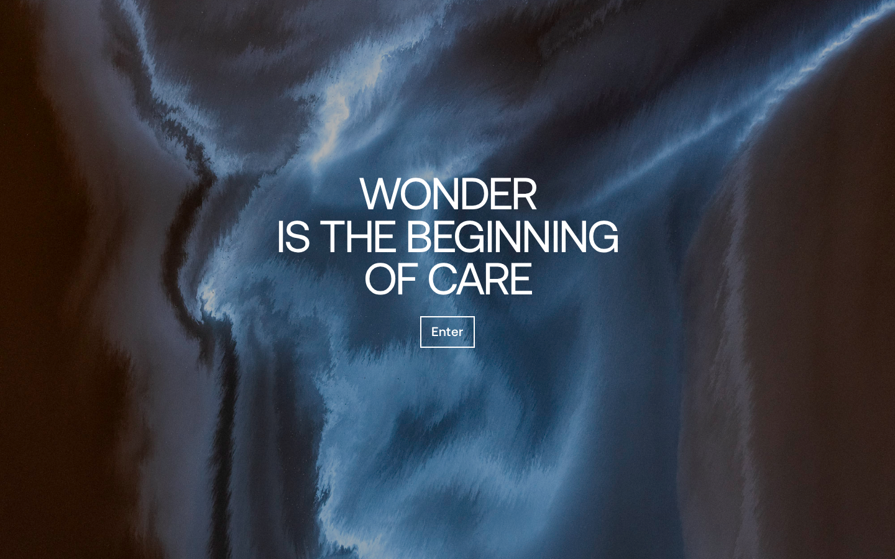
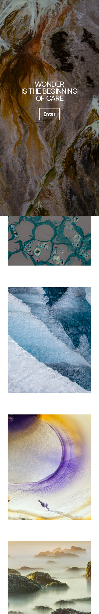

# UI Design System & Master Generation Blueprint: jonmccormack-com

> **Patterns - Jon McCormack** (https://jonmccormack.com/) — Explore the intriguing repeating patterns in nature that captivate the eye and remind us of the awe and beauty in the world.



---

## 1. Executive Visual Persona & Design Archetype

- **Brand Essence & Persona**: **Patterns - Jon McCormack** (`https://jonmccormack.com/`). Explore the intriguing repeating patterns in nature that captivate the eye and remind us of the awe and beauty in the world.
- **Capture Provenance**: Live browser capture (`tier1_fast`, HTTP `200`, captured `2026-11-23`).
- **Visual Archetype**: **Light-Substrate Editorial & Modular Grid System (`#ffffff` canvas, `#111111` ink, `#000000` accent)**.
- **Anti-AI-Slop Differentiators**:
  - **Live-Computed Chromatic Polarity**: Anchors the viewport in `#ffffff` (live computed `body` `background-color` (`computed_styles.json`)) paired with `#111111` primary typography and `#000000` accents.
  - **Grounded Typographic Hierarchy**: Pairs `Aeonik Pro` for display copy (`Patterns - Jon McCormack`) with `Aeonik Pro` and `Fira Code`.
  - **Calibrated Spatial Grid & Motion**: Combines `1440px` container bounds (`gap: 19.2px`, padding `2rem`) with `cubic-bezier(0.22,1,0.36,1)` easing and GSAP Timeline & ScrollTrigger.

---

## 2. Spatial Architecture & Modular Grid Mathematics



### Viewport Allocation & Container Geometry
- **Captured Viewport Dimensions**: Desktop `1440×900px` (`assets/desktop.png`, single-viewport 100vh live capture (900px)), Mobile `390×2400px` (`assets/mobile.png`, clamped at 2400px live multi-section capture).
- **Master Container Bounds**: `1440px` (full-bleed `100%` viewport stage).
- **Canvas Lateral Padding & Spacing**: `2rem` lateral canvas padding with `19.2px` grid gap.
- **Border Radius Scale**: `50%`, `9999px`.

### Responsive Breakpoint Architecture
- **Desktop Layout**: Multi-column CSS Grid / Flexbox layout at `1440px` (`max-width: 1440px`, `gap: 19.2px`).
- **Mobile Layout**: Single-column vertical stack at `390px` viewport width with `2rem` horizontal padding.
- **Extracted CSS Media Queries**: `@media (prefers-reduced-motion: reduce)`, `@media (max-width: 768px)`, `@media only screen and (max-width: 781px)`, `@media (min-width: 769px)`.

---

## 3. Color System, Materiality & Atmospheric Lighting

### Semantic Palette & Source Grounding
| Semantic Role | Ground-Truth Value | Extracted Live / CSS Source |
|---|---|---|
| **Primary Canvas Substrate** | `#ffffff` | live computed `body` `background-color` (`computed_styles.json`) |
| **Primary Typography Ink** | `#111111` | live computed `body` `color` (`computed_styles.json`) |
| **Elevated Surface / Card Substrate** | `#dddddd` | `var(--wp-editor-canvas-background)` in `:root` |
| **Interactive Accent / Highlight** | `#000000` | `ash__enter.wp-element-button:fo... { color: #000000 }` |
| **Secondary / Muted Copy** | `#808080` | `.has-cyan-bluish-gray-color { color: gray }` (`#808080`) |
| **Structural Hairline Border** | `#d9d9d9` | `.wp-block-navigation__submenu-c... { border: #d9d9d9 }` |
| **Variable Token (`--wp-block-synced-color`)** | `#7a00df` | `var(--wp-block-synced-color)` in `:root` |
| **Variable Token (`--wp-admin-theme-color`)** | `#007cba` | `var(--wp-admin-theme-color)` in `:root` |
| **Variable Token (`--wp-admin-theme-color-darker-10`)** | `#006ba1` | `var(--wp-admin-theme-color-darker-10)` in `:root` |
| **Variable Token (`--wp-admin-theme-color-darker-20`)** | `#005a87` | `var(--wp-admin-theme-color-darker-20)` in `:root` |

### Sanitized Root CSS Variables (`ui-ux.md` Ground Truth)
| Variable Name | Extracted Value | Semantic Role |
|---|---|---|
| `--wp-block-synced-color` | `#7a00df` | Brand / Palette Token |
| `--wp-block-synced-color--rgb` | `122,0,223` | Brand / Palette Token |
| `--wp-bound-block-color` | `var(--wp-block-synced-color)` | Brand / Palette Token |
| `--wp-editor-canvas-background` | `#ddd` | Canvas / Surface Token |
| `--wp-admin-theme-color` | `#007cba` | Brand / Palette Token |
| `--wp-admin-theme-color--rgb` | `0,124,186` | Brand / Palette Token |
| `--wp-admin-theme-color-darker-10` | `#006ba1` | Canvas / Surface Token |
| `--wp-admin-theme-color-darker-10--rgb` | `0,107,160.5` | Canvas / Surface Token |
| `--wp-admin-theme-color-darker-20` | `#005a87` | Canvas / Surface Token |
| `--wp-admin-theme-color-darker-20--rgb` | `0,90,135` | Canvas / Surface Token |
| `--wp-admin-border-width-focus` | `2px` | Layout / Spatial Grid Token |
| `--wp-admin--admin-bar--position-offset` | `var(--wp-admin--admin-bar--height,0px)` | Dimension / Scale Token |
| `--wp--style--global--content-size` | `735px` | Layout / Spatial Grid Token |
| `--wp--style--global--wide-size` | `2200px` | Layout / Spatial Grid Token |
| `--wp--style--block-gap` | `1.2rem` | Layout / Spatial Grid Token |
| `--jm-shell-header` | `10vh` | Layout / Spatial Grid Token |

---

## 4. Typographic Scale & Editorial Hierarchy

### Font Family Stacks
- **Display Typography**: `Aeonik Pro`.
- **Primary Body Stack**: `Aeonik Pro`.
- **Technical / Metadata Stack**: `Fira Code`.

### Typographic Scale & Rules (Live Computed & Stylesheet Grounded)
- **Hero Display (`H1`)**: observed font-size ladder: `31.68px`, `18.4064px`, `20.304px`, `31.2px`, `clamp(1.2rem, 6vw, 4.5rem)`.
- **Section Heading (`H2`)**: live computed `h3 (primary section heading)` (`font-size: 31.68px`, `line-height: 34.848px`, `font-weight: 400`).
- **Body Copy**: live computed `body` (`font-size: 18.4064px`, `line-height: 27.6096px`, `font-weight: 300`).
- **Metadata & Navigation Labels**: live computed `nav/a` (`font-size: 20.304px`, `line-height: 30.456px`, `font-weight: 300`).

---

## 5. Choreographed Motion & Interaction Physics

### Primary Easing Curves
- **Extracted Timing Functions**: `cubic-bezier(0.22,1,0.36,1)`, `cubic-bezier(.16,1,.3,1)`.

### Per-Element Transition & Choreography Rules
- **Selector `footer li`**: `transition: all 0.3s ease-in-out` extracted from `jonmccormack-com` stylesheet.
- **Selector `.is-style-editorial-heading`**: `transition: all 0.3s ease-in-out` extracted from `jonmccormack-com` stylesheet.
- **Selector `.jm-attachment-modal .jm-attachme...`**: `transition: opacity 250ms ease, transform 350ms cubic-bezier(0.22, 1, 0.36...` extracted from `jonmccormack-com` stylesheet.
- **Extracted Easing Curve (`cubic-bezier(0.22,1,0.36,1)`)**: Governs interactive state transitions across `<header.wp-block-template-part>` and `<article.jm-patterns-landing__item:nth(2)>`.
- **Runtime Interaction Engine**: Integrates GSAP Timeline & ScrollTrigger with `prefers-reduced-motion: reduce` fallback guards.

---

## 6. Component Wireframe & Structural DOM Map

### Visual Layout Schematic — Desktop (`1440px`, Grounded in `dom.html` & Landmark Bounding Boxes)
```
┌────────────────────────────────────────────────────────────────────────┐
│ DESKTOP VIEWPORT (1440px) — Patterns - Jon McCormack                   │
│ ====================================================================== │
│ [ <header.wp-block-templ (1440x87px)  | Patterns · News · TEDx · Boo ] │
│ ---------------------------------------------------------------------- │
│ | HERO STAGE: <article.jm-patterns-landing__item> (w=1440px)         | │
│ | H1: Patterns - Jon McCormack                                       | │
│ | Substrate: #ffffff | Ink: #111111 | Accent: #000000                | │
│ ---------------------------------------------------------------------- │
│ | SHOWCASE GRID (<article.jm-patterns-landi) max-w: 1440px           | │
│ | +------------------------------+  +------------------------------+ | │
│ | | Featured Work & Interactive  |  | Technical Architecture & Nar | | │
│ | +------------------------------+  +------------------------------+ | │
│ ---------------------------------------------------------------------- │
│ | DETAIL MODULE (<article.jm-patterns-landi) — Global Directory & Co | │
│ ---------------------------------------------------------------------- │
│ [ FOOTER (<footer.wp-block-tem) | https://jonmccormack.com/            │
└────────────────────────────────────────────────────────────────────────┘
```

### Visual Layout Schematic — Mobile Reflow (`390px`)
```
┌────────────────────────────────────────────────────────────────────────┐
│ MOBILE VIEWPORT REFLOW (390px) — Single-Column Stack (gap: 19.2px)     │
│ ====================================================================== │
│ [ HEADER BAR (<header.wp-block-templat) | Compact Menu (390px)         │
│ ---------------------------------------------------------------------- │
│ | HERO STAGE (<article.jm-patterns-lan) — 390px Vertical Lead        | │
│ | H1: Patterns - Jon McCormack                                       | │
│ ---------------------------------------------------------------------- │
│ | SHOWCASE STACK (<article.jm-patterns-l) — 1-Col Stack              | │
│ | [ Item 1: Featured Work & Interactive Showcase                   ] | │
│ | [ Item 2: Technical Architecture & Narrative                     ] | │
│ ---------------------------------------------------------------------- │
│ | DETAIL STACK (<article.jm-patterns-lan) — 1-Col (Global Directory &) │
│ ---------------------------------------------------------------------- │
│ [ FOOTER (<footer.wp-block-tem) | Stacked 390px Colophon               │
└────────────────────────────────────────────────────────────────────────┘
```

### Granular DOM Region Breakdown
1. **Brand Header & Navigation Bar (<header.wp-block-template-part> — `jonmccormack-com`)**:
   - Landmark `<header class="wp-block-template-part">` (`1440x87px`) hosting `Patterns - Jon McCormack` navigation (`Patterns · News · TEDx · Book · Bio`), DOM attributes (`data-wp-strategy="defer"`, `data-wp-interactive="core/navigation"`, `data-wp-context="("overlayOpenedBy":("..."`, `data-wp-on--click="actions.openMenuOnClick"`), and stylesheet rule `.jm-splash__enter-wrap { display: flex; justify-content: center; width: 100%; margin: 0 0 clamp(2... }`.
2. **Hero Stage & Focal Lead (<article.jm-patterns-landing__item> — `Patterns - Jon McCormack`)**:
   - Landmark `<article class="jm-patterns-landing__item">` presenting display lead `Patterns - Jon McCormack` and copy excerpt *"Explore the intriguing repeating patterns in nature that captivat"* over `#ffffff` canvas and `#111111` ink.
3. **Primary Showcase & Content Grid (<article.jm-patterns-landing__item:nth(2)> — `Featured Work & Interactive Showca`)**:
   - Landmark `<article class="jm-patterns-landing__item">` rendering section `Featured Work & Interactive Showcase` with copy *"Patterns - Jon McCormack"*, asset references (`cdnjs.cloudflare.com`, `www.googletagmanager.com`, `embed`, `splash.css`), and grid rule `.jm-splash__enter-wrap .wp-block-... { display: flex; justify-content: center; }`.
4. **Interactive Detail & Feature Matrix (<article.jm-patterns-landing__item:nth(3)> — `Technical Architecture & Narrative`)**:
   - Landmark `<article class="jm-patterns-landing__item">` framing `Technical Architecture & Narrative` and `Global Directory & Contact` (*"Featured Work & Interactive Showcase"*) with `#dddddd` surface cards, `#000000` accents, and `.jm-splash__enter { opacity: 0; visibility: hidden; pointer-events: none; }`.
5. **Colophon & Global Directory Footer (<footer.wp-block-template-part> — `https://jonmccormack.com/`)**:
   - Landmark `<footer class="wp-block-template-part">` anchoring `Patterns - Jon McCormack` footer links (`Patterns · News · TEDx · Book · Bio`), copy *"Technical Architecture & Narrative"*, and `#d9d9d9` structural dividers.

---

## 7. Master Zero-Shot AI Generation Prompt

```markdown
# Master Zero-Shot Frontend Generation Prompt: jonmccormack-com (Patterns - Jon McCormack)

You are a principal frontend architect and design systems engineer. Build a complete, production-ready web application replicating the exact design system, DOM landmarks, typographic hierarchy, color tokens, and motion physics of `jonmccormack-com` (**Patterns - Jon McCormack** — `https://jonmccormack.com/`).

### 1. Visual Archetype & Anti-AI-Slop Mandates
- **Archetype**: Light-Substrate Editorial & Modular Grid System (`#ffffff` canvas, `#111111` ink, `#000000` accent).
- **Identity & Domain Context**: Explore the intriguing repeating patterns in nature that captivate the eye and remind us of the awe and beauty in the world.
- **Primary Substrate**: `#ffffff` (live computed `body` `background-color` (`computed_styles.json`)), **Primary Ink**: `#111111`, **Accent / Highlight**: `#000000`.
- **Site-Specific Differentiators**:
  - **Live-Computed Chromatic Polarity**: Anchors the viewport in `#ffffff` (live computed `body` `background-color` (`computed_styles.json`)) paired with `#111111` primary typography and `#000000` accents.
  - **Grounded Typographic Hierarchy**: Pairs `Aeonik Pro` for display copy (`Patterns - Jon McCormack`) with `Aeonik Pro` and `Fira Code`.
  - **Calibrated Spatial Grid & Motion**: Combines `1440px` container bounds (`gap: 19.2px`, padding `2rem`) with `cubic-bezier(0.22,1,0.36,1)` easing and GSAP Timeline & ScrollTrigger.

### 2. Ground-Truth CSS Variables (`:root` Token Contract)
Declare and consume these exact custom properties extracted from `jonmccormack-com` in your global stylesheet:

:root {
  /* Patterns - Jon McCormack (jonmccormack-com) — Live-Grounded CSS Variables */
  --wp-block-synced-color: #7a00df; /* Brand / Palette Token (jonmccormack-com) */
  --wp-block-synced-color--rgb: 122,0,223; /* Brand / Palette Token (jonmccormack-com) */
  --wp-bound-block-color: var(--wp-block-synced-color); /* Brand / Palette Token (jonmccormack-com) */
  --wp-editor-canvas-background: #ddd; /* Canvas / Surface Token (jonmccormack-com) */
  --wp-admin-theme-color: #007cba; /* Brand / Palette Token (jonmccormack-com) */
  --wp-admin-theme-color--rgb: 0,124,186; /* Brand / Palette Token (jonmccormack-com) */
  --wp-admin-theme-color-darker-10: #006ba1; /* Canvas / Surface Token (jonmccormack-com) */
  --wp-admin-theme-color-darker-10--rgb: 0,107,160.5; /* Canvas / Surface Token (jonmccormack-com) */
  --wp-admin-theme-color-darker-20: #005a87; /* Canvas / Surface Token (jonmccormack-com) */
  --wp-admin-theme-color-darker-20--rgb: 0,90,135; /* Canvas / Surface Token (jonmccormack-com) */
  --wp-admin-border-width-focus: 2px; /* Layout / Spatial Grid Token (jonmccormack-com) */
  --wp-admin--admin-bar--position-offset: var(--wp-admin--admin-bar--height,0px); /* Dimension / Scale Token (jonmccormack-com) */
  --wp--style--global--content-size: 735px; /* Layout / Spatial Grid Token (jonmccormack-com) */
  --wp--style--global--wide-size: 2200px; /* Layout / Spatial Grid Token (jonmccormack-com) */
  --wp--style--block-gap: 1.2rem; /* Layout / Spatial Grid Token (jonmccormack-com) */
  --jm-shell-header: 10vh; /* Layout / Spatial Grid Token (jonmccormack-com) */
}

### 3. Semantic Color & Materiality Contract
Map every surface, ink, and border strictly to these source-grounded tokens:
- **Primary Canvas Substrate**: `#ffffff` — grounded in live computed `body` `background-color` (`computed_styles.json`)
- **Primary Typography Ink**: `#111111` — grounded in live computed `body` `color` (`computed_styles.json`)
- **Elevated Surface / Card Substrate**: `#dddddd` — grounded in `var(--wp-editor-canvas-background)` in `:root`
- **Interactive Accent / Highlight**: `#000000` — grounded in `ash__enter.wp-element-button:fo... { color: #000000 }`
- **Secondary / Muted Copy**: `#808080` — grounded in `.has-cyan-bluish-gray-color { color: gray }` (`#808080`)
- **Structural Hairline Border**: `#d9d9d9` — grounded in `.wp-block-navigation__submenu-c... { border: #d9d9d9 }`
- **Variable Token (`--wp-block-synced-color`)**: `#7a00df` — grounded in `var(--wp-block-synced-color)` in `:root`
- **Variable Token (`--wp-admin-theme-color`)**: `#007cba` — grounded in `var(--wp-admin-theme-color)` in `:root`
- **Variable Token (`--wp-admin-theme-color-darker-10`)**: `#006ba1` — grounded in `var(--wp-admin-theme-color-darker-10)` in `:root`
- **Variable Token (`--wp-admin-theme-color-darker-20`)**: `#005a87` — grounded in `var(--wp-admin-theme-color-darker-20)` in `:root`

### 4. Spatial Grid, Container Bounds & Responsive Breakpoints
- **Desktop Viewport Reference**: `1440×900px` (single-viewport 100vh live capture (900px), `1440px` standard desktop width).
- **Mobile Viewport Reference**: `390×2400px` (clamped at 2400px live multi-section capture, `390px` standard mobile width).
- **Container Max-Width**: `1440px` (full-bleed `100%` viewport stage)
- **Padding & Gutters**: `2rem` lateral canvas padding with `19.2px` grid gap
- **Desktop Grid**: Multi-column CSS Grid / Flexbox layout at `1440px` (`max-width: 1440px`, `gap: 19.2px`)
- **Mobile Adaptation**: Single-column vertical stack at `390px` viewport width with `2rem` horizontal padding
- **Media Queries**: `@media (prefers-reduced-motion: reduce)`, `@media (max-width: 768px)`, `@media only screen and (max-width: 781px)`, `@media (min-width: 769px)`
- **Corner Radii**: `50%`, `9999px`

### 5. Typography & Editorial Scale Contract
- **Display Font Stack**: `Aeonik Pro`
- **Body Font Stack**: `Aeonik Pro`
- **Monospace / Technical Font Stack**: `Fira Code`
- **H1 Display Rule**: observed font-size ladder: `31.68px`, `18.4064px`, `20.304px`, `31.2px`, `clamp(1.2rem, 6vw, 4.5rem)`
- **H2 Section Rule**: live computed `h3 (primary section heading)` (`font-size: 31.68px`, `line-height: 34.848px`, `font-weight: 400`)
- **Body Copy Rule**: live computed `body` (`font-size: 18.4064px`, `line-height: 27.6096px`, `font-weight: 300`)
- **Metadata & Index Rule**: live computed `nav/a` (`font-size: 20.304px`, `line-height: 30.456px`, `font-weight: 300`)

### 6. Component Hierarchy, Verbatim Copy & Real DOM Landmarks
Scaffold `jonmccormack-com` (`Patterns - Jon McCormack`) with these exact structural regions, extracted copy, and CSS rules from `dom.html`:
1. **Brand Header & Navigation Bar (<header.wp-block-template-part> — `jonmccormack-com`)**:
   - DOM & Selectors: Landmark `<header class="wp-block-template-part">` (`1440x87px`) hosting `Patterns - Jon McCormack` navigation (`Patterns · News · TEDx · Book · Bio`), DOM attributes (`data-wp-strategy="defer"`, `data-wp-interactive="core/navigation"`, `data-wp-context="("overlayOpenedBy":("..."`, `data-wp-on--click="actions.openMenuOnClick"`), and stylesheet rule `.jm-splash__enter-wrap { display: flex; justify-content: center; width: 100%; margin: 0 0 clamp(2... }`.
   - Responsive Contract: Header `Brand Header & Navigation Bar (<header.wp-block-template-part> — `jonmccormack-com`)` (`jonmccormack-com`) adapts across `@media (prefers-reduced-motion: reduce)`, `@media (max-width: 768px)`, `@media only screen and (max-width: 781px)`, `@media (min-width: 769px)` with `cubic-bezier(0.22,1,0.36,1)`, `cubic-bezier(.16,1,.3,1)` transitions and links `Patterns · News · TEDx · Book · Bio`.
2. **Hero Stage & Focal Lead (<article.jm-patterns-landing__item> — `Patterns - Jon McCormack`)**:
   - DOM & Selectors: Landmark `<article class="jm-patterns-landing__item">` presenting display lead `Patterns - Jon McCormack` and copy excerpt *"Explore the intriguing repeating patterns in nature that captivat"* over `#ffffff` canvas and `#111111` ink.
   - Responsive Contract: Hero stage (`1440×900px` desktop / `390×2400px` mobile) sets `#ffffff` background with `#111111` headline `Patterns - Jon McCormack`.
3. **Primary Showcase & Content Grid (<article.jm-patterns-landing__item:nth(2)> — `Featured Work & Interactive Showca`)**:
   - DOM & Selectors: Landmark `<article class="jm-patterns-landing__item">` rendering section `Featured Work & Interactive Showcase` with copy *"Patterns - Jon McCormack"*, asset references (`cdnjs.cloudflare.com`, `www.googletagmanager.com`, `embed`, `splash.css`), and grid rule `.jm-splash__enter-wrap .wp-block-... { display: flex; justify-content: center; }`.
   - Responsive Contract: Showcase grid `Primary Showcase & Content Grid (<article.jm-patterns-landing__item:nth(2)> — `Featured Work & Interactive Showca`)` applies Multi-column CSS Grid / Flexbox layout at `1440px` (`max-width: 1440px`, `gap: 19.2px`) on desktop and Single-column vertical stack at `390px` viewport width with `2rem` horizontal padding on mobile.
4. **Interactive Detail & Feature Matrix (<article.jm-patterns-landing__item:nth(3)> — `Technical Architecture & Narrative`)**:
   - DOM & Selectors: Landmark `<article class="jm-patterns-landing__item">` framing `Technical Architecture & Narrative` and `Global Directory & Contact` (*"Featured Work & Interactive Showcase"*) with `#dddddd` surface cards, `#000000` accents, and `.jm-splash__enter { opacity: 0; visibility: hidden; pointer-events: none; }`.
   - Responsive Contract: Detail module `Interactive Detail & Feature Matrix (<article.jm-patterns-landing__item:nth(3)> — `Technical Architecture & Narrative`)` uses `50%`, `9999px` radii, `#000000` highlights, and assets (cdnjs.cloudflare.com, www.googletagmanager.com, embed).
5. **Colophon & Global Directory Footer (<footer.wp-block-template-part> — `https://jonmccormack.com/`)**:
   - DOM & Selectors: Landmark `<footer class="wp-block-template-part">` anchoring `Patterns - Jon McCormack` footer links (`Patterns · News · TEDx · Book · Bio`), copy *"Technical Architecture & Narrative"*, and `#d9d9d9` structural dividers.
   - Responsive Contract: Footer `Colophon & Global Directory Footer (<footer.wp-block-template-part> — `https://jonmccormack.com/`)` aligns to `1440px` (full-bleed `100%` viewport stage) with `2rem` lateral canvas padding with `19.2px` grid gap and attributes (data-wp-strategy="defer", data-wp-interactive="core/navigation", data-wp-context="("overlayOpenedBy":("...").

#### Verbatim DOM Copy Excerpts (`dom.html`)
- Lead Copy: *"Explore the intriguing repeating patterns in nature that captivate the eye and remind us of the awe and beauty in the world."*

### 7. Motion, Extracted Stylesheet Rules & Interaction Choreography
- **Primary Easing Functions**: `cubic-bezier(0.22,1,0.36,1)`, `cubic-bezier(.16,1,.3,1)`
- **Extracted Stylesheet Rules (`jonmccormack-com`)**:
- `.jm-splash__enter-wrap { display: flex; justify-content: center; width: 100%; margin: 0 0 clamp(2... }`
- `.jm-splash__enter-wrap .wp-block-... { display: flex; justify-content: center; }`
- `.jm-splash__enter { opacity: 0; visibility: hidden; pointer-events: none; }`
- `.jm-splash__enter.is-visible { pointer-events: auto; }`
- `.jm-splash__image-stage { position: absolute; inset: 0; z-index: 1; background: 000; pointer-event... }`
- **Per-Selector Transition Rules**:
- **Selector `footer li`**: `transition: all 0.3s ease-in-out` extracted from `jonmccormack-com` stylesheet.
- **Selector `.is-style-editorial-heading`**: `transition: all 0.3s ease-in-out` extracted from `jonmccormack-com` stylesheet.
- **Selector `.jm-attachment-modal .jm-attachme...`**: `transition: opacity 250ms ease, transform 350ms cubic-bezier(0.22, 1, 0.36...` extracted from `jonmccormack-com` stylesheet.
- **Extracted Easing Curve (`cubic-bezier(0.22,1,0.36,1)`)**: Governs interactive state transitions across `<header.wp-block-template-part>` and `<article.jm-patterns-landing__item:nth(2)>`.
- **Runtime Interaction Engine**: Integrates GSAP Timeline & ScrollTrigger with `prefers-reduced-motion: reduce` fallback guards.

### 8. Technical Deliverables
- Implement in Next.js (App Router) with TypeScript and Tailwind CSS consuming the `:root` custom properties defined above for `jonmccormack-com`.
- Reproduce both the `1440px` desktop architecture and `390px` mobile breakpoint transitions, preserving semantic HTML5 landmarks (`<header>`, `<nav>`, `<main>`, `<section>`, `<footer>`) and `prefers-reduced-motion` accessibility guards.
```
