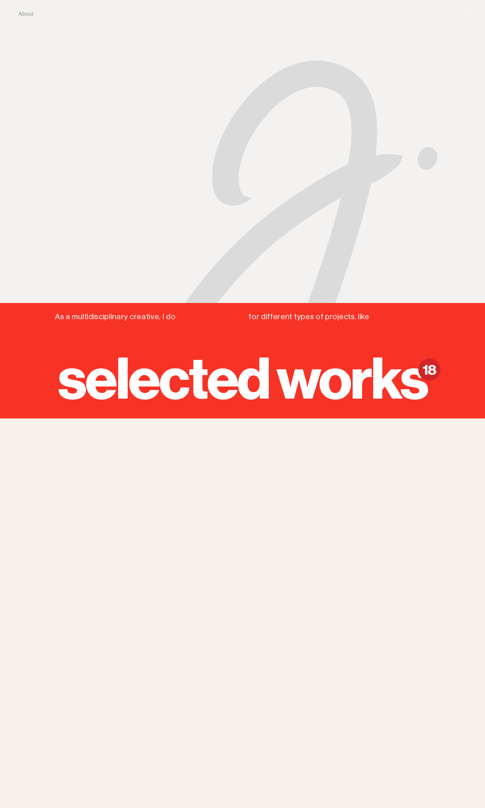

# UI Design System & Master Generation Blueprint: jozue-fr

> **Josué Pichot, freelance art director and photographer in Paris** (https://jozue.fr) — Paris-based freelance art director, photographer, director and product designer. 15+ years in advertising and digital. Available in-house...



---

## 1. Executive Visual Persona & Design Archetype

- **Brand Essence & Persona**: **Josué Pichot, freelance art director and photographer in Paris** (`https://jozue.fr`). Paris-based freelance art director, photographer, director and product designer. 15+ years in advertising and digital. Available in-house...
- **Capture Provenance**: Live browser capture (`tier1_fast`, HTTP `200`, captured `2026-11-23`).
- **Visual Archetype**: **Light-Substrate Editorial & Modular Grid System (`#ffffff` canvas, `#111319` ink, `#f73326` accent)**.
- **Anti-AI-Slop Differentiators**:
  - **Live-Computed Chromatic Polarity**: Anchors the viewport in `#ffffff` (live computed `body` `background-color` (`computed_styles.json`)) paired with `#111319` primary typography and `#f73326` accents.
  - **Grounded Typographic Hierarchy**: Pairs `Neue Haas Grotesk Display` for display copy (`art director + photo grapher`) with `Neue Haas Grotesk Display` and not declared in live computed styles (uses primary stack / `ui-monospace`).
  - **Calibrated Spatial Grid & Motion**: Combines `1399px` container bounds (`gap: 5rem`, padding `var(--split-over)`) with `cubic-bezier(.4,0,1,1)` easing.

---

## 2. Spatial Architecture & Modular Grid Mathematics


### Viewport Allocation & Container Geometry
- **Captured Viewport Dimensions**: Desktop `1440×2400px` (`assets/desktop.png`, clamped at 2400px live multi-section capture), Mobile `390×2400px` (`assets/mobile.png`, clamped at 2400px live multi-section capture).
- **Master Container Bounds**: `1399px` (measured widest bounded `<section>` landmark width on `1440px` desktop).
- **Canvas Lateral Padding & Spacing**: `var(--split-over)` lateral canvas padding with `5rem` grid gap.
- **Border Radius Scale**: `2px`, `3rem`, `1.9rem`, `2rem`.

### Responsive Breakpoint Architecture
- **Desktop Layout**: Multi-column CSS Grid / Flexbox layout at `1440px` (`max-width: 1399px`, `gap: 5rem`).
- **Mobile Layout**: Single-column vertical stack at `390px` viewport width with `var(--split-over)` horizontal padding.
- **Extracted CSS Media Queries**: `@media (min-width:767px)`, `@media (prefers-reduced-motion:reduce)`, `@media (max-width:766px)`, `@media (min-width:1024px)`.

---

## 3. Color System, Materiality & Atmospheric Lighting

### Semantic Palette & Source Grounding
| Semantic Role | Ground-Truth Value | Extracted Live / CSS Source |
|---|---|---|
| **Primary Canvas Substrate** | `#ffffff` | live computed `body` `background-color` (`computed_styles.json`) |
| **Primary Typography Ink** | `#111319` | live computed `h1` `color` (`computed_styles.json`) |
| **Elevated Surface / Card Substrate** | `#dcdcd9` | `.scroll-pagination { background-color: #dcdcd9 }` |
| **Interactive Accent / Highlight** | `#f73326` | `.button-selected:hover { color: #f73326 }` |
| **Secondary / Muted Copy** | `#999999` | `.lightbox { color: #999999 }` |
| **Structural Hairline Border** | `#8c8c8c` | `.button-slide:hover path { stroke: #8c8c8c }` |

### Sanitized Root CSS Variables (`ui-ux.md` Ground Truth)
| Variable Name | Extracted Value | Semantic Role |
|---|---|---|
| `--motion-fast` | `200ms` | Motion / Easing Token |
| `--motion-base` | `300ms` | Motion / Easing Token |
| `--motion-slow` | `1000ms` | Motion / Easing Token |
| `--ease-default` | `ease` | Motion / Easing Token |
| `--ease-in` | `ease-in` | Motion / Easing Token |
| `--ease-in-out` | `ease-in-out` | Motion / Easing Token |
| `--transition-fade-in` | `300ms` | Motion / Easing Token |
| `--transition-hold` | `1000ms` | Motion / Easing Token |
| `--transition-fade-out` | `300ms` | Motion / Easing Token |
| `--dur-micro` | `160ms` | Motion / Timing Token |
| `--dur-base` | `380ms` | Motion / Timing Token |
| `--dur-move` | `720ms` | Motion / Timing Token |
| `--dur-cine` | `1400ms` | Motion / Timing Token |
| `--ease-enter` | `cubic-bezier(0.22,0.61,0.36,1)` | Motion / Easing Token |
| `--ease-exit` | `cubic-bezier(0.4,0,1,1)` | Motion / Easing Token |
| `--ease-move` | `cubic-bezier(0.4,0,0.2,1)` | Motion / Easing Token |

---

## 4. Typographic Scale & Editorial Hierarchy

### Font Family Stacks
- **Display Typography**: `Neue Haas Grotesk Display`.
- **Primary Body Stack**: `Neue Haas Grotesk Display`.
- **Technical / Metadata Stack**: not declared in live computed styles (uses primary stack / `ui-monospace`).

### Typographic Scale & Rules (Live Computed & Stylesheet Grounded)
- **Hero Display (`H1`)**: live computed `h1` (`font-size: 170px`, `line-height: 125.8px`, `font-weight: 700`, `letter-spacing: -5.1px`).
- **Section Heading (`H2`)**: live computed `h2` (`font-size: 170px`, `line-height: 125.8px`, `font-weight: 700`, `letter-spacing: -5.1px`).
- **Body Copy**: live computed `body` (`font-size: 16px`, `line-height: 25.6px`, `font-weight: 400`); rule `p` (`font-size: 2.3rem`, `line-height: 1.22`, `letter-spacing: .03em`).
- **Metadata & Navigation Labels**: live computed `nav/a` (`font-size: 16px`, `line-height: 25.6px`, `font-weight: 400`).

---

## 5. Choreographed Motion & Interaction Physics

### Primary Easing Curves
- **Extracted Timing Functions**: `cubic-bezier(.4,0,1,1)`, `cubic-bezier(0.22,0.61,0.36,1)`, `cubic-bezier(0.4,0,1,1)`.

### Per-Element Transition & Choreography Rules
- **Selector `data-reveal]`**: `transition: opacity var(--reveal-duration) var(--ease-enter) var(--reveal-...` extracted from `jozue-fr` stylesheet.
- **Selector `.panel`**: `transition: transform var(--panel-duration) var(--ease-move)` extracted from `jozue-fr` stylesheet.
- **Selector `.panel.panel--out`**: `transition: var(--ease-exit)` extracted from `jozue-fr` stylesheet.
- **Extracted Easing Curve (`cubic-bezier(.4,0,1,1)`)**: Governs interactive state transitions across `<nav.menu>` and `<section.js-infos>`.
- **State & Hover Choreography**: Opacity and transform transitions on `<article.homepage>` and `<section.js-infos>` interactive targets.

---

## 6. Component Wireframe & Structural DOM Map

### Visual Layout Schematic — Desktop (`1440px`, Grounded in `dom.html` & Landmark Bounding Boxes)
```
┌────────────────────────────────────────────────────────────────────────┐
│ DESKTOP VIEWPORT (1440px) — Josué Pichot, freelance art director and p │
│ ====================================================================== │
│ [ <nav.menu> (1440x900px)             | About. · Works. · Contact. · ] │
│ ---------------------------------------------------------------------- │
│ | HERO STAGE: <article.homepage> (w=1440px)                          | │
│ | H1: art director + photo grapher                                   | │
│ | Substrate: #ffffff | Ink: #111319 | Accent: #f73326                | │
│ ---------------------------------------------------------------------- │
│ | SHOWCASE GRID (<section.js-infos>) max-w: 1399px                   | │
│ | +------------------------------+  +------------------------------+ | │
│ | | a r t d i r e c t o r + p h  |  | selected works 18            | | │
│ | +------------------------------+  +------------------------------+ | │
│ ---------------------------------------------------------------------- │
│ | DETAIL MODULE (<section.wrapper>) — Awards & Archives              | │
│ ---------------------------------------------------------------------- │
│ [ FOOTER (<footer.main>       ) | https://jozue.fr                     │
└────────────────────────────────────────────────────────────────────────┘
```

### Visual Layout Schematic — Mobile Reflow (`390px`)
```
┌────────────────────────────────────────────────────────────────────────┐
│ MOBILE VIEWPORT REFLOW (390px) — Single-Column Stack (gap: 5rem)       │
│ ====================================================================== │
│ [ HEADER BAR (<nav.menu>              ) | Compact Menu (390px)         │
│ ---------------------------------------------------------------------- │
│ | HERO STAGE (<article.homepage>) — 390px Vertical Lead              | │
│ | H1: art director + photo grapher                                   | │
│ ---------------------------------------------------------------------- │
│ | SHOWCASE STACK (<section.js-infos>) — 1-Col Stack                  | │
│ | [ Item 1: a r t d i r e c t o r + p h o t o g r a p h e r c...   ] | │
│ | [ Item 2: selected works 18                                      ] | │
│ ---------------------------------------------------------------------- │
│ | DETAIL STACK (<section.wrapper>) — 1-Col (Awards & Archives)       | │
│ ---------------------------------------------------------------------- │
│ [ FOOTER (<footer.main>       ) | Stacked 390px Colophon               │
└────────────────────────────────────────────────────────────────────────┘
```

### Granular DOM Region Breakdown
1. **Brand Header & Navigation Bar (<nav.menu> — `jozue-fr`)**:
   - Landmark `<nav class="menu menu--site">` (`1440x900px`) hosting `Josué Pichot, freelance art director` navigation (`About. · Works. · Contact. · Français.`), DOM attributes (`data-intro="full"`, `data-period="917"`, `data-written="561"`, `data-fade="799"`), and stylesheet rule `.project-hero-image--drawn { --reveal-duration:.9s;--reveal-distance:32px }`.
2. **Hero Stage & Focal Lead (<article.homepage> — `art director + photo grapher`)**:
   - Landmark `<article class="homepage">` presenting display lead `art director + photo grapher` and copy excerpt *"English. Français."* over `#ffffff` canvas and `#111319` ink.
3. **Primary Showcase & Content Grid (<section.js-infos> — `a r t d i r e c t o r + p h o t o `)**:
   - Landmark `<section class="js-infos homepage__infos">` rendering section `a r t d i r e c t o r + p h o t o g r a p h e r c...` with copy *"a r t d i r e c t o r + p h o t o g r a p h e r"*, asset references (`favicon.ico`, `favicon.svg`, `apple-touch-icon.png`, `jozue-logo-full.DpMZCk-F.svg`), and grid rule `.is-in { opacity:1;transform:none }`.
4. **Interactive Detail & Feature Matrix (<section.wrapper> — `selected works 18`)**:
   - Landmark `<section class="wrapper wrapper--infos">` framing `selected works 18` and `Awards & Archives` (*"a r t d i r e c t o r"*) with `#dcdcd9` surface cards, `#f73326` accents, and `.panel-host { z-index:200;pointer-events:none;position:fixed;top:0;bottom:0;left:0;rig... }`.
5. **Colophon & Global Directory Footer (<footer.main> — `https://jozue.fr`)**:
   - Landmark `<footer class="main">` anchoring `Josué Pichot, freelance art dire` footer links (`About. · Works. · Contact. · Français.`), copy *"+ p h o t o g r a p h e r"*, and `#8c8c8c` structural dividers.

---

## 7. Master Zero-Shot AI Generation Prompt

```markdown
# Master Zero-Shot Frontend Generation Prompt: jozue-fr (Josué Pichot, freelance art director and photographer in Paris)

You are a principal frontend architect and design systems engineer. Build a complete, production-ready web application replicating the exact design system, DOM landmarks, typographic hierarchy, color tokens, and motion physics of `jozue-fr` (**Josué Pichot, freelance art director and photographer in Paris** — `https://jozue.fr`).

### 1. Visual Archetype & Anti-AI-Slop Mandates
- **Archetype**: Light-Substrate Editorial & Modular Grid System (`#ffffff` canvas, `#111319` ink, `#f73326` accent).
- **Identity & Domain Context**: Paris-based freelance art director, photographer, director and product designer. 15+ years in advertising and digital. Available in-house...
- **Primary Substrate**: `#ffffff` (live computed `body` `background-color` (`computed_styles.json`)), **Primary Ink**: `#111319`, **Accent / Highlight**: `#f73326`.
- **Site-Specific Differentiators**:
  - **Live-Computed Chromatic Polarity**: Anchors the viewport in `#ffffff` (live computed `body` `background-color` (`computed_styles.json`)) paired with `#111319` primary typography and `#f73326` accents.
  - **Grounded Typographic Hierarchy**: Pairs `Neue Haas Grotesk Display` for display copy (`art director + photo grapher`) with `Neue Haas Grotesk Display` and not declared in live computed styles (uses primary stack / `ui-monospace`).
  - **Calibrated Spatial Grid & Motion**: Combines `1399px` container bounds (`gap: 5rem`, padding `var(--split-over)`) with `cubic-bezier(.4,0,1,1)` easing.

### 2. Ground-Truth CSS Variables (`:root` Token Contract)
Declare and consume these exact custom properties extracted from `jozue-fr` in your global stylesheet:

:root {
  /* Josué Pichot, freelance art director and photographer in Paris (jozue-fr) — Live-Grounded CSS Variables */
  --motion-fast: 200ms; /* Motion / Easing Token (jozue-fr) */
  --motion-base: 300ms; /* Motion / Easing Token (jozue-fr) */
  --motion-slow: 1000ms; /* Motion / Easing Token (jozue-fr) */
  --ease-default: ease; /* Motion / Easing Token (jozue-fr) */
  --ease-in: ease-in; /* Motion / Easing Token (jozue-fr) */
  --ease-in-out: ease-in-out; /* Motion / Easing Token (jozue-fr) */
  --transition-fade-in: 300ms; /* Motion / Easing Token (jozue-fr) */
  --transition-hold: 1000ms; /* Motion / Easing Token (jozue-fr) */
  --transition-fade-out: 300ms; /* Motion / Easing Token (jozue-fr) */
  --dur-micro: 160ms; /* Motion / Timing Token (jozue-fr) */
  --dur-base: 380ms; /* Motion / Timing Token (jozue-fr) */
  --dur-move: 720ms; /* Motion / Timing Token (jozue-fr) */
  --dur-cine: 1400ms; /* Motion / Timing Token (jozue-fr) */
  --ease-enter: cubic-bezier(0.22,0.61,0.36,1); /* Motion / Easing Token (jozue-fr) */
  --ease-exit: cubic-bezier(0.4,0,1,1); /* Motion / Easing Token (jozue-fr) */
  --ease-move: cubic-bezier(0.4,0,0.2,1); /* Motion / Easing Token (jozue-fr) */
}

### 3. Semantic Color & Materiality Contract
Map every surface, ink, and border strictly to these source-grounded tokens:
- **Primary Canvas Substrate**: `#ffffff` — grounded in live computed `body` `background-color` (`computed_styles.json`)
- **Primary Typography Ink**: `#111319` — grounded in live computed `h1` `color` (`computed_styles.json`)
- **Elevated Surface / Card Substrate**: `#dcdcd9` — grounded in `.scroll-pagination { background-color: #dcdcd9 }`
- **Interactive Accent / Highlight**: `#f73326` — grounded in `.button-selected:hover { color: #f73326 }`
- **Secondary / Muted Copy**: `#999999` — grounded in `.lightbox { color: #999999 }`
- **Structural Hairline Border**: `#8c8c8c` — grounded in `.button-slide:hover path { stroke: #8c8c8c }`

### 4. Spatial Grid, Container Bounds & Responsive Breakpoints
- **Desktop Viewport Reference**: `1440×2400px` (clamped at 2400px live multi-section capture, `1440px` standard desktop width).
- **Mobile Viewport Reference**: `390×2400px` (clamped at 2400px live multi-section capture, `390px` standard mobile width).
- **Container Max-Width**: `1399px` (measured widest bounded `<section>` landmark width on `1440px` desktop)
- **Padding & Gutters**: `var(--split-over)` lateral canvas padding with `5rem` grid gap
- **Desktop Grid**: Multi-column CSS Grid / Flexbox layout at `1440px` (`max-width: 1399px`, `gap: 5rem`)
- **Mobile Adaptation**: Single-column vertical stack at `390px` viewport width with `var(--split-over)` horizontal padding
- **Media Queries**: `@media (min-width:767px)`, `@media (prefers-reduced-motion:reduce)`, `@media (max-width:766px)`, `@media (min-width:1024px)`
- **Corner Radii**: `2px`, `3rem`, `1.9rem`, `2rem`

### 5. Typography & Editorial Scale Contract
- **Display Font Stack**: `Neue Haas Grotesk Display`
- **Body Font Stack**: `Neue Haas Grotesk Display`
- **Monospace / Technical Font Stack**: not declared in live computed styles (uses primary stack / `ui-monospace`)
- **H1 Display Rule**: live computed `h1` (`font-size: 170px`, `line-height: 125.8px`, `font-weight: 700`, `letter-spacing: -5.1px`)
- **H2 Section Rule**: live computed `h2` (`font-size: 170px`, `line-height: 125.8px`, `font-weight: 700`, `letter-spacing: -5.1px`)
- **Body Copy Rule**: live computed `body` (`font-size: 16px`, `line-height: 25.6px`, `font-weight: 400`); rule `p` (`font-size: 2.3rem`, `line-height: 1.22`, `letter-spacing: .03em`)
- **Metadata & Index Rule**: live computed `nav/a` (`font-size: 16px`, `line-height: 25.6px`, `font-weight: 400`)

### 6. Component Hierarchy, Verbatim Copy & Real DOM Landmarks
Scaffold `jozue-fr` (`Josué Pichot, freelance art director and photographer in Paris`) with these exact structural regions, extracted copy, and CSS rules from `dom.html`:
1. **Brand Header & Navigation Bar (<nav.menu> — `jozue-fr`)**:
   - DOM & Selectors: Landmark `<nav class="menu menu--site">` (`1440x900px`) hosting `Josué Pichot, freelance art director` navigation (`About. · Works. · Contact. · Français.`), DOM attributes (`data-intro="full"`, `data-period="917"`, `data-written="561"`, `data-fade="799"`), and stylesheet rule `.project-hero-image--drawn { --reveal-duration:.9s;--reveal-distance:32px }`.
   - Responsive Contract: Header `Brand Header & Navigation Bar (<nav.menu> — `jozue-fr`)` (`jozue-fr`) adapts across `@media (min-width:767px)`, `@media (prefers-reduced-motion:reduce)`, `@media (max-width:766px)`, `@media (min-width:1024px)` with `cubic-bezier(.4,0,1,1)`, `cubic-bezier(0.22,0.61,0.36,1)`, `cubic-bezier(0.4,0,1,1)` transitions and links `About. · Works. · Contact. · Français.`.
2. **Hero Stage & Focal Lead (<article.homepage> — `art director + photo grapher`)**:
   - DOM & Selectors: Landmark `<article class="homepage">` presenting display lead `art director + photo grapher` and copy excerpt *"English. Français."* over `#ffffff` canvas and `#111319` ink.
   - Responsive Contract: Hero stage (`1440×2400px` desktop / `390×2400px` mobile) sets `#ffffff` background with `#111319` headline `art director + photo grapher`.
3. **Primary Showcase & Content Grid (<section.js-infos> — `a r t d i r e c t o r + p h o t o `)**:
   - DOM & Selectors: Landmark `<section class="js-infos homepage__infos">` rendering section `a r t d i r e c t o r + p h o t o g r a p h e r c...` with copy *"a r t d i r e c t o r + p h o t o g r a p h e r"*, asset references (`favicon.ico`, `favicon.svg`, `apple-touch-icon.png`, `jozue-logo-full.DpMZCk-F.svg`), and grid rule `.is-in { opacity:1;transform:none }`.
   - Responsive Contract: Showcase grid `Primary Showcase & Content Grid (<section.js-infos> — `a r t d i r e c t o r + p h o t o `)` applies Multi-column CSS Grid / Flexbox layout at `1440px` (`max-width: 1399px`, `gap: 5rem`) on desktop and Single-column vertical stack at `390px` viewport width with `var(--split-over)` horizontal padding on mobile.
4. **Interactive Detail & Feature Matrix (<section.wrapper> — `selected works 18`)**:
   - DOM & Selectors: Landmark `<section class="wrapper wrapper--infos">` framing `selected works 18` and `Awards & Archives` (*"a r t d i r e c t o r"*) with `#dcdcd9` surface cards, `#f73326` accents, and `.panel-host { z-index:200;pointer-events:none;position:fixed;top:0;bottom:0;left:0;rig... }`.
   - Responsive Contract: Detail module `Interactive Detail & Feature Matrix (<section.wrapper> — `selected works 18`)` uses `2px`, `3rem`, `1.9rem`, `2rem` radii, `#f73326` highlights, and assets (favicon.ico, favicon.svg, apple-touch-icon.png).
5. **Colophon & Global Directory Footer (<footer.main> — `https://jozue.fr`)**:
   - DOM & Selectors: Landmark `<footer class="main">` anchoring `Josué Pichot, freelance art dire` footer links (`About. · Works. · Contact. · Français.`), copy *"+ p h o t o g r a p h e r"*, and `#8c8c8c` structural dividers.
   - Responsive Contract: Footer `Colophon & Global Directory Footer (<footer.main> — `https://jozue.fr`)` aligns to `1399px` (measured widest bounded `<section>` landmark width on `1440px` desktop) with `var(--split-over)` lateral canvas padding with `5rem` grid gap and attributes (data-intro="full", data-period="917", data-written="561").

#### Verbatim DOM Copy Excerpts (`dom.html`)
- Copy Excerpt 1: *"English. Français."*
- Copy Excerpt 2: *"a r t d i r e c t o r + p h o t o g r a p h e r"*
- Copy Excerpt 3: *"a r t d i r e c t o r"*
- Copy Excerpt 4: *"+ p h o t o g r a p h e r"*

### 7. Motion, Extracted Stylesheet Rules & Interaction Choreography
- **Primary Easing Functions**: `cubic-bezier(.4,0,1,1)`, `cubic-bezier(0.22,0.61,0.36,1)`, `cubic-bezier(0.4,0,1,1)`
- **Extracted Stylesheet Rules (`jozue-fr`)**:
- `.project-hero-image--drawn { --reveal-duration:.9s;--reveal-distance:32px }`
- `.is-in { opacity:1;transform:none }`
- `.panel-host { z-index:200;pointer-events:none;position:fixed;top:0;bottom:0;left:0;rig... }`
- `.panel.panel--in { transform:none }`
- `.panel.panel--out { transition-timing-function:var(--ease-exit);transform:translate(101%) }`
- **Per-Selector Transition Rules**:
- **Selector `data-reveal]`**: `transition: opacity var(--reveal-duration) var(--ease-enter) var(--reveal-...` extracted from `jozue-fr` stylesheet.
- **Selector `.panel`**: `transition: transform var(--panel-duration) var(--ease-move)` extracted from `jozue-fr` stylesheet.
- **Selector `.panel.panel--out`**: `transition: var(--ease-exit)` extracted from `jozue-fr` stylesheet.
- **Extracted Easing Curve (`cubic-bezier(.4,0,1,1)`)**: Governs interactive state transitions across `<nav.menu>` and `<section.js-infos>`.
- **State & Hover Choreography**: Opacity and transform transitions on `<article.homepage>` and `<section.js-infos>` interactive targets.

### 8. Technical Deliverables
- Implement in Next.js (App Router) with TypeScript and Tailwind CSS consuming the `:root` custom properties defined above for `jozue-fr`.
- Reproduce both the `1440px` desktop architecture and `390px` mobile breakpoint transitions, preserving semantic HTML5 landmarks (`<header>`, `<nav>`, `<main>`, `<section>`, `<footer>`) and `prefers-reduced-motion` accessibility guards.
```
