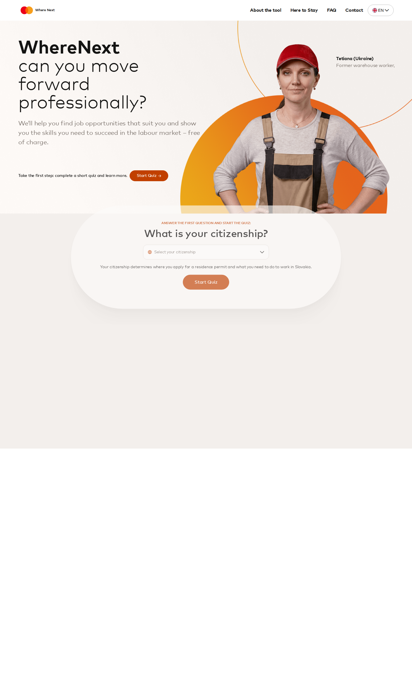
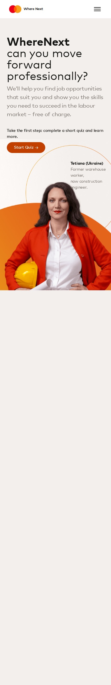

# UI Design System & Master Generation Blueprint: kamdalej-sk_en

> **Mastercard · Where Next** (https://kamdalej.sk/en) — A digital tool helping people in Slovakia find better career opportunities by matching their skills with real labour market needs



---

## 1. Executive Visual Persona & Design Archetype

- **Brand Essence & Persona**: **Mastercard · Where Next** (`https://kamdalej.sk/en`). A digital tool helping people in Slovakia find better career opportunities by matching their skills with real labour market needs
- **Capture Provenance**: Live browser capture (`tier1_fast`, HTTP `200`, captured `2026-11-23`).
- **Visual Archetype**: **Light-Substrate Editorial & Modular Grid System (`#ffffff` canvas, `#000000` ink, `#0000ff` accent)**.
- **Anti-AI-Slop Differentiators**:
  - **Live-Computed Chromatic Polarity**: Anchors the viewport in `#ffffff` (live computed `body` `background-color` (`computed_styles.json`)) paired with `#000000` primary typography and `#0000ff` accents.
  - **Grounded Typographic Hierarchy**: Pairs `Mark Offc For MC` for display copy (`WhereNext can you move forward profe`) with `Mark Offc For MC` and not declared in live computed styles (uses primary stack / `ui-monospace`).
  - **Calibrated Spatial Grid & Motion**: Combines `1440px` container bounds (`gap: 40px`, padding `var(--pad_x6)`) with `cubic-bezier(.215,.61,.355,1)` easing and Three.js / WebGL Canvas Pipeline, Barba.js Page Transition Router.

---

## 2. Spatial Architecture & Modular Grid Mathematics



### Viewport Allocation & Container Geometry
- **Captured Viewport Dimensions**: Desktop `1440×2400px` (`assets/desktop.png`, clamped at 2400px live multi-section capture), Mobile `390×2400px` (`assets/mobile.png`, clamped at 2400px live multi-section capture).
- **Master Container Bounds**: `1440px` (full-bleed `100%` desktop stage measured on `1440px` viewport).
- **Canvas Lateral Padding & Spacing**: `var(--pad_x6)` lateral canvas padding with `40px` grid gap.
- **Border Radius Scale**: `56px`, `var(--pad_x4)`, `24px`, `4px`.

### Responsive Breakpoint Architecture
- **Desktop Layout**: Multi-column CSS Grid / Flexbox layout at `1440px` (`max-width: 1440px`, `gap: 40px`).
- **Mobile Layout**: Single-column vertical stack at `390px` viewport width with `var(--pad_x6)` horizontal padding.
- **Extracted CSS Media Queries**: `@media (print),(prefers-reduced-motion:reduce)`, `@media screen and (min-width:1024px)`, `@media screen and (min-width:768px)`, `@media screen and (min-width:1600px)`.

---

## 3. Color System, Materiality & Atmospheric Lighting

### Semantic Palette & Source Grounding
| Semantic Role | Ground-Truth Value | Extracted Live / CSS Source |
|---|---|---|
| **Primary Canvas Substrate** | `#ffffff` | live computed `body` `background-color` (`computed_styles.json`) |
| **Primary Typography Ink** | `#000000` | live computed `main` `color` (`computed_styles.json`) |
| **Elevated Surface / Card Substrate** | `#f6f3f1` | `var(--bg_100)` in `:root` |
| **Interactive Accent / Highlight** | `#0000ff` | `form label a:hover { color: blue }` (`#0000ff`) |
| **Secondary / Muted Copy** | `#756c66` | live computed `p` `color` (`computed_styles.json`) |
| **Structural Hairline Border** | `#ffa500` | `.simpleImg:before { border: #ffa500 }` |

### Sanitized Root CSS Variables (`ui-ux.md` Ground Truth)
| Variable Name | Extracted Value | Semantic Role |
|---|---|---|
| `--oki-base` | `4px` | Dimension / Scale Token |
| `--pad` | `calc(var(--oki-base) * 1)` | Layout / Spatial Grid Token |
| `--pad_x0` | `calc(var(--oki-base) * 0)` | Layout / Spatial Grid Token |
| `--pad_x1` | `calc(var(--oki-base) * 1)` | Layout / Spatial Grid Token |
| `--pad_x2` | `calc(var(--oki-base) * 2)` | Layout / Spatial Grid Token |
| `--pad_x3` | `calc(var(--oki-base) * 3)` | Layout / Spatial Grid Token |
| `--pad_x4` | `calc(var(--oki-base) * 4)` | Layout / Spatial Grid Token |
| `--pad_x5` | `calc(var(--oki-base) * 5)` | Layout / Spatial Grid Token |
| `--pad_x6` | `calc(var(--oki-base) * 6)` | Layout / Spatial Grid Token |
| `--pad_x7` | `calc(var(--oki-base) * 7)` | Layout / Spatial Grid Token |
| `--pad_x8` | `calc(var(--oki-base) * 8)` | Layout / Spatial Grid Token |
| `--pad_x9` | `calc(var(--oki-base) * 9)` | Layout / Spatial Grid Token |
| `--pad_x10` | `calc(var(--oki-base) * 10)` | Layout / Spatial Grid Token |
| `--pad_x11` | `calc(var(--oki-base) * 11)` | Layout / Spatial Grid Token |
| `--pad_x12` | `calc(var(--oki-base) * 12)` | Layout / Spatial Grid Token |
| `--pad_x13` | `calc(var(--oki-base) * 13)` | Layout / Spatial Grid Token |

---

## 4. Typographic Scale & Editorial Hierarchy

### Font Family Stacks
- **Display Typography**: `Mark Offc For MC`.
- **Primary Body Stack**: `Mark Offc For MC`.
- **Technical / Metadata Stack**: not declared in live computed styles (uses primary stack / `ui-monospace`).

### Typographic Scale & Rules (Live Computed & Stylesheet Grounded)
- **Hero Display (`H1`)**: live computed `h1` (`font-size: 64px`, `line-height: 64px`, `font-weight: 300`); CSS variables `--fz-h1-mob: 40`, `--fz-h1: 64`; rule `.title` (`font-size: calc(var(--fz-body-xs) * 1px...`, `font-weight: var(--fw-medium)`).
- **Section Heading (`H2`)**: live computed `h2` (`font-size: 52px`, `line-height: 57.9956px`, `font-weight: 500`); CSS variables `--fz-h2-mob: 36`, `--fz-h2: 52`; rule `h2` (`font-size: 1.5rem`, `line-height: 1.25`).
- **Body Copy**: live computed `body` (`font-size: 16px`, `line-height: 24px`, `font-weight: 400`, `letter-spacing: -0.24px`); CSS variables `--fz-body-xl-mob: 30`, `--fz-body-xl: 36`, `--fz-body-l-mob: 20`; rule `p` (`font-size: 14px`, `line-height: 20px`, `font-weight: var(--fw-normal)`).
- **Metadata & Navigation Labels**: live computed `nav/a` (`font-size: 16px`, `line-height: 24px`, `font-weight: 400`, `letter-spacing: -0.24px`); rule `.label` (`font-size: calc(var(--fz-body-xs) * 1px...`, `line-height: 14px`, `font-weight: var(--fw-normal)`).

---

## 5. Choreographed Motion & Interaction Physics

### Primary Easing Curves
- **Extracted Timing Functions**: `cubic-bezier(.215,.61,.355,1)`, `cubic-bezier(.755,.05,.855,.06)`, `cubic-bezier(.55,.055,.675,.19)`.

### Per-Element Transition & Choreography Rules
- **Selector `prefers-reduced-motion:reduce)`**: `transition: 1ms!important` extracted from `kamdalej-sk_en` stylesheet.
- **Selector `button.burger`**: `transition: .2s` extracted from `kamdalej-sk_en` stylesheet.
- **Selector `button.burger span`**: `transition: .2s` extracted from `kamdalej-sk_en` stylesheet.
- **Extracted Easing Curve (`cubic-bezier(.215,.61,.355,1)`)**: Governs interactive state transitions across `<header.loaded>` and `<section.heroForm>`.
- **Runtime Interaction Engine**: Integrates Three.js / WebGL Canvas Pipeline, Barba.js Page Transition Router with `prefers-reduced-motion: reduce` fallback guards.

---

## 6. Component Wireframe & Structural DOM Map

### Visual Layout Schematic — Desktop (`1440px`, Grounded in `dom.html` & Landmark Bounding Boxes)
```
┌────────────────────────────────────────────────────────────────────────┐
│ DESKTOP VIEWPORT (1440px) — Mastercard · Where Next                    │
│ ====================================================================== │
│ [ <header.loaded> (1440x72px)         | Work Permit                  ] │
│ ---------------------------------------------------------------------- │
│ | HERO STAGE: <section.hero> (w=1440px)                              | │
│ | H1: WhereNext can you move forward professionally?                 | │
│ | Substrate: #ffffff | Ink: #000000 | Accent: #0000ff                | │
│ ---------------------------------------------------------------------- │
│ | SHOWCASE GRID (<section.heroForm>) max-w: 1440px                   | │
│ | +------------------------------+  +------------------------------+ | │
│ | | Powered by trusted partners  |  | Create your professional gro | | │
│ | +------------------------------+  +------------------------------+ | │
│ ---------------------------------------------------------------------- │
│ | DETAIL MODULE (<section.partners>) — Work experience               | │
│ ---------------------------------------------------------------------- │
│ [ FOOTER (<footer.aic>        ) | https://kamdalej.sk/en               │
└────────────────────────────────────────────────────────────────────────┘
```

### Visual Layout Schematic — Mobile Reflow (`390px`)
```
┌────────────────────────────────────────────────────────────────────────┐
│ MOBILE VIEWPORT REFLOW (390px) — Single-Column Stack (gap: 40px)       │
│ ====================================================================== │
│ [ HEADER BAR (<header.loaded>         ) | Compact Menu (390px)         │
│ ---------------------------------------------------------------------- │
│ | HERO STAGE (<section.hero>) — 390px Vertical Lead                  | │
│ | H1: WhereNext can you move forward professionally?                 | │
│ ---------------------------------------------------------------------- │
│ | SHOWCASE STACK (<section.heroForm>) — 1-Col Stack                  | │
│ | [ Item 1: Powered by trusted partners                            ] | │
│ | [ Item 2: Create your professional growth path                   ] | │
│ ---------------------------------------------------------------------- │
│ | DETAIL STACK (<section.partners>) — 1-Col (Work experience)        | │
│ ---------------------------------------------------------------------- │
│ [ FOOTER (<footer.aic>        ) | Stacked 390px Colophon               │
└────────────────────────────────────────────────────────────────────────┘
```

### Granular DOM Region Breakdown
1. **Brand Header & Navigation Bar (<header.loaded> — `kamdalej-sk_en`)**:
   - Landmark `<header class="loaded">` (`1440x72px`) hosting `Mastercard · Where Next` navigation (`Work Permit`), DOM attributes (`data-document-language="true"`, `data-domain-script="019c98a8-e583-7fb5-a6..."`, `data-v-app`, `data-v-a006813b`), and stylesheet rule `.flash { -webkit-animation-name:flash;animation-name:flash }`.
2. **Hero Stage & Focal Lead (<section.hero> — `WhereNext can you move forward pro`)**:
   - Landmark `<section class="hero heroMain">` presenting display lead `WhereNext can you move forward professionally?` and copy excerpt *"Tetiana (Ukraine) Former warehouse worker, now construction engin"* over `#ffffff` canvas and `#000000` ink.
3. **Primary Showcase & Content Grid (<section.heroForm> — `Powered by trusted partners`)**:
   - Landmark `<section class="heroForm">` rendering section `Powered by trusted partners` with copy *"Former warehouse worker,"*, asset references (`fav.svg`, `cdn.cookielaw.org`, `assets.adobedtm.com`, `otSDKStub.js`), and grid rule `.pulse { -webkit-animation-name:pulse;animation-name:pulse }`.
4. **Interactive Detail & Feature Matrix (<section.partners> — `Create your professional growth pa`)**:
   - Landmark `<section class="partners">` framing `Create your professional growth path` and `Work experience` (*"now construction engineer."*) with `#f6f3f1` surface cards, `#0000ff` accents, and `.rubberBand { -webkit-animation-name:rubberBand;animation-name:rubberBand }`.
5. **Colophon & Global Directory Footer (<footer.aic> — `https://kamdalej.sk/en`)**:
   - Landmark `<footer class="aic">` anchoring `Mastercard · Where Next` footer links (`Work Permit`), copy *"Noura (Lebanon) Former call center agent, now Head of Reserv"*, and `#ffa500` structural dividers.

---

## 7. Master Zero-Shot AI Generation Prompt

```markdown
# Master Zero-Shot Frontend Generation Prompt: kamdalej-sk_en (Mastercard · Where Next)

You are a principal frontend architect and design systems engineer. Build a complete, production-ready web application replicating the exact design system, DOM landmarks, typographic hierarchy, color tokens, and motion physics of `kamdalej-sk_en` (**Mastercard · Where Next** — `https://kamdalej.sk/en`).

### 1. Visual Archetype & Anti-AI-Slop Mandates
- **Archetype**: Light-Substrate Editorial & Modular Grid System (`#ffffff` canvas, `#000000` ink, `#0000ff` accent).
- **Identity & Domain Context**: A digital tool helping people in Slovakia find better career opportunities by matching their skills with real labour market needs
- **Primary Substrate**: `#ffffff` (live computed `body` `background-color` (`computed_styles.json`)), **Primary Ink**: `#000000`, **Accent / Highlight**: `#0000ff`.
- **Site-Specific Differentiators**:
  - **Live-Computed Chromatic Polarity**: Anchors the viewport in `#ffffff` (live computed `body` `background-color` (`computed_styles.json`)) paired with `#000000` primary typography and `#0000ff` accents.
  - **Grounded Typographic Hierarchy**: Pairs `Mark Offc For MC` for display copy (`WhereNext can you move forward profe`) with `Mark Offc For MC` and not declared in live computed styles (uses primary stack / `ui-monospace`).
  - **Calibrated Spatial Grid & Motion**: Combines `1440px` container bounds (`gap: 40px`, padding `var(--pad_x6)`) with `cubic-bezier(.215,.61,.355,1)` easing and Three.js / WebGL Canvas Pipeline, Barba.js Page Transition Router.

### 2. Ground-Truth CSS Variables (`:root` Token Contract)
Declare and consume these exact custom properties extracted from `kamdalej-sk_en` in your global stylesheet:

:root {
  /* Mastercard · Where Next (kamdalej-sk_en) — Live-Grounded CSS Variables */
  --oki-base: 4px; /* Dimension / Scale Token (kamdalej-sk_en) */
  --pad: calc(var(--oki-base) * 1); /* Layout / Spatial Grid Token (kamdalej-sk_en) */
  --pad_x0: calc(var(--oki-base) * 0); /* Layout / Spatial Grid Token (kamdalej-sk_en) */
  --pad_x1: calc(var(--oki-base) * 1); /* Layout / Spatial Grid Token (kamdalej-sk_en) */
  --pad_x2: calc(var(--oki-base) * 2); /* Layout / Spatial Grid Token (kamdalej-sk_en) */
  --pad_x3: calc(var(--oki-base) * 3); /* Layout / Spatial Grid Token (kamdalej-sk_en) */
  --pad_x4: calc(var(--oki-base) * 4); /* Layout / Spatial Grid Token (kamdalej-sk_en) */
  --pad_x5: calc(var(--oki-base) * 5); /* Layout / Spatial Grid Token (kamdalej-sk_en) */
  --pad_x6: calc(var(--oki-base) * 6); /* Layout / Spatial Grid Token (kamdalej-sk_en) */
  --pad_x7: calc(var(--oki-base) * 7); /* Layout / Spatial Grid Token (kamdalej-sk_en) */
  --pad_x8: calc(var(--oki-base) * 8); /* Layout / Spatial Grid Token (kamdalej-sk_en) */
  --pad_x9: calc(var(--oki-base) * 9); /* Layout / Spatial Grid Token (kamdalej-sk_en) */
  --pad_x10: calc(var(--oki-base) * 10); /* Layout / Spatial Grid Token (kamdalej-sk_en) */
  --pad_x11: calc(var(--oki-base) * 11); /* Layout / Spatial Grid Token (kamdalej-sk_en) */
  --pad_x12: calc(var(--oki-base) * 12); /* Layout / Spatial Grid Token (kamdalej-sk_en) */
  --pad_x13: calc(var(--oki-base) * 13); /* Layout / Spatial Grid Token (kamdalej-sk_en) */
}

### 3. Semantic Color & Materiality Contract
Map every surface, ink, and border strictly to these source-grounded tokens:
- **Primary Canvas Substrate**: `#ffffff` — grounded in live computed `body` `background-color` (`computed_styles.json`)
- **Primary Typography Ink**: `#000000` — grounded in live computed `main` `color` (`computed_styles.json`)
- **Elevated Surface / Card Substrate**: `#f6f3f1` — grounded in `var(--bg_100)` in `:root`
- **Interactive Accent / Highlight**: `#0000ff` — grounded in `form label a:hover { color: blue }` (`#0000ff`)
- **Secondary / Muted Copy**: `#756c66` — grounded in live computed `p` `color` (`computed_styles.json`)
- **Structural Hairline Border**: `#ffa500` — grounded in `.simpleImg:before { border: #ffa500 }`

### 4. Spatial Grid, Container Bounds & Responsive Breakpoints
- **Desktop Viewport Reference**: `1440×2400px` (clamped at 2400px live multi-section capture, `1440px` standard desktop width).
- **Mobile Viewport Reference**: `390×2400px` (clamped at 2400px live multi-section capture, `390px` standard mobile width).
- **Container Max-Width**: `1440px` (full-bleed `100%` desktop stage measured on `1440px` viewport)
- **Padding & Gutters**: `var(--pad_x6)` lateral canvas padding with `40px` grid gap
- **Desktop Grid**: Multi-column CSS Grid / Flexbox layout at `1440px` (`max-width: 1440px`, `gap: 40px`)
- **Mobile Adaptation**: Single-column vertical stack at `390px` viewport width with `var(--pad_x6)` horizontal padding
- **Media Queries**: `@media (print),(prefers-reduced-motion:reduce)`, `@media screen and (min-width:1024px)`, `@media screen and (min-width:768px)`, `@media screen and (min-width:1600px)`
- **Corner Radii**: `56px`, `var(--pad_x4)`, `24px`, `4px`

### 5. Typography & Editorial Scale Contract
- **Display Font Stack**: `Mark Offc For MC`
- **Body Font Stack**: `Mark Offc For MC`
- **Monospace / Technical Font Stack**: not declared in live computed styles (uses primary stack / `ui-monospace`)
- **H1 Display Rule**: live computed `h1` (`font-size: 64px`, `line-height: 64px`, `font-weight: 300`); CSS variables `--fz-h1-mob: 40`, `--fz-h1: 64`; rule `.title` (`font-size: calc(var(--fz-body-xs) * 1px...`, `font-weight: var(--fw-medium)`)
- **H2 Section Rule**: live computed `h2` (`font-size: 52px`, `line-height: 57.9956px`, `font-weight: 500`); CSS variables `--fz-h2-mob: 36`, `--fz-h2: 52`; rule `h2` (`font-size: 1.5rem`, `line-height: 1.25`)
- **Body Copy Rule**: live computed `body` (`font-size: 16px`, `line-height: 24px`, `font-weight: 400`, `letter-spacing: -0.24px`); CSS variables `--fz-body-xl-mob: 30`, `--fz-body-xl: 36`, `--fz-body-l-mob: 20`; rule `p` (`font-size: 14px`, `line-height: 20px`, `font-weight: var(--fw-normal)`)
- **Metadata & Index Rule**: live computed `nav/a` (`font-size: 16px`, `line-height: 24px`, `font-weight: 400`, `letter-spacing: -0.24px`); rule `.label` (`font-size: calc(var(--fz-body-xs) * 1px...`, `line-height: 14px`, `font-weight: var(--fw-normal)`)

### 6. Component Hierarchy, Verbatim Copy & Real DOM Landmarks
Scaffold `kamdalej-sk_en` (`Mastercard · Where Next`) with these exact structural regions, extracted copy, and CSS rules from `dom.html`:
1. **Brand Header & Navigation Bar (<header.loaded> — `kamdalej-sk_en`)**:
   - DOM & Selectors: Landmark `<header class="loaded">` (`1440x72px`) hosting `Mastercard · Where Next` navigation (`Work Permit`), DOM attributes (`data-document-language="true"`, `data-domain-script="019c98a8-e583-7fb5-a6..."`, `data-v-app`, `data-v-a006813b`), and stylesheet rule `.flash { -webkit-animation-name:flash;animation-name:flash }`.
   - Responsive Contract: Header `Brand Header & Navigation Bar (<header.loaded> — `kamdalej-sk_en`)` (`kamdalej-sk_en`) adapts across `@media (print),(prefers-reduced-motion:reduce)`, `@media screen and (min-width:1024px)`, `@media screen and (min-width:768px)`, `@media screen and (min-width:1600px)` with `cubic-bezier(.215,.61,.355,1)`, `cubic-bezier(.755,.05,.855,.06)`, `cubic-bezier(.55,.055,.675,.19)` transitions and links `Work Permit`.
2. **Hero Stage & Focal Lead (<section.hero> — `WhereNext can you move forward pro`)**:
   - DOM & Selectors: Landmark `<section class="hero heroMain">` presenting display lead `WhereNext can you move forward professionally?` and copy excerpt *"Tetiana (Ukraine) Former warehouse worker, now construction engin"* over `#ffffff` canvas and `#000000` ink.
   - Responsive Contract: Hero stage (`1440×2400px` desktop / `390×2400px` mobile) sets `#ffffff` background with `#000000` headline `WhereNext can you move forward professionally?`.
3. **Primary Showcase & Content Grid (<section.heroForm> — `Powered by trusted partners`)**:
   - DOM & Selectors: Landmark `<section class="heroForm">` rendering section `Powered by trusted partners` with copy *"Former warehouse worker,"*, asset references (`fav.svg`, `cdn.cookielaw.org`, `assets.adobedtm.com`, `otSDKStub.js`), and grid rule `.pulse { -webkit-animation-name:pulse;animation-name:pulse }`.
   - Responsive Contract: Showcase grid `Primary Showcase & Content Grid (<section.heroForm> — `Powered by trusted partners`)` applies Multi-column CSS Grid / Flexbox layout at `1440px` (`max-width: 1440px`, `gap: 40px`) on desktop and Single-column vertical stack at `390px` viewport width with `var(--pad_x6)` horizontal padding on mobile.
4. **Interactive Detail & Feature Matrix (<section.partners> — `Create your professional growth pa`)**:
   - DOM & Selectors: Landmark `<section class="partners">` framing `Create your professional growth path` and `Work experience` (*"now construction engineer."*) with `#f6f3f1` surface cards, `#0000ff` accents, and `.rubberBand { -webkit-animation-name:rubberBand;animation-name:rubberBand }`.
   - Responsive Contract: Detail module `Interactive Detail & Feature Matrix (<section.partners> — `Create your professional growth pa`)` uses `56px`, `var(--pad_x4)`, `24px`, `4px` radii, `#0000ff` highlights, and assets (fav.svg, cdn.cookielaw.org, assets.adobedtm.com).
5. **Colophon & Global Directory Footer (<footer.aic> — `https://kamdalej.sk/en`)**:
   - DOM & Selectors: Landmark `<footer class="aic">` anchoring `Mastercard · Where Next` footer links (`Work Permit`), copy *"Noura (Lebanon) Former call center agent, now Head of Reserv"*, and `#ffa500` structural dividers.
   - Responsive Contract: Footer `Colophon & Global Directory Footer (<footer.aic> — `https://kamdalej.sk/en`)` aligns to `1440px` (full-bleed `100%` desktop stage measured on `1440px` viewport) with `var(--pad_x6)` lateral canvas padding with `40px` grid gap and attributes (data-document-language="true", data-domain-script="019c98a8-e583-7fb5-a6...", data-v-app).

#### Verbatim DOM Copy Excerpts (`dom.html`)
- Copy Excerpt 1: *"Tetiana (Ukraine) Former warehouse worker, now construction engineer."*
- Copy Excerpt 2: *"Former warehouse worker,"*
- Copy Excerpt 3: *"now construction engineer."*
- Copy Excerpt 4: *"Noura (Lebanon) Former call center agent, now Head of Reservations."*

### 7. Motion, Extracted Stylesheet Rules & Interaction Choreography
- **Primary Easing Functions**: `cubic-bezier(.215,.61,.355,1)`, `cubic-bezier(.755,.05,.855,.06)`, `cubic-bezier(.55,.055,.675,.19)`
- **Extracted Stylesheet Rules (`kamdalej-sk_en`)**:
- `.flash { -webkit-animation-name:flash;animation-name:flash }`
- `.pulse { -webkit-animation-name:pulse;animation-name:pulse }`
- `.rubberBand { -webkit-animation-name:rubberBand;animation-name:rubberBand }`
- `.shake { -webkit-animation-name:shake;animation-name:shake }`
- `.swing { -webkit-transform-origin:top center;transform-origin:top center;-webkit-... }`
- **Per-Selector Transition Rules**:
- **Selector `prefers-reduced-motion:reduce)`**: `transition: 1ms!important` extracted from `kamdalej-sk_en` stylesheet.
- **Selector `button.burger`**: `transition: .2s` extracted from `kamdalej-sk_en` stylesheet.
- **Selector `button.burger span`**: `transition: .2s` extracted from `kamdalej-sk_en` stylesheet.
- **Extracted Easing Curve (`cubic-bezier(.215,.61,.355,1)`)**: Governs interactive state transitions across `<header.loaded>` and `<section.heroForm>`.
- **Runtime Interaction Engine**: Integrates Three.js / WebGL Canvas Pipeline, Barba.js Page Transition Router with `prefers-reduced-motion: reduce` fallback guards.

### 8. Technical Deliverables
- Implement in Next.js (App Router) with TypeScript and Tailwind CSS consuming the `:root` custom properties defined above for `kamdalej-sk_en`.
- Reproduce both the `1440px` desktop architecture and `390px` mobile breakpoint transitions, preserving semantic HTML5 landmarks (`<header>`, `<nav>`, `<main>`, `<section>`, `<footer>`) and `prefers-reduced-motion` accessibility guards.
```
