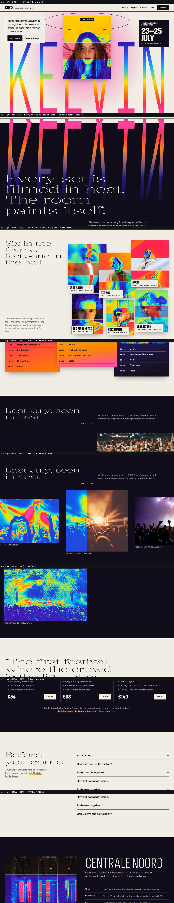
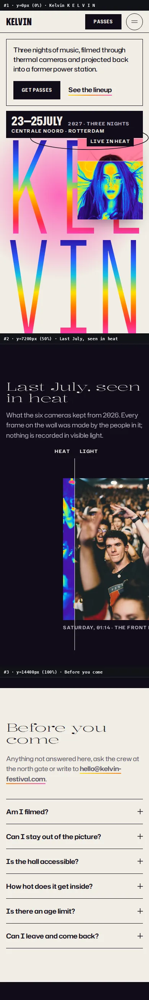

# UI Design System & Master Generation Blueprint: kelvin-8b-com

> **Kelvin — three nights of music, filmed in heat** (https://kelvin.8b.com/) — Kelvin is a three-night music festival filmed through thermal cameras and projected back into a former power station in Rotterdam. 23–25...





---

## 1. Executive Visual Persona & Design Archetype

- **Brand Essence & Persona**: **Kelvin — three nights of music, filmed in heat** (`https://kelvin.8b.com/`). Kelvin is a three-night music festival filmed through thermal cameras and projected back into a former power station in Rotterdam. 23–25...
- **Capture Provenance**: Live browser capture (`tier1_fast`, HTTP `200`, captured `2026-11-24`).
- **Visual Archetype**: **Light-Substrate Editorial & Modular Grid System (`#f1ede4` canvas, `#110d19` ink, `#ffe000` accent)**.
- **Anti-AI-Slop Differentiators**:
  - **Live-Computed Chromatic Polarity**: Anchors the viewport in `#f1ede4` (live computed `body` `background-color` (`computed_styles.json`)) paired with `#110d19` primary typography and `#ffe000` accents.
  - **Grounded Typographic Hierarchy**: Uses `Hubot Sans` across display (`Kelvin K E L V I N`) and body copy.
  - **Calibrated Spatial Grid & Motion**: Combines `1440px` container bounds (`gap: 24px`, padding `43.2px`) with `cubic-bezier(0.2,0.7,0.2,1)` easing and Lenis Smooth Scroll (`data-lenis`), GSAP Timeline & ScrollTrigger.

---

## 2. Spatial Architecture & Modular Grid Mathematics

### Viewport Allocation & Container Geometry
- **Captured Journey Filmstrips**: Desktop `1280×6624px` (`assets/desktop-journey.webp`, `8` keyframes up to `y=14400px` / doc `17000px`), Mobile `390×2616px` (`assets/mobile-journey.webp`, `3` keyframes).
- **Master Container Bounds**: `1440px` (full-bleed `100%` desktop stage measured on `1440px` viewport).
- **Canvas Lateral Padding & Spacing**: `43.2px` lateral canvas padding with `24px` grid gap.
- **Border Radius Scale**: `50%`.

### Responsive Breakpoint Architecture
- **Desktop Layout**: Multi-column CSS Grid / Flexbox layout at `1440px` (`max-width: 1440px`, `gap: 24px`).
- **Mobile Layout**: Single-column vertical stack at `390px` viewport width with `43.2px` horizontal padding.
- **Extracted CSS Media Queries**: `@media (max-width:699px)`, `@media (max-width:899px)`, `@media (prefers-reduced-motion:reduce)`, `@media (prefers-reduced-motion:no-preference)`.

---

## 3. Color System, Materiality & Atmospheric Lighting

### Semantic Palette & Source Grounding
| Semantic Role | Ground-Truth Value | Extracted Live / CSS Source |
|---|---|---|
| **Primary Canvas Substrate** | `#f1ede4` | live computed `body` `background-color` (`computed_styles.json`) |
| **Primary Typography Ink** | `#110d19` | live computed `h1` `color` (`computed_styles.json`) |
| **Elevated Surface / Card Substrate** | `#f1ede4` | transparent/inherited card surface over live computed `body` `background-color` (`computed_styles.json`) |
| **Interactive Accent / Highlight** | `#ffe000` | `var(--color-6)` in `:root` |
| **Secondary / Muted Copy** | `#110d19` | secondary opacity step of live computed `h1` `color` (`computed_styles.json`) |
| **Structural Hairline Border** | `#110d19` | live computed `header` `border-color` (`computed_styles.json`) |
| **Variable Token (`--color-3`)** | `#2d18a8` | `var(--color-3)` in `:root` |
| **Variable Token (`--color-4`)** | `#2a5cff` | `var(--color-4)` in `:root` |
| **Variable Token (`--color-5`)** | `#12c3e3` | `var(--color-5)` in `:root` |
| **Variable Token (`--color-7`)** | `#ff7a00` | `var(--color-7)` in `:root` |
| **Variable Token (`--color-8`)** | `#ff2c46` | `var(--color-8)` in `:root` |
| **Variable Token (`--color-9`)** | `#ff42ad` | `var(--color-9)` in `:root` |
| **Variable Token (`--color-10`)** | `#5b5664` | `var(--color-10)` in `:root` |
| **Variable Token (`--color-11`)** | `#bcb6c6` | `var(--color-11)` in `:root` |

### Sanitized Root CSS Variables (`ui-ux.md` Ground Truth)
| Variable Name | Extracted Value | Semantic Role |
|---|---|---|
| `--color-1` | `#f1ede4` | Brand / Palette Token |
| `--color-2` | `#110d19` | Brand / Palette Token |
| `--color-3` | `#2d18a8` | Brand / Palette Token |
| `--color-4` | `#2a5cff` | Brand / Palette Token |
| `--color-5` | `#12c3e3` | Brand / Palette Token |
| `--color-6` | `#ffe000` | Brand / Palette Token |
| `--color-7` | `#ff7a00` | Brand / Palette Token |
| `--color-8` | `#ff2c46` | Brand / Palette Token |
| `--color-9` | `#ff42ad` | Brand / Palette Token |
| `--color-10` | `#5b5664` | Brand / Palette Token |
| `--color-11` | `#bcb6c6` | Brand / Palette Token |
| `--font-1` | `"Hubot Sans", "Arial Narrow", Arial, sans-serif` | Typography / Scale Token |
| `--font-2` | `"Kalnia", Georgia, serif` | Typography / Scale Token |
| `--font-3` | `"Hubot Sans", "Kelvin Narrow", sans-serif` | Typography / Scale Token |
| `--space-1` | `clamp(16px, 3vw, 44px)` | Layout / Spatial Grid Token |
| `--space-2` | `clamp(88px, 11vw, 168px)` | Layout / Spatial Grid Token |

---

## 4. Typographic Scale & Editorial Hierarchy

### Font Family Stacks
- **Display Typography**: `Hubot Sans`.
- **Primary Body Stack**: `Hubot Sans`.
- **Technical / Metadata Stack**: not declared in live computed styles (uses primary stack / `ui-monospace`).

### Typographic Scale & Rules (Live Computed & Stylesheet Grounded)
- **Hero Display (`H1`)**: live computed `h1` (`font-size: 34px`, `line-height: 52.7px`, `font-weight: 700`).
- **Section Heading (`H2`)**: live computed `h2` (`font-size: 120.571px`, `line-height: 98.8683px`, `font-weight: 300`, `letter-spacing: -1.20571px`).
- **Body Copy**: live computed `body` (`font-size: 17px`, `line-height: 26.35px`, `font-weight: 400`).
- **Metadata & Navigation Labels**: live computed `nav/a` (`font-size: 17px`, `line-height: 26.35px`, `font-weight: 400`).

---

## 5. Choreographed Motion & Interaction Physics

### Primary Easing Curves
- **Extracted Timing Functions**: `cubic-bezier(0.2,0.7,0.2,1)`, `cubic-bezier(0.2,0.75,0.2,1)`, `cubic-bezier(0.5,0,0.2,1)`.

### Per-Element Transition & Choreography Rules
- **Selector `.m-btn-2`**: `transition: color 0.3s` extracted from `kelvin-8b-com` stylesheet.
- **Selector `.m-btn-2::before`**: `transition: transform 0.5s cubic-bezier(0.2,0.7,0.2,1)` extracted from `kelvin-8b-com` stylesheet.
- **Selector `.m-link`**: `transition: background-size 0.4s cubic-bezier(0.2,0.7,0.2,1)` extracted from `kelvin-8b-com` stylesheet.
- **Extracted Easing Curve (`cubic-bezier(0.2,0.7,0.2,1)`)**: Governs interactive state transitions across `<header.lenis>` and `<section.heat-defs>`.
- **Runtime Interaction Engine**: Integrates Lenis Smooth Scroll (`data-lenis`), GSAP Timeline & ScrollTrigger, Three.js / WebGL Canvas Pipeline with `prefers-reduced-motion: reduce` fallback guards.
### Measured Runtime Scroll & Interaction Telemetry (`behavioral_journey_v2`)
- **Scroll Driver Mode**: `native` (max document height `17000px`, deepest scrollY reached `14400px` across `8` desktop keyframes).
- **Detected Scroll / Motion Libraries**: `Lenis`, `GSAP/ScrollTrigger`.
- **Hover Physics (`primary_cta` · `GET PASSES`)**: `color`: `rgb(241, 237, 228)` -> `rgb(17, 13, 25)` (`transition-duration: 0.3s`, `timing: ease`).
- **Interactive Control Probe (`accordion`)**: Tested `Am I filmed?` (diff `3.381`).

---

## 6. Component Wireframe & Structural DOM Map

### Visual Layout Schematic — Desktop (`1440px`, Grounded in `dom.html` & Landmark Bounding Boxes)
```
┌────────────────────────────────────────────────────────────────────────┐
│ DESKTOP VIEWPORT (1440px) — Kelvin — three nights of music, filmed in  │
│ ====================================================================== │
│ [ <header.lenis> (1440x64px)          | Lineup · Nights · Archive ·  ] │
│ ---------------------------------------------------------------------- │
│ | HERO STAGE: <section.m-text> (w=1440px)                            | │
│ | H1: Kelvin K E L V I N                                             | │
│ | Substrate: #f1ede4 | Ink: #110d19 | Accent: #ffe000                | │
│ ---------------------------------------------------------------------- │
│ | SHOWCASE GRID (<section.heat-defs>) max-w: 1440px                  | │
│ | +------------------------------+  +------------------------------+ | │
│ | | Every set is filmed in heat. |  | Six in the frame, forty‑one  | | │
│ | +------------------------------+  +------------------------------+ | │
│ ---------------------------------------------------------------------- │
│ | DETAIL MODULE (<section.nav__brand>) — Also in the hall            | │
│ ---------------------------------------------------------------------- │
│ [ FOOTER (<footer.m-text-3>   ) | https://kelvin.8b.com/               │
└────────────────────────────────────────────────────────────────────────┘
```

### Visual Layout Schematic — Mobile Reflow (`390px`)
```
┌────────────────────────────────────────────────────────────────────────┐
│ MOBILE VIEWPORT REFLOW (390px) — Single-Column Stack (gap: 24px)       │
│ ====================================================================== │
│ [ HEADER BAR (<header.lenis>          ) | Compact Menu (390px)         │
│ ---------------------------------------------------------------------- │
│ | HERO STAGE (<section.m-text>) — 390px Vertical Lead                | │
│ | H1: Kelvin K E L V I N                                             | │
│ ---------------------------------------------------------------------- │
│ | SHOWCASE STACK (<section.heat-defs>) — 1-Col Stack                 | │
│ | [ Item 1: Every set is filmed in heat. The room paints itself.   ] | │
│ | [ Item 2: Six in the frame, forty‑one in the hall                ] | │
│ ---------------------------------------------------------------------- │
│ | DETAIL STACK (<section.nav__brand>) — 1-Col (Also in the hall)     | │
│ ---------------------------------------------------------------------- │
│ [ FOOTER (<footer.m-text-3>   ) | Stacked 390px Colophon               │
└────────────────────────────────────────────────────────────────────────┘
```

### Granular DOM Region Breakdown
1. **Brand Header & Navigation Bar (<header.lenis> — `kelvin-8b-com`)**:
   - Landmark `<header class="lenis">` (`1440x64px`) hosting `Kelvin — three nights of music, film` navigation (`Lineup · Nights · Archive · Visit`), DOM attributes (`data-8b-contract="4"`, `data-8b-part="fonts"`, `data-8b-part="layers"`, `data-8b-part="tokens"`), and stylesheet rule `after { box-sizing:border-box }`.
2. **Hero Stage & Focal Lead (<section.m-text> — `Kelvin K E L V I N`)**:
   - Landmark `<section class="m-text">` presenting display lead `Kelvin K E L V I N` and copy excerpt *"CENTRALE NOORD · ROTTERDAM"* over `#f1ede4` canvas and `#110d19` ink.
3. **Primary Showcase & Content Grid (<section.heat-defs> — `Every set is filmed in heat. The r`)**:
   - Landmark `<section class="heat-defs">` rendering section `Every set is filmed in heat. The room paints itself.` with copy *"Centrale Noord · Rotterdam"*, asset references (`images.unsplash.com`, `cdn.jsdelivr.net`, `fonts.gstatic.com`, `pe0rMIiULYxOvxVLbVwhEtCaBg.woff2`), and grid rule `html { -webkit-text-size-adjust:100%;text-size-adjust:100% }`.
4. **Interactive Detail & Feature Matrix (<section.nav__brand> — `Six in the frame, forty‑one in the`)**:
   - Landmark `<section class="nav__brand">` framing `Six in the frame, forty‑one in the hall` and `Also in the hall` (*"2027 · three nights"*) with `#f1ede4` surface cards, `#ffe000` accents, and `html.lenis body { height:auto }`.
5. **Colophon & Global Directory Footer (<footer.m-text-3> — `https://kelvin.8b.com/`)**:
   - Landmark `<footer class="m-text-3">` anchoring `Kelvin — three nights of music, ` footer links (`Lineup · Nights · Archive · Visit`), copy *"Three nights of music, filmed through thermal cameras and pr"*, and `#110d19` structural dividers.
### Full Vertical Scroll Sequence (Desktop `1440×900` Keyframes)
- **Step 01** (`y=0px`, `0%`): Active landmark `Kelvin K E L V I N` · sticky/fixed elements: `1`
- **Step 02** (`y=850px`, `5%`): Active landmark `Every set is filmed in heat. The room paints itself.` · sticky/fixed elements: `0`
- **Step 03** (`y=3400px`, `21%`): Active landmark `Six in the frame, forty‑one in the hall` · sticky/fixed elements: `1`
- **Step 04** (`y=5950px`, `37%`): Active landmark `Last July, seen in heat` · sticky/fixed elements: `0`
- **Step 05** (`y=8500px`, `53%`): Active landmark `Last July, seen in heat` · sticky/fixed elements: `1`
- **Step 06** (`y=11050px`, `69%`): Active landmark `#voices` · sticky/fixed elements: `0`
- **Step 07** (`y=13600px`, `84%`): Active landmark `Before you come` · sticky/fixed elements: `0`
- **Step 08** (`y=14400px`, `89%`): Active landmark `CENTRALE NOORD` · sticky/fixed elements: `1`

---

## 7. Master Zero-Shot AI Generation Prompt

```markdown
# Master Zero-Shot Frontend Generation Prompt: kelvin-8b-com (Kelvin — three nights of music, filmed in heat)

You are a principal frontend architect and design systems engineer. Build a complete, production-ready web application replicating the exact design system, DOM landmarks, typographic hierarchy, color tokens, and motion physics of `kelvin-8b-com` (**Kelvin — three nights of music, filmed in heat** — `https://kelvin.8b.com/`).

### 1. Visual Archetype & Anti-AI-Slop Mandates
- **Archetype**: Light-Substrate Editorial & Modular Grid System (`#f1ede4` canvas, `#110d19` ink, `#ffe000` accent).
- **Identity & Domain Context**: Kelvin is a three-night music festival filmed through thermal cameras and projected back into a former power station in Rotterdam. 23–25...
- **Primary Substrate**: `#f1ede4` (live computed `body` `background-color` (`computed_styles.json`)), **Primary Ink**: `#110d19`, **Accent / Highlight**: `#ffe000`.
- **Site-Specific Differentiators**:
  - **Live-Computed Chromatic Polarity**: Anchors the viewport in `#f1ede4` (live computed `body` `background-color` (`computed_styles.json`)) paired with `#110d19` primary typography and `#ffe000` accents.
  - **Grounded Typographic Hierarchy**: Uses `Hubot Sans` across display (`Kelvin K E L V I N`) and body copy.
  - **Calibrated Spatial Grid & Motion**: Combines `1440px` container bounds (`gap: 24px`, padding `43.2px`) with `cubic-bezier(0.2,0.7,0.2,1)` easing and Lenis Smooth Scroll (`data-lenis`), GSAP Timeline & ScrollTrigger.

### 2. Ground-Truth CSS Variables (`:root` Token Contract)
Declare and consume these exact custom properties extracted from `kelvin-8b-com` in your global stylesheet:

:root {
  /* Kelvin — three nights of music, filmed in heat (kelvin-8b-com) — Live-Grounded CSS Variables */
  --color-1: #f1ede4; /* Brand / Palette Token (kelvin-8b-com) */
  --color-2: #110d19; /* Brand / Palette Token (kelvin-8b-com) */
  --color-3: #2d18a8; /* Brand / Palette Token (kelvin-8b-com) */
  --color-4: #2a5cff; /* Brand / Palette Token (kelvin-8b-com) */
  --color-5: #12c3e3; /* Brand / Palette Token (kelvin-8b-com) */
  --color-6: #ffe000; /* Brand / Palette Token (kelvin-8b-com) */
  --color-7: #ff7a00; /* Brand / Palette Token (kelvin-8b-com) */
  --color-8: #ff2c46; /* Brand / Palette Token (kelvin-8b-com) */
  --color-9: #ff42ad; /* Brand / Palette Token (kelvin-8b-com) */
  --color-10: #5b5664; /* Brand / Palette Token (kelvin-8b-com) */
  --color-11: #bcb6c6; /* Brand / Palette Token (kelvin-8b-com) */
  --font-1: "Hubot Sans", "Arial Narrow", Arial, sans-serif; /* Typography / Scale Token (kelvin-8b-com) */
  --font-2: "Kalnia", Georgia, serif; /* Typography / Scale Token (kelvin-8b-com) */
  --font-3: "Hubot Sans", "Kelvin Narrow", sans-serif; /* Typography / Scale Token (kelvin-8b-com) */
  --space-1: clamp(16px, 3vw, 44px); /* Layout / Spatial Grid Token (kelvin-8b-com) */
  --space-2: clamp(88px, 11vw, 168px); /* Layout / Spatial Grid Token (kelvin-8b-com) */
}

### 3. Semantic Color & Materiality Contract
Map every surface, ink, and border strictly to these source-grounded tokens:
- **Primary Canvas Substrate**: `#f1ede4` — grounded in live computed `body` `background-color` (`computed_styles.json`)
- **Primary Typography Ink**: `#110d19` — grounded in live computed `h1` `color` (`computed_styles.json`)
- **Elevated Surface / Card Substrate**: `#f1ede4` — grounded in transparent/inherited card surface over live computed `body` `background-color` (`computed_styles.json`)
- **Interactive Accent / Highlight**: `#ffe000` — grounded in `var(--color-6)` in `:root`
- **Secondary / Muted Copy**: `#110d19` — grounded in secondary opacity step of live computed `h1` `color` (`computed_styles.json`)
- **Structural Hairline Border**: `#110d19` — grounded in live computed `header` `border-color` (`computed_styles.json`)
- **Variable Token (`--color-3`)**: `#2d18a8` — grounded in `var(--color-3)` in `:root`
- **Variable Token (`--color-4`)**: `#2a5cff` — grounded in `var(--color-4)` in `:root`
- **Variable Token (`--color-5`)**: `#12c3e3` — grounded in `var(--color-5)` in `:root`
- **Variable Token (`--color-7`)**: `#ff7a00` — grounded in `var(--color-7)` in `:root`
- **Variable Token (`--color-8`)**: `#ff2c46` — grounded in `var(--color-8)` in `:root`
- **Variable Token (`--color-9`)**: `#ff42ad` — grounded in `var(--color-9)` in `:root`
- **Variable Token (`--color-10`)**: `#5b5664` — grounded in `var(--color-10)` in `:root`
- **Variable Token (`--color-11`)**: `#bcb6c6` — grounded in `var(--color-11)` in `:root`

### 4. Spatial Grid, Container Bounds & Responsive Breakpoints
- **Desktop Viewport Reference**: `1280×6624px` (multi-frame vertical journey filmstrip (6624px), `1440px` standard desktop width).
- **Mobile Viewport Reference**: `390×2616px` (multi-frame vertical journey filmstrip (2616px), `390px` standard mobile width).
- **Container Max-Width**: `1440px` (full-bleed `100%` desktop stage measured on `1440px` viewport)
- **Padding & Gutters**: `43.2px` lateral canvas padding with `24px` grid gap
- **Desktop Grid**: Multi-column CSS Grid / Flexbox layout at `1440px` (`max-width: 1440px`, `gap: 24px`)
- **Mobile Adaptation**: Single-column vertical stack at `390px` viewport width with `43.2px` horizontal padding
- **Media Queries**: `@media (max-width:699px)`, `@media (max-width:899px)`, `@media (prefers-reduced-motion:reduce)`, `@media (prefers-reduced-motion:no-preference)`
- **Corner Radii**: `50%`

### 5. Typography & Editorial Scale Contract
- **Display Font Stack**: `Hubot Sans`
- **Body Font Stack**: `Hubot Sans`
- **Monospace / Technical Font Stack**: not declared in live computed styles (uses primary stack / `ui-monospace`)
- **H1 Display Rule**: live computed `h1` (`font-size: 34px`, `line-height: 52.7px`, `font-weight: 700`)
- **H2 Section Rule**: live computed `h2` (`font-size: 120.571px`, `line-height: 98.8683px`, `font-weight: 300`, `letter-spacing: -1.20571px`)
- **Body Copy Rule**: live computed `body` (`font-size: 17px`, `line-height: 26.35px`, `font-weight: 400`)
- **Metadata & Index Rule**: live computed `nav/a` (`font-size: 17px`, `line-height: 26.35px`, `font-weight: 400`)

### 6. Component Hierarchy, Verbatim Copy & Real DOM Landmarks
Scaffold `kelvin-8b-com` (`Kelvin — three nights of music, filmed in heat`) with these exact structural regions, extracted copy, and CSS rules from `dom.html`:
1. **Brand Header & Navigation Bar (<header.lenis> — `kelvin-8b-com`)**:
   - DOM & Selectors: Landmark `<header class="lenis">` (`1440x64px`) hosting `Kelvin — three nights of music, film` navigation (`Lineup · Nights · Archive · Visit`), DOM attributes (`data-8b-contract="4"`, `data-8b-part="fonts"`, `data-8b-part="layers"`, `data-8b-part="tokens"`), and stylesheet rule `after { box-sizing:border-box }`.
   - Responsive Contract: Header `Brand Header & Navigation Bar (<header.lenis> — `kelvin-8b-com`)` (`kelvin-8b-com`) adapts across `@media (max-width:699px)`, `@media (max-width:899px)`, `@media (prefers-reduced-motion:reduce)`, `@media (prefers-reduced-motion:no-preference)` with `cubic-bezier(0.2,0.7,0.2,1)`, `cubic-bezier(0.2,0.75,0.2,1)`, `cubic-bezier(0.5,0,0.2,1)` transitions and links `Lineup · Nights · Archive · Visit`.
2. **Hero Stage & Focal Lead (<section.m-text> — `Kelvin K E L V I N`)**:
   - DOM & Selectors: Landmark `<section class="m-text">` presenting display lead `Kelvin K E L V I N` and copy excerpt *"CENTRALE NOORD · ROTTERDAM"* over `#f1ede4` canvas and `#110d19` ink.
   - Responsive Contract: Hero stage (`1280×6624px` desktop / `390×2616px` mobile) sets `#f1ede4` background with `#110d19` headline `Kelvin K E L V I N`.
3. **Primary Showcase & Content Grid (<section.heat-defs> — `Every set is filmed in heat. The r`)**:
   - DOM & Selectors: Landmark `<section class="heat-defs">` rendering section `Every set is filmed in heat. The room paints itself.` with copy *"Centrale Noord · Rotterdam"*, asset references (`images.unsplash.com`, `cdn.jsdelivr.net`, `fonts.gstatic.com`, `pe0rMIiULYxOvxVLbVwhEtCaBg.woff2`), and grid rule `html { -webkit-text-size-adjust:100%;text-size-adjust:100% }`.
   - Responsive Contract: Showcase grid `Primary Showcase & Content Grid (<section.heat-defs> — `Every set is filmed in heat. The r`)` applies Multi-column CSS Grid / Flexbox layout at `1440px` (`max-width: 1440px`, `gap: 24px`) on desktop and Single-column vertical stack at `390px` viewport width with `43.2px` horizontal padding on mobile.
4. **Interactive Detail & Feature Matrix (<section.nav__brand> — `Six in the frame, forty‑one in the`)**:
   - DOM & Selectors: Landmark `<section class="nav__brand">` framing `Six in the frame, forty‑one in the hall` and `Also in the hall` (*"2027 · three nights"*) with `#f1ede4` surface cards, `#ffe000` accents, and `html.lenis body { height:auto }`.
   - Responsive Contract: Detail module `Interactive Detail & Feature Matrix (<section.nav__brand> — `Six in the frame, forty‑one in the`)` uses `50%` radii, `#ffe000` highlights, and assets (images.unsplash.com, cdn.jsdelivr.net, fonts.gstatic.com).
5. **Colophon & Global Directory Footer (<footer.m-text-3> — `https://kelvin.8b.com/`)**:
   - DOM & Selectors: Landmark `<footer class="m-text-3">` anchoring `Kelvin — three nights of music, ` footer links (`Lineup · Nights · Archive · Visit`), copy *"Three nights of music, filmed through thermal cameras and pr"*, and `#110d19` structural dividers.
   - Responsive Contract: Footer `Colophon & Global Directory Footer (<footer.m-text-3> — `https://kelvin.8b.com/`)` aligns to `1440px` (full-bleed `100%` desktop stage measured on `1440px` viewport) with `43.2px` lateral canvas padding with `24px` grid gap and attributes (data-8b-contract="4", data-8b-part="fonts", data-8b-part="layers").

#### Verbatim DOM Copy Excerpts (`dom.html`)
- Copy Excerpt 1: *"CENTRALE NOORD · ROTTERDAM"*
- Copy Excerpt 2: *"Centrale Noord · Rotterdam"*
- Copy Excerpt 3: *"2027 · three nights"*
- Copy Excerpt 4: *"Three nights of music, filmed through thermal cameras and projected back into a fo..."*

### 7. Motion, Extracted Stylesheet Rules & Interaction Choreography
- **Primary Easing Functions**: `cubic-bezier(0.2,0.7,0.2,1)`, `cubic-bezier(0.2,0.75,0.2,1)`, `cubic-bezier(0.5,0,0.2,1)`
- **Extracted Stylesheet Rules (`kelvin-8b-com`)**:
- `after { box-sizing:border-box }`
- `html { -webkit-text-size-adjust:100%;text-size-adjust:100% }`
- `html.lenis body { height:auto }`
- `.lenis.lenis-stopped { overflow:clip }`
- `.lenis.lenis-smooth iframe { pointer-events:none }`
- **Per-Selector Transition Rules**:
- **Selector `.m-btn-2`**: `transition: color 0.3s` extracted from `kelvin-8b-com` stylesheet.
- **Selector `.m-btn-2::before`**: `transition: transform 0.5s cubic-bezier(0.2,0.7,0.2,1)` extracted from `kelvin-8b-com` stylesheet.
- **Selector `.m-link`**: `transition: background-size 0.4s cubic-bezier(0.2,0.7,0.2,1)` extracted from `kelvin-8b-com` stylesheet.
- **Extracted Easing Curve (`cubic-bezier(0.2,0.7,0.2,1)`)**: Governs interactive state transitions across `<header.lenis>` and `<section.heat-defs>`.
- **Runtime Interaction Engine**: Integrates Lenis Smooth Scroll (`data-lenis`), GSAP Timeline & ScrollTrigger, Three.js / WebGL Canvas Pipeline with `prefers-reduced-motion: reduce` fallback guards.
### 7b. Full-Page Scroll Choreography, Interactive States & Multi-Page Routes
- **Scroll Mechanics**: Implement `native` vertical progression up to `17000px` across 8 distinct viewport chapters using Lenis, GSAP/ScrollTrigger.
- **Vertical Chapter Sequence**: Kelvin K E L V I N (0%) -> Every set is filmed in heat... (5%) -> Six in the frame, forty‑one... (21%) -> Last July, seen in heat (37%) -> Last July, seen in heat (53%) -> #voices (69%) -> Before you come (84%) -> CENTRALE NOORD (89%).
- **Hover Micro-Interaction (`primary_cta`)**: Animate `color` with `0.3s ease`.

### 8. Technical Deliverables
- Implement in Next.js (App Router) with TypeScript and Tailwind CSS consuming the `:root` custom properties defined above for `kelvin-8b-com`.
- Reproduce both the `1440px` desktop architecture and `390px` mobile breakpoint transitions, preserving semantic HTML5 landmarks (`<header>`, `<nav>`, `<main>`, `<section>`, `<footer>`) and `prefers-reduced-motion` accessibility guards.
```
---

## 8. Full-Page Scroll Journey, Interactive States & Subpage Inventory

### Desktop Scroll Keyframes (`1440×900` WebP)
| Step | Scroll Y | Progress | Active Landmark / Section | Sticky/Fixed | Visual Asset |
| :---: | :---: | :---: | :--- | :---: | :--- |
| `#01` | `0px` | `0%` | Kelvin K E L V I N | `1` | [desktop-step-01.webp](assets/desktop-step-01.webp) |
| `#02` | `850px` | `5%` | Every set is filmed in heat. The room paints... | `0` | [desktop-step-02.webp](assets/desktop-step-02.webp) |
| `#03` | `3400px` | `21%` | Six in the frame, forty‑one in the hall | `1` | [desktop-step-03.webp](assets/desktop-step-03.webp) |
| `#04` | `5950px` | `37%` | Last July, seen in heat | `0` | [desktop-step-04.webp](assets/desktop-step-04.webp) |
| `#05` | `8500px` | `53%` | Last July, seen in heat | `1` | [desktop-step-05.webp](assets/desktop-step-05.webp) |
| `#06` | `11050px` | `69%` | #voices | `0` | [desktop-step-06.webp](assets/desktop-step-06.webp) |
| `#07` | `13600px` | `84%` | Before you come | `0` | [desktop-step-07.webp](assets/desktop-step-07.webp) |
| `#08` | `14400px` | `89%` | CENTRALE NOORD | `1` | [desktop-step-08.webp](assets/desktop-step-08.webp) |

### Mobile Condensed Keyframes (`390×844` WebP)
| Step | Scroll Y | Progress | Active Landmark | Visual Asset |
| :---: | :---: | :---: | :--- | :--- |
| `#01` | `0px` | `0%` | Kelvin K E L V I N | [mobile-step-01.webp](assets/mobile-step-01.webp) |
| `#02` | `7200px` | `50%` | Last July, seen in heat | [mobile-step-02.webp](assets/mobile-step-02.webp) |
| `#03` | `14400px` | `100%` | Before you come | [mobile-step-03.webp](assets/mobile-step-03.webp) |

