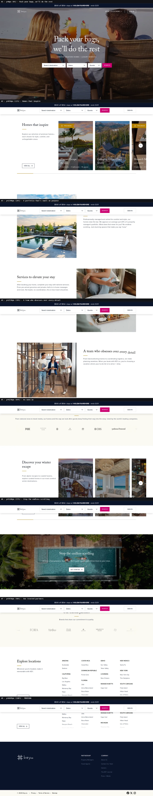
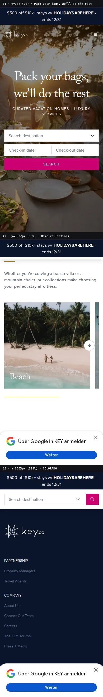

# UI Design System & Master Generation Blueprint: key-co

> **KEY.co · Luxury Vacation Home Rentals + Concierge Services** (https://key.co/) — Find your perfect getaway with KEY.co. Explore curated vacation homes with in-home services like pre-arrival groceries and private chefs.





---

## 1. Executive Visual Persona & Design Archetype

- **Brand Essence & Persona**: **KEY.co · Luxury Vacation Home Rentals + Concierge Services** (`https://key.co/`). Find your perfect getaway with KEY.co. Explore curated vacation homes with in-home services like pre-arrival groceries and private chefs.
- **Capture Provenance**: Live browser capture (`tier1_fast`, HTTP `200`, captured `2026-11-24`).
- **Visual Archetype**: **Light-Substrate Editorial & Modular Grid System (`#ffffff` canvas, `#020817` ink, `#0b142b` accent)**.
- **Anti-AI-Slop Differentiators**:
  - **Live-Computed Chromatic Polarity**: Anchors the viewport in `#ffffff` (live computed `body` `background-color` (`computed_styles.json`)) paired with `#020817` primary typography and `#0b142b` accents.
  - **Grounded Typographic Hierarchy**: Pairs `adobe-caslon-pro` for display copy (`Pack your bags, we’ll do the rest`) with `proxima-nova` and `GeistMono`.
  - **Calibrated Spatial Grid & Motion**: Combines `96rem` container bounds (`gap: 6px`, padding `15px`) with `cubic-bezier(0,0,.2,1)` easing and GSAP Timeline & ScrollTrigger, Barba.js Page Transition Router.

---

## 2. Spatial Architecture & Modular Grid Mathematics

### Viewport Allocation & Container Geometry
- **Captured Journey Filmstrips**: Desktop `1280×6624px` (`assets/desktop-journey.webp`, `8` keyframes up to `y=6609px` / doc `7509px`), Mobile `390×2616px` (`assets/mobile-journey.webp`, `3` keyframes).
- **Master Container Bounds**: `96rem` (non-`@media` desktop container stylesheet rule).
- **Canvas Lateral Padding & Spacing**: `15px` lateral canvas padding with `6px` grid gap.
- **Border Radius Scale**: `1.2px`, `var(--radius)`, `.3125rem`, `.375rem`.

### Responsive Breakpoint Architecture
- **Desktop Layout**: Multi-column CSS Grid / Flexbox layout at `1440px` (`max-width: 96rem`, `gap: 6px`).
- **Mobile Layout**: Single-column vertical stack at `390px` viewport width with `15px` horizontal padding.
- **Extracted CSS Media Queries**: `@media (min-width:64rem)`, `@media (max-width:767px)`, `@media (min-width:768px)`, `@media (min-width:40rem)`.

---

## 3. Color System, Materiality & Atmospheric Lighting

### Semantic Palette & Source Grounding
| Semantic Role | Ground-Truth Value | Extracted Live / CSS Source |
|---|---|---|
| **Primary Canvas Substrate** | `#ffffff` | live computed `body` `background-color` (`computed_styles.json`) |
| **Primary Typography Ink** | `#020817` | live computed `body` `color` (`computed_styles.json`) |
| **Elevated Surface / Card Substrate** | `#fbf9f2` | live computed `footer` `background-color` (`computed_styles.json`) |
| **Interactive Accent / Highlight** | `#0b142b` | `.accent-brand-navy { color: #0b142b }` |
| **Secondary / Muted Copy** | `#b47f00` | `.text-brand-gold { color: #b47f00 }` |
| **Structural Hairline Border** | `#b47f00` | `.border-brand-gold { border-color: #b47f00 }` |

### Sanitized Root CSS Variables (`ui-ux.md` Ground Truth)
| Variable Name | Extracted Value | Semantic Role |
|---|---|---|
| `--font-geist-sans` | `"GeistSans","GeistSans Fallback"` | Typography / Scale Token |
| `--color-red-50` | `oklch(97.1% .013 17.38)` | Brand / Palette Token |
| `--color-red-100` | `oklch(93.6% .032 17.717)` | Brand / Palette Token |
| `--color-red-200` | `oklch(88.5% .062 18.334)` | Brand / Palette Token |
| `--color-red-400` | `oklch(70.4% .191 22.216)` | Brand / Palette Token |
| `--color-red-500` | `oklch(63.7% .237 25.331)` | Brand / Palette Token |
| `--color-red-600` | `oklch(57.7% .245 27.325)` | Brand / Palette Token |
| `--color-red-700` | `oklch(50.5% .213 27.518)` | Brand / Palette Token |
| `--color-red-800` | `oklch(44.4% .177 26.899)` | Brand / Palette Token |
| `--color-orange-100` | `oklch(95.4% .038 75.164)` | Brand / Palette Token |
| `--color-orange-600` | `oklch(64.6% .222 41.116)` | Brand / Palette Token |
| `--color-green-100` | `oklch(96.2% .044 156.743)` | Brand / Palette Token |
| `--color-green-600` | `oklch(62.7% .194 149.214)` | Brand / Palette Token |
| `--color-blue-50` | `oklch(97% .014 254.604)` | Brand / Palette Token |
| `--color-blue-100` | `oklch(93.2% .032 255.585)` | Brand / Palette Token |
| `--color-blue-500` | `oklch(62.3% .214 259.815)` | Brand / Palette Token |

---

## 4. Typographic Scale & Editorial Hierarchy

### Font Family Stacks
- **Display Typography**: `adobe-caslon-pro`.
- **Primary Body Stack**: `proxima-nova`.
- **Technical / Metadata Stack**: `GeistMono`.

### Typographic Scale & Rules (Live Computed & Stylesheet Grounded)
- **Hero Display (`H1`)**: live computed `h1` (`font-size: 72px`, `line-height: 92px`, `font-weight: 400`, `letter-spacing: -1.44px`); CSS variables `--text-4xl: 2.25rem`, `--text-4xl--line-height: calc(2.5/2.25)`, `--text-5xl: 3rem`.
- **Section Heading (`H2`)**: live computed `h2` (`font-size: 32px`, `line-height: 40px`, `font-weight: 400`); CSS variables `--text-2xl: 1.5rem`, `--text-2xl--line-height: calc(2/1.5)`, `--text-3xl: 1.875rem`; rule `,h2` (`font-weight: var(--font-we...`).
- **Body Copy**: live computed `body` (`font-size: 16px`, `line-height: 24px`, `font-weight: 400`); CSS variables `--text-base: 1rem`, `--text-base--line-height: calc(1.5/1)`; rule `p` (`font-size: var(--text-sm)`, `line-height: var(--tw-leading,var(...`, `letter-spacing: .28px`, `font-weight: var(--font-we...`).
- **Metadata & Navigation Labels**: live computed `nav/a` (`font-size: 16px`, `line-height: 24px`, `font-weight: 400`); CSS variables `--text-xs: .75rem`, `--text-xs--line-height: calc(1/.75)`, `--text-sm: .875rem`.

---

## 5. Choreographed Motion & Interaction Physics

### Primary Easing Curves
- **Extracted Timing Functions**: `cubic-bezier(0,0,.2,1)`, `cubic-bezier(.4,0,.2,1)`, `cubic-bezier(.4,0,.6,1)`.

### Per-Element Transition & Choreography Rules
- **Selector `layer theme`**: `transition: .15s` extracted from `key-co` stylesheet.
- **Selector `.navbar-hovered`**: `transition: var(--tw-ease,var(--default-transition-timing-function))` extracted from `key-co` stylesheet.
- **Selector `.navbar-hovered .navbar-logo img`**: `transition: var(--tw-ease,var(--default-transition-timing-function))` extracted from `key-co` stylesheet.
- **Extracted Easing Curve (`cubic-bezier(0,0,.2,1)`)**: Governs interactive state transitions across `<nav.max-w-max>` and `<article.wf-proximanova-n5-active>`.
- **Runtime Interaction Engine**: Integrates GSAP Timeline & ScrollTrigger, Barba.js Page Transition Router with `prefers-reduced-motion: reduce` fallback guards.
### Measured Runtime Scroll & Interaction Telemetry (`behavioral_journey_v2`)
- **Scroll Driver Mode**: `native` (max document height `7509px`, deepest scrollY reached `6609px` across `8` desktop keyframes).
- **Detected Scroll / Motion Libraries**: Native browser scroll / standard CSS transitions.
- **Nav / Drawer Probe (`HOME COLLECTIONS`)**: Triggered visual change (pixel diff `60.682`, captured in `assets/state-nav.webp`); revealed links: BEACH, SKI, DESERT, LAKE, MOUNTAIN, CONTENT HOMES.
- **Route Transition Architecture**: First internal navigation (`/destinations/scottsdale`) measured as `direct` in `1238ms`.

---

## 6. Component Wireframe & Structural DOM Map

### Visual Layout Schematic — Desktop (`1440px`, Grounded in `dom.html` & Landmark Bounding Boxes)
```
┌────────────────────────────────────────────────────────────────────────┐
│ DESKTOP VIEWPORT (1440px) — KEY.co · Luxury Vacation Home Rentals + Co │
│ ====================================================================== │
│ [ <nav.max-w-max> (1120x68px)         | Overview · Index · Archive · ] │
│ ---------------------------------------------------------------------- │
│ | HERO STAGE: <section.navbar-section> (w=1440px)                    | │
│ | H1: Pack your bags, we’ll do the rest                              | │
│ | Substrate: #ffffff | Ink: #020817 | Accent: #0b142b                | │
│ ---------------------------------------------------------------------- │
│ | SHOWCASE GRID (<article.wf-proximanova-n5) max-w: 96rem            | │
│ | +------------------------------+  +------------------------------+ | │
│ | | $500 off $10k+ stays w/ HOLI |  | Curated Vacation Homes + Lux | | │
│ | +------------------------------+  +------------------------------+ | │
│ ---------------------------------------------------------------------- │
│ | DETAIL MODULE (<section.video-fit>) — Explore our selection        | │
│ ---------------------------------------------------------------------- │
│ [ FOOTER (<footer.bg-brand-bei) | https://key.co/                      │
└────────────────────────────────────────────────────────────────────────┘
```

### Visual Layout Schematic — Mobile Reflow (`390px`)
```
┌────────────────────────────────────────────────────────────────────────┐
│ MOBILE VIEWPORT REFLOW (390px) — Single-Column Stack (gap: 6px)        │
│ ====================================================================== │
│ [ HEADER BAR (<nav.max-w-max>         ) | Compact Menu (390px)         │
│ ---------------------------------------------------------------------- │
│ | HERO STAGE (<section.navbar-section>) — 390px Vertical Lead        | │
│ | H1: Pack your bags, we’ll do the rest                              | │
│ ---------------------------------------------------------------------- │
│ | SHOWCASE STACK (<article.wf-proximanov) — 1-Col Stack              | │
│ | [ Item 1: $500 off $10k+ stays w/ HOLIDAYSAREHERE - ends 1       ] | │
│ | [ Item 2: Curated Vacation Homes + Luxury Services               ] | │
│ ---------------------------------------------------------------------- │
│ | DETAIL STACK (<section.video-fit>) — 1-Col (Explore our select)    | │
│ ---------------------------------------------------------------------- │
│ [ FOOTER (<footer.bg-brand-bei) | Stacked 390px Colophon               │
└────────────────────────────────────────────────────────────────────────┘
```

### Granular DOM Region Breakdown
1. **Brand Header & Navigation Bar (<nav.max-w-max> — `key-co`)**:
   - Landmark `<nav class="max-w-max flex-1">` (`1120x68px`) hosting `KEY.co · Luxury Vacation Home Rental` navigation (`Overview · Index · Archive · About · Contact`), DOM attributes (`data-precedence="next"`, `data-precedence="next"`, `data-precedence="next"`, `data-rspack="@klaviyo/onsite-modul..."`), and stylesheet rule `.__className_fb8f2c { font-family:GeistSans,GeistSans Fallback }`.
2. **Hero Stage & Focal Lead (<section.navbar-section> — `Pack your bags, we’ll do the rest`)**:
   - Landmark `<section class="navbar-section">` presenting display lead `Pack your bags, we’ll do the rest` and copy excerpt *"$500 off $10k+ stays w/ HOLIDAYSAREHERE - ends 12/31"* over `#ffffff` canvas and `#020817` ink.
3. **Primary Showcase & Content Grid (<article.wf-proximanova-n5-active> — `$500 off $10k+ stays w/ HOLIDAYSAR`)**:
   - Landmark `<article class="wf-proximanova-n5-active">` rendering section `$500 off $10k+ stays w/ HOLIDAYSAREHERE - ends 1` with copy *"Curated Vacation Homes + Luxury Services"*, asset references (`oaiq.min.js`, `283498678855975`, `fbevents.js`, `gtm.js`), and grid rule `.__variable_fb8f2c { --font-geist-sans:"GeistSans","GeistSans Fallback" }`.
4. **Interactive Detail & Feature Matrix (<section.video-fit> — `Curated Vacation Homes + Luxury Se`)**:
   - Landmark `<section class="video-fit no-gsap-animation">` framing `Curated Vacation Homes + Luxury Services` and `Explore our selection of premium homes—each chos` (*"Explore our selection of premium homes—each chosen for style, com"*) with `#fbf9f2` surface cards, `#0b142b` accents, and `before { box-sizing:border-box;border:0 solid;margin:0;padding:0 }`.
5. **Colophon & Global Directory Footer (<footer.bg-brand-beige> — `https://key.co/`)**:
   - Landmark `<footer class="bg-brand-beige">` anchoring `KEY.co · Luxury Vacation Home Re` footer links (`Overview · Index · Archive · About · Contact`), copy *"Professionally managed and vetted for comfort and style, our"*, and `#b47f00` structural dividers.
### Full Vertical Scroll Sequence (Desktop `1440×900` Keyframes)
- **Step 01** (`y=0px`, `0%`): Active landmark `Pack your bags, we’ll do the rest` · sticky/fixed elements: `1`
- **Step 02** (`y=850px`, `13%`): Active landmark `Homes that inspire` · sticky/fixed elements: `2`
- **Step 03** (`y=1700px`, `26%`): Active landmark `A portfolio that's small on purpose` · sticky/fixed elements: `2`
- **Step 04** (`y=2550px`, `39%`): Active landmark `A team who obsesses over every detail` · sticky/fixed elements: `2`
- **Step 05** (`y=4250px`, `64%`): Active landmark `As seen in` · sticky/fixed elements: `2`
- **Step 06** (`y=5100px`, `77%`): Active landmark `Stop the endless scrolling` · sticky/fixed elements: `2`
- **Step 07** (`y=5950px`, `90%`): Active landmark `Our trusted partners` · sticky/fixed elements: `2`
- **Step 08** (`y=6609px`, `100%`): Active landmark `MONTANA` · sticky/fixed elements: `2`

### Multi-Page Internal Route Map
- **Detail Route (`/destinations/scottsdale`)**: `https://key.co/destinations/scottsdale` — H1: `LUXURY VACATION HOMES IN Scottsdale, Arizona`, scrollHeight `8020px`, transition `direct` (`1238ms`)
- **Detail Route (`/destinations/sedona`)**: `https://key.co/destinations/sedona` — H1: `LUXURY VACATION HOMES IN Sedona, Arizona`, scrollHeight `7995px`, transition `direct` (`1069ms`)
- **Detail Route (`/destinations/california-big-bear`)**: `https://key.co/destinations/california-big-bear` — H1: `LUXURY VACATION HOMES IN Big Bear, California`, scrollHeight `8701px`, transition `direct` (`1051ms`)

---

## 7. Master Zero-Shot AI Generation Prompt

```markdown
# Master Zero-Shot Frontend Generation Prompt: key-co (KEY.co · Luxury Vacation Home Rentals + Concierge Services)

You are a principal frontend architect and design systems engineer. Build a complete, production-ready web application replicating the exact design system, DOM landmarks, typographic hierarchy, color tokens, and motion physics of `key-co` (**KEY.co · Luxury Vacation Home Rentals + Concierge Services** — `https://key.co/`).

### 1. Visual Archetype & Anti-AI-Slop Mandates
- **Archetype**: Light-Substrate Editorial & Modular Grid System (`#ffffff` canvas, `#020817` ink, `#0b142b` accent).
- **Identity & Domain Context**: Find your perfect getaway with KEY.co. Explore curated vacation homes with in-home services like pre-arrival groceries and private chefs.
- **Primary Substrate**: `#ffffff` (live computed `body` `background-color` (`computed_styles.json`)), **Primary Ink**: `#020817`, **Accent / Highlight**: `#0b142b`.
- **Site-Specific Differentiators**:
  - **Live-Computed Chromatic Polarity**: Anchors the viewport in `#ffffff` (live computed `body` `background-color` (`computed_styles.json`)) paired with `#020817` primary typography and `#0b142b` accents.
  - **Grounded Typographic Hierarchy**: Pairs `adobe-caslon-pro` for display copy (`Pack your bags, we’ll do the rest`) with `proxima-nova` and `GeistMono`.
  - **Calibrated Spatial Grid & Motion**: Combines `96rem` container bounds (`gap: 6px`, padding `15px`) with `cubic-bezier(0,0,.2,1)` easing and GSAP Timeline & ScrollTrigger, Barba.js Page Transition Router.

### 2. Ground-Truth CSS Variables (`:root` Token Contract)
Declare and consume these exact custom properties extracted from `key-co` in your global stylesheet:

:root {
  /* KEY.co · Luxury Vacation Home Rentals + Concierge Services (key-co) — Live-Grounded CSS Variables */
  --font-geist-sans: "GeistSans","GeistSans Fallback"; /* Typography / Scale Token (key-co) */
  --color-red-50: oklch(97.1% .013 17.38); /* Brand / Palette Token (key-co) */
  --color-red-100: oklch(93.6% .032 17.717); /* Brand / Palette Token (key-co) */
  --color-red-200: oklch(88.5% .062 18.334); /* Brand / Palette Token (key-co) */
  --color-red-400: oklch(70.4% .191 22.216); /* Brand / Palette Token (key-co) */
  --color-red-500: oklch(63.7% .237 25.331); /* Brand / Palette Token (key-co) */
  --color-red-600: oklch(57.7% .245 27.325); /* Brand / Palette Token (key-co) */
  --color-red-700: oklch(50.5% .213 27.518); /* Brand / Palette Token (key-co) */
  --color-red-800: oklch(44.4% .177 26.899); /* Brand / Palette Token (key-co) */
  --color-orange-100: oklch(95.4% .038 75.164); /* Brand / Palette Token (key-co) */
  --color-orange-600: oklch(64.6% .222 41.116); /* Brand / Palette Token (key-co) */
  --color-green-100: oklch(96.2% .044 156.743); /* Brand / Palette Token (key-co) */
  --color-green-600: oklch(62.7% .194 149.214); /* Brand / Palette Token (key-co) */
  --color-blue-50: oklch(97% .014 254.604); /* Brand / Palette Token (key-co) */
  --color-blue-100: oklch(93.2% .032 255.585); /* Brand / Palette Token (key-co) */
  --color-blue-500: oklch(62.3% .214 259.815); /* Brand / Palette Token (key-co) */
}

### 3. Semantic Color & Materiality Contract
Map every surface, ink, and border strictly to these source-grounded tokens:
- **Primary Canvas Substrate**: `#ffffff` — grounded in live computed `body` `background-color` (`computed_styles.json`)
- **Primary Typography Ink**: `#020817` — grounded in live computed `body` `color` (`computed_styles.json`)
- **Elevated Surface / Card Substrate**: `#fbf9f2` — grounded in live computed `footer` `background-color` (`computed_styles.json`)
- **Interactive Accent / Highlight**: `#0b142b` — grounded in `.accent-brand-navy { color: #0b142b }`
- **Secondary / Muted Copy**: `#b47f00` — grounded in `.text-brand-gold { color: #b47f00 }`
- **Structural Hairline Border**: `#b47f00` — grounded in `.border-brand-gold { border-color: #b47f00 }`

### 4. Spatial Grid, Container Bounds & Responsive Breakpoints
- **Desktop Viewport Reference**: `1280×6624px` (multi-frame vertical journey filmstrip (6624px), `1440px` standard desktop width).
- **Mobile Viewport Reference**: `390×2616px` (multi-frame vertical journey filmstrip (2616px), `390px` standard mobile width).
- **Container Max-Width**: `96rem` (non-`@media` desktop container stylesheet rule)
- **Padding & Gutters**: `15px` lateral canvas padding with `6px` grid gap
- **Desktop Grid**: Multi-column CSS Grid / Flexbox layout at `1440px` (`max-width: 96rem`, `gap: 6px`)
- **Mobile Adaptation**: Single-column vertical stack at `390px` viewport width with `15px` horizontal padding
- **Media Queries**: `@media (min-width:64rem)`, `@media (max-width:767px)`, `@media (min-width:768px)`, `@media (min-width:40rem)`
- **Corner Radii**: `1.2px`, `var(--radius)`, `.3125rem`, `.375rem`

### 5. Typography & Editorial Scale Contract
- **Display Font Stack**: `adobe-caslon-pro`
- **Body Font Stack**: `proxima-nova`
- **Monospace / Technical Font Stack**: `GeistMono`
- **H1 Display Rule**: live computed `h1` (`font-size: 72px`, `line-height: 92px`, `font-weight: 400`, `letter-spacing: -1.44px`); CSS variables `--text-4xl: 2.25rem`, `--text-4xl--line-height: calc(2.5/2.25)`, `--text-5xl: 3rem`
- **H2 Section Rule**: live computed `h2` (`font-size: 32px`, `line-height: 40px`, `font-weight: 400`); CSS variables `--text-2xl: 1.5rem`, `--text-2xl--line-height: calc(2/1.5)`, `--text-3xl: 1.875rem`; rule `,h2` (`font-weight: var(--font-we...`)
- **Body Copy Rule**: live computed `body` (`font-size: 16px`, `line-height: 24px`, `font-weight: 400`); CSS variables `--text-base: 1rem`, `--text-base--line-height: calc(1.5/1)`; rule `p` (`font-size: var(--text-sm)`, `line-height: var(--tw-leading,var(...`, `letter-spacing: .28px`, `font-weight: var(--font-we...`)
- **Metadata & Index Rule**: live computed `nav/a` (`font-size: 16px`, `line-height: 24px`, `font-weight: 400`); CSS variables `--text-xs: .75rem`, `--text-xs--line-height: calc(1/.75)`, `--text-sm: .875rem`

### 6. Component Hierarchy, Verbatim Copy & Real DOM Landmarks
Scaffold `key-co` (`KEY.co · Luxury Vacation Home Rentals + Concierge Services`) with these exact structural regions, extracted copy, and CSS rules from `dom.html`:
1. **Brand Header & Navigation Bar (<nav.max-w-max> — `key-co`)**:
   - DOM & Selectors: Landmark `<nav class="max-w-max flex-1">` (`1120x68px`) hosting `KEY.co · Luxury Vacation Home Rental` navigation (`Overview · Index · Archive · About · Contact`), DOM attributes (`data-precedence="next"`, `data-precedence="next"`, `data-precedence="next"`, `data-rspack="@klaviyo/onsite-modul..."`), and stylesheet rule `.__className_fb8f2c { font-family:GeistSans,GeistSans Fallback }`.
   - Responsive Contract: Header `Brand Header & Navigation Bar (<nav.max-w-max> — `key-co`)` (`key-co`) adapts across `@media (min-width:64rem)`, `@media (max-width:767px)`, `@media (min-width:768px)`, `@media (min-width:40rem)` with `cubic-bezier(0,0,.2,1)`, `cubic-bezier(.4,0,.2,1)`, `cubic-bezier(.4,0,.6,1)` transitions and links `Overview · Index · Archive · About · Contact`.
2. **Hero Stage & Focal Lead (<section.navbar-section> — `Pack your bags, we’ll do the rest`)**:
   - DOM & Selectors: Landmark `<section class="navbar-section">` presenting display lead `Pack your bags, we’ll do the rest` and copy excerpt *"$500 off $10k+ stays w/ HOLIDAYSAREHERE - ends 12/31"* over `#ffffff` canvas and `#020817` ink.
   - Responsive Contract: Hero stage (`1280×6624px` desktop / `390×2616px` mobile) sets `#ffffff` background with `#020817` headline `Pack your bags, we’ll do the rest`.
3. **Primary Showcase & Content Grid (<article.wf-proximanova-n5-active> — `$500 off $10k+ stays w/ HOLIDAYSAR`)**:
   - DOM & Selectors: Landmark `<article class="wf-proximanova-n5-active">` rendering section `$500 off $10k+ stays w/ HOLIDAYSAREHERE - ends 1` with copy *"Curated Vacation Homes + Luxury Services"*, asset references (`oaiq.min.js`, `283498678855975`, `fbevents.js`, `gtm.js`), and grid rule `.__variable_fb8f2c { --font-geist-sans:"GeistSans","GeistSans Fallback" }`.
   - Responsive Contract: Showcase grid `Primary Showcase & Content Grid (<article.wf-proximanova-n5-active> — `$500 off $10k+ stays w/ HOLIDAYSAR`)` applies Multi-column CSS Grid / Flexbox layout at `1440px` (`max-width: 96rem`, `gap: 6px`) on desktop and Single-column vertical stack at `390px` viewport width with `15px` horizontal padding on mobile.
4. **Interactive Detail & Feature Matrix (<section.video-fit> — `Curated Vacation Homes + Luxury Se`)**:
   - DOM & Selectors: Landmark `<section class="video-fit no-gsap-animation">` framing `Curated Vacation Homes + Luxury Services` and `Explore our selection of premium homes—each chos` (*"Explore our selection of premium homes—each chosen for style, com"*) with `#fbf9f2` surface cards, `#0b142b` accents, and `before { box-sizing:border-box;border:0 solid;margin:0;padding:0 }`.
   - Responsive Contract: Detail module `Interactive Detail & Feature Matrix (<section.video-fit> — `Curated Vacation Homes + Luxury Se`)` uses `1.2px`, `var(--radius)`, `.3125rem`, `.375rem` radii, `#0b142b` highlights, and assets (oaiq.min.js, 283498678855975, fbevents.js).
5. **Colophon & Global Directory Footer (<footer.bg-brand-beige> — `https://key.co/`)**:
   - DOM & Selectors: Landmark `<footer class="bg-brand-beige">` anchoring `KEY.co · Luxury Vacation Home Re` footer links (`Overview · Index · Archive · About · Contact`), copy *"Professionally managed and vetted for comfort and style, our"*, and `#b47f00` structural dividers.
   - Responsive Contract: Footer `Colophon & Global Directory Footer (<footer.bg-brand-beige> — `https://key.co/`)` aligns to `96rem` (non-`@media` desktop container stylesheet rule) with `15px` lateral canvas padding with `6px` grid gap and attributes (data-precedence="next", data-precedence="next", data-precedence="next").

#### Verbatim DOM Copy Excerpts (`dom.html`)
- Copy Excerpt 1: *"$500 off $10k+ stays w/ HOLIDAYSAREHERE - ends 12/31"*
- Copy Excerpt 2: *"Curated Vacation Homes + Luxury Services"*
- Copy Excerpt 3: *"Explore our selection of premium homes—each chosen for style, comfort, and unforge..."*
- Copy Excerpt 4: *"Professionally managed and vetted for comfort and style, our homes raise the bar...."*

### 7. Motion, Extracted Stylesheet Rules & Interaction Choreography
- **Primary Easing Functions**: `cubic-bezier(0,0,.2,1)`, `cubic-bezier(.4,0,.2,1)`, `cubic-bezier(.4,0,.6,1)`
- **Extracted Stylesheet Rules (`key-co`)**:
- `.__className_fb8f2c { font-family:GeistSans,GeistSans Fallback }`
- `.__variable_fb8f2c { --font-geist-sans:"GeistSans","GeistSans Fallback" }`
- `before { box-sizing:border-box;border:0 solid;margin:0;padding:0 }`
- `file-selector-button { box-sizing:border-box;border:0 solid;margin:0;padding:0 }`
- `strong { font-weight:bolder }`
- **Per-Selector Transition Rules**:
- **Selector `layer theme`**: `transition: .15s` extracted from `key-co` stylesheet.
- **Selector `.navbar-hovered`**: `transition: var(--tw-ease,var(--default-transition-timing-function))` extracted from `key-co` stylesheet.
- **Selector `.navbar-hovered .navbar-logo img`**: `transition: var(--tw-ease,var(--default-transition-timing-function))` extracted from `key-co` stylesheet.
- **Extracted Easing Curve (`cubic-bezier(0,0,.2,1)`)**: Governs interactive state transitions across `<nav.max-w-max>` and `<article.wf-proximanova-n5-active>`.
- **Runtime Interaction Engine**: Integrates GSAP Timeline & ScrollTrigger, Barba.js Page Transition Router with `prefers-reduced-motion: reduce` fallback guards.
### 7b. Full-Page Scroll Choreography, Interactive States & Multi-Page Routes
- **Scroll Mechanics**: Implement `native` vertical progression up to `7509px` across 8 distinct viewport chapters.
- **Vertical Chapter Sequence**: Pack your bags, we’ll do th... (0%) -> Homes that inspire (13%) -> A portfolio that's small on... (26%) -> A team who obsesses over ev... (39%) -> As seen in (64%) -> Stop the endless scrolling (77%) -> Our trusted partners (90%) -> MONTANA (100%).
- **Navigation Drawer / Menu State**: Replicate interactive menu toggle (`HOME COLLECTIONS`) with Escape-to-close keyboard handling.
- **Multi-Page Routes**: Scaffold internal routes `/destinations/scottsdale` (detail, direct), `/destinations/sedona` (detail, direct), `/destinations/california-big-bear` (detail, direct) sharing the global header/footer shell and design tokens.

### 8. Technical Deliverables
- Implement in Next.js (App Router) with TypeScript and Tailwind CSS consuming the `:root` custom properties defined above for `key-co`.
- Reproduce both the `1440px` desktop architecture and `390px` mobile breakpoint transitions, preserving semantic HTML5 landmarks (`<header>`, `<nav>`, `<main>`, `<section>`, `<footer>`) and `prefers-reduced-motion` accessibility guards.
```
---

## 8. Full-Page Scroll Journey, Interactive States & Subpage Inventory

### Desktop Scroll Keyframes (`1440×900` WebP)
| Step | Scroll Y | Progress | Active Landmark / Section | Sticky/Fixed | Visual Asset |
| :---: | :---: | :---: | :--- | :---: | :--- |
| `#01` | `0px` | `0%` | Pack your bags, we’ll do the rest | `1` | [desktop-step-01.webp](assets/desktop-step-01.webp) |
| `#02` | `850px` | `13%` | Homes that inspire | `2` | [desktop-step-02.webp](assets/desktop-step-02.webp) |
| `#03` | `1700px` | `26%` | A portfolio that's small on purpose | `2` | [desktop-step-03.webp](assets/desktop-step-03.webp) |
| `#04` | `2550px` | `39%` | A team who obsesses over every detail | `2` | [desktop-step-04.webp](assets/desktop-step-04.webp) |
| `#05` | `4250px` | `64%` | As seen in | `2` | [desktop-step-05.webp](assets/desktop-step-05.webp) |
| `#06` | `5100px` | `77%` | Stop the endless scrolling | `2` | [desktop-step-06.webp](assets/desktop-step-06.webp) |
| `#07` | `5950px` | `90%` | Our trusted partners | `2` | [desktop-step-07.webp](assets/desktop-step-07.webp) |
| `#08` | `6609px` | `100%` | MONTANA | `2` | [desktop-step-08.webp](assets/desktop-step-08.webp) |

### Mobile Condensed Keyframes (`390×844` WebP)
| Step | Scroll Y | Progress | Active Landmark | Visual Asset |
| :---: | :---: | :---: | :--- | :--- |
| `#01` | `0px` | `0%` | Pack your bags, we’ll do the rest | [mobile-step-01.webp](assets/mobile-step-01.webp) |
| `#02` | `3932px` | `50%` | Home collections | [mobile-step-02.webp](assets/mobile-step-02.webp) |
| `#03` | `7865px` | `100%` | COLORADO | [mobile-step-03.webp](assets/mobile-step-03.webp) |

### Interactive UI State Captures (`1440×900` WebP)
| State Type | Trigger / Observation | Visual Asset |
| :--- | :--- | :--- |
| `nav_menu` | Nav/Menu opened (`HOME COLLECTIONS`, diff `60.682`) | [state-nav.webp](assets/state-nav.webp) |

### Internal Subpage Filmstrips (`1080px` Wide WebP)
| # | Template | Route URL | H1 / Title | Scroll Height | Transition | Filmstrip Asset |
| :-: | :---: | :--- | :--- | :---: | :---: | :--- |
| `1` | `detail` | `https://key.co/destinations/scottsdale` | LUXURY VACATION HOMES IN Scottsdale,... | `8020px` | `direct` (`1238ms`) | [subpage-01-destinations-scottsdale.webp](assets/subpage-01-destinations-scottsdale.webp) |
| `2` | `detail` | `https://key.co/destinations/sedona` | LUXURY VACATION HOMES IN Sedona, Arizona | `7995px` | `direct` (`1069ms`) | [subpage-02-destinations-sedona.webp](assets/subpage-02-destinations-sedona.webp) |
| `3` | `detail` | `https://key.co/destinations/california-big-bear` | LUXURY VACATION HOMES IN Big Bear, Ca... | `8701px` | `direct` (`1051ms`) | [subpage-03-destinations-california-big-bear.webp](assets/subpage-03-destinations-california-big-bear.webp) |

