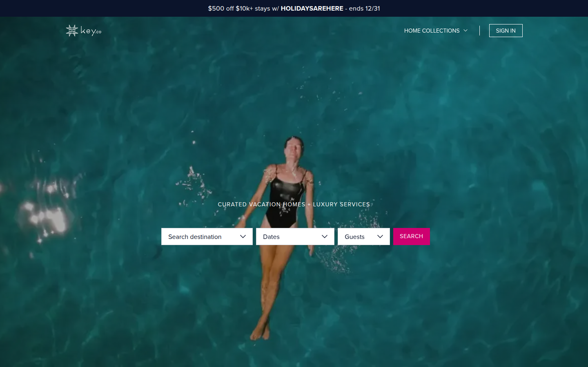

# UI Design System & Master Generation Blueprint: key-co

> **KEY.co · Luxury Vacation Home Rentals + Concierge Services** (https://key.co/) — Find your perfect getaway with KEY.co. Explore curated vacation homes with in-home services like pre-arrival groceries and private chefs.



---

## 1. Executive Visual Persona & Design Archetype

- **Brand Essence & Persona**: **KEY.co · Luxury Vacation Home Rentals + Concierge Services** (`https://key.co/`). Find your perfect getaway with KEY.co. Explore curated vacation homes with in-home services like pre-arrival groceries and private chefs.
- **Capture Provenance**: Live browser capture (`tier2_webgl`, HTTP `200`, captured `2026-11-23`).
- **Visual Archetype**: **Light-Substrate Editorial & Modular Grid System (`#ffffff` canvas, `#020817` ink, `#1a73e8` accent)**.
- **Anti-AI-Slop Differentiators**:
  - **Live-Computed Chromatic Polarity**: Anchors the viewport in `#ffffff` (live computed `body` `background-color` (`computed_styles.json`)) paired with `#020817` primary typography and `#1a73e8` accents.
  - **Grounded Typographic Hierarchy**: Pairs `adobe-caslon-pro` for display copy (`Pack your bags, we’ll do the rest`) with `proxima-nova` and not declared in live computed styles (uses primary stack / `ui-monospace`).
  - **Calibrated Spatial Grid & Motion**: Combines `1440px` container bounds (`gap: 0px (flush layout)`, padding `10px`) with `cubic-bezier(0.25,0.1,0.25,1)` easing and GSAP Timeline & ScrollTrigger, Barba.js Page Transition Router.

---

## 2. Spatial Architecture & Modular Grid Mathematics


### Viewport Allocation & Container Geometry
- **Captured Viewport Dimensions**: Desktop `1440×900px` (`assets/desktop.png`, single-viewport 100vh live capture (900px)), Mobile `390×844px` (`assets/mobile.png`, single-viewport 100vh live capture (844px)).
- **Master Container Bounds**: `1440px` (full-bleed `100%` desktop stage measured on `1440px` viewport).
- **Canvas Lateral Padding & Spacing**: `10px` lateral canvas padding with `0px (flush layout)` grid gap.
- **Border Radius Scale**: `1.2px`, `10px`, `4px`, `20px`.

### Responsive Breakpoint Architecture
- **Desktop Layout**: Multi-column CSS Grid / Flexbox layout at `1440px` (`max-width: 1440px`, `gap: 0px (flush layout)`).
- **Mobile Layout**: Single-column vertical stack at `390px` viewport width with `10px` horizontal padding.
- **Extracted CSS Media Queries**: `@media screen and (-ms-high-contrast:active)`, `@media screen and (preferes-contrast:more)`, `@media screen and (prefers-contrast:more)`.

---

## 3. Color System, Materiality & Atmospheric Lighting

### Semantic Palette & Source Grounding
| Semantic Role | Ground-Truth Value | Extracted Live / CSS Source |
|---|---|---|
| **Primary Canvas Substrate** | `#ffffff` | live computed `body` `background-color` (`computed_styles.json`) |
| **Primary Typography Ink** | `#020817` | live computed `body` `color` (`computed_styles.json`) |
| **Elevated Surface / Card Substrate** | `#fbf9f2` | live computed `footer` `background-color` (`computed_styles.json`) |
| **Interactive Accent / Highlight** | `#1a73e8` | `.hSRGPd { color: #1a73e8 }` |
| **Secondary / Muted Copy** | `#1a73e8` | `.hSRGPd { color: #1a73e8 }` |
| **Structural Hairline Border** | `#4285f4` | `.fFW7wc-ibnC6b>.aZ2wEe>div { border-color: #4285f4 }` |

### Sanitized Root CSS Variables (`ui-ux.md` Ground Truth)
| Variable Name | Extracted Value | Semantic Role |
|---|---|---|
| `--font-geist-sans` | `'GeistSans', 'GeistSans Fallback'` | Typography / Scale Token |
| `--top-banner-height` | `41px` | Layout / Spatial Grid Token |
| `--key-co-bg` | `#ffffff` | Canvas Substrate (from live computed `body` `background-color` (`computed_styles.json`)) |
| `--key-co-ink` | `#020817` | Primary Typography Ink (computed-derived) |
| `--key-co-surface` | `#fbf9f2` | Surface Substrate (computed-derived) |
| `--key-co-accent` | `#1a73e8` | Interactive Accent (computed-derived) |
| `--key-co-muted` | `#1a73e8` | Secondary Ink (computed-derived) |
| `--key-co-border` | `#4285f4` | Structural Border (computed-derived) |
| `--key-co-container` | `1440px` | Container Bound (computed-derived) |
| `--key-co-gap` | `0px` | Grid Gutter (computed-derived) |
| `--key-co-pad` | `10px` | Lateral Padding (computed-derived) |
| `--key-co-ease` | `cubic-bezier(0.25,0.1,0.25,1)` | Primary Easing Function |
| `--key-co-radius` | `1.2px` | Corner Radius (computed-derived) |
| `--key-co-fs-base` | `72px` | Observed Font Size Token |

---

## 4. Typographic Scale & Editorial Hierarchy

### Font Family Stacks
- **Display Typography**: `adobe-caslon-pro`.
- **Primary Body Stack**: `proxima-nova`.
- **Technical / Metadata Stack**: not declared in live computed styles (uses primary stack / `ui-monospace`).

### Typographic Scale & Rules (Live Computed & Stylesheet Grounded)
- **Hero Display (`H1`)**: live computed `h1` (`font-size: 72px`, `line-height: 92px`, `font-weight: 400`, `letter-spacing: -1.44px`).
- **Section Heading (`H2`)**: live computed `h2` (`font-size: 32px`, `line-height: 40px`, `font-weight: 400`).
- **Body Copy**: live computed `body` (`font-size: 16px`, `line-height: 24px`, `font-weight: 400`).
- **Metadata & Navigation Labels**: live computed `nav/a` (`font-size: 16px`, `line-height: 24px`, `font-weight: 400`).

---

## 5. Choreographed Motion & Interaction Physics

### Primary Easing Curves
- **Extracted Timing Functions**: `cubic-bezier(0.25,0.1,0.25,1)`.

### Per-Element Transition & Choreography Rules
- **Selector `.P1ekSe-ZMv3u`**: `transition: height .2s linear` extracted from `key-co` stylesheet.
- **Selector `.P1ekSe-ZMv3u>div:first-child`**: `transition: width .3s linear` extracted from `key-co` stylesheet.
- **Selector `.nsm7Bb-HzV7m-LgbsSe`**: `transition: background-color .218s,border-color .218s` extracted from `key-co` stylesheet.
- **Standard CSS Easing (`cubic-bezier(0.25,0.1,0.25,1)`)**: Default timing curve (no custom `cubic-bezier()` declared in captured CSS).
- **Runtime Interaction Engine**: Integrates GSAP Timeline & ScrollTrigger, Barba.js Page Transition Router with `prefers-reduced-motion: reduce` fallback guards.

---

## 6. Component Wireframe & Structural DOM Map

### Visual Layout Schematic — Desktop (`1440px`, Grounded in `dom.html` & Landmark Bounding Boxes)
```
┌────────────────────────────────────────────────────────────────────────┐
│ DESKTOP VIEWPORT (1440px) — KEY.co · Luxury Vacation Home Rentals + Co │
│ ====================================================================== │
│ [ <nav.max-w-max> (1120x68px)         | Overview · Index · Archive · ] │
│ ---------------------------------------------------------------------- │
│ | HERO STAGE: <section.navbar-section> (w=1440px)                    | │
│ | H1: Pack your bags, we’ll do the rest                              | │
│ | Substrate: #ffffff | Ink: #020817 | Accent: #1a73e8                | │
│ ---------------------------------------------------------------------- │
│ | SHOWCASE GRID (<article.wf-proximanova-n4) max-w: 1440px           | │
│ | +------------------------------+  +------------------------------+ | │
│ | | $500 off $10k+ stays w/ HOLI |  | Curated Vacation Homes + Lux | | │
│ | +------------------------------+  +------------------------------+ | │
│ ---------------------------------------------------------------------- │
│ | DETAIL MODULE (<section.video-fit>) — Explore our selection        | │
│ ---------------------------------------------------------------------- │
│ [ FOOTER (<footer.bg-brand-bei) | https://key.co/                      │
└────────────────────────────────────────────────────────────────────────┘
```

### Visual Layout Schematic — Mobile Reflow (`390px`)
```
┌────────────────────────────────────────────────────────────────────────┐
│ MOBILE VIEWPORT REFLOW (390px) — Single-Column Stack (gap: 0px (flu)   │
│ ====================================================================== │
│ [ HEADER BAR (<nav.max-w-max>         ) | Compact Menu (390px)         │
│ ---------------------------------------------------------------------- │
│ | HERO STAGE (<section.navbar-section>) — 390px Vertical Lead        | │
│ | H1: Pack your bags, we’ll do the rest                              | │
│ ---------------------------------------------------------------------- │
│ | SHOWCASE STACK (<article.wf-proximanov) — 1-Col Stack              | │
│ | [ Item 1: $500 off $10k+ stays w/ HOLIDAYSAREHERE - ends 1       ] | │
│ | [ Item 2: Curated Vacation Homes + Luxury Services               ] | │
│ ---------------------------------------------------------------------- │
│ | DETAIL STACK (<section.video-fit>) — 1-Col (Explore our select)    | │
│ ---------------------------------------------------------------------- │
│ [ FOOTER (<footer.bg-brand-bei) | Stacked 390px Colophon               │
└────────────────────────────────────────────────────────────────────────┘
```

### Granular DOM Region Breakdown
1. **Brand Header & Navigation Bar (<nav.max-w-max> — `key-co`)**:
   - Landmark `<nav class="max-w-max flex-1">` (`1120x68px`) hosting `KEY.co · Luxury Vacation Home Rental` navigation (`Overview · Index · Archive · About · Contact`), DOM attributes (`data-precedence="next"`, `data-precedence="next"`, `data-precedence="next"`, `data-theme="light"`), and stylesheet rule `.tk-proxima-nova { font-family: "proxima-nova",sans-serif; }`.
2. **Hero Stage & Focal Lead (<section.navbar-section> — `Pack your bags, we’ll do the rest`)**:
   - Landmark `<section class="navbar-section">` presenting display lead `Pack your bags, we’ll do the rest` and copy excerpt *"$500 off $10k+ stays w/ HOLIDAYSAREHERE - ends 12/31"* over `#ffffff` canvas and `#020817` ink.
3. **Primary Showcase & Content Grid (<article.wf-proximanova-n4-active> — `$500 off $10k+ stays w/ HOLIDAYSAR`)**:
   - Landmark `<article class="wf-proximanova-n4-active">` rendering section `$500 off $10k+ stays w/ HOLIDAYSAREHERE - ends 1` with copy *"Curated Vacation Homes + Luxury Services"*, asset references (`oaiq.min.js`, `283498678855975`, `fbevents.js`, `gtm.js`), and grid rule `.tk-adobe-caslon-pro { font-family: "adobe-caslon-pro",serif; }`.
4. **Interactive Detail & Feature Matrix (<section.video-fit> — `Curated Vacation Homes + Luxury Se`)**:
   - Landmark `<section class="video-fit no-gsap-animation">` framing `Curated Vacation Homes + Luxury Services` and `Explore our selection of premium homes—each chos` (*"Explore our selection of premium homes—each chosen for style, com"*) with `#fbf9f2` surface cards, `#1a73e8` accents, and `.tk-futura-pt { font-family: "futura-pt",sans-serif; }`.
5. **Colophon & Global Directory Footer (<footer.bg-brand-beige> — `https://key.co/`)**:
   - Landmark `<footer class="bg-brand-beige">` anchoring `KEY.co · Luxury Vacation Home Re` footer links (`Overview · Index · Archive · About · Contact`), copy *"Professionally managed and vetted for comfort and style, our"*, and `#4285f4` structural dividers.

---

## 7. Master Zero-Shot AI Generation Prompt

```markdown
# Master Zero-Shot Frontend Generation Prompt: key-co (KEY.co · Luxury Vacation Home Rentals + Concierge Services)

You are a principal frontend architect and design systems engineer. Build a complete, production-ready web application replicating the exact design system, DOM landmarks, typographic hierarchy, color tokens, and motion physics of `key-co` (**KEY.co · Luxury Vacation Home Rentals + Concierge Services** — `https://key.co/`).

### 1. Visual Archetype & Anti-AI-Slop Mandates
- **Archetype**: Light-Substrate Editorial & Modular Grid System (`#ffffff` canvas, `#020817` ink, `#1a73e8` accent).
- **Identity & Domain Context**: Find your perfect getaway with KEY.co. Explore curated vacation homes with in-home services like pre-arrival groceries and private chefs.
- **Primary Substrate**: `#ffffff` (live computed `body` `background-color` (`computed_styles.json`)), **Primary Ink**: `#020817`, **Accent / Highlight**: `#1a73e8`.
- **Site-Specific Differentiators**:
  - **Live-Computed Chromatic Polarity**: Anchors the viewport in `#ffffff` (live computed `body` `background-color` (`computed_styles.json`)) paired with `#020817` primary typography and `#1a73e8` accents.
  - **Grounded Typographic Hierarchy**: Pairs `adobe-caslon-pro` for display copy (`Pack your bags, we’ll do the rest`) with `proxima-nova` and not declared in live computed styles (uses primary stack / `ui-monospace`).
  - **Calibrated Spatial Grid & Motion**: Combines `1440px` container bounds (`gap: 0px (flush layout)`, padding `10px`) with `cubic-bezier(0.25,0.1,0.25,1)` easing and GSAP Timeline & ScrollTrigger, Barba.js Page Transition Router.

### 2. Ground-Truth CSS Variables (`:root` Token Contract)
Declare and consume these exact custom properties extracted from `key-co` in your global stylesheet:

:root {
  /* KEY.co · Luxury Vacation Home Rentals + Concierge Services (key-co) — Live-Grounded CSS Variables */
  --font-geist-sans: 'GeistSans', 'GeistSans Fallback'; /* Typography / Scale Token (key-co) */
  --top-banner-height: 41px; /* Layout / Spatial Grid Token (key-co) */
  --key-co-bg: #ffffff; /* Canvas Substrate (from live computed `body` `background-color` (`computed_styles.json`)) (key-co) */
  --key-co-ink: #020817; /* Primary Typography Ink (computed-derived) (key-co) */
  --key-co-surface: #fbf9f2; /* Surface Substrate (computed-derived) (key-co) */
  --key-co-accent: #1a73e8; /* Interactive Accent (computed-derived) (key-co) */
  --key-co-muted: #1a73e8; /* Secondary Ink (computed-derived) (key-co) */
  --key-co-border: #4285f4; /* Structural Border (computed-derived) (key-co) */
  --key-co-container: 1440px; /* Container Bound (computed-derived) (key-co) */
  --key-co-gap: 0px; /* Grid Gutter (computed-derived) (key-co) */
  --key-co-pad: 10px; /* Lateral Padding (computed-derived) (key-co) */
  --key-co-ease: cubic-bezier(0.25,0.1,0.25,1); /* Primary Easing Function (key-co) */
  --key-co-radius: 1.2px; /* Corner Radius (computed-derived) (key-co) */
  --key-co-fs-base: 72px; /* Observed Font Size Token (key-co) */
}

### 3. Semantic Color & Materiality Contract
Map every surface, ink, and border strictly to these source-grounded tokens:
- **Primary Canvas Substrate**: `#ffffff` — grounded in live computed `body` `background-color` (`computed_styles.json`)
- **Primary Typography Ink**: `#020817` — grounded in live computed `body` `color` (`computed_styles.json`)
- **Elevated Surface / Card Substrate**: `#fbf9f2` — grounded in live computed `footer` `background-color` (`computed_styles.json`)
- **Interactive Accent / Highlight**: `#1a73e8` — grounded in `.hSRGPd { color: #1a73e8 }`
- **Secondary / Muted Copy**: `#1a73e8` — grounded in `.hSRGPd { color: #1a73e8 }`
- **Structural Hairline Border**: `#4285f4` — grounded in `.fFW7wc-ibnC6b>.aZ2wEe>div { border-color: #4285f4 }`

### 4. Spatial Grid, Container Bounds & Responsive Breakpoints
- **Desktop Viewport Reference**: `1440×900px` (single-viewport 100vh live capture (900px), `1440px` standard desktop width).
- **Mobile Viewport Reference**: `390×844px` (single-viewport 100vh live capture (844px), `390px` standard mobile width).
- **Container Max-Width**: `1440px` (full-bleed `100%` desktop stage measured on `1440px` viewport)
- **Padding & Gutters**: `10px` lateral canvas padding with `0px (flush layout)` grid gap
- **Desktop Grid**: Multi-column CSS Grid / Flexbox layout at `1440px` (`max-width: 1440px`, `gap: 0px (flush layout)`)
- **Mobile Adaptation**: Single-column vertical stack at `390px` viewport width with `10px` horizontal padding
- **Media Queries**: `@media screen and (-ms-high-contrast:active)`, `@media screen and (preferes-contrast:more)`, `@media screen and (prefers-contrast:more)`
- **Corner Radii**: `1.2px`, `10px`, `4px`, `20px`

### 5. Typography & Editorial Scale Contract
- **Display Font Stack**: `adobe-caslon-pro`
- **Body Font Stack**: `proxima-nova`
- **Monospace / Technical Font Stack**: not declared in live computed styles (uses primary stack / `ui-monospace`)
- **H1 Display Rule**: live computed `h1` (`font-size: 72px`, `line-height: 92px`, `font-weight: 400`, `letter-spacing: -1.44px`)
- **H2 Section Rule**: live computed `h2` (`font-size: 32px`, `line-height: 40px`, `font-weight: 400`)
- **Body Copy Rule**: live computed `body` (`font-size: 16px`, `line-height: 24px`, `font-weight: 400`)
- **Metadata & Index Rule**: live computed `nav/a` (`font-size: 16px`, `line-height: 24px`, `font-weight: 400`)

### 6. Component Hierarchy, Verbatim Copy & Real DOM Landmarks
Scaffold `key-co` (`KEY.co · Luxury Vacation Home Rentals + Concierge Services`) with these exact structural regions, extracted copy, and CSS rules from `dom.html`:
1. **Brand Header & Navigation Bar (<nav.max-w-max> — `key-co`)**:
   - DOM & Selectors: Landmark `<nav class="max-w-max flex-1">` (`1120x68px`) hosting `KEY.co · Luxury Vacation Home Rental` navigation (`Overview · Index · Archive · About · Contact`), DOM attributes (`data-precedence="next"`, `data-precedence="next"`, `data-precedence="next"`, `data-theme="light"`), and stylesheet rule `.tk-proxima-nova { font-family: "proxima-nova",sans-serif; }`.
   - Responsive Contract: Header `Brand Header & Navigation Bar (<nav.max-w-max> — `key-co`)` (`key-co`) adapts across `@media screen and (-ms-high-contrast:active)`, `@media screen and (preferes-contrast:more)`, `@media screen and (prefers-contrast:more)` with `cubic-bezier(0.25,0.1,0.25,1)` transitions and links `Overview · Index · Archive · About · Contact`.
2. **Hero Stage & Focal Lead (<section.navbar-section> — `Pack your bags, we’ll do the rest`)**:
   - DOM & Selectors: Landmark `<section class="navbar-section">` presenting display lead `Pack your bags, we’ll do the rest` and copy excerpt *"$500 off $10k+ stays w/ HOLIDAYSAREHERE - ends 12/31"* over `#ffffff` canvas and `#020817` ink.
   - Responsive Contract: Hero stage (`1440×900px` desktop / `390×844px` mobile) sets `#ffffff` background with `#020817` headline `Pack your bags, we’ll do the rest`.
3. **Primary Showcase & Content Grid (<article.wf-proximanova-n4-active> — `$500 off $10k+ stays w/ HOLIDAYSAR`)**:
   - DOM & Selectors: Landmark `<article class="wf-proximanova-n4-active">` rendering section `$500 off $10k+ stays w/ HOLIDAYSAREHERE - ends 1` with copy *"Curated Vacation Homes + Luxury Services"*, asset references (`oaiq.min.js`, `283498678855975`, `fbevents.js`, `gtm.js`), and grid rule `.tk-adobe-caslon-pro { font-family: "adobe-caslon-pro",serif; }`.
   - Responsive Contract: Showcase grid `Primary Showcase & Content Grid (<article.wf-proximanova-n4-active> — `$500 off $10k+ stays w/ HOLIDAYSAR`)` applies Multi-column CSS Grid / Flexbox layout at `1440px` (`max-width: 1440px`, `gap: 0px (flush layout)`) on desktop and Single-column vertical stack at `390px` viewport width with `10px` horizontal padding on mobile.
4. **Interactive Detail & Feature Matrix (<section.video-fit> — `Curated Vacation Homes + Luxury Se`)**:
   - DOM & Selectors: Landmark `<section class="video-fit no-gsap-animation">` framing `Curated Vacation Homes + Luxury Services` and `Explore our selection of premium homes—each chos` (*"Explore our selection of premium homes—each chosen for style, com"*) with `#fbf9f2` surface cards, `#1a73e8` accents, and `.tk-futura-pt { font-family: "futura-pt",sans-serif; }`.
   - Responsive Contract: Detail module `Interactive Detail & Feature Matrix (<section.video-fit> — `Curated Vacation Homes + Luxury Se`)` uses `1.2px`, `10px`, `4px`, `20px` radii, `#1a73e8` highlights, and assets (oaiq.min.js, 283498678855975, fbevents.js).
5. **Colophon & Global Directory Footer (<footer.bg-brand-beige> — `https://key.co/`)**:
   - DOM & Selectors: Landmark `<footer class="bg-brand-beige">` anchoring `KEY.co · Luxury Vacation Home Re` footer links (`Overview · Index · Archive · About · Contact`), copy *"Professionally managed and vetted for comfort and style, our"*, and `#4285f4` structural dividers.
   - Responsive Contract: Footer `Colophon & Global Directory Footer (<footer.bg-brand-beige> — `https://key.co/`)` aligns to `1440px` (full-bleed `100%` desktop stage measured on `1440px` viewport) with `10px` lateral canvas padding with `0px (flush layout)` grid gap and attributes (data-precedence="next", data-precedence="next", data-precedence="next").

#### Verbatim DOM Copy Excerpts (`dom.html`)
- Copy Excerpt 1: *"$500 off $10k+ stays w/ HOLIDAYSAREHERE - ends 12/31"*
- Copy Excerpt 2: *"Curated Vacation Homes + Luxury Services"*
- Copy Excerpt 3: *"Explore our selection of premium homes—each chosen for style, comfort, and unforge..."*
- Copy Excerpt 4: *"Professionally managed and vetted for comfort and style, our homes raise the bar...."*

### 7. Motion, Extracted Stylesheet Rules & Interaction Choreography
- **Primary Easing Functions**: `cubic-bezier(0.25,0.1,0.25,1)`
- **Extracted Stylesheet Rules (`key-co`)**:
- `.tk-proxima-nova { font-family: "proxima-nova",sans-serif; }`
- `.tk-adobe-caslon-pro { font-family: "adobe-caslon-pro",serif; }`
- `.tk-futura-pt { font-family: "futura-pt",sans-serif; }`
- `.tk-futura-pt-bold { font-family: "futura-pt-bold",sans-serif; }`
- `.ynRLnc { left:-9999px;position:absolute;top:-9999px }`
- **Per-Selector Transition Rules**:
- **Selector `.P1ekSe-ZMv3u`**: `transition: height .2s linear` extracted from `key-co` stylesheet.
- **Selector `.P1ekSe-ZMv3u>div:first-child`**: `transition: width .3s linear` extracted from `key-co` stylesheet.
- **Selector `.nsm7Bb-HzV7m-LgbsSe`**: `transition: background-color .218s,border-color .218s` extracted from `key-co` stylesheet.
- **Standard CSS Easing (`cubic-bezier(0.25,0.1,0.25,1)`)**: Default timing curve (no custom `cubic-bezier()` declared in captured CSS).
- **Runtime Interaction Engine**: Integrates GSAP Timeline & ScrollTrigger, Barba.js Page Transition Router with `prefers-reduced-motion: reduce` fallback guards.

### 8. Technical Deliverables
- Implement in Next.js (App Router) with TypeScript and Tailwind CSS consuming the `:root` custom properties defined above for `key-co`.
- Reproduce both the `1440px` desktop architecture and `390px` mobile breakpoint transitions, preserving semantic HTML5 landmarks (`<header>`, `<nav>`, `<main>`, `<section>`, `<footer>`) and `prefers-reduced-motion` accessibility guards.
```
