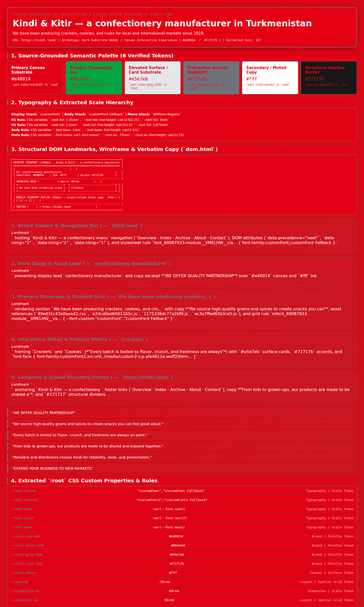
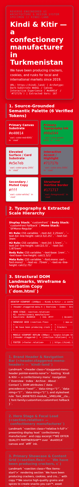

# UI Design System & Master Generation Blueprint: kindi-land

> **Kindi & Kitir — a confectionery manufacturer in Turkmenistan** (https://kindi.land/) — We have been producing crackers, cookies, and rusks for local and international markets since 2019.



---

## 1. Executive Visual Persona & Design Archetype

- **Brand Essence & Persona**: **Kindi & Kitir — a confectionery manufacturer in Turkmenistan** (`https://kindi.land/`). We have been producing crackers, cookies, and rusks for local and international markets since 2019.
- **Visual Archetype**: **Dark-Substrate WebGL / Canvas Interactive Experience (`#e40014` / `#71717b`)**.
- **Anti-AI-Slop Differentiators**:
  - **Source-Grounded Chromatic Polarity**: Anchors the viewport in `#e40014` (`var(--color-red-600)` in `:root`) paired with `#fff` primary typography and `#71717b` accents.
  - **Extracted Typographic Hierarchy**: Pairs `customFont` for display copy (`confectionery manufacturer`) with `customFont Fallback` and `SFMono-Regular`.
  - **Calibrated Spatial Grid & Motion**: Combines `40rem` container bounds (`gap: .4rem`, padding `16px`) with `cubic-bezier(.4,0,.2,1)` easing and Lenis Smooth Scroll (`data-lenis`), HTML5 `<canvas>` Interactive Viewport Surface.

---

## 2. Spatial Architecture & Modular Grid Mathematics



### Viewport Allocation & Container Geometry
- **Captured Viewport Dimensions**: Desktop `1440×2400px` (`assets/desktop.png`, capped at 2400px multi-section capture), Mobile `390×2400px` (`assets/mobile.png`, capped at 2400px multi-section capture).
- **Master Container Bounds**: `40rem` extracted from `kindi-land` stylesheet.
- **Canvas Lateral Padding & Spacing**: `16px` lateral canvas padding with `.4rem` grid gap.
- **Border Radius Scale**: `.25rem`, `var(--radius-2xl)`, `var(--radius-3xl)`, `var(--radius-4xl)`.

### Responsive Breakpoint Architecture
- **Desktop Layout**: Multi-column CSS Grid / Flexbox layout at `1440px` (`max-width: 40rem`, `gap: .4rem`).
- **Mobile Layout**: Single-column vertical stack at `390px` viewport width with `16px` horizontal padding.
- **Extracted CSS Media Queries**: `@media (min-width:40rem)`, `@media (min-width:48rem)`, `@media (min-width:64rem)`, `@media (min-width:80rem)`.

---

## 3. Color System, Materiality & Atmospheric Lighting

### Semantic Palette & Source Grounding
| Semantic Role | Ground-Truth Value | Extracted CSS Source / Selector |
|---|---|---|
| **Primary Canvas Substrate** | `#e40014` | `var(--color-red-600)` in `:root` |
| **Primary Typography Ink** | `#00a544` | `var(--color-green-600)` in `:root` |
| **Elevated Surface / Card Substrate** | `#e5e7eb` | `var(--color-gray-200)` in `:root` |
| **Interactive Accent / Highlight** | `#71717b` | `var(--color-zinc-500)` in `:root` |
| **Secondary / Muted Copy** | `#fff` | `var(--color-white)` in `:root` |
| **Structural Hairline Border** | `#171717` | `var(--foreground)` in `:root` |

### Sanitized Root CSS Variables (`ui-ux.md` Ground Truth)
| Variable Name | Extracted Value | Semantic Role |
|---|---|---|
| `--font-custom` | `"customFont","customFont Fallback"` | Typography / Scale Token |
| `--font-custom2` | `"customFont2","customFont2 Fallback"` | Typography / Scale Token |
| `--font-sans` | `var(--font-sans)` | Typography / Scale Token |
| `--font-serif` | `var(--font-serif)` | Typography / Scale Token |
| `--font-mono` | `var(--font-mono)` | Typography / Scale Token |
| `--color-red-600` | `#e40014` | Brand / Palette Token |
| `--color-green-600` | `#00a544` | Brand / Palette Token |
| `--color-gray-200` | `#e5e7eb` | Brand / Palette Token |
| `--color-zinc-500` | `#71717b` | Brand / Palette Token |
| `--color-white` | `#fff` | Canvas / Surface Token |
| `--spacing` | `.25rem` | Layout / Spatial Grid Token |
| `--breakpoint-xl` | `80rem` | Dimension / Scale Token |
| `--container-xl` | `36rem` | Layout / Spatial Grid Token |
| `--container-2xl` | `42rem` | Layout / Spatial Grid Token |
| `--container-3xl` | `48rem` | Layout / Spatial Grid Token |
| `--container-4xl` | `56rem` | Layout / Spatial Grid Token |

---

## 4. Typographic Scale & Editorial Hierarchy

### Font Family Stacks
- **Display Typography**: `customFont`.
- **Primary Body Stack**: `customFont Fallback`.
- **Technical / Metadata Stack**: `SFMono-Regular`.

### Typographic Scale & Rules (Extracted from Stylesheet & Variables)
- **Hero Display (`H1`)**: CSS variables `--text-4xl: 2.25rem`, `--text-4xl--line-height: calc(2.5/2.25)`, `--text-5xl: 3rem`.
- **Section Heading (`H2`)**: CSS variables `--text-2xl: 1.5rem`, `--text-2xl--line-height: calc(2/1.5)`, `--text-3xl: 1.875rem`.
- **Body Copy**: CSS variables `--text-base: 1rem`, `--text-base--line-height: calc(1.5/1)`.
- **Metadata & Navigation Labels**: CSS variables `--font-mono: var(--font-mono)`, `--text-xs: .75rem`, `--text-xs--line-height: calc(1/.75)`.

---

## 5. Choreographed Motion & Interaction Physics

### Primary Easing Curves
- **Extracted Timing Functions**: `cubic-bezier(.4,0,.2,1)`, `cubic-bezier(.4,0,.6,1)`.

### Per-Element Transition & Choreography Rules
- **Selector `layer theme`**: `transition: .15s` extracted from `kindi-land` stylesheet.
- **Selector `footer a:after`**: `transition: -webkit-transform .5s` extracted from `kindi-land` stylesheet.
- **Selector `aside a:after`**: `transition: -webkit-transform .5s` extracted from `kindi-land` stylesheet.
- **Extracted Easing Curve (`cubic-bezier(.4,0,.2,1)`)**: Governs interactive state transitions across `<header.staggered-menu-header>` and `<section.flex>`.
- **Runtime Interaction Engine**: Integrates Lenis Smooth Scroll (`data-lenis`), HTML5 `<canvas>` Interactive Viewport Surface with `prefers-reduced-motion: reduce` fallback guards.

---

## 6. Component Wireframe & Structural DOM Map

### Visual Layout Schematic (Grounded in `dom.html` — `1440px` Desktop & `390px` Mobile Reflow)
```
┌────────────────────────────────────────────────────────────────────────┐
│ DESKTOP VIEWPORT (1440px) — Kindi & Kitir — a confectionery manufactur │
│ ====================================================================== │
│ [ <header.staggered-menu-h | Overview · Index · Archive · About · C ]  │
│ ---------------------------------------------------------------------- │
│ | HERO STAGE: <section.relative>                                   |   │
│ | H1: confectionery manufacturer                                   |   │
│ | Substrate: #e40014    | Ink: #fff       | Accent: #71717b        |   │
│ ---------------------------------------------------------------------- │
│ | SHOWCASE GRID (<section.flex>            ) max-w: 40rem          |   │
│ | +------------------------------+  +------------------------------+ | │
│ | | We have been producing crack |  | Crackers                     | | │
│ | +------------------------------+  +------------------------------+ | │
│ ---------------------------------------------------------------------- │
│ | MOBILE VIEWPORT REFLOW (390px) — Single-Column Stack (gap: .4rem ) | │
│ | [<header.staggered-] -> [<section.relative>] -> [<section.flex>] |   │
│ ---------------------------------------------------------------------- │
│ [ FOOTER (<footer.relative>     ) | https://kindi.land/                │
└────────────────────────────────────────────────────────────────────────┘
```

### Granular DOM Region Breakdown
1. **Brand Header & Navigation Bar (<header.staggered-menu-header> — `kindi-land`)**:
   - Landmark `<header class="staggered-menu-header pointer-events-none">` hosting `Kindi & Kitir — a confectionery manu` navigation (`Overview · Index · Archive · About · Contact`), DOM attributes (`data-precedence="next"`, `data-nimg="1"`, `data-nimg="1"`, `data-nimg="1"`), and stylesheet rule `font_69087933-module__VMELHW__cla... { font-family:customFont,customFont Fallback }`.
2. **Hero Stage & Focal Lead (<section.relative> — `confectionery manufacturer`)**:
   - Landmark `<section class="relative h-full">` presenting display lead `confectionery manufacturer` and copy excerpt *"WE OFFER QUALITY PARTNERSHIP"* over `#e40014` canvas and `#fff` ink.
3. **Primary Showcase & Content Grid (<section.flex> — `We have been producing crackers, c`)**:
   - Landmark `<section class="flex items-start">` rendering section `We have been producing crackers, cookies, and cro...` with copy *"We source high‑quality grains and spices to create snacks you can"*, asset references (`49ed31c42e0eea42.css`, `e2dcd0ad6001165c.js`, `1175336dc77a2bf9.js`, `ac3a7ffed65b3ce5.js`), and grid rule `mfont_69087933-module__VMELHW__va... { --font-custom:"customFont","customFont Fallback" }`.
4. **Interactive Detail & Feature Matrix (<section.relative> — `Crackers`)**:
   - Landmark `<section class="relative w-full">` framing `Crackers` and `Cookies` (*"Every batch is tested so flavor, crunch, and freshness are always"*) with `#e5e7eb` surface cards, `#71717b` accents, and `font-face { font-family:customFont2;src:url(../media/custom2-s.p.afe4611e.woff2)form... }`.
5. **Colophon & Global Directory Footer (<footer.relative> — `https://kindi.land/`)**:
   - Landmark `<footer class="relative z-10">` anchoring `Kindi & Kitir — a confectionery ` footer links (`Overview · Index · Archive · About · Contact`), copy *"From kids to grown‑ups, our products are made to be shared a"*, and `#171717` structural dividers.

---

## 7. Master Zero-Shot AI Generation Prompt

```markdown
# Master Zero-Shot Frontend Generation Prompt: kindi-land (Kindi & Kitir — a confectionery manufacturer in Turkmenistan)

You are a principal frontend architect and design systems engineer. Build a complete, production-ready web application replicating the exact design system, DOM landmarks, typographic hierarchy, color tokens, and motion physics of `kindi-land` (**Kindi & Kitir — a confectionery manufacturer in Turkmenistan** — `https://kindi.land/`).

### 1. Visual Archetype & Anti-AI-Slop Mandates
- **Archetype**: Dark-Substrate WebGL / Canvas Interactive Experience (`#e40014` / `#71717b`).
- **Identity & Domain Context**: We have been producing crackers, cookies, and rusks for local and international markets since 2019.
- **Primary Substrate**: `#e40014` (`var(--color-red-600)` in `:root`), **Primary Ink**: `#fff`, **Accent / Highlight**: `#71717b`.
- **Site-Specific Differentiators**:
  - **Source-Grounded Chromatic Polarity**: Anchors the viewport in `#e40014` (`var(--color-red-600)` in `:root`) paired with `#fff` primary typography and `#71717b` accents.
  - **Extracted Typographic Hierarchy**: Pairs `customFont` for display copy (`confectionery manufacturer`) with `customFont Fallback` and `SFMono-Regular`.
  - **Calibrated Spatial Grid & Motion**: Combines `40rem` container bounds (`gap: .4rem`, padding `16px`) with `cubic-bezier(.4,0,.2,1)` easing and Lenis Smooth Scroll (`data-lenis`), HTML5 `<canvas>` Interactive Viewport Surface.

### 2. Ground-Truth CSS Variables (`:root` Token Contract)
Declare and consume these exact custom properties extracted from `kindi-land` in your global stylesheet:

:root {
  /* Kindi & Kitir — a confectionery manufacturer in Turkmenistan (kindi-land) — Ground-Truth Extracted CSS Variables */
  --font-custom: "customFont","customFont Fallback"; /* Typography / Scale Token (kindi-land) */
  --font-custom2: "customFont2","customFont2 Fallback"; /* Typography / Scale Token (kindi-land) */
  --font-sans: var(--font-sans); /* Typography / Scale Token (kindi-land) */
  --font-serif: var(--font-serif); /* Typography / Scale Token (kindi-land) */
  --font-mono: var(--font-mono); /* Typography / Scale Token (kindi-land) */
  --color-red-600: #e40014; /* Brand / Palette Token (kindi-land) */
  --color-green-600: #00a544; /* Brand / Palette Token (kindi-land) */
  --color-gray-200: #e5e7eb; /* Brand / Palette Token (kindi-land) */
  --color-zinc-500: #71717b; /* Brand / Palette Token (kindi-land) */
  --color-white: #fff; /* Canvas / Surface Token (kindi-land) */
  --spacing: .25rem; /* Layout / Spatial Grid Token (kindi-land) */
  --breakpoint-xl: 80rem; /* Dimension / Scale Token (kindi-land) */
  --container-xl: 36rem; /* Layout / Spatial Grid Token (kindi-land) */
  --container-2xl: 42rem; /* Layout / Spatial Grid Token (kindi-land) */
  --container-3xl: 48rem; /* Layout / Spatial Grid Token (kindi-land) */
  --container-4xl: 56rem; /* Layout / Spatial Grid Token (kindi-land) */
}

### 3. Semantic Color & Materiality Contract
Map every surface, ink, and border strictly to these source-grounded tokens:
- **Primary Canvas Substrate**: `#e40014` — grounded in `var(--color-red-600)` in `:root`
- **Primary Typography Ink**: `#00a544` — grounded in `var(--color-green-600)` in `:root`
- **Elevated Surface / Card Substrate**: `#e5e7eb` — grounded in `var(--color-gray-200)` in `:root`
- **Interactive Accent / Highlight**: `#71717b` — grounded in `var(--color-zinc-500)` in `:root`
- **Secondary / Muted Copy**: `#fff` — grounded in `var(--color-white)` in `:root`
- **Structural Hairline Border**: `#171717` — grounded in `var(--foreground)` in `:root`

### 4. Spatial Grid, Container Bounds & Responsive Breakpoints
- **Desktop Viewport Reference**: `1440×2400px` (capped at 2400px multi-section capture, `1440px` standard desktop width).
- **Mobile Viewport Reference**: `390×2400px` (capped at 2400px multi-section capture, `390px` standard mobile width).
- **Container Max-Width**: `40rem` extracted from `kindi-land` stylesheet
- **Padding & Gutters**: `16px` lateral canvas padding with `.4rem` grid gap
- **Desktop Grid**: Multi-column CSS Grid / Flexbox layout at `1440px` (`max-width: 40rem`, `gap: .4rem`)
- **Mobile Adaptation**: Single-column vertical stack at `390px` viewport width with `16px` horizontal padding
- **Media Queries**: `@media (min-width:40rem)`, `@media (min-width:48rem)`, `@media (min-width:64rem)`, `@media (min-width:80rem)`
- **Corner Radii**: `.25rem`, `var(--radius-2xl)`, `var(--radius-3xl)`, `var(--radius-4xl)`

### 5. Typography & Editorial Scale Contract
- **Display Font Stack**: `customFont`
- **Body Font Stack**: `customFont Fallback`
- **Monospace / Technical Font Stack**: `SFMono-Regular`
- **H1 Display Rule**: CSS variables `--text-4xl: 2.25rem`, `--text-4xl--line-height: calc(2.5/2.25)`, `--text-5xl: 3rem`
- **H2 Section Rule**: CSS variables `--text-2xl: 1.5rem`, `--text-2xl--line-height: calc(2/1.5)`, `--text-3xl: 1.875rem`
- **Body Copy Rule**: CSS variables `--text-base: 1rem`, `--text-base--line-height: calc(1.5/1)`
- **Metadata & Index Rule**: CSS variables `--font-mono: var(--font-mono)`, `--text-xs: .75rem`, `--text-xs--line-height: calc(1/.75)`

### 6. Component Hierarchy, Verbatim Copy & Real DOM Landmarks
Scaffold `kindi-land` (`Kindi & Kitir — a confectionery manufacturer in Turkmenistan`) with these exact structural regions, extracted copy, and CSS rules from `dom.html`:
1. **Brand Header & Navigation Bar (<header.staggered-menu-header> — `kindi-land`)**:
   - DOM & Selectors: Landmark `<header class="staggered-menu-header pointer-events-none">` hosting `Kindi & Kitir — a confectionery manu` navigation (`Overview · Index · Archive · About · Contact`), DOM attributes (`data-precedence="next"`, `data-nimg="1"`, `data-nimg="1"`, `data-nimg="1"`), and stylesheet rule `font_69087933-module__VMELHW__cla... { font-family:customFont,customFont Fallback }`.
   - Responsive Contract: Header `Brand Header & Navigation Bar (<header.staggered-menu-header> — `kindi-land`)` (`kindi-land`) adapts across `@media (min-width:40rem)`, `@media (min-width:48rem)`, `@media (min-width:64rem)`, `@media (min-width:80rem)` with `cubic-bezier(.4,0,.2,1)`, `cubic-bezier(.4,0,.6,1)` transitions and links `Overview · Index · Archive · About · Contact`.
2. **Hero Stage & Focal Lead (<section.relative> — `confectionery manufacturer`)**:
   - DOM & Selectors: Landmark `<section class="relative h-full">` presenting display lead `confectionery manufacturer` and copy excerpt *"WE OFFER QUALITY PARTNERSHIP"* over `#e40014` canvas and `#fff` ink.
   - Responsive Contract: Hero stage (`1440×2400px` desktop / `390×2400px` mobile) sets `#e40014` background with `#fff` headline `confectionery manufacturer`.
3. **Primary Showcase & Content Grid (<section.flex> — `We have been producing crackers, c`)**:
   - DOM & Selectors: Landmark `<section class="flex items-start">` rendering section `We have been producing crackers, cookies, and cro...` with copy *"We source high‑quality grains and spices to create snacks you can"*, asset references (`49ed31c42e0eea42.css`, `e2dcd0ad6001165c.js`, `1175336dc77a2bf9.js`, `ac3a7ffed65b3ce5.js`), and grid rule `mfont_69087933-module__VMELHW__va... { --font-custom:"customFont","customFont Fallback" }`.
   - Responsive Contract: Showcase grid `Primary Showcase & Content Grid (<section.flex> — `We have been producing crackers, c`)` applies Multi-column CSS Grid / Flexbox layout at `1440px` (`max-width: 40rem`, `gap: .4rem`) on desktop and Single-column vertical stack at `390px` viewport width with `16px` horizontal padding on mobile.
4. **Interactive Detail & Feature Matrix (<section.relative> — `Crackers`)**:
   - DOM & Selectors: Landmark `<section class="relative w-full">` framing `Crackers` and `Cookies` (*"Every batch is tested so flavor, crunch, and freshness are always"*) with `#e5e7eb` surface cards, `#71717b` accents, and `font-face { font-family:customFont2;src:url(../media/custom2-s.p.afe4611e.woff2)form... }`.
   - Responsive Contract: Detail module `Interactive Detail & Feature Matrix (<section.relative> — `Crackers`)` uses `.25rem`, `var(--radius-2xl)`, `var(--radius-3xl)`, `var(--radius-4xl)` radii, `#71717b` highlights, and assets (49ed31c42e0eea42.css, e2dcd0ad6001165c.js, 1175336dc77a2bf9.js).
5. **Colophon & Global Directory Footer (<footer.relative> — `https://kindi.land/`)**:
   - DOM & Selectors: Landmark `<footer class="relative z-10">` anchoring `Kindi & Kitir — a confectionery ` footer links (`Overview · Index · Archive · About · Contact`), copy *"From kids to grown‑ups, our products are made to be shared a"*, and `#171717` structural dividers.
   - Responsive Contract: Footer `Colophon & Global Directory Footer (<footer.relative> — `https://kindi.land/`)` aligns to `40rem` extracted from `kindi-land` stylesheet with `16px` lateral canvas padding with `.4rem` grid gap and attributes (data-precedence="next", data-nimg="1", data-nimg="1").

#### Verbatim DOM Copy Excerpts (`dom.html`)
- Copy Excerpt 1: *"WE OFFER QUALITY PARTNERSHIP"*
- Copy Excerpt 2: *"We source high‑quality grains and spices to create snacks you can feel good about."*
- Copy Excerpt 3: *"Every batch is tested so flavor, crunch, and freshness are always on point."*
- Copy Excerpt 4: *"From kids to grown‑ups, our products are made to be shared and enjoyed together."*

### 7. Motion, Extracted Stylesheet Rules & Interaction Choreography
- **Primary Easing Functions**: `cubic-bezier(.4,0,.2,1)`, `cubic-bezier(.4,0,.6,1)`
- **Extracted Stylesheet Rules (`kindi-land`)**:
- `font_69087933-module__VMELHW__cla... { font-family:customFont,customFont Fallback }`
- `mfont_69087933-module__VMELHW__va... { --font-custom:"customFont","customFont Fallback" }`
- `font-face { font-family:customFont2;src:url(../media/custom2-s.p.afe4611e.woff2)form... }`
- `ont2_8f3bcc0e-module__JLimDW__cla... { font-family:customFont2,customFont2 Fallback }`
- `font2_8f3bcc0e-module__JLimDW__va... { --font-custom2:"customFont2","customFont2 Fallback" }`
- **Per-Selector Transition Rules**:
- **Selector `layer theme`**: `transition: .15s` extracted from `kindi-land` stylesheet.
- **Selector `footer a:after`**: `transition: -webkit-transform .5s` extracted from `kindi-land` stylesheet.
- **Selector `aside a:after`**: `transition: -webkit-transform .5s` extracted from `kindi-land` stylesheet.
- **Extracted Easing Curve (`cubic-bezier(.4,0,.2,1)`)**: Governs interactive state transitions across `<header.staggered-menu-header>` and `<section.flex>`.
- **Runtime Interaction Engine**: Integrates Lenis Smooth Scroll (`data-lenis`), HTML5 `<canvas>` Interactive Viewport Surface with `prefers-reduced-motion: reduce` fallback guards.

### 8. Technical Deliverables
- Implement in Next.js (App Router) with TypeScript and Tailwind CSS consuming the `:root` custom properties defined above for `kindi-land`.
- Reproduce both the `1440px` desktop architecture and `390px` mobile breakpoint transitions, preserving semantic HTML5 landmarks (`<header>`, `<nav>`, `<main>`, `<section>`, `<footer>`) and `prefers-reduced-motion` accessibility guards.
```
