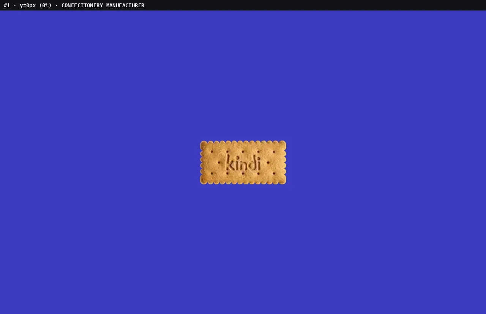
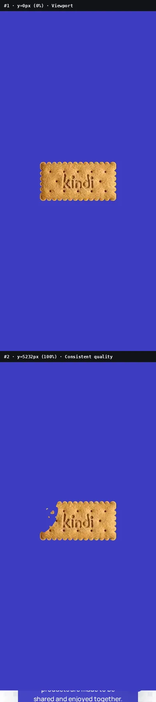

# UI Design System & Master Generation Blueprint: kindi-land

> **Kindi & Kitir — a confectionery manufacturer in Turkmenistan** (https://kindi.land/) — We have been producing crackers, cookies, and rusks for local and international markets since 2019.





---

## 1. Executive Visual Persona & Design Archetype

- **Brand Essence & Persona**: **Kindi & Kitir — a confectionery manufacturer in Turkmenistan** (`https://kindi.land/`). We have been producing crackers, cookies, and rusks for local and international markets since 2019.
- **Capture Provenance**: Live browser capture (`tier1_fast`, HTTP `200`, captured `2026-11-24`).
- **Visual Archetype**: **Light-Gallery WebGL / Canvas Interactive Experience (`#ffffff` / `#ff0000`)**.
- **Anti-AI-Slop Differentiators**:
  - **Live-Computed Chromatic Polarity**: Anchors the viewport in `#ffffff` (live computed `body` `background-color` (`computed_styles.json`)) paired with `#171717` primary typography and `#ff0000` accents.
  - **Grounded Typographic Hierarchy**: Pairs `customFont2` for display copy (`CONFECTIONERY MANUFACTURER`) with `Outfit` and `SFMono-Regular`.
  - **Calibrated Spatial Grid & Motion**: Combines `96rem` container bounds (`gap: .4rem`, padding `32px`) with `cubic-bezier(.4,0,.2,1)` easing and Lenis Smooth Scroll (`data-lenis`), HTML5 `<canvas>` Interactive Viewport Surface.

---

## 2. Spatial Architecture & Modular Grid Mathematics

### Viewport Allocation & Container Geometry
- **Captured Journey Filmstrips**: Desktop `1280×828px` (`assets/desktop-journey.webp`, `1` keyframes up to `y=0px` / doc `7194px`), Mobile `390×1744px` (`assets/mobile-journey.webp`, `2` keyframes).
- **Master Container Bounds**: `96rem` (non-`@media` desktop container stylesheet rule).
- **Canvas Lateral Padding & Spacing**: `32px` lateral canvas padding with `.4rem` grid gap.
- **Border Radius Scale**: `.25rem`, `var(--radius-2xl)`, `var(--radius-3xl)`, `var(--radius-4xl)`.

### Responsive Breakpoint Architecture
- **Desktop Layout**: Multi-column CSS Grid / Flexbox layout at `1440px` (`max-width: 96rem`, `gap: .4rem`).
- **Mobile Layout**: Single-column vertical stack at `390px` viewport width with `32px` horizontal padding.
- **Extracted CSS Media Queries**: `@media (min-width:40rem)`, `@media (min-width:48rem)`, `@media (min-width:64rem)`, `@media (min-width:80rem)`.

---

## 3. Color System, Materiality & Atmospheric Lighting

### Semantic Palette & Source Grounding
| Semantic Role | Ground-Truth Value | Extracted Live / CSS Source |
|---|---|---|
| **Primary Canvas Substrate** | `#ffffff` | live computed `body` `background-color` (`computed_styles.json`) |
| **Primary Typography Ink** | `#171717` | live computed `body` `color` (`computed_styles.json`) |
| **Elevated Surface / Card Substrate** | `#fcfcfc` | `var(--card)` in `:root` |
| **Interactive Accent / Highlight** | `#ff0000` | `.sm-scope .sm-socials-link:hover { color: #ff0000 }` |
| **Secondary / Muted Copy** | `#707070` | `var(--sidebar-foreground)` in `:root` |
| **Structural Hairline Border** | `#dfdfdf` | `var(--border)` in `:root` |
| **Variable Token (`--popover-foreground`)** | `#525252` | `var(--popover-foreground)` in `:root` |
| **Variable Token (`--primary`)** | `#3d3dc2` | `var(--primary)` in `:root` |
| **Variable Token (`--secondary`)** | `#fdfdfd` | `var(--secondary)` in `:root` |
| **Variable Token (`--muted`)** | `#ededed` | `var(--muted)` in `:root` |
| **Variable Token (`--muted-foreground`)** | `#202020` | `var(--muted-foreground)` in `:root` |
| **Variable Token (`--destructive`)** | `#ca3214` | `var(--destructive)` in `:root` |
| **Variable Token (`--destructive-foreground`)** | `#fffcfc` | `var(--destructive-foreground)` in `:root` |

### Sanitized Root CSS Variables (`ui-ux.md` Ground Truth)
| Variable Name | Extracted Value | Semantic Role |
|---|---|---|
| `--background` | `#fff` | Canvas / Surface Token |
| `--foreground` | `#171717` | Typography Ink Token |
| `--card` | `#fcfcfc` | Color / Atmospheric Token |
| `--card-foreground` | `#171717` | Typography Ink Token |
| `--popover` | `#fcfcfc` | Color / Atmospheric Token |
| `--popover-foreground` | `#525252` | Typography Ink Token |
| `--primary` | `#3d3dc2` | Brand / Palette Token |
| `--primary-foreground` | `#fff` | Typography Ink Token |
| `--secondary` | `#fdfdfd` | Brand / Palette Token |
| `--secondary-foreground` | `#171717` | Typography Ink Token |
| `--muted` | `#ededed` | Color / Atmospheric Token |
| `--muted-foreground` | `#202020` | Typography Ink Token |
| `--accent` | `#ededed` | Brand / Palette Token |
| `--accent-foreground` | `#202020` | Typography Ink Token |
| `--destructive` | `#ca3214` | Color / Atmospheric Token |
| `--destructive-foreground` | `#fffcfc` | Typography Ink Token |

---

## 4. Typographic Scale & Editorial Hierarchy

### Font Family Stacks
- **Display Typography**: `customFont2`.
- **Primary Body Stack**: `Outfit`.
- **Technical / Metadata Stack**: `SFMono-Regular`.

### Typographic Scale & Rules (Live Computed & Stylesheet Grounded)
- **Hero Display (`H1`)**: live computed `h1` (`font-size: 96px`, `line-height: 96px`, `font-weight: 400`); CSS variables `--text-4xl: 2.25rem`, `--text-4xl--line-height: calc(2.5/2.25)`, `--text-5xl: 3rem`.
- **Section Heading (`H2`)**: live computed `h2` (`font-size: 72px`, `line-height: 72px`, `font-weight: 400`); CSS variables `--text-2xl: 1.5rem`, `--text-2xl--line-height: calc(2/1.5)`, `--text-3xl: 1.875rem`.
- **Body Copy**: live computed `body` (`font-size: 16px`, `line-height: 24px`, `font-weight: 400`); CSS variables `--text-base: 1rem`, `--text-base--line-height: calc(1.5/1)`.
- **Metadata & Navigation Labels**: live computed `nav/a` (`font-size: 16px`, `line-height: 24px`, `font-weight: 400`); CSS variables `--font-mono: monospace`, `--text-xs: .75rem`, `--text-xs--line-height: calc(1/.75)`.

---

## 5. Choreographed Motion & Interaction Physics

### Primary Easing Curves
- **Extracted Timing Functions**: `cubic-bezier(.4,0,.2,1)`, `cubic-bezier(.4,0,.6,1)`.

### Per-Element Transition & Choreography Rules
- **Selector `layer theme`**: `transition: .15s` extracted from `kindi-land` stylesheet.
- **Selector `footer a:after`**: `transition: -webkit-transform .5s` extracted from `kindi-land` stylesheet.
- **Selector `aside a:after`**: `transition: -webkit-transform .5s` extracted from `kindi-land` stylesheet.
- **Extracted Easing Curve (`cubic-bezier(.4,0,.2,1)`)**: Governs interactive state transitions across `<header.staggered-menu-header>` and `<section.py-24>`.
- **Runtime Interaction Engine**: Integrates Lenis Smooth Scroll (`data-lenis`), HTML5 `<canvas>` Interactive Viewport Surface with `prefers-reduced-motion: reduce` fallback guards.
### Measured Runtime Scroll & Interaction Telemetry (`behavioral_journey_v2`)
- **Scroll Driver Mode**: `native` (max document height `7194px`, deepest scrollY reached `0px` across `1` desktop keyframes).
- **Detected Scroll / Motion Libraries**: Native browser scroll / standard CSS transitions.

---

## 6. Component Wireframe & Structural DOM Map

### Visual Layout Schematic — Desktop (`1440px`, Grounded in `dom.html` & Landmark Bounding Boxes)
```
┌────────────────────────────────────────────────────────────────────────┐
│ DESKTOP VIEWPORT (1440px) — Kindi & Kitir — a confectionery manufactur │
│ ====================================================================== │
│ [ <header.staggered-menu (1440x102px) | Overview · Index · Archive · ] │
│ ---------------------------------------------------------------------- │
│ | HERO STAGE: <section.relative> (w=1440px)                          | │
│ | H1: CONFECTIONERY MANUFACTURER                                     | │
│ | Substrate: #ffffff | Ink: #171717 | Accent: #ff0000                | │
│ ---------------------------------------------------------------------- │
│ | SHOWCASE GRID (<section.py-24>) max-w: 96rem                       | │
│ | +------------------------------+  +------------------------------+ | │
│ | | confectionery manufacturer   |  | We have been producing crack | | │
│ | +------------------------------+  +------------------------------+ | │
│ ---------------------------------------------------------------------- │
│ | DETAIL MODULE (<section.pb-20>) — Every batch is tested            | │
│ ---------------------------------------------------------------------- │
│ [ FOOTER (<footer.relative>   ) | https://kindi.land/                  │
└────────────────────────────────────────────────────────────────────────┘
```

### Visual Layout Schematic — Mobile Reflow (`390px`)
```
┌────────────────────────────────────────────────────────────────────────┐
│ MOBILE VIEWPORT REFLOW (390px) — Single-Column Stack (gap: .4rem)      │
│ ====================================================================== │
│ [ HEADER BAR (<header.staggered-menu-h) | Compact Menu (390px)         │
│ ---------------------------------------------------------------------- │
│ | HERO STAGE (<section.relative>) — 390px Vertical Lead              | │
│ | H1: CONFECTIONERY MANUFACTURER                                     | │
│ ---------------------------------------------------------------------- │
│ | SHOWCASE STACK (<section.py-24>) — 1-Col Stack                     | │
│ | [ Item 1: confectionery manufacturer                             ] | │
│ | [ Item 2: We have been producing crackers, cookies, and cro...   ] | │
│ ---------------------------------------------------------------------- │
│ | DETAIL STACK (<section.pb-20>) — 1-Col (Every batch is tes)        | │
│ ---------------------------------------------------------------------- │
│ [ FOOTER (<footer.relative>   ) | Stacked 390px Colophon               │
└────────────────────────────────────────────────────────────────────────┘
```

### Granular DOM Region Breakdown
1. **Brand Header & Navigation Bar (<header.staggered-menu-header> — `kindi-land`)**:
   - Landmark `<header class="staggered-menu-header pointer-events-none">` (`1440x102px`) hosting `Kindi & Kitir — a confectionery manu` navigation (`Overview · Index · Archive · About · Contact`), DOM attributes (`data-precedence="next"`, `data-position="right"`, `data-index="1"`, `data-index="2"`), and stylesheet rule `font_69087933-module__VMELHW__cla... { font-family:customFont,customFont Fallback }`.
2. **Hero Stage & Focal Lead (<section.relative> — `CONFECTIONERY MANUFACTURER`)**:
   - Landmark `<section class="relative h-full">` presenting display lead `CONFECTIONERY MANUFACTURER` and copy excerpt *"We source high‑quality grains and spices to create snacks you can"* over `#ffffff` canvas and `#171717` ink.
3. **Primary Showcase & Content Grid (<section.py-24> — `confectionery manufacturer`)**:
   - Landmark `<section class="py-24 flex">` rendering section `confectionery manufacturer` with copy *"WE OFFER QUALITY PARTNERSHIP"*, asset references (`49ed31c42e0eea42.css`, `e2dcd0ad6001165c.js`, `1175336dc77a2bf9.js`, `ac3a7ffed65b3ce5.js`), and grid rule `mfont_69087933-module__VMELHW__va... { --font-custom:"customFont","customFont Fallback" }`.
4. **Interactive Detail & Feature Matrix (<section.pb-20> — `We have been producing crackers, c`)**:
   - Landmark `<section class="pb-20 relative">` framing `We have been producing crackers, cookies, and cro...` and `Every batch is tested so flavor, crunch, and fre` (*"Every batch is tested so flavor, crunch, and freshness are always"*) with `#fcfcfc` surface cards, `#ff0000` accents, and `font-face { font-family:customFont2;src:url(../media/custom2-s.p.afe4611e.woff2)form... }`.
5. **Colophon & Global Directory Footer (<footer.relative> — `https://kindi.land/`)**:
   - Landmark `<footer class="relative z-10">` anchoring `Kindi & Kitir — a confectionery ` footer links (`Overview · Index · Archive · About · Contact`), copy *"From kids to grown‑ups, our products are made to be shared a"*, and `#dfdfdf` structural dividers.
### Full Vertical Scroll Sequence (Desktop `1440×900` Keyframes)
- **Step 01** (`y=0px`, `0%`): Active landmark `CONFECTIONERY MANUFACTURER` · sticky/fixed elements: `3`

---

## 7. Master Zero-Shot AI Generation Prompt

```markdown
# Master Zero-Shot Frontend Generation Prompt: kindi-land (Kindi & Kitir — a confectionery manufacturer in Turkmenistan)

You are a principal frontend architect and design systems engineer. Build a complete, production-ready web application replicating the exact design system, DOM landmarks, typographic hierarchy, color tokens, and motion physics of `kindi-land` (**Kindi & Kitir — a confectionery manufacturer in Turkmenistan** — `https://kindi.land/`).

### 1. Visual Archetype & Anti-AI-Slop Mandates
- **Archetype**: Light-Gallery WebGL / Canvas Interactive Experience (`#ffffff` / `#ff0000`).
- **Identity & Domain Context**: We have been producing crackers, cookies, and rusks for local and international markets since 2019.
- **Primary Substrate**: `#ffffff` (live computed `body` `background-color` (`computed_styles.json`)), **Primary Ink**: `#171717`, **Accent / Highlight**: `#ff0000`.
- **Site-Specific Differentiators**:
  - **Live-Computed Chromatic Polarity**: Anchors the viewport in `#ffffff` (live computed `body` `background-color` (`computed_styles.json`)) paired with `#171717` primary typography and `#ff0000` accents.
  - **Grounded Typographic Hierarchy**: Pairs `customFont2` for display copy (`CONFECTIONERY MANUFACTURER`) with `Outfit` and `SFMono-Regular`.
  - **Calibrated Spatial Grid & Motion**: Combines `96rem` container bounds (`gap: .4rem`, padding `32px`) with `cubic-bezier(.4,0,.2,1)` easing and Lenis Smooth Scroll (`data-lenis`), HTML5 `<canvas>` Interactive Viewport Surface.

### 2. Ground-Truth CSS Variables (`:root` Token Contract)
Declare and consume these exact custom properties extracted from `kindi-land` in your global stylesheet:

:root {
  /* Kindi & Kitir — a confectionery manufacturer in Turkmenistan (kindi-land) — Live-Grounded CSS Variables */
  --background: #fff; /* Canvas / Surface Token (kindi-land) */
  --foreground: #171717; /* Typography Ink Token (kindi-land) */
  --card: #fcfcfc; /* Color / Atmospheric Token (kindi-land) */
  --card-foreground: #171717; /* Typography Ink Token (kindi-land) */
  --popover: #fcfcfc; /* Color / Atmospheric Token (kindi-land) */
  --popover-foreground: #525252; /* Typography Ink Token (kindi-land) */
  --primary: #3d3dc2; /* Brand / Palette Token (kindi-land) */
  --primary-foreground: #fff; /* Typography Ink Token (kindi-land) */
  --secondary: #fdfdfd; /* Brand / Palette Token (kindi-land) */
  --secondary-foreground: #171717; /* Typography Ink Token (kindi-land) */
  --muted: #ededed; /* Color / Atmospheric Token (kindi-land) */
  --muted-foreground: #202020; /* Typography Ink Token (kindi-land) */
  --accent: #ededed; /* Brand / Palette Token (kindi-land) */
  --accent-foreground: #202020; /* Typography Ink Token (kindi-land) */
  --destructive: #ca3214; /* Color / Atmospheric Token (kindi-land) */
  --destructive-foreground: #fffcfc; /* Typography Ink Token (kindi-land) */
}

### 3. Semantic Color & Materiality Contract
Map every surface, ink, and border strictly to these source-grounded tokens:
- **Primary Canvas Substrate**: `#ffffff` — grounded in live computed `body` `background-color` (`computed_styles.json`)
- **Primary Typography Ink**: `#171717` — grounded in live computed `body` `color` (`computed_styles.json`)
- **Elevated Surface / Card Substrate**: `#fcfcfc` — grounded in `var(--card)` in `:root`
- **Interactive Accent / Highlight**: `#ff0000` — grounded in `.sm-scope .sm-socials-link:hover { color: #ff0000 }`
- **Secondary / Muted Copy**: `#707070` — grounded in `var(--sidebar-foreground)` in `:root`
- **Structural Hairline Border**: `#dfdfdf` — grounded in `var(--border)` in `:root`
- **Variable Token (`--popover-foreground`)**: `#525252` — grounded in `var(--popover-foreground)` in `:root`
- **Variable Token (`--primary`)**: `#3d3dc2` — grounded in `var(--primary)` in `:root`
- **Variable Token (`--secondary`)**: `#fdfdfd` — grounded in `var(--secondary)` in `:root`
- **Variable Token (`--muted`)**: `#ededed` — grounded in `var(--muted)` in `:root`
- **Variable Token (`--muted-foreground`)**: `#202020` — grounded in `var(--muted-foreground)` in `:root`
- **Variable Token (`--destructive`)**: `#ca3214` — grounded in `var(--destructive)` in `:root`
- **Variable Token (`--destructive-foreground`)**: `#fffcfc` — grounded in `var(--destructive-foreground)` in `:root`

### 4. Spatial Grid, Container Bounds & Responsive Breakpoints
- **Desktop Viewport Reference**: `1280×828px` (single-viewport 100vh live capture (900px), `1440px` standard desktop width).
- **Mobile Viewport Reference**: `390×1744px` (full-page live capture (1744px), `390px` standard mobile width).
- **Container Max-Width**: `96rem` (non-`@media` desktop container stylesheet rule)
- **Padding & Gutters**: `32px` lateral canvas padding with `.4rem` grid gap
- **Desktop Grid**: Multi-column CSS Grid / Flexbox layout at `1440px` (`max-width: 96rem`, `gap: .4rem`)
- **Mobile Adaptation**: Single-column vertical stack at `390px` viewport width with `32px` horizontal padding
- **Media Queries**: `@media (min-width:40rem)`, `@media (min-width:48rem)`, `@media (min-width:64rem)`, `@media (min-width:80rem)`
- **Corner Radii**: `.25rem`, `var(--radius-2xl)`, `var(--radius-3xl)`, `var(--radius-4xl)`

### 5. Typography & Editorial Scale Contract
- **Display Font Stack**: `customFont2`
- **Body Font Stack**: `Outfit`
- **Monospace / Technical Font Stack**: `SFMono-Regular`
- **H1 Display Rule**: live computed `h1` (`font-size: 96px`, `line-height: 96px`, `font-weight: 400`); CSS variables `--text-4xl: 2.25rem`, `--text-4xl--line-height: calc(2.5/2.25)`, `--text-5xl: 3rem`
- **H2 Section Rule**: live computed `h2` (`font-size: 72px`, `line-height: 72px`, `font-weight: 400`); CSS variables `--text-2xl: 1.5rem`, `--text-2xl--line-height: calc(2/1.5)`, `--text-3xl: 1.875rem`
- **Body Copy Rule**: live computed `body` (`font-size: 16px`, `line-height: 24px`, `font-weight: 400`); CSS variables `--text-base: 1rem`, `--text-base--line-height: calc(1.5/1)`
- **Metadata & Index Rule**: live computed `nav/a` (`font-size: 16px`, `line-height: 24px`, `font-weight: 400`); CSS variables `--font-mono: monospace`, `--text-xs: .75rem`, `--text-xs--line-height: calc(1/.75)`

### 6. Component Hierarchy, Verbatim Copy & Real DOM Landmarks
Scaffold `kindi-land` (`Kindi & Kitir — a confectionery manufacturer in Turkmenistan`) with these exact structural regions, extracted copy, and CSS rules from `dom.html`:
1. **Brand Header & Navigation Bar (<header.staggered-menu-header> — `kindi-land`)**:
   - DOM & Selectors: Landmark `<header class="staggered-menu-header pointer-events-none">` (`1440x102px`) hosting `Kindi & Kitir — a confectionery manu` navigation (`Overview · Index · Archive · About · Contact`), DOM attributes (`data-precedence="next"`, `data-position="right"`, `data-index="1"`, `data-index="2"`), and stylesheet rule `font_69087933-module__VMELHW__cla... { font-family:customFont,customFont Fallback }`.
   - Responsive Contract: Header `Brand Header & Navigation Bar (<header.staggered-menu-header> — `kindi-land`)` (`kindi-land`) adapts across `@media (min-width:40rem)`, `@media (min-width:48rem)`, `@media (min-width:64rem)`, `@media (min-width:80rem)` with `cubic-bezier(.4,0,.2,1)`, `cubic-bezier(.4,0,.6,1)` transitions and links `Overview · Index · Archive · About · Contact`.
2. **Hero Stage & Focal Lead (<section.relative> — `CONFECTIONERY MANUFACTURER`)**:
   - DOM & Selectors: Landmark `<section class="relative h-full">` presenting display lead `CONFECTIONERY MANUFACTURER` and copy excerpt *"We source high‑quality grains and spices to create snacks you can"* over `#ffffff` canvas and `#171717` ink.
   - Responsive Contract: Hero stage (`1280×828px` desktop / `390×1744px` mobile) sets `#ffffff` background with `#171717` headline `CONFECTIONERY MANUFACTURER`.
3. **Primary Showcase & Content Grid (<section.py-24> — `confectionery manufacturer`)**:
   - DOM & Selectors: Landmark `<section class="py-24 flex">` rendering section `confectionery manufacturer` with copy *"WE OFFER QUALITY PARTNERSHIP"*, asset references (`49ed31c42e0eea42.css`, `e2dcd0ad6001165c.js`, `1175336dc77a2bf9.js`, `ac3a7ffed65b3ce5.js`), and grid rule `mfont_69087933-module__VMELHW__va... { --font-custom:"customFont","customFont Fallback" }`.
   - Responsive Contract: Showcase grid `Primary Showcase & Content Grid (<section.py-24> — `confectionery manufacturer`)` applies Multi-column CSS Grid / Flexbox layout at `1440px` (`max-width: 96rem`, `gap: .4rem`) on desktop and Single-column vertical stack at `390px` viewport width with `32px` horizontal padding on mobile.
4. **Interactive Detail & Feature Matrix (<section.pb-20> — `We have been producing crackers, c`)**:
   - DOM & Selectors: Landmark `<section class="pb-20 relative">` framing `We have been producing crackers, cookies, and cro...` and `Every batch is tested so flavor, crunch, and fre` (*"Every batch is tested so flavor, crunch, and freshness are always"*) with `#fcfcfc` surface cards, `#ff0000` accents, and `font-face { font-family:customFont2;src:url(../media/custom2-s.p.afe4611e.woff2)form... }`.
   - Responsive Contract: Detail module `Interactive Detail & Feature Matrix (<section.pb-20> — `We have been producing crackers, c`)` uses `.25rem`, `var(--radius-2xl)`, `var(--radius-3xl)`, `var(--radius-4xl)` radii, `#ff0000` highlights, and assets (49ed31c42e0eea42.css, e2dcd0ad6001165c.js, 1175336dc77a2bf9.js).
5. **Colophon & Global Directory Footer (<footer.relative> — `https://kindi.land/`)**:
   - DOM & Selectors: Landmark `<footer class="relative z-10">` anchoring `Kindi & Kitir — a confectionery ` footer links (`Overview · Index · Archive · About · Contact`), copy *"From kids to grown‑ups, our products are made to be shared a"*, and `#dfdfdf` structural dividers.
   - Responsive Contract: Footer `Colophon & Global Directory Footer (<footer.relative> — `https://kindi.land/`)` aligns to `96rem` (non-`@media` desktop container stylesheet rule) with `32px` lateral canvas padding with `.4rem` grid gap and attributes (data-precedence="next", data-position="right", data-index="1").

#### Verbatim DOM Copy Excerpts (`dom.html`)
- Copy Excerpt 1: *"We source high‑quality grains and spices to create snacks you can feel good about."*
- Copy Excerpt 2: *"WE OFFER QUALITY PARTNERSHIP"*
- Copy Excerpt 3: *"Every batch is tested so flavor, crunch, and freshness are always on point."*
- Copy Excerpt 4: *"From kids to grown‑ups, our products are made to be shared and enjoyed together."*

### 7. Motion, Extracted Stylesheet Rules & Interaction Choreography
- **Primary Easing Functions**: `cubic-bezier(.4,0,.2,1)`, `cubic-bezier(.4,0,.6,1)`
- **Extracted Stylesheet Rules (`kindi-land`)**:
- `font_69087933-module__VMELHW__cla... { font-family:customFont,customFont Fallback }`
- `mfont_69087933-module__VMELHW__va... { --font-custom:"customFont","customFont Fallback" }`
- `font-face { font-family:customFont2;src:url(../media/custom2-s.p.afe4611e.woff2)form... }`
- `ont2_8f3bcc0e-module__JLimDW__cla... { font-family:customFont2,customFont2 Fallback }`
- `font2_8f3bcc0e-module__JLimDW__va... { --font-custom2:"customFont2","customFont2 Fallback" }`
- **Per-Selector Transition Rules**:
- **Selector `layer theme`**: `transition: .15s` extracted from `kindi-land` stylesheet.
- **Selector `footer a:after`**: `transition: -webkit-transform .5s` extracted from `kindi-land` stylesheet.
- **Selector `aside a:after`**: `transition: -webkit-transform .5s` extracted from `kindi-land` stylesheet.
- **Extracted Easing Curve (`cubic-bezier(.4,0,.2,1)`)**: Governs interactive state transitions across `<header.staggered-menu-header>` and `<section.py-24>`.
- **Runtime Interaction Engine**: Integrates Lenis Smooth Scroll (`data-lenis`), HTML5 `<canvas>` Interactive Viewport Surface with `prefers-reduced-motion: reduce` fallback guards.
### 7b. Full-Page Scroll Choreography, Interactive States & Multi-Page Routes
- **Scroll Mechanics**: Implement `native` vertical progression up to `7194px` across 1 distinct viewport chapters.
- **Vertical Chapter Sequence**: CONFECTIONERY MANUFACTURER (0%).

### 8. Technical Deliverables
- Implement in Next.js (App Router) with TypeScript and Tailwind CSS consuming the `:root` custom properties defined above for `kindi-land`.
- Reproduce both the `1440px` desktop architecture and `390px` mobile breakpoint transitions, preserving semantic HTML5 landmarks (`<header>`, `<nav>`, `<main>`, `<section>`, `<footer>`) and `prefers-reduced-motion` accessibility guards.
```
---

## 8. Full-Page Scroll Journey, Interactive States & Subpage Inventory

### Desktop Scroll Keyframes (`1440×900` WebP)
| Step | Scroll Y | Progress | Active Landmark / Section | Sticky/Fixed | Visual Asset |
| :---: | :---: | :---: | :--- | :---: | :--- |
| `#01` | `0px` | `0%` | CONFECTIONERY MANUFACTURER | `3` | [desktop-step-01.webp](assets/desktop-step-01.webp) |

### Mobile Condensed Keyframes (`390×844` WebP)
| Step | Scroll Y | Progress | Active Landmark | Visual Asset |
| :---: | :---: | :---: | :--- | :--- |
| `#01` | `0px` | `0%` | Viewport | [mobile-step-01.webp](assets/mobile-step-01.webp) |
| `#02` | `5232px` | `100%` | Consistent quality | [mobile-step-02.webp](assets/mobile-step-02.webp) |

