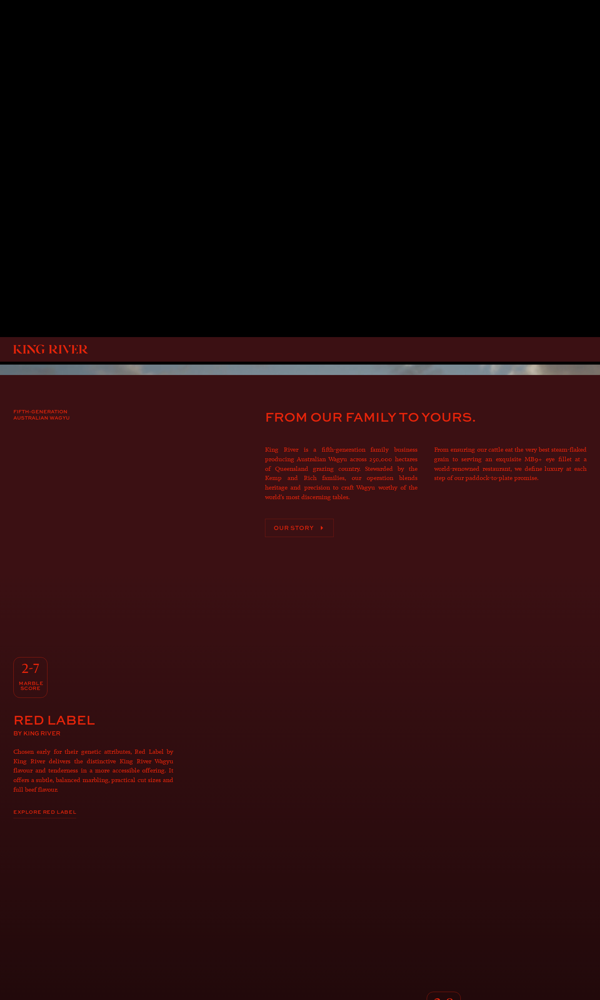

# UI Design System & Master Generation Blueprint: kingriver-com-au

> **Australian Wagyu Beef · King River Legendary Wagyu** (https://kingriver.com.au/) — Explore the exquisite taste of King River Australian Wagyu beef and its unique quality that sets it apart in the culinary world.



---

## 1. Executive Visual Persona & Design Archetype

- **Brand Essence & Persona**: **Australian Wagyu Beef · King River Legendary Wagyu** (`https://kingriver.com.au/`). Explore the exquisite taste of King River Australian Wagyu beef and its unique quality that sets it apart in the culinary world.
- **Visual Archetype**: **Light-Gallery WebGL / Canvas Interactive Experience (`#f6ede8` / `#e5240a`)**.
- **Anti-AI-Slop Differentiators**:
  - **Source-Grounded Chromatic Polarity**: Anchors the viewport in `#f6ede8` (`var(--button-base)` in `:root`) paired with `#3b1013` primary typography and `#e5240a` accents.
  - **Extracted Typographic Hierarchy**: Pairs `feijoa` for display copy (`King River`) with `sweet-sans-pro` and `SFMono-Regular`.
  - **Calibrated Spatial Grid & Motion**: Combines `640px` container bounds (`gap: .25rem`, padding `1.5rem`) with `cubic-bezier(.4,0,.2,1)` easing and Lenis Smooth Scroll (`data-lenis`), Three.js / WebGL Canvas Pipeline.

---

## 2. Spatial Architecture & Modular Grid Mathematics


### Viewport Allocation & Container Geometry
- **Captured Viewport Dimensions**: Desktop `1440×10193px` (`assets/desktop.png`, full-page scroll capture), Mobile `390×2400px` (`assets/mobile.png`, capped at 2400px multi-section capture).
- **Master Container Bounds**: `640px` extracted from `kingriver-com-au` stylesheet.
- **Canvas Lateral Padding & Spacing**: `1.5rem` lateral canvas padding with `.25rem` grid gap.
- **Border Radius Scale**: `.25rem`, `1rem`, `9999px`, `.5rem`.

### Responsive Breakpoint Architecture
- **Desktop Layout**: Multi-column CSS Grid / Flexbox layout at `1440px` (`max-width: 640px`, `gap: .25rem`).
- **Mobile Layout**: Single-column vertical stack at `390px` viewport width with `1.5rem` horizontal padding.
- **Extracted CSS Media Queries**: `@media (min-width:640px)`, `@media (min-width:768px)`, `@media (min-width:1024px)`, `@media (min-width:1280px)`.

---

## 3. Color System, Materiality & Atmospheric Lighting

### Semantic Palette & Source Grounding
| Semantic Role | Ground-Truth Value | Extracted CSS Source / Selector |
|---|---|---|
| **Primary Canvas Substrate** | `#f6ede8` | `var(--button-base)` in `:root` |
| **Primary Typography Ink** | `#3b1013` | `var(--button-ink)` in `:root` |
| **Elevated Surface / Card Substrate** | `#7d1a1c` | `var(--marker-color)` in `:root` |
| **Interactive Accent / Highlight** | `#e5240a` | `var(--marker-active-color)` in `:root` |
| **Secondary / Muted Copy** | `#551115` | `var(--beef-background)` in `:root` |
| **Structural Hairline Border** | `#f2e5de` | `var(--field-bg)` in `:root` |

### Sanitized Root CSS Variables (`ui-ux.md` Ground Truth)
| Variable Name | Extracted Value | Semantic Role |
|---|---|---|
| `--button-base` | `#f6ede8` | Color / Atmospheric Token |
| `--button-ink` | `#3b1013` | Typography Ink Token |
| `--button-fill` | `#f6ede8` | Color / Atmospheric Token |
| `--marker-size` | `12px` | Layout / Spatial Grid Token |
| `--marker-active-size` | `18px` | Layout / Spatial Grid Token |
| `--marker-color` | `#7d1a1c` | Brand / Palette Token |
| `--marker-active-color` | `#e5240a` | Brand / Palette Token |
| `--button-ease` | `cubic-bezier(0.33,1,0.68,1)` | Motion / Easing Token |
| `--button-sweep` | `0.34s` | Motion / Timing Token |
| `--pill-ease` | `cubic-bezier(0.33,1,0.68,1)` | Motion / Easing Token |
| `--jewel-slide-gap` | `1rem` | Layout / Spatial Grid Token |
| `--jewel-slide-size` | `82%` | Layout / Spatial Grid Token |
| `--beef-background` | `#551115` | Canvas / Surface Token |
| `--card-ease` | `cubic-bezier(0.33,1,0.68,1)` | Motion / Easing Token |
| `--row-ease` | `cubic-bezier(0.33,1,0.68,1)` | Motion / Easing Token |
| `--card-bg` | `#f6ede8` | Canvas / Surface Token |

---

## 4. Typographic Scale & Editorial Hierarchy

### Font Family Stacks
- **Display Typography**: `feijoa`.
- **Primary Body Stack**: `sweet-sans-pro`.
- **Technical / Metadata Stack**: `SFMono-Regular`.

### Typographic Scale & Rules (Extracted from Stylesheet & Variables)
- **Hero Display (`H1`)**: not explicitly declared on tag in static CSS (stylesheet font-size ladder: `1em`, `80%`, `75%`, `100%`, `14px`).
- **Section Heading (`H2`)**: rule `,h2` (`font-size: 1.375rem`, `font-weight: 700`).
- **Body Copy**: rule `p` (`font-size: .75rem`, `line-height: 2`, `letter-spacing: .05em`, `font-weight: 700`).
- **Metadata & Navigation Labels**: CSS variables `--chain-meta: 1rem`, `--chain-meta-gap: 1.25rem`, `--chain-caption-gap: 0px`.

---

## 5. Choreographed Motion & Interaction Physics

### Primary Easing Curves
- **Extracted Timing Functions**: `cubic-bezier(.4,0,.2,1)`, `cubic-bezier(0,0,.2,1)`, `cubic-bezier(.4,0,.6,1)`.

### Per-Element Transition & Choreography Rules
- **Selector `.link-underline:after`**: `transition: .3s` extracted from `kingriver-com-au` stylesheet.
- **Selector `.transition`**: `transition: .15s` extracted from `kingriver-com-au` stylesheet.
- **Selector `.transition-\[border-color\2c pad...`**: `transition: .15s` extracted from `kingriver-com-au` stylesheet.
- **Extracted Easing Curve (`cubic-bezier(.4,0,.2,1)`)**: Governs interactive state transitions across `<header.fixed>` and `<section.relative>`.
- **Runtime Interaction Engine**: Integrates Lenis Smooth Scroll (`data-lenis`), Three.js / WebGL Canvas Pipeline with `prefers-reduced-motion: reduce` fallback guards.

---

## 6. Component Wireframe & Structural DOM Map

### Visual Layout Schematic (Grounded in `dom.html` — `1440px` Desktop & `390px` Mobile Reflow)
```
┌────────────────────────────────────────────────────────────────────────┐
│ DESKTOP VIEWPORT (1440px) — Australian Wagyu Beef · King River Legenda │
│ ====================================================================== │
│ [ <header.fixed>           | Our Properties · Our Story · Our Beef  ]  │
│ ---------------------------------------------------------------------- │
│ | HERO STAGE: <section.remove-section-padding>                     |   │
│ | H1: King River                                                   |   │
│ | Substrate: #f6ede8    | Ink: #3b1013    | Accent: #e5240a        |   │
│ ---------------------------------------------------------------------- │
│ | SHOWCASE GRID (<section.relative>        ) max-w: 640px          |   │
│ | +------------------------------+  +------------------------------+ | │
│ | | From our family to yours.    |  | RED LABEL                    | | │
│ | +------------------------------+  +------------------------------+ | │
│ ---------------------------------------------------------------------- │
│ | MOBILE VIEWPORT REFLOW (390px) — Single-Column Stack (gap: .25rem) | │
│ | [<header.fixed>] -> [<section.remove-se] -> [<section.relative>] |   │
│ ---------------------------------------------------------------------- │
│ [ FOOTER (<footer.overflow-hidde) | https://kingriver.com.au/          │
└────────────────────────────────────────────────────────────────────────┘
```

### Granular DOM Region Breakdown
1. **Brand Header & Navigation Bar (<header.fixed> — `kingriver-com-au`)**:
   - Landmark `<header class="fixed top-0">` hosting `Australian Wagyu Beef · King River L` navigation (`Our Properties · Our Story · Our Beef · Jewel · Partners`), DOM attributes (`data-template="base.twig"`, `data-transition`, `data-transition-shade`, `data-transition-panel`), and stylesheet rule `before { border:0 solid e5e7eb;box-sizing:border-box }`.
2. **Hero Stage & Focal Lead (<section.remove-section-padding> — `King River`)**:
   - Landmark `<section class="remove-section-padding relative">` presenting display lead `King River` and copy excerpt *"King River Australian Wagyu"* over `#f6ede8` canvas and `#3b1013` ink.
3. **Primary Showcase & Content Grid (<section.relative> — `From our family to yours.`)**:
   - Landmark `<section class="relative bg-maroon-dark">` rendering section `From our family to yours.` with copy *"Queensland, Australia"*, asset references (`clarity.js`, `yxd9a243r4`, `gtm.js`, `humans.txt`), and grid rule `body { line-height:inherit;margin:0 }`.
4. **Interactive Detail & Feature Matrix (<section.home> — `RED LABEL`)**:
   - Landmark `<section class="home">` framing `RED LABEL` and `KING RIVER` (*"Fifth-generation Australian Wagyu"*) with `#7d1a1c` surface cards, `#e5240a` accents, and `strong { font-weight:bolder }`.
5. **Colophon & Global Directory Footer (<footer.overflow-hidden> — `https://kingriver.com.au/`)**:
   - Landmark `<footer class="overflow-hidden bg-maroon-dark">` anchoring `Australian Wagyu Beef · King Riv` footer links (`Our Properties · Our Story · Our Beef · Jewel · Partners`), copy *"King River is a fifth-generation family business producing A"*, and `#f2e5de` structural dividers.

---

## 7. Master Zero-Shot AI Generation Prompt

```markdown
# Master Zero-Shot Frontend Generation Prompt: kingriver-com-au (Australian Wagyu Beef · King River Legendary Wagyu)

You are a principal frontend architect and design systems engineer. Build a complete, production-ready web application replicating the exact design system, DOM landmarks, typographic hierarchy, color tokens, and motion physics of `kingriver-com-au` (**Australian Wagyu Beef · King River Legendary Wagyu** — `https://kingriver.com.au/`).

### 1. Visual Archetype & Anti-AI-Slop Mandates
- **Archetype**: Light-Gallery WebGL / Canvas Interactive Experience (`#f6ede8` / `#e5240a`).
- **Identity & Domain Context**: Explore the exquisite taste of King River Australian Wagyu beef and its unique quality that sets it apart in the culinary world.
- **Primary Substrate**: `#f6ede8` (`var(--button-base)` in `:root`), **Primary Ink**: `#3b1013`, **Accent / Highlight**: `#e5240a`.
- **Site-Specific Differentiators**:
  - **Source-Grounded Chromatic Polarity**: Anchors the viewport in `#f6ede8` (`var(--button-base)` in `:root`) paired with `#3b1013` primary typography and `#e5240a` accents.
  - **Extracted Typographic Hierarchy**: Pairs `feijoa` for display copy (`King River`) with `sweet-sans-pro` and `SFMono-Regular`.
  - **Calibrated Spatial Grid & Motion**: Combines `640px` container bounds (`gap: .25rem`, padding `1.5rem`) with `cubic-bezier(.4,0,.2,1)` easing and Lenis Smooth Scroll (`data-lenis`), Three.js / WebGL Canvas Pipeline.

### 2. Ground-Truth CSS Variables (`:root` Token Contract)
Declare and consume these exact custom properties extracted from `kingriver-com-au` in your global stylesheet:

:root {
  /* Australian Wagyu Beef · King River Legendary Wagyu (kingriver-com-au) — Ground-Truth Extracted CSS Variables */
  --button-base: #f6ede8; /* Color / Atmospheric Token (kingriver-com-au) */
  --button-ink: #3b1013; /* Typography Ink Token (kingriver-com-au) */
  --button-fill: #f6ede8; /* Color / Atmospheric Token (kingriver-com-au) */
  --marker-size: 12px; /* Layout / Spatial Grid Token (kingriver-com-au) */
  --marker-active-size: 18px; /* Layout / Spatial Grid Token (kingriver-com-au) */
  --marker-color: #7d1a1c; /* Brand / Palette Token (kingriver-com-au) */
  --marker-active-color: #e5240a; /* Brand / Palette Token (kingriver-com-au) */
  --button-ease: cubic-bezier(0.33,1,0.68,1); /* Motion / Easing Token (kingriver-com-au) */
  --button-sweep: 0.34s; /* Motion / Timing Token (kingriver-com-au) */
  --pill-ease: cubic-bezier(0.33,1,0.68,1); /* Motion / Easing Token (kingriver-com-au) */
  --jewel-slide-gap: 1rem; /* Layout / Spatial Grid Token (kingriver-com-au) */
  --jewel-slide-size: 82%; /* Layout / Spatial Grid Token (kingriver-com-au) */
  --beef-background: #551115; /* Canvas / Surface Token (kingriver-com-au) */
  --card-ease: cubic-bezier(0.33,1,0.68,1); /* Motion / Easing Token (kingriver-com-au) */
  --row-ease: cubic-bezier(0.33,1,0.68,1); /* Motion / Easing Token (kingriver-com-au) */
  --card-bg: #f6ede8; /* Canvas / Surface Token (kingriver-com-au) */
}

### 3. Semantic Color & Materiality Contract
Map every surface, ink, and border strictly to these source-grounded tokens:
- **Primary Canvas Substrate**: `#f6ede8` — grounded in `var(--button-base)` in `:root`
- **Primary Typography Ink**: `#3b1013` — grounded in `var(--button-ink)` in `:root`
- **Elevated Surface / Card Substrate**: `#7d1a1c` — grounded in `var(--marker-color)` in `:root`
- **Interactive Accent / Highlight**: `#e5240a` — grounded in `var(--marker-active-color)` in `:root`
- **Secondary / Muted Copy**: `#551115` — grounded in `var(--beef-background)` in `:root`
- **Structural Hairline Border**: `#f2e5de` — grounded in `var(--field-bg)` in `:root`

### 4. Spatial Grid, Container Bounds & Responsive Breakpoints
- **Desktop Viewport Reference**: `1440×10193px` (full-page scroll capture, `1440px` standard desktop width).
- **Mobile Viewport Reference**: `390×2400px` (capped at 2400px multi-section capture, `390px` standard mobile width).
- **Container Max-Width**: `640px` extracted from `kingriver-com-au` stylesheet
- **Padding & Gutters**: `1.5rem` lateral canvas padding with `.25rem` grid gap
- **Desktop Grid**: Multi-column CSS Grid / Flexbox layout at `1440px` (`max-width: 640px`, `gap: .25rem`)
- **Mobile Adaptation**: Single-column vertical stack at `390px` viewport width with `1.5rem` horizontal padding
- **Media Queries**: `@media (min-width:640px)`, `@media (min-width:768px)`, `@media (min-width:1024px)`, `@media (min-width:1280px)`
- **Corner Radii**: `.25rem`, `1rem`, `9999px`, `.5rem`

### 5. Typography & Editorial Scale Contract
- **Display Font Stack**: `feijoa`
- **Body Font Stack**: `sweet-sans-pro`
- **Monospace / Technical Font Stack**: `SFMono-Regular`
- **H1 Display Rule**: not explicitly declared on tag in static CSS (stylesheet font-size ladder: `1em`, `80%`, `75%`, `100%`, `14px`)
- **H2 Section Rule**: rule `,h2` (`font-size: 1.375rem`, `font-weight: 700`)
- **Body Copy Rule**: rule `p` (`font-size: .75rem`, `line-height: 2`, `letter-spacing: .05em`, `font-weight: 700`)
- **Metadata & Index Rule**: CSS variables `--chain-meta: 1rem`, `--chain-meta-gap: 1.25rem`, `--chain-caption-gap: 0px`

### 6. Component Hierarchy, Verbatim Copy & Real DOM Landmarks
Scaffold `kingriver-com-au` (`Australian Wagyu Beef · King River Legendary Wagyu`) with these exact structural regions, extracted copy, and CSS rules from `dom.html`:
1. **Brand Header & Navigation Bar (<header.fixed> — `kingriver-com-au`)**:
   - DOM & Selectors: Landmark `<header class="fixed top-0">` hosting `Australian Wagyu Beef · King River L` navigation (`Our Properties · Our Story · Our Beef · Jewel · Partners`), DOM attributes (`data-template="base.twig"`, `data-transition`, `data-transition-shade`, `data-transition-panel`), and stylesheet rule `before { border:0 solid e5e7eb;box-sizing:border-box }`.
   - Responsive Contract: Header `Brand Header & Navigation Bar (<header.fixed> — `kingriver-com-au`)` (`kingriver-com-au`) adapts across `@media (min-width:640px)`, `@media (min-width:768px)`, `@media (min-width:1024px)`, `@media (min-width:1280px)` with `cubic-bezier(.4,0,.2,1)`, `cubic-bezier(0,0,.2,1)`, `cubic-bezier(.4,0,.6,1)` transitions and links `Our Properties · Our Story · Our Beef · Jewel · Partners`.
2. **Hero Stage & Focal Lead (<section.remove-section-padding> — `King River`)**:
   - DOM & Selectors: Landmark `<section class="remove-section-padding relative">` presenting display lead `King River` and copy excerpt *"King River Australian Wagyu"* over `#f6ede8` canvas and `#3b1013` ink.
   - Responsive Contract: Hero stage (`1440×10193px` desktop / `390×2400px` mobile) sets `#f6ede8` background with `#3b1013` headline `King River`.
3. **Primary Showcase & Content Grid (<section.relative> — `From our family to yours.`)**:
   - DOM & Selectors: Landmark `<section class="relative bg-maroon-dark">` rendering section `From our family to yours.` with copy *"Queensland, Australia"*, asset references (`clarity.js`, `yxd9a243r4`, `gtm.js`, `humans.txt`), and grid rule `body { line-height:inherit;margin:0 }`.
   - Responsive Contract: Showcase grid `Primary Showcase & Content Grid (<section.relative> — `From our family to yours.`)` applies Multi-column CSS Grid / Flexbox layout at `1440px` (`max-width: 640px`, `gap: .25rem`) on desktop and Single-column vertical stack at `390px` viewport width with `1.5rem` horizontal padding on mobile.
4. **Interactive Detail & Feature Matrix (<section.home> — `RED LABEL`)**:
   - DOM & Selectors: Landmark `<section class="home">` framing `RED LABEL` and `KING RIVER` (*"Fifth-generation Australian Wagyu"*) with `#7d1a1c` surface cards, `#e5240a` accents, and `strong { font-weight:bolder }`.
   - Responsive Contract: Detail module `Interactive Detail & Feature Matrix (<section.home> — `RED LABEL`)` uses `.25rem`, `1rem`, `9999px`, `.5rem` radii, `#e5240a` highlights, and assets (clarity.js, yxd9a243r4, gtm.js).
5. **Colophon & Global Directory Footer (<footer.overflow-hidden> — `https://kingriver.com.au/`)**:
   - DOM & Selectors: Landmark `<footer class="overflow-hidden bg-maroon-dark">` anchoring `Australian Wagyu Beef · King Riv` footer links (`Our Properties · Our Story · Our Beef · Jewel · Partners`), copy *"King River is a fifth-generation family business producing A"*, and `#f2e5de` structural dividers.
   - Responsive Contract: Footer `Colophon & Global Directory Footer (<footer.overflow-hidden> — `https://kingriver.com.au/`)` aligns to `640px` extracted from `kingriver-com-au` stylesheet with `1.5rem` lateral canvas padding with `.25rem` grid gap and attributes (data-template="base.twig", data-transition, data-transition-shade).

#### Verbatim DOM Copy Excerpts (`dom.html`)
- Copy Excerpt 1: *"King River Australian Wagyu"*
- Copy Excerpt 2: *"Queensland, Australia"*
- Copy Excerpt 3: *"Fifth-generation Australian Wagyu"*
- Copy Excerpt 4: *"King River is a fifth-generation family business producing Australian Wagyu across..."*

### 7. Motion, Extracted Stylesheet Rules & Interaction Choreography
- **Primary Easing Functions**: `cubic-bezier(.4,0,.2,1)`, `cubic-bezier(0,0,.2,1)`, `cubic-bezier(.4,0,.6,1)`
- **Extracted Stylesheet Rules (`kingriver-com-au`)**:
- `before { border:0 solid e5e7eb;box-sizing:border-box }`
- `body { line-height:inherit;margin:0 }`
- `strong { font-weight:bolder }`
- `small { font-size:80% }`
- `sup { font-size:75%;line-height:0;position:relative;vertical-align:baseline }`
- **Per-Selector Transition Rules**:
- **Selector `.link-underline:after`**: `transition: .3s` extracted from `kingriver-com-au` stylesheet.
- **Selector `.transition`**: `transition: .15s` extracted from `kingriver-com-au` stylesheet.
- **Selector `.transition-\[border-color\2c pad...`**: `transition: .15s` extracted from `kingriver-com-au` stylesheet.
- **Extracted Easing Curve (`cubic-bezier(.4,0,.2,1)`)**: Governs interactive state transitions across `<header.fixed>` and `<section.relative>`.
- **Runtime Interaction Engine**: Integrates Lenis Smooth Scroll (`data-lenis`), Three.js / WebGL Canvas Pipeline with `prefers-reduced-motion: reduce` fallback guards.

### 8. Technical Deliverables
- Implement in Next.js (App Router) with TypeScript and Tailwind CSS consuming the `:root` custom properties defined above for `kingriver-com-au`.
- Reproduce both the `1440px` desktop architecture and `390px` mobile breakpoint transitions, preserving semantic HTML5 landmarks (`<header>`, `<nav>`, `<main>`, `<section>`, `<footer>`) and `prefers-reduced-motion` accessibility guards.
```
