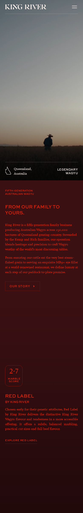

# UI Design System & Master Generation Blueprint: kingriver-com-au

> **Australian Wagyu Beef · King River Legendary Wagyu** (https://kingriver.com.au/) — Explore the exquisite taste of King River Australian Wagyu beef and its unique quality that sets it apart in the culinary world.


---

## 1. Executive Visual Persona & Design Archetype

- **Brand Essence & Persona**: **Australian Wagyu Beef · King River Legendary Wagyu** (`https://kingriver.com.au/`). Explore the exquisite taste of King River Australian Wagyu beef and its unique quality that sets it apart in the culinary world.
- **Capture Provenance**: Live browser capture (`tier1_fast`, HTTP `200`, captured `2026-11-23`).
- **Visual Archetype**: **Dark-Substrate WebGL / Canvas Interactive Experience (`#000000` / `#e5240a`)**.
- **Anti-AI-Slop Differentiators**:
  - **Live-Computed Chromatic Polarity**: Anchors the viewport in `#000000` (live computed `body` `background-color` (`computed_styles.json`)) paired with `#ffffff` primary typography and `#e5240a` accents.
  - **Grounded Typographic Hierarchy**: Pairs `sweet-sans-pro` for display copy (`KING RIVER`) with `feijoa` and `SFMono-Regular`.
  - **Calibrated Spatial Grid & Motion**: Combines `1690px` container bounds (`gap: .25rem`, padding `1.5rem`) with `cubic-bezier(.4,0,.2,1)` easing and Lenis Smooth Scroll (`data-lenis`), Three.js / WebGL Canvas Pipeline.

---

## 2. Spatial Architecture & Modular Grid Mathematics



### Viewport Allocation & Container Geometry
- **Captured Viewport Dimensions**: Desktop `1440×2400px` (`assets/desktop.png`, clamped at 2400px live multi-section capture), Mobile `390×2400px` (`assets/mobile.png`, clamped at 2400px live multi-section capture).
- **Master Container Bounds**: `1690px` (non-`@media` desktop container stylesheet rule).
- **Canvas Lateral Padding & Spacing**: `1.5rem` lateral canvas padding with `.25rem` grid gap.
- **Border Radius Scale**: `.25rem`, `1rem`, `9999px`, `.5rem`.

### Responsive Breakpoint Architecture
- **Desktop Layout**: Multi-column CSS Grid / Flexbox layout at `1440px` (`max-width: 1690px`, `gap: .25rem`).
- **Mobile Layout**: Single-column vertical stack at `390px` viewport width with `1.5rem` horizontal padding.
- **Extracted CSS Media Queries**: `@media (min-width:640px)`, `@media (min-width:768px)`, `@media (min-width:1024px)`, `@media (min-width:1280px)`.

---

## 3. Color System, Materiality & Atmospheric Lighting

### Semantic Palette & Source Grounding
| Semantic Role | Ground-Truth Value | Extracted Live / CSS Source |
|---|---|---|
| **Primary Canvas Substrate** | `#000000` | live computed `body` `background-color` (`computed_styles.json`) |
| **Primary Typography Ink** | `#ffffff` | `.wp-block-button__link { color: #ffffff }` |
| **Elevated Surface / Card Substrate** | `#3b1013` | live computed `footer` `background-color` (`computed_styles.json`) |
| **Interactive Accent / Highlight** | `#e5240a` | live computed `a` `color` (`computed_styles.json`) |
| **Secondary / Muted Copy** | `#e5240a` | live computed `p` `color` (`computed_styles.json`) |
| **Structural Hairline Border** | `#e5240a` | `var(--field-rule)` in `:root` |
| **Variable Token (`--wp-block-synced-color`)** | `#7a00df` | `var(--wp-block-synced-color)` in `:root` |
| **Variable Token (`--wp-editor-canvas-background`)** | `#dddddd` | `var(--wp-editor-canvas-background)` in `:root` |
| **Variable Token (`--wp-admin-theme-color`)** | `#007cba` | `var(--wp-admin-theme-color)` in `:root` |
| **Variable Token (`--wp-admin-theme-color-darker-10`)** | `#006ba1` | `var(--wp-admin-theme-color-darker-10)` in `:root` |
| **Variable Token (`--wp-admin-theme-color-darker-20`)** | `#005a87` | `var(--wp-admin-theme-color-darker-20)` in `:root` |
| **Variable Token (`--button-base`)** | `#f6ede8` | `var(--button-base)` in `:root` |

### Sanitized Root CSS Variables (`ui-ux.md` Ground Truth)
| Variable Name | Extracted Value | Semantic Role |
|---|---|---|
| `--wp-block-synced-color` | `#7a00df` | Brand / Palette Token |
| `--wp-block-synced-color--rgb` | `122,0,223` | Brand / Palette Token |
| `--wp-bound-block-color` | `var(--wp-block-synced-color)` | Brand / Palette Token |
| `--wp-editor-canvas-background` | `#ddd` | Canvas / Surface Token |
| `--wp-admin-theme-color` | `#007cba` | Brand / Palette Token |
| `--wp-admin-theme-color--rgb` | `0,124,186` | Brand / Palette Token |
| `--wp-admin-theme-color-darker-10` | `#006ba1` | Canvas / Surface Token |
| `--wp-admin-theme-color-darker-10--rgb` | `0,107,160.5` | Canvas / Surface Token |
| `--wp-admin-theme-color-darker-20` | `#005a87` | Canvas / Surface Token |
| `--wp-admin-theme-color-darker-20--rgb` | `0,90,135` | Canvas / Surface Token |
| `--wp-admin-border-width-focus` | `2px` | Layout / Spatial Grid Token |
| `--wp-admin--admin-bar--position-offset` | `var(--wp-admin--admin-bar--height,0px)` | Dimension / Scale Token |
| `--button-base` | `#f6ede8` | Color / Atmospheric Token |
| `--button-ink` | `#3b1013` | Typography Ink Token |
| `--button-fill` | `#f6ede8` | Color / Atmospheric Token |
| `--marker-size` | `12px` | Layout / Spatial Grid Token |

---

## 4. Typographic Scale & Editorial Hierarchy

### Font Family Stacks
- **Display Typography**: `sweet-sans-pro`.
- **Primary Body Stack**: `feijoa`.
- **Technical / Metadata Stack**: `SFMono-Regular`.

### Typographic Scale & Rules (Live Computed & Stylesheet Grounded)
- **Hero Display (`H1`)**: live computed `h1` (`font-size: 32px`, `line-height: 40px`, `font-weight: 700`).
- **Section Heading (`H2`)**: live computed `h2` (`font-size: 32px`, `line-height: 40px`, `font-weight: 700`); rule `,h2` (`font-size: 1.375rem`, `font-weight: 700`).
- **Body Copy**: live computed `body` (`font-size: 14px`, `line-height: 22.75px`, `font-weight: 500`); rule `p` (`font-size: .75rem`, `line-height: 2`, `letter-spacing: .05em`, `font-weight: 700`).
- **Metadata & Navigation Labels**: live computed `nav/a` (`font-size: 14px`, `line-height: 22.75px`, `font-weight: 500`); CSS variables `--chain-meta: 1rem`, `--chain-meta-gap: 1.25rem`, `--chain-caption-gap: 0px`.

---

## 5. Choreographed Motion & Interaction Physics

### Primary Easing Curves
- **Extracted Timing Functions**: `cubic-bezier(.4,0,.2,1)`, `cubic-bezier(0,0,.2,1)`, `cubic-bezier(.4,0,.6,1)`.

### Per-Element Transition & Choreography Rules
- **Selector `.link-underline:after`**: `transition: .3s` extracted from `kingriver-com-au` stylesheet.
- **Selector `.transition`**: `transition: .15s` extracted from `kingriver-com-au` stylesheet.
- **Selector `.transition-\[border-color\2c pad...`**: `transition: .15s` extracted from `kingriver-com-au` stylesheet.
- **Extracted Easing Curve (`cubic-bezier(.4,0,.2,1)`)**: Governs interactive state transitions across `<header.top-0>` and `<section.bg-maroon-dark>`.
- **Runtime Interaction Engine**: Integrates Lenis Smooth Scroll (`data-lenis`), Three.js / WebGL Canvas Pipeline with `prefers-reduced-motion: reduce` fallback guards.

---

## 6. Component Wireframe & Structural DOM Map

### Visual Layout Schematic — Desktop (`1440px`, Grounded in `dom.html` & Landmark Bounding Boxes)
```
┌────────────────────────────────────────────────────────────────────────┐
│ DESKTOP VIEWPORT (1440px) — Australian Wagyu Beef · King River Legenda │
│ ====================================================================== │
│ [ <header.top-0> (1440x59px)          | Our Properties · Our Story · ] │
│ ---------------------------------------------------------------------- │
│ | HERO STAGE: <section.remove-section-padding> (w=1440px)            | │
│ | H1: KING RIVER                                                     | │
│ | Substrate: #000000 | Ink: #ffffff | Accent: #e5240a                | │
│ ---------------------------------------------------------------------- │
│ | SHOWCASE GRID (<section.bg-maroon-dark>) max-w: 1690px             | │
│ | +------------------------------+  +------------------------------+ | │
│ | | King River                   |  | From our family to yours.    | | │
│ | +------------------------------+  +------------------------------+ | │
│ ---------------------------------------------------------------------- │
│ | DETAIL MODULE (<section.yoast-schema-grap) — AUSTRALIA’S FINEST LU | │
│ ---------------------------------------------------------------------- │
│ [ FOOTER (<footer.bg-maroon-da) | https://kingriver.com.au/            │
└────────────────────────────────────────────────────────────────────────┘
```

### Visual Layout Schematic — Mobile Reflow (`390px`)
```
┌────────────────────────────────────────────────────────────────────────┐
│ MOBILE VIEWPORT REFLOW (390px) — Single-Column Stack (gap: .25rem)     │
│ ====================================================================== │
│ [ HEADER BAR (<header.top-0>          ) | Compact Menu (390px)         │
│ ---------------------------------------------------------------------- │
│ | HERO STAGE (<section.remove-section-) — 390px Vertical Lead        | │
│ | H1: KING RIVER                                                     | │
│ ---------------------------------------------------------------------- │
│ | SHOWCASE STACK (<section.bg-maroon-dar) — 1-Col Stack              | │
│ | [ Item 1: King River                                             ] | │
│ | [ Item 2: From our family to yours.                              ] | │
│ ---------------------------------------------------------------------- │
│ | DETAIL STACK (<section.yoast-schema-gr) — 1-Col (AUSTRALIA’S FINEST) │
│ ---------------------------------------------------------------------- │
│ [ FOOTER (<footer.bg-maroon-da) | Stacked 390px Colophon               │
└────────────────────────────────────────────────────────────────────────┘
```

### Granular DOM Region Breakdown
1. **Brand Header & Navigation Bar (<header.top-0> — `kingriver-com-au`)**:
   - Landmark `<header class="top-0 text-gum-light">` (`1440x59px`) hosting `Australian Wagyu Beef · King River L` navigation (`Our Properties · Our Story · Our Beef · Jewel · Partners`), DOM attributes (`data-template="base.twig"`, `data-transition`, `data-transition-shade`, `data-transition-panel`), and stylesheet rule `.tk-sweet-sans-pro { font-family: "sweet-sans-pro",sans-serif; }`.
2. **Hero Stage & Focal Lead (<section.remove-section-padding> — `KING RIVER`)**:
   - Landmark `<section class="remove-section-padding h-svh">` presenting display lead `KING RIVER` and copy excerpt *"FIFTH-GENERATION AUSTRALIAN WAGYU"* over `#000000` canvas and `#ffffff` ink.
3. **Primary Showcase & Content Grid (<section.bg-maroon-dark> — `King River`)**:
   - Landmark `<section class="bg-maroon-dark relative">` rendering section `King River` with copy *"Queensland, Australia"*, asset references (`clarity.js`, `yxd9a243r4`, `gtm.js`, `humans.txt`), and grid rule `before { border:0 solid e5e7eb;box-sizing:border-box }`.
4. **Interactive Detail & Feature Matrix (<section.yoast-schema-graph> — `From our family to yours.`)**:
   - Landmark `<section class="yoast-schema-graph">` framing `From our family to yours.` and `AUSTRALIA’S FINEST LUXURY WAGYU. RAISED ON PURE P...` (*"Fifth-generation Australian Wagyu"*) with `#3b1013` surface cards, `#e5240a` accents, and `body { line-height:inherit;margin:0 }`.
5. **Colophon & Global Directory Footer (<footer.bg-maroon-dark> — `https://kingriver.com.au/`)**:
   - Landmark `<footer class="bg-maroon-dark text-scarlet">` anchoring `Australian Wagyu Beef · King Riv` footer links (`Our Properties · Our Story · Our Beef · Jewel · Partners`), copy *"King River is a fifth-generation family business producing A"*, and `#e5240a` structural dividers.

---

## 7. Master Zero-Shot AI Generation Prompt

```markdown
# Master Zero-Shot Frontend Generation Prompt: kingriver-com-au (Australian Wagyu Beef · King River Legendary Wagyu)

You are a principal frontend architect and design systems engineer. Build a complete, production-ready web application replicating the exact design system, DOM landmarks, typographic hierarchy, color tokens, and motion physics of `kingriver-com-au` (**Australian Wagyu Beef · King River Legendary Wagyu** — `https://kingriver.com.au/`).

### 1. Visual Archetype & Anti-AI-Slop Mandates
- **Archetype**: Dark-Substrate WebGL / Canvas Interactive Experience (`#000000` / `#e5240a`).
- **Identity & Domain Context**: Explore the exquisite taste of King River Australian Wagyu beef and its unique quality that sets it apart in the culinary world.
- **Primary Substrate**: `#000000` (live computed `body` `background-color` (`computed_styles.json`)), **Primary Ink**: `#ffffff`, **Accent / Highlight**: `#e5240a`.
- **Site-Specific Differentiators**:
  - **Live-Computed Chromatic Polarity**: Anchors the viewport in `#000000` (live computed `body` `background-color` (`computed_styles.json`)) paired with `#ffffff` primary typography and `#e5240a` accents.
  - **Grounded Typographic Hierarchy**: Pairs `sweet-sans-pro` for display copy (`KING RIVER`) with `feijoa` and `SFMono-Regular`.
  - **Calibrated Spatial Grid & Motion**: Combines `1690px` container bounds (`gap: .25rem`, padding `1.5rem`) with `cubic-bezier(.4,0,.2,1)` easing and Lenis Smooth Scroll (`data-lenis`), Three.js / WebGL Canvas Pipeline.

### 2. Ground-Truth CSS Variables (`:root` Token Contract)
Declare and consume these exact custom properties extracted from `kingriver-com-au` in your global stylesheet:

:root {
  /* Australian Wagyu Beef · King River Legendary Wagyu (kingriver-com-au) — Live-Grounded CSS Variables */
  --wp-block-synced-color: #7a00df; /* Brand / Palette Token (kingriver-com-au) */
  --wp-block-synced-color--rgb: 122,0,223; /* Brand / Palette Token (kingriver-com-au) */
  --wp-bound-block-color: var(--wp-block-synced-color); /* Brand / Palette Token (kingriver-com-au) */
  --wp-editor-canvas-background: #ddd; /* Canvas / Surface Token (kingriver-com-au) */
  --wp-admin-theme-color: #007cba; /* Brand / Palette Token (kingriver-com-au) */
  --wp-admin-theme-color--rgb: 0,124,186; /* Brand / Palette Token (kingriver-com-au) */
  --wp-admin-theme-color-darker-10: #006ba1; /* Canvas / Surface Token (kingriver-com-au) */
  --wp-admin-theme-color-darker-10--rgb: 0,107,160.5; /* Canvas / Surface Token (kingriver-com-au) */
  --wp-admin-theme-color-darker-20: #005a87; /* Canvas / Surface Token (kingriver-com-au) */
  --wp-admin-theme-color-darker-20--rgb: 0,90,135; /* Canvas / Surface Token (kingriver-com-au) */
  --wp-admin-border-width-focus: 2px; /* Layout / Spatial Grid Token (kingriver-com-au) */
  --wp-admin--admin-bar--position-offset: var(--wp-admin--admin-bar--height,0px); /* Dimension / Scale Token (kingriver-com-au) */
  --button-base: #f6ede8; /* Color / Atmospheric Token (kingriver-com-au) */
  --button-ink: #3b1013; /* Typography Ink Token (kingriver-com-au) */
  --button-fill: #f6ede8; /* Color / Atmospheric Token (kingriver-com-au) */
  --marker-size: 12px; /* Layout / Spatial Grid Token (kingriver-com-au) */
}

### 3. Semantic Color & Materiality Contract
Map every surface, ink, and border strictly to these source-grounded tokens:
- **Primary Canvas Substrate**: `#000000` — grounded in live computed `body` `background-color` (`computed_styles.json`)
- **Primary Typography Ink**: `#ffffff` — grounded in `.wp-block-button__link { color: #ffffff }`
- **Elevated Surface / Card Substrate**: `#3b1013` — grounded in live computed `footer` `background-color` (`computed_styles.json`)
- **Interactive Accent / Highlight**: `#e5240a` — grounded in live computed `a` `color` (`computed_styles.json`)
- **Secondary / Muted Copy**: `#e5240a` — grounded in live computed `p` `color` (`computed_styles.json`)
- **Structural Hairline Border**: `#e5240a` — grounded in `var(--field-rule)` in `:root`
- **Variable Token (`--wp-block-synced-color`)**: `#7a00df` — grounded in `var(--wp-block-synced-color)` in `:root`
- **Variable Token (`--wp-editor-canvas-background`)**: `#dddddd` — grounded in `var(--wp-editor-canvas-background)` in `:root`
- **Variable Token (`--wp-admin-theme-color`)**: `#007cba` — grounded in `var(--wp-admin-theme-color)` in `:root`
- **Variable Token (`--wp-admin-theme-color-darker-10`)**: `#006ba1` — grounded in `var(--wp-admin-theme-color-darker-10)` in `:root`
- **Variable Token (`--wp-admin-theme-color-darker-20`)**: `#005a87` — grounded in `var(--wp-admin-theme-color-darker-20)` in `:root`
- **Variable Token (`--button-base`)**: `#f6ede8` — grounded in `var(--button-base)` in `:root`

### 4. Spatial Grid, Container Bounds & Responsive Breakpoints
- **Desktop Viewport Reference**: `1440×2400px` (clamped at 2400px live multi-section capture, `1440px` standard desktop width).
- **Mobile Viewport Reference**: `390×2400px` (clamped at 2400px live multi-section capture, `390px` standard mobile width).
- **Container Max-Width**: `1690px` (non-`@media` desktop container stylesheet rule)
- **Padding & Gutters**: `1.5rem` lateral canvas padding with `.25rem` grid gap
- **Desktop Grid**: Multi-column CSS Grid / Flexbox layout at `1440px` (`max-width: 1690px`, `gap: .25rem`)
- **Mobile Adaptation**: Single-column vertical stack at `390px` viewport width with `1.5rem` horizontal padding
- **Media Queries**: `@media (min-width:640px)`, `@media (min-width:768px)`, `@media (min-width:1024px)`, `@media (min-width:1280px)`
- **Corner Radii**: `.25rem`, `1rem`, `9999px`, `.5rem`

### 5. Typography & Editorial Scale Contract
- **Display Font Stack**: `sweet-sans-pro`
- **Body Font Stack**: `feijoa`
- **Monospace / Technical Font Stack**: `SFMono-Regular`
- **H1 Display Rule**: live computed `h1` (`font-size: 32px`, `line-height: 40px`, `font-weight: 700`)
- **H2 Section Rule**: live computed `h2` (`font-size: 32px`, `line-height: 40px`, `font-weight: 700`); rule `,h2` (`font-size: 1.375rem`, `font-weight: 700`)
- **Body Copy Rule**: live computed `body` (`font-size: 14px`, `line-height: 22.75px`, `font-weight: 500`); rule `p` (`font-size: .75rem`, `line-height: 2`, `letter-spacing: .05em`, `font-weight: 700`)
- **Metadata & Index Rule**: live computed `nav/a` (`font-size: 14px`, `line-height: 22.75px`, `font-weight: 500`); CSS variables `--chain-meta: 1rem`, `--chain-meta-gap: 1.25rem`, `--chain-caption-gap: 0px`

### 6. Component Hierarchy, Verbatim Copy & Real DOM Landmarks
Scaffold `kingriver-com-au` (`Australian Wagyu Beef · King River Legendary Wagyu`) with these exact structural regions, extracted copy, and CSS rules from `dom.html`:
1. **Brand Header & Navigation Bar (<header.top-0> — `kingriver-com-au`)**:
   - DOM & Selectors: Landmark `<header class="top-0 text-gum-light">` (`1440x59px`) hosting `Australian Wagyu Beef · King River L` navigation (`Our Properties · Our Story · Our Beef · Jewel · Partners`), DOM attributes (`data-template="base.twig"`, `data-transition`, `data-transition-shade`, `data-transition-panel`), and stylesheet rule `.tk-sweet-sans-pro { font-family: "sweet-sans-pro",sans-serif; }`.
   - Responsive Contract: Header `Brand Header & Navigation Bar (<header.top-0> — `kingriver-com-au`)` (`kingriver-com-au`) adapts across `@media (min-width:640px)`, `@media (min-width:768px)`, `@media (min-width:1024px)`, `@media (min-width:1280px)` with `cubic-bezier(.4,0,.2,1)`, `cubic-bezier(0,0,.2,1)`, `cubic-bezier(.4,0,.6,1)` transitions and links `Our Properties · Our Story · Our Beef · Jewel · Partners`.
2. **Hero Stage & Focal Lead (<section.remove-section-padding> — `KING RIVER`)**:
   - DOM & Selectors: Landmark `<section class="remove-section-padding h-svh">` presenting display lead `KING RIVER` and copy excerpt *"FIFTH-GENERATION AUSTRALIAN WAGYU"* over `#000000` canvas and `#ffffff` ink.
   - Responsive Contract: Hero stage (`1440×2400px` desktop / `390×2400px` mobile) sets `#000000` background with `#ffffff` headline `KING RIVER`.
3. **Primary Showcase & Content Grid (<section.bg-maroon-dark> — `King River`)**:
   - DOM & Selectors: Landmark `<section class="bg-maroon-dark relative">` rendering section `King River` with copy *"Queensland, Australia"*, asset references (`clarity.js`, `yxd9a243r4`, `gtm.js`, `humans.txt`), and grid rule `before { border:0 solid e5e7eb;box-sizing:border-box }`.
   - Responsive Contract: Showcase grid `Primary Showcase & Content Grid (<section.bg-maroon-dark> — `King River`)` applies Multi-column CSS Grid / Flexbox layout at `1440px` (`max-width: 1690px`, `gap: .25rem`) on desktop and Single-column vertical stack at `390px` viewport width with `1.5rem` horizontal padding on mobile.
4. **Interactive Detail & Feature Matrix (<section.yoast-schema-graph> — `From our family to yours.`)**:
   - DOM & Selectors: Landmark `<section class="yoast-schema-graph">` framing `From our family to yours.` and `AUSTRALIA’S FINEST LUXURY WAGYU. RAISED ON PURE P...` (*"Fifth-generation Australian Wagyu"*) with `#3b1013` surface cards, `#e5240a` accents, and `body { line-height:inherit;margin:0 }`.
   - Responsive Contract: Detail module `Interactive Detail & Feature Matrix (<section.yoast-schema-graph> — `From our family to yours.`)` uses `.25rem`, `1rem`, `9999px`, `.5rem` radii, `#e5240a` highlights, and assets (clarity.js, yxd9a243r4, gtm.js).
5. **Colophon & Global Directory Footer (<footer.bg-maroon-dark> — `https://kingriver.com.au/`)**:
   - DOM & Selectors: Landmark `<footer class="bg-maroon-dark text-scarlet">` anchoring `Australian Wagyu Beef · King Riv` footer links (`Our Properties · Our Story · Our Beef · Jewel · Partners`), copy *"King River is a fifth-generation family business producing A"*, and `#e5240a` structural dividers.
   - Responsive Contract: Footer `Colophon & Global Directory Footer (<footer.bg-maroon-dark> — `https://kingriver.com.au/`)` aligns to `1690px` (non-`@media` desktop container stylesheet rule) with `1.5rem` lateral canvas padding with `.25rem` grid gap and attributes (data-template="base.twig", data-transition, data-transition-shade).

#### Verbatim DOM Copy Excerpts (`dom.html`)
- Copy Excerpt 1: *"FIFTH-GENERATION AUSTRALIAN WAGYU"*
- Copy Excerpt 2: *"Queensland, Australia"*
- Copy Excerpt 3: *"Fifth-generation Australian Wagyu"*
- Copy Excerpt 4: *"King River is a fifth-generation family business producing Australian Wagyu across..."*

### 7. Motion, Extracted Stylesheet Rules & Interaction Choreography
- **Primary Easing Functions**: `cubic-bezier(.4,0,.2,1)`, `cubic-bezier(0,0,.2,1)`, `cubic-bezier(.4,0,.6,1)`
- **Extracted Stylesheet Rules (`kingriver-com-au`)**:
- `.tk-sweet-sans-pro { font-family: "sweet-sans-pro",sans-serif; }`
- `before { border:0 solid e5e7eb;box-sizing:border-box }`
- `body { line-height:inherit;margin:0 }`
- `strong { font-weight:bolder }`
- `small { font-size:80% }`
- **Per-Selector Transition Rules**:
- **Selector `.link-underline:after`**: `transition: .3s` extracted from `kingriver-com-au` stylesheet.
- **Selector `.transition`**: `transition: .15s` extracted from `kingriver-com-au` stylesheet.
- **Selector `.transition-\[border-color\2c pad...`**: `transition: .15s` extracted from `kingriver-com-au` stylesheet.
- **Extracted Easing Curve (`cubic-bezier(.4,0,.2,1)`)**: Governs interactive state transitions across `<header.top-0>` and `<section.bg-maroon-dark>`.
- **Runtime Interaction Engine**: Integrates Lenis Smooth Scroll (`data-lenis`), Three.js / WebGL Canvas Pipeline with `prefers-reduced-motion: reduce` fallback guards.

### 8. Technical Deliverables
- Implement in Next.js (App Router) with TypeScript and Tailwind CSS consuming the `:root` custom properties defined above for `kingriver-com-au`.
- Reproduce both the `1440px` desktop architecture and `390px` mobile breakpoint transitions, preserving semantic HTML5 landmarks (`<header>`, `<nav>`, `<main>`, `<section>`, `<footer>`) and `prefers-reduced-motion` accessibility guards.
```
