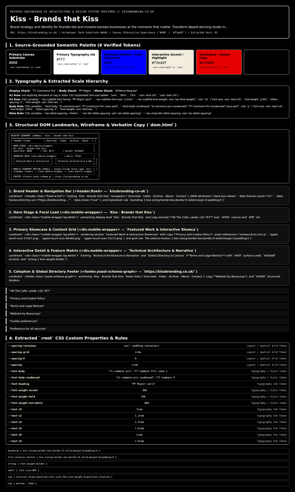

# UI Design System & Master Generation Blueprint: kissbranding-co-uk

> **Kiss · Brands that Kiss** (https://kissbranding.co.uk/) — Brand strategy and identity for founder-led and investor-backed businesses at the moments that matter. Transform Award-winning studio in...



---

## 1. Executive Visual Persona & Design Archetype

- **Brand Essence & Persona**: **Kiss · Brands that Kiss** (`https://kissbranding.co.uk/`). Brand strategy and identity for founder-led and investor-backed businesses at the moments that matter. Transform Award-winning studio in...
- **Visual Archetype**: **Dark-Substrate WebGL / Canvas Interactive Experience (`#000` / `#f3eddf`)**.
- **Anti-AI-Slop Differentiators**:
  - **Source-Grounded Chromatic Polarity**: Anchors the viewport in `#000` (`var(--color-black)` in `:root`) paired with `#fff` primary typography and `#f3eddf` accents.
  - **Extracted Typographic Hierarchy**: Pairs `TT Commons Pro` for display copy (`Kiss · Brands that Kiss`) with `PP Migra` and `SFMono-Regular`.
  - **Calibrated Spatial Grid & Motion**: Combines `375px` container bounds (`gap: var(--spacing-grid)`, padding `var(--spacing-container)`) with `cubic-bezier(.23,1,.32,1)` easing and Lenis Smooth Scroll (`data-lenis`), Lottie Vector Animation Player.

---

## 2. Spatial Architecture & Modular Grid Mathematics


### Viewport Allocation & Container Geometry
- **Captured Viewport Dimensions**: Desktop `1440×2400px` (`assets/desktop.png`, capped at 2400px multi-section capture), Mobile `390×2400px` (`assets/mobile.png`, capped at 2400px multi-section capture).
- **Master Container Bounds**: `375px` extracted from `kissbranding-co-uk` stylesheet.
- **Canvas Lateral Padding & Spacing**: `var(--spacing-container)` lateral canvas padding with `var(--spacing-grid)` grid gap.
- **Border Radius Scale**: `var(--tac-border-radius)`, `var(--tac-btn-border-radius)`, `8px`, `5px`.

### Responsive Breakpoint Architecture
- **Desktop Layout**: Multi-column CSS Grid / Flexbox layout at `1440px` (`max-width: 375px`, `gap: var(--spacing-grid)`).
- **Mobile Layout**: Single-column vertical stack at `390px` viewport width with `var(--spacing-container)` horizontal padding.
- **Extracted CSS Media Queries**: `@media (min-width:375px)`, `@media (min-width:768px)`, `@media (min-width:1024px)`, `@media (min-width:1200px)`.

---

## 3. Color System, Materiality & Atmospheric Lighting

### Semantic Palette & Source Grounding
| Semantic Role | Ground-Truth Value | Extracted CSS Source / Selector |
|---|---|---|
| **Primary Canvas Substrate** | `#000` | `var(--color-black)` in `:root` |
| **Primary Typography Ink** | `#fff` | `var(--color-white)` in `:root` |
| **Elevated Surface / Card Substrate** | `#00f` | `var(--color-blue)` in `:root` |
| **Interactive Accent / Highlight** | `#f3eddf` | `var(--color-light)` in `:root` |
| **Secondary / Muted Copy** | `#e70000` | `var(--color-red)` in `:root` |
| **Structural Hairline Border** | `#0000` | `textarea { background-color: #0000 }` |

### Sanitized Root CSS Variables (`ui-ux.md` Ground Truth)
| Variable Name | Extracted Value | Semantic Role |
|---|---|---|
| `--spacing-container` | `var(--padding-container)` | Layout / Spatial Grid Token |
| `--spacing-grid` | `1rem` | Layout / Spatial Grid Token |
| `--spacing-0` | `0` | Layout / Spatial Grid Token |
| `--spacing` | `.1rem` | Layout / Spatial Grid Token |
| `--font-body` | `"tt-commons-pro","TT Commons Pro",sans-serif` | Typography / Scale Token |
| `--font-body-condensed` | `"tt-commons-pro-condensed","TT Commons Pro Condensed",sans-serif` | Typography / Scale Token |
| `--font-heading` | `"PP Migra",serif` | Typography Ink Token |
| `--font-weight-normal` | `400` | Typography / Scale Token |
| `--font-weight-bold` | `700` | Typography / Scale Token |
| `--font-weight-extrabold` | `800` | Typography / Scale Token |
| `--text-10` | `1rem` | Typography Ink Token |
| `--text-12` | `1.2rem` | Typography Ink Token |
| `--text-14` | `1.4rem` | Typography Ink Token |
| `--text-16` | `1.6rem` | Typography Ink Token |
| `--text-20` | `2rem` | Typography Ink Token |
| `--text-24` | `2.4rem` | Typography Ink Token |

---

## 4. Typographic Scale & Editorial Hierarchy

### Font Family Stacks
- **Display Typography**: `TT Commons Pro`.
- **Primary Body Stack**: `PP Migra`.
- **Technical / Metadata Stack**: `SFMono-Regular`.

### Typographic Scale & Rules (Extracted from Stylesheet & Variables)
- **Hero Display (`H1`)**: not explicitly declared on tag in static CSS (stylesheet font-size ladder: `1em`, `80%`, `75%`, `var(--text-24)`, `var(--text-14)`).
- **Section Heading (`H2`)**: CSS variables `--tac-subtitle-font-family: "PP Migra",serif`, `--tac-subtitle-font-size: 3.2rem`, `--tac-subtitle-font-weight: var(--tac-font-weight)`; rule `h2` (`font-size: var(--text-24)`, `line-height: 120%`, `letter-spacing: 0`, `font-weight: var(--font-we...`).
- **Body Copy**: CSS variables `--font-body: "tt-commons-pro","TT Commons Pro",sans-serif`, `--font-body-condensed: "tt-commons-pro-condensed","TT Commons Pro Condensed",sans-serif`; rule `p` (`font-size: var(--text-14)`, `line-height: 140%`, `letter-spacing: 0`, `font-weight: var(--font-we...`).
- **Metadata & Navigation Labels**: CSS variables `--tac-letter-spacing: .04rem`, `--tac-btn-letter-spacing: var(--tac-letter-spacing)`, `--tac-close-btn-letter-spacing: var(--tac-letter-spacing)`.

---

## 5. Choreographed Motion & Interaction Physics

### Primary Easing Curves
- **Extracted Timing Functions**: `cubic-bezier(.23,1,.32,1)`.

### Per-Element Transition & Choreography Rules
- **Selector `layer theme`**: `transition: 15` extracted from `kissbranding-co-uk` stylesheet.
- **Selector `.transition`**: `transition: var(--tw-ease,ease)` extracted from `kissbranding-co-uk` stylesheet.
- **Selector `.transition-all`**: `transition: var(--tw-ease,ease)` extracted from `kissbranding-co-uk` stylesheet.
- **Extracted Easing Curve (`cubic-bezier(.23,1,.32,1)`)**: Governs interactive state transitions across `<header.fixed>` and `<div.mobile-wrapper>`.
- **Runtime Interaction Engine**: Integrates Lenis Smooth Scroll (`data-lenis`), Lottie Vector Animation Player, HTML5 `<canvas>` Interactive Viewport Surface with `prefers-reduced-motion: reduce` fallback guards.

---

## 6. Component Wireframe & Structural DOM Map

### Visual Layout Schematic (Grounded in `dom.html` — `1440px` Desktop & `390px` Mobile Reflow)
```
┌────────────────────────────────────────────────────────────────────────┐
│ DESKTOP VIEWPORT (1440px) — Kiss · Brands that Kiss                    │
│ ====================================================================== │
│ [ <header.fixed>           | Overview · Index · Archive · About · C ]  │
│ ---------------------------------------------------------------------- │
│ | HERO STAGE: <div.mobile-wrapper>                                 |   │
│ | H1: Kiss · Brands that Kiss                                      |   │
│ | Substrate: #000       | Ink: #fff       | Accent: #f3eddf        |   │
│ ---------------------------------------------------------------------- │
│ | SHOWCASE GRID (<div.mobile-wrapper>      ) max-w: 375px          |   │
│ | +------------------------------+  +------------------------------+ | │
│ | | Featured Work & Interactive  |  | Technical Architecture & Nar | | │
│ | +------------------------------+  +------------------------------+ | │
│ ---------------------------------------------------------------------- │
│ | MOBILE VIEWPORT REFLOW (390px) — Single-Column Stack (gap: var(--) | │
│ | [<header.fixed>] -> [<div.mobile-wrappe] -> [<div.mobile-wrappe] |   │
│ ---------------------------------------------------------------------- │
│ [ FOOTER (<footer.yoast-schema-g) | https://kissbranding.co.uk/        │
└────────────────────────────────────────────────────────────────────────┘
```

### Granular DOM Region Breakdown
1. **Brand Header & Navigation Bar (<header.fixed> — `kissbranding-co-uk`)**:
   - Landmark `<header class="fixed w-full">` hosting `Kiss · Brands that Kiss` navigation (`Overview · Index · Archive · About · Contact`), DOM attributes (`data-taxi-reload`, `data-frames-count="22"`, `data-frames-directory-uri="https://kissbranding...."`, `data-clone="true"`), and stylesheet rule `backdrop { box-sizing:border-box;border:0 solid;margin:0;padding:0 }`.
2. **Hero Stage & Focal Lead (<div.mobile-wrapper> — `Kiss · Brands that Kiss`)**:
   - Landmark `<div class="mobile-wrapper bg-white">` presenting display lead `Kiss · Brands that Kiss` and copy excerpt *"46 The Calls, Leeds, LS2 7EY"* over `#000` canvas and `#fff` ink.
3. **Primary Showcase & Content Grid (<div.mobile-wrapper> — `Featured Work & Interactive Showca`)**:
   - Landmark `<div class="mobile-wrapper bg-white">` rendering section `Featured Work & Interactive Showcase` with copy *"Privacy and Cookie Policy"*, asset references (`tarteaucitron.min.js`, `apple-touch-icon-57x57.png`, `apple-touch-icon-60x60.png`, `apple-touch-icon-72x72.png`), and grid rule `file-selector-button { box-sizing:border-box;border:0 solid;margin:0;padding:0 }`.
4. **Interactive Detail & Feature Matrix (<div.mobile-wrapper> — `Technical Architecture & Narrative`)**:
   - Landmark `<div class="mobile-wrapper bg-white">` framing `Technical Architecture & Narrative` and `Global Directory & Contact` (*"Terms and Legal Notices"*) with `#00f` surface cards, `#f3eddf` accents, and `strong { font-weight:bolder }`.
5. **Colophon & Global Directory Footer (<footer.yoast-schema-graph> — `https://kissbranding.co.uk/`)**:
   - Landmark `<footer class="yoast-schema-graph">` anchoring `Kiss · Brands that Kiss` footer links (`Overview · Index · Archive · About · Contact`), copy *"Website by Beaucoup"*, and `#0000` structural dividers.

---

## 7. Master Zero-Shot AI Generation Prompt

```markdown
# Master Zero-Shot Frontend Generation Prompt: kissbranding-co-uk (Kiss · Brands that Kiss)

You are a principal frontend architect and design systems engineer. Build a complete, production-ready web application replicating the exact design system, DOM landmarks, typographic hierarchy, color tokens, and motion physics of `kissbranding-co-uk` (**Kiss · Brands that Kiss** — `https://kissbranding.co.uk/`).

### 1. Visual Archetype & Anti-AI-Slop Mandates
- **Archetype**: Dark-Substrate WebGL / Canvas Interactive Experience (`#000` / `#f3eddf`).
- **Identity & Domain Context**: Brand strategy and identity for founder-led and investor-backed businesses at the moments that matter. Transform Award-winning studio in...
- **Primary Substrate**: `#000` (`var(--color-black)` in `:root`), **Primary Ink**: `#fff`, **Accent / Highlight**: `#f3eddf`.
- **Site-Specific Differentiators**:
  - **Source-Grounded Chromatic Polarity**: Anchors the viewport in `#000` (`var(--color-black)` in `:root`) paired with `#fff` primary typography and `#f3eddf` accents.
  - **Extracted Typographic Hierarchy**: Pairs `TT Commons Pro` for display copy (`Kiss · Brands that Kiss`) with `PP Migra` and `SFMono-Regular`.
  - **Calibrated Spatial Grid & Motion**: Combines `375px` container bounds (`gap: var(--spacing-grid)`, padding `var(--spacing-container)`) with `cubic-bezier(.23,1,.32,1)` easing and Lenis Smooth Scroll (`data-lenis`), Lottie Vector Animation Player.

### 2. Ground-Truth CSS Variables (`:root` Token Contract)
Declare and consume these exact custom properties extracted from `kissbranding-co-uk` in your global stylesheet:

:root {
  /* Kiss · Brands that Kiss (kissbranding-co-uk) — Ground-Truth Extracted CSS Variables */
  --spacing-container: var(--padding-container); /* Layout / Spatial Grid Token (kissbranding-co-uk) */
  --spacing-grid: 1rem; /* Layout / Spatial Grid Token (kissbranding-co-uk) */
  --spacing-0: 0; /* Layout / Spatial Grid Token (kissbranding-co-uk) */
  --spacing: .1rem; /* Layout / Spatial Grid Token (kissbranding-co-uk) */
  --font-body: "tt-commons-pro","TT Commons Pro",sans-serif; /* Typography / Scale Token (kissbranding-co-uk) */
  --font-body-condensed: "tt-commons-pro-condensed","TT Commons Pro Condensed",sans-serif; /* Typography / Scale Token (kissbranding-co-uk) */
  --font-heading: "PP Migra",serif; /* Typography Ink Token (kissbranding-co-uk) */
  --font-weight-normal: 400; /* Typography / Scale Token (kissbranding-co-uk) */
  --font-weight-bold: 700; /* Typography / Scale Token (kissbranding-co-uk) */
  --font-weight-extrabold: 800; /* Typography / Scale Token (kissbranding-co-uk) */
  --text-10: 1rem; /* Typography Ink Token (kissbranding-co-uk) */
  --text-12: 1.2rem; /* Typography Ink Token (kissbranding-co-uk) */
  --text-14: 1.4rem; /* Typography Ink Token (kissbranding-co-uk) */
  --text-16: 1.6rem; /* Typography Ink Token (kissbranding-co-uk) */
  --text-20: 2rem; /* Typography Ink Token (kissbranding-co-uk) */
  --text-24: 2.4rem; /* Typography Ink Token (kissbranding-co-uk) */
}

### 3. Semantic Color & Materiality Contract
Map every surface, ink, and border strictly to these source-grounded tokens:
- **Primary Canvas Substrate**: `#000` — grounded in `var(--color-black)` in `:root`
- **Primary Typography Ink**: `#fff` — grounded in `var(--color-white)` in `:root`
- **Elevated Surface / Card Substrate**: `#00f` — grounded in `var(--color-blue)` in `:root`
- **Interactive Accent / Highlight**: `#f3eddf` — grounded in `var(--color-light)` in `:root`
- **Secondary / Muted Copy**: `#e70000` — grounded in `var(--color-red)` in `:root`
- **Structural Hairline Border**: `#0000` — grounded in `textarea { background-color: #0000 }`

### 4. Spatial Grid, Container Bounds & Responsive Breakpoints
- **Desktop Viewport Reference**: `1440×2400px` (capped at 2400px multi-section capture, `1440px` standard desktop width).
- **Mobile Viewport Reference**: `390×2400px` (capped at 2400px multi-section capture, `390px` standard mobile width).
- **Container Max-Width**: `375px` extracted from `kissbranding-co-uk` stylesheet
- **Padding & Gutters**: `var(--spacing-container)` lateral canvas padding with `var(--spacing-grid)` grid gap
- **Desktop Grid**: Multi-column CSS Grid / Flexbox layout at `1440px` (`max-width: 375px`, `gap: var(--spacing-grid)`)
- **Mobile Adaptation**: Single-column vertical stack at `390px` viewport width with `var(--spacing-container)` horizontal padding
- **Media Queries**: `@media (min-width:375px)`, `@media (min-width:768px)`, `@media (min-width:1024px)`, `@media (min-width:1200px)`
- **Corner Radii**: `var(--tac-border-radius)`, `var(--tac-btn-border-radius)`, `8px`, `5px`

### 5. Typography & Editorial Scale Contract
- **Display Font Stack**: `TT Commons Pro`
- **Body Font Stack**: `PP Migra`
- **Monospace / Technical Font Stack**: `SFMono-Regular`
- **H1 Display Rule**: not explicitly declared on tag in static CSS (stylesheet font-size ladder: `1em`, `80%`, `75%`, `var(--text-24)`, `var(--text-14)`)
- **H2 Section Rule**: CSS variables `--tac-subtitle-font-family: "PP Migra",serif`, `--tac-subtitle-font-size: 3.2rem`, `--tac-subtitle-font-weight: var(--tac-font-weight)`; rule `h2` (`font-size: var(--text-24)`, `line-height: 120%`, `letter-spacing: 0`, `font-weight: var(--font-we...`)
- **Body Copy Rule**: CSS variables `--font-body: "tt-commons-pro","TT Commons Pro",sans-serif`, `--font-body-condensed: "tt-commons-pro-condensed","TT Commons Pro Condensed",sans-serif`; rule `p` (`font-size: var(--text-14)`, `line-height: 140%`, `letter-spacing: 0`, `font-weight: var(--font-we...`)
- **Metadata & Index Rule**: CSS variables `--tac-letter-spacing: .04rem`, `--tac-btn-letter-spacing: var(--tac-letter-spacing)`, `--tac-close-btn-letter-spacing: var(--tac-letter-spacing)`

### 6. Component Hierarchy, Verbatim Copy & Real DOM Landmarks
Scaffold `kissbranding-co-uk` (`Kiss · Brands that Kiss`) with these exact structural regions, extracted copy, and CSS rules from `dom.html`:
1. **Brand Header & Navigation Bar (<header.fixed> — `kissbranding-co-uk`)**:
   - DOM & Selectors: Landmark `<header class="fixed w-full">` hosting `Kiss · Brands that Kiss` navigation (`Overview · Index · Archive · About · Contact`), DOM attributes (`data-taxi-reload`, `data-frames-count="22"`, `data-frames-directory-uri="https://kissbranding...."`, `data-clone="true"`), and stylesheet rule `backdrop { box-sizing:border-box;border:0 solid;margin:0;padding:0 }`.
   - Responsive Contract: Header `Brand Header & Navigation Bar (<header.fixed> — `kissbranding-co-uk`)` (`kissbranding-co-uk`) adapts across `@media (min-width:375px)`, `@media (min-width:768px)`, `@media (min-width:1024px)`, `@media (min-width:1200px)` with `cubic-bezier(.23,1,.32,1)` transitions and links `Overview · Index · Archive · About · Contact`.
2. **Hero Stage & Focal Lead (<div.mobile-wrapper> — `Kiss · Brands that Kiss`)**:
   - DOM & Selectors: Landmark `<div class="mobile-wrapper bg-white">` presenting display lead `Kiss · Brands that Kiss` and copy excerpt *"46 The Calls, Leeds, LS2 7EY"* over `#000` canvas and `#fff` ink.
   - Responsive Contract: Hero stage (`1440×2400px` desktop / `390×2400px` mobile) sets `#000` background with `#fff` headline `Kiss · Brands that Kiss`.
3. **Primary Showcase & Content Grid (<div.mobile-wrapper> — `Featured Work & Interactive Showca`)**:
   - DOM & Selectors: Landmark `<div class="mobile-wrapper bg-white">` rendering section `Featured Work & Interactive Showcase` with copy *"Privacy and Cookie Policy"*, asset references (`tarteaucitron.min.js`, `apple-touch-icon-57x57.png`, `apple-touch-icon-60x60.png`, `apple-touch-icon-72x72.png`), and grid rule `file-selector-button { box-sizing:border-box;border:0 solid;margin:0;padding:0 }`.
   - Responsive Contract: Showcase grid `Primary Showcase & Content Grid (<div.mobile-wrapper> — `Featured Work & Interactive Showca`)` applies Multi-column CSS Grid / Flexbox layout at `1440px` (`max-width: 375px`, `gap: var(--spacing-grid)`) on desktop and Single-column vertical stack at `390px` viewport width with `var(--spacing-container)` horizontal padding on mobile.
4. **Interactive Detail & Feature Matrix (<div.mobile-wrapper> — `Technical Architecture & Narrative`)**:
   - DOM & Selectors: Landmark `<div class="mobile-wrapper bg-white">` framing `Technical Architecture & Narrative` and `Global Directory & Contact` (*"Terms and Legal Notices"*) with `#00f` surface cards, `#f3eddf` accents, and `strong { font-weight:bolder }`.
   - Responsive Contract: Detail module `Interactive Detail & Feature Matrix (<div.mobile-wrapper> — `Technical Architecture & Narrative`)` uses `var(--tac-border-radius)`, `var(--tac-btn-border-radius)`, `8px`, `5px` radii, `#f3eddf` highlights, and assets (tarteaucitron.min.js, apple-touch-icon-57x57.png, apple-touch-icon-60x60.png).
5. **Colophon & Global Directory Footer (<footer.yoast-schema-graph> — `https://kissbranding.co.uk/`)**:
   - DOM & Selectors: Landmark `<footer class="yoast-schema-graph">` anchoring `Kiss · Brands that Kiss` footer links (`Overview · Index · Archive · About · Contact`), copy *"Website by Beaucoup"*, and `#0000` structural dividers.
   - Responsive Contract: Footer `Colophon & Global Directory Footer (<footer.yoast-schema-graph> — `https://kissbranding.co.uk/`)` aligns to `375px` extracted from `kissbranding-co-uk` stylesheet with `var(--spacing-container)` lateral canvas padding with `var(--spacing-grid)` grid gap and attributes (data-taxi-reload, data-frames-count="22", data-frames-directory-uri="https://kissbranding....").

#### Verbatim DOM Copy Excerpts (`dom.html`)
- Copy Excerpt 1: *"46 The Calls, Leeds, LS2 7EY"*
- Copy Excerpt 2: *"Privacy and Cookie Policy"*
- Copy Excerpt 3: *"Terms and Legal Notices"*
- Copy Excerpt 4: *"Website by Beaucoup"*

### 7. Motion, Extracted Stylesheet Rules & Interaction Choreography
- **Primary Easing Functions**: `cubic-bezier(.23,1,.32,1)`
- **Extracted Stylesheet Rules (`kissbranding-co-uk`)**:
- `backdrop { box-sizing:border-box;border:0 solid;margin:0;padding:0 }`
- `file-selector-button { box-sizing:border-box;border:0 solid;margin:0;padding:0 }`
- `strong { font-weight:bolder }`
- `small { font-size:80% }`
- `sup { vertical-align:baseline;font-size:75%;line-height:0;position:relative }`
- **Per-Selector Transition Rules**:
- **Selector `layer theme`**: `transition: 15` extracted from `kissbranding-co-uk` stylesheet.
- **Selector `.transition`**: `transition: var(--tw-ease,ease)` extracted from `kissbranding-co-uk` stylesheet.
- **Selector `.transition-all`**: `transition: var(--tw-ease,ease)` extracted from `kissbranding-co-uk` stylesheet.
- **Extracted Easing Curve (`cubic-bezier(.23,1,.32,1)`)**: Governs interactive state transitions across `<header.fixed>` and `<div.mobile-wrapper>`.
- **Runtime Interaction Engine**: Integrates Lenis Smooth Scroll (`data-lenis`), Lottie Vector Animation Player, HTML5 `<canvas>` Interactive Viewport Surface with `prefers-reduced-motion: reduce` fallback guards.

### 8. Technical Deliverables
- Implement in Next.js (App Router) with TypeScript and Tailwind CSS consuming the `:root` custom properties defined above for `kissbranding-co-uk`.
- Reproduce both the `1440px` desktop architecture and `390px` mobile breakpoint transitions, preserving semantic HTML5 landmarks (`<header>`, `<nav>`, `<main>`, `<section>`, `<footer>`) and `prefers-reduced-motion` accessibility guards.
```
