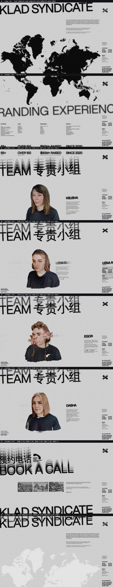
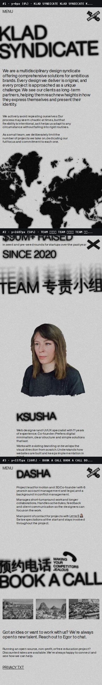

# UI Design System & Master Generation Blueprint: klad-design

> **Multidisciplinary Design Syndicate – KLAD** (https://klad.design/) — Klad Syndicate is a multidisciplinary design studio offering comprehensive solutions for ambitious brands. Every design we deliver is ori...





---

## 1. Executive Visual Persona & Design Archetype

- **Brand Essence & Persona**: **Multidisciplinary Design Syndicate – KLAD** (`https://klad.design/`). Klad Syndicate is a multidisciplinary design studio offering comprehensive solutions for ambitious brands. Every design we deliver is ori...
- **Capture Provenance**: Live browser capture (`tier1_fast`, HTTP `200`, captured `2026-11-24`).
- **Visual Archetype**: **Light-Gallery WebGL / Canvas Interactive Experience (`#e6e6e6` / `#000000`)**.
- **Anti-AI-Slop Differentiators**:
  - **Live-Computed Chromatic Polarity**: Anchors the viewport in `#e6e6e6` (live computed `body` `background-color` (`computed_styles.json`)) paired with `#000000` primary typography and `#000000` accents.
  - **Grounded Typographic Hierarchy**: Uses `Helvetica Now Display` across display (`KLAD SYNDICATE KLAD SYNDICATE KLAD S`) and body copy, paired with `SFMono-Regular` for monospace/code.
  - **Calibrated Spatial Grid & Motion**: Combines `96rem` container bounds (`gap: 3px`, padding `10px`) with `cubic-bezier(.4,0,.2,1)` easing and Lenis Smooth Scroll (`data-lenis`), GSAP Timeline & ScrollTrigger.

---

## 2. Spatial Architecture & Modular Grid Mathematics

### Viewport Allocation & Container Geometry
- **Captured Journey Filmstrips**: Desktop `1280×6624px` (`assets/desktop-journey.webp`, `8` keyframes up to `y=5893px` / doc `6793px`), Mobile `390×2616px` (`assets/mobile-journey.webp`, `3` keyframes).
- **Master Container Bounds**: `96rem` (non-`@media` desktop container stylesheet rule).
- **Canvas Lateral Padding & Spacing**: `10px` lateral canvas padding with `3px` grid gap.
- **Border Radius Scale**: `0px` (sharp unrounded corners).

### Responsive Breakpoint Architecture
- **Desktop Layout**: Multi-column CSS Grid / Flexbox layout at `1440px` (`max-width: 96rem`, `gap: 3px`).
- **Mobile Layout**: Single-column vertical stack at `390px` viewport width with `10px` horizontal padding.
- **Extracted CSS Media Queries**: `@media (min-width:768px)`, `@media (min-width:48rem)`, `@media (min-width:96rem)`, `@media (min-width:64rem)`.

---

## 3. Color System, Materiality & Atmospheric Lighting

### Semantic Palette & Source Grounding
| Semantic Role | Ground-Truth Value | Extracted Live / CSS Source |
|---|---|---|
| **Primary Canvas Substrate** | `#e6e6e6` | live computed `body` `background-color` (`computed_styles.json`) |
| **Primary Typography Ink** | `#000000` | live computed `h1` `color` (`computed_styles.json`) |
| **Elevated Surface / Card Substrate** | `#808080` | `.bg-gray { background-color: gray }` (`#808080`) |
| **Interactive Accent / Highlight** | `#000000` | live computed `a` `color` (`computed_styles.json`) |
| **Secondary / Muted Copy** | `#808080` | `.case-close { color: gray }` (`#808080`) |
| **Structural Hairline Border** | `#808080` | hairline divider derived from `.case-close { color: gray }` (`#808080`) |
| **Variable Token (`--color-black`)** | `#010101` | `var(--color-black)` in `:root` |
| **Variable Token (`--color-white`)** | `#ffffff` | `var(--color-white)` in `:root` |

### Sanitized Root CSS Variables (`ui-ux.md` Ground Truth)
| Variable Name | Extracted Value | Semantic Role |
|---|---|---|
| `--color-black` | `#010101` | Canvas / Surface Token |
| `--color-white` | `#fff` | Canvas / Surface Token |
| `--spacing` | `.25rem` | Layout / Spatial Grid Token |
| `--font-weight-normal` | `400` | Typography / Scale Token |
| `--tracking-normal` | `0em` | Typography / Scale Token |
| `--blur-xs` | `4px` | Elevation / Border Token |
| `--default-transition-duration` | `.15s` | Motion / Easing Token |
| `--default-transition-timing-function` | `cubic-bezier(.4, 0, .2, 1)` | Motion / Easing Token |
| `--default-font-family` | `var(--font-sans)` | Typography / Scale Token |
| `--default-mono-font-family` | `var(--font-mono)` | Typography / Scale Token |
| `--color-gray` | `#e6e6e6` | Brand / Palette Token |
| `--font-helvetica` | `"Helvetica Now Display"` | Typography / Scale Token |
| `--text-normal` | `inherit` | Typography Ink Token |
| `--text-h1` | `74px` | Typography Ink Token |
| `--text-h1--line-height` | `114%` | Typography Ink Token |
| `--text-h1--letter-spacing` | `-.74px` | Typography Ink Token |

---

## 4. Typographic Scale & Editorial Hierarchy

### Font Family Stacks
- **Display Typography**: `Helvetica Now Display`.
- **Primary Body Stack**: `Helvetica Now Display`.
- **Technical / Metadata Stack**: `SFMono-Regular`.

### Typographic Scale & Rules (Live Computed & Stylesheet Grounded)
- **Hero Display (`H1`)**: live computed `h1` (`font-size: 151.2px`, `line-height: 136.08px`, `font-weight: 400`); CSS variables `--text-h1: 74px`, `--text-h1--line-height: 114%`, `--text-h1--letter-spacing: -.74px`.
- **Section Heading (`H2`)**: live computed `h2` (`font-size: 151.2px`, `line-height: 136.08px`, `font-weight: 400`); CSS variables `--text-h2-md: 64px`, `--text-h2-md--line-height: 114%`, `--text-h2-md--letter-spacing: -.64px`; rule `h2` (`font-size: var(--text-p1)`, `line-height: var(--tw-leading,var(...`, `letter-spacing: var(--tw-tracking,var...`).
- **Body Copy**: live computed `body` (`font-size: 16px`, `line-height: 24px`, `font-weight: 400`).
- **Metadata & Navigation Labels**: live computed `nav/a` (`font-size: 16px`, `line-height: 24px`, `font-weight: 400`); CSS variables `--default-mono-font-family: var(--font-mono)`, `--text-h1--letter-spacing: -.74px`, `--text-h1-md--letter-spacing: -1.52px`.

---

## 5. Choreographed Motion & Interaction Physics

### Primary Easing Curves
- **Extracted Timing Functions**: `cubic-bezier(.4,0,.2,1)`, `cubic-bezier(.16,1,.3,1)`.

### Per-Element Transition & Choreography Rules
- **Selector `layer theme`**: `transition: .15s` extracted from `klad-design` stylesheet.
- **Selector `button`**: `transition: opacity .15s linear` extracted from `klad-design` stylesheet.
- **Selector `.button:after`**: `transition: var(--tw-ease,var(--default-transition-timing-function))` extracted from `klad-design` stylesheet.
- **Extracted Easing Curve (`cubic-bezier(.4,0,.2,1)`)**: Governs interactive state transitions across `<header.site-header>` and `<section.duration-200>`.
- **Runtime Interaction Engine**: Integrates Lenis Smooth Scroll (`data-lenis`), GSAP Timeline & ScrollTrigger, HTML5 `<canvas>` Interactive Viewport Surface with `prefers-reduced-motion: reduce` fallback guards.
### Measured Runtime Scroll & Interaction Telemetry (`behavioral_journey_v2`)
- **Scroll Driver Mode**: `native` (max document height `6793px`, deepest scrollY reached `5893px` across `8` desktop keyframes).
- **Detected Scroll / Motion Libraries**: `Lenis`, `GSAP/ScrollTrigger`, `WebGL/Canvas`.
- **Route Transition Architecture**: First internal navigation (`/work`) measured as `SPA` in `3295ms`.

---

## 6. Component Wireframe & Structural DOM Map

### Visual Layout Schematic — Desktop (`1440px`, Grounded in `dom.html` & Landmark Bounding Boxes)
```
┌────────────────────────────────────────────────────────────────────────┐
│ DESKTOP VIEWPORT (1440px) — Multidisciplinary Design Syndicate – KLAD  │
│ ====================================================================== │
│ [ <header.site-header> (150x900px)    | About · Work · Process · Exp ] │
│ ---------------------------------------------------------------------- │
│ | HERO STAGE: <section.transition-colors> (w=1440px)                 | │
│ | H1: KLAD SYNDICATE KLAD SYNDICATE KLAD SYNDICATE KLAD...           | │
│ | Substrate: #e6e6e6 | Ink: #000000 | Accent: #000000                | │
│ ---------------------------------------------------------------------- │
│ | SHOWCASE GRID (<section.duration-200>) max-w: 96rem                | │
│ | +------------------------------+  +------------------------------+ | │
│ | | Klad Syndicate Klad Syndicat |  | Team 专责小组 Team 专责小组 Team 专责小 | | │
│ | +------------------------------+  +------------------------------+ | │
│ ---------------------------------------------------------------------- │
│ | DETAIL MODULE (<section.pt-20>) — Ksusha Ksusha Ksusha             | │
│ ---------------------------------------------------------------------- │
│ [ FOOTER (<footer.absolute>   ) | https://klad.design/                 │
└────────────────────────────────────────────────────────────────────────┘
```

### Visual Layout Schematic — Mobile Reflow (`390px`)
```
┌────────────────────────────────────────────────────────────────────────┐
│ MOBILE VIEWPORT REFLOW (390px) — Single-Column Stack (gap: 3px)        │
│ ====================================================================== │
│ [ HEADER BAR (<header.site-header>    ) | Compact Menu (390px)         │
│ ---------------------------------------------------------------------- │
│ | HERO STAGE (<section.transition-colo) — 390px Vertical Lead        | │
│ | H1: KLAD SYNDICATE KLAD SYNDICATE KLAD SYNDICATE KLAD...           | │
│ ---------------------------------------------------------------------- │
│ | SHOWCASE STACK (<section.duration-200>) — 1-Col Stack              | │
│ | [ Item 1: Klad Syndicate Klad Syndicate Klad Syndicate Klad...   ] | │
│ | [ Item 2: Team 专责小组 Team 专责小组 Team 专责小组 Team 专责小组 Team 专责小组...   ] | │
│ ---------------------------------------------------------------------- │
│ | DETAIL STACK (<section.pt-20>) — 1-Col (Ksusha Ksusha Ksus)        | │
│ ---------------------------------------------------------------------- │
│ [ FOOTER (<footer.absolute>   ) | Stacked 390px Colophon               │
└────────────────────────────────────────────────────────────────────────┘
```

### Granular DOM Region Breakdown
1. **Brand Header & Navigation Bar (<header.site-header> — `klad-design`)**:
   - Landmark `<header class="site-header top-0">` (`150x900px`) hosting `Multidisciplinary Design Syndicate –` navigation (`About · Work · Process · Expectations · Pricing`), DOM attributes (`data-theme="light"`, `data-precedence="next"`, `data-page-noise="true"`, `data-active`), and stylesheet rule `backdrop { box-sizing:border-box;border:0 solid;margin:0;padding:0 }`.
2. **Hero Stage & Focal Lead (<section.transition-colors> — `KLAD SYNDICATE KLAD SYNDICATE KLAD`)**:
   - Landmark `<section class="transition-colors">` presenting display lead `KLAD SYNDICATE KLAD SYNDICATE KLAD SYNDICATE KLAD...` and copy excerpt *"We are a multidisciplinary design syndicate offering comprehensiv"* over `#e6e6e6` canvas and `#000000` ink.
3. **Primary Showcase & Content Grid (<section.duration-200> — `Klad Syndicate Klad Syndicate Klad`)**:
   - Landmark `<section class="duration-200">` rendering section `Klad Syndicate Klad Syndicate Klad Syndicate Klad...` with copy *"We actively avoid repeating ourselves. Our process may seem chaot"*, asset references (`logo-still.31i0fmdt_igcj.svg`, `world.39sfmav5iqip_.svg`, `1myj9p5-zqliw.css`, `3wl6p7zgws1t-.js`), and grid rule `file-selector-button { box-sizing:border-box;border:0 solid;margin:0;padding:0 }`.
4. **Interactive Detail & Feature Matrix (<section.pt-20> — `Team 专责小组 Team 专责小组 Team 专责小组 Team`)**:
   - Landmark `<section class="pt-20 z-1">` framing `Team 专责小组 Team 专责小组 Team 专责小组 Team 专责小组 Team 专责小组...` and `Ksusha Ksusha Ksusha Ksusha Ksusha Ksusha` (*"As a small team, we deliberately limit the number of projects we "*) with `#808080` surface cards, `#000000` accents, and `strong { font-weight:bolder }`.
5. **Colophon & Global Directory Footer (<footer.absolute> — `https://klad.design/`)**:
   - Landmark `<footer class="absolute">` anchoring `Multidisciplinary Design Syndica` footer links (`About · Work · Process · Expectations · Pricing`), copy *"Retail & E-commerce"*, and `#808080` structural dividers.
### Full Vertical Scroll Sequence (Desktop `1440×900` Keyframes)
- **Step 01** (`y=0px`, `0%`): Active landmark `KLAD SYNDICATE KLAD SYNDICATE KLAD SYNDICATE KLAD...` · sticky/fixed elements: `2`
- **Step 02** (`y=850px`, `14%`): Active landmark `Section @ 14%` · sticky/fixed elements: `2`
- **Step 03** (`y=1700px`, `29%`): Active landmark `TEAM 专责小组 TEAM 专责小组 TEAM 专责小组 TEAM 专责小组 TEAM 专责小组...` · sticky/fixed elements: `2`
- **Step 04** (`y=2550px`, `43%`): Active landmark `TEAM 专责小组 TEAM 专责小组 TEAM 专责小组 TEAM 专责小组 TEAM 专责小组...` · sticky/fixed elements: `3`
- **Step 05** (`y=3400px`, `58%`): Active landmark `TEAM 专责小组 TEAM 专责小组 TEAM 专责小组 TEAM 专责小组 TEAM 专责小组...` · sticky/fixed elements: `3`
- **Step 06** (`y=4250px`, `72%`): Active landmark `TEAM 专责小组 TEAM 专责小组 TEAM 专责小组 TEAM 专责小组 TEAM 专责小组...` · sticky/fixed elements: `2`
- **Step 07** (`y=5100px`, `87%`): Active landmark `BOOK A CALL BOOK A CALL BOOK A CALL BOOK A CALL B...` · sticky/fixed elements: `2`
- **Step 08** (`y=5893px`, `100%`): Active landmark `KLAD SYNDICATE KLAD SYNDICATE KLAD SYNDICATE KLAD...` · sticky/fixed elements: `2`

### Multi-Page Internal Route Map
- **Listing Route (`/work`)**: `https://klad.design/work` — H1: `DATALANE DATALANE DATALANE`, scrollHeight `900px`, transition `SPA` (`3295ms`)
- **Listing Route (`/pricing`)**: `https://klad.design/pricing` — H1: `PRICING 価格設定 PRICING 価格設定 PRICING 価格設定`, scrollHeight `900px`, transition `direct` (`610ms`)
- **Other Route (`/process`)**: `https://klad.design/process` — H1: `PROCESS 过程 PROCESS 过程 PROCESS 过程`, scrollHeight `900px`, transition `direct` (`632ms`)

---

## 7. Master Zero-Shot AI Generation Prompt

```markdown
# Master Zero-Shot Frontend Generation Prompt: klad-design (Multidisciplinary Design Syndicate – KLAD)

You are a principal frontend architect and design systems engineer. Build a complete, production-ready web application replicating the exact design system, DOM landmarks, typographic hierarchy, color tokens, and motion physics of `klad-design` (**Multidisciplinary Design Syndicate – KLAD** — `https://klad.design/`).

### 1. Visual Archetype & Anti-AI-Slop Mandates
- **Archetype**: Light-Gallery WebGL / Canvas Interactive Experience (`#e6e6e6` / `#000000`).
- **Identity & Domain Context**: Klad Syndicate is a multidisciplinary design studio offering comprehensive solutions for ambitious brands. Every design we deliver is ori...
- **Primary Substrate**: `#e6e6e6` (live computed `body` `background-color` (`computed_styles.json`)), **Primary Ink**: `#000000`, **Accent / Highlight**: `#000000`.
- **Site-Specific Differentiators**:
  - **Live-Computed Chromatic Polarity**: Anchors the viewport in `#e6e6e6` (live computed `body` `background-color` (`computed_styles.json`)) paired with `#000000` primary typography and `#000000` accents.
  - **Grounded Typographic Hierarchy**: Uses `Helvetica Now Display` across display (`KLAD SYNDICATE KLAD SYNDICATE KLAD S`) and body copy, paired with `SFMono-Regular` for monospace/code.
  - **Calibrated Spatial Grid & Motion**: Combines `96rem` container bounds (`gap: 3px`, padding `10px`) with `cubic-bezier(.4,0,.2,1)` easing and Lenis Smooth Scroll (`data-lenis`), GSAP Timeline & ScrollTrigger.

### 2. Ground-Truth CSS Variables (`:root` Token Contract)
Declare and consume these exact custom properties extracted from `klad-design` in your global stylesheet:

:root {
  /* Multidisciplinary Design Syndicate – KLAD (klad-design) — Live-Grounded CSS Variables */
  --color-black: #010101; /* Canvas / Surface Token (klad-design) */
  --color-white: #fff; /* Canvas / Surface Token (klad-design) */
  --spacing: .25rem; /* Layout / Spatial Grid Token (klad-design) */
  --font-weight-normal: 400; /* Typography / Scale Token (klad-design) */
  --tracking-normal: 0em; /* Typography / Scale Token (klad-design) */
  --blur-xs: 4px; /* Elevation / Border Token (klad-design) */
  --default-transition-duration: .15s; /* Motion / Easing Token (klad-design) */
  --default-transition-timing-function: cubic-bezier(.4, 0, .2, 1); /* Motion / Easing Token (klad-design) */
  --default-font-family: var(--font-sans); /* Typography / Scale Token (klad-design) */
  --default-mono-font-family: var(--font-mono); /* Typography / Scale Token (klad-design) */
  --color-gray: #e6e6e6; /* Brand / Palette Token (klad-design) */
  --font-helvetica: "Helvetica Now Display"; /* Typography / Scale Token (klad-design) */
  --text-normal: inherit; /* Typography Ink Token (klad-design) */
  --text-h1: 74px; /* Typography Ink Token (klad-design) */
  --text-h1--line-height: 114%; /* Typography Ink Token (klad-design) */
  --text-h1--letter-spacing: -.74px; /* Typography Ink Token (klad-design) */
}

### 3. Semantic Color & Materiality Contract
Map every surface, ink, and border strictly to these source-grounded tokens:
- **Primary Canvas Substrate**: `#e6e6e6` — grounded in live computed `body` `background-color` (`computed_styles.json`)
- **Primary Typography Ink**: `#000000` — grounded in live computed `h1` `color` (`computed_styles.json`)
- **Elevated Surface / Card Substrate**: `#808080` — grounded in `.bg-gray { background-color: gray }` (`#808080`)
- **Interactive Accent / Highlight**: `#000000` — grounded in live computed `a` `color` (`computed_styles.json`)
- **Secondary / Muted Copy**: `#808080` — grounded in `.case-close { color: gray }` (`#808080`)
- **Structural Hairline Border**: `#808080` — grounded in hairline divider derived from `.case-close { color: gray }` (`#808080`)
- **Variable Token (`--color-black`)**: `#010101` — grounded in `var(--color-black)` in `:root`
- **Variable Token (`--color-white`)**: `#ffffff` — grounded in `var(--color-white)` in `:root`

### 4. Spatial Grid, Container Bounds & Responsive Breakpoints
- **Desktop Viewport Reference**: `1280×6624px` (multi-frame vertical journey filmstrip (6624px), `1440px` standard desktop width).
- **Mobile Viewport Reference**: `390×2616px` (multi-frame vertical journey filmstrip (2616px), `390px` standard mobile width).
- **Container Max-Width**: `96rem` (non-`@media` desktop container stylesheet rule)
- **Padding & Gutters**: `10px` lateral canvas padding with `3px` grid gap
- **Desktop Grid**: Multi-column CSS Grid / Flexbox layout at `1440px` (`max-width: 96rem`, `gap: 3px`)
- **Mobile Adaptation**: Single-column vertical stack at `390px` viewport width with `10px` horizontal padding
- **Media Queries**: `@media (min-width:768px)`, `@media (min-width:48rem)`, `@media (min-width:96rem)`, `@media (min-width:64rem)`
- **Corner Radii**: `0px` (sharp unrounded corners)

### 5. Typography & Editorial Scale Contract
- **Display Font Stack**: `Helvetica Now Display`
- **Body Font Stack**: `Helvetica Now Display`
- **Monospace / Technical Font Stack**: `SFMono-Regular`
- **H1 Display Rule**: live computed `h1` (`font-size: 151.2px`, `line-height: 136.08px`, `font-weight: 400`); CSS variables `--text-h1: 74px`, `--text-h1--line-height: 114%`, `--text-h1--letter-spacing: -.74px`
- **H2 Section Rule**: live computed `h2` (`font-size: 151.2px`, `line-height: 136.08px`, `font-weight: 400`); CSS variables `--text-h2-md: 64px`, `--text-h2-md--line-height: 114%`, `--text-h2-md--letter-spacing: -.64px`; rule `h2` (`font-size: var(--text-p1)`, `line-height: var(--tw-leading,var(...`, `letter-spacing: var(--tw-tracking,var...`)
- **Body Copy Rule**: live computed `body` (`font-size: 16px`, `line-height: 24px`, `font-weight: 400`)
- **Metadata & Index Rule**: live computed `nav/a` (`font-size: 16px`, `line-height: 24px`, `font-weight: 400`); CSS variables `--default-mono-font-family: var(--font-mono)`, `--text-h1--letter-spacing: -.74px`, `--text-h1-md--letter-spacing: -1.52px`

### 6. Component Hierarchy, Verbatim Copy & Real DOM Landmarks
Scaffold `klad-design` (`Multidisciplinary Design Syndicate – KLAD`) with these exact structural regions, extracted copy, and CSS rules from `dom.html`:
1. **Brand Header & Navigation Bar (<header.site-header> — `klad-design`)**:
   - DOM & Selectors: Landmark `<header class="site-header top-0">` (`150x900px`) hosting `Multidisciplinary Design Syndicate –` navigation (`About · Work · Process · Expectations · Pricing`), DOM attributes (`data-theme="light"`, `data-precedence="next"`, `data-page-noise="true"`, `data-active`), and stylesheet rule `backdrop { box-sizing:border-box;border:0 solid;margin:0;padding:0 }`.
   - Responsive Contract: Header `Brand Header & Navigation Bar (<header.site-header> — `klad-design`)` (`klad-design`) adapts across `@media (min-width:768px)`, `@media (min-width:48rem)`, `@media (min-width:96rem)`, `@media (min-width:64rem)` with `cubic-bezier(.4,0,.2,1)`, `cubic-bezier(.16,1,.3,1)` transitions and links `About · Work · Process · Expectations · Pricing`.
2. **Hero Stage & Focal Lead (<section.transition-colors> — `KLAD SYNDICATE KLAD SYNDICATE KLAD`)**:
   - DOM & Selectors: Landmark `<section class="transition-colors">` presenting display lead `KLAD SYNDICATE KLAD SYNDICATE KLAD SYNDICATE KLAD...` and copy excerpt *"We are a multidisciplinary design syndicate offering comprehensiv"* over `#e6e6e6` canvas and `#000000` ink.
   - Responsive Contract: Hero stage (`1280×6624px` desktop / `390×2616px` mobile) sets `#e6e6e6` background with `#000000` headline `KLAD SYNDICATE KLAD SYNDICATE KLAD SYNDICATE KLAD...`.
3. **Primary Showcase & Content Grid (<section.duration-200> — `Klad Syndicate Klad Syndicate Klad`)**:
   - DOM & Selectors: Landmark `<section class="duration-200">` rendering section `Klad Syndicate Klad Syndicate Klad Syndicate Klad...` with copy *"We actively avoid repeating ourselves. Our process may seem chaot"*, asset references (`logo-still.31i0fmdt_igcj.svg`, `world.39sfmav5iqip_.svg`, `1myj9p5-zqliw.css`, `3wl6p7zgws1t-.js`), and grid rule `file-selector-button { box-sizing:border-box;border:0 solid;margin:0;padding:0 }`.
   - Responsive Contract: Showcase grid `Primary Showcase & Content Grid (<section.duration-200> — `Klad Syndicate Klad Syndicate Klad`)` applies Multi-column CSS Grid / Flexbox layout at `1440px` (`max-width: 96rem`, `gap: 3px`) on desktop and Single-column vertical stack at `390px` viewport width with `10px` horizontal padding on mobile.
4. **Interactive Detail & Feature Matrix (<section.pt-20> — `Team 专责小组 Team 专责小组 Team 专责小组 Team`)**:
   - DOM & Selectors: Landmark `<section class="pt-20 z-1">` framing `Team 专责小组 Team 专责小组 Team 专责小组 Team 专责小组 Team 专责小组...` and `Ksusha Ksusha Ksusha Ksusha Ksusha Ksusha` (*"As a small team, we deliberately limit the number of projects we "*) with `#808080` surface cards, `#000000` accents, and `strong { font-weight:bolder }`.
   - Responsive Contract: Detail module `Interactive Detail & Feature Matrix (<section.pt-20> — `Team 专责小组 Team 专责小组 Team 专责小组 Team`)` uses `0px` (sharp unrounded corners) radii, `#000000` highlights, and assets (logo-still.31i0fmdt_igcj.svg, world.39sfmav5iqip_.svg, 1myj9p5-zqliw.css).
5. **Colophon & Global Directory Footer (<footer.absolute> — `https://klad.design/`)**:
   - DOM & Selectors: Landmark `<footer class="absolute">` anchoring `Multidisciplinary Design Syndica` footer links (`About · Work · Process · Expectations · Pricing`), copy *"Retail & E-commerce"*, and `#808080` structural dividers.
   - Responsive Contract: Footer `Colophon & Global Directory Footer (<footer.absolute> — `https://klad.design/`)` aligns to `96rem` (non-`@media` desktop container stylesheet rule) with `10px` lateral canvas padding with `3px` grid gap and attributes (data-theme="light", data-precedence="next", data-page-noise="true").

#### Verbatim DOM Copy Excerpts (`dom.html`)
- Copy Excerpt 1: *"We are a multidisciplinary design syndicate offering comprehensive solutions for a..."*
- Copy Excerpt 2: *"We actively avoid repeating ourselves. Our process may seem chaotic at times, but..."*
- Copy Excerpt 3: *"As a small team, we deliberately limit the number of projects we take on, dedicati..."*
- Copy Excerpt 4: *"Retail & E-commerce"*

### 7. Motion, Extracted Stylesheet Rules & Interaction Choreography
- **Primary Easing Functions**: `cubic-bezier(.4,0,.2,1)`, `cubic-bezier(.16,1,.3,1)`
- **Extracted Stylesheet Rules (`klad-design`)**:
- `backdrop { box-sizing:border-box;border:0 solid;margin:0;padding:0 }`
- `file-selector-button { box-sizing:border-box;border:0 solid;margin:0;padding:0 }`
- `strong { font-weight:bolder }`
- `small { font-size:80% }`
- `sup { vertical-align:baseline;font-size:75%;line-height:0;position:relative }`
- **Per-Selector Transition Rules**:
- **Selector `layer theme`**: `transition: .15s` extracted from `klad-design` stylesheet.
- **Selector `button`**: `transition: opacity .15s linear` extracted from `klad-design` stylesheet.
- **Selector `.button:after`**: `transition: var(--tw-ease,var(--default-transition-timing-function))` extracted from `klad-design` stylesheet.
- **Extracted Easing Curve (`cubic-bezier(.4,0,.2,1)`)**: Governs interactive state transitions across `<header.site-header>` and `<section.duration-200>`.
- **Runtime Interaction Engine**: Integrates Lenis Smooth Scroll (`data-lenis`), GSAP Timeline & ScrollTrigger, HTML5 `<canvas>` Interactive Viewport Surface with `prefers-reduced-motion: reduce` fallback guards.
### 7b. Full-Page Scroll Choreography, Interactive States & Multi-Page Routes
- **Scroll Mechanics**: Implement `native` vertical progression up to `6793px` across 8 distinct viewport chapters using Lenis, GSAP/ScrollTrigger, WebGL/Canvas.
- **Vertical Chapter Sequence**: KLAD SYNDICATE KLAD SYNDICA... (0%) -> Section @ 14% (14%) -> TEAM 专责小组 TEAM 专责小组 TEAM 专责... (29%) -> TEAM 专责小组 TEAM 专责小组 TEAM 专责... (43%) -> TEAM 专责小组 TEAM 专责小组 TEAM 专责... (58%) -> TEAM 专责小组 TEAM 专责小组 TEAM 专责... (72%) -> BOOK A CALL BOOK A CALL BOO... (87%) -> KLAD SYNDICATE KLAD SYNDICA... (100%).
- **Multi-Page Routes**: Scaffold internal routes `/work` (listing, SPA), `/pricing` (listing, direct), `/process` (other, direct) sharing the global header/footer shell and design tokens.

### 8. Technical Deliverables
- Implement in Next.js (App Router) with TypeScript and Tailwind CSS consuming the `:root` custom properties defined above for `klad-design`.
- Reproduce both the `1440px` desktop architecture and `390px` mobile breakpoint transitions, preserving semantic HTML5 landmarks (`<header>`, `<nav>`, `<main>`, `<section>`, `<footer>`) and `prefers-reduced-motion` accessibility guards.
```
---

## 8. Full-Page Scroll Journey, Interactive States & Subpage Inventory

### Desktop Scroll Keyframes (`1440×900` WebP)
| Step | Scroll Y | Progress | Active Landmark / Section | Sticky/Fixed | Visual Asset |
| :---: | :---: | :---: | :--- | :---: | :--- |
| `#01` | `0px` | `0%` | KLAD SYNDICATE KLAD SYNDICATE KLAD SYNDICATE... | `2` | [desktop-step-01.webp](assets/desktop-step-01.webp) |
| `#02` | `850px` | `14%` | Section @ 14% | `2` | [desktop-step-02.webp](assets/desktop-step-02.webp) |
| `#03` | `1700px` | `29%` | TEAM 专责小组 TEAM 专责小组 TEAM 专责小组 TEAM 专责小组 TEAM... | `2` | [desktop-step-03.webp](assets/desktop-step-03.webp) |
| `#04` | `2550px` | `43%` | TEAM 专责小组 TEAM 专责小组 TEAM 专责小组 TEAM 专责小组 TEAM... | `3` | [desktop-step-04.webp](assets/desktop-step-04.webp) |
| `#05` | `3400px` | `58%` | TEAM 专责小组 TEAM 专责小组 TEAM 专责小组 TEAM 专责小组 TEAM... | `3` | [desktop-step-05.webp](assets/desktop-step-05.webp) |
| `#06` | `4250px` | `72%` | TEAM 专责小组 TEAM 专责小组 TEAM 专责小组 TEAM 专责小组 TEAM... | `2` | [desktop-step-06.webp](assets/desktop-step-06.webp) |
| `#07` | `5100px` | `87%` | BOOK A CALL BOOK A CALL BOOK A CALL BOOK A CA... | `2` | [desktop-step-07.webp](assets/desktop-step-07.webp) |
| `#08` | `5893px` | `100%` | KLAD SYNDICATE KLAD SYNDICATE KLAD SYNDICATE... | `2` | [desktop-step-08.webp](assets/desktop-step-08.webp) |

### Mobile Condensed Keyframes (`390×844` WebP)
| Step | Scroll Y | Progress | Active Landmark | Visual Asset |
| :---: | :---: | :---: | :--- | :--- |
| `#01` | `0px` | `0%` | KLAD SYNDICATE KLAD SYNDICATE KLAD SYNDIC... | [mobile-step-01.webp](assets/mobile-step-01.webp) |
| `#02` | `1687px` | `50%` | TEAM 专责小组 TEAM 专责小组 TEAM 专责小组 TEAM 专责小组 T... | [mobile-step-02.webp](assets/mobile-step-02.webp) |
| `#03` | `3375px` | `100%` | BOOK A CALL BOOK A CALL BOOK A CALL BOOK... | [mobile-step-03.webp](assets/mobile-step-03.webp) |

### Internal Subpage Filmstrips (`1080px` Wide WebP)
| # | Template | Route URL | H1 / Title | Scroll Height | Transition | Filmstrip Asset |
| :-: | :---: | :--- | :--- | :---: | :---: | :--- |
| `1` | `listing` | `https://klad.design/work` | DATALANE DATALANE DATALANE | `900px` | `SPA` (`3295ms`) | [subpage-01-work.webp](assets/subpage-01-work.webp) |
| `2` | `listing` | `https://klad.design/pricing` | PRICING 価格設定 PRICING 価格設定 PRICING 価格設定 | `900px` | `direct` (`610ms`) | [subpage-02-pricing.webp](assets/subpage-02-pricing.webp) |
| `3` | `other` | `https://klad.design/process` | PROCESS 过程 PROCESS 过程 PROCESS 过程 | `900px` | `direct` (`632ms`) | [subpage-03-process.webp](assets/subpage-03-process.webp) |

