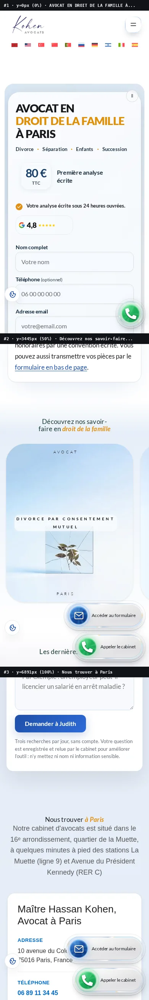

# UI Design System & Master Generation Blueprint: kohenavocats-com_avocats-droit-famille-paris

> **Avocat Droit de la Famille Paris · Divorce, Garde d'Enfants, Succession** (https://kohenavocats.com/avocats-droit-famille-paris/) — Avocat en droit de la famille à Paris. Divorce amiable ou contentieux, garde d'enfants, pension alimentaire, succession. Première analyse...




---

## 1. Executive Visual Persona & Design Archetype

- **Brand Essence & Persona**: **Avocat Droit de la Famille Paris · Divorce, Garde d'Enfants, Succession** (`https://kohenavocats.com/avocats-droit-famille-paris/`). Avocat en droit de la famille à Paris. Divorce amiable ou contentieux, garde d'enfants, pension alimentaire, succession. Première analyse...
- **Capture Provenance**: Live browser capture (`tier1_fast`, HTTP `200`, captured `2026-11-24`).
- **Visual Archetype**: **Light-Substrate Editorial & Modular Grid System (`#ffffff` canvas, `#000000` ink, `#0077ed` accent)**.
- **Anti-AI-Slop Differentiators**:
  - **Live-Computed Chromatic Polarity**: Anchors the viewport in `#ffffff` (live computed `body` `background-color` (`computed_styles.json`)) paired with `#000000` primary typography and `#0077ed` accents.
  - **Grounded Typographic Hierarchy**: Pairs `Lato` for display copy (`AVOCAT EN DROIT DE LA FAMILLE À PARI`) with `Segoe UI`.
  - **Calibrated Spatial Grid & Motion**: Combines `1392px` container bounds (`gap: .5rem`, padding `8px`) with `cubic-bezier(.58,.3,.005,1)` easing and Three.js / WebGL Canvas Pipeline, Swiper Touch Carousel Engine.

---

## 2. Spatial Architecture & Modular Grid Mathematics

### Viewport Allocation & Container Geometry
- **Captured Journey Filmstrips**: Desktop `1280×1656px` (`assets/desktop-journey.webp`, `2` keyframes up to `y=850px` / doc `5775px`), Mobile `390×2616px` (`assets/mobile-journey.webp`, `3` keyframes).
- **Master Container Bounds**: `1392px` (measured widest bounded `<section>` landmark width on `1440px` desktop).
- **Canvas Lateral Padding & Spacing**: `8px` lateral canvas padding with `.5rem` grid gap.
- **Border Radius Scale**: `18px`, `3px`, `var(--border-radius)`, `2px`.

### Responsive Breakpoint Architecture
- **Desktop Layout**: Multi-column CSS Grid / Flexbox layout at `1440px` (`max-width: 1392px`, `gap: .5rem`).
- **Mobile Layout**: Single-column vertical stack at `390px` viewport width with `8px` horizontal padding.
- **Extracted CSS Media Queries**: `@media (max-width:576px)`, `@media (min-width:768px)`, `@media (min-width:576px)and (max-width:767px)`, `@media (min-width:992px)`.

---

## 3. Color System, Materiality & Atmospheric Lighting

### Semantic Palette & Source Grounding
| Semantic Role | Ground-Truth Value | Extracted Live / CSS Source |
|---|---|---|
| **Primary Canvas Substrate** | `#ffffff` | live computed `body` `background-color` (`computed_styles.json`) |
| **Primary Typography Ink** | `#000000` | live computed `main` `color` (`computed_styles.json`) |
| **Elevated Surface / Card Substrate** | `#f6faff` | live computed `button` `background-color` (`computed_styles.json`) |
| **Interactive Accent / Highlight** | `#0077ed` | `.kcf-wrap .kcf-btn:hover { background: #0077ed }` |
| **Secondary / Muted Copy** | `#7c7c7c` | `var(--e-global-color-secondary)` in `:root` |
| **Structural Hairline Border** | `#dce3e7` | `var(--kohen-avis-border)` in `:root` |

### Sanitized Root CSS Variables (`ui-ux.md` Ground Truth)
| Variable Name | Extracted Value | Semantic Role |
|---|---|---|
| `--wp--style--global--content-size` | `800px` | Layout / Spatial Grid Token |
| `--wp--style--global--wide-size` | `1200px` | Layout / Spatial Grid Token |
| `--wp--style--block-gap` | `24px` | Layout / Spatial Grid Token |
| `--direction-multiplier` | `1` | Design System Custom Token |
| `--page-title-display` | `block` | Design System Custom Token |
| `--flex-direction` | `initial` | Design System Custom Token |
| `--flex-wrap` | `initial` | Layout / Spatial Grid Token |
| `--justify-content` | `initial` | Design System Custom Token |
| `--align-items` | `initial` | Design System Custom Token |
| `--align-content` | `initial` | Design System Custom Token |
| `--gap` | `initial` | Layout / Spatial Grid Token |
| `--flex-basis` | `initial` | Design System Custom Token |
| `--flex-grow` | `initial` | Design System Custom Token |
| `--flex-shrink` | `initial` | Typography Ink Token |
| `--order` | `initial` | Design System Custom Token |
| `--align-self` | `initial` | Design System Custom Token |

---

## 4. Typographic Scale & Editorial Hierarchy

### Font Family Stacks
- **Display Typography**: `Lato`.
- **Primary Body Stack**: `Segoe UI`.
- **Technical / Metadata Stack**: not declared in live computed styles (uses primary stack / `ui-monospace`).

### Typographic Scale & Rules (Live Computed & Stylesheet Grounded)
- **Hero Display (`H1`)**: live computed `h1` (`font-size: 44px`, `line-height: 50.6px`, `font-weight: 900`, `letter-spacing: -1.1px`); CSS variables `--page-title-display: block`, `--display: flex`; rule `h1` (`font-size: clamp(26px, 6vw, 86px)`, `line-height: 1.12`, `letter-spacing: -.025em`, `font-weight: 900`).
- **Section Heading (`H2`)**: live computed `h2` (`font-size: 110.88px`, `line-height: 97.5744px`, `font-weight: 900`, `letter-spacing: -7.2072px`); rule `h2` (`font-size: clamp(18px, 0.9rem + 0.6vw, 2...`, `line-height: 1.12`, `letter-spacing: 0.02em`, `font-weight: 400`).
- **Body Copy**: live computed `body` (`font-size: 16px`, `line-height: 24px`, `font-weight: 400`); rule `p` (`font-size: 18px`).
- **Metadata & Navigation Labels**: live computed `nav/a` (`font-size: 16px`, `line-height: 24px`, `font-weight: 400`); CSS variables `--e-global-typography-primary-letter-spacing: -0.3px`, `--e-global-typography-secondary-letter-spacing: 0px`, `--e-global-typography-text-letter-spacing: -0.8px`; rule `small` (`font-size: 11px`).

---

## 5. Choreographed Motion & Interaction Physics

### Primary Easing Curves
- **Extracted Timing Functions**: `cubic-bezier(.58,.3,.005,1)`, `cubic-bezier(.2,.8,.2,1)`, `cubic-bezier(0.25,0.1,0.25,1)`.

### Per-Element Transition & Choreography Rules
- **Selector `-holder .site-navigation-toggle-i...`**: `transition: all .2s ease-in-out` extracted from `kohenavocats-com_avocats-droit-famille-paris` stylesheet.
- **Selector `.site-navigation-dropdown`**: `transition: max-height .3s,transform .3s` extracted from `kohenavocats-com_avocats-droit-famille-paris` stylesheet.
- **Selector `.site-navigation-dropdown ul.menu...`**: `transition: max-height .3s,transform .3s` extracted from `kohenavocats-com_avocats-droit-famille-paris` stylesheet.
- **Extracted Easing Curve (`cubic-bezier(.58,.3,.005,1)`)**: Governs interactive state transitions across `<header.elementor>` and `<section.kohen-avis-panel>`.
- **Runtime Interaction Engine**: Integrates Three.js / WebGL Canvas Pipeline, Swiper Touch Carousel Engine, Lottie Vector Animation Player with `prefers-reduced-motion: reduce` fallback guards.
### Measured Runtime Scroll & Interaction Telemetry (`behavioral_journey_v2`)
- **Scroll Driver Mode**: `native` (max document height `5775px`, deepest scrollY reached `850px` across `2` desktop keyframes).
- **Detected Scroll / Motion Libraries**: Native browser scroll / standard CSS transitions.
- **Nav / Drawer Probe (`Ouvrir le menu`)**: Triggered visual change (pixel diff `44.634`, captured in `assets/state-nav.webp`); revealed links: Passer à العربية, Passer à English, Passer à Türkçe, Passer à 简体中文, Passer à Português, Passer à Русский.
- **Hover Physics (`primary_cta` · `4,8 ★★★★★ 85 avis`)**: Computed transition `0.3s` / `ease` (no static color/transform shift captured at rest).
- **Hover Physics (`first_card` · `Ne pas remplir Nom complet Téléph...`)**: Computed transition `0s` / `ease` (no static color/transform shift captured at rest).
- **Interactive Control Probe (`tab` · `Le cabinet`)**: Triggered visual diff `8.611` (attr `false -> true`, captured in `assets/state-interactive.webp`).
- **Route Transition Architecture**: First internal navigation (`/`) measured as `MPA` in `1731ms`.

---

## 6. Component Wireframe & Structural DOM Map

### Visual Layout Schematic — Desktop (`1440px`, Grounded in `dom.html` & Landmark Bounding Boxes)
```
┌────────────────────────────────────────────────────────────────────────┐
│ DESKTOP VIEWPORT (1440px) — Avocat Droit de la Famille Paris · Divorce │
│ ====================================================================== │
│ [ <header.elementor> (1440x60px)      | Urgence pénale · Garde à vue ] │
│ ---------------------------------------------------------------------- │
│ | HERO STAGE: <section.kfh-conversion> (w=1440px)                    | │
│ | H1: AVOCAT EN DROIT DE LA FAMILLE À PARIS                          | │
│ | Substrate: #ffffff | Ink: #000000 | Accent: #0077ed                | │
│ ---------------------------------------------------------------------- │
│ | SHOWCASE GRID (<section.kohen-avis-panel>) max-w: 1392px           | │
│ | +------------------------------+  +------------------------------+ | │
│ | | Avocat en droit de la famill |  | Recevez une première analyse | | │
│ | +------------------------------+  +------------------------------+ | │
│ ---------------------------------------------------------------------- │
│ | DETAIL MODULE (<section.knp>) — Ils parlent de nous                | │
│ ---------------------------------------------------------------------- │
│ [ FOOTER (<footer.kohen-avis-p) | https://kohenavocats.com/avocats-dr  │
└────────────────────────────────────────────────────────────────────────┘
```

### Visual Layout Schematic — Mobile Reflow (`390px`)
```
┌────────────────────────────────────────────────────────────────────────┐
│ MOBILE VIEWPORT REFLOW (390px) — Single-Column Stack (gap: .5rem)      │
│ ====================================================================== │
│ [ HEADER BAR (<header.elementor>      ) | Compact Menu (390px)         │
│ ---------------------------------------------------------------------- │
│ | HERO STAGE (<section.kfh-conversion>) — 390px Vertical Lead        | │
│ | H1: AVOCAT EN DROIT DE LA FAMILLE À PARIS                          | │
│ ---------------------------------------------------------------------- │
│ | SHOWCASE STACK (<section.kohen-avis-pa) — 1-Col Stack              | │
│ | [ Item 1: Avocat en droit de la famille à Paris                  ] | │
│ | [ Item 2: Recevez une première analyse                           ] | │
│ ---------------------------------------------------------------------- │
│ | DETAIL STACK (<section.knp>) — 1-Col (Ils parlent de nou)          | │
│ ---------------------------------------------------------------------- │
│ [ FOOTER (<footer.kohen-avis-p) | Stacked 390px Colophon               │
└────────────────────────────────────────────────────────────────────────┘
```

### Granular DOM Region Breakdown
1. **Brand Header & Navigation Bar (<header.elementor> — `kohenavocats-com_avocats-droit-famille-paris`)**:
   - Landmark `<header class="elementor elementor-25177">` (`1440x60px`) hosting `Avocat Droit de la Famille Paris · D` navigation (`Urgence pénale · Garde à vue · Détention provisoire · Cour d’assises · Instruction pénale`), DOM attributes (`data-kfh-variant="transparent"`, `data-cfasync="false"`, `data-no-minify="1"`, `data-no-optimize="1"`), and stylesheet rule `.site-header .site-title { font-size:2.5rem;font-weight:500;line-height:1.2 }`.
2. **Hero Stage & Focal Lead (<section.kfh-conversion> — `AVOCAT EN DROIT DE LA FAMILLE À PA`)**:
   - Landmark `<section class="kfh-conversion kfg-unified">` presenting display lead `AVOCAT EN DROIT DE LA FAMILLE À PARIS` and copy excerpt *"Divorce Séparation Enfants Succession"* over `#ffffff` canvas and `#000000` ink.
3. **Primary Showcase & Content Grid (<section.kohen-avis-panel> — `Avocat en droit de la famille à Pa`)**:
   - Landmark `<section class="kohen-avis-panel kohen-avis-wrap">` rendering section `Avocat en droit de la famille à Paris` with copy *"droit de la famille"*, asset references (`scevent.min.js`, `insight.min.js`, `bat.js`, `scripts.clarity.ms`), and grid rule `.site-header .site-branding { display:flex;flex-direction:column;gap:.5rem;justify-content:center }`.
4. **Interactive Detail & Feature Matrix (<section.knp> — `Recevez une première analyse`)**:
   - Landmark `<section class="knp knp--manuel">` framing `Recevez une première analyse` and `Ils parlent de nous` (*"Première analyse écrite 80 € TTC"*) with `#f6faff` surface cards, `#0077ed` accents, and `.site-header .header-inner { display:flex;flex-wrap:wrap;justify-content:space-between }`.
5. **Colophon & Global Directory Footer (<footer.kohen-avis-panel-footer> — `https://kohenavocats.com/avocats-droit-famille-paris/`)**:
   - Landmark `<footer class="kohen-avis-panel-footer">` anchoring `Avocat Droit de la Famille Paris` footer links (`Urgence pénale · Garde à vue · Détention provisoire · Cour d’assises · Instruction pénale`), copy *"Première analyse écrite"*, and `#dce3e7` structural dividers.
### Full Vertical Scroll Sequence (Desktop `1440×900` Keyframes)
- **Step 01** (`y=0px`, `0%`): Active landmark `AVOCAT EN DROIT DE LA FAMILLE À PARIS` · sticky/fixed elements: `2`
- **Step 02** (`y=850px`, `17%`): Active landmark `Ils parlent de nous` · sticky/fixed elements: `2`

### Multi-Page Internal Route Map
- **Other Route (`/`)**: `https://kohenavocats.com/` — H1: `AVOCAT PÉNALISTE À PARIS`, scrollHeight `5841px`, transition `MPA` (`1731ms`)
- **Other Route (`/avocat-urgence-paris/`)**: `https://kohenavocats.com/avocat-urgence-paris/` — H1: `AVOCAT EN URGENCE À PARIS`, scrollHeight `5362px`, transition `direct` (`3008ms`)
- **Other Route (`/avocats-en-droit-penal-a-paris-conseil-et-defense-strategique/avocats-garde-a-vue-paris/`)**: `https://kohenavocats.com/avocats-en-droit-penal-a-paris-conseil-et-defense-strategique/avocats-garde-a-vue-paris/` — H1: `Avocat garde à vue à Paris : assistance immédiate...`, scrollHeight `8093px`, transition `direct` (`4392ms`)

---

## 7. Master Zero-Shot AI Generation Prompt

```markdown
# Master Zero-Shot Frontend Generation Prompt: kohenavocats-com_avocats-droit-famille-paris (Avocat Droit de la Famille Paris · Divorce, Garde d'Enfants, Succession)

You are a principal frontend architect and design systems engineer. Build a complete, production-ready web application replicating the exact design system, DOM landmarks, typographic hierarchy, color tokens, and motion physics of `kohenavocats-com_avocats-droit-famille-paris` (**Avocat Droit de la Famille Paris · Divorce, Garde d'Enfants, Succession** — `https://kohenavocats.com/avocats-droit-famille-paris/`).

### 1. Visual Archetype & Anti-AI-Slop Mandates
- **Archetype**: Light-Substrate Editorial & Modular Grid System (`#ffffff` canvas, `#000000` ink, `#0077ed` accent).
- **Identity & Domain Context**: Avocat en droit de la famille à Paris. Divorce amiable ou contentieux, garde d'enfants, pension alimentaire, succession. Première analyse...
- **Primary Substrate**: `#ffffff` (live computed `body` `background-color` (`computed_styles.json`)), **Primary Ink**: `#000000`, **Accent / Highlight**: `#0077ed`.
- **Site-Specific Differentiators**:
  - **Live-Computed Chromatic Polarity**: Anchors the viewport in `#ffffff` (live computed `body` `background-color` (`computed_styles.json`)) paired with `#000000` primary typography and `#0077ed` accents.
  - **Grounded Typographic Hierarchy**: Pairs `Lato` for display copy (`AVOCAT EN DROIT DE LA FAMILLE À PARI`) with `Segoe UI`.
  - **Calibrated Spatial Grid & Motion**: Combines `1392px` container bounds (`gap: .5rem`, padding `8px`) with `cubic-bezier(.58,.3,.005,1)` easing and Three.js / WebGL Canvas Pipeline, Swiper Touch Carousel Engine.

### 2. Ground-Truth CSS Variables (`:root` Token Contract)
Declare and consume these exact custom properties extracted from `kohenavocats-com_avocats-droit-famille-paris` in your global stylesheet:

:root {
  /* Avocat Droit de la Famille Paris · Divorce, Garde d'Enfants, Succession (kohenavocats-com_avocats-droit-famille-paris) — Live-Grounded CSS Variables */
  --wp--style--global--content-size: 800px; /* Layout / Spatial Grid Token (kohenavocats-com_avocats-droit-famille-paris) */
  --wp--style--global--wide-size: 1200px; /* Layout / Spatial Grid Token (kohenavocats-com_avocats-droit-famille-paris) */
  --wp--style--block-gap: 24px; /* Layout / Spatial Grid Token (kohenavocats-com_avocats-droit-famille-paris) */
  --direction-multiplier: 1; /* Design System Custom Token (kohenavocats-com_avocats-droit-famille-paris) */
  --page-title-display: block; /* Design System Custom Token (kohenavocats-com_avocats-droit-famille-paris) */
  --flex-direction: initial; /* Design System Custom Token (kohenavocats-com_avocats-droit-famille-paris) */
  --flex-wrap: initial; /* Layout / Spatial Grid Token (kohenavocats-com_avocats-droit-famille-paris) */
  --justify-content: initial; /* Design System Custom Token (kohenavocats-com_avocats-droit-famille-paris) */
  --align-items: initial; /* Design System Custom Token (kohenavocats-com_avocats-droit-famille-paris) */
  --align-content: initial; /* Design System Custom Token (kohenavocats-com_avocats-droit-famille-paris) */
  --gap: initial; /* Layout / Spatial Grid Token (kohenavocats-com_avocats-droit-famille-paris) */
  --flex-basis: initial; /* Design System Custom Token (kohenavocats-com_avocats-droit-famille-paris) */
  --flex-grow: initial; /* Design System Custom Token (kohenavocats-com_avocats-droit-famille-paris) */
  --flex-shrink: initial; /* Typography Ink Token (kohenavocats-com_avocats-droit-famille-paris) */
  --order: initial; /* Design System Custom Token (kohenavocats-com_avocats-droit-famille-paris) */
  --align-self: initial; /* Design System Custom Token (kohenavocats-com_avocats-droit-famille-paris) */
}

### 3. Semantic Color & Materiality Contract
Map every surface, ink, and border strictly to these source-grounded tokens:
- **Primary Canvas Substrate**: `#ffffff` — grounded in live computed `body` `background-color` (`computed_styles.json`)
- **Primary Typography Ink**: `#000000` — grounded in live computed `main` `color` (`computed_styles.json`)
- **Elevated Surface / Card Substrate**: `#f6faff` — grounded in live computed `button` `background-color` (`computed_styles.json`)
- **Interactive Accent / Highlight**: `#0077ed` — grounded in `.kcf-wrap .kcf-btn:hover { background: #0077ed }`
- **Secondary / Muted Copy**: `#7c7c7c` — grounded in `var(--e-global-color-secondary)` in `:root`
- **Structural Hairline Border**: `#dce3e7` — grounded in `var(--kohen-avis-border)` in `:root`

### 4. Spatial Grid, Container Bounds & Responsive Breakpoints
- **Desktop Viewport Reference**: `1280×1656px` (full-page live capture (1656px), `1440px` standard desktop width).
- **Mobile Viewport Reference**: `390×2616px` (multi-frame vertical journey filmstrip (2616px), `390px` standard mobile width).
- **Container Max-Width**: `1392px` (measured widest bounded `<section>` landmark width on `1440px` desktop)
- **Padding & Gutters**: `8px` lateral canvas padding with `.5rem` grid gap
- **Desktop Grid**: Multi-column CSS Grid / Flexbox layout at `1440px` (`max-width: 1392px`, `gap: .5rem`)
- **Mobile Adaptation**: Single-column vertical stack at `390px` viewport width with `8px` horizontal padding
- **Media Queries**: `@media (max-width:576px)`, `@media (min-width:768px)`, `@media (min-width:576px)and (max-width:767px)`, `@media (min-width:992px)`
- **Corner Radii**: `18px`, `3px`, `var(--border-radius)`, `2px`

### 5. Typography & Editorial Scale Contract
- **Display Font Stack**: `Lato`
- **Body Font Stack**: `Segoe UI`
- **Monospace / Technical Font Stack**: not declared in live computed styles (uses primary stack / `ui-monospace`)
- **H1 Display Rule**: live computed `h1` (`font-size: 44px`, `line-height: 50.6px`, `font-weight: 900`, `letter-spacing: -1.1px`); CSS variables `--page-title-display: block`, `--display: flex`; rule `h1` (`font-size: clamp(26px, 6vw, 86px)`, `line-height: 1.12`, `letter-spacing: -.025em`, `font-weight: 900`)
- **H2 Section Rule**: live computed `h2` (`font-size: 110.88px`, `line-height: 97.5744px`, `font-weight: 900`, `letter-spacing: -7.2072px`); rule `h2` (`font-size: clamp(18px, 0.9rem + 0.6vw, 2...`, `line-height: 1.12`, `letter-spacing: 0.02em`, `font-weight: 400`)
- **Body Copy Rule**: live computed `body` (`font-size: 16px`, `line-height: 24px`, `font-weight: 400`); rule `p` (`font-size: 18px`)
- **Metadata & Index Rule**: live computed `nav/a` (`font-size: 16px`, `line-height: 24px`, `font-weight: 400`); CSS variables `--e-global-typography-primary-letter-spacing: -0.3px`, `--e-global-typography-secondary-letter-spacing: 0px`, `--e-global-typography-text-letter-spacing: -0.8px`; rule `small` (`font-size: 11px`)

### 6. Component Hierarchy, Verbatim Copy & Real DOM Landmarks
Scaffold `kohenavocats-com_avocats-droit-famille-paris` (`Avocat Droit de la Famille Paris · Divorce, Garde d'Enfants, Succession`) with these exact structural regions, extracted copy, and CSS rules from `dom.html`:
1. **Brand Header & Navigation Bar (<header.elementor> — `kohenavocats-com_avocats-droit-famille-paris`)**:
   - DOM & Selectors: Landmark `<header class="elementor elementor-25177">` (`1440x60px`) hosting `Avocat Droit de la Famille Paris · D` navigation (`Urgence pénale · Garde à vue · Détention provisoire · Cour d’assises · Instruction pénale`), DOM attributes (`data-kfh-variant="transparent"`, `data-cfasync="false"`, `data-no-minify="1"`, `data-no-optimize="1"`), and stylesheet rule `.site-header .site-title { font-size:2.5rem;font-weight:500;line-height:1.2 }`.
   - Responsive Contract: Header `Brand Header & Navigation Bar (<header.elementor> — `kohenavocats-com_avocats-droit-famille-paris`)` (`kohenavocats-com_avocats-droit-famille-paris`) adapts across `@media (max-width:576px)`, `@media (min-width:768px)`, `@media (min-width:576px)and (max-width:767px)`, `@media (min-width:992px)` with `cubic-bezier(.58,.3,.005,1)`, `cubic-bezier(.2,.8,.2,1)`, `cubic-bezier(0.25,0.1,0.25,1)` transitions and links `Urgence pénale · Garde à vue · Détention provisoire · Cour d’assises · Instruction pénale`.
2. **Hero Stage & Focal Lead (<section.kfh-conversion> — `AVOCAT EN DROIT DE LA FAMILLE À PA`)**:
   - DOM & Selectors: Landmark `<section class="kfh-conversion kfg-unified">` presenting display lead `AVOCAT EN DROIT DE LA FAMILLE À PARIS` and copy excerpt *"Divorce Séparation Enfants Succession"* over `#ffffff` canvas and `#000000` ink.
   - Responsive Contract: Hero stage (`1280×1656px` desktop / `390×2616px` mobile) sets `#ffffff` background with `#000000` headline `AVOCAT EN DROIT DE LA FAMILLE À PARIS`.
3. **Primary Showcase & Content Grid (<section.kohen-avis-panel> — `Avocat en droit de la famille à Pa`)**:
   - DOM & Selectors: Landmark `<section class="kohen-avis-panel kohen-avis-wrap">` rendering section `Avocat en droit de la famille à Paris` with copy *"droit de la famille"*, asset references (`scevent.min.js`, `insight.min.js`, `bat.js`, `scripts.clarity.ms`), and grid rule `.site-header .site-branding { display:flex;flex-direction:column;gap:.5rem;justify-content:center }`.
   - Responsive Contract: Showcase grid `Primary Showcase & Content Grid (<section.kohen-avis-panel> — `Avocat en droit de la famille à Pa`)` applies Multi-column CSS Grid / Flexbox layout at `1440px` (`max-width: 1392px`, `gap: .5rem`) on desktop and Single-column vertical stack at `390px` viewport width with `8px` horizontal padding on mobile.
4. **Interactive Detail & Feature Matrix (<section.knp> — `Recevez une première analyse`)**:
   - DOM & Selectors: Landmark `<section class="knp knp--manuel">` framing `Recevez une première analyse` and `Ils parlent de nous` (*"Première analyse écrite 80 € TTC"*) with `#f6faff` surface cards, `#0077ed` accents, and `.site-header .header-inner { display:flex;flex-wrap:wrap;justify-content:space-between }`.
   - Responsive Contract: Detail module `Interactive Detail & Feature Matrix (<section.knp> — `Recevez une première analyse`)` uses `18px`, `3px`, `var(--border-radius)`, `2px` radii, `#0077ed` highlights, and assets (scevent.min.js, insight.min.js, bat.js).
5. **Colophon & Global Directory Footer (<footer.kohen-avis-panel-footer> — `https://kohenavocats.com/avocats-droit-famille-paris/`)**:
   - DOM & Selectors: Landmark `<footer class="kohen-avis-panel-footer">` anchoring `Avocat Droit de la Famille Paris` footer links (`Urgence pénale · Garde à vue · Détention provisoire · Cour d’assises · Instruction pénale`), copy *"Première analyse écrite"*, and `#dce3e7` structural dividers.
   - Responsive Contract: Footer `Colophon & Global Directory Footer (<footer.kohen-avis-panel-footer> — `https://kohenavocats.com/avocats-droit-famille-paris/`)` aligns to `1392px` (measured widest bounded `<section>` landmark width on `1440px` desktop) with `8px` lateral canvas padding with `.5rem` grid gap and attributes (data-kfh-variant="transparent", data-cfasync="false", data-no-minify="1").

#### Verbatim DOM Copy Excerpts (`dom.html`)
- Copy Excerpt 1: *"Divorce Séparation Enfants Succession"*
- Copy Excerpt 2: *"droit de la famille"*
- Copy Excerpt 3: *"Première analyse écrite 80 € TTC"*
- Copy Excerpt 4: *"Première analyse écrite"*

### 7. Motion, Extracted Stylesheet Rules & Interaction Choreography
- **Primary Easing Functions**: `cubic-bezier(.58,.3,.005,1)`, `cubic-bezier(.2,.8,.2,1)`, `cubic-bezier(0.25,0.1,0.25,1)`
- **Extracted Stylesheet Rules (`kohenavocats-com_avocats-droit-famille-paris`)**:
- `.site-header .site-title { font-size:2.5rem;font-weight:500;line-height:1.2 }`
- `.site-header .site-branding { display:flex;flex-direction:column;gap:.5rem;justify-content:center }`
- `.site-header .header-inner { display:flex;flex-wrap:wrap;justify-content:space-between }`
- `header .header-inner .custom-logo... { display:block }`
- `der-inner .site-branding .site-lo... { display:block }`
- **Per-Selector Transition Rules**:
- **Selector `-holder .site-navigation-toggle-i...`**: `transition: all .2s ease-in-out` extracted from `kohenavocats-com_avocats-droit-famille-paris` stylesheet.
- **Selector `.site-navigation-dropdown`**: `transition: max-height .3s,transform .3s` extracted from `kohenavocats-com_avocats-droit-famille-paris` stylesheet.
- **Selector `.site-navigation-dropdown ul.menu...`**: `transition: max-height .3s,transform .3s` extracted from `kohenavocats-com_avocats-droit-famille-paris` stylesheet.
- **Extracted Easing Curve (`cubic-bezier(.58,.3,.005,1)`)**: Governs interactive state transitions across `<header.elementor>` and `<section.kohen-avis-panel>`.
- **Runtime Interaction Engine**: Integrates Three.js / WebGL Canvas Pipeline, Swiper Touch Carousel Engine, Lottie Vector Animation Player with `prefers-reduced-motion: reduce` fallback guards.
### 7b. Full-Page Scroll Choreography, Interactive States & Multi-Page Routes
- **Scroll Mechanics**: Implement `native` vertical progression up to `5775px` across 2 distinct viewport chapters.
- **Vertical Chapter Sequence**: AVOCAT EN DROIT DE LA FAMIL... (0%) -> Ils parlent de nous (17%).
- **Navigation Drawer / Menu State**: Replicate interactive menu toggle (`Ouvrir le menu`) with Escape-to-close keyboard handling.
- **Multi-Page Routes**: Scaffold internal routes `/` (other, MPA), `/avocat-urgence-paris/` (other, direct), `/avocats-en-droit-penal-a-paris-conseil-et-defense-strategique/avocats-garde-a-vue-paris/` (other, direct) sharing the global header/footer shell and design tokens.

### 8. Technical Deliverables
- Implement in Next.js (App Router) with TypeScript and Tailwind CSS consuming the `:root` custom properties defined above for `kohenavocats-com_avocats-droit-famille-paris`.
- Reproduce both the `1440px` desktop architecture and `390px` mobile breakpoint transitions, preserving semantic HTML5 landmarks (`<header>`, `<nav>`, `<main>`, `<section>`, `<footer>`) and `prefers-reduced-motion` accessibility guards.
```
---

## 8. Full-Page Scroll Journey, Interactive States & Subpage Inventory

### Desktop Scroll Keyframes (`1440×900` WebP)
| Step | Scroll Y | Progress | Active Landmark / Section | Sticky/Fixed | Visual Asset |
| :---: | :---: | :---: | :--- | :---: | :--- |
| `#01` | `0px` | `0%` | AVOCAT EN DROIT DE LA FAMILLE À PARIS | `2` | [desktop-step-01.webp](assets/desktop-step-01.webp) |
| `#02` | `850px` | `17%` | Ils parlent de nous | `2` | [desktop-step-02.webp](assets/desktop-step-02.webp) |

### Mobile Condensed Keyframes (`390×844` WebP)
| Step | Scroll Y | Progress | Active Landmark | Visual Asset |
| :---: | :---: | :---: | :--- | :--- |
| `#01` | `0px` | `0%` | AVOCAT EN DROIT DE LA FAMILLE À PARIS | [mobile-step-01.webp](assets/mobile-step-01.webp) |
| `#02` | `3445px` | `50%` | Découvrez nos savoir-faire en droit de la... | [mobile-step-02.webp](assets/mobile-step-02.webp) |
| `#03` | `6891px` | `100%` | Nous trouver à Paris | [mobile-step-03.webp](assets/mobile-step-03.webp) |

### Interactive UI State Captures (`1440×900` WebP)
| State Type | Trigger / Observation | Visual Asset |
| :--- | :--- | :--- |
| `nav_menu` | Nav/Menu opened (`Ouvrir le menu`, diff `44.634`) | [state-nav.webp](assets/state-nav.webp) |
| `interactive_control` | Control `tab` (`Le cabinet`, diff `8.611`) | [state-interactive.webp](assets/state-interactive.webp) |

### Internal Subpage Filmstrips (`1080px` Wide WebP)
| # | Template | Route URL | H1 / Title | Scroll Height | Transition | Filmstrip Asset |
| :-: | :---: | :--- | :--- | :---: | :---: | :--- |
| `1` | `other` | `https://kohenavocats.com/` | AVOCAT PÉNALISTE À PARIS | `5841px` | `MPA` (`1731ms`) | [subpage-01-page.webp](assets/subpage-01-page.webp) |
| `2` | `other` | `https://kohenavocats.com/avocat-urgence-paris/` | AVOCAT EN URGENCE À PARIS | `5362px` | `direct` (`3008ms`) | [subpage-02-avocat-urgence-paris.webp](assets/subpage-02-avocat-urgence-paris.webp) |
| `3` | `other` | `https://kohenavocats.com/avocats-en-droit-penal-a-paris-conseil-et-defense-strategique/avocats-garde-a-vue-paris/` | Avocat garde à vue à Paris : assistan... | `8093px` | `direct` (`4392ms`) | [subpage-03-avocats-en-droit-penal-a-paris-conse.webp](assets/subpage-03-avocats-en-droit-penal-a-paris-conse.webp) |

