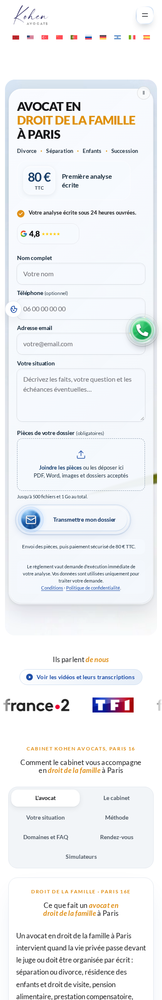

# UI Design System & Master Generation Blueprint: kohenavocats-com_avocats-droit-famille-paris

> **Avocat Droit de la Famille Paris · Divorce, Garde d'Enfants, Succession** (https://kohenavocats.com/avocats-droit-famille-paris/) — Avocat en droit de la famille à Paris. Divorce amiable ou contentieux, garde d'enfants, pension alimentaire, succession. Première analyse...


---

## 1. Executive Visual Persona & Design Archetype

- **Brand Essence & Persona**: **Avocat Droit de la Famille Paris · Divorce, Garde d'Enfants, Succession** (`https://kohenavocats.com/avocats-droit-famille-paris/`). Avocat en droit de la famille à Paris. Divorce amiable ou contentieux, garde d'enfants, pension alimentaire, succession. Première analyse...
- **Capture Provenance**: Live browser capture (`tier1_fast`, HTTP `200`, captured `2026-11-23`).
- **Visual Archetype**: **Light-Substrate Editorial & Modular Grid System (`#ffffff` canvas, `#000000` ink, `#0077ed` accent)**.
- **Anti-AI-Slop Differentiators**:
  - **Live-Computed Chromatic Polarity**: Anchors the viewport in `#ffffff` (live computed `body` `background-color` (`computed_styles.json`)) paired with `#000000` primary typography and `#0077ed` accents.
  - **Grounded Typographic Hierarchy**: Pairs `Lato` for display copy (`AVOCAT EN DROIT DE LA FAMILLE À PARI`) with `Segoe UI` and not declared in live computed styles (uses primary stack / `ui-monospace`).
  - **Calibrated Spatial Grid & Motion**: Combines `1386px` container bounds (`gap: var(--row-gap)`, padding `7px`) with `cubic-bezier(.58,.3,.005,1)` easing and Three.js / WebGL Canvas Pipeline, Swiper Touch Carousel Engine.

---

## 2. Spatial Architecture & Modular Grid Mathematics



### Viewport Allocation & Container Geometry
- **Captured Viewport Dimensions**: Desktop `1440×2400px` (`assets/desktop.png`, clamped at 2400px live multi-section capture), Mobile `390×2400px` (`assets/mobile.png`, clamped at 2400px live multi-section capture).
- **Master Container Bounds**: `1386px` (measured widest bounded `<section>` landmark width on `1440px` desktop).
- **Canvas Lateral Padding & Spacing**: `7px` lateral canvas padding with `var(--row-gap)` grid gap.
- **Border Radius Scale**: `18px`, `50%`, `3px`, `var(--border-radius)`.

### Responsive Breakpoint Architecture
- **Desktop Layout**: Multi-column CSS Grid / Flexbox layout at `1440px` (`max-width: 1386px`, `gap: var(--row-gap)`).
- **Mobile Layout**: Single-column vertical stack at `390px` viewport width with `7px` horizontal padding.
- **Extracted CSS Media Queries**: `@media (max-width:1024px)`, `@media (max-width:767px)`, `@media (min-width: 768px) and (max-width: 1024px)`, `@media (max-width: 767px)`.

---

## 3. Color System, Materiality & Atmospheric Lighting

### Semantic Palette & Source Grounding
| Semantic Role | Ground-Truth Value | Extracted Live / CSS Source |
|---|---|---|
| **Primary Canvas Substrate** | `#ffffff` | live computed `body` `background-color` (`computed_styles.json`) |
| **Primary Typography Ink** | `#000000` | live computed `main` `color` (`computed_styles.json`) |
| **Elevated Surface / Card Substrate** | `#f6faff` | live computed `button` `background-color` (`computed_styles.json`) |
| **Interactive Accent / Highlight** | `#0077ed` | `.kcf-wrap .kcf-btn:hover { background: #0077ed }` |
| **Secondary / Muted Copy** | `#7c7c7c` | `var(--e-global-color-secondary)` in `:root` |
| **Structural Hairline Border** | `#dce3e7` | `var(--kohen-avis-border)` in `:root` |
| **Variable Token (`--e-global-color-primary`)** | `#15342c` | `var(--e-global-color-primary)` in `:root` |
| **Variable Token (`--e-global-color-cda53b9`)** | `#52aa69` | `var(--e-global-color-cda53b9)` in `:root` |

### Sanitized Root CSS Variables (`ui-ux.md` Ground Truth)
| Variable Name | Extracted Value | Semantic Role |
|---|---|---|
| `--wp--style--global--content-size` | `800px` | Layout / Spatial Grid Token |
| `--wp--style--global--wide-size` | `1200px` | Layout / Spatial Grid Token |
| `--wp--style--block-gap` | `24px` | Layout / Spatial Grid Token |
| `--direction-multiplier` | `1` | Design System Custom Token |
| `--page-title-display` | `block` | Design System Custom Token |
| `--e-global-color-primary` | `#15342C` | Brand / Palette Token |
| `--e-global-color-secondary` | `#7C7C7C` | Brand / Palette Token |
| `--e-global-color-text` | `#000000` | Typography Ink Token |
| `--e-global-color-accent` | `#000000` | Brand / Palette Token |
| `--e-global-color-cd1e84d` | `#FFFFFF` | Brand / Palette Token |
| `--e-global-color-a983356` | `#FFFFFF` | Brand / Palette Token |
| `--e-global-color-02754a5` | `#FFFFFF00` | Brand / Palette Token |
| `--e-global-color-ef9a968` | `#FFFFFF` | Brand / Palette Token |
| `--e-global-color-0c93145` | `#15342C` | Brand / Palette Token |
| `--e-global-color-cda53b9` | `#52AA69` | Brand / Palette Token |
| `--e-global-color-934eedc` | `#FFFFFF` | Brand / Palette Token |

---

## 4. Typographic Scale & Editorial Hierarchy

### Font Family Stacks
- **Display Typography**: `Lato`.
- **Primary Body Stack**: `Segoe UI`.
- **Technical / Metadata Stack**: not declared in live computed styles (uses primary stack / `ui-monospace`).

### Typographic Scale & Rules (Live Computed & Stylesheet Grounded)
- **Hero Display (`H1`)**: live computed `h1` (`font-size: 44px`, `line-height: 50.6px`, `font-weight: 900`, `letter-spacing: -1.1px`); CSS variables `--page-title-display: block`, `--display: flex`; rule `h1` (`font-size: clamp(26px, 6vw, 86px)`, `line-height: 1.12`, `letter-spacing: -.025em`, `font-weight: 900`).
- **Section Heading (`H2`)**: live computed `h2` (`font-size: 23.04px`, `line-height: 25.8048px`, `font-weight: 400`, `letter-spacing: 0.4608px`); rule `h2` (`font-size: clamp(18px, 0.9rem + 0.6vw, 2...`, `line-height: 1.12`, `letter-spacing: 0.02em`, `font-weight: 400`).
- **Body Copy**: live computed `body` (`font-size: 16px`, `line-height: 24px`, `font-weight: 400`); rule `p` (`font-size: 18px`).
- **Metadata & Navigation Labels**: live computed `nav/a` (`font-size: 16px`, `line-height: 24px`, `font-weight: 400`); CSS variables `--e-global-typography-primary-letter-spacing: -0.3px`, `--e-global-typography-secondary-letter-spacing: 0px`, `--e-global-typography-text-letter-spacing: -0.8px`; rule `small` (`font-size: 11px`).

---

## 5. Choreographed Motion & Interaction Physics

### Primary Easing Curves
- **Extracted Timing Functions**: `cubic-bezier(.58,.3,.005,1)`, `cubic-bezier(0.25,0.1,0.25,1)`, `cubic-bezier(.2,.8,.2,1)`.

### Per-Element Transition & Choreography Rules
- **Selector `textarea`**: `transition: all .3s` extracted from `kohenavocats-com_avocats-droit-famille-paris` stylesheet.
- **Selector `button`**: `transition: all .3s` extracted from `kohenavocats-com_avocats-droit-famille-paris` stylesheet.
- **Selector `entor .elementor-background-video...`**: `transition: opacity 1s` extracted from `kohenavocats-com_avocats-droit-famille-paris` stylesheet.
- **Extracted Easing Curve (`cubic-bezier(.58,.3,.005,1)`)**: Governs interactive state transitions across `<header.elementor>` and `<section.kohen-avis-panel>`.
- **Runtime Interaction Engine**: Integrates Three.js / WebGL Canvas Pipeline, Swiper Touch Carousel Engine, Lottie Vector Animation Player with `prefers-reduced-motion: reduce` fallback guards.

---

## 6. Component Wireframe & Structural DOM Map

### Visual Layout Schematic — Desktop (`1440px`, Grounded in `dom.html` & Landmark Bounding Boxes)
```
┌────────────────────────────────────────────────────────────────────────┐
│ DESKTOP VIEWPORT (1440px) — Avocat Droit de la Famille Paris · Divorce │
│ ====================================================================== │
│ [ <header.elementor> (1440x60px)      | Urgence pénale · Garde à vue ] │
│ ---------------------------------------------------------------------- │
│ | HERO STAGE: <section.kfh-conversion> (w=1440px)                    | │
│ | H1: AVOCAT EN DROIT DE LA FAMILLE À PARIS                          | │
│ | Substrate: #ffffff | Ink: #000000 | Accent: #0077ed                | │
│ ---------------------------------------------------------------------- │
│ | SHOWCASE GRID (<section.kohen-avis-panel>) max-w: 1386px           | │
│ | +------------------------------+  +------------------------------+ | │
│ | | Avocat en droit de la famill |  | Recevez une première analyse | | │
│ | +------------------------------+  +------------------------------+ | │
│ ---------------------------------------------------------------------- │
│ | DETAIL MODULE (<section.knp>) — Ils parlent de nous                | │
│ ---------------------------------------------------------------------- │
│ [ FOOTER (<footer.kohen-avis-p) | https://kohenavocats.com/avocats-dr  │
└────────────────────────────────────────────────────────────────────────┘
```

### Visual Layout Schematic — Mobile Reflow (`390px`)
```
┌────────────────────────────────────────────────────────────────────────┐
│ MOBILE VIEWPORT REFLOW (390px) — Single-Column Stack (gap: var(--ro)   │
│ ====================================================================== │
│ [ HEADER BAR (<header.elementor>      ) | Compact Menu (390px)         │
│ ---------------------------------------------------------------------- │
│ | HERO STAGE (<section.kfh-conversion>) — 390px Vertical Lead        | │
│ | H1: AVOCAT EN DROIT DE LA FAMILLE À PARIS                          | │
│ ---------------------------------------------------------------------- │
│ | SHOWCASE STACK (<section.kohen-avis-pa) — 1-Col Stack              | │
│ | [ Item 1: Avocat en droit de la famille à Paris                  ] | │
│ | [ Item 2: Recevez une première analyse                           ] | │
│ ---------------------------------------------------------------------- │
│ | DETAIL STACK (<section.knp>) — 1-Col (Ils parlent de nou)          | │
│ ---------------------------------------------------------------------- │
│ [ FOOTER (<footer.kohen-avis-p) | Stacked 390px Colophon               │
└────────────────────────────────────────────────────────────────────────┘
```

### Granular DOM Region Breakdown
1. **Brand Header & Navigation Bar (<header.elementor> — `kohenavocats-com_avocats-droit-famille-paris`)**:
   - Landmark `<header class="elementor elementor-25177">` (`1440x60px`) hosting `Avocat Droit de la Famille Paris · D` navigation (`Urgence pénale · Garde à vue · Détention provisoire · Cour d’assises · Instruction pénale`), DOM attributes (`data-kfh-variant="transparent"`, `data-cfasync="false"`, `data-no-minify="1"`, `data-no-optimize="1"`), and stylesheet rule `.elementor-kit-701 .elementor-button { background-color:var( --e-global-color-0eaab80 ); }`.
2. **Hero Stage & Focal Lead (<section.kfh-conversion> — `AVOCAT EN DROIT DE LA FAMILLE À PA`)**:
   - Landmark `<section class="kfh-conversion kfg-unified">` presenting display lead `AVOCAT EN DROIT DE LA FAMILLE À PARIS` and copy excerpt *"Divorce Séparation Enfants Succession"* over `#ffffff` canvas and `#000000` ink.
3. **Primary Showcase & Content Grid (<section.kohen-avis-panel> — `Avocat en droit de la famille à Pa`)**:
   - Landmark `<section class="kohen-avis-panel kohen-avis-wrap">` rendering section `Avocat en droit de la famille à Paris` with copy *"droit de la famille"*, asset references (`clarity.js`, `u3tj0s09d9`, `656597ce-1c9d-42db-9ea8-b873188c4...`, `scevent.min.js`), and grid rule `.elementor-kit-701 e-page-transition { background-color:FFBC7D; }`.
4. **Interactive Detail & Feature Matrix (<section.knp> — `Recevez une première analyse`)**:
   - Landmark `<section class="knp knp--manuel">` framing `Recevez une première analyse` and `Ils parlent de nous` (*"Première analyse écrite 80 € TTC"*) with `#f6faff` surface cards, `#0077ed` accents, and `.elementor-kit-701 a { color:var( --e-global-color-text ); }`.
5. **Colophon & Global Directory Footer (<footer.kohen-avis-panel-footer> — `https://kohenavocats.com/avocats-droit-famille-paris/`)**:
   - Landmark `<footer class="kohen-avis-panel-footer">` anchoring `Avocat Droit de la Famille Paris` footer links (`Urgence pénale · Garde à vue · Détention provisoire · Cour d’assises · Instruction pénale`), copy *"Première analyse écrite"*, and `#dce3e7` structural dividers.

---

## 7. Master Zero-Shot AI Generation Prompt

```markdown
# Master Zero-Shot Frontend Generation Prompt: kohenavocats-com_avocats-droit-famille-paris (Avocat Droit de la Famille Paris · Divorce, Garde d'Enfants, Succession)

You are a principal frontend architect and design systems engineer. Build a complete, production-ready web application replicating the exact design system, DOM landmarks, typographic hierarchy, color tokens, and motion physics of `kohenavocats-com_avocats-droit-famille-paris` (**Avocat Droit de la Famille Paris · Divorce, Garde d'Enfants, Succession** — `https://kohenavocats.com/avocats-droit-famille-paris/`).

### 1. Visual Archetype & Anti-AI-Slop Mandates
- **Archetype**: Light-Substrate Editorial & Modular Grid System (`#ffffff` canvas, `#000000` ink, `#0077ed` accent).
- **Identity & Domain Context**: Avocat en droit de la famille à Paris. Divorce amiable ou contentieux, garde d'enfants, pension alimentaire, succession. Première analyse...
- **Primary Substrate**: `#ffffff` (live computed `body` `background-color` (`computed_styles.json`)), **Primary Ink**: `#000000`, **Accent / Highlight**: `#0077ed`.
- **Site-Specific Differentiators**:
  - **Live-Computed Chromatic Polarity**: Anchors the viewport in `#ffffff` (live computed `body` `background-color` (`computed_styles.json`)) paired with `#000000` primary typography and `#0077ed` accents.
  - **Grounded Typographic Hierarchy**: Pairs `Lato` for display copy (`AVOCAT EN DROIT DE LA FAMILLE À PARI`) with `Segoe UI` and not declared in live computed styles (uses primary stack / `ui-monospace`).
  - **Calibrated Spatial Grid & Motion**: Combines `1386px` container bounds (`gap: var(--row-gap)`, padding `7px`) with `cubic-bezier(.58,.3,.005,1)` easing and Three.js / WebGL Canvas Pipeline, Swiper Touch Carousel Engine.

### 2. Ground-Truth CSS Variables (`:root` Token Contract)
Declare and consume these exact custom properties extracted from `kohenavocats-com_avocats-droit-famille-paris` in your global stylesheet:

:root {
  /* Avocat Droit de la Famille Paris · Divorce, Garde d'Enfants, Succession (kohenavocats-com_avocats-droit-famille-paris) — Live-Grounded CSS Variables */
  --wp--style--global--content-size: 800px; /* Layout / Spatial Grid Token (kohenavocats-com_avocats-droit-famille-paris) */
  --wp--style--global--wide-size: 1200px; /* Layout / Spatial Grid Token (kohenavocats-com_avocats-droit-famille-paris) */
  --wp--style--block-gap: 24px; /* Layout / Spatial Grid Token (kohenavocats-com_avocats-droit-famille-paris) */
  --direction-multiplier: 1; /* Design System Custom Token (kohenavocats-com_avocats-droit-famille-paris) */
  --page-title-display: block; /* Design System Custom Token (kohenavocats-com_avocats-droit-famille-paris) */
  --e-global-color-primary: #15342C; /* Brand / Palette Token (kohenavocats-com_avocats-droit-famille-paris) */
  --e-global-color-secondary: #7C7C7C; /* Brand / Palette Token (kohenavocats-com_avocats-droit-famille-paris) */
  --e-global-color-text: #000000; /* Typography Ink Token (kohenavocats-com_avocats-droit-famille-paris) */
  --e-global-color-accent: #000000; /* Brand / Palette Token (kohenavocats-com_avocats-droit-famille-paris) */
  --e-global-color-cd1e84d: #FFFFFF; /* Brand / Palette Token (kohenavocats-com_avocats-droit-famille-paris) */
  --e-global-color-a983356: #FFFFFF; /* Brand / Palette Token (kohenavocats-com_avocats-droit-famille-paris) */
  --e-global-color-02754a5: #FFFFFF00; /* Brand / Palette Token (kohenavocats-com_avocats-droit-famille-paris) */
  --e-global-color-ef9a968: #FFFFFF; /* Brand / Palette Token (kohenavocats-com_avocats-droit-famille-paris) */
  --e-global-color-0c93145: #15342C; /* Brand / Palette Token (kohenavocats-com_avocats-droit-famille-paris) */
  --e-global-color-cda53b9: #52AA69; /* Brand / Palette Token (kohenavocats-com_avocats-droit-famille-paris) */
  --e-global-color-934eedc: #FFFFFF; /* Brand / Palette Token (kohenavocats-com_avocats-droit-famille-paris) */
}

### 3. Semantic Color & Materiality Contract
Map every surface, ink, and border strictly to these source-grounded tokens:
- **Primary Canvas Substrate**: `#ffffff` — grounded in live computed `body` `background-color` (`computed_styles.json`)
- **Primary Typography Ink**: `#000000` — grounded in live computed `main` `color` (`computed_styles.json`)
- **Elevated Surface / Card Substrate**: `#f6faff` — grounded in live computed `button` `background-color` (`computed_styles.json`)
- **Interactive Accent / Highlight**: `#0077ed` — grounded in `.kcf-wrap .kcf-btn:hover { background: #0077ed }`
- **Secondary / Muted Copy**: `#7c7c7c` — grounded in `var(--e-global-color-secondary)` in `:root`
- **Structural Hairline Border**: `#dce3e7` — grounded in `var(--kohen-avis-border)` in `:root`
- **Variable Token (`--e-global-color-primary`)**: `#15342c` — grounded in `var(--e-global-color-primary)` in `:root`
- **Variable Token (`--e-global-color-cda53b9`)**: `#52aa69` — grounded in `var(--e-global-color-cda53b9)` in `:root`

### 4. Spatial Grid, Container Bounds & Responsive Breakpoints
- **Desktop Viewport Reference**: `1440×2400px` (clamped at 2400px live multi-section capture, `1440px` standard desktop width).
- **Mobile Viewport Reference**: `390×2400px` (clamped at 2400px live multi-section capture, `390px` standard mobile width).
- **Container Max-Width**: `1386px` (measured widest bounded `<section>` landmark width on `1440px` desktop)
- **Padding & Gutters**: `7px` lateral canvas padding with `var(--row-gap)` grid gap
- **Desktop Grid**: Multi-column CSS Grid / Flexbox layout at `1440px` (`max-width: 1386px`, `gap: var(--row-gap)`)
- **Mobile Adaptation**: Single-column vertical stack at `390px` viewport width with `7px` horizontal padding
- **Media Queries**: `@media (max-width:1024px)`, `@media (max-width:767px)`, `@media (min-width: 768px) and (max-width: 1024px)`, `@media (max-width: 767px)`
- **Corner Radii**: `18px`, `50%`, `3px`, `var(--border-radius)`

### 5. Typography & Editorial Scale Contract
- **Display Font Stack**: `Lato`
- **Body Font Stack**: `Segoe UI`
- **Monospace / Technical Font Stack**: not declared in live computed styles (uses primary stack / `ui-monospace`)
- **H1 Display Rule**: live computed `h1` (`font-size: 44px`, `line-height: 50.6px`, `font-weight: 900`, `letter-spacing: -1.1px`); CSS variables `--page-title-display: block`, `--display: flex`; rule `h1` (`font-size: clamp(26px, 6vw, 86px)`, `line-height: 1.12`, `letter-spacing: -.025em`, `font-weight: 900`)
- **H2 Section Rule**: live computed `h2` (`font-size: 23.04px`, `line-height: 25.8048px`, `font-weight: 400`, `letter-spacing: 0.4608px`); rule `h2` (`font-size: clamp(18px, 0.9rem + 0.6vw, 2...`, `line-height: 1.12`, `letter-spacing: 0.02em`, `font-weight: 400`)
- **Body Copy Rule**: live computed `body` (`font-size: 16px`, `line-height: 24px`, `font-weight: 400`); rule `p` (`font-size: 18px`)
- **Metadata & Index Rule**: live computed `nav/a` (`font-size: 16px`, `line-height: 24px`, `font-weight: 400`); CSS variables `--e-global-typography-primary-letter-spacing: -0.3px`, `--e-global-typography-secondary-letter-spacing: 0px`, `--e-global-typography-text-letter-spacing: -0.8px`; rule `small` (`font-size: 11px`)

### 6. Component Hierarchy, Verbatim Copy & Real DOM Landmarks
Scaffold `kohenavocats-com_avocats-droit-famille-paris` (`Avocat Droit de la Famille Paris · Divorce, Garde d'Enfants, Succession`) with these exact structural regions, extracted copy, and CSS rules from `dom.html`:
1. **Brand Header & Navigation Bar (<header.elementor> — `kohenavocats-com_avocats-droit-famille-paris`)**:
   - DOM & Selectors: Landmark `<header class="elementor elementor-25177">` (`1440x60px`) hosting `Avocat Droit de la Famille Paris · D` navigation (`Urgence pénale · Garde à vue · Détention provisoire · Cour d’assises · Instruction pénale`), DOM attributes (`data-kfh-variant="transparent"`, `data-cfasync="false"`, `data-no-minify="1"`, `data-no-optimize="1"`), and stylesheet rule `.elementor-kit-701 .elementor-button { background-color:var( --e-global-color-0eaab80 ); }`.
   - Responsive Contract: Header `Brand Header & Navigation Bar (<header.elementor> — `kohenavocats-com_avocats-droit-famille-paris`)` (`kohenavocats-com_avocats-droit-famille-paris`) adapts across `@media (max-width:1024px)`, `@media (max-width:767px)`, `@media (min-width: 768px) and (max-width: 1024px)`, `@media (max-width: 767px)` with `cubic-bezier(.58,.3,.005,1)`, `cubic-bezier(0.25,0.1,0.25,1)`, `cubic-bezier(.2,.8,.2,1)` transitions and links `Urgence pénale · Garde à vue · Détention provisoire · Cour d’assises · Instruction pénale`.
2. **Hero Stage & Focal Lead (<section.kfh-conversion> — `AVOCAT EN DROIT DE LA FAMILLE À PA`)**:
   - DOM & Selectors: Landmark `<section class="kfh-conversion kfg-unified">` presenting display lead `AVOCAT EN DROIT DE LA FAMILLE À PARIS` and copy excerpt *"Divorce Séparation Enfants Succession"* over `#ffffff` canvas and `#000000` ink.
   - Responsive Contract: Hero stage (`1440×2400px` desktop / `390×2400px` mobile) sets `#ffffff` background with `#000000` headline `AVOCAT EN DROIT DE LA FAMILLE À PARIS`.
3. **Primary Showcase & Content Grid (<section.kohen-avis-panel> — `Avocat en droit de la famille à Pa`)**:
   - DOM & Selectors: Landmark `<section class="kohen-avis-panel kohen-avis-wrap">` rendering section `Avocat en droit de la famille à Paris` with copy *"droit de la famille"*, asset references (`clarity.js`, `u3tj0s09d9`, `656597ce-1c9d-42db-9ea8-b873188c4...`, `scevent.min.js`), and grid rule `.elementor-kit-701 e-page-transition { background-color:FFBC7D; }`.
   - Responsive Contract: Showcase grid `Primary Showcase & Content Grid (<section.kohen-avis-panel> — `Avocat en droit de la famille à Pa`)` applies Multi-column CSS Grid / Flexbox layout at `1440px` (`max-width: 1386px`, `gap: var(--row-gap)`) on desktop and Single-column vertical stack at `390px` viewport width with `7px` horizontal padding on mobile.
4. **Interactive Detail & Feature Matrix (<section.knp> — `Recevez une première analyse`)**:
   - DOM & Selectors: Landmark `<section class="knp knp--manuel">` framing `Recevez une première analyse` and `Ils parlent de nous` (*"Première analyse écrite 80 € TTC"*) with `#f6faff` surface cards, `#0077ed` accents, and `.elementor-kit-701 a { color:var( --e-global-color-text ); }`.
   - Responsive Contract: Detail module `Interactive Detail & Feature Matrix (<section.knp> — `Recevez une première analyse`)` uses `18px`, `50%`, `3px`, `var(--border-radius)` radii, `#0077ed` highlights, and assets (clarity.js, u3tj0s09d9, 656597ce-1c9d-42db-9ea8-b873188c4...).
5. **Colophon & Global Directory Footer (<footer.kohen-avis-panel-footer> — `https://kohenavocats.com/avocats-droit-famille-paris/`)**:
   - DOM & Selectors: Landmark `<footer class="kohen-avis-panel-footer">` anchoring `Avocat Droit de la Famille Paris` footer links (`Urgence pénale · Garde à vue · Détention provisoire · Cour d’assises · Instruction pénale`), copy *"Première analyse écrite"*, and `#dce3e7` structural dividers.
   - Responsive Contract: Footer `Colophon & Global Directory Footer (<footer.kohen-avis-panel-footer> — `https://kohenavocats.com/avocats-droit-famille-paris/`)` aligns to `1386px` (measured widest bounded `<section>` landmark width on `1440px` desktop) with `7px` lateral canvas padding with `var(--row-gap)` grid gap and attributes (data-kfh-variant="transparent", data-cfasync="false", data-no-minify="1").

#### Verbatim DOM Copy Excerpts (`dom.html`)
- Copy Excerpt 1: *"Divorce Séparation Enfants Succession"*
- Copy Excerpt 2: *"droit de la famille"*
- Copy Excerpt 3: *"Première analyse écrite 80 € TTC"*
- Copy Excerpt 4: *"Première analyse écrite"*

### 7. Motion, Extracted Stylesheet Rules & Interaction Choreography
- **Primary Easing Functions**: `cubic-bezier(.58,.3,.005,1)`, `cubic-bezier(0.25,0.1,0.25,1)`, `cubic-bezier(.2,.8,.2,1)`
- **Extracted Stylesheet Rules (`kohenavocats-com_avocats-droit-famille-paris`)**:
- `.elementor-kit-701 .elementor-button { background-color:var( --e-global-color-0eaab80 ); }`
- `.elementor-kit-701 e-page-transition { background-color:FFBC7D; }`
- `.elementor-kit-701 a { color:var( --e-global-color-text ); }`
- `.elementor-kit-701 label { color:var( --e-global-color-primary ); }`
- `kit-701 .elementor-field-textual:... { color:var( --e-global-color-primary );background-color:var( --e-global-c... }`
- **Per-Selector Transition Rules**:
- **Selector `textarea`**: `transition: all .3s` extracted from `kohenavocats-com_avocats-droit-famille-paris` stylesheet.
- **Selector `button`**: `transition: all .3s` extracted from `kohenavocats-com_avocats-droit-famille-paris` stylesheet.
- **Selector `entor .elementor-background-video...`**: `transition: opacity 1s` extracted from `kohenavocats-com_avocats-droit-famille-paris` stylesheet.
- **Extracted Easing Curve (`cubic-bezier(.58,.3,.005,1)`)**: Governs interactive state transitions across `<header.elementor>` and `<section.kohen-avis-panel>`.
- **Runtime Interaction Engine**: Integrates Three.js / WebGL Canvas Pipeline, Swiper Touch Carousel Engine, Lottie Vector Animation Player with `prefers-reduced-motion: reduce` fallback guards.

### 8. Technical Deliverables
- Implement in Next.js (App Router) with TypeScript and Tailwind CSS consuming the `:root` custom properties defined above for `kohenavocats-com_avocats-droit-famille-paris`.
- Reproduce both the `1440px` desktop architecture and `390px` mobile breakpoint transitions, preserving semantic HTML5 landmarks (`<header>`, `<nav>`, `<main>`, `<section>`, `<footer>`) and `prefers-reduced-motion` accessibility guards.
```
