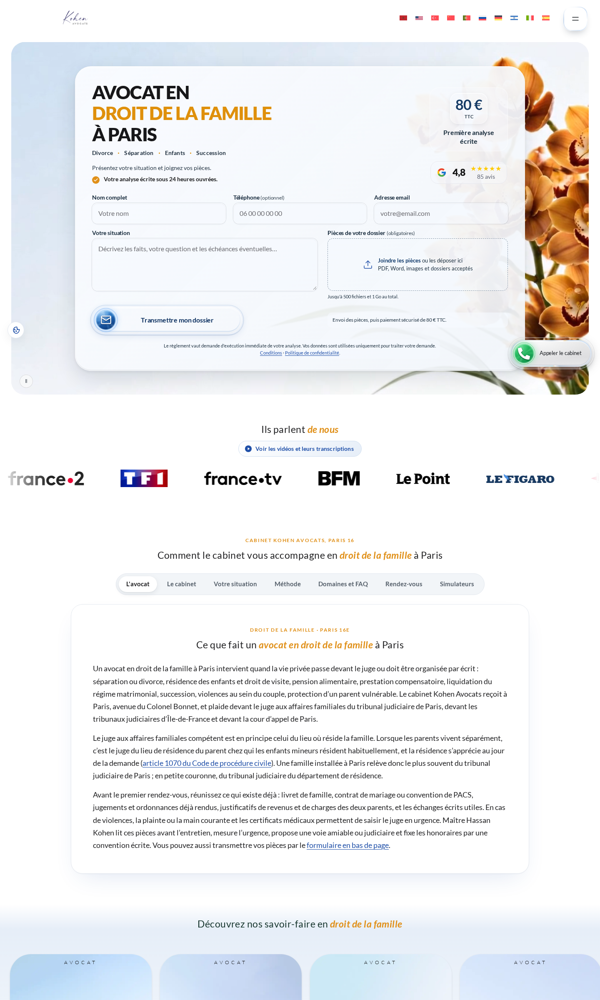

# UI Design System & Master Generation Blueprint: kohenavocats-com_avocats-droit-famille-paris

> **Avocat Droit de la Famille Paris · Divorce, Garde d'Enfants, Succession** (https://kohenavocats.com/avocats-droit-famille-paris/) — Avocat en droit de la famille à Paris. Divorce amiable ou contentieux, garde d'enfants, pension alimentaire, succession. Accompagnement h...



---

## 1. Executive Visual Persona & Design Archetype

- **Brand Essence & Persona**: **Avocat Droit de la Famille Paris · Divorce, Garde d'Enfants, Succession** (`https://kohenavocats.com/avocats-droit-famille-paris/`). Avocat en droit de la famille à Paris. Divorce amiable ou contentieux, garde d'enfants, pension alimentaire, succession. Accompagnement h...
- **Visual Archetype**: **Light-Substrate Editorial & Modular Grid System (`#39aa59` canvas, `#000` ink, `#fff` accent)**.
- **Anti-AI-Slop Differentiators**:
  - **Source-Grounded Chromatic Polarity**: Anchors the viewport in `#39aa59` (`var(--e-contact-buttons-profile-dot-bg)` in `:root`) paired with `#000` primary typography and `#fff` accents.
  - **Extracted Typographic Hierarchy**: Pairs `Inter` for display copy (`Avocat en droit de la famille à Pari`) with `Lato` and not declared in static CSS (uses primary stack / `ui-monospace`).
  - **Calibrated Spatial Grid & Motion**: Combines `480px` container bounds (`gap: 8px`, padding `20px`) with `cubic-bezier(.58,.3,.005,1)` easing and Three.js / WebGL Canvas Pipeline, Swiper Touch Carousel Engine.

---

## 2. Spatial Architecture & Modular Grid Mathematics


### Viewport Allocation & Container Geometry
- **Captured Viewport Dimensions**: Desktop `1440×2400px` (`assets/desktop.png`, capped at 2400px multi-section capture), Mobile `390×2400px` (`assets/mobile.png`, capped at 2400px multi-section capture).
- **Master Container Bounds**: `480px` extracted from `kohenavocats-com_avocats-droit-famille-paris` stylesheet.
- **Canvas Lateral Padding & Spacing**: `20px` lateral canvas padding with `8px` grid gap.
- **Border Radius Scale**: `19px`, `23px`, `12px`, `50%`.

### Responsive Breakpoint Architecture
- **Desktop Layout**: Multi-column CSS Grid / Flexbox layout at `1440px` (`max-width: 480px`, `gap: 8px`).
- **Mobile Layout**: Single-column vertical stack at `390px` viewport width with `20px` horizontal padding.
- **Extracted CSS Media Queries**: `@media (prefers-reduced-motion: reduce)`, `@media (prefers-reduced-motion:reduce)`, `@media (max-width:480px)`, `@media (max-width:1024px)`.

---

## 3. Color System, Materiality & Atmospheric Lighting

### Semantic Palette & Source Grounding
| Semantic Role | Ground-Truth Value | Extracted CSS Source / Selector |
|---|---|---|
| **Primary Canvas Substrate** | `#39aa59` | `var(--e-contact-buttons-profile-dot-bg)` in `:root` |
| **Primary Typography Ink** | `#467ff7` | `var(--e-contact-buttons-button-bg)` in `:root` |
| **Elevated Surface / Card Substrate** | `#1c2448` | `var(--e-contact-buttons-button-bg-hover)` in `:root` |
| **Interactive Accent / Highlight** | `#fff` | `var(--e-contact-buttons-button-icon)` in `:root` |
| **Secondary / Muted Copy** | `#000` | `var(--e-contact-buttons-message-bubble-name)` in `:root` |
| **Structural Hairline Border** | `#c8d5dc` | `var(--e-contact-buttons-message-bubble-chat-bg)` in `:root` |

### Sanitized Root CSS Variables (`ui-ux.md` Ground Truth)
| Variable Name | Extracted Value | Semantic Role |
|---|---|---|
| `--km-beacon` | `360deg` | Design System Custom Token |
| `--direction-multiplier` | `1` | Design System Custom Token |
| `--flex-direction` | `initial` | Design System Custom Token |
| `--flex-wrap` | `initial` | Layout / Spatial Grid Token |
| `--justify-content` | `initial` | Design System Custom Token |
| `--align-items` | `initial` | Design System Custom Token |
| `--align-content` | `initial` | Design System Custom Token |
| `--gap` | `initial` | Layout / Spatial Grid Token |
| `--flex-basis` | `initial` | Design System Custom Token |
| `--flex-grow` | `initial` | Design System Custom Token |
| `--flex-shrink` | `initial` | Typography Ink Token |
| `--order` | `initial` | Design System Custom Token |
| `--align-self` | `initial` | Design System Custom Token |
| `--page-title-display` | `block` | Design System Custom Token |
| `--border-radius` | `0` | Elevation / Border Token |
| `--border-top-width` | `0px` | Layout / Spatial Grid Token |

---

## 4. Typographic Scale & Editorial Hierarchy

### Font Family Stacks
- **Display Typography**: `Inter`.
- **Primary Body Stack**: `Lato`.
- **Technical / Metadata Stack**: not declared in static CSS (uses primary stack / `ui-monospace`).

### Typographic Scale & Rules (Extracted from Stylesheet & Variables)
- **Hero Display (`H1`)**: CSS variables `--page-title-display: block`, `--display: flex`; rule `h1` (`font-size: clamp(26px, 6vw, 86px)`, `line-height: 1.12`, `letter-spacing: -.025em`, `font-weight: 900`).
- **Section Heading (`H2`)**: CSS variables `--e-contact-buttons-top-bar-subtitle: #fff`; rule `h2` (`font-size: clamp(18px, 0.9rem + 0.6vw, 2...`, `line-height: 1.12 !important`, `letter-spacing: 0.02em !important`, `font-weight: 400 !important`).
- **Body Copy**: CSS variables `--e-contact-buttons-message-bubble-body: #000`; rule `p` (`font-size: 18px`).
- **Metadata & Navigation Labels**: CSS variables `--e-contact-buttons-size-small: 55px`, `--e-contact-buttons-svg-size-small: 32px`, `--e-contact-buttons-profile-image-size-small: 65px`; rule `small` (`font-size: 11px`).

---

## 5. Choreographed Motion & Interaction Physics

### Primary Easing Curves
- **Extracted Timing Functions**: `cubic-bezier(.58,.3,.005,1)`, `cubic-bezier(.2,.8,.2,1)`, `cubic-bezier(0.25,0.1,0.25,1)`.

### Per-Element Transition & Choreography Rules
- **Selector `or-icon[href*="off_canvas%3Aopen"...`**: `transition: transform .2s, box-shadow .2s` extracted from `kohenavocats-com_avocats-droit-famille-paris` stylesheet.
- **Selector `#kohen-cc-icon`**: `transition: transform 0.15s ease,box-shadow 0.15s ease,border-color 0.15s...` extracted from `kohenavocats-com_avocats-droit-famille-paris` stylesheet.
- **Selector `.kohen-cc-btn`**: `transition: background 0.15s ease,border-color 0.15s ease,box-shadow 0.15s...` extracted from `kohenavocats-com_avocats-droit-famille-paris` stylesheet.
- **Extracted Easing Curve (`cubic-bezier(.58,.3,.005,1)`)**: Governs interactive state transitions across `<header.elementor>` and `<section.kohen-avis-panel>`.
- **Runtime Interaction Engine**: Integrates Three.js / WebGL Canvas Pipeline, Swiper Touch Carousel Engine, Lottie Vector Animation Player with `prefers-reduced-motion: reduce` fallback guards.

---

## 6. Component Wireframe & Structural DOM Map

### Visual Layout Schematic (Grounded in `dom.html` — `1440px` Desktop & `390px` Mobile Reflow)
```
┌────────────────────────────────────────────────────────────────────────┐
│ DESKTOP VIEWPORT (1440px) — Avocat Droit de la Famille Paris · Divorce │
│ ====================================================================== │
│ [ <header.elementor>       | Urgence pénale · Garde à vue · Détenti ]  │
│ ---------------------------------------------------------------------- │
│ | HERO STAGE: <section.kfh-conversion>                             |   │
│ | H1: Avocat en droit de la famille à Paris                        |   │
│ | Substrate: #39aa59    | Ink: #000       | Accent: #fff           |   │
│ ---------------------------------------------------------------------- │
│ | SHOWCASE GRID (<section.kohen-avis-panel>) max-w: 480px          |   │
│ | +------------------------------+  +------------------------------+ | │
│ | | Recevez une première analyse |  | Ils parlent de nous          | | │
│ | +------------------------------+  +------------------------------+ | │
│ ---------------------------------------------------------------------- │
│ | MOBILE VIEWPORT REFLOW (390px) — Single-Column Stack (gap: 8px   ) | │
│ | [<header.elementor>] -> [<section.kfh-conve] -> [<section.kohen-avi] │
│ ---------------------------------------------------------------------- │
│ [ FOOTER (<footer.kohen-avis-pan) | https://kohenavocats.com/avocats-d │
└────────────────────────────────────────────────────────────────────────┘
```

### Granular DOM Region Breakdown
1. **Brand Header & Navigation Bar (<header.elementor> — `kohenavocats-com_avocats-droit-famille-paris`)**:
   - Landmark `<header class="elementor elementor-25177">` hosting `Avocat Droit de la Famille Paris · D` navigation (`Urgence pénale · Garde à vue · Détention provisoire · Cour d’assises · Instruction pénale`), DOM attributes (`data-kfh-variant="transparent"`, `data-cfasync="false"`, `data-no-minify="1"`, `data-no-optimize="1"`), and stylesheet rule `property --km-beacon { syntax: '<angle>'; inherits: false; initial-value: 0deg; }`.
2. **Hero Stage & Focal Lead (<section.kfh-conversion> — `Avocat en droit de la famille à Pa`)**:
   - Landmark `<section class="kfh-conversion kfg-unified">` presenting display lead `Avocat en droit de la famille à Paris` and copy excerpt *"Droit pénal · Avocat pénaliste à Paris Urgence pénale Garde à vue"* over `#39aa59` canvas and `#000` ink.
3. **Primary Showcase & Content Grid (<section.kohen-avis-panel> — `Recevez une première analyse`)**:
   - Landmark `<section class="kohen-avis-panel kohen-avis-wrap">` rendering section `Recevez une première analyse` with copy *"Droit pénal · Avocat pénaliste à Paris"*, asset references (`bat.js`, `scripts.clarity.ms`, `www.googletagmanager.com`, `www.clarity.ms`), and grid rule `to { --km-beacon: 360deg; }`.
4. **Interactive Detail & Feature Matrix (<section.knp> — `Ils parlent de nous`)**:
   - Landmark `<section class="knp knp--manuel">` framing `Ils parlent de nous` and `Comment le cabinet vous accompagne en droit de la...` (*"Comparution immédiate"*) with `#1c2448` surface cards, `#fff` accents, and `svg { position: relative; z-index: 1; width: 24px; height: 24px; }`.
5. **Colophon & Global Directory Footer (<footer.kohen-avis-panel-footer> — `https://kohenavocats.com/avocats-droit-famille-paris/`)**:
   - Landmark `<footer class="kohen-avis-panel-footer">` anchoring `Avocat Droit de la Famille Paris` footer links (`Urgence pénale · Garde à vue · Détention provisoire · Cour d’assises · Instruction pénale`), copy *"Détention provisoire"*, and `#c8d5dc` structural dividers.

---

## 7. Master Zero-Shot AI Generation Prompt

```markdown
# Master Zero-Shot Frontend Generation Prompt: kohenavocats-com_avocats-droit-famille-paris (Avocat Droit de la Famille Paris · Divorce, Garde d'Enfants, Succession)

You are a principal frontend architect and design systems engineer. Build a complete, production-ready web application replicating the exact design system, DOM landmarks, typographic hierarchy, color tokens, and motion physics of `kohenavocats-com_avocats-droit-famille-paris` (**Avocat Droit de la Famille Paris · Divorce, Garde d'Enfants, Succession** — `https://kohenavocats.com/avocats-droit-famille-paris/`).

### 1. Visual Archetype & Anti-AI-Slop Mandates
- **Archetype**: Light-Substrate Editorial & Modular Grid System (`#39aa59` canvas, `#000` ink, `#fff` accent).
- **Identity & Domain Context**: Avocat en droit de la famille à Paris. Divorce amiable ou contentieux, garde d'enfants, pension alimentaire, succession. Accompagnement h...
- **Primary Substrate**: `#39aa59` (`var(--e-contact-buttons-profile-dot-bg)` in `:root`), **Primary Ink**: `#000`, **Accent / Highlight**: `#fff`.
- **Site-Specific Differentiators**:
  - **Source-Grounded Chromatic Polarity**: Anchors the viewport in `#39aa59` (`var(--e-contact-buttons-profile-dot-bg)` in `:root`) paired with `#000` primary typography and `#fff` accents.
  - **Extracted Typographic Hierarchy**: Pairs `Inter` for display copy (`Avocat en droit de la famille à Pari`) with `Lato` and not declared in static CSS (uses primary stack / `ui-monospace`).
  - **Calibrated Spatial Grid & Motion**: Combines `480px` container bounds (`gap: 8px`, padding `20px`) with `cubic-bezier(.58,.3,.005,1)` easing and Three.js / WebGL Canvas Pipeline, Swiper Touch Carousel Engine.

### 2. Ground-Truth CSS Variables (`:root` Token Contract)
Declare and consume these exact custom properties extracted from `kohenavocats-com_avocats-droit-famille-paris` in your global stylesheet:

:root {
  /* Avocat Droit de la Famille Paris · Divorce, Garde d'Enfants, Succession (kohenavocats-com_avocats-droit-famille-paris) — Ground-Truth Extracted CSS Variables */
  --km-beacon: 360deg; /* Design System Custom Token (kohenavocats-com_avocats-droit-famille-paris) */
  --direction-multiplier: 1; /* Design System Custom Token (kohenavocats-com_avocats-droit-famille-paris) */
  --flex-direction: initial; /* Design System Custom Token (kohenavocats-com_avocats-droit-famille-paris) */
  --flex-wrap: initial; /* Layout / Spatial Grid Token (kohenavocats-com_avocats-droit-famille-paris) */
  --justify-content: initial; /* Design System Custom Token (kohenavocats-com_avocats-droit-famille-paris) */
  --align-items: initial; /* Design System Custom Token (kohenavocats-com_avocats-droit-famille-paris) */
  --align-content: initial; /* Design System Custom Token (kohenavocats-com_avocats-droit-famille-paris) */
  --gap: initial; /* Layout / Spatial Grid Token (kohenavocats-com_avocats-droit-famille-paris) */
  --flex-basis: initial; /* Design System Custom Token (kohenavocats-com_avocats-droit-famille-paris) */
  --flex-grow: initial; /* Design System Custom Token (kohenavocats-com_avocats-droit-famille-paris) */
  --flex-shrink: initial; /* Typography Ink Token (kohenavocats-com_avocats-droit-famille-paris) */
  --order: initial; /* Design System Custom Token (kohenavocats-com_avocats-droit-famille-paris) */
  --align-self: initial; /* Design System Custom Token (kohenavocats-com_avocats-droit-famille-paris) */
  --page-title-display: block; /* Design System Custom Token (kohenavocats-com_avocats-droit-famille-paris) */
  --border-radius: 0; /* Elevation / Border Token (kohenavocats-com_avocats-droit-famille-paris) */
  --border-top-width: 0px; /* Layout / Spatial Grid Token (kohenavocats-com_avocats-droit-famille-paris) */
}

### 3. Semantic Color & Materiality Contract
Map every surface, ink, and border strictly to these source-grounded tokens:
- **Primary Canvas Substrate**: `#39aa59` — grounded in `var(--e-contact-buttons-profile-dot-bg)` in `:root`
- **Primary Typography Ink**: `#467ff7` — grounded in `var(--e-contact-buttons-button-bg)` in `:root`
- **Elevated Surface / Card Substrate**: `#1c2448` — grounded in `var(--e-contact-buttons-button-bg-hover)` in `:root`
- **Interactive Accent / Highlight**: `#fff` — grounded in `var(--e-contact-buttons-button-icon)` in `:root`
- **Secondary / Muted Copy**: `#000` — grounded in `var(--e-contact-buttons-message-bubble-name)` in `:root`
- **Structural Hairline Border**: `#c8d5dc` — grounded in `var(--e-contact-buttons-message-bubble-chat-bg)` in `:root`

### 4. Spatial Grid, Container Bounds & Responsive Breakpoints
- **Desktop Viewport Reference**: `1440×2400px` (capped at 2400px multi-section capture, `1440px` standard desktop width).
- **Mobile Viewport Reference**: `390×2400px` (capped at 2400px multi-section capture, `390px` standard mobile width).
- **Container Max-Width**: `480px` extracted from `kohenavocats-com_avocats-droit-famille-paris` stylesheet
- **Padding & Gutters**: `20px` lateral canvas padding with `8px` grid gap
- **Desktop Grid**: Multi-column CSS Grid / Flexbox layout at `1440px` (`max-width: 480px`, `gap: 8px`)
- **Mobile Adaptation**: Single-column vertical stack at `390px` viewport width with `20px` horizontal padding
- **Media Queries**: `@media (prefers-reduced-motion: reduce)`, `@media (prefers-reduced-motion:reduce)`, `@media (max-width:480px)`, `@media (max-width:1024px)`
- **Corner Radii**: `19px`, `23px`, `12px`, `50%`

### 5. Typography & Editorial Scale Contract
- **Display Font Stack**: `Inter`
- **Body Font Stack**: `Lato`
- **Monospace / Technical Font Stack**: not declared in static CSS (uses primary stack / `ui-monospace`)
- **H1 Display Rule**: CSS variables `--page-title-display: block`, `--display: flex`; rule `h1` (`font-size: clamp(26px, 6vw, 86px)`, `line-height: 1.12`, `letter-spacing: -.025em`, `font-weight: 900`)
- **H2 Section Rule**: CSS variables `--e-contact-buttons-top-bar-subtitle: #fff`; rule `h2` (`font-size: clamp(18px, 0.9rem + 0.6vw, 2...`, `line-height: 1.12 !important`, `letter-spacing: 0.02em !important`, `font-weight: 400 !important`)
- **Body Copy Rule**: CSS variables `--e-contact-buttons-message-bubble-body: #000`; rule `p` (`font-size: 18px`)
- **Metadata & Index Rule**: CSS variables `--e-contact-buttons-size-small: 55px`, `--e-contact-buttons-svg-size-small: 32px`, `--e-contact-buttons-profile-image-size-small: 65px`; rule `small` (`font-size: 11px`)

### 6. Component Hierarchy, Verbatim Copy & Real DOM Landmarks
Scaffold `kohenavocats-com_avocats-droit-famille-paris` (`Avocat Droit de la Famille Paris · Divorce, Garde d'Enfants, Succession`) with these exact structural regions, extracted copy, and CSS rules from `dom.html`:
1. **Brand Header & Navigation Bar (<header.elementor> — `kohenavocats-com_avocats-droit-famille-paris`)**:
   - DOM & Selectors: Landmark `<header class="elementor elementor-25177">` hosting `Avocat Droit de la Famille Paris · D` navigation (`Urgence pénale · Garde à vue · Détention provisoire · Cour d’assises · Instruction pénale`), DOM attributes (`data-kfh-variant="transparent"`, `data-cfasync="false"`, `data-no-minify="1"`, `data-no-optimize="1"`), and stylesheet rule `property --km-beacon { syntax: '<angle>'; inherits: false; initial-value: 0deg; }`.
   - Responsive Contract: Header `Brand Header & Navigation Bar (<header.elementor> — `kohenavocats-com_avocats-droit-famille-paris`)` (`kohenavocats-com_avocats-droit-famille-paris`) adapts across `@media (prefers-reduced-motion: reduce)`, `@media (prefers-reduced-motion:reduce)`, `@media (max-width:480px)`, `@media (max-width:1024px)` with `cubic-bezier(.58,.3,.005,1)`, `cubic-bezier(.2,.8,.2,1)`, `cubic-bezier(0.25,0.1,0.25,1)` transitions and links `Urgence pénale · Garde à vue · Détention provisoire · Cour d’assises · Instruction pénale`.
2. **Hero Stage & Focal Lead (<section.kfh-conversion> — `Avocat en droit de la famille à Pa`)**:
   - DOM & Selectors: Landmark `<section class="kfh-conversion kfg-unified">` presenting display lead `Avocat en droit de la famille à Paris` and copy excerpt *"Droit pénal · Avocat pénaliste à Paris Urgence pénale Garde à vue"* over `#39aa59` canvas and `#000` ink.
   - Responsive Contract: Hero stage (`1440×2400px` desktop / `390×2400px` mobile) sets `#39aa59` background with `#000` headline `Avocat en droit de la famille à Paris`.
3. **Primary Showcase & Content Grid (<section.kohen-avis-panel> — `Recevez une première analyse`)**:
   - DOM & Selectors: Landmark `<section class="kohen-avis-panel kohen-avis-wrap">` rendering section `Recevez une première analyse` with copy *"Droit pénal · Avocat pénaliste à Paris"*, asset references (`bat.js`, `scripts.clarity.ms`, `www.googletagmanager.com`, `www.clarity.ms`), and grid rule `to { --km-beacon: 360deg; }`.
   - Responsive Contract: Showcase grid `Primary Showcase & Content Grid (<section.kohen-avis-panel> — `Recevez une première analyse`)` applies Multi-column CSS Grid / Flexbox layout at `1440px` (`max-width: 480px`, `gap: 8px`) on desktop and Single-column vertical stack at `390px` viewport width with `20px` horizontal padding on mobile.
4. **Interactive Detail & Feature Matrix (<section.knp> — `Ils parlent de nous`)**:
   - DOM & Selectors: Landmark `<section class="knp knp--manuel">` framing `Ils parlent de nous` and `Comment le cabinet vous accompagne en droit de la...` (*"Comparution immédiate"*) with `#1c2448` surface cards, `#fff` accents, and `svg { position: relative; z-index: 1; width: 24px; height: 24px; }`.
   - Responsive Contract: Detail module `Interactive Detail & Feature Matrix (<section.knp> — `Ils parlent de nous`)` uses `19px`, `23px`, `12px`, `50%` radii, `#fff` highlights, and assets (bat.js, scripts.clarity.ms, www.googletagmanager.com).
5. **Colophon & Global Directory Footer (<footer.kohen-avis-panel-footer> — `https://kohenavocats.com/avocats-droit-famille-paris/`)**:
   - DOM & Selectors: Landmark `<footer class="kohen-avis-panel-footer">` anchoring `Avocat Droit de la Famille Paris` footer links (`Urgence pénale · Garde à vue · Détention provisoire · Cour d’assises · Instruction pénale`), copy *"Détention provisoire"*, and `#c8d5dc` structural dividers.
   - Responsive Contract: Footer `Colophon & Global Directory Footer (<footer.kohen-avis-panel-footer> — `https://kohenavocats.com/avocats-droit-famille-paris/`)` aligns to `480px` extracted from `kohenavocats-com_avocats-droit-famille-paris` stylesheet with `20px` lateral canvas padding with `8px` grid gap and attributes (data-kfh-variant="transparent", data-cfasync="false", data-no-minify="1").

#### Verbatim DOM Copy Excerpts (`dom.html`)
- Copy Excerpt 1: *"Droit pénal · Avocat pénaliste à Paris Urgence pénale Garde à vue Comparution immé..."*
- Copy Excerpt 2: *"Droit pénal · Avocat pénaliste à Paris"*
- Copy Excerpt 3: *"Comparution immédiate"*
- Copy Excerpt 4: *"Détention provisoire"*

### 7. Motion, Extracted Stylesheet Rules & Interaction Choreography
- **Primary Easing Functions**: `cubic-bezier(.58,.3,.005,1)`, `cubic-bezier(.2,.8,.2,1)`, `cubic-bezier(0.25,0.1,0.25,1)`
- **Extracted Stylesheet Rules (`kohenavocats-com_avocats-droit-famille-paris`)**:
- `property --km-beacon { syntax: '<angle>'; inherits: false; initial-value: 0deg; }`
- `to { --km-beacon: 360deg; }`
- `svg { position: relative; z-index: 1; width: 24px; height: 24px; }`
- `hover::after { animation: km-beacon-rim 9s linear infinite; }`
- `active { transform: translateY(1.5px); }`
- **Per-Selector Transition Rules**:
- **Selector `or-icon[href*="off_canvas%3Aopen"...`**: `transition: transform .2s, box-shadow .2s` extracted from `kohenavocats-com_avocats-droit-famille-paris` stylesheet.
- **Selector `#kohen-cc-icon`**: `transition: transform 0.15s ease,box-shadow 0.15s ease,border-color 0.15s...` extracted from `kohenavocats-com_avocats-droit-famille-paris` stylesheet.
- **Selector `.kohen-cc-btn`**: `transition: background 0.15s ease,border-color 0.15s ease,box-shadow 0.15s...` extracted from `kohenavocats-com_avocats-droit-famille-paris` stylesheet.
- **Extracted Easing Curve (`cubic-bezier(.58,.3,.005,1)`)**: Governs interactive state transitions across `<header.elementor>` and `<section.kohen-avis-panel>`.
- **Runtime Interaction Engine**: Integrates Three.js / WebGL Canvas Pipeline, Swiper Touch Carousel Engine, Lottie Vector Animation Player with `prefers-reduced-motion: reduce` fallback guards.

### 8. Technical Deliverables
- Implement in Next.js (App Router) with TypeScript and Tailwind CSS consuming the `:root` custom properties defined above for `kohenavocats-com_avocats-droit-famille-paris`.
- Reproduce both the `1440px` desktop architecture and `390px` mobile breakpoint transitions, preserving semantic HTML5 landmarks (`<header>`, `<nav>`, `<main>`, `<section>`, `<footer>`) and `prefers-reduced-motion` accessibility guards.
```
